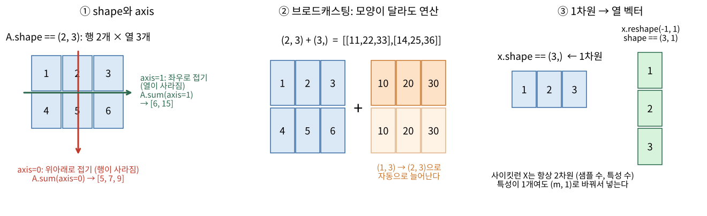
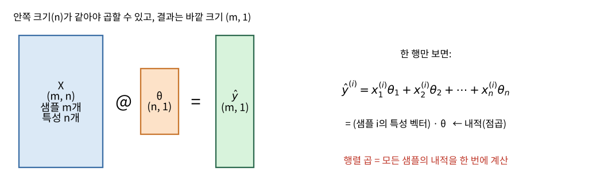
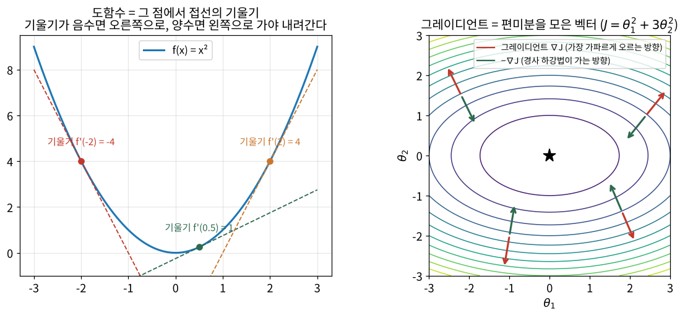
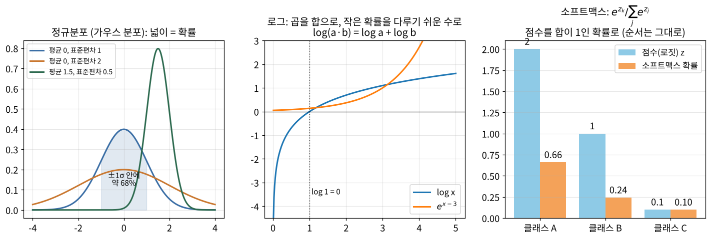

# 0장. 시작하기 전에 — 수학과 파이썬 도구 최소 지식

[📚 전체 목차](../README.md) · [📖 용어집](glossary.md) · [1장. 한눈에 보는 머신러닝 →](01_the_machine_learning_landscape.md)

> 📘 이 장은 교재에 없는 **부록**이다. 1~16장 노트는 넘파이·판다스·맷플롯립 코드와 몇 가지 수식을 설명 없이 쓰는 곳이 있다. 그때 필요한 최소한만 여기 모았다.
>
> - 처음부터 다 읽을 필요는 없다. 1장을 읽다가 막히는 기호나 코드가 나오면 이 장의 해당 절로 와서 보면 된다
> - 각 절 끝의 **어디서 쓰나**에 그 개념이 처음 본격적으로 쓰이는 장을 적어 두었다

## 🎓 강의를 시작하며

> 🎤 **이 장을 한 문장으로** — 머신러닝 코드는 결국 **"표(행렬)를 곱하고, 기울기(미분)를 따라 내려가고, 확률로 말하는 것"** 세 가지의 반복이다.

자, 수학이 무섭다는 사람 손! 걱정하지 말자. 이 노트 전체에서 쓰는 수학은 딱 세 가지 동작뿐이다.

| 동작 | 비유 | 어디서 쓰나 |
|---|---|---|
| **곱하기** (행렬 곱) | 엑셀 표에 가중치를 곱해 점수 매기기 | 모든 모델의 예측 |
| **내려가기** (미분·그레이디언트) | 안개 낀 산에서 발밑 경사만 보고 내려가기 | 모든 모델의 훈련 |
| **확률로 말하기** (소프트맥스·로그) | "고양이일 확률 90%"처럼 자신감까지 말하기 | 모든 분류 모델의 출력 |

이 장을 다 외우려 하지 말고, **본문을 읽다 막힐 때 사전처럼** 돌아오면 된다.

---

## 목차

- [1. 넘파이: 배열 다루기](#1-넘파이-배열-다루기)
- [2. 판다스: 표 다루기](#2-판다스-표-다루기)
- [3. 맷플롯립: 그림 읽고 그리기](#3-맷플롯립-그림-읽고-그리기)
- [4. 선형대수: 벡터와 행렬](#4-선형대수-벡터와-행렬)
- [5. 미분: 기울기와 그레이디언트](#5-미분-기울기와-그레이디언트)
- [6. 확률과 통계: 분포, 로그, 소프트맥스](#6-확률과-통계-분포-로그-소프트맥스)
- [7. 노트에서 쓰는 기호 정리](#7-노트에서-쓰는-기호-정리)

---

## 1. 넘파이: 배열 다루기

> 🎯 **목적** — 모든 장의 데이터(`X`, `y`)가 넘파이 배열이다. 배열의 모양(shape)과 축(axis)을 읽을 수 있으면 코드의 절반이 풀린다.

> 💬 **shape만 보면 코드가 읽힌다**
>
> 넘파이 코드를 읽을 때 초보와 고수의 차이는 딱 하나, **모든 변수 옆에 shape을 머릿속으로 적어 두느냐**다. `X`가 `(1000, 8)`이면 "샘플 천 개, 특성 여덟 개"라고 바로 읽혀야 한다.
>
> - **핵심 한 줄**: `axis=0`은 "행을 따라 내려가며 접는다" → 결과에서 **그 축이 사라진다**
> - **헷갈림 주의**: `(3,)`과 `(3, 1)`은 다르다. 앞은 그냥 숫자 세 개, 뒤는 세로로 세운 열 벡터. 사이킷런 오류의 절반이 여기서 난다
> - **기억법**: "axis = 없애고 싶은 축 번호"


```python
import numpy as np

A = np.array([[1, 2, 3],
              [4, 5, 6]])
A.shape          # (2, 3)  ← 행 2개, 열 3개
A.ndim           # 2       ← 2차원
A[0]             # array([1, 2, 3])   첫 번째 행
A[:, 1]          # array([2, 5])      모든 행의 1번 열
A[A > 3]         # array([4, 5, 6])   조건을 만족하는 원소만 (불리언 마스크)
A.sum(axis=0)    # array([5, 7, 9])   행 방향으로 접기 → 열마다 합
A.sum(axis=1)    # array([ 6, 15])    열 방향으로 접기 → 행마다 합
A + np.array([10, 20, 30])   # 브로드캐스팅: 각 행에 [10, 20, 30]을 더함
x = np.array([1, 2, 3])      # shape (3,)
x.reshape(-1, 1)             # shape (3, 1)  ← -1은 "나머지는 알아서"
```



| 개념 | 핵심 | 자주 하는 실수 |
|---|---|---|
| `shape` | 각 축의 길이를 담은 튜플 | `(3,)`(1차원)과 `(3, 1)`(2차원 열 벡터)은 다르다 |
| `axis` | 연산이 **사라지게 할** 축 | `axis=0`은 "행을 따라 내려가며" 계산 → 결과에서 행 축이 없어진다 |
| 인덱싱 `A[i, j]` | 행 `i`, 열 `j`. `:`는 전부 | `A[i]`는 행 하나(1차원). 2차원을 유지하려면 `A[i:i+1]` |
| 불리언 마스크 | `A[조건]` → 조건이 True인 원소만 | 두 조건은 `&`(그리고), `\|`(또는)로 묶고 각 조건을 괄호로 감싼다 |
| 브로드캐스팅 | 크기가 1인 축(또는 없는 축)을 자동으로 늘려 연산 | 의도하지 않은 늘림이 오류 없이 일어날 수 있다 → `shape`을 확인하는 습관 |
| 무작위 | `rng = np.random.default_rng(seed=42)` 후 `rng.random()`, `rng.standard_normal()` | 시드를 고정해야 결과가 재현된다 |

> ⚠️ 사이킷런은 `X`를 **항상 2차원 `(샘플 수, 특성 수)`** 로 받는다. 특성이 하나여도 `X.reshape(-1, 1)` 또는 `df[["열"]]`(이중 대괄호)로 넣는다.

**어디서 쓰나** — [1장 4-3](01_the_machine_learning_landscape.md#4-3-사례-기반-학습-vs-모델-기반-학습) 첫 코드부터. 파이토치의 텐서([10장 1-2](10_neural_nets_with_pytorch.md#1-2-텐서))도 같은 규칙을 따른다.

---

## 2. 판다스: 표 다루기

> 🎯 **목적** — CSV 데이터를 읽고, 열을 고르고, 요약 통계를 보는 기본 동작을 익힌다.

> 💬 **판다스는 '이름표 달린 넘파이'**
>
> DataFrame은 행과 열에 **이름표**가 붙은 넘파이 배열이라고 생각하면 끝이다. 이름으로 꺼내면 `loc`, 번호로 꺼내면 `iloc`.
>
> - **핵심 한 줄**: `df["열"]`은 1차원 Series, `df[["열"]]`은 2차원 DataFrame. 모델에 넣을 X는 **항상 뒤쪽**
> - **헷갈림 주의**: `describe()`의 `50%`는 "절반"이 아니라 **중앙값**이다


```python
import pandas as pd

df = pd.read_csv("housing.csv")   # 표 전체 = DataFrame
df.head()                          # 위 5행
df.info()                          # 행 수, 열별 결측 아닌 값 수, 자료형
df.describe()                      # 수치 열의 평균·표준편차·사분위수
df["ocean_proximity"].value_counts()   # 범주별 개수

s = df["median_income"]            # 열 하나 = Series (1차원)
d = df[["median_income"]]          # 열 목록 = DataFrame (2차원)
df.loc[0, "median_income"]         # 이름(라벨)으로 꺼내기
df.iloc[0, 7]                      # 위치(번호)로 꺼내기
df[df["median_income"] > 5]        # 조건에 맞는 행만
df.to_numpy()                      # 넘파이 배열로
```

| 헷갈리는 것 | 차이 |
|---|---|
| `df["a"]` vs `df[["a"]]` | Series(1차원) vs DataFrame(2차원). 사이킷런 `X`에는 뒤쪽 |
| `loc` vs `iloc` | 인덱스 **이름** 기준 vs **위치** 기준 |
| `describe()`의 `50%` | 중앙값 |
| `NaN` | 결측치. `isna()`로 찾고 2장에서 `SimpleImputer`로 채운다 |

**어디서 쓰나** — [2장](02_end_to_end_machine_learning_project.md) 전체. 13장 시계열(`pd.read_csv(..., parse_dates=...)`)과 14장 데이터셋에서도 쓴다.

---

## 3. 맷플롯립: 그림 읽고 그리기

> 🎯 **목적** — 노트의 그림을 정확히 읽는 법과, 같은 그림을 직접 그리는 기본 함수를 익힌다.

> 💬 **그림은 '축 → 범례 → 비교 대상' 순서로 읽는다**
>
> 학생들이 그래프를 보고 "음… 선이 내려가네요"에서 멈추는 이유는 **무엇과 무엇을 비교하는 그림인지**를 안 봐서다. 축 이름, 범례, 비교 대상 세 가지만 먼저 확인하면 그림이 말을 걸어온다.
>
> - **핵심 한 줄**: 세로축이 **로그 스케일**이면 눈금 한 칸이 10배다. 직선처럼 보여도 실제로는 폭발적으로 변하는 중일 수 있다
> - **헷갈림 주의**: 그림은 **경향**, 숫자는 **표**에서 확인한다


```python
import matplotlib.pyplot as plt

plt.plot(x, y, "b-")             # 선 그래프 ("b-" = 파란 실선, "r--" = 빨간 파선, "go" = 초록 원)
plt.scatter(x, y, c=labels)      # 산점도 (c=값 → 값마다 색)
plt.hist(values, bins=50)        # 히스토그램 (구간 50개)
plt.imshow(image, cmap="gray")   # 2차원 배열을 이미지로
plt.subplot(1, 2, 1)             # 1행 2열 중 첫 번째 칸에 그리기
plt.xlabel("x"); plt.ylabel("y"); plt.legend(); plt.grid()
plt.show()
```

그림을 읽는 순서 (모든 장 공통):

1. **축 이름과 단위**부터 본다. 세로축이 **로그 스케일**이면 같은 간격이 10배 차이다
2. **범례**로 선·색·기호가 무엇인지 확인한다. 노트에서는 그림 바로 아래 괄호에 적어 두었다
3. 무엇과 무엇을 **비교**하는 그림인지(훈련 vs 검증, 모델 A vs B) 찾는다
4. 숫자는 그림 아래 **표**에서 확인한다 (그림은 경향, 표는 값)

| 그림 종류 | 이 노트에서 무엇을 볼 때 쓰나 |
|---|---|
| 학습 곡선 (가로 = 에포크·데이터 수, 세로 = 오차) | 과소적합·과대적합 진단 ([4장 4](04_training_linear_models.md#4-학습-곡선-44)) |
| 결정 경계 (배경색 = 예측 클래스) | 모델이 공간을 어떻게 나누는지 ([4장 6-5](04_training_linear_models.md#6-5-결정-경계-특성-2개), [5장](05_decision_trees.md), [6장](06_ensemble_learning_and_random_forests.md)) |
| 히스토그램 | 특성의 분포 모양(치우침, 봉우리) ([2장 2-2](02_end_to_end_machine_learning_project.md#2-2-데이터-구조-확인)) |
| 오차 행렬 히트맵 | 어떤 클래스끼리 헷갈리는지 ([3장 5-1](03_classification.md#5-1-오차-행렬-시각화)) |

---

## 4. 선형대수: 벡터와 행렬

> 🎯 **목적** — 선형 회귀(4장)와 신경망(9장~)의 계산은 전부 "행렬 × 벡터"다. 모양 규칙만 알면 수식이 읽힌다.

> 💬 **행렬 곱 = 모든 샘플의 내적을 한 번에**
>
> 선형 모델의 예측은 "특성 × 가중치를 다 더하기"다. 이걸 샘플 하나에 하면 **내적**, 샘플 천 개에 한꺼번에 하면 **행렬 곱**. 그게 전부다.
>
> - **핵심 한 줄**: `(m, n) @ (n, k) → (m, k)`. **안쪽이 같아야 곱해지고, 바깥이 남는다**
> - **헷갈림 주의**: `*`는 같은 자리끼리 곱하는 원소별 곱, `@`가 행렬 곱이다. 둘을 바꿔 쓰면 오류 없이 **틀린 답**이 나올 수 있어 더 무섭다
> - **기억법**: 내적이 크다 = 두 벡터가 같은 방향을 본다 = 비슷하다. 어텐션(15장)도 이 한 줄에서 출발한다


| 이름 | 모양 | 예 |
|---|---|---|
| 스칼라 | 숫자 하나 | 학습률 $\eta$ = 0.1 |
| 벡터 | 숫자 $n$개 한 줄 | 샘플 하나의 특성 $\mathbf{x} = (x_1, \dots, x_n)$, 파라미터 $\boldsymbol{\theta}$ |
| 행렬 | $m \times n$ 표 | 훈련 세트 $\mathbf{X}$ (샘플 $m$개 × 특성 $n$개) |
| 텐서 | 3차원 이상 | 이미지 배치 (개수 × 채널 × 높이 × 너비) |

**내적(점곱)** — 같은 길이의 두 벡터를 원소끼리 곱해서 더한 값

```math
\mathbf{a} \cdot \mathbf{b} = a_1 b_1 + a_2 b_2 + \cdots + a_n b_n
```

- 선형 모델의 예측 $\hat{y} = \boldsymbol{\theta} \cdot \mathbf{x}$ 가 바로 내적이다
- 두 벡터의 방향이 비슷할수록 커진다 → 코사인 유사도, 어텐션 점수(14~16장)의 바탕

**행렬 곱** — `X @ theta`. 안쪽 크기가 같아야 하고, 결과는 바깥 크기



| 연산 | 넘파이 | 결과 모양 |
|---|---|---|
| 행렬 곱 | `X @ theta` | `(m, n) @ (n, 1)` → `(m, 1)` |
| 전치 (행↔열) | `X.T` | `(m, n)` → `(n, m)` |
| 역행렬 | `np.linalg.inv(A)` | 정사각 행렬에서 $A^{-1}A = I$ |
| 노름 (벡터 길이) | `np.linalg.norm(v)` | $\lVert \mathbf{v} \rVert_2 = \sqrt{\sum v_i^2}$ (ℓ2), $\lVert \mathbf{v} \rVert_1 = \sum \lvert v_i \rvert$ (ℓ1) |
| 원소별 곱 | `A * B` | 같은 모양끼리 (행렬 곱과 다르다!) |

> ⚠️ `*`는 **원소별** 곱, `@`는 **행렬** 곱이다. 신경망 층 하나는 `X @ W + b`다 (9장).

**어디서 쓰나** — [4장 1-3 정규 방정식](04_training_linear_models.md#1-3-정규-방정식), [7장 PCA](07_dimensionality_reduction.md#3-주성분-분석-73), [9장 신경망 층](09_artificial_neural_networks.md#1-6-다층-퍼셉트론과-역전파), [15장 어텐션](15_transformers_for_nlp_and_chatbots.md#1-3-스케일드-점곱-어텐션).

---

## 5. 미분: 기울기와 그레이디언트

> 🎯 **목적** — "훈련 = 비용을 줄이는 방향으로 파라미터를 조금씩 옮기기"를 이해하는 데 필요한 미분 세 가지(도함수, 편미분, 연쇄 법칙)만 다룬다.

> 💬 **안개 낀 산에서 내려오기**
>
> 눈을 가리고 산 중턱에 서 있다고 하자. 지도는 없고, 발바닥으로 느끼는 **경사**만 있다. 가장 가파르게 내려가는 쪽으로 한 걸음, 다시 경사를 느끼고 한 걸음. 이게 경사 하강법이고, 발바닥이 느끼는 경사가 **그레이디언트**다.
>
> - **핵심 한 줄**: 그레이디언트는 **올라가는** 방향이다. 그래서 훈련은 항상 **마이너스** 그레이디언트 쪽으로 간다
> - **연쇄 법칙 비유**: 환율이 1달러 = 1,400원이고 1유로 = 1.1달러면 1유로 = 1.1 × 1,400원. 변화율도 이렇게 **곱해서 전달**된다. 신경망의 역전파가 정확히 이것
> - **헷갈림 주의**: 곱이 길어지면 1보다 작은 수는 0으로, 큰 수는 무한대로 간다 → 11장의 그레이디언트 소실·폭주


**도함수** $f'(x)$ — $x$를 아주 조금 늘렸을 때 $f$가 얼마나 변하는지 = 접선의 기울기

| 함수 | 도함수 |
|---|---|
| $x^2$ | $2x$ |
| $ax + b$ | $a$ |
| $e^x$ | $e^x$ |
| $\log x$ | $1/x$ |
| 시그모이드 $\sigma(x)$ | $\sigma(x)(1 - \sigma(x))$ |

**편미분과 그레이디언트** — 변수가 여러 개면 하나씩 따로 미분(나머지는 상수 취급)하고, 그 결과를 벡터로 모은 것이 그레이디언트 $\nabla J$

```math
\nabla_{\boldsymbol{\theta}} J = \left( \frac{\partial J}{\partial \theta_1}, \frac{\partial J}{\partial \theta_2}, \dots, \frac{\partial J}{\partial \theta_n} \right)
```



(왼쪽: 같은 함수라도 위치마다 기울기가 다르다. 오른쪽: 등고선 위 빨간 화살표 = 그레이디언트, 초록 화살표 = 그 반대 방향.)

- 그레이디언트는 비용이 **가장 빨리 커지는** 방향 → **반대로** 가면 가장 빨리 줄어든다
- 그래서 경사 하강법은 $\boldsymbol{\theta} \leftarrow \boldsymbol{\theta} - \eta \nabla J$ 를 반복한다 ([4장 2-1](04_training_linear_models.md#2-1-경사-하강법의-원리))

**연쇄 법칙** — 함수를 이어 붙였을 때의 미분 = 각 단계 미분의 곱

```math
y = f(g(x)) \;\Rightarrow\; \frac{dy}{dx} = \frac{dy}{dg} \cdot \frac{dg}{dx}
```

- 신경망은 층(함수)을 여러 개 이어 붙인 것 → 출력 쪽부터 연쇄 법칙으로 곱해 내려오면 모든 가중치의 그레이디언트를 한 번에 얻는다 = **역전파** ([9장 1-6](09_artificial_neural_networks.md#1-6-다층-퍼셉트론과-역전파))
- 곱이 여러 번 이어지므로 각 단계 값이 1보다 작으면 0으로 사라지고, 크면 폭발한다 = **그레이디언트 소실·폭주** ([11장 1-1](11_training_deep_neural_networks.md#1-1-불안정한-그레이디언트))
- 파이토치는 이 계산을 자동으로 해 준다 (`loss.backward()`, [10장 1-6](10_neural_nets_with_pytorch.md#1-6-자동-미분-autograd))

---

## 6. 확률과 통계: 분포, 로그, 소프트맥스

> 🎯 **목적** — 평가 지표, 분류 모델의 확률 출력, 가우스 혼합, 언어 모델의 생성을 읽는 데 필요한 확률 개념을 정리한다.

> 💬 **로그는 '곱셈을 덧셈으로 바꾸는 번역기'**
>
> 확률 0.01을 100번 곱하면 컴퓨터는 그냥 0이라고 말해 버린다. 로그를 씌우면 −4.6을 100번 **더하는** 문제가 되어 멀쩡히 계산된다. 머신러닝 손실 함수에 로그가 그렇게 자주 나오는 이유다.
>
> - **핵심 한 줄**: 소프트맥스 = "점수를 양수로 만들고(exp), 합으로 나눠 합이 1인 확률로" 바꾸는 것. **순위는 그대로**다
> - **헷갈림 주의**: 정규분포 그래프의 세로축은 확률이 아니라 **밀도**다. 확률은 **넓이**. 그래서 밀도는 1을 넘을 수 있다


| 개념 | 정의 | 넘파이 |
|---|---|---|
| 평균 $\mu$ | 값의 합 / 개수 | `x.mean()` |
| 분산 $\sigma^2$ | 평균에서 떨어진 거리 제곱의 평균 | `x.var()` |
| 표준편차 $\sigma$ | 분산의 제곱근 (원래 단위로 돌아온 퍼진 정도) | `x.std()` |
| 중앙값 | 정렬했을 때 가운데 값. 이상치에 덜 민감 | `np.median(x)` |
| 백분위수 | 아래에서 q%에 해당하는 값 | `np.percentile(x, q)` |
| 상관계수 | 두 변수의 선형 관계 −1~1 | `np.corrcoef(a, b)` |



- **정규분포**: 평균 근처에 많고 멀어질수록 드문 종 모양. 표준편차가 클수록 넓게 퍼진다. 연속 분포에서 세로축은 확률이 아니라 **확률 밀도** — 구간의 **넓이**가 확률이다 (그래서 밀도는 1보다 클 수 있다)
- **로그**: 곱을 합으로 바꾼다 ($\log ab = \log a + \log b$). 아주 작은 확률 여러 개의 곱 대신 로그의 합을 계산하면 숫자가 0으로 뭉개지지 않는다 → 로그 가능도, 교차 엔트로피 (4장, 8장, 15장)
- **지수 함수** $e^x$: 항상 양수이고 큰 값을 더 크게 벌린다
- **소프트맥스**: 점수(로짓)를 $e^{z}$로 양수로 만든 뒤 합으로 나눠 **합이 1인 확률**로 만든다. 점수가 가장 큰 클래스가 확률도 가장 크다 ([4장 6-6](04_training_linear_models.md#6-6-소프트맥스-회귀))
- **기댓값**: 확률로 가중한 평균. "평균적으로 얼마"
- **조건부 확률** $P(A \mid B)$: B가 일어났을 때 A의 확률. 정밀도 = $P(\text{실제 양성} \mid \text{양성 예측})$, 재현율 = $P(\text{양성 예측} \mid \text{실제 양성})$ (3장)

---

## 7. 노트에서 쓰는 기호 정리

| 기호 | 뜻 | 처음 나오는 곳 |
|---|---|---|
| $m$ | 샘플 수 | 4장 |
| $n$ | 특성 수 | 4장 |
| $\mathbf{x}^{(i)}$, $y^{(i)}$ | $i$번째 샘플의 특성 벡터와 레이블 | 4장 |
| $\mathbf{X}$ | 훈련 세트 전체 (행 = 샘플) | 4장 |
| $\hat{y}$ | 모델의 예측값 (모자 = 추정값) | 4장 |
| $\mathbf{X}^\top$ | 전치 행렬 (행과 열을 바꾼 것, 넘파이 `X.T`) | 4장 |
| $\boldsymbol{\theta}$ | 모델 파라미터 벡터 ($\theta_0$ = 절편/편향) | 1장, 4장 |
| $\mathbf{W}$, $\mathbf{b}$ | 신경망 층의 가중치 행렬과 편향 벡터 | 9장 |
| $J(\boldsymbol{\theta})$ | 비용 함수 | 4장 |
| $\eta$ (에타) | 학습률 | 4장 |
| $\alpha$ (알파) | 규제 강도 (사이킷런 `alpha`) | 4장 |
| $\nabla$ (나블라) | 그레이디언트 | 4장 |
| $\sum_{i=1}^{m}$ | $i$ = 1부터 $m$까지 더하기 | 4장 |
| $\sigma(\cdot)$ | 시그모이드 함수 (문맥에 따라 표준편차) | 4장 |
| $\lVert \cdot \rVert_1$, $\lVert \cdot \rVert_2$ | ℓ1, ℓ2 노름 | 4장 |
| $\arg\max_k$ | 값이 가장 큰 $k$ (값 자체가 아니라 위치) | 4장 |
| $\log$ | 자연로그 (밑 $e$) | 4장 |
| $\otimes$, $\oslash$ | 원소별 곱, 원소별 나눗셈 (넘파이 `*`, `/`) | 9장, 11장, 13장 |
| $\mathcal{L}$ | 가능도(8장) 또는 손실(9장~) | 8장 |
| $d_k$, $d_\text{model}$ | 어텐션 키 차원, 트랜스포머 임베딩 차원 | 15장 |

---

> ➡️ **다음 장 — [1장. 한눈에 보는 머신러닝](01_the_machine_learning_landscape.md)**

[📚 전체 목차](../README.md) · [📖 용어집](glossary.md) · [1장. 한눈에 보는 머신러닝 →](01_the_machine_learning_landscape.md)
