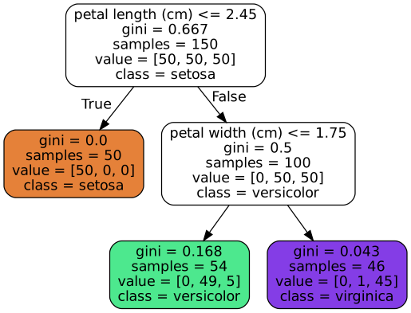
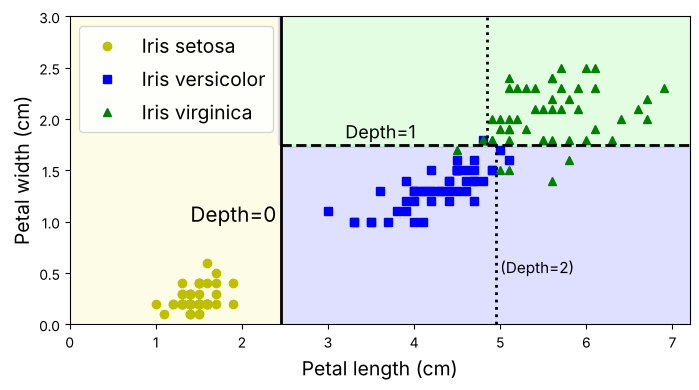
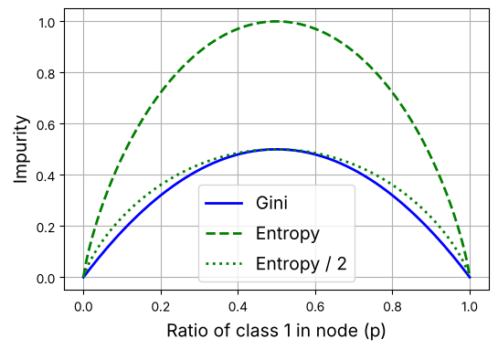
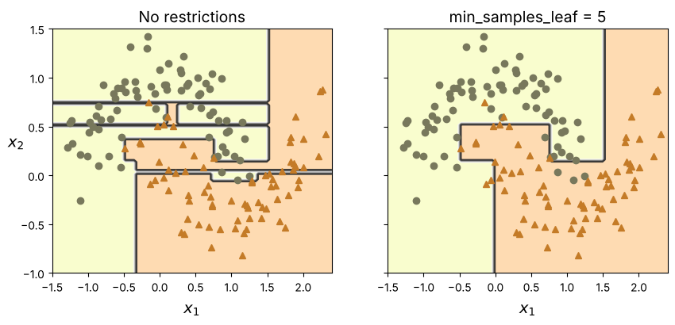
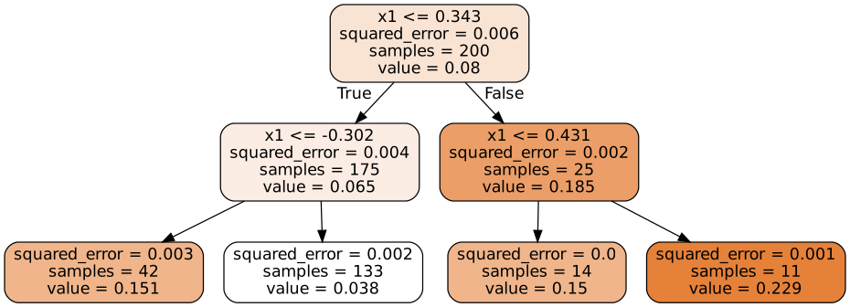
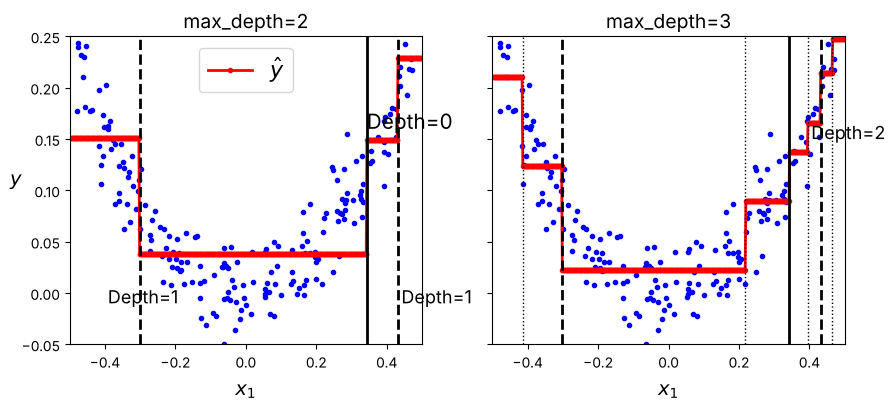
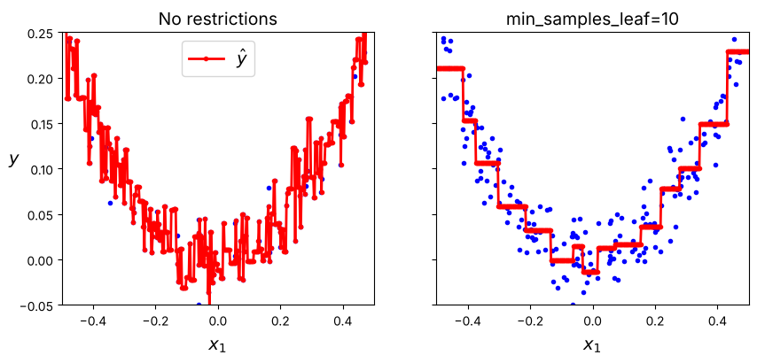
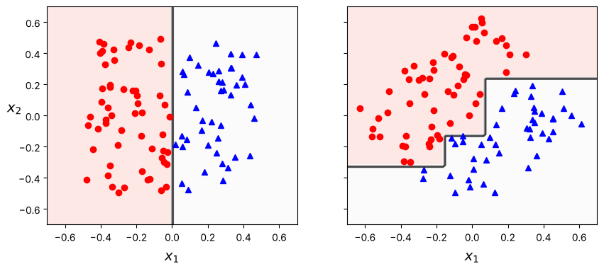
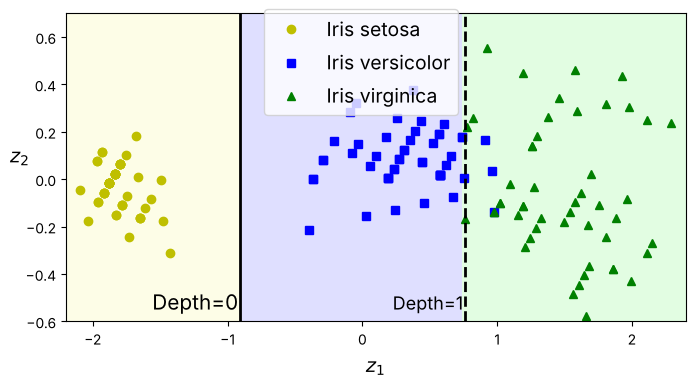
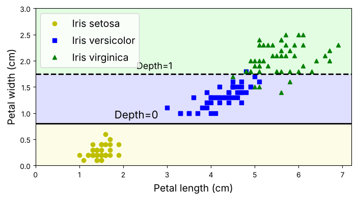

# 5장. 결정 트리

> 교재: 『핸즈온 머신러닝 with 사이킷런, 파이토치』 — 노트북 `05_decision_trees.ipynb`
>
> 실행 환경: 노트북 요구사항은 scikit-learn ≥ 1.6.1. 이 노트의 출력값과 그림은 **scikit-learn 1.9.1**로 직접 실행한 결과.

## 0. 개요

### 0-1. 결정 트리의 정의

결정 트리(decision tree)는 **"특성 *k* ≤ 임곗값 *t*" 형태의 이진 질문을 반복 적용해 입력 공간을 직사각형 영역으로 분할하고, 각 영역에 하나의 예측값을 할당하는 모델**이다.

- 분류(`DecisionTreeClassifier`)와 회귀(`DecisionTreeRegressor`)에 모두 사용
- 질문 순서를 그대로 읽을 수 있는 **화이트박스** 모델
- 특성 스케일에 영향을 받지 않음 → 스케일링 불필요

### 0-2. 장의 구성

이 장은 다음 순서로 전개된다.

| 단계 | 절 | 다루는 내용 |
|---|---|---|
| ① 모델 구조 | 5.1 | 트리를 학습하고 노드에 담긴 정보(지니, samples, value)를 읽는다 |
| ② 모델 사용 | 5.2, 5.3 | 예측 과정, 결정 경계, 클래스 확률 |
| ③ 학습 원리 | 5.4, 5.5, 5.6 | 분할을 고르는 CART 알고리즘, 계산 비용, 불순도 지표 |
| ④ 성능 제어 | 5.7 | 과대적합과 규제 하이퍼파라미터 |
| ⑤ 확장 | 5.8 | 회귀 트리 |
| ⑥ 한계 | 5.9, 5.10 | 축 방향 민감성, 높은 분산 → 6장 앙상블의 동기 |

### 0-3. 핵심 용어

| 용어 | 정의 |
|---|---|
| 노드(node) | 트리의 각 상자. 하나의 질문 또는 최종 예측을 가짐 |
| 루트 노드 | 깊이 0의 최상위 노드. 전체 훈련 세트에서 출발 |
| 분할 노드(split node) | 질문을 가지고 자식 2개로 나뉘는 노드 |
| 리프 노드(leaf node) | 자식이 없는 노드. 예측값이 결정되는 곳 |
| 깊이(depth) | 루트에서 해당 노드까지 거친 분할 횟수 |
| 임곗값(threshold) | 분할 질문 "특성 ≤ *t*"의 *t* |
| 불순도(impurity) | 노드에 서로 다른 클래스가 섞인 정도. 0이면 **순수(pure)** |

### 0-4. 실습 데이터

| 데이터 | 사용 절 | 구성 |
|---|---|---|
| 붓꽃(iris) | 5.1~5.3, 5.9, 5.10 | 150개, 3클래스(setosa·versicolor·virginica 각 50). 꽃잎 길이·너비 2개 특성만 사용 |
| moons | 5.7, 연습문제 | `make_moons`로 생성한 2클래스 데이터 |
| 2차 데이터 | 5.8 | *y* = *x*² + 잡음, 200개 |

## 목차

1. [결정 트리 학습과 시각화 (5.1)](#1-결정-트리-학습과-시각화-51)
2. [예측 (5.2)](#2-예측-52)
3. [클래스 확률 추정 (5.3)](#3-클래스-확률-추정-53)
4. [CART 훈련 알고리즘 (5.4)](#4-cart-훈련-알고리즘-54)
5. [계산 복잡도 (5.5)](#5-계산-복잡도-55)
6. [지니 불순도 또는 엔트로피? (5.6)](#6-지니-불순도-또는-엔트로피-56)
7. [규제 하이퍼파라미터 (5.7)](#7-규제-하이퍼파라미터-57)
8. [회귀 (5.8)](#8-회귀-58)
9. [축 방향에 대한 민감성 (5.9)](#9-축-방향에-대한-민감성-59)
10. [결정 트리의 분산 문제 (5.10)](#10-결정-트리의-분산-문제-510)
11. [부록: `tree_` 속성으로 트리 구조 다루기](#11-부록-tree_-속성으로-트리-구조-다루기)
12. [연습문제 풀이](#12-연습문제-풀이)
13. [종합 정리](#13-종합-정리)

각 절은 **개념 → 원리 → 코드 → 결과 해석 → 정리** 순서로 구성했다.

---

## 1. 결정 트리 학습과 시각화 (5.1)

### 1-1. 개념

결정 트리는 훈련 데이터로부터 **어떤 특성을 어떤 임곗값으로 나눌지**를 학습한다. 학습된 트리는 노드마다 다음 정보를 갖는다.

| 항목 | 의미 |
|---|---|
| 질문 | "특성 ≤ 임곗값" (분할 노드에만 존재) |
| `samples` | 그 노드에 도달한 훈련 샘플 수 |
| `value` | 그 노드에 도달한 샘플의 클래스별 개수 |
| `gini` | 그 노드의 지니 불순도 |
| `class` | `value`가 가장 큰 클래스 = 그 노드의 예측 |

### 1-2. 원리: 지니 불순도

노드 *i*의 지니 불순도는 다음과 같이 정의한다.

$$G_i = 1 - \sum_{k=1}^{n} p_{i,k}^2$$

- *p*<sub>*i,k*</sub>: 노드 *i*의 샘플 중 클래스 *k*의 비율, *n*: 클래스 수
- 의미: 노드에서 샘플 2개를 복원 추출했을 때 **두 샘플의 클래스가 다를 확률**
- 범위: 0(한 클래스만 존재, 순수) ~ 1 − 1/*n*(모든 클래스가 균등)

### 1-3. 코드

**① 학습**

```python
from sklearn.datasets import load_iris
from sklearn.tree import DecisionTreeClassifier

iris = load_iris(as_frame=True)
X_iris = iris.data[["petal length (cm)", "petal width (cm)"]].values
y_iris = iris.target

tree_clf = DecisionTreeClassifier(max_depth=2, random_state=42)
tree_clf.fit(X_iris, y_iris)
```

| 코드 | 설명 |
|---|---|
| `load_iris(as_frame=True)` | 특성은 DataFrame, 타깃은 Series로 로드 |
| `[["petal length (cm)", "petal width (cm)"]]` | 2개 특성만 선택 → 결정 경계를 2차원 평면에 표시 가능 |
| `.values` | NumPy 배열로 변환 |
| `max_depth=2` | 최대 깊이 2로 제한 (시각화를 위한 설정) |
| `random_state=42` | 훈련 과정의 무작위성 고정 (원인은 10절) |

**② 시각화**

```python
from sklearn.tree import export_graphviz
from graphviz import Source

export_graphviz(
        tree_clf,
        out_file="my_iris_tree.dot",
        feature_names=["petal length (cm)", "petal width (cm)"],
        class_names=iris.target_names,
        rounded=True,
        filled=True
    )
Source.from_file("my_iris_tree.dot")

!dot -Tpng "my_iris_tree.dot" -o "my_iris_tree.png"
```

| 코드 | 설명 |
|---|---|
| `export_graphviz` | 트리 구조를 Graphviz 형식의 `.dot` 텍스트 파일로 저장 |
| `feature_names` / `class_names` | 노드에 특성·클래스를 이름으로 표시 |
| `rounded=True` | 노드 모서리를 둥글게 |
| `filled=True` | 다수 클래스의 색으로 채우고 순수할수록 진하게 |
| `Source.from_file` | `.dot` 파일을 노트북 안에서 렌더링 |
| `!dot -Tpng` | Graphviz 명령줄 도구로 PNG 변환 (`!`는 셸 명령 실행) |

Graphviz 없이 확인하려면 `sklearn.tree.export_text`(텍스트) 또는 `sklearn.tree.plot_tree`(matplotlib)를 사용한다.

```python
from sklearn.tree import export_text
print(export_text(tree_clf, feature_names=["petal length", "petal width"],
                  show_weights=True))
# |--- petal length <= 2.45
# |   |--- weights: [50.00, 0.00, 0.00] class: 0
# |--- petal length >  2.45
# |   |--- petal width <= 1.75
# |   |   |--- weights: [0.00, 49.00, 5.00] class: 1
# |   |--- petal width >  1.75
# |   |   |--- weights: [0.00, 1.00, 45.00] class: 2
```

### 1-4. 결과 해석



**구조**
- 루트(깊이 0): "꽃잎 길이 ≤ 2.45" → 참이면 왼쪽, 거짓이면 오른쪽
- 왼쪽 자식(깊이 1): 리프. setosa 50개만 존재
- 오른쪽 자식(깊이 1): "꽃잎 너비 ≤ 1.75"로 다시 분할
- 깊이 2의 리프 2개: versicolor 우세 / virginica 우세

**노드별 지니 계산**

| 노드 | value | 계산 | 지니 |
|---|---|---|---|
| 0 (루트) | [50, 50, 50] | 1 − 3 × (1/3)² | **0.667** |
| 1 | [50, 0, 0] | 1 − 1² | **0** |
| 2 | [0, 50, 50] | 1 − 0.5² − 0.5² | **0.5** |
| 3 | [0, 49, 5] | 1 − (49/54)² − (5/54)² = 1 − 0.823 − 0.009 | **0.168** |
| 4 | [0, 1, 45] | 1 − (1/46)² − (45/46)² | **0.043** |

- 루트의 0.667은 3클래스 균등 분포일 때의 최댓값 1 − 1/3
- 깊이가 깊어질수록 불순도가 감소 → 분할이 클래스를 분리하고 있음을 의미

### 1-5. 정리

- 결정 트리는 "특성 ≤ 임곗값" 질문을 계층적으로 배치한 모델
- 각 노드는 질문, 샘플 수, 클래스 분포, 불순도를 가짐
- 지니 불순도 = 노드 내 클래스 혼합 정도. 학습은 불순도를 낮추는 방향으로 진행
- 사이킷런의 트리는 모든 분할 노드가 자식 2개인 **이진 트리** (ID3 등 다른 알고리즘은 3개 이상 가능)

---

## 2. 예측 (5.2)

### 2-1. 개념

새 샘플의 예측은 **루트에서 시작해 각 노드의 질문에 답하며 리프까지 내려간 뒤, 리프의 클래스를 출력**하는 과정이다. 이 과정을 입력 공간 전체에 적용하면 공간이 클래스별 영역으로 나뉘며, 영역 간 경계를 **결정 경계(decision boundary)** 라 한다.

### 2-2. 원리

**① 예측 경로**

| 입력 (길이, 너비) | 노드 0: 길이 ≤ 2.45 | 노드 2: 너비 ≤ 1.75 | 도착 리프 | 예측 |
|---|---|---|---|---|
| (1.4, 0.2) | 참 | — | 노드 1 [50, 0, 0] | setosa |
| (5.0, 1.5) | 거짓 | 참 | 노드 3 [0, 49, 5] | versicolor |
| (5.5, 2.0) | 거짓 | 거짓 | 노드 4 [0, 1, 45] | virginica |

예측에 필요한 비교 횟수 = 도착한 리프의 깊이 (여기서는 최대 2회).

**② 결정 경계의 형태**

각 질문은 특성 하나만 비교하므로 경계는 항상 **축에 수직인 직선**(2차원에서는 세로선 또는 가로선)이다. 따라서 결정 트리의 영역은 **축에 정렬된 직사각형들의 합집합**이 된다.

### 2-3. 코드

결정 경계는 평면을 격자로 덮고 각 격자점을 예측해 색칠하는 방식으로 그린다.

```python
import numpy as np
import matplotlib.pyplot as plt
from matplotlib.colors import ListedColormap

custom_cmap = ListedColormap(['#fafab0', '#9898ff', '#a0faa0'])
plt.figure(figsize=(8, 4))

lengths, widths = np.meshgrid(np.linspace(0, 7.2, 100), np.linspace(0, 3, 100))
X_iris_all = np.c_[lengths.ravel(), widths.ravel()]
y_pred = tree_clf.predict(X_iris_all).reshape(lengths.shape)
plt.contourf(lengths, widths, y_pred, alpha=0.3, cmap=custom_cmap)

for idx, (name, style) in enumerate(zip(iris.target_names, ("yo", "bs", "g^"))):
    plt.plot(X_iris[:, 0][y_iris == idx], X_iris[:, 1][y_iris == idx],
             style, label=f"Iris {name}")
```

| 단계 | 코드 | 결과 형태 |
|---|---|---|
| 1. 격자 생성 | `np.meshgrid(x 100개, y 100개)` | (100, 100) 행렬 2개 |
| 2. 격자점을 샘플 배열로 변환 | `np.c_[lengths.ravel(), widths.ravel()]` | (10000, 2) |
| 3. 모든 격자점 예측 | `tree_clf.predict(X_iris_all)` | (10000,) |
| 4. 격자 형태로 복원 | `.reshape(lengths.shape)` | (100, 100) |
| 5. 영역 색칠 | `plt.contourf` | — |
| 6. 훈련 샘플 표시 | `X_iris[:, 0][y_iris == idx]` 로 클래스별 선택 후 `plt.plot` | — |

`meshgrid`, `ravel`, `np.c_`의 동작은 작은 예로 확인할 수 있다.

```python
xx, yy = np.meshgrid([1, 2, 3], [10, 20])
# xx = [[1, 2, 3],      yy = [[10, 10, 10],
#       [1, 2, 3]]            [20, 20, 20]]
np.c_[xx.ravel(), yy.ravel()]
# [[1, 10], [2, 10], [3, 10], [1, 20], [2, 20], [3, 20]]   → 격자점 6개
```

분할선은 학습된 트리의 임곗값으로 그린다.

```python
tree_clf_deeper = DecisionTreeClassifier(max_depth=3, random_state=42)
tree_clf_deeper.fit(X_iris, y_iris)
th0, th1, th2a, th2b = tree_clf_deeper.tree_.threshold[[0, 2, 3, 6]]
# th0=2.45, th1=1.75, th2a=4.95, th2b=4.85

plt.plot([th0, th0], [0, 3], "k-", linewidth=2)       # 깊이 0 분할: x = 2.45
plt.plot([th0, 7.2], [th1, th1], "k--", linewidth=2)  # 깊이 1 분할: y = 1.75
plt.plot([th2a, th2a], [0, th1], "k:", linewidth=2)   # 깊이 2 분할 (max_depth=3일 때)
plt.plot([th2b, th2b], [th1, 3], "k:", linewidth=2)
```

- `tree_.threshold`: 노드 번호 순으로 임곗값을 저장한 배열 (11절)
- 깊이 3 트리를 별도로 학습한 것은 다음 단계 분할 위치(점선)를 참고로 보여 주기 위함

### 2-4. 결과 해석



- 실선(깊이 0): 길이 2.45에서 setosa 영역 분리
- 파선(깊이 1): 너비 1.75에서 versicolor / virginica 분리
- 점선(깊이 2): `max_depth=3`이었다면 추가될 분할 (현재 모델에는 없음)
- 모든 경계가 축에 수직 → 2-2절 ②의 성질 확인

### 2-5. 정리

- 예측 = 루트 → 리프 경로 탐색, 비용은 트리 깊이에 비례
- 결정 경계는 축에 정렬된 직사각형 영역으로 구성 (9절 한계의 원인)
- 결정 트리는 예측 근거를 경로로 설명할 수 있는 **화이트박스** 모델. 랜덤 포레스트·신경망 같은 **블랙박스** 모델과 대비됨

---

## 3. 클래스 확률 추정 (5.3)

### 3-1. 개념

결정 트리는 예측 클래스뿐 아니라 각 클래스에 속할 **확률 추정값**도 제공한다.

### 3-2. 원리

샘플이 도달한 리프 노드의 클래스 비율을 그대로 확률로 사용한다.

$$\hat{p}_k = \frac{\text{리프에 있는 클래스 } k \text{ 훈련 샘플 수}}{\text{리프의 전체 훈련 샘플 수}}$$

`predict`는 이 확률이 최대인 클래스를 반환한다.

### 3-3. 코드

```python
tree_clf.predict_proba([[5, 1.5]]).round(3)
# array([[0.   , 0.907, 0.093]])

tree_clf.predict([[5, 1.5]])
# array([1])
```

- 입력은 (샘플 수, 특성 수) 형태의 2차원이어야 하므로 샘플 1개도 `[[...]]`로 감싼다

### 3-4. 결과 해석

- (5, 1.5)는 노드 3(value = [0, 49, 5])에 도달
- 확률 = [0/54, 49/54, 5/54] = **[0, 0.907, 0.093]** → 예측 versicolor
- 같은 리프에 도달하는 모든 입력은 **확률이 동일**하다. 예: (6, 1.5), (5, 1.0)도 모두 [0, 0.907, 0.093]. 리프 경계에 가까운 입력이라도 확률이 낮아지지 않는다

### 3-5. 정리

- 확률 = 리프의 클래스 비율
- 리프 단위로 계단식으로 변하므로 확률 추정이 거칠다

---

## 4. CART 훈련 알고리즘 (5.4)

> 노트북에는 이 절의 코드가 없다. 아래 코드는 알고리즘 검증을 위해 직접 작성한 것이다.

### 4-1. 개념

사이킷런은 **CART**(Classification And Regression Tree) 알고리즘으로 트리를 학습한다. CART는 각 노드에서 **가장 좋은 (특성, 임곗값) 쌍 하나**를 찾아 데이터를 둘로 나누고, 이를 재귀적으로 반복한다.

### 4-2. 원리

**① 비용 함수**

특성 *k*와 임곗값 *t*<sub>*k*</sub>로 분할했을 때의 비용은 두 자식 노드 불순도의 **샘플 수 가중 평균**이다.

$$J(k, t_k) = \frac{m_\text{left}}{m} G_\text{left} + \frac{m_\text{right}}{m} G_\text{right}$$

- *m*: 분할 전 샘플 수, *m*<sub>left</sub>, *m*<sub>right</sub>: 각 자식의 샘플 수
- *G*<sub>left</sub>, *G*<sub>right</sub>: 각 자식의 불순도
- 샘플 수로 가중하는 이유: 큰 자식 노드의 불순도가 전체 품질에 더 큰 영향을 주기 때문

**② 알고리즘**

```
CART(노드):
    1. 각 특성 k에 대해
         그 특성의 고유값을 정렬하고, 인접한 값의 중간점들을 후보 임곗값 t로 삼는다
         각 (k, t)에 대해 J(k, t)를 계산한다
    2. J가 최소인 (k*, t*)를 선택한다
    3. 정지 조건(max_depth 도달, 불순도를 더 줄일 수 없음 등)이면 리프로 만든다
    4. 아니면 (k*, t*)로 두 자식을 만들고 각 자식에 CART를 재귀 호출한다
```

**③ 탐욕 알고리즘(greedy algorithm)**

- 각 단계에서 **현재 비용이 최소인 분할**만 선택하고, 이후 단계의 결과는 고려하지 않는다
- 따라서 합리적으로 좋은 트리를 찾지만 **전역 최적 트리는 보장하지 않는다**
- 최적 트리를 찾는 문제는 **NP-완전** 문제로 O(exp(*m*)) 시간이 필요해 현실적으로 풀 수 없다. 탐욕 방식은 이에 대한 실용적 타협이다

### 4-3. 코드

```python
def gini(y):
    if len(y) == 0:
        return 0.0
    p = np.bincount(y, minlength=3) / len(y)
    return 1 - (p ** 2).sum()

def best_split(X, y):
    m = len(y)
    best = (None, None, np.inf)                      # (특성, 임곗값, 비용)
    for k in range(X.shape[1]):
        values = np.unique(X[:, k])                  # 정렬된 고유값
        for t in (values[:-1] + values[1:]) / 2:     # 인접값의 중간점 = 후보 임곗값
            left = X[:, k] <= t
            J = left.sum() / m * gini(y[left]) + (~left).sum() / m * gini(y[~left])
            if J < best[2] - 1e-12:
                best = (k, t, J)
    return best

y = y_iris.values
best_split(X_iris, y)                        # (0, 2.45, 0.3333)

right = X_iris[:, 0] > 2.45
best_split(X_iris[right], y[right])          # (1, 1.75, 0.1103)
```

| 코드 | 설명 |
|---|---|
| `np.bincount(y, minlength=3)` | 클래스별 샘플 수 |
| `(values[:-1] + values[1:]) / 2` | 정렬된 고유값의 인접 중간점 (알고리즘 1단계) |
| `~left` | 오른쪽 자식에 해당하는 불리언 마스크 |
| `1e-12` | 부동소수 오차로 동일한 비용을 다르게 판정하지 않기 위한 허용 오차 |
| 두 번째 `best_split` 호출 | 오른쪽 자식에 대한 재귀 단계 (알고리즘 4단계) |

### 4-4. 결과 해석

**루트 노드의 후보 분할 비교** (전체 후보 63개 중 일부)

| 분할 | 왼쪽 value | *G*<sub>left</sub> | 오른쪽 value | *G*<sub>right</sub> | *J* |
|---|---|---|---|---|---|
| 길이 ≤ 2.45 | [50, 0, 0] | 0 | [0, 50, 50] | 0.5 | **0.333** |
| 너비 ≤ 0.8 | [50, 0, 0] | 0 | [0, 50, 50] | 0.5 | **0.333** |
| 너비 ≤ 1.75 | [50, 49, 5] | 0.545 | [0, 1, 45] | 0.043 | 0.391 |
| 길이 ≤ 4.75 | [50, 44, 1] | 0.508 | [0, 6, 49] | 0.194 | 0.393 |
| 길이 ≤ 5.05 | [50, 49, 9] | 0.573 | [0, 1, 41] | 0.046 | 0.425 |
| 너비 ≤ 1.35 | [50, 28, 0] | 0.460 | [0, 22, 50] | 0.424 | 0.443 |

- 최소 비용 *J* = 50/150 × 0 + 100/150 × 0.5 = **0.333** → 사이킷런이 고른 루트 분할과 일치
- 임곗값 2.45 = (setosa 최대 길이 1.9 + versicolor 최소 길이 3.0) / 2
- 오른쪽 자식의 최적 분할 = 너비 ≤ 1.75 (*J* = 0.110) → 그림 5-1의 노드 2와 일치
- **"길이 ≤ 2.45"와 "너비 ≤ 0.8"이 동일한 비용**을 가진다. 0.8 = (setosa 최대 너비 0.6 + versicolor 최소 너비 1.0) / 2. 이 동점이 10절 분산 문제의 직접 원인이다

### 4-5. 정리

- CART = 가중 불순도 *J*를 최소화하는 분할을 탐욕적·재귀적으로 선택
- 후보 임곗값 = 정렬된 고유값의 인접 중간점
- 전역 최적은 보장되지 않음 (NP-완전 문제)
- 동일 비용의 분할이 여럿이면 선택이 무작위성에 좌우될 수 있음

---

## 5. 계산 복잡도 (5.5)

### 5-1. 개념

*m*: 훈련 샘플 수, *n*: 특성 수일 때 예측과 훈련의 시간 복잡도를 분석한다.

### 5-2. 원리

| 단계 | 복잡도 | 근거 |
|---|---|---|
| 예측 | O(log₂ *m*) | 루트→리프 경로 길이 = 깊이. 트리가 대체로 균형을 이루면 깊이 ≈ log₂ *m*. 각 노드에서 특성 1개만 비교하므로 *n*과 무관 |
| 훈련 | O(*n* × *m* log₂ *m*) | 각 깊이 수준에서 *n*개 특성 전체에 대해 *m*개 샘플을 비교. 깊이 수 log₂ *m* |

### 5-3. 결과 해석

**예측 비용**

| *m* | log₂ *m* (예측 시 비교 횟수) |
|---|---|
| 10³ | ≈ 10 |
| 10⁶ | ≈ 20 |
| 10⁹ | ≈ 30 |

샘플 수가 1000배 증가해도 비교 횟수는 약 10회 증가 → 대규모 데이터에서도 예측이 빠르다.

**훈련 비용 (연습문제 5번)**: *m* = 10⁶에서 1시간이 걸렸다면 *m* = 10⁷에서는

$$K = \frac{n \times 10m \log_2(10m)}{n \times m \log_2 m} = 10 \times \frac{\log_2 10^7}{\log_2 10^6} = 10 \times \frac{23.25}{19.93} \approx 11.7$$

→ 약 **11.7시간**. 샘플 수 증가 배율(10)보다 약간 크게 증가한다.

### 5-4. 정리

- 예측 O(log₂ *m*): 특성 수와 무관하며 매우 빠름
- 훈련 O(*n* × *m* log₂ *m*): 특성 수에 비례, 샘플 수에 대해 선형보다 약간 큼

---

## 6. 지니 불순도 또는 엔트로피? (5.6)

### 6-1. 개념

불순도 지표로 지니 대신 **엔트로피**를 사용할 수 있다. `criterion` 하이퍼파라미터로 지정한다.

```python
DecisionTreeClassifier(criterion="entropy")   # 기본값 "gini". "log_loss"는 "entropy"와 동일
```

### 6-2. 원리

엔트로피는 정보 이론에서 메시지의 평균 정보량을 나타내는 척도이며, 노드 *i*에 대해 다음과 같이 정의한다.

$$H_i = -\sum_{k=1,\ p_{i,k} \ne 0}^{n} p_{i,k} \log_2 p_{i,k}$$

| 성질 | 지니 | 엔트로피 |
|---|---|---|
| 순수 노드 | 0 | 0 |
| 최댓값 (*n* 클래스 균등) | 1 − 1/*n* | log₂ *n* |
| 계산 | 제곱 | 로그 |

**계산 예**

| 노드 | 지니 | 엔트로피 |
|---|---|---|
| 루트 [50, 50, 50] | 0.667 | log₂ 3 = 1.585 |
| 노드 3 [0, 49, 5] | 0.168 | −(0.907 log₂ 0.907 + 0.093 log₂ 0.093) = −(−0.128 − 0.318) = 0.445 |

### 6-3. 코드

두 기준으로 학습한 트리 비교 (노트북 외 검증 코드)

```python
tree_ent = DecisionTreeClassifier(max_depth=2, criterion="entropy", random_state=42)
tree_ent.fit(X_iris, y_iris)
(tree_ent.predict(X_iris) == tree_clf.predict(X_iris)).all()   # True
```

### 6-4. 결과 해석

이진 분류 노드에서 클래스 1의 비율 *p*에 따른 두 지표:



- 두 곡선 모두 *p* = 0, 1에서 0, *p* = 0.5에서 최대
- 엔트로피를 1/2로 축소하면 지니와 거의 일치 → 분할 순위가 대부분 같아짐
- 붓꽃 데이터에서도 두 기준이 **동일한 트리**를 생성

| | 지니 | 엔트로피 |
|---|---|---|
| 계산 속도 | 약간 빠름 (로그 연산 없음) | 약간 느림 |
| 분할 경향 | 가장 빈도가 높은 클래스를 한쪽 가지로 고립시키는 경향 | 조금 더 균형 잡힌 트리를 만드는 경향 |

### 6-5. 정리

- 대부분의 경우 두 지표의 결과는 거의 같다
- 계산이 빠른 지니가 기본값으로 적절하다

---

## 7. 규제 하이퍼파라미터 (5.7)

### 7-1. 개념

| 구분 | 정의 | 예 |
|---|---|---|
| 파라미터 모델 | 모델 파라미터의 수가 훈련 전에 정해짐 → 자유도가 제한되어 과대적합 위험이 낮고 과소적합 위험이 높음 | 선형 모델 |
| 비파라미터 모델 | 파라미터의 수가 훈련 전에 정해지지 않음 → 모델 구조가 데이터에 맞춰 자유롭게 커짐 | 결정 트리 |

결정 트리는 비파라미터 모델이므로, 제약이 없으면 **모든 리프가 순수해질 때까지 분할**하여 훈련 데이터에 과대적합된다. 이를 막기 위해 트리의 성장을 제한하는 것을 **규제**라 한다.

### 7-2. 원리: 규제 하이퍼파라미터

| 하이퍼파라미터 | 의미 | 규제 강화 방향 |
|---|---|---|
| `max_depth` | 트리의 최대 깊이 (기본값 `None` = 제한 없음) | 감소 |
| `max_features` | 각 노드에서 분할에 사용할 수 있는 최대 특성 수 | 감소 |
| `max_leaf_nodes` | 리프 노드의 최대 개수 | 감소 |
| `min_samples_split` | 분할하기 위해 노드가 가져야 할 최소 샘플 수 | 증가 |
| `min_samples_leaf` | 리프 노드가 가져야 할 최소 샘플 수 | 증가 |
| `min_weight_fraction_leaf` | `min_samples_leaf`와 같으나 전체 가중치 대비 비율로 지정 | 증가 |

**규칙**: `max_*`를 줄이거나 `min_*`을 늘리면 규제가 강해진다.

**가지치기(pruning)**: 제약 없이 트리를 만든 뒤 불필요한 노드를 제거하는 방식. 교재는 χ² 검정으로 분할이 통계적으로 유의미한지(순전히 우연인지) 판정하는 방법을 소개한다. 사이킷런에서는 `ccp_alpha`(비용 복잡도 가지치기)로 수행한다.

### 7-3. 코드

**① 학습**

```python
from sklearn.datasets import make_moons

X_moons, y_moons = make_moons(n_samples=150, noise=0.2, random_state=42)

tree_clf1 = DecisionTreeClassifier(random_state=42)
tree_clf2 = DecisionTreeClassifier(min_samples_leaf=5, random_state=42)
tree_clf1.fit(X_moons, y_moons)
tree_clf2.fit(X_moons, y_moons)
```

| 코드 | 설명 |
|---|---|
| `make_moons(n_samples, noise)` | 두 개의 반달 모양 클래스 생성. `noise`는 가우스 잡음의 표준편차 |
| `tree_clf1` | 규제 없음 |
| `tree_clf2` | `min_samples_leaf=5`: 리프마다 최소 5개 샘플 |

**② 결정 경계 시각화 함수**

```python
def plot_decision_boundary(clf, X, y, axes, cmap):
    x1, x2 = np.meshgrid(np.linspace(axes[0], axes[1], 100),
                         np.linspace(axes[2], axes[3], 100))
    X_new = np.c_[x1.ravel(), x2.ravel()]
    y_pred = clf.predict(X_new).reshape(x1.shape)

    plt.contourf(x1, x2, y_pred, alpha=0.3, cmap=cmap)
    plt.contour(x1, x2, y_pred, cmap="Greys", alpha=0.8)
    colors = {"Wistia": ["#78785c", "#c47b27"], "Pastel1": ["red", "blue"]}
    markers = ("o", "^")
    for idx in (0, 1):
        plt.plot(X[:, 0][y == idx], X[:, 1][y == idx],
                 color=colors[cmap][idx], marker=markers[idx], linestyle="none")
    plt.axis(axes)
    plt.xlabel(r"$x_1$")
    plt.ylabel(r"$x_2$", rotation=0)

fig, axes = plt.subplots(ncols=2, figsize=(10, 4), sharey=True)
plt.sca(axes[0])
plot_decision_boundary(tree_clf1, X_moons, y_moons,
                       axes=[-1.5, 2.4, -1, 1.5], cmap="Wistia")
plt.title("No restrictions")
plt.sca(axes[1])
plot_decision_boundary(tree_clf2, X_moons, y_moons,
                       axes=[-1.5, 2.4, -1, 1.5], cmap="Wistia")
plt.title(f"min_samples_leaf = {tree_clf2.min_samples_leaf}")
plt.show()
```

| 코드 | 설명 |
|---|---|
| 함수 본문 1~4줄 | 2-3절의 격자 예측 절차를 함수화 |
| `plt.contourf` / `plt.contour` | 영역 채우기 / 경계선만 그리기 |
| `plt.subplots(ncols=2, sharey=True)` | 서브플롯 2개, y축 공유 |
| `plt.sca(ax)` | 이후 그리기 명령의 대상 서브플롯 지정 |

**③ 일반화 성능 평가**

```python
X_moons_test, y_moons_test = make_moons(n_samples=1000, noise=0.2,
                                        random_state=43)
tree_clf1.score(X_moons_test, y_moons_test)   # 0.898
tree_clf2.score(X_moons_test, y_moons_test)   # 0.92
```

- 다른 `random_state`(43)로 같은 분포의 새 데이터 1,000개를 생성해 테스트 세트로 사용

### 7-4. 결과 해석



| | 규제 없음 | `min_samples_leaf=5` |
|---|---|---|
| 깊이 / 리프 수 | 8 / 19 | 6 / 13 |
| 훈련 정확도 | 1.000 | 0.947 |
| 테스트 정확도 | 0.898 | **0.920** |

(깊이·리프 수·훈련 정확도는 노트북 외 추가 확인값)

- 규제 없는 모델: 훈련 정확도 100%. 반대 클래스 영역에 섞인 개별 샘플까지 분리하는 작은 영역을 만들어 경계가 복잡함 → **과대적합**
- 규제한 모델: 훈련 정확도는 낮아졌지만 경계가 단순하고 **테스트 정확도가 더 높음** → 일반화 성능 향상

### 7-5. 정리

- 결정 트리는 비파라미터 모델이므로 규제 없이는 과대적합된다
- `max_*` 감소, `min_*` 증가로 규제를 강화한다
- 규제의 효과는 훈련 점수가 아니라 **테스트 점수**로 판단한다

---

## 8. 회귀 (5.8)

### 8-1. 개념

`DecisionTreeRegressor`는 분류 트리와 같은 구조로 **연속값**을 예측한다. 차이는 두 가지다.

| | 분류 트리 | 회귀 트리 |
|---|---|---|
| 리프의 예측값 | 다수 클래스 | 리프에 속한 훈련 샘플 타깃의 **평균** |
| 분할 기준 | 불순도 (지니/엔트로피) | **MSE** (평균제곱오차) |

### 8-2. 원리

**① 회귀용 CART 비용 함수**

$$J(k, t_k) = \frac{m_\text{left}}{m} \text{MSE}_\text{left} + \frac{m_\text{right}}{m} \text{MSE}_\text{right}$$

$$\text{MSE}_\text{node} = \frac{1}{m_\text{node}} \sum_{i \in \text{node}} \left(\hat{y}_\text{node} - y^{(i)}\right)^2, \qquad \hat{y}_\text{node} = \frac{1}{m_\text{node}} \sum_{i \in \text{node}} y^{(i)}$$

- 각 자식 노드의 샘플들이 그 노드 평균에 최대한 가깝도록 분할
- 분류용 CART에서 *G*를 MSE로 바꾼 것과 같다

**② 예측 함수의 형태**

각 리프가 상수 하나를 출력하므로 예측 함수는 **구간별 상수 함수(계단 함수)** 가 된다. 깊이가 *d*인 트리는 최대 2<sup>*d*</sup>개의 구간을 가진다.

### 8-3. 코드

**① 데이터 생성과 학습**

```python
import numpy as np
from sklearn.tree import DecisionTreeRegressor

rng = np.random.default_rng(seed=42)
X_quad = rng.random((200, 1)) - 0.5
y_quad = X_quad ** 2 + 0.025 * rng.standard_normal((200, 1))

tree_reg = DecisionTreeRegressor(max_depth=2, random_state=42)
tree_reg.fit(X_quad, y_quad)
```

| 코드 | 설명 |
|---|---|
| `rng.random((200, 1)) - 0.5` | [−0.5, 0.5) 균등분포 200개, 특성 1개 |
| `X_quad ** 2 + 0.025 * rng.standard_normal(...)` | *y* = *x*² + 𝒩(0, 0.025²) 잡음 |

**② 트리 시각화**

```python
export_graphviz(tree_reg, out_file="my_regression_tree.dot",
                feature_names=["x1"], rounded=True, filled=True)
Source.from_file("my_regression_tree.dot")
```

**③ 깊이별 비교**

```python
tree_reg2 = DecisionTreeRegressor(max_depth=3, random_state=42)
tree_reg2.fit(X_quad, y_quad)

tree_reg.tree_.threshold
# array([ 0.343 , -0.3018, -2.    , -2.    ,  0.4314, -2.    , -2.    ])
tree_reg2.tree_.threshold
# array([ 0.343 , -0.3018, -0.414 , -2.    , -2.    ,  0.2182, -2.    ,
#        -2.    ,  0.4314,  0.3948, -2.    , -2.    ,  0.4647, -2.    , -2.    ])
```

- `-2`는 리프 노드를 나타내는 값 (사이킷런의 `TREE_UNDEFINED`)

```python
def plot_regression_predictions(tree_reg, X, y, axes=[-0.5, 0.5, -0.05, 0.25]):
    x1 = np.linspace(axes[0], axes[1], 500).reshape(-1, 1)
    y_pred = tree_reg.predict(x1)
    plt.axis(axes)
    plt.xlabel("$x_1$")
    plt.plot(X, y, "b.")
    plt.plot(x1, y_pred, "r.-", linewidth=2, label=r"$\hat{y}$")

th0, th1a, th1b = tree_reg.tree_.threshold[[0, 1, 4]]   # 깊이 0, 깊이 1 ×2
th2s = tree_reg2.tree_.threshold[[2, 5, 9, 12]]         # 깊이 2 ×4
```

- `.reshape(-1, 1)`: (500,) → (500, 1). 사이킷런은 특성이 1개여도 2차원 입력을 요구

**④ 규제 비교**

```python
tree_reg1 = DecisionTreeRegressor(random_state=42)
tree_reg2 = DecisionTreeRegressor(random_state=42, min_samples_leaf=10)
tree_reg1.fit(X_quad, y_quad)
tree_reg2.fit(X_quad, y_quad)

x1 = np.linspace(-0.5, 0.5, 500).reshape(-1, 1)
y_pred1 = tree_reg1.predict(x1)
y_pred2 = tree_reg2.predict(x1)
```

### 8-4. 결과 해석

**① 트리 구조 (그림 5-4)**



| 노드 | 구간 | samples | value (평균) | MSE |
|---|---|---|---|---|
| 루트 | 전체 | 200 | 0.080 | 0.0056 |
| 리프 | *x*₁ ≤ −0.302 | 42 | 0.151 | 0.0028 |
| 리프 | −0.302 < *x*₁ ≤ 0.343 | 133 | 0.038 | 0.0017 |
| 리프 | 0.343 < *x*₁ ≤ 0.431 | 14 | 0.150 | 0.0005 |
| 리프 | *x*₁ > 0.431 | 11 | 0.229 | 0.0006 |

- 예측 예: *x*₁ = 0.2 → 두 번째 리프 → *ŷ* = **0.038** (`tree_reg.predict([[0.2]])` = 0.0376). 실제 함수값 0.2² = 0.04에 근접
- 데이터는 무작위 생성이므로 교재 그림의 수치와 다를 수 있음

**② 깊이별 예측 (그림 5-5)**



- 예측(빨간 선)이 계단 함수. `max_depth=2` → 구간 4개, `max_depth=3` → 구간 8개
- 깊이 3 트리는 깊이 0·1의 임곗값(0.343, −0.302, 0.431)을 유지한 채 하위 분할만 추가

**③ 규제 효과 (그림 5-6)**



| | 규제 없음 | `min_samples_leaf=10` |
|---|---|---|
| 리프 수 (추가 확인값) | 200 (= 샘플 수) | 15 |
| 예측 형태 | 개별 샘플을 모두 통과하는 불규칙한 선 | 2차 곡선을 매끄럽게 근사 |

- 규제 없는 회귀 트리는 샘플마다 리프를 만들어 잡음까지 학습 → 과대적합

### 8-5. 정리

- 회귀 트리 = 리프 평균을 출력하는 계단 함수, 분할 기준은 MSE
- 분류 트리와 마찬가지로 규제 없이는 과대적합된다

---

## 9. 축 방향에 대한 민감성 (5.9)

### 9-1. 개념

결정 트리의 모든 분할은 축에 수직이다(2-2절 ②). 따라서 실제 경계가 축에 대해 **기울어져 있으면** 이를 여러 개의 축 수직 분할로 근사해야 하며, 트리가 불필요하게 복잡해진다.

### 9-2. 원리

- 기울어진 직선 경계 하나 → 계단 형태의 다수 분할로 근사
- 분할이 많아질수록 훈련 데이터에만 맞는 경계가 생겨 일반화 성능이 떨어질 가능성이 커짐
- 대응 방법: **PCA**로 데이터를 회전시켜 주요 변동 방향을 축에 정렬한 뒤 트리 학습 (PCA는 7장)

### 9-3. 코드

**① 회전 실험**

```python
rng = np.random.default_rng(seed=42)
X_square = rng.random((100, 2)) - 0.5
y_square = (X_square[:, 0] > 0).astype(np.int64)

angle = np.pi / 4  # 45도
rotation_matrix = np.array([[np.cos(angle), -np.sin(angle)],
                            [np.sin(angle), np.cos(angle)]])
X_rotated_square = X_square.dot(rotation_matrix)

tree_clf_square = DecisionTreeClassifier(random_state=42)
tree_clf_square.fit(X_square, y_square)
tree_clf_rotated_square = DecisionTreeClassifier(random_state=42)
tree_clf_rotated_square.fit(X_rotated_square, y_square)
```

| 코드 | 설명 |
|---|---|
| `y_square = (X_square[:, 0] > 0)` | 정답 경계 = 세로선 *x*₁ = 0 (축 수직, 선형 분리 가능) |
| `rotation_matrix` | 2차원 회전 행렬 |
| `X_square.dot(rotation_matrix)` | 모든 샘플을 45° 회전 → 정답 경계가 대각선이 됨 |

**② PCA 적용**

```python
from sklearn.decomposition import PCA
from sklearn.pipeline import make_pipeline
from sklearn.preprocessing import StandardScaler

pca_pipeline = make_pipeline(StandardScaler(), PCA())
X_iris_rotated = pca_pipeline.fit_transform(X_iris)
tree_clf_pca = DecisionTreeClassifier(max_depth=2, random_state=42)
tree_clf_pca.fit(X_iris_rotated, y_iris)
```

| 코드 | 설명 |
|---|---|
| `StandardScaler()` | PCA는 분산 기반이므로 먼저 특성 스케일을 맞춤 |
| `PCA()` | 분산이 가장 큰 방향을 *z*₁, 그에 직교하는 방향을 *z*₂로 하는 좌표로 회전 |
| `make_pipeline` | 두 변환을 순차 적용 |

```python
th1, th2 = tree_clf_pca.tree_.threshold[[0, 2]]   # -0.911, 0.758
```

### 9-4. 결과 해석

**① 회전 실험 (그림 5-7)**



| | 원본 (왼쪽) | 45° 회전 (오른쪽) |
|---|---|---|
| 정답 경계 | 세로선 | 대각선 |
| 깊이 / 리프 수 (추가 확인값) | 1 / 2 | 4 / 6 |
| 학습된 경계 | 단일 세로선 | 계단 형태 |

- 두 데이터는 회전 외에는 동일하지만, 회전된 데이터에서는 트리가 훨씬 복잡해짐
- 계단 경계는 훈련 샘플은 맞히지만 새로운 샘플에 대한 일반화는 불리함

**② PCA 적용 (그림 5-8)**



- 두 분할 모두 *z*₁만 사용 (`tree_.feature` = `[0, -2, 0, -2, -2]`) → 경계가 세로선 2개로 단순화
- 꽃잎 길이와 너비의 상관이 강해 *z*₁ 하나가 분산의 98.1%를 설명
- 훈련 정확도: 원본 0.96 → PCA 적용 0.98
- 단, *z*₁은 원래 특성의 선형 결합이므로 **해석 가능성은 감소**

### 9-5. 정리

- 결정 트리는 축에 수직인 분할만 가능하므로 데이터 방향에 민감하다
- 기울어진 경계는 계단 형태로 근사되어 모델이 복잡해진다
- PCA로 축을 정렬하면 개선될 수 있으나 해석성은 떨어진다

---

## 10. 결정 트리의 분산 문제 (5.10)

### 10-1. 개념

**분산이 높은 모델**은 훈련 데이터나 하이퍼파라미터의 작은 변화에도 학습 결과가 크게 달라진다. 결정 트리는 대표적인 고분산 모델이다. 9절의 회전도 그 예이며, 이 절에서는 데이터를 바꾸지 않고 `random_state`만 바꿔도 다른 트리가 나오는 것을 확인한다.

### 10-2. 원리

- 사이킷런의 CART 구현은 각 노드에서 **특성을 무작위 순서로** 검토하며, 비용이 같은 분할이 있으면 먼저 발견한 것을 선택한다
- 4-4절에서 확인했듯 붓꽃 루트에서는 "길이 ≤ 2.45"와 "너비 ≤ 0.8"이 동일 비용(0.333)
- 따라서 `random_state`에 따라 루트 분할이 달라진다
- 상위 분할이 달라지면 하위 구조와 결정 경계 전체가 달라진다

### 10-3. 코드

```python
tree_clf_tweaked = DecisionTreeClassifier(max_depth=2, random_state=40)
tree_clf_tweaked.fit(X_iris, y_iris)
```

```python
plt.figure(figsize=(8, 4))
y_pred = tree_clf_tweaked.predict(X_iris_all).reshape(lengths.shape)
plt.contourf(lengths, widths, y_pred, alpha=0.3, cmap=custom_cmap)
...
th0, th1 = tree_clf_tweaked.tree_.threshold[[0, 2]]
plt.plot([0, 7.2], [th0, th0], "k-", linewidth=2)    # 깊이 0: 가로선
plt.plot([0, 7.2], [th1, th1], "k--", linewidth=2)   # 깊이 1: 가로선
```

시드에 따른 루트 분할 분포 확인 (노트북 외 검증 코드)

```python
from collections import Counter
roots = Counter()
for rs in range(100):
    t = DecisionTreeClassifier(max_depth=2, random_state=rs).fit(X_iris, y_iris).tree_
    roots[(t.feature[0], round(t.threshold[0], 2))] += 1
roots   # (특성 1, 0.8) → 51회, (특성 0, 2.45) → 49회
```

### 10-4. 결과 해석



| | `random_state=42` | `random_state=40` |
|---|---|---|
| 루트 분할 | 길이 ≤ 2.45 | **너비 ≤ 0.80** |
| 깊이 1 분할 | 너비 ≤ 1.75 | 너비 ≤ 1.75 |
| 결정 경계 | 세로선 + 가로선 | 가로선 2개 |
| 훈련 정확도 | 0.96 | 0.96 |

- 시드 0~99 중 루트 분할: 너비 0.8 → 51회, 길이 2.45 → 49회
- 훈련 정확도는 같지만 **훈련 샘플이 없는 영역에서는 예측이 다르다**. 예: (길이 2, 너비 1.5)
  - `random_state=42`: 길이 2 ≤ 2.45 → setosa
  - `random_state=40`: 너비 1.5 > 0.8, ≤ 1.75 → versicolor

### 10-5. 정리

- 결정 트리는 작은 변화에도 구조가 크게 바뀌는 고분산 모델이다
- 해결 방법: 여러 트리의 예측을 **평균(다수결)** 하여 분산을 줄인다 → **랜덤 포레스트** (6장)
- 연습문제 8번(12절)에서 이를 직접 구현한다

---

## 11. 부록: `tree_` 속성으로 트리 구조 다루기

### 11-1. 개념

학습된 트리의 구조는 `tree_` 속성(`sklearn.tree._tree.Tree` 객체)에 **노드 번호를 인덱스로 하는 NumPy 배열**들로 저장된다. 노드 번호는 루트 0부터 **깊이 우선(전위) 순서**로 부여된다.

```
노드 번호 (그림 5-1)
        0
       / \
      1   2
         / \
        3   4
```

### 11-2. 주요 속성

| 속성 | 의미 | `tree_clf` 값 |
|---|---|---|
| `node_count` | 전체 노드 수 | 5 |
| `max_depth` | 최대 깊이 | 2 |
| `max_n_classes` | 클래스 수 | 3 |
| `n_features` | 특성 수 | 2 |
| `n_outputs` | 타깃 수 | 1 |
| `n_leaves` | 리프 수 | 3 |
| `impurity` | 노드별 불순도 | `[0.6667, 0, 0.5, 0.168, 0.0425]` |
| `children_left` / `children_right` | 노드별 왼쪽·오른쪽 자식 번호 (리프는 −1) | `[1, -1, 3, -1, -1]` / `[2, -1, 4, -1, -1]` |
| `feature` | 분할에 쓴 특성 번호 (리프는 −2) | `[0, -2, 1, -2, -2]` |
| `threshold` | 분할 임곗값 (리프는 −2) | `[2.45, -2, 1.75, -2, -2]` |
| `n_node_samples` | 노드별 샘플 수 | `[150, 50, 100, 54, 46]` |
| `value` | 노드별 클래스 분포 (11-4 참고) | 모양 (5, 1, 3) |

### 11-3. 코드

**① 리프 노드 찾기**

```python
tree = tree_clf.tree_

tree.children_left[0], tree.children_right[0]   # (1, 2)
tree.children_left[3], tree.children_right[3]   # (-1, -1)

is_leaf = (tree.children_left == tree.children_right)
np.arange(tree.node_count)[is_leaf]             # array([1, 3, 4])
```

- 리프는 두 자식 번호가 모두 −1로 같다는 성질을 이용

**② 노드별 깊이 계산**

```python
def compute_depth(tree_clf):
    tree = tree_clf.tree_
    depth = np.zeros(tree.node_count)
    stack = [(0, 0)]                        # (노드 번호, 깊이)
    while stack:
        node, node_depth = stack.pop()
        depth[node] = node_depth
        if tree.children_left[node] != tree.children_right[node]:   # 분할 노드이면
            stack.append((tree.children_left[node], node_depth + 1))
            stack.append((tree.children_right[node], node_depth + 1))
    return depth

depth = compute_depth(tree_clf)
depth   # array([0., 1., 1., 2., 2.])
```

스택 기반 깊이 우선 탐색의 진행

| 단계 | pop | 기록 | push | 스택 |
|---|---|---|---|---|
| 1 | (0, 0) | depth[0] = 0 | (1, 1), (2, 1) | [(1,1), (2,1)] |
| 2 | (2, 1) | depth[2] = 1 | (3, 2), (4, 2) | [(1,1), (3,2), (4,2)] |
| 3 | (4, 2) | depth[4] = 2 | — | [(1,1), (3,2)] |
| 4 | (3, 2) | depth[3] = 2 | — | [(1,1)] |
| 5 | (1, 1) | depth[1] = 1 | — | [] |

**③ 조건으로 노드 선택**

```python
tree_clf.tree_.feature[(depth == 1) & (~is_leaf)]     # array([1])
tree_clf.tree_.threshold[(depth == 1) & (~is_leaf)]   # array([1.75])
```

- 깊이 1의 분할 노드(노드 2)가 특성 1(꽃잎 너비)을 임곗값 1.75로 분할함을 확인

### 11-4. 버전 차이: `value`의 저장 방식

```python
tree.value.squeeze(1)
# [[0.3333, 0.3333, 0.3333],
#  [1.    , 0.    , 0.    ],
#  [0.    , 0.5   , 0.5   ],
#  [0.    , 0.9074, 0.0926],
#  [0.    , 0.0217, 0.9783]]

np.all(tree.value.sum(axis=(1, 2)) == tree.n_node_samples)
# 노트북 기대값: True / scikit-learn 1.9.1 실행 결과: False
```

- 노트북은 `value`가 **클래스별 개수**라고 가정하지만, 최근 scikit-learn은 분류 트리에서 **클래스별 비율**을 저장한다. 각 행의 합이 1이므로 위 비교는 `False`
- 개수는 가중 샘플 수를 곱해 복원한다

```python
counts = tree.value.squeeze(1) * tree.weighted_n_node_samples[:, None]
# [[50, 50, 50], [50, 0, 0], [0, 50, 50], [0, 49, 5], [0, 1, 45]]
np.all(counts.sum(axis=1).round() == tree.n_node_samples)   # True
```

### 11-5. 정리

- `tree_`의 배열들은 노드 번호로 인덱싱된다
- 리프 판별: `children_left == children_right`
- 리프 위치의 `feature`, `threshold` 값(−2)은 무의미
- 최근 버전에서 `value`는 비율로 저장됨에 유의

---

## 12. 연습문제 풀이

### 12-1. 개념 문제 (1~6번)

| 번 | 질문 | 답 | 근거 |
|---|---|---|---|
| 1 | 샘플 100만 개로 제한 없이 학습한 트리의 깊이 | 약 **20** | 리프 ≈ 샘플 수, 균형 이진 트리 깊이 ≈ log₂(10⁶) ≈ 19.9. 완전한 균형이 아니므로 실제로는 약간 더 깊음 |
| 2 | 노드의 지니는 부모보다 항상 낮은가 | **일반적으로 낮지만 항상은 아니다** | 아래 예시 |
| 3 | 과대적합 시 `max_depth`를 | **감소** | 모델 제약 = 규제 |
| 4 | 과소적합 시 특성 스케일링이 도움이 되는가 | **아니다** | 결정 트리는 스케일과 무관 |
| 5 | 100만 개에 1시간이면 1,000만 개는 | 약 **11.7시간** | 5-3절 계산 |
| 6 | 특성 수가 2배이면 | 약 **2배** | 훈련 복잡도가 *n*에 비례 |

**2번 예시**: 1차원 데이터가 A, B, A, A, A 순서로 정렬된 노드

| 노드 | 구성 | 지니 |
|---|---|---|
| 부모 | A 4, B 1 | 1 − (4/5)² − (1/5)² = 0.32 |
| 왼쪽 자식 | A, B | 1 − (1/2)² − (1/2)² = **0.5** (부모보다 높음) |
| 오른쪽 자식 | A, A, A | 0 |
| 가중 평균 *J* | | 2/5 × 0.5 + 3/5 × 0 = 0.2 < 0.32 |

CART는 자식 불순도의 **가중 평균**을 최소화하므로, 한 자식의 불순도가 부모보다 높아도 전체 비용이 감소하면 그 분할을 선택한다.

### 12-2. 7번: moons 데이터로 결정 트리 튜닝

**a. 데이터 생성**

```python
from sklearn.datasets import make_moons

X_moons, y_moons = make_moons(n_samples=10000, noise=0.4, random_state=42)
```

**b. 훈련/테스트 분할**

```python
from sklearn.model_selection import train_test_split

X_train, X_test, y_train, y_test = train_test_split(X_moons, y_moons,
                                                    test_size=0.2,
                                                    random_state=42)
```

- 훈련 8,000 / 테스트 2,000

**c. 그리드 서치**

```python
from sklearn.model_selection import GridSearchCV

params = {
    'max_leaf_nodes': list(range(2, 100)),
    'max_depth': [1, 2, 3, 4, 5, 6],
    'min_samples_split': [2, 3, 4]
}
grid_search_cv = GridSearchCV(DecisionTreeClassifier(random_state=42),
                              params, cv=3)
grid_search_cv.fit(X_train, y_train)

grid_search_cv.best_estimator_
# DecisionTreeClassifier(max_depth=6, max_leaf_nodes=17, random_state=42)
```

- 탐색 조합: 98 × 6 × 3 = 1,764개, 3-폴드 교차 검증 → 5,292회 학습
- 최적 조합: `max_depth=6`, `max_leaf_nodes=17` (교차 검증 정확도 0.854)

**d. 테스트 평가**

```python
from sklearn.metrics import accuracy_score

y_pred = grid_search_cv.predict(X_test)
accuracy_score(y_test, y_pred)   # 0.8595
```

- `GridSearchCV`는 기본값 `refit=True`로 최적 조합을 전체 훈련 세트에 재학습해 두므로 바로 예측 가능
- 테스트 정확도 0.8595 → 목표 범위(85~87%) 충족

### 12-3. 8번: 숲 만들기

**a. 크기 100의 부분 훈련 세트 1,000개 생성**

```python
from sklearn.model_selection import ShuffleSplit

n_trees = 1000
n_instances = 100

mini_sets = []
rs = ShuffleSplit(n_splits=n_trees, test_size=len(X_train) - n_instances,
                  random_state=42)
for mini_train_index, mini_test_index in rs.split(X_train):
    X_mini_train = X_train[mini_train_index]
    y_mini_train = y_train[mini_train_index]
    mini_sets.append((X_mini_train, y_mini_train))
```

- `ShuffleSplit`: 무작위 섞기 후 분할을 `n_splits`회 반복
- `test_size = 8000 − 100` → 훈련 쪽 인덱스가 정확히 100개

**b. 각 부분 세트로 트리 학습 및 개별 평가**

```python
from sklearn.base import clone

forest = [clone(grid_search_cv.best_estimator_) for _ in range(n_trees)]

accuracy_scores = []
for tree, (X_mini_train, y_mini_train) in zip(forest, mini_sets):
    tree.fit(X_mini_train, y_mini_train)
    y_pred = tree.predict(X_test)
    accuracy_scores.append(accuracy_score(y_test, y_pred))

np.mean(accuracy_scores)   # 0.8056605
```

- `clone`: 7번의 최적 하이퍼파라미터를 가진 미학습 복제본

**c. 다수결 예측**

```python
Y_pred = np.empty([n_trees, len(X_test)], dtype=np.uint8)   # (1000, 2000)
for tree_index, tree in enumerate(forest):
    Y_pred[tree_index] = tree.predict(X_test)

from scipy.stats import mode
y_pred_majority_votes, n_votes = mode(Y_pred, axis=0)
```

- `Y_pred[i, j]` = 트리 *i*의 테스트 샘플 *j*에 대한 예측
- `mode(axis=0)`: 각 열(테스트 샘플)에 대해 1,000개 예측의 최빈값과 득표수

**d. 평가**

```python
accuracy_score(y_test, y_pred_majority_votes.reshape([-1]))   # 0.873
```

- 최근 SciPy의 `mode`는 1차원 `(2000,)`을 반환하므로 `.reshape([-1])`은 구버전 호환용

**결과 비교**

| 모델 | 테스트 정확도 |
|---|---|
| 부분 세트(100개)로 학습한 트리 1개 평균 | 0.806 |
| 전체 훈련 세트로 튜닝한 트리 1개 (7번) | 0.8595 |
| 부분 세트 트리 1,000개 다수결 | **0.873** |

- 개별 트리는 약하지만 다수결 결합이 최고 단일 트리보다 높은 성능을 낸다
- 10절의 고분산 문제를 평균으로 완화한 결과이며, 이것이 랜덤 포레스트의 기본 원리(6장)

---

## 13. 종합 정리

### 13-1. 전체 흐름

```
[모델 구조]   5.1  "특성 ≤ 임곗값" 질문의 이진 트리, 노드별 지니·samples·value
     ↓
[모델 사용]   5.2  루트→리프 경로로 예측, 축에 수직인 결정 경계
              5.3  확률 = 리프의 클래스 비율
     ↓
[학습 원리]   5.4  CART: 가중 불순도 J 최소 분할을 탐욕적·재귀적으로 선택
              5.5  예측 O(log m), 훈련 O(n·m log m)
              5.6  지니 ≈ 엔트로피, 기본값 지니
     ↓
[성능 제어]   5.7  비파라미터 모델 → 과대적합 → max_* 감소, min_* 증가
     ↓
[확장]       5.8  회귀 트리: 리프 평균, MSE 최소화, 계단 함수
     ↓
[한계]       5.9  축 방향 민감성 → PCA
              5.10 높은 분산 → 여러 트리 평균 = 랜덤 포레스트(6장)
```

### 13-2. 분류 트리와 회귀 트리 비교

| | `DecisionTreeClassifier` | `DecisionTreeRegressor` |
|---|---|---|
| 리프 예측값 | 다수 클래스, 확률 = 클래스 비율 | 타깃 평균 |
| 분할 기준 | 지니 / 엔트로피 | MSE |
| CART 비용 | 자식 불순도의 가중 평균 | 자식 MSE의 가중 평균 |
| 예측 함수 형태 | 축 정렬 직사각형 영역 | 구간별 상수 (계단) |

### 13-3. 장단점

| 장점 | 단점 |
|---|---|
| 예측 근거를 해석할 수 있음 (화이트박스) | 규제 없이는 과대적합 |
| 특성 스케일링·중앙화 불필요 | 축에 수직인 분할만 가능 → 기울어진 경계에 취약 |
| 분류·회귀 모두 가능 | 고분산: 데이터·시드 변화에 구조가 크게 변함 |
| 예측이 빠름 O(log *m*) | 확률 추정이 리프 단위로 거침 |

### 13-4. 실험 결과 요약

| 실험 | 결과 |
|---|---|
| 붓꽃 깊이 2 트리 | 루트 길이 ≤ 2.45, 다음 너비 ≤ 1.75, 훈련 정확도 0.96 |
| (5, 1.5) 확률 | [0, 0.907, 0.093] → versicolor |
| 루트 후보 분할 비용 | 길이 ≤ 2.45와 너비 ≤ 0.8이 동일 최솟값 0.333 |
| moons: 규제 없음 / `min_samples_leaf=5` | 테스트 0.898 / **0.920** |
| 회귀 리프 수: 규제 없음 / `min_samples_leaf=10` | 200 / 15 |
| 정사각형 데이터 리프 수: 원본 / 45° 회전 | 2 / 6 |
| 붓꽃 PCA 후 트리 | *z*₁만 사용, 훈련 정확도 0.98 |
| 시드 100개 중 루트 분할 | 길이 2.45: 49회 / 너비 0.8: 51회 |
| 연습 7 최적 트리 | `max_depth=6, max_leaf_nodes=17`, 테스트 0.8595 |
| 연습 8 개별 트리 평균 / 다수결 | 0.806 / **0.873** |

### 13-5. 주요 코드 패턴

| 패턴 | 용도 | 위치 |
|---|---|---|
| `export_graphviz(..., filled=True)` + `Source.from_file` | 트리 시각화 | 1-3, 8-3 |
| `export_text(..., show_weights=True)` | 트리 텍스트 출력 | 1-3 |
| `meshgrid` → `ravel` → `np.c_` → `predict` → `reshape` → `contourf` | 2차원 결정 경계 | 2-3, 7-3, 9 |
| `tree_.threshold[[i, j]]` | 특정 노드의 임곗값 추출 | 2-3, 8-3, 9-3 |
| `children_left == children_right` | 리프 노드 판별 | 11-3 |
| `X.reshape(-1, 1)` | 단일 특성 입력을 2차원으로 | 8-3 |
| `X.dot(rotation_matrix)` | 데이터 회전 | 9-3 |
| `make_pipeline(StandardScaler(), PCA())` | 축 정렬 전처리 | 9-3 |
| `ShuffleSplit(test_size=전체−100)` | 무작위 부분 세트 반복 생성 | 12-3 |
| `scipy.stats.mode(Y, axis=0)` | 다수결 앙상블 | 12-3 |
