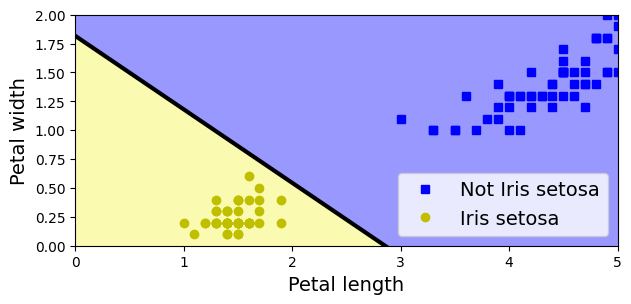
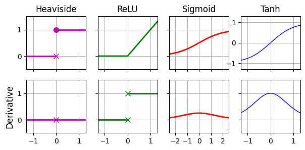
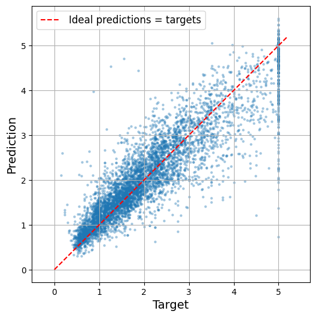
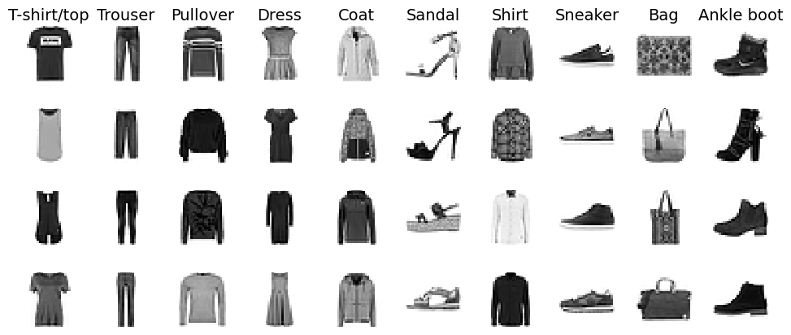

# 9장. 인공 신경망 소개

[← 8장. 비지도 학습](08_unsupervised_learning.md) · [📚 전체 목차](../README.md) · 10장. 파이토치로 신경망 구축하기 (정리 예정) →

> 📘 **교재** 『핸즈온 머신러닝 with 사이킷런, 파이토치』 9장 · 노트북 `09_artificial_neural_networks.ipynb`
>
> 8장까지는 사이킷런의 "전통적인" 머신러닝 모델이었다. 9장부터는 **인공 신경망(ANN)** 이다. 뇌의 뉴런에서 아이디어를 얻은 모델로, 층을 깊게 쌓으면 이미지·음성·언어처럼 크고 복잡한 문제를 풀 수 있다.
>
> - **9.1** 뉴런 하나(퍼셉트론)에서 출발해, 층을 쌓은 **다층 퍼셉트론(MLP)** 과 그것을 훈련하는 **역전파**까지
> - **9.2** 익숙한 사이킷런 API(`MLPRegressor`, `MLPClassifier`)로 회귀·분류 MLP를 직접 훈련
> - **9.3** 층 수·뉴런 수·학습률·배치 크기 같은 하이퍼파라미터를 어떻게 정할지
>
> ⬅️ **앞에서** 4장의 **경사 하강법·로지스틱 회귀·소프트맥스 회귀**가 그대로 신경망의 부품이 된다. 뉴런 하나 = 4장의 선형 모델 + 활성화 함수.  
> ➡️ **다음으로** 사이킷런의 MLP는 편하지만 구조를 자유롭게 바꿀 수 없고 GPU도 못 쓴다. 10장에서 **파이토치**로 같은 신경망을 직접 만든다.

## 이 장의 흐름

| 단계 | 절 | 핵심 질문 | 결과물 |
|---|---|---|---|
| 1. 뉴런 하나 | 9.1 | 인공 뉴런은 무엇을 계산하는가 | 논리 연산, TLU, `Perceptron` |
| 2. 한계와 돌파 | 9.1 | 뉴런 하나로 안 되는 문제는 어떻게 푸는가 | XOR 문제, 다층 퍼셉트론(MLP) |
| 3. 훈련 방법 | 9.1 | 층이 여러 개인 신경망은 어떻게 학습하는가 | 역전파, 활성화 함수(시그모이드·tanh·ReLU) |
| 4. 회귀 MLP | 9.2 | 신경망으로 숫자를 예측하려면 | `MLPRegressor`, 캘리포니아 주택 RMSE 0.533 |
| 5. 분류 MLP | 9.2 | 신경망으로 클래스를 예측하려면 | `MLPClassifier`, 패션 MNIST 정확도 89.1% |
| 6. 튜닝 | 9.3 | 수많은 하이퍼파라미터를 어떻게 정하는가 | 층 수·뉴런 수·학습률·배치 크기 가이드라인 |

## 데이터

| 데이터 | 형태 | 사용 절 | 비고 |
|---|---|---|---|
| 붓꽃 `load_iris()` | `(150, 2)` — 꽃잎 길이·너비만 | 9.1 | 타깃 = setosa 여부(이진) |
| 캘리포니아 주택 `fetch_california_housing()` | `(20640, 8)` | 9.2 회귀 | 타깃 = 중간 주택 가격(단위 10만 달러), 결측·범주형 없음 |
| 패션 MNIST `fetch_openml("Fashion-MNIST")` | `(70000, 784)` — 28×28 흑백 | 9.2 분류 | 의류 10종, 훈련 60,000 / 테스트 10,000 |
| CoverType `fetch_covtype()` | `(581012, 54)` | 연습문제 10 | 산림 피복 유형 7종 |

> ⚠️ 여기의 캘리포니아 주택 데이터는 2장의 `housing.csv`와 다른 버전이다. 사이킷런 내장판은 `ocean_proximity`(범주형)가 없고 결측값도 없어서 스케일링만 하면 바로 쓸 수 있다. 타깃 단위도 달러가 아니라 **10만 달러**다.

## 목차

- [0. 준비](#0-준비)
- [1. 생물학적 뉴런에서 인공 뉴런까지 (9.1)](#1-생물학적-뉴런에서-인공-뉴런까지-91)
   - [1-1. 신경망의 역사와 생물학적 뉴런](#1-1-신경망의-역사와-생물학적-뉴런)
   - [1-2. 뉴런을 사용한 논리 연산](#1-2-뉴런을-사용한-논리-연산)
   - [1-3. 퍼셉트론](#1-3-퍼셉트론)
   - [1-4. 사이킷런 Perceptron](#1-4-사이킷런-perceptron)
   - [1-5. 퍼셉트론의 한계와 XOR 문제](#1-5-퍼셉트론의-한계와-xor-문제)
   - [1-6. 다층 퍼셉트론과 역전파](#1-6-다층-퍼셉트론과-역전파)
   - [1-7. 활성화 함수](#1-7-활성화-함수)
- [2. 사이킷런으로 MLP 만들고 훈련하기 (9.2)](#2-사이킷런으로-mlp-만들고-훈련하기-92)
   - [2-1. 회귀 MLP의 구조](#2-1-회귀-mlp의-구조)
   - [2-2. MLPRegressor 훈련](#2-2-mlpregressor-훈련)
   - [2-3. 회귀 MLP 평가](#2-3-회귀-mlp-평가)
   - [2-4. 분류 MLP의 구조](#2-4-분류-mlp의-구조)
   - [2-5. 패션 MNIST 데이터](#2-5-패션-mnist-데이터)
   - [2-6. MLPClassifier 훈련과 평가](#2-6-mlpclassifier-훈련과-평가)
   - [2-7. 예측과 확률](#2-7-예측과-확률)
   - [2-8. 보충 코드: 파라미터 수와 순전파 직접 계산](#2-8-보충-코드-파라미터-수와-순전파-직접-계산)
- [3. 하이퍼파라미터 튜닝 가이드라인 (9.3)](#3-하이퍼파라미터-튜닝-가이드라인-93)
   - [3-1. 은닉 층 수](#3-1-은닉-층-수)
   - [3-2. 은닉 층의 뉴런 수](#3-2-은닉-층의-뉴런-수)
   - [3-3. 학습률](#3-3-학습률)
   - [3-4. 배치 크기](#3-4-배치-크기)
   - [3-5. 그 밖의 하이퍼파라미터](#3-5-그-밖의-하이퍼파라미터)
   - [3-6. 사이킷런 MLP 하이퍼파라미터 대응표](#3-6-사이킷런-mlp-하이퍼파라미터-대응표)
- [4. 연습문제](#4-연습문제)
   - [4-1. 개념 문제 (1~9번)](#4-1-개념-문제-19번)
   - [4-2. 10번 — CoverType 심층 MLP](#4-2-10번--covertype-심층-mlp)
- [5. 정리](#5-정리)
   - [5-1. 전체 흐름](#5-1-전체-흐름)
   - [5-2. 개념과 코드 대응](#5-2-개념과-코드-대응)
   - [5-3. 문제 유형별 MLP 구조 비교](#5-3-문제-유형별-mlp-구조-비교)
   - [5-4. 주요 결과](#5-4-주요-결과)
   - [5-5. 자주 쓴 코드 패턴](#5-5-자주-쓴-코드-패턴)
   - [5-6. 핵심 원칙](#5-6-핵심-원칙)

---

## 0. 준비

```python
import sys
assert sys.version_info >= (3, 10)

from packaging.version import Version
import sklearn
assert Version(sklearn.__version__) >= Version("1.6.1")

import matplotlib.pyplot as plt
plt.rc('font', size=14)
plt.rc('axes', labelsize=14, titlesize=14)
plt.rc('legend', fontsize=14)
plt.rc('xtick', labelsize=10)
plt.rc('ytick', labelsize=10)
```

모든 장 노트북 맨 앞에 반복되는 환경 확인 + 그래프 글꼴 설정. 각 줄의 의미는 [1장 0. 준비](01_the_machine_learning_landscape.md#0-준비) 참고.

---

## 1. 생물학적 뉴런에서 인공 뉴런까지 (9.1)

**인공 신경망(ANN, Artificial Neural Network)** = 뇌 속 뉴런의 연결 구조에서 아이디어를 얻은 머신러닝 모델. 다만 비행기가 새에게서 영감을 받았어도 날개를 퍼덕이지 않듯, 지금의 신경망은 생물학적 뉴런과 꽤 달라졌다.

| 신경망의 강점 | 설명 |
|---|---|
| 범용성 | 이미지 분류, 음성 인식, 추천, 번역, 게임 등 거의 모든 종류의 문제에 적용 |
| 확장성 | 데이터와 모델이 커질수록 성능이 계속 오름 — 전통적 모델은 어느 지점에서 정체 |
| 표현 학습 | 특성을 사람이 설계하지 않아도 층이 스스로 유용한 특성을 만들어 냄 |

### 1-1. 신경망의 역사와 생물학적 뉴런

> 🎯 **목적** — 신경망이 왜 오래된 아이디어인데 지금에 와서야 주류가 됐는지 이해한다.

**개념·원리**

| 시기 | 사건 |
|---|---|
| 1943 | 매컬러·피츠가 뉴런의 단순한 계산 모델 제안 — 최초의 인공 신경망 구조 |
| 1957 | 로젠블랫의 **퍼셉트론** |
| 1969 | 민스키·페퍼트가 퍼셉트론의 한계(XOR)를 지적 → 첫 번째 침체기 |
| 1980년대 | **역전파** 알고리즘 재발견·대중화 → 다시 관심 |
| 1990년대 | 서포트 벡터 머신 등 다른 기법이 더 좋은 결과·탄탄한 이론을 보여 다시 침체 |
| 2010년대~ | 딥러닝의 부흥 — 현재까지 이어짐 |

이번 부흥이 과거와 다른 이유:

| 이유 | 설명 |
|---|---|
| 데이터 | 신경망을 훈련할 만큼 방대한 데이터가 생겼다. 크고 복잡한 문제에서 다른 기법보다 성능이 좋다 |
| 컴퓨팅 성능 | 무어의 법칙 + 게임 산업이 만든 **GPU**, 클라우드 → 큰 신경망을 현실적인 시간에 훈련 |
| 알고리즘 개선 | 1990년대와 크게 다르진 않지만 작은 개선들이 큰 차이를 만들었다 |
| 이론적 우려 해소 | "지역 최적점에 갇힌다"는 걱정은 실제로는 드물고, 갇히더라도 대개 전역 최적점에 가까운 해 |
| 선순환 | 뛰어난 제품 → 관심·투자 → 더 많은 연구 → 더 나은 제품 |

**생물학적 뉴런**의 구조:

| 부위 | 역할 | 인공 뉴런에서 대응 |
|---|---|---|
| 수상돌기(dendrite) | 다른 뉴런에서 신호를 받음 | 입력 $x_i$ |
| 세포체(cell body) | 받은 신호를 모음 | 가중치 합 $z$ |
| 축삭돌기(axon) | 신호를 멀리 전달 | 출력 |
| 시냅스(synapse) | 뉴런과 뉴런이 만나는 접점, 신호 세기가 조절됨 | 가중치 $w_i$ |

- 뉴런은 짧은 전기 신호(**활동 전위**)를 만들어 내보낸다. 받은 신호가 충분히 쌓이면 자기도 신호를 발화한다
- 뉴런 하나는 단순하지만 수십억 개가 수천 개씩 서로 연결되어 복잡한 계산을 한다 → "단순한 단위를 많이 연결한다"가 신경망의 핵심 아이디어

### 1-2. 뉴런을 사용한 논리 연산

> 🎯 **목적** — 아주 단순한 뉴런 몇 개만으로도 계산을 할 수 있음을 확인한다.

**개념·원리**

매컬러·피츠의 **인공 뉴런**: 입력과 출력이 모두 켜짐/꺼짐(1/0)인 이진 뉴런. **일정 개수 이상의 입력이 켜지면** 출력을 켠다. 교재 예시는 "입력 2개 이상이 켜지면 발화"하는 뉴런이다.

| 연산 | 연결 방법 | 동작 |
|---|---|---|
| 항등 `C = A` | A에서 C로 연결 2개 | A가 켜지면 입력 2개가 켜진 셈 → C 발화 |
| 논리곱 `C = A ∧ B` | A, B에서 각각 연결 1개 | 둘 다 켜져야 2개 → C 발화 |
| 논리합 `C = A ∨ B` | A, B에서 각각 연결 2개 | 하나만 켜져도 2개 → C 발화 |
| 부정 포함 `C = A ∧ ¬B` | A에서 연결 2개, B에서 **억제** 연결 | A가 켜지고 B가 꺼져 있을 때만 발화 |

이런 뉴런을 조합하면 어떤 논리 명제든 계산하는 네트워크를 만들 수 있다.

**보충 코드** — 같은 아이디어를 "가중치 합 + 임곗값" 형태로 직접 확인. 뒤에 나올 TLU와 같은 계산이다.

```python
import numpy as np

step = lambda z: (z >= 0).astype(int)     # 0 이상이면 1(발화), 아니면 0

A = np.array([0, 0, 1, 1])
B = np.array([0, 1, 0, 1])                # (A, B)의 4가지 조합

step(A + B - 2)    # AND : 둘 다 1이어야 합이 2 → 0 이상
# array([0, 0, 0, 1])
step(A + B - 1)    # OR  : 하나만 1이어도 합이 1 → 0 이상
# array([0, 1, 1, 1])
step(-A + 0)       # NOT A : 가중치를 음수로
# array([1, 1, 0, 0])
```

| 연산 | 가중치 $(w_A, w_B)$ | 편향 $b$ | 의미 |
|---|---|---|---|
| AND | (1, 1) | −2 | 합이 2 이상이어야 발화 |
| OR | (1, 1) | −1 | 합이 1 이상이면 발화 |
| NOT A | (−1, 0) | 0 | A가 켜지면 음수가 되어 꺼짐 |

> 💡 **가중치와 편향만 바꾸면 같은 뉴런이 다른 연산을 한다.** 이 값들을 사람이 정하지 않고 데이터에서 학습하게 만든 것이 다음 절의 퍼셉트론이다.

### 1-3. 퍼셉트론

> 🎯 **목적** — 숫자 입력을 받는 뉴런(TLU)의 계산식과, 그 가중치를 학습하는 규칙을 정리한다.

**개념·원리**

**퍼셉트론**(로젠블랫, 1957)은 **TLU(Threshold Logic Unit, 임계 논리 유닛)** 라는 뉴런을 쓴다. 입력·출력이 이진값이 아니라 **숫자**이고, 입력마다 **가중치**가 붙는다.

TLU 하나의 계산은 두 단계다.

```math
z = w_1 x_1 + w_2 x_2 + \cdots + w_n x_n + b = \mathbf{w}^\top \mathbf{x} + b
```

```math
h_{\mathbf{w}}(\mathbf{x}) = \text{step}(z)
```

| 기호 | 의미 |
|---|---|
| $x_i$ | $i$번째 입력 특성 |
| $w_i$ | $i$번째 연결 가중치 |
| $b$ | 편향 |
| $z$ | 입력의 가중치 합 — 4장 선형 모델의 계산과 같다 |
| $\text{step}$ | 계단 함수. $z$가 임곗값을 넘는지만 본다 |

자주 쓰는 계단 함수:

```math
\text{heaviside}(z) = \begin{cases} 0 & z < 0 \\ 1 & z \ge 0 \end{cases}
\qquad
\text{sgn}(z) = \begin{cases} -1 & z < 0 \\ 0 & z = 0 \\ +1 & z > 0 \end{cases}
```

- TLU 하나 = **선형 이진 분류기**. 가중치 합을 계산해 임곗값을 넘으면 양성. 4장의 로지스틱 회귀와 같은 구조인데, 확률 대신 0/1을 바로 낸다
- **퍼셉트론** = TLU 여러 개를 **한 층**으로 늘어놓은 것. 각 TLU는 모든 입력에 연결된다 → **완전 연결 층(밀집 층, dense layer)**
- 입력이 들어오는 자리를 **입력 층**이라 부른다. 입력 층은 계산 없이 값을 그대로 넘긴다
- TLU가 여러 개면 출력도 여러 개 → 다중 레이블 분류가 된다 (소프트맥스를 쓰면 다중 클래스)

완전 연결 층의 출력을 샘플 여러 개에 대해 한 번에 계산:

```math
h_{\mathbf{W}, \mathbf{b}}(\mathbf{X}) = \phi(\mathbf{X}\mathbf{W} + \mathbf{b})
```

| 기호 | 형태 | 의미 |
|---|---|---|
| $\mathbf{X}$ | (샘플 수, 입력 수) | 입력 행렬. 행 = 샘플, 열 = 특성 |
| $\mathbf{W}$ | (입력 수, 뉴런 수) | 가중치 행렬. 열 하나가 뉴런 하나의 가중치 |
| $\mathbf{b}$ | (뉴런 수,) | 편향 벡터. 뉴런마다 하나 |
| $\phi$ | — | **활성화 함수**. TLU에서는 계단 함수 |

> 📌 $\mathbf{X}\mathbf{W}$는 (샘플 수, 뉴런 수) 행렬이고 $\mathbf{b}$는 벡터다. 더할 때 $\mathbf{b}$가 **모든 행에 똑같이** 더해진다(브로드캐스팅). 이 식 하나가 신경망 층 계산의 전부이고, 뒤의 MLP도 이 식을 층마다 반복할 뿐이다.

**퍼셉트론 학습 규칙**

- **헤브의 규칙**: "함께 발화하는 뉴런은 서로 연결이 강해진다"
- 퍼셉트론은 이를 변형해, **예측이 틀렸을 때** 올바른 예측에 기여했어야 할 입력의 가중치를 키운다

```math
w_{i,j}^{(\text{다음 스텝})} = w_{i,j} + \eta\,(y_j - \hat{y}_j)\,x_i
```

| 기호 | 의미 |
|---|---|
| $w_{i,j}$ | $i$번째 입력과 $j$번째 뉴런 사이의 가중치 |
| $x_i$ | 현재 훈련 샘플의 $i$번째 입력값 |
| $\hat{y}_j$ | $j$번째 뉴런의 출력(예측) |
| $y_j$ | $j$번째 뉴런의 타깃 |
| $\eta$ | 학습률 |

| 경우 | $y - \hat{y}$ | 가중치 변화 |
|---|---|---|
| 맞힘 | 0 | 그대로 |
| 양성인데 음성으로 예측 | +1 | $+\eta x_i$ → $z$가 커지는 방향 |
| 음성인데 양성으로 예측 | −1 | $-\eta x_i$ → $z$가 작아지는 방향 |

- 샘플을 **하나씩** 넣으며 갱신한다 → 4장의 확률적 경사 하강법과 같은 방식
- 결정 경계는 **선형**이다. 훈련 샘플이 **선형적으로 구분 가능**하면 반드시 해에 수렴한다 (**퍼셉트론 수렴 이론**)

### 1-4. 사이킷런 Perceptron

**코드**

```python
import numpy as np
from sklearn.datasets import load_iris
from sklearn.linear_model import Perceptron

iris = load_iris(as_frame=True)
X = iris.data[["petal length (cm)", "petal width (cm)"]].values
y = (iris.target == 0)  # Iris setosa

per_clf = Perceptron(random_state=42)
per_clf.fit(X, y)

X_new = [[2, 0.5], [3, 1]]
y_pred = per_clf.predict(X_new)
y_pred
# array([ True, False])
```

| 코드 | 의미 |
|---|---|
| `load_iris(as_frame=True)` | 데이터를 판다스 DataFrame으로 받음 → 열 이름으로 선택 가능 |
| `[[...]].values` | 꽃잎 길이·너비 두 열만 골라 넘파이 배열로 |
| `iris.target == 0` | 품종 0(setosa)이면 `True` → 이진 분류 타깃 |
| `Perceptron()` | TLU 하나짜리 퍼셉트론 |

**결과 해석**

- `[2, 0.5]`(작은 꽃잎) → `True`(setosa), `[3, 1]` → `False`

학습된 가중치로 직접 확인 (보충 코드):

```python
per_clf.coef_, per_clf.intercept_
# (array([[-1.4, -2.2]]), array([4.]))

per_clf.decision_function([[2, 0.5], [3, 1]])
# array([ 0.1, -2.4])
```

| 샘플 | $z = -1.4 x_1 - 2.2 x_2 + 4$ | 예측 |
|---|---|---|
| `[2, 0.5]` | $-2.8 - 1.1 + 4 = 0.1$ | $z \ge 0$ → `True` |
| `[3, 1]` | $-4.2 - 2.2 + 4 = -2.4$ | $z < 0$ → `False` |

- 꽃잎이 길고 넓을수록 $z$가 작아진다(가중치가 둘 다 음수) → setosa가 아니다
- `per_clf.n_iter_`는 7, 훈련 정확도는 1.0 — 선형 분리 가능한 데이터라 7 에포크 만에 완벽한 경계를 찾았다

#### Perceptron = 특수한 SGDClassifier

```python
from sklearn.linear_model import SGDClassifier

sgd_clf = SGDClassifier(loss="perceptron", penalty=None,
                        learning_rate="constant", eta0=1, random_state=42)
sgd_clf.fit(X, y)
assert (sgd_clf.coef_ == per_clf.coef_).all()
assert (sgd_clf.intercept_ == per_clf.intercept_).all()
```

| 설정 | 의미 |
|---|---|
| `loss="perceptron"` | 퍼셉트론 손실 — 틀린 샘플에서만 갱신 |
| `penalty=None` | 규제 없음 |
| `learning_rate="constant", eta0=1` | 학습률을 1로 고정 |

- 두 `assert`가 통과 → 가중치와 편향이 **완전히 같다**. `Perceptron`은 3장에서 쓴 `SGDClassifier`의 특수한 경우일 뿐이다

#### 결정 경계

```python
from matplotlib.colors import ListedColormap

a = -per_clf.coef_[0, 0] / per_clf.coef_[0, 1]
b = -per_clf.intercept_ / per_clf.coef_[0, 1]
axes = [0, 5, 0, 2]
x0, x1 = np.meshgrid(
    np.linspace(axes[0], axes[1], 500).reshape(-1, 1),
    np.linspace(axes[2], axes[3], 200).reshape(-1, 1),
)
X_new = np.c_[x0.ravel(), x1.ravel()]
y_predict = per_clf.predict(X_new)
zz = y_predict.reshape(x0.shape)
custom_cmap = ListedColormap(['#9898ff', '#fafab0'])

plt.figure(figsize=(7, 3))
plt.plot(X[y == 0, 0], X[y == 0, 1], "bs", label="Not Iris setosa")
plt.plot(X[y == 1, 0], X[y == 1, 1], "yo", label="Iris setosa")
plt.plot([axes[0], axes[1]], [a * axes[0] + b, a * axes[1] + b], "k-",
         linewidth=3)
plt.contourf(x0, x1, zz, cmap=custom_cmap)
plt.xlabel("Petal length")
plt.ylabel("Petal width")
plt.legend(loc="lower right")
plt.axis(axes)
plt.show()
```

| 코드 | 의미 |
|---|---|
| `a`, `b` | 경계선 $w_1 x_1 + w_2 x_2 + b = 0$을 $x_2 = a x_1 + b$ 꼴로 풀어 쓴 기울기·절편. 여기서는 $x_2 = -0.636 x_1 + 1.818$ |
| `np.meshgrid` → `np.c_[...ravel()]` | 그림 영역 전체를 500×200 격자점으로 만들어 `(100000, 2)` 입력으로 변환 |
| `predict` → `reshape` | 격자점마다 예측한 뒤 다시 격자 모양으로 |
| `contourf` | 예측값에 따라 영역을 색칠 |



- 경계는 **직선**이다. 두 클래스를 완벽히 나누지만, setosa(노란 점) 쪽에 훨씬 가깝게 붙어 있다
- 퍼셉트론은 모든 샘플을 맞히는 순간 **학습을 멈춘다**. 그래서 "가장 여유 있는 경계"가 아니라 "처음 찾은 경계"에 머문다

> ⚠️ **퍼셉트론 vs 로지스틱 회귀**
> - 퍼셉트론은 **클래스 확률을 내지 않는다**. 임곗값 기준의 0/1만 낸다
> - 기본적으로 규제를 쓰지 않고, 훈련 샘플을 다 맞히면 멈춘다 → 일반화가 로지스틱 회귀·SVM보다 떨어지는 경우가 많다
> - 대신 훈련이 조금 더 빠를 수 있다
> - 실무에서는 대개 로지스틱 회귀가 더 나은 선택

### 1-5. 퍼셉트론의 한계와 XOR 문제

> 🎯 **목적** — 뉴런 한 층으로는 풀 수 없는 문제가 있고, 층을 쌓으면 풀린다는 것을 확인한다.

**개념·원리**

- 민스키·페퍼트(1969): 퍼셉트론은 **XOR(배타적 논리합)** 같은 아주 단순한 문제도 못 푼다
- 이유: XOR은 직선 하나로 나눌 수 없다. 퍼셉트론의 경계는 직선뿐이다 (다른 선형 분류기도 똑같다)
- 해결: 퍼셉트론을 **여러 층 쌓는다** → **다층 퍼셉트론(MLP)**

| A | B | A ⊕ B |
|---|---|---|
| 0 | 0 | 0 |
| 0 | 1 | 1 |
| 1 | 0 | 1 |
| 1 | 1 | 0 |

(0,1)과 (1,0)이 한 클래스, (0,0)과 (1,1)이 다른 클래스 — 대각선으로 엇갈려 있어 직선 하나로 가를 수 없다.

**보충 코드 ① — 가중치를 손으로 정한 2층 네트워크**

```python
h1 = step(A + B - 1)      # 은닉 뉴런 1 : OR
h2 = step(A + B - 2)      # 은닉 뉴런 2 : AND
step(h1 - h2 - 1)         # 출력 뉴런   : h1이고 h2가 아닐 때
# array([0, 1, 1, 0])     ← XOR
```

- XOR = "OR이면서 AND는 아님". 은닉 층이 OR과 AND를 먼저 계산해 주면, 출력 뉴런은 그 둘만 보고 **직선 하나로** 가를 수 있다
- 은닉 층이 하는 일 = 원래 입력을 **선형 분리 가능한 새 특성으로 바꾸기**

**보충 코드 ② — 학습으로 확인**

```python
from sklearn.neural_network import MLPClassifier

X_xor = np.c_[A, B]
y_xor = A ^ B                                   # [0, 1, 1, 0]

per = Perceptron(random_state=42, max_iter=1000, tol=None).fit(X_xor, y_xor)
per.predict(X_xor), per.score(X_xor, y_xor)
# (array([0, 0, 0, 0]), 0.5)                    ← 1,000 에포크를 돌려도 실패

mlp = MLPClassifier(hidden_layer_sizes=[4], activation="tanh",
                    solver="lbfgs", random_state=42, max_iter=1000).fit(X_xor, y_xor)
mlp.predict(X_xor), mlp.score(X_xor, y_xor)
# (array([0, 1, 1, 0]), 1.0)                    ← 은닉 층 하나로 해결
```

> ✅ 퍼셉트론은 정확도 0.5에서 벗어나지 못했고, 은닉 뉴런 4개짜리 MLP는 네 점을 모두 맞혔다.

> ⚠️ 은닉 뉴런을 이론상 최소인 2개로 줄여 `random_state`를 0~4로 바꿔 보니 5번 중 2번만 XOR을 맞혔다. "표현할 수 있다"와 "경사 하강법으로 그 해를 찾는다"는 다른 문제다. 뉴런을 넉넉히 주면 훈련이 쉬워진다 — 3-2절의 "크게 잡고 규제하라"와 이어진다.

### 1-6. 다층 퍼셉트론과 역전파

> 🎯 **목적** — MLP의 구조 용어를 정리하고, 여러 층의 가중치를 한꺼번에 학습하는 역전파의 순서를 이해한다.

**개념·원리**

**MLP의 구조**

| 구성 | 설명 |
|---|---|
| 입력 층 | 특성을 그대로 통과시킴. 계산 없음 |
| 은닉 층(hidden layer) | 입력 층과 출력 층 사이의 층. 1개 이상 |
| 출력 층 | 최종 예측을 내는 층 |
| 하위 층 / 상위 층 | 입력에 가까운 층 / 출력에 가까운 층 |

- 신호가 입력 → 출력 **한 방향**으로만 흐른다 → **피드포워드 신경망(FNN)**
- 은닉 층을 많이 쌓은 신경망 = **심층 신경망(DNN)**. 이를 연구하는 분야가 **딥러닝**
- 모든 층이 완전 연결 층이다 → 한 층의 모든 뉴런이 다음 층의 모든 뉴런과 연결

**역전파(backpropagation)**

오랫동안 MLP를 훈련할 방법이 없었다. 은닉 층의 뉴런에는 "정답"이 없어서 퍼셉트론 학습 규칙을 쓸 수 없기 때문이다. 해법은 4장의 경사 하강법을 쓰되, **모든 가중치에 대한 오차의 그레이디언트를 효율적으로 구하는 것**이었다.

> **역전파** = 신경망을 **정방향 한 번, 역방향 한 번** 지나가는 것만으로 모든 가중치·편향에 대한 오차의 그레이디언트를 계산하는 방법. 그레이디언트를 자동으로 구하는 이 계산 기법을 **후진 모드 자동 미분(reverse-mode autodiff)** 이라 한다.

훈련 순서:

| 단계 | 이름 | 하는 일 |
|---|---|---|
| 0 | 초기화 | 모든 가중치를 **무작위**로 초기화 |
| 1 | 미니배치 | 훈련 세트에서 샘플 몇 개(예: 32개)를 꺼냄 |
| 2 | **정방향 계산** | 입력 층 → 은닉 층 → 출력 층 순서로 각 층의 출력을 계산. 예측할 때와 같지만 **중간 결과를 모두 저장**한다 |
| 3 | 오차 측정 | 손실 함수로 출력과 정답의 차이를 계산 |
| 4 | **역방향 계산** | 출력 층 → 입력 층 방향으로, **연쇄 법칙**을 써서 각 연결이 오차에 얼마나 기여했는지(그레이디언트) 계산 |
| 5 | 경사 하강법 스텝 | 구한 그레이디언트로 모든 가중치를 조금씩 수정 |

- 훈련 세트 전체를 한 번 다 쓰는 것 = **에포크(epoch)**. 1~5단계를 미니배치마다 반복하고, 이를 여러 에포크 되풀이한다
- 4단계에서 2단계에 저장해 둔 중간 결과를 재사용한다 → 가중치가 수백만 개여도 한 번의 왕복으로 끝난다

> ⚠️ **가중치는 반드시 무작위로 초기화해야 한다.** 모든 가중치·편향을 0(또는 같은 값)으로 두면 한 층의 뉴런이 전부 똑같은 값을 내고, 역전파도 전부 똑같이 갱신한다 → 뉴런이 몇 개든 뉴런 하나처럼 움직인다. 무작위 초기화가 이 **대칭성을 깨서** 뉴런마다 다른 역할을 배우게 한다.

> 💡 4장과의 연결: 경사 하강법 자체는 4장과 같다. 달라진 건 "그레이디언트를 식으로 직접 유도"하던 것을 "역전파가 자동으로 계산"한다는 점뿐이다. 10장의 파이토치가 이 자동 미분을 제공한다.

### 1-7. 활성화 함수

> 🎯 **목적** — 계단 함수를 왜 버렸는지, 층 사이에 왜 비선형 함수가 꼭 필요한지 이해한다.

**개념·원리**

**① 계단 함수로는 경사 하강법을 쓸 수 없다**

- 계단 함수는 어디서나 평평하다 → 기울기가 0 → 경사 하강법이 움직일 방향이 없다
- 그래서 역전파를 처음 적용할 때 계단 함수를 **시그모이드**로 바꿨다. 시그모이드는 모든 곳에서 기울기가 0이 아니다

**② 비선형 활성화 함수가 없으면 층을 쌓는 의미가 없다**

- 선형 변환을 여러 번 이어 붙여도 결과는 선형 변환 하나다. 예: $f(x) = 2x + 3$, $g(x) = 5x - 1$이면 $f(g(x)) = 10x + 1$
- 층 사이에 비선형성이 없으면 아무리 깊은 신경망도 **층 하나짜리와 같다** → XOR도 못 푼다
- 반대로 비선형 활성화 함수를 쓰는 충분히 큰 신경망은 이론적으로 어떤 연속 함수든 근사할 수 있다

| 함수 | 식 | 출력 범위 | 특징 |
|---|---|---|---|
| 계단(Heaviside) | $z \ge 0$이면 1, 아니면 0 | {0, 1} | 기울기가 0 → 경사 하강법 불가 |
| 시그모이드 | $\sigma(z) = \dfrac{1}{1 + e^{-z}}$ | (0, 1) | S자, 어디서나 미분 가능. 4장 로지스틱 회귀에서 쓴 그 함수 |
| 하이퍼볼릭 탄젠트 | $\tanh(z) = 2\sigma(2z) - 1$ | (−1, 1) | S자인데 **0이 중심** → 층의 출력이 0 근처에 모여 훈련 초기 수렴이 빨라지는 경향 |
| ReLU | $\text{ReLU}(z) = \max(0, z)$ | [0, ∞) | 계산이 매우 빠름. $z = 0$에서 미분 불가, $z < 0$에서 기울기 0. 그래도 실제로 잘 작동해 **기본값**이 됨 |

**코드** — 그림 9-8 (활성화 함수와 도함수)

```python
from scipy.special import expit as sigmoid

def relu(z):
    return np.maximum(0, z)

def derivative(f, z, eps=0.000001):
    return (f(z + eps) - f(z - eps)) / (2 * eps)

max_z = 2.5
z = np.linspace(-max_z, max_z, 200)

fig, axes = plt.subplots(nrows=2, ncols=4, figsize=(7, 3))
# 위 행: 함수, 아래 행: 도함수
axes[0, 1].plot(z, relu(z), "g-", linewidth=2)
axes[0, 2].plot(z, sigmoid(z), "r-", linewidth=2)
axes[1, 2].plot(z, derivative(sigmoid, z), "r-", linewidth=2)
axes[0, 3].plot(z, np.tanh(z), "b-", linewidth=1)
axes[1, 3].plot(z, derivative(np.tanh, z), "b-", linewidth=1)
# (계단 함수와 ReLU 도함수는 선분·점으로 직접 그림. 축 눈금 설정 생략)
plt.show()
```

| 코드 | 의미 |
|---|---|
| `scipy.special.expit` | 시그모이드 함수 (수치적으로 안정적인 구현) |
| `np.maximum(0, z)` | 원소별로 0과 비교해 큰 값 → ReLU |
| `derivative(f, z)` | **수치 미분**. 아주 작은 `eps`만큼 양쪽으로 움직였을 때의 변화율 $\dfrac{f(z+\epsilon) - f(z-\epsilon)}{2\epsilon}$ |

**결과 해석**



| 함수 | 도함수의 모양 | 의미 |
|---|---|---|
| 계단 | 전 구간 0 | 학습 신호가 없다 |
| ReLU | $z < 0$에서 0, $z > 0$에서 1 | 양수 쪽에서는 기울기가 줄지 않고 그대로 전달된다 |
| 시그모이드 | 0 근처에서 최대 0.25, 양끝으로 갈수록 0 | 입력이 크거나 작으면 기울기가 거의 사라진다(포화) |
| tanh | 0에서 최대 1, 양끝으로 갈수록 0 | 시그모이드보다 기울기가 크지만 마찬가지로 포화한다 |

> 💡 시그모이드·tanh의 **포화**(양끝에서 기울기 ≈ 0)는 층이 깊어질수록 문제가 된다. 역전파가 기울기를 층마다 곱해 가는데, 작은 값을 여러 번 곱하면 하위 층까지 신호가 거의 닿지 않는다. ReLU가 기본값이 된 이유이고, 11장에서 자세히 다룬다.

---

## 2. 사이킷런으로 MLP 만들고 훈련하기 (9.2)

사이킷런의 `sklearn.neural_network`에는 MLP가 두 개 있다. 지금까지 쓴 `fit()` / `predict()` 방식 그대로 쓸 수 있다.

| 클래스 | 용도 | 출력 층 | 손실 |
|---|---|---|---|
| `MLPRegressor` | 회귀 | 활성화 함수 없음 | 평균 제곱 오차 |
| `MLPClassifier` | 분류 | 이진: 시그모이드 / 다중: 소프트맥스 | 크로스 엔트로피 |

### 2-1. 회귀 MLP의 구조

> 🎯 **목적** — 회귀 문제에 맞는 출력 층·손실 함수를 정한다.

**개념·원리**

- 값 하나를 예측 → **출력 뉴런 1개**. 여러 값을 동시에 예측(다변량 회귀)하면 값마다 1개씩. 예: 물체 중심 좌표 (x, y) → 2개, 경계 상자까지 → 4개
- 은닉 층은 ReLU, 출력 층은 보통 **활성화 함수 없이** 값을 그대로 낸다 → 어떤 범위의 값이든 출력 가능

출력 범위를 제한하고 싶을 때:

| 원하는 출력 | 출력 층 활성화 함수 |
|---|---|
| 제한 없음 | 없음 |
| 항상 양수 | ReLU, 또는 매끄러운 변형인 소프트플러스 $\log(1 + e^{z})$ |
| 정해진 범위 안 | 시그모이드(0~1) 또는 tanh(−1~1)를 쓰고, 타깃을 그 범위로 스케일 조정 |

손실 함수:

| 손실 | 언제 |
|---|---|
| 평균 제곱 오차(MSE) | 기본 |
| 평균 절대 오차(MAE) | 이상치가 많을 때 — 큰 오차를 덜 강조 |
| 후버(Huber) 손실 | 둘의 절충. 오차가 작으면 제곱, 크면 절댓값처럼 동작 |

전형적인 회귀 MLP 구조:

| 하이퍼파라미터 | 전형적인 값 |
|---|---|
| 은닉 층 수 | 문제에 따라 다름. 보통 1~5 |
| 은닉 층의 뉴런 수 | 문제에 따라 다름. 보통 10~100 |
| 출력 뉴런 수 | 예측할 값마다 1개 |
| 은닉 층 활성화 함수 | ReLU |
| 출력 층 활성화 함수 | 없음 (양수: ReLU·소프트플러스 / 범위 제한: 시그모이드·tanh) |
| 손실 함수 | MSE (이상치가 많으면 후버) |

> ⚠️ `MLPRegressor`는 출력 층 활성화 함수를 **지정할 수 없고** 손실도 **MSE만** 지원한다. 위 표의 다른 선택지를 쓰려면 10장의 파이토치가 필요하다.

### 2-2. MLPRegressor 훈련

**코드**

```python
from sklearn.datasets import fetch_california_housing
from sklearn.metrics import root_mean_squared_error
from sklearn.model_selection import train_test_split
from sklearn.neural_network import MLPRegressor
from sklearn.pipeline import make_pipeline
from sklearn.preprocessing import StandardScaler

housing = fetch_california_housing()
X_train, X_test, y_train, y_test = train_test_split(
    housing.data, housing.target, random_state=42)

mlp_reg = MLPRegressor(hidden_layer_sizes=[50, 50, 50], early_stopping=True,
                       verbose=True, random_state=42)
pipeline = make_pipeline(StandardScaler(), mlp_reg)
pipeline.fit(X_train, y_train)
```

| 코드 | 의미 |
|---|---|
| `train_test_split(..., random_state=42)` | 기본 비율 75% / 25% → 훈련 15,480 / 테스트 5,160 |
| `hidden_layer_sizes=[50, 50, 50]` | 뉴런 50개짜리 은닉 층 **3개**. 리스트 길이 = 은닉 층 수 |
| `early_stopping=True` | 훈련 세트의 10%를 검증용으로 떼어 놓고, 검증 점수가 나아지지 않으면 훈련 중단 |
| `verbose=True` | 에포크마다 손실과 검증 점수를 출력 |
| `make_pipeline(StandardScaler(), mlp_reg)` | 표준화 → MLP 순서로 연결 (2장의 파이프라인) |

- 입력 층·출력 층은 적지 않는다. 입력 뉴런 수(8)와 출력 뉴런 수(1)는 `fit()`에서 데이터 형태를 보고 자동으로 정해진다
- 은닉 층 활성화 함수는 기본값 ReLU, 옵티마이저는 기본값 **Adam**(경사 하강법의 개선판, 11장), L2 규제 `alpha=0.0001`이 기본으로 조금 들어간다

> ⚠️ **신경망에는 스케일링이 필수다.** 경사 하강법은 특성 스케일이 다르면 수렴이 느려진다(4장). 캘리포니아 데이터는 중간 소득(0~15)과 인구(수천)처럼 스케일 차이가 커서 `StandardScaler` 없이는 훈련이 잘 되지 않는다.

**결과 해석**

```
Iteration 1, loss = 0.85190332
Validation score: 0.534299
Iteration 2, loss = 0.28288639
Validation score: 0.651094
...
Iteration 34, loss = 0.13509029
Validation score: 0.791536
...
Iteration 45, loss = 0.12960481
Validation score: 0.788517
Validation score did not improve more than tol=0.000100 for 10 consecutive epochs. Stopping.
```

| 항목 | 의미 |
|---|---|
| `Iteration` | 에포크 번호 (훈련 세트를 한 번 다 본 횟수) |
| `loss` | 훈련 손실. 계속 감소한다 |
| `Validation score` | 떼어 둔 검증 세트에서의 **R²** (회귀 모델의 `score()`). 1에 가까울수록 좋다 |
| 마지막 줄 | 검증 점수가 `tol`(0.0001) 넘게 개선되지 않는 에포크가 `n_iter_no_change`(10)번 이어져 중단 |

- 훈련 손실은 45 에포크까지 계속 줄지만 검증 점수는 34 에포크(0.7915) 이후 제자리 → 그 뒤로는 **훈련 세트에만 더 맞춰지고 있다**는 신호
- 4장의 조기 종료와 같은 원리. 훈련이 끝나면 **검증 점수가 가장 좋았던 시점의 가중치**로 되돌린다

```python
mlp_reg.best_validation_score_
# 0.791536125425778
```

### 2-3. 회귀 MLP 평가

**코드**

```python
y_pred = pipeline.predict(X_test)
rmse = root_mean_squared_error(y_test, y_pred)
rmse
# 0.5327699946812925
```

- 타깃 단위가 10만 달러 → 테스트 RMSE 약 **53,000달러**

```python
plt.figure(figsize=(6, 6))
plt.scatter(y_test, y_pred, s=5, alpha=0.3)
plt.plot([0, 5.2], [0, 5.2], color='red', linestyle='--',
         label="Ideal predictions = targets")
plt.axis("equal")
plt.xlabel("Target")
plt.ylabel("Prediction")
plt.legend(fontsize=12)
plt.grid()
plt.show()
```

| 코드 | 의미 |
|---|---|
| `scatter(y_test, y_pred, s=5, alpha=0.3)` | 가로 = 실제값, 세로 = 예측값. 점이 5,160개라 작고 반투명하게 |
| 빨간 점선 | 예측 = 실제인 이상적인 선 (y = x) |
| `plt.axis("equal")` | 가로·세로 눈금 간격을 같게 → 점선이 정확히 45° |

**결과 해석**



- 점들이 대각선을 따라 모여 있다 → 전반적으로 잘 맞는다. 값이 클수록 퍼짐이 커진다
- **오른쪽 끝(타깃 = 5)의 세로줄**: 원본 데이터에서 주택 가격이 50만 달러로 **상한 처리**돼 있어서 생긴다. 2장에서 히스토그램으로 확인했던 그 상한이다. 실제로는 더 비쌌을 집이 모두 5로 기록돼 있어 예측이 위아래로 넓게 흩어진다

> 📌 **정리**
> - `MLPRegressor(hidden_layer_sizes=[...])` + `StandardScaler` 파이프라인이 기본 형태
> - `early_stopping=True`면 검증 세트를 알아서 떼어 내고 과대적합 전에 멈춘다
> - 이 설정으로 테스트 RMSE 0.533. 랜덤 포레스트로도 비슷한 성능을 낼 수 있는 문제라, 표 형태의 작은 데이터에서 신경망이 압도적이지는 않다

### 2-4. 분류 MLP의 구조

> 🎯 **목적** — 이진·다중 레이블·다중 클래스 분류에 맞는 출력 층을 구분한다.

**개념·원리**

| 분류 유형 | 출력 뉴런 수 | 출력 층 활성화 함수 | 출력의 의미 |
|---|---|---|---|
| 이진 분류 | 1 | 시그모이드 | 양성 클래스일 확률 (음성 확률 = 1 − 출력) |
| 다중 레이블 이진 분류 | 레이블마다 1 | 시그모이드 | 레이블별 확률. **합이 1일 필요 없음** |
| 다중 클래스 분류 | 클래스마다 1 | 소프트맥스 | 클래스별 확률. **합이 1** |

- 다중 레이블 예: 이메일이 스팸인지 + 긴급한지를 동시에 예측 → 출력 뉴런 2개. 긴급한 정상 메일, 긴급하지 않은 스팸 등 조합이 모두 가능
- 다중 클래스 예: 숫자 0~9 중 하나 → 출력 뉴런 10개 + 소프트맥스 (4장 소프트맥스 회귀와 같은 출력)
- 손실 함수는 확률 분포를 예측하므로 **크로스 엔트로피**(로그 손실)

전형적인 분류 MLP 구조:

| 하이퍼파라미터 | 이진 분류 | 다중 레이블 이진 분류 | 다중 클래스 분류 |
|---|---|---|---|
| 은닉 층 수 | 보통 1~5 | 보통 1~5 | 보통 1~5 |
| 출력 뉴런 수 | 1 | 레이블마다 1 | 클래스마다 1 |
| 출력 층 활성화 함수 | 시그모이드 | 시그모이드 | 소프트맥스 |
| 손실 함수 | 크로스 엔트로피 | 크로스 엔트로피 | 크로스 엔트로피 |

> 💡 4장과의 연결: 은닉 층이 **하나도 없는** 분류 MLP는 이진이면 로지스틱 회귀, 다중 클래스면 소프트맥스 회귀와 같다. MLP는 그 앞에 "특성을 스스로 만들어 내는 층"을 붙인 것이다.

### 2-5. 패션 MNIST 데이터

**코드**

```python
from sklearn.datasets import fetch_openml

fashion_mnist = fetch_openml(name="Fashion-MNIST", as_frame=False)
targets = fashion_mnist.target.astype(int)

X_train, y_train = fashion_mnist.data[:60_000], targets[:60_000]
X_test, y_test = fashion_mnist.data[60_000:], targets[60_000:]
```

| 코드 | 의미 |
|---|---|
| `fetch_openml(name="Fashion-MNIST", as_frame=False)` | OpenML에서 내려받음. `as_frame=False` → 넘파이 배열 |
| `.astype(int)` | 타깃이 문자열 `'0'`~`'9'`로 오므로 정수로 변환 (3장 MNIST와 같은 주의점) |
| `[:60_000]` / `[60_000:]` | 이미 섞여 있고 앞 60,000개가 훈련, 뒤 10,000개가 테스트로 정해져 있음 |

- 3장의 MNIST와 **형식이 완전히 같다**: 28×28 흑백 이미지 70,000장, 클래스 10개, 픽셀값 0~255
- 다만 손글씨 숫자 대신 **의류 이미지**라 훨씬 어렵다. 선형 모델이 MNIST에서는 정확도 92% 정도를 내지만 패션 MNIST에서는 83% 정도에 그친다

```python
X_sample = X_train[0].reshape(28, 28)   # 784 → 28×28
plt.figure(figsize=(1, 1))
plt.imshow(X_sample, cmap="binary")
plt.axis('off')
plt.show()

class_names = ["T-shirt/top", "Trouser", "Pullover", "Dress", "Coat",
               "Sandal", "Shirt", "Sneaker", "Bag", "Ankle boot"]
class_names[y_train[0]]
# 'Ankle boot'
```

- 레이블은 0~9 숫자뿐이라 이름 목록 `class_names`를 따로 만들어 둔다. 첫 훈련 이미지는 레이블 9 → 앵클 부츠

| 레이블 | 0 | 1 | 2 | 3 | 4 | 5 | 6 | 7 | 8 | 9 |
|---|---|---|---|---|---|---|---|---|---|---|
| 클래스 | 티셔츠/상의 | 바지 | 풀오버 | 드레스 | 코트 | 샌들 | 셔츠 | 스니커즈 | 가방 | 앵클 부츠 |

```python
n_rows = 4
plt.figure(figsize=(12, n_rows * 1.2))
for row in range(n_rows):
    for class_index in range(10):
        X_img = X_train[y_train == class_index][row].reshape(28, 28)
        y_img = y_train[y_train == class_index][row]
        plt.subplot(n_rows, 10, 10 * row + class_index + 1)
        plt.imshow(X_img, cmap="binary", interpolation="nearest")
        plt.axis('off')
        if row == 0:
            plt.title(class_names[y_img])
plt.subplots_adjust(wspace=0.2, hspace=0.5)
plt.show()
```

| 코드 | 의미 |
|---|---|
| `X_train[y_train == class_index][row]` | 해당 클래스 이미지만 고른 뒤 `row`번째 것 |
| `plt.subplot(n_rows, 10, 10 * row + class_index + 1)` | 4행 10열 격자에서 위치 지정 (번호는 1부터) |



- 열 = 클래스, 행 = 그 클래스의 샘플 4개. 풀오버·코트·셔츠는 사람 눈에도 비슷해 보인다 → 뒤에서 모델이 헷갈리는 지점

### 2-6. MLPClassifier 훈련과 평가

**코드**

```python
from sklearn.neural_network import MLPClassifier
from sklearn.preprocessing import MinMaxScaler

mlp_clf = MLPClassifier(hidden_layer_sizes=[200, 100], verbose=True,
                        early_stopping=True, random_state=42)
pipeline = make_pipeline(MinMaxScaler(), mlp_clf)
pipeline.fit(X_train, y_train)
accuracy = pipeline.score(X_test, y_test)
```

| 코드 | 의미 |
|---|---|
| `hidden_layer_sizes=[200, 100]` | 은닉 층 2개 (뉴런 200개 → 100개) |
| `MinMaxScaler()` | 픽셀값 0~255를 **0~1**로 변환 |
| `pipeline.score()` | 분류기의 `score()` = 정확도 |

- 회귀에서는 `StandardScaler`, 여기서는 `MinMaxScaler`를 쓴 이유: 이미지 가장자리 픽셀은 거의 항상 0이라 표준편차가 0에 가깝다. 표준화하면 그런 픽셀이 불안정해진다. 픽셀은 범위(0~255)가 이미 같으므로 0~1로 줄이기만 하면 된다
- 출력 층은 클래스가 10개이므로 자동으로 **뉴런 10개 + 소프트맥스**가 된다

**결과 해석**

```
Iteration 1, loss = 0.57483807
Validation score: 0.849333
Iteration 2, loss = 0.39938584
Validation score: 0.856833
...
Iteration 42, loss = 0.09681605
Validation score: 0.896500
...
Iteration 53, loss = 0.06864580
Validation score: 0.891500
Validation score did not improve more than tol=0.000100 for 10 consecutive epochs. Stopping.
```

```python
accuracy
# 0.8907
mlp_clf.best_validation_score_
# 0.8965
```

| 지표 | 값 | 비고 |
|---|---|---|
| 최고 검증 정확도 | 0.8965 | 42 에포크. 검증 세트 = 훈련 60,000개 중 10%(6,000개) |
| 테스트 정확도 | **0.8907** | 검증 정확도와 비슷 → 검증 세트에 과하게 맞춰지지 않았다 |
| 훈련 손실 | 0.575 → 0.069 | 계속 감소. 검증 점수는 0.89 근처에서 정체 → 뒤쪽은 과대적합 구간 |

- 첫 에포크만으로 검증 정확도 85% — 선형 모델 수준(약 83%)을 바로 넘는다
- 클래스가 10개이므로 무작위 추측은 10%

> ⚠️ **파이프라인을 거치지 않고 `mlp_clf`를 직접 쓰면 스케일링이 빠진다.**
> ```python
> mlp_clf.score(X_test, y_test)
> # 0.8713
> ```
> 같은 모델, 같은 테스트 세트인데 정확도가 0.8907 → 0.8713으로 떨어진다. `mlp_clf`는 0~1로 변환된 입력으로 훈련됐는데 0~255 원본 픽셀을 그대로 받았기 때문이다. **훈련 때 쓴 전처리는 예측 때도 똑같이** 적용해야 하고, 그래서 `pipeline.score()` / `pipeline.predict()`를 써야 한다 (2장에서 파이프라인을 쓰는 이유).

### 2-7. 예측과 확률

**코드**

```python
X_new = X_test[:15]          # 새 이미지 15장이라고 가정
mlp_clf.predict(X_new)
# array([9, 2, 1, 1, 6, 1, 4, 6, 5, 7, 4, 5, 8, 3, 4])
y_test[:15]
# array([9, 2, 1, 1, 6, 1, 4, 6, 5, 7, 4, 5, 7, 3, 4])
```

- 15개 중 14개 정답. 틀린 건 인덱스 12 하나: 실제 7(스니커즈)을 8(가방)로 예측

```python
y_proba = mlp_clf.predict_proba(X_new)
y_proba[12]
# array([0., 0., 0., 0., 0., 0., 0., 0., 1., 0.])
```

- `predict_proba()` = 소프트맥스 출력. 클래스별 확률 10개, 합은 1
- **틀린 예측인데 확률이 1.0**이다. 모델이 틀리면서도 전혀 망설이지 않는다

```python
y_proba = mlp_clf.predict_proba(X_test)
(y_proba.max(axis=1) < 0.999).sum()
# np.int64(24)
sum(y_proba.max(axis=1) < 0.99)
# np.int64(16)
```

| 코드 | 의미 |
|---|---|
| `y_proba.max(axis=1)` | 샘플마다 가장 높은 클래스 확률 = 모델의 **확신도** |
| `(... < 0.999).sum()` | 확신도가 99.9% 미만인 샘플 수 |

**결과 해석**

- 테스트 10,000개 중 확신도가 99.9% 미만인 샘플이 **24개뿐**, 99% 미만은 16개뿐
- 정확도는 87~89%인데 거의 모든 예측을 99.9% 이상 확신한다 → 틀린 1,000여 개도 대부분 "확실하다"고 답한 것. 이 확률은 믿을 만한 확신도가 아니다

> ⚠️ **과잉 확신(overconfidence)** — 신경망의 `predict_proba()`는 실제 정답률보다 높게 나오는 경향이 있다. 확률을 그대로 "믿을 만한 정도"로 해석하면 안 된다.
>
> 이 실험에서는 한 가지 요인이 더 있다. 여기서도 `pipeline`이 아니라 `mlp_clf`를 직접 호출해서 **스케일링 안 된 0~255 픽셀**이 들어갔다. 입력이 훈련 때보다 훨씬 크니 소프트맥스에 들어가는 값도 커지고, 확률이 0 또는 1로 더 극단적으로 쏠린다. 확률을 제대로 보려면 `pipeline.predict_proba()`를 써야 한다.

> 📌 **정리**
> - `predict()` = 확률이 가장 높은 클래스, `predict_proba()` = 클래스별 확률
> - 확률이 높다고 정답이라는 보장은 없다. 특히 신경망은 과잉 확신하기 쉽다
> - 전처리와 모델은 항상 파이프라인째로 호출한다

### 2-8. 보충 코드: 파라미터 수와 순전파 직접 계산

> 📌 노트북에 없는 내용. 1-3절의 식 $\phi(\mathbf{X}\mathbf{W} + \mathbf{b})$가 실제 `MLPRegressor` 안에서 그대로 쓰이는지 확인하려고 작은 인공 데이터로 직접 만들어 실행했다.

**코드**

```python
rng = np.random.default_rng(42)
X_s = rng.normal(size=(200, 3))                        # 샘플 200개, 특성 3개
y_s = np.sin(X_s[:, 0]) + X_s[:, 1]**2 - X_s[:, 2]

reg = MLPRegressor(hidden_layer_sizes=[5, 4], random_state=42, max_iter=2000)
reg.fit(X_s, y_s)

[w.shape for w in reg.coefs_]        # 층별 가중치 행렬
# [(3, 5), (5, 4), (4, 1)]
[b.shape for b in reg.intercepts_]   # 층별 편향 벡터
# [(5,), (4,), (1,)]
reg.n_layers_, reg.out_activation_
# (4, 'identity')
```

| 속성 | 의미 |
|---|---|
| `coefs_` | 층 사이마다 하나씩인 가중치 행렬 리스트. 형태 = **(앞 층 뉴런 수, 뒤 층 뉴런 수)** |
| `intercepts_` | 층마다 하나씩인 편향 벡터 리스트. 길이 = 그 층의 뉴런 수 |
| `n_layers_` | 입력 층 + 은닉 층 2개 + 출력 층 = 4 |
| `out_activation_` | 출력 층 활성화 함수. 회귀는 `'identity'`(없음), 이진 분류는 `'logistic'`, 다중 클래스는 `'softmax'` |

**순전파를 손으로 계산**

```python
relu = lambda z: np.maximum(0, z)

h = X_s[:3]                                            # 샘플 3개
for W, b in zip(reg.coefs_[:-1], reg.intercepts_[:-1]):
    h = relu(h @ W + b)                                # 은닉 층: ReLU(XW + b)
out = h @ reg.coefs_[-1] + reg.intercepts_[-1]         # 출력 층: 활성화 함수 없음

out.ravel().round(4)
# array([ 0.6214,  5.7671, -0.3352])
reg.predict(X_s[:3]).round(4)
# array([ 0.6214,  5.7671, -0.3352])
```

> ✅ 손으로 계산한 값과 `predict()` 결과가 일치한다. MLP의 예측은 "행렬 곱 → 편향 더하기 → ReLU"를 층마다 반복하는 것이 전부다.

**파라미터 수 세기**

층 하나의 파라미터 수 = (입력 수 × 뉴런 수) 가중치 + (뉴런 수) 편향.

```python
def n_params(sizes):
    return sum(i * o + o for i, o in zip(sizes[:-1], sizes[1:]))

n_params([8, 50, 50, 50, 1])        # 2-2절 회귀 MLP
# 5601
n_params([784, 200, 100, 10])       # 2-6절 분류 MLP
# 178110
n_params([54, 200, 100, 50, 7])     # 연습문제 10번
# 36507
```

| 모델 | 구조 | 층별 파라미터 | 합계 |
|---|---|---|---|
| 회귀 (주택) | 8 → 50 → 50 → 50 → 1 | 450 + 2,550 + 2,550 + 51 | 5,601 |
| 분류 (패션 MNIST) | 784 → 200 → 100 → 10 | 157,000 + 20,100 + 1,010 | 178,110 |
| 분류 (CoverType) | 54 → 200 → 100 → 50 → 7 | 11,000 + 20,100 + 5,050 + 357 | 36,507 |

- 패션 MNIST 모델은 파라미터의 **88%가 첫 번째 층**에 있다 (784 × 200). 입력 차원이 크면 첫 층이 가장 무겁다
- 파라미터가 많을수록 유연하지만 과대적합 위험도 커진다 → 조기 종료·규제가 필요한 이유

---

## 3. 하이퍼파라미터 튜닝 가이드라인 (9.3)

신경망은 유연한 만큼 정할 것이 많다. 층 수, 층별 뉴런 수, 활성화 함수, 학습률, 배치 크기, 옵티마이저…

**방법 ① — 자동 탐색**: 2장의 `GridSearchCV` / `RandomizedSearchCV`를 MLP에도 그대로 쓸 수 있다. 다만 신경망은 한 번 훈련하는 데 오래 걸려서 조합을 많이 시도하기 어렵다.

**방법 ② — 경험 법칙으로 탐색 범위 좁히기**: 아래 가이드라인으로 합리적인 출발점을 잡고, 그 주변만 탐색한다.

### 3-1. 은닉 층 수

**개념·원리**

- 이론적으로는 은닉 층 **하나**만으로도 뉴런이 충분히 많으면 아주 복잡한 함수를 모델링할 수 있다
- 하지만 복잡한 문제에서는 **깊은 신경망이 얕은 신경망보다 파라미터 효율이 훨씬 좋다**. 같은 성능을 훨씬 적은 뉴런으로 낸다

| 비유 | 설명 |
|---|---|
| 복사·붙여넣기 없이 숲 그리기 | 나무 하나하나, 가지 하나하나, 잎 하나하나를 전부 따로 그려야 한다 → 얕은 신경망 |
| 복사·붙여넣기로 숲 그리기 | 잎을 그려 복사해 가지를, 가지를 복사해 나무를, 나무를 복사해 숲을 만든다 → 깊은 신경망 |

현실 데이터는 이런 **계층 구조**를 갖는 경우가 많고, 깊은 신경망은 그 구조를 자연스럽게 이용한다.

| 층 | 학습하는 것 (얼굴 인식 예) |
|---|---|
| 하위 층 | 저수준 구조 — 여러 방향의 선분 |
| 중간 층 | 저수준 구조의 조합 — 사각형, 원 |
| 상위 층·출력 층 | 고수준 구조 — 얼굴 |

계층 구조의 이점:

| 이점 | 설명 |
|---|---|
| 빠른 수렴 | 좋은 해에 더 빨리 도달 |
| 더 나은 일반화 | 새 데이터에 잘 맞는다 |
| **전이 학습** | 얼굴 인식 모델의 하위 층을 가져와 헤어스타일 인식 모델을 초기화 → 선분·윤곽 같은 저수준 특성을 다시 배울 필요 없이 고수준 특성만 학습 |

**실전 가이드**

- 많은 문제는 은닉 층 **1~2개**로 시작해도 충분하다. MNIST는 은닉 층 1개(뉴런 수백 개)로 97% 이상, 2개로 98% 이상의 정확도가 나온다
- 더 복잡한 문제는 **훈련 세트에 과대적합될 때까지** 층을 늘려 본다
- 대규모 이미지·음성 문제는 수십~수백 층이 필요하지만, 그런 모델을 처음부터 훈련하는 일은 드물다. 비슷한 작업을 학습한 **사전 훈련된 모델의 일부를 재사용**한다 → 훈련이 빨라지고 데이터도 훨씬 적게 든다

### 3-2. 은닉 층의 뉴런 수

**개념·원리**

- 입력 층·출력 층의 뉴런 수는 **문제가 정한다**. 패션 MNIST: 입력 28 × 28 = 784, 출력 10
- 은닉 층은 정해야 한다

| 방식 | 내용 | 평가 |
|---|---|---|
| 피라미드형 (예전) | 층마다 뉴런을 줄임. 예: 300 → 200 → 100. 저수준 특성 여러 개가 적은 수의 고수준 특성으로 합쳐진다는 생각 | 요즘은 잘 쓰지 않는다 |
| 같은 크기 (요즘) | 모든 은닉 층에 같은 뉴런 수. 예: 150 → 150 → 150 | 대부분 비슷하거나 더 낫고, **튜닝할 값이 층마다가 아니라 하나**로 줄어든다 |

- 데이터에 따라 **첫 번째 은닉 층을 다른 층보다 크게** 하는 것이 도움이 될 수 있다
- 층 수와 마찬가지로 과대적합이 시작될 때까지 뉴런 수를 늘려 볼 수 있다

**스트레치 팬츠 방식** — 실전에서 더 간단하고 효율적인 방법:

> 딱 맞는 바지를 찾느라 시간을 쓰지 말고, 큰 스트레치 팬츠를 사서 줄여 입는다. → **필요보다 층과 뉴런이 많은 모델을 고르고, 조기 종료나 규제로 과대적합을 막는다.**

- 한 층의 뉴런이 너무 적으면 그 층이 **병목**이 된다. 예를 들어 뉴런이 2개뿐인 층은 2차원 정보밖에 전달하지 못한다. 3차원 데이터가 지나가면 정보가 손실되고, 뒤 층이 아무리 크고 뛰어나도 **잃어버린 정보는 복구할 수 없다**

> 💡 대체로 **층의 뉴런 수를 늘리는 것보다 층 수를 늘리는 쪽**이 얻는 것이 많다.

### 3-3. 학습률

**개념·원리**

학습률은 가장 중요한 하이퍼파라미터라고 할 만하다.

- 최적 학습률은 대략 **최대 학습률의 절반** 정도. 최대 학습률 = 그 이상이면 훈련이 발산하는 값 (4장: 학습률이 너무 크면 발산)

좋은 학습률을 찾는 방법:

| 단계 | 내용 |
|---|---|
| 1 | 아주 작은 학습률(예: $10^{-5}$)에서 시작 |
| 2 | 반복마다 학습률에 **일정한 값을 곱해** 아주 큰 값(예: 10)까지 서서히 올리며 수백 번 훈련. $10^{-5}$에서 10까지 500번에 걸쳐 가려면 반복마다 $(10/10^{-5})^{1/500} \approx 1.028$배 |
| 3 | 학습률(로그 스케일)에 대한 **손실 그래프**를 그린다 |
| 4 | 처음엔 손실이 줄다가 어느 지점부터 다시 치솟는다. **손실이 치솟기 시작하는 지점보다 조금 낮은 값**(보통 그 지점의 1/10 정도)을 고른다 |
| 5 | 모델을 **다시 초기화**하고 그 학습률로 정식 훈련 |

> ⚠️ 최적 학습률은 **다른 하이퍼파라미터, 특히 배치 크기에 따라 달라진다.** 다른 값을 바꿨다면 학습률도 다시 맞춰야 한다. 훈련 도중 학습률을 바꾸는 학습 스케줄은 11장에서 다룬다.

### 3-4. 배치 크기

**개념·원리**

배치 크기는 성능과 훈련 시간 모두에 영향을 준다. 두 가지 입장이 있다.

| | 큰 배치 | 작은 배치 |
|---|---|---|
| 장점 | GPU 같은 하드웨어가 한꺼번에 효율적으로 처리 → 초당 처리하는 샘플 수가 많다 | 그레이디언트의 잡음이 규제처럼 작용해 일반화가 좋은 경우가 많다 |
| 단점 | 훈련 초기에 불안정해지기 쉽고, 작은 배치로 훈련한 모델만큼 일반화하지 못할 수 있다 | 훈련이 오래 걸린다 |
| 권장 사례 | 메모리에 들어가는 한 가장 큰 배치 | 2~32 사이의 작은 배치 |

- 큰 배치를 쓰려면 **학습률 예열(warmup)** 같은 기법이 필요하다. 작은 학습률로 시작해 점점 키운다. 이렇게 하면 아주 큰 배치(수천 개)로도 일반화 손실 없이 훈련 시간을 크게 줄였다는 연구 결과가 있다
- 실전 전략: **학습률 예열과 함께 큰 배치를 먼저 시도**하고, 훈련이 불안정하거나 최종 성능이 만족스럽지 않으면 작은 배치로 바꾼다

> 💡 4장의 배치·미니배치·확률적 경사 하강법 비교와 같은 이야기다. 배치가 작을수록 경로가 불규칙하지만 그 불규칙함이 지역 최적점을 벗어나게 돕는다.

### 3-5. 그 밖의 하이퍼파라미터

| 하이퍼파라미터 | 가이드 |
|---|---|
| 옵티마이저 | 평범한 미니배치 경사 하강법보다 나은 옵티마이저(Adam 등)를 고르고 그 하이퍼파라미터를 조정하는 것도 중요 — 11장 |
| 활성화 함수 | 은닉 층은 대부분 **ReLU**가 좋은 기본값. 출력 층은 작업에 따라 결정 (2-1절, 2-4절) |
| 반복 횟수(에포크 수) | 대부분 튜닝할 필요 없다. 넉넉히 주고 **조기 종료**를 쓴다 |

> 📌 하이퍼파라미터끼리 서로 영향을 준다. 하나를 바꾸면 다른 것도 다시 봐야 한다. 그래서 한 번에 하나씩이 아니라 랜덤 서치처럼 조합을 탐색하는 방법이 필요하다.

### 3-6. 사이킷런 MLP 하이퍼파라미터 대응표

> 📌 보충 정리. 위 가이드라인이 `MLPRegressor` / `MLPClassifier`의 어느 매개변수에 해당하는지와 사이킷런 1.9 기준 기본값.

| 가이드라인 | 매개변수 | 기본값 | 비고 |
|---|---|---|---|
| 은닉 층 수·뉴런 수 | `hidden_layer_sizes` | `(100,)` | 리스트 길이 = 층 수, 값 = 층별 뉴런 수 |
| 은닉 층 활성화 함수 | `activation` | `'relu'` | `'tanh'`, `'logistic'`, `'identity'` 가능. 출력 층은 지정 불가 |
| 옵티마이저 | `solver` | `'adam'` | `'sgd'`, `'lbfgs'`(작은 데이터에 적합) |
| 학습률 | `learning_rate_init` | `0.001` | |
| 배치 크기 | `batch_size` | `'auto'` | `min(200, 샘플 수)` |
| 에포크 수 | `max_iter` | `200` | 조기 종료와 함께 쓰면 상한 역할 |
| 조기 종료 | `early_stopping` | `False` | `True`면 `validation_fraction`(0.1)만큼 검증 세트로 분리 |
| 조기 종료 인내 | `n_iter_no_change`, `tol` | `10`, `1e-4` | `tol`보다 큰 개선이 없는 에포크가 10번 넘게 이어지면 중단 |
| 규제 | `alpha` | `0.0001` | L2 규제 강도. 클수록 강한 규제 |

랜덤 서치에 넣을 때의 모양 (보충 코드, 실행 결과 없음):

```python
from sklearn.model_selection import RandomizedSearchCV

param_distribs = {
    "mlpclassifier__hidden_layer_sizes": [[100], [200, 100], [200, 100, 50], [300, 300]],
    "mlpclassifier__learning_rate_init": [1e-4, 3e-4, 1e-3, 3e-3],
    "mlpclassifier__alpha": [1e-5, 1e-4, 1e-3],
    "mlpclassifier__batch_size": [32, 128, 512],
}
rnd_search = RandomizedSearchCV(pipeline, param_distribs, n_iter=10, cv=3,
                                random_state=42)
# rnd_search.fit(X_train, y_train)
```

- 파이프라인 안의 단계는 `단계이름__매개변수` 로 지정한다 (2장). `make_pipeline`은 클래스 이름을 소문자로 바꿔 단계 이름으로 쓴다
- 조합 하나마다 신경망을 3번(cv=3) 훈련하므로 시간이 오래 걸린다 → 가이드라인으로 범위를 먼저 좁혀야 하는 이유

---

## 4. 연습문제

### 4-1. 개념 문제 (1~9번)

| 번호 | 질문 | 답 요약 |
|---|---|---|
| 1 | 텐서플로 플레이그라운드 실습 | [playground.tensorflow.org](https://playground.tensorflow.org/)에서 층 수·뉴런 수·활성화 함수·학습률을 바꿔 가며 결정 경계가 어떻게 변하는지 직접 관찰하는 문제 (코드 없음) |
| 2 | 초창기 인공 뉴런으로 $A \oplus B$를 계산하는 신경망 | $A \oplus B = (A \land \lnot B) \lor (\lnot A \land B)$ 를 이용. 은닉 뉴런 2개가 각각 $A \land \lnot B$, $\lnot A \land B$를 계산하고 출력 뉴런이 둘을 OR. 다른 해도 가능: $(A \lor B) \land \lnot(A \land B)$ — 1-5절 보충 코드가 이 방식 — 또는 $(A \lor B) \land (\lnot A \lor \lnot B)$ |
| 3 | 퍼셉트론보다 로지스틱 회귀가 선호되는 이유, 퍼셉트론을 로지스틱 회귀와 같게 만들려면 | 퍼셉트론은 데이터가 **선형 분리 가능할 때만** 수렴하고 **클래스 확률을 못 낸다**. 로지스틱 회귀는 선형 분리가 안 돼도 괜찮은 해로 수렴하고 확률을 낸다. 퍼셉트론의 활성화 함수를 **시그모이드**(뉴런이 여러 개면 소프트맥스)로 바꾸고 **경사 하강법**(크로스 엔트로피 최소화)으로 훈련하면 로지스틱 회귀와 같아진다 |
| 4 | 시그모이드가 초창기 MLP 훈련의 핵심이었던 이유 | 도함수가 **어디서나 0이 아니어서** 경사 하강법이 항상 내려갈 방향을 찾는다. 계단 함수는 기울기가 없어 움직일 수 없다 |
| 5 | 널리 쓰이는 활성화 함수 | 계단 함수, 시그모이드, tanh, ReLU (그림 9-8). ELU 등 ReLU 변형은 11장 |
| 6 | 입력 10 → 은닉 50 → 출력 3 (모두 ReLU) MLP의 형태 | 아래 표 |
| 7 | 스팸 분류 / MNIST / 주택 가격의 출력 층 | **스팸**: 출력 뉴런 1개 + 시그모이드. **MNIST**: 10개 + 소프트맥스. **주택 가격**: 1개 + 활성화 함수 없음 |
| 8 | 역전파란? 후진 모드 자동 미분과의 차이 | 역전파 = 신경망 훈련 기법. 모든 파라미터에 대한 비용 함수의 그레이디언트를 구하고 그것으로 경사 하강법 스텝을 수행, 이를 수천~수백만 번 반복. **후진 모드 자동 미분** = 그레이디언트를 효율적으로 구하는 **계산 기법**(정방향으로 각 노드 값 계산 → 역방향으로 모든 그레이디언트를 한 번에). 즉 역전파는 훈련 과정 전체, 후진 모드 자동 미분은 그 안에서 쓰는 도구 |
| 9 | 기본 MLP에서 조정할 수 있는 하이퍼파라미터, 과대적합 시 조치 | 은닉 층 수, 층별 뉴런 수, 은닉 층·출력 층의 활성화 함수. 은닉 층은 ReLU가 좋은 기본값, 출력 층은 이진 = 시그모이드 / 다중 클래스 = 소프트맥스 / 회귀 = 없음. **과대적합이면 은닉 층 수와 층별 뉴런 수를 줄인다** |

**6번 — 행렬 형태** ($m$ = 배치 크기)

| 항목 | 기호 | 형태 |
|---|---|---|
| 입력 행렬 | $\mathbf{X}$ | $m \times 10$ |
| 은닉 층 가중치 | $\mathbf{W}_h$ | $10 \times 50$ |
| 은닉 층 편향 | $\mathbf{b}_h$ | 길이 50 |
| 출력 층 가중치 | $\mathbf{W}_o$ | $50 \times 3$ |
| 출력 층 편향 | $\mathbf{b}_o$ | 길이 3 |
| 출력 행렬 | $\mathbf{Y}$ | $m \times 3$ |

```math
\mathbf{Y} = \text{ReLU}\big(\text{ReLU}(\mathbf{X}\mathbf{W}_h + \mathbf{b}_h)\,\mathbf{W}_o + \mathbf{b}_o\big)
```

- ReLU는 행렬의 음수 원소를 모두 0으로 바꾼다
- 편향 벡터는 행렬의 **모든 행에** 더해진다 (브로드캐스팅)
- 가중치 행렬의 형태가 (앞 층 뉴런 수, 뒤 층 뉴런 수)인 것은 2-8절에서 `coefs_`로 확인한 것과 같다

**7번 보충** — 예측할 값의 크기가 여러 자릿수에 걸쳐 변하면 타깃 대신 **타깃의 로그**를 예측하게 하는 편이 낫다. 신경망 출력에 지수 함수를 취하면 원래 값이 된다 ($\exp(\log v) = v$).

### 4-2. 10번 — CoverType 심층 MLP

> 🎯 **목적** — CoverType 데이터셋에 심층 MLP를 훈련해 테스트 정확도 93% 이상을 노린다.

**코드**

```python
from sklearn.datasets import fetch_covtype

covtype = fetch_covtype()
X_train, X_test, y_train, y_test = train_test_split(
    covtype.data, covtype.target, random_state=42)

mlp_clf = MLPClassifier(hidden_layer_sizes=[200, 100, 50], early_stopping=True,
                        verbose=True, random_state=42)
pipeline = make_pipeline(StandardScaler(), mlp_clf)
pipeline.fit(X_train, y_train)
```

| 코드 | 의미 |
|---|---|
| `fetch_covtype()` | 지형 정보(고도, 경사, 토양 유형 등 특성 54개)로 산림 피복 유형 7종을 맞히는 데이터. 샘플 581,012개 |
| `hidden_layer_sizes=[200, 100, 50]` | 은닉 층 3개 |
| `StandardScaler()` | 고도(수천)와 0/1 지시 특성이 섞여 있어 표준화 |

**결과 해석**

```
Iteration 1, loss = 0.54176112
Validation score: 0.806751
...
Iteration 47, loss = 0.15675589
Validation score: 0.932417
...
Iteration 58, loss = 0.14782816
Validation score: 0.931912
Validation score did not improve more than tol=0.000100 for 10 consecutive epochs. Stopping.
```

```python
pipeline.score(X_test, y_test)
# 0.9325521675972269
```

| 항목 | 값 |
|---|---|
| 훈련 / 테스트 샘플 | 435,759 / 145,253 |
| 최고 검증 정확도 | 0.9324 (47 에포크) |
| 중단 | 58 에포크 |
| 테스트 정확도 | **0.9326** — 목표 93% 달성 |

- 하이퍼파라미터를 따로 탐색하지 않고 "층 3개 + 조기 종료"만으로 목표에 도달했다. 3-2절의 **넉넉하게 잡고 조기 종료로 막는** 방식
- 검증 정확도(0.9324)와 테스트 정확도(0.9326)가 거의 같다 → 과대적합 없이 일반화됐다
- 샘플이 58만 개로 많아서 은닉 층 3개짜리 모델이 과대적합되기 어렵다. 더 올리려면 층·뉴런을 늘리거나 `RandomizedSearchCV`로 학습률·규제를 탐색해 볼 수 있다

---

## 5. 정리

### 5-1. 전체 흐름

```
[9.1 생물학적 뉴런에서 인공 뉴런까지]
인공 뉴런 (1943)                         ← 이진 입출력, 논리 연산(AND·OR·NOT)
  ↓ 숫자 입력 + 가중치
TLU : z = wᵀx + b → step(z)              ← 선형 이진 분류기
  ↓ 한 층으로 배열
Perceptron()                             ← 학습 규칙 w += η(y − ŷ)x, 선형 분리 가능하면 수렴
  └ 한계: XOR ✗, 확률 ✗
  ↓ 층을 쌓음
MLP : 입력 층 → 은닉 층들 → 출력 층        ← 층마다 φ(XW + b)
  ├ 훈련: 역전파 = 정방향 계산 → 오차 → 역방향 계산(연쇄 법칙) → 경사 하강법 스텝
  ├ 가중치 무작위 초기화 (대칭성 깨기)
  └ 활성화 함수: 계단 ✗ → 시그모이드 / tanh / ReLU(기본)

[9.2 사이킷런으로 MLP 만들고 훈련하기]
make_pipeline(StandardScaler(), MLPRegressor(hidden_layer_sizes, early_stopping=True))
  └ 출력 1개, 활성화 함수 없음, MSE → 캘리포니아 주택 RMSE 0.533
make_pipeline(MinMaxScaler(), MLPClassifier(hidden_layer_sizes, early_stopping=True))
  ├ 출력 10개 + 소프트맥스, 크로스 엔트로피 → 패션 MNIST 정확도 0.891
  └ predict / predict_proba (과잉 확신 주의, 반드시 파이프라인째로 호출)

[9.3 하이퍼파라미터 튜닝 가이드라인]
  ├ 은닉 층 수 : 1~2개에서 시작, 과대적합될 때까지 늘림 (깊이 = 파라미터 효율)
  ├ 뉴런 수   : 모든 층 같은 크기, 넉넉히 잡고 조기 종료·규제 (스트레치 팬츠)
  ├ 학습률    : 지수적으로 올리며 손실 관찰 → 치솟는 지점의 1/10 정도
  ├ 배치 크기  : 예열과 함께 큰 배치 먼저, 불안정하면 작은 배치
  └ 그 외     : 옵티마이저(Adam), ReLU, 에포크는 조기 종료에 맡김
```

### 5-2. 개념과 코드 대응

| 단계 | 핵심 코드 | 핵심 원칙 |
|---|---|---|
| 논리 연산 뉴런 | `step(A + B - 2)` | 가중치·편향만 바꾸면 다른 연산 |
| 퍼셉트론 | `Perceptron()` = `SGDClassifier(loss="perceptron", penalty=None, learning_rate="constant", eta0=1)` | 선형 경계, 확률 없음 |
| XOR | `MLPClassifier(hidden_layer_sizes=[4])` | 은닉 층이 선형 분리 가능한 특성을 만든다 |
| 층 계산 | `relu(h @ W + b)` | $\phi(\mathbf{X}\mathbf{W} + \mathbf{b})$를 층마다 반복 |
| 활성화 함수 | `np.maximum(0, z)`, `expit(z)`, `np.tanh(z)` | 비선형성이 없으면 층을 쌓아도 선형 모델 |
| 회귀 MLP | `MLPRegressor(hidden_layer_sizes=[50, 50, 50], early_stopping=True)` | 출력 1개, 활성화 함수 없음, MSE |
| 분류 MLP | `MLPClassifier(hidden_layer_sizes=[200, 100], early_stopping=True)` | 출력 = 클래스 수, 소프트맥스, 크로스 엔트로피 |
| 전처리 | `make_pipeline(StandardScaler() 또는 MinMaxScaler(), mlp)` | 신경망은 스케일링 필수, 예측도 파이프라인으로 |
| 조기 종료 | `early_stopping=True`, `best_validation_score_` | 검증 점수가 멈추면 훈련도 멈춘다 |
| 학습된 파라미터 | `coefs_`, `intercepts_` | 가중치 행렬 형태 = (앞 층, 뒤 층) |

### 5-3. 문제 유형별 MLP 구조 비교

| | 회귀 | 이진 분류 | 다중 레이블 분류 | 다중 클래스 분류 |
|---|---|---|---|---|
| 출력 뉴런 수 | 예측값마다 1 | 1 | 레이블마다 1 | 클래스마다 1 |
| 출력 층 활성화 함수 | 없음 | 시그모이드 | 시그모이드 | 소프트맥스 |
| 손실 함수 | MSE (또는 후버) | 크로스 엔트로피 | 크로스 엔트로피 | 크로스 엔트로피 |
| 은닉 층 활성화 함수 | ReLU | ReLU | ReLU | ReLU |
| 사이킷런 | `MLPRegressor` | `MLPClassifier` | `MLPClassifier` | `MLPClassifier` |
| 4장에서 대응하는 모델 (은닉 층이 없을 때) | 선형 회귀 | 로지스틱 회귀 | — | 소프트맥스 회귀 |

활성화 함수 비교:

| 함수 | 출력 범위 | 기울기 | 주 용도 |
|---|---|---|---|
| 계단 | {0, 1} | 0 | 초기 퍼셉트론 (경사 하강법 불가) |
| 시그모이드 | (0, 1) | 최대 0.25, 양끝에서 0 | 이진·다중 레이블 분류의 **출력 층** |
| tanh | (−1, 1) | 최대 1, 양끝에서 0 | 은닉 층, 범위가 정해진 출력 |
| ReLU | [0, ∞) | 0 또는 1 | **은닉 층 기본값** |
| 소프트맥스 | 합이 1인 확률 | — | 다중 클래스 분류의 **출력 층** |

### 5-4. 주요 결과

| 실험 | 지표 | 값 |
|---|---|---|
| 붓꽃 setosa, `Perceptron` | 가중치 / 편향 | (−1.4, −2.2) / 4.0 |
| 붓꽃 setosa, `Perceptron` | 훈련 정확도 (7 에포크) | 1.0 |
| XOR, `Perceptron` | 정확도 | 0.5 |
| XOR, MLP (은닉 뉴런 4개) | 정확도 | 1.0 |
| 캘리포니아 주택, MLP [50, 50, 50] | 최고 검증 R² (34 에포크) | 0.7915 |
| 캘리포니아 주택, MLP [50, 50, 50] | 테스트 RMSE | **0.5328** (약 53,000달러) |
| 패션 MNIST, MLP [200, 100] | 최고 검증 정확도 (42 에포크) | 0.8965 |
| 패션 MNIST, MLP [200, 100] | 테스트 정확도 (파이프라인) | **0.8907** |
| 패션 MNIST, 스케일링 없이 호출 | 테스트 정확도 | 0.8713 |
| 패션 MNIST, 확신도 99.9% 미만 | 샘플 수 (10,000개 중) | 24 |
| CoverType, MLP [200, 100, 50] | 테스트 정확도 | **0.9326** |
| 파라미터 수 | 회귀 / 패션 MNIST / CoverType | 5,601 / 178,110 / 36,507 |

### 5-5. 자주 쓴 코드 패턴

| 패턴 | 용도 | 위치 |
|---|---|---|
| `make_pipeline(Scaler(), MLP(...))` | 스케일링 + 신경망을 한 모델로 | 2-2, 2-6, 4-2 |
| `MLP(hidden_layer_sizes=[...], early_stopping=True, verbose=True, random_state=42)` | 구조 지정 + 조기 종료 + 진행 출력 | 2-2, 2-6, 4-2 |
| `mlp.best_validation_score_` | 조기 종료 시 가장 좋았던 검증 점수 | 2-2, 2-6 |
| `np.meshgrid` + `np.c_[x0.ravel(), x1.ravel()]` + `reshape` + `contourf` | 결정 경계 색칠 | 1-4 |
| `X[i].reshape(28, 28)` + `plt.imshow(cmap="binary")` | 784차원 벡터를 이미지로 | 2-5 |
| `X_train[y_train == k][row]` | 클래스별로 샘플 골라내기 | 2-5 |
| `y_proba.max(axis=1)` | 샘플별 예측 확신도 | 2-7 |
| `(조건).sum()` | 조건을 만족하는 샘플 수 세기 | 2-7 |
| `(f(z + eps) - f(z - eps)) / (2 * eps)` | 수치 미분 | 1-7 |
| `for W, b in zip(coefs_, intercepts_): h = relu(h @ W + b)` | 순전파 직접 계산 | 2-8 |

### 5-6. 핵심 원칙

1. 인공 뉴런 하나는 **가중치 합 + 활성화 함수**다. 선형 모델(4장)에 활성화 함수를 붙인 것과 같다.
2. 뉴런 한 층(퍼셉트론)은 선형 경계만 만든다. XOR처럼 선형 분리가 안 되는 문제는 **은닉 층**이 있어야 풀린다.
3. 층 사이에는 반드시 **비선형 활성화 함수**가 있어야 한다. 없으면 몇 층을 쌓아도 선형 모델 하나와 같다. 은닉 층의 기본값은 ReLU.
4. MLP는 **역전파**로 훈련한다. 정방향 계산으로 예측하고, 역방향 계산으로 모든 가중치의 그레이디언트를 구해 경사 하강법으로 갱신한다. 가중치는 무작위로 초기화한다.
5. 출력 층과 손실 함수는 **문제 유형이 정한다**. 회귀 = 활성화 함수 없음 + MSE, 이진 = 시그모이드, 다중 클래스 = 소프트맥스 + 크로스 엔트로피.
6. 신경망은 **입력 스케일링이 필수**이고, 훈련 때 쓴 전처리를 예측 때도 똑같이 적용해야 한다 → 파이프라인째로 쓴다.
7. 신경망의 예측 확률은 **과잉 확신**하기 쉽다. 확률이 높다고 정답은 아니다.
8. 하이퍼파라미터는 **넉넉한 모델 + 조기 종료·규제**에서 시작한다. 뉴런을 늘리기보다 층을 늘리는 쪽이 대체로 효율적이고, 학습률이 가장 중요하다.

---

> ➡️ **다음 장 — 10장. 파이토치로 신경망 구축하기 (정리 예정)**  
> 사이킷런의 MLP는 출력 층 활성화 함수도, 손실 함수도, 층의 구조도 바꿀 수 없고 GPU도 쓰지 못한다. 10장에서 **파이토치**로 같은 신경망을 직접 만들고 훈련 루프를 작성한다.

[← 8장. 비지도 학습](08_unsupervised_learning.md) · [📚 전체 목차](../README.md) · 10장. 파이토치로 신경망 구축하기 (정리 예정) →
