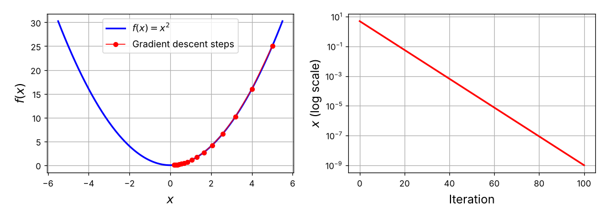
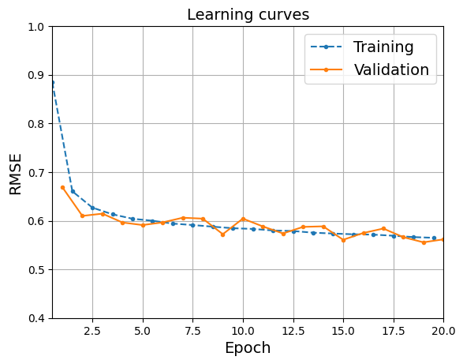

# 10장. 파이토치로 신경망 구축하기

[← 9장. 인공 신경망 소개](09_artificial_neural_networks.md) · [📚 전체 목차](../README.md) · 11장. 심층 신경망 훈련 (정리 예정) →

> 📘 **교재** 『핸즈온 머신러닝 with 사이킷런, 파이토치』 10장 · 노트북 `10_neural_nets_with_pytorch.ipynb`
>
> 9장에서는 사이킷런의 `MLPRegressor`·`MLPClassifier`로 신경망을 훈련했다. 편하지만 층 구조·출력 층·손실 함수를 바꿀 수 없고 GPU도 쓰지 못한다. 10장은 **파이토치(PyTorch)** 로 같은 신경망을 밑바닥부터 직접 만든다.
>
> - **10.1** 파이토치의 세 기둥 — **텐서**, **하드웨어 가속(GPU)**, **자동 미분(autograd)**
> - **10.2~10.3** 텐서와 autograd만으로 선형 회귀를 만들고, 고수준 API(`nn.Linear`, `nn.Sequential`, 옵티마이저, 손실 함수)로 회귀 MLP까지
> - **10.4~10.5** `DataLoader`로 미니배치 훈련 루프를 만들고, `torchmetrics`로 올바르게 평가
> - **10.6** `nn.Module`을 상속해 와이드 & 딥, 다중 입력·다중 출력 모델 만들기
> - **10.7~10.8** 패션 MNIST 이미지 분류기와 **Optuna** 하이퍼파라미터 튜닝
> - **10.9~10.10** 모델 저장·로드, TorchScript·`torch.compile()`로 컴파일·최적화
>
> ⬅️ **앞에서** 9장의 MLP 구조(층마다 $\phi(\mathbf{X}\mathbf{W} + \mathbf{b})$), 역전파, 4장의 경사 하강법이 그대로 코드가 된다. 9장에서 "`fit()` 한 줄"이었던 것을 이제 **훈련 루프**로 직접 쓴다.  
> ➡️ **다음으로** 여기서 만든 MLP는 얕다. 층을 깊게 쌓으면 그레이디언트 소실·폭주, 느린 훈련, 과대적합 문제가 생긴다. 11장에서 초기화·활성화 함수·옵티마이저·규제로 이를 해결한다.

## 이 장의 흐름

| 단계 | 절 | 핵심 질문 | 결과물 |
|---|---|---|---|
| 1. 도구 익히기 | 10.1 | 파이토치는 넘파이와 무엇이 다른가 | 텐서, `device`, `backward()` |
| 2. 선형 회귀 | 10.2 | 훈련 루프는 어떤 단계로 이루어지는가 | 저수준(텐서 + autograd) 손실 0.568 → 고수준(`nn.Linear`) 손실 0.537 |
| 3. 회귀 MLP | 10.3 | 층을 쌓으려면 | `nn.Sequential`, 배치 경사 하강법 손실 0.565 |
| 4. 미니배치 | 10.4 | 데이터를 조금씩 넣어 훈련하려면 | `TensorDataset` + `DataLoader`, `train()`, 손실 0.307 |
| 5. 평가 | 10.5 | 배치 단위로 계산한 지표를 어떻게 합치는가 | `evaluate()`, `torchmetrics`, 검증 RMSE 0.639, 학습 곡선 |
| 6. 비순차 모델 | 10.6 | 층을 한 줄로 쌓지 않는 구조는 | `nn.Module` 상속, 와이드 & 딥, 다중 입력·출력 |
| 7. 이미지 분류 | 10.7 | 분류 모델은 무엇이 달라지는가 | `torchvision`, `nn.CrossEntropyLoss`, 검증 정확도 최고 0.891 |
| 8. 튜닝 | 10.8 | 하이퍼파라미터를 자동으로 찾으려면 | Optuna `objective()`, 가지치기, 검증 정확도 0.887 |
| 9. 저장 | 10.9 | 훈련한 모델을 어떻게 보관하는가 | `torch.save()`, `state_dict()` |
| 10. 최적화 | 10.10 | 모델을 파이썬 밖에서, 더 빠르게 돌리려면 | TorchScript(`trace`·`script`), `torch.compile()` |

## 데이터

| 데이터 | 형태 | 사용 절 | 비고 |
|---|---|---|---|
| 캘리포니아 주택 `fetch_california_housing()` | `(20640, 8)` | 10.2 ~ 10.6 | 훈련 11,610 / 검증 3,870 / 테스트 5,160. 타깃 = 중간 주택 가격(단위 10만 달러) |
| 패션 MNIST `torchvision.datasets.FashionMNIST` | 이미지 1장 = `[1, 28, 28]` | 10.7 ~ 10.10 | 훈련 55,000 / 검증 5,000 / 테스트 10,000. 의류 10종 |
| CoverType `fetch_covtype()` | `(581012, 54)` | 연습문제 15 | 훈련 464,809 / 검증 58,101 / 테스트 58,102. 산림 피복 유형 7종 |

> 📌 캘리포니아 주택과 CoverType은 9장과 같은 데이터다. 9장에서는 사이킷런이 검증 세트를 알아서 떼어 냈지만(`early_stopping=True`), 여기서는 **훈련·검증·테스트를 직접 나눈다**. 패션 MNIST는 `fetch_openml()` 대신 `torchvision`으로 받는다 — 784차원 벡터가 아니라 `[채널, 높이, 너비]` 이미지 텐서로 온다.

## 목차

- [0. 준비](#0-준비)
- [1. 파이토치 기초 (10.1)](#1-파이토치-기초-101)
   - [1-1. 파이토치란](#1-1-파이토치란)
   - [1-2. 텐서](#1-2-텐서)
   - [1-3. 넘파이와 주고받기](#1-3-넘파이와-주고받기)
   - [1-4. 인플레이스 연산](#1-4-인플레이스-연산)
   - [1-5. 하드웨어 가속](#1-5-하드웨어-가속)
   - [1-6. 자동 미분 autograd](#1-6-자동-미분-autograd)
   - [1-7. autograd로 경사 하강법 구현](#1-7-autograd로-경사-하강법-구현)
- [2. 선형 회귀 구현하기 (10.2)](#2-선형-회귀-구현하기-102)
   - [2-1. 데이터 준비](#2-1-데이터-준비)
   - [2-2. 텐서와 autograd로 선형 회귀](#2-2-텐서와-autograd로-선형-회귀)
   - [2-3. 고수준 API로 선형 회귀](#2-3-고수준-api로-선형-회귀)
   - [2-4. 저수준과 고수준 비교](#2-4-저수준과-고수준-비교)
- [3. 회귀 MLP 구현하기 (10.3)](#3-회귀-mlp-구현하기-103)
   - [3-1. nn.Sequential로 층 쌓기](#3-1-nnsequential로-층-쌓기)
   - [3-2. 보충 코드: 층 구조와 파라미터 수 확인](#3-2-보충-코드-층-구조와-파라미터-수-확인)
- [4. DataLoader로 미니배치 경사 하강법 구현하기 (10.4)](#4-dataloader로-미니배치-경사-하강법-구현하기-104)
   - [4-1. Dataset과 DataLoader](#4-1-dataset과-dataloader)
   - [4-2. 미니배치 훈련 루프](#4-2-미니배치-훈련-루프)
- [5. 모델 평가 (10.5)](#5-모델-평가-105)
   - [5-1. 평가 함수](#5-1-평가-함수)
   - [5-2. 배치 평균의 함정](#5-2-배치-평균의-함정)
   - [5-3. torchmetrics](#5-3-torchmetrics)
   - [5-4. 훈련 중 검증과 학습 곡선](#5-4-훈련-중-검증과-학습-곡선)
- [6. 사용자 정의 모듈로 비순차 모델 만들기 (10.6)](#6-사용자-정의-모듈로-비순차-모델-만들기-106)
   - [6-1. 와이드 & 딥 모델](#6-1-와이드--딥-모델)
   - [6-2. 입력을 나눠 보내기](#6-2-입력을-나눠-보내기)
   - [6-3. 다중 입력 모델](#6-3-다중-입력-모델)
   - [6-4. 이름 붙은 입력: 사용자 정의 Dataset](#6-4-이름-붙은-입력-사용자-정의-dataset)
   - [6-5. 다중 출력 모델](#6-5-다중-출력-모델)
   - [6-6. 와이드 & 딥 변형 비교](#6-6-와이드--딥-변형-비교)
- [7. 파이토치로 이미지 분류기 만들기 (10.7)](#7-파이토치로-이미지-분류기-만들기-107)
   - [7-1. 토치비전으로 데이터 적재](#7-1-토치비전으로-데이터-적재)
   - [7-2. 분류기 만들기](#7-2-분류기-만들기)
   - [7-3. 훈련](#7-3-훈련)
   - [7-4. 예측과 확률](#7-4-예측과-확률)
   - [7-5. 보충 코드: CrossEntropyLoss 직접 계산](#7-5-보충-코드-crossentropyloss-직접-계산)
- [8. Optuna로 신경망 하이퍼파라미터 미세 튜닝하기 (10.8)](#8-optuna로-신경망-하이퍼파라미터-미세-튜닝하기-108)
   - [8-1. 목적 함수와 스터디](#8-1-목적-함수와-스터디)
   - [8-2. 가지치기](#8-2-가지치기)
- [9. 파이토치 모델 저장과 로드 (10.9)](#9-파이토치-모델-저장과-로드-109)
   - [9-1. 모델 전체 저장](#9-1-모델-전체-저장)
   - [9-2. 가중치만 저장](#9-2-가중치만-저장)
   - [9-3. 가중치와 하이퍼파라미터를 함께 저장](#9-3-가중치와-하이퍼파라미터를-함께-저장)
- [10. 파이토치 모델 컴파일과 최적화 (10.10)](#10-파이토치-모델-컴파일과-최적화-1010)
   - [10-1. TorchScript](#10-1-torchscript)
   - [10-2. torch.compile](#10-2-torchcompile)
- [11. 연습문제](#11-연습문제)
   - [11-1. 개념 문제 (1~12번)](#11-1-개념-문제-112번)
   - [11-2. 13번 autograd로 그레이디언트 구하기](#11-2-13번-autograd로-그레이디언트-구하기)
   - [11-3. 14번 사용자 정의 Dense 모듈](#11-3-14번-사용자-정의-dense-모듈)
   - [11-4. 15번 CoverType 분류 MLP](#11-4-15번-covertype-분류-mlp)
- [12. 정리](#12-정리)
   - [12-1. 전체 흐름](#12-1-전체-흐름)
   - [12-2. 개념과 코드 대응](#12-2-개념과-코드-대응)
   - [12-3. 사이킷런 MLP와 파이토치 비교](#12-3-사이킷런-mlp와-파이토치-비교)
   - [12-4. 주요 결과](#12-4-주요-결과)
   - [12-5. 자주 쓴 코드 패턴](#12-5-자주-쓴-코드-패턴)
   - [12-6. 핵심 원칙](#12-6-핵심-원칙)

---

## 0. 준비

```python
import sys
assert sys.version_info >= (3, 10)

from packaging.version import Version
import sklearn
assert Version(sklearn.__version__) >= Version("1.6.1")

IS_COLAB = "google.colab" in sys.modules
IS_KAGGLE = "kaggle_secrets" in sys.modules

if IS_COLAB:
    %pip install -q optuna torchmetrics

import torch
assert Version(torch.__version__) >= Version("2.6.0")

import matplotlib.pyplot as plt
plt.rc('font', size=14)
plt.rc('axes', labelsize=14, titlesize=14)
plt.rc('legend', fontsize=14)
plt.rc('xtick', labelsize=10)
plt.rc('ytick', labelsize=10)
```

모든 장 노트북 맨 앞에 반복되는 환경 확인 + 그래프 글꼴 설정. 각 줄의 의미는 [1장 0. 준비](01_the_machine_learning_landscape.md#0-준비) 참고. 이 장에서 새로 추가된 것:

| 코드 | 의미 |
|---|---|
| `IS_COLAB`, `IS_KAGGLE` | 코랩·캐글에서 실행 중인지 확인 |
| `%pip install -q optuna torchmetrics` | 코랩에 기본으로 없는 두 라이브러리 설치 — Optuna(8절), TorchMetrics(5절) |
| `Version(torch.__version__) >= Version("2.6.0")` | 파이토치 2.6 이상 필요 |

> ⚠️ 노트북의 출력은 **코랩 GPU(`cuda`)** 에서 실행한 결과다. 이 노트의 **보충 코드**는 파이토치 2.15(CPU)에서 직접 실행해 확인했다. 장치·버전이 다르면 난수와 소수점 아래 값이 조금씩 달라질 수 있다.

---

## 1. 파이토치 기초 (10.1)

### 1-1. 파이토치란

> 🎯 **목적** — 파이토치가 무엇을 제공하는 라이브러리인지 큰 그림을 잡는다.

**개념·원리**

**파이토치(PyTorch)** = 넘파이와 비슷한 다차원 배열(**텐서**)을 다루면서, 딥러닝에 필요한 기능을 더한 라이브러리.

| 핵심 기능 | 설명 | 이 노트 |
|---|---|---|
| 텐서 | 넘파이 배열과 거의 같은 다차원 배열 | 1-2 ~ 1-4 |
| 하드웨어 가속 | 같은 연산을 GPU 같은 가속기에서 실행 | 1-5 |
| 자동 미분(autograd) | 계산 과정을 기록해 두었다가 그레이디언트를 자동으로 계산 | 1-6, 1-7 |
| 신경망 부품 | 층(`torch.nn`), 옵티마이저(`torch.optim`), 손실 함수, 데이터 로더 | 2절 ~ |

| 사이킷런 MLP (9장) | 파이토치 (10장) |
|---|---|
| `fit()` 한 줄로 훈련 | 훈련 루프를 직접 작성 |
| 층 수·뉴런 수만 지정 | 층의 연결 방식까지 자유롭게 설계 |
| 출력 층·손실 함수 고정 | 원하는 대로 선택·조합 |
| CPU만 사용 | GPU 사용 가능 |

> 💡 코드가 길어지는 대신 **모든 단계가 눈에 보인다.** 9장 1-6절의 역전파 표(정방향 계산 → 오차 → 역방향 계산 → 경사 하강법 스텝)가 이 장에서는 코드 네 줄로 그대로 나타난다.

### 1-2. 텐서

> 🎯 **목적** — 텐서를 만들고, 넘파이 배열처럼 다루는 기본 연산을 익힌다.

**코드**

```python
import torch

X = torch.tensor([[1.0, 4.0, 7.0], [2.0, 3.0, 6.0]])
X
# tensor([[1., 4., 7.],
#         [2., 3., 6.]])

X.shape    # torch.Size([2, 3])
X.dtype    # torch.float32
```

| 코드 | 의미 |
|---|---|
| `torch.tensor(...)` | 파이썬 리스트(또는 넘파이 배열)로 텐서 생성 |
| `X.shape` | 형태. `torch.Size([2, 3])` = 2행 3열 |
| `X.dtype` | 원소의 자료형. 파이썬 실수로 만들면 **`float32`** |

> ⚠️ **기본 실수형이 다르다.** 넘파이는 `float64`, 파이토치는 `float32`가 기본이다. 신경망은 64비트 정밀도가 필요 없고, 32비트가 메모리를 절반만 쓰고 GPU에서 더 빠르기 때문이다.

인덱싱과 연산은 넘파이와 같다.

```python
X[0, 1]            # tensor(4.)           ← 0행 1열
X[:, 1]            # tensor([4., 3.])     ← 1열 전체

10 * (X + 1.0)     # 원소별 덧셈·곱셈
# tensor([[20., 50., 80.],
#         [30., 40., 70.]])

X.exp()            # 원소별 지수 함수
# tensor([[   2.7183,   54.5981, 1096.6332],
#         [   7.3891,   20.0855,  403.4288]])

X.mean()           # tensor(3.8333)       ← 전체 평균

X.max(dim=0)       # 열마다 최댓값
# torch.return_types.max(
# values=tensor([2., 4., 7.]),
# indices=tensor([1, 0, 0]))

X @ X.T            # 행렬 곱
# tensor([[66., 56.],
#         [56., 49.]])
```

| 코드 | 의미 | 넘파이와의 차이 |
|---|---|---|
| `X[0, 1]` | 원소 하나 | 결과도 **텐서**(`tensor(4.)`). 파이썬 숫자로 꺼내려면 `.item()` |
| `X.exp()`, `X.mean()` | 원소별 함수, 집계 | 같음. `torch.exp(X)`처럼 함수로 불러도 된다 |
| `X.max(dim=0)` | `dim=0` 방향(행을 따라 내려가며)으로 최댓값 | 매개변수 이름이 `axis` 대신 **`dim`**. 값(`values`)과 위치(`indices`)를 **함께** 반환 |
| `X @ X.T` | 행렬 곱. `(2, 3) @ (3, 2)` → `(2, 2)` | 같음 |

**결과 해석**

- `X.max(dim=0)`의 `indices=[1, 0, 0]`: 0열의 최댓값 2는 1행에, 1열의 4와 2열의 7은 0행에 있다는 뜻. 넘파이의 `max()`와 `argmax()`를 한 번에 주는 셈
- 파이토치와 넘파이에 **이름이 같은 함수가 200개 이상** 있다(`abs`, `arange`, `argmax`, `clip`, `concatenate`, `cumsum`, `linspace`, `meshgrid`, `reshape`, …). 넘파이를 알면 대부분 그대로 쓸 수 있다

**보충 코드** — `dim` 방향과 자료형 확인

```python
X.max(dim=0).values    # tensor([2., 4., 7.])   ← 열마다 (행 방향으로 줄임)
X.max(dim=1).values    # tensor([7., 6.])       ← 행마다 (열 방향으로 줄임)
X.sum(dim=0)           # tensor([ 3.,  7., 13.])
X.sum(dim=1)           # tensor([12., 11.])

torch.tensor([1, 2]).dtype     # torch.int64     ← 정수 기본형
torch.tensor([1., 2.]).dtype   # torch.float32   ← 실수 기본형
```

| `dim` | 사라지는 차원 | 결과 형태 (입력 `(2, 3)`) | 읽는 법 |
|---|---|---|---|
| `dim=0` | 행 | `(3,)` | 열마다 하나 |
| `dim=1` | 열 | `(2,)` | 행마다 하나 |

### 1-3. 넘파이와 주고받기

> 🎯 **목적** — 사이킷런(넘파이)으로 준비한 데이터를 파이토치로 넘길 때 자료형과 메모리 공유를 구분한다.

**코드**

```python
import numpy as np

X.numpy()                                   # 텐서 → 넘파이
# array([[1., 4., 7.],
#        [2., 3., 6.]], dtype=float32)

torch.tensor(np.array([[1., 4., 7.], [2., 3., 6.]]))
# tensor([[1., 4., 7.],
#         [2., 3., 6.]], dtype=torch.float64)    ← float64가 그대로 따라온다

torch.tensor(np.array([[1., 4., 7.], [2., 3., 6.]]), dtype=torch.float32)
# tensor([[1., 4., 7.],
#         [2., 3., 6.]])

torch.FloatTensor(np.array([[1., 4., 7.], [2., 3., 6]]))
# tensor([[1., 4., 7.],
#         [2., 3., 6.]])                          ← float32로 변환
```

```python
X2_np = np.array([[1., 4., 7.], [2., 3., 6]])
X2 = torch.from_numpy(X2_np)   # X2_np와 X2가 같은 메모리를 공유
X2_np[0, 1] = 88
X2
# tensor([[ 1., 88.,  7.],
#         [ 2.,  3.,  6.]], dtype=torch.float64)
```

| 방법 | 자료형 | 메모리 |
|---|---|---|
| `torch.tensor(넘파이 배열)` | 넘파이의 자료형 유지(`float64`) | **복사** |
| `torch.tensor(넘파이 배열, dtype=torch.float32)` | 지정한 자료형 | 복사 |
| `torch.FloatTensor(넘파이 배열)` | 항상 `float32` | 복사 (자료형을 바꾸므로) |
| `torch.from_numpy(넘파이 배열)` | 넘파이의 자료형 유지 | **공유** — 한쪽을 바꾸면 다른 쪽도 바뀜 |
| `텐서.numpy()` | 텐서의 자료형 유지 | 공유 (CPU 텐서일 때) |

**결과 해석**

- 넘파이 배열 `X2_np`의 원소를 88로 바꿨는데 텐서 `X2`도 88이 됐다 → `from_numpy()`는 데이터를 복사하지 않고 같은 메모리를 바라본다. 큰 데이터를 빠르게 넘길 때 좋지만, 의도치 않게 원본이 바뀔 수 있다
- 사이킷런이 주는 데이터는 `float64`다. 모델의 가중치는 `float32`이므로 **자료형을 맞추지 않으면 오류**가 난다 → 이 장은 `torch.FloatTensor(...)`로 변환한다 (2-1절)

### 1-4. 인플레이스 연산

**코드**

```python
X[:, 1] = -99      # 1열 전체에 값 대입
X
# tensor([[  1., -99.,   7.],
#         [  2., -99.,   6.]])

X.relu_()          # 음수를 0으로 — X 자체를 수정
X
# tensor([[1., 0., 7.],
#         [2., 0., 6.]])
```

| 코드 | 의미 |
|---|---|
| `X[:, 1] = -99` | 슬라이스에 대입. 넘파이와 같다 |
| `X.relu()` | ReLU를 적용한 **새 텐서**를 반환. `X`는 그대로 |
| `X.relu_()` | ReLU를 `X`에 **직접** 적용 (인플레이스) |

> 📌 **이름 끝의 밑줄 `_` = 인플레이스 연산.** `exp_()`, `zero_()`, `uniform_()`, `requires_grad_()` 등. 새 텐서를 만들지 않아 메모리를 아끼지만, autograd와 함께 쓰면 그레이디언트 계산에 필요한 값을 덮어써 오류가 나거나 결과가 조용히 틀릴 수 있다 ([연습문제 5번](#11-1-개념-문제-112번)).

### 1-5. 하드웨어 가속

> 🎯 **목적** — 텐서를 GPU로 옮겨 연산하는 방법과 그 효과를 확인한다.

**코드**

```python
if torch.cuda.is_available():
    device = "cuda"
elif torch.backends.mps.is_available():
    device = "mps"
else:
    device = "cpu"

device
# 'cuda'
```

| 장치 | 의미 |
|---|---|
| `"cuda"` | 엔비디아 GPU |
| `"mps"` | 애플 실리콘(M 시리즈)의 GPU — Metal Performance Shaders |
| `"cpu"` | 가속기가 없을 때 |

```python
M = torch.tensor([[1., 2., 3.], [4., 5., 6.]])
M = M.to(device)                 # ① CPU에 만든 뒤 GPU로 옮기기
M.device
# device(type='cuda', index=0)

M = torch.tensor([[1., 2., 3.], [4., 5., 6.]], device=device)   # ② 처음부터 GPU에 만들기

R = M @ M.T                      # GPU에서 연산
R
# tensor([[14., 32.],
#         [32., 77.]], device='cuda:0')
```

| 코드 | 의미 |
|---|---|
| `M.to(device)` | 텐서를 해당 장치로 **복사한 새 텐서**를 반환 → `M = M.to(device)`처럼 다시 받아야 한다 |
| `torch.tensor(..., device=device)` | 처음부터 그 장치에 생성. 옮기는 비용이 없어 더 효율적 |
| `device='cuda:0'` | 0번 GPU에 있다는 표시. GPU 텐서끼리 연산하면 결과도 GPU에 생긴다 |

속도 비교:

```python
M = torch.rand((1000, 1000))  # CPU
M @ M.T  # 예열
%timeit M @ M.T
# 16.1 ms ± 2.17 ms per loop

M = M.to(device)
M @ M.T  # 예열
%timeit M @ M.T
# 549 µs ± 3.99 µs per loop
```

**결과 해석**

| 장치 | 1000×1000 행렬 곱 1회 | 비고 |
|---|---|---|
| CPU | 16.1 ms | |
| GPU (`cuda`) | 0.549 ms | 약 **29배** 빠름 |

- 신경망 계산의 대부분이 이런 큰 행렬 곱이다 → GPU가 훈련 시간을 크게 줄인다
- 측정 전에 한 번 실행하는 **예열**: 첫 실행에는 초기화 비용이 섞이므로 빼고 잰다

> ⚠️ **연산에 참여하는 텐서는 모두 같은 장치에 있어야 한다.** CPU 텐서와 GPU 텐서를 섞으면 오류가 난다. 그래서 이 장의 훈련 루프는 모델을 `model.to(device)`로 옮기고, 배치마다 `X_batch.to(device)`, `y_batch.to(device)`를 호출한다 (4-2절).

> 📌 GPU가 항상 이기지는 않는다. 텐서를 GPU로 **옮기는 데도 시간이 든다.** 작은 텐서·작은 모델에서는 옮기는 비용이 더 커서 CPU가 빠를 수 있다.

### 1-6. 자동 미분 autograd

> 🎯 **목적** — 파이토치가 그레이디언트를 자동으로 계산하는 과정을 가장 단순한 함수로 확인한다.

**개념·원리**

9장에서 역전파의 핵심 도구로 소개한 **후진 모드 자동 미분**을 파이토치는 **autograd**라는 이름으로 제공한다.

| 단계 | 하는 일 |
|---|---|
| 1 | `requires_grad=True`인 텐서로 연산하면, 파이토치가 **어떤 연산을 거쳤는지 기록**한다(계산 그래프) |
| 2 | 결과 텐서에서 `backward()`를 호출하면 그래프를 **거꾸로** 따라가며 연쇄 법칙으로 그레이디언트를 계산한다 |
| 3 | 계산된 그레이디언트는 각 입력 텐서의 `.grad`에 저장된다 |

예: $f(x) = x^2$ → 도함수 $f'(x) = 2x$. $x = 5$에서 $f(5) = 25$, $f'(5) = 10$이 나와야 한다.

**코드**

```python
x = torch.tensor(5.0, requires_grad=True)
f = x ** 2
f
# tensor(25., grad_fn=<PowBackward0>)

f.backward()
x.grad
# tensor(10.)
```

| 코드 | 의미 |
|---|---|
| `requires_grad=True` | 이 텐서에 대한 그레이디언트가 필요하다고 표시 → 이후 연산을 추적 |
| `grad_fn=<PowBackward0>` | `f`가 거듭제곱 연산으로 만들어졌다는 기록. 역방향 계산 때 이 연산의 미분 규칙을 쓴다 |
| `f.backward()` | 역방향 계산 실행. `f`는 값 하나짜리(스칼라)여야 한다 |
| `x.grad` | $\dfrac{\partial f}{\partial x}$의 값. 직접 미분한 $2 \times 5 = 10$과 일치 |

경사 하강법 스텝:

```python
learning_rate = 0.1
with torch.no_grad():
    x -= learning_rate * x.grad  # 경사 하강법 스텝

x
# tensor(4., requires_grad=True)       ← 5 − 0.1 × 10 = 4
```

```python
# 같은 일을 detach()로도 할 수 있다 (no_grad()가 더 흔함)
x_detached = x.detach()
x_detached -= learning_rate * x.grad

x.grad.zero_()
# tensor(0.)
```

| 코드 | 의미 |
|---|---|
| `with torch.no_grad():` | 블록 안의 연산은 **추적하지 않는다**. 파라미터 갱신 자체는 미분할 대상이 아니기 때문 |
| `x -= ...` | 인플레이스 갱신. `x = x - ...`라고 쓰면 새 텐서가 만들어져 원래 `x`와 연결이 끊긴다 |
| `x.detach()` | 같은 데이터를 공유하지만 **추적이 꺼진** 텐서. 이것을 수정하면 `x`도 바뀐다 |
| `x.grad.zero_()` | 그레이디언트를 0으로 초기화 |

**보충 코드** — 왜 `no_grad()`와 `zero_()`가 필요한가

```python
x = torch.tensor(5.0, requires_grad=True)
f = x ** 2
x.is_leaf, f.is_leaf, f.requires_grad, x.grad
# (True, False, True, None)             ← backward() 전에는 grad가 없다

f.backward(); x.grad
# tensor(10.)

f = x ** 2; f.backward(); x.grad        # 초기화하지 않고 한 번 더
# tensor(20.)                           ← 10 + 10 : 누적된다

x.grad.zero_()
f = x ** 2; f.backward(); x.grad
# tensor(10.)

x -= 0.1 * x.grad                       # no_grad() 없이 갱신하면
# RuntimeError: a leaf Variable that requires grad is being used in an in-place operation.

with torch.no_grad():
    g = x ** 2
g.requires_grad, x.detach().requires_grad
# (False, False)
```

| 확인한 것 | 결과 | 의미 |
|---|---|---|
| `backward()`를 두 번 | `x.grad`가 10 → 20 | 그레이디언트는 **덮어쓰지 않고 더해진다** → 스텝마다 0으로 초기화해야 한다 |
| `no_grad()` 없이 `x -= ...` | `RuntimeError` | 추적 중인 **리프 텐서**(사용자가 직접 만든 텐서)는 인플레이스로 바꿀 수 없다 |
| `no_grad()` 안의 연산 | `requires_grad=False` | 추적하지 않는다 → 메모리·시간 절약. 평가·예측 때도 쓴다 |

> 💡 그레이디언트가 누적되는 것은 실수가 아니라 설계다. 여러 손실의 그레이디언트를 합치거나, 메모리가 부족할 때 작은 배치 여러 개의 그레이디언트를 모아 한 번에 갱신하는 데 쓰인다. 대신 **초기화는 사용자의 몫**이다.

### 1-7. autograd로 경사 하강법 구현

**코드**

```python
learning_rate = 0.1
x = torch.tensor(5.0, requires_grad=True)
for iteration in range(100):
    f = x ** 2  # 정방향 계산
    f.backward()  # 역방향 계산
    with torch.no_grad():
        x -= learning_rate * x.grad  # 경사 하강법 스텝
    x.grad.zero_()  # 그레이디언트 초기화

x
# tensor(1.0185e-09, requires_grad=True)
```

| 순서 | 코드 | 9장 역전파 표의 단계 |
|---|---|---|
| ① | `f = x ** 2` | 정방향 계산 (+ 오차 측정) |
| ② | `f.backward()` | 역방향 계산 |
| ③ | `x -= learning_rate * x.grad` | 경사 하강법 스텝 |
| ④ | `x.grad.zero_()` | (다음 반복을 위한 초기화) |

**결과 해석**

- $f(x) = x^2$를 최소로 만드는 값은 $x = 0$. 100번 반복 후 $x \approx 1.02 \times 10^{-9}$ → 0에 수렴했다
- 한 스텝의 계산: $x \leftarrow x - 0.1 \times 2x = 0.8x$. 매번 0.8배가 되므로 100번 뒤에는 $5 \times 0.8^{100} = 1.0185 \times 10^{-9}$ — 출력과 정확히 일치한다



(보충 그림. 왼쪽: 처음 15 스텝의 위치 — 5 → 4 → 3.2 → 2.56 → … 기울기가 완만해질수록 보폭이 줄어든다. 오른쪽: 100 스텝 동안의 $x$를 로그 축으로 — 매 스텝 0.8배라서 직선이다.)

> 📌 **이 네 줄이 이 장의 모든 훈련 루프의 뼈대다.** 뒤에서는 `x` 대신 모델 파라미터, `x ** 2` 대신 손실 함수가 들어가고, ③④를 옵티마이저가 대신할 뿐이다.

---

## 2. 선형 회귀 구현하기 (10.2)

4장의 선형 회귀를 파이토치로 두 번 만든다. 먼저 텐서와 autograd만으로(저수준), 다음에는 파이토치가 제공하는 부품으로(고수준).

### 2-1. 데이터 준비

**코드**

```python
from sklearn.datasets import fetch_california_housing
from sklearn.model_selection import train_test_split

housing = fetch_california_housing()
X_train_full, X_test, y_train_full, y_test = train_test_split(
    housing.data, housing.target, random_state=42)
X_train, X_valid, y_train, y_valid = train_test_split(
    X_train_full, y_train_full, random_state=42)
```

| 분할 | 샘플 수 | 계산 |
|---|---|---|
| 테스트 | 5,160 | 20,640의 25% |
| 검증 | 3,870 | 나머지 15,480의 25% |
| 훈련 | 11,610 | 나머지 |

```python
X_train = torch.FloatTensor(X_train)
X_valid = torch.FloatTensor(X_valid)
X_test = torch.FloatTensor(X_test)
means = X_train.mean(dim=0, keepdims=True)
stds = X_train.std(dim=0, keepdims=True)
X_train = (X_train - means) / stds
X_valid = (X_valid - means) / stds
X_test = (X_test - means) / stds

y_train = torch.FloatTensor(y_train).view(-1, 1)
y_valid = torch.FloatTensor(y_valid).view(-1, 1)
y_test = torch.FloatTensor(y_test).view(-1, 1)
```

| 코드 | 의미 |
|---|---|
| `torch.FloatTensor(X_train)` | 넘파이 `float64` 배열 → `float32` 텐서 |
| `X_train.mean(dim=0, keepdims=True)` | 특성(열)마다 평균. `keepdims=True` → 형태가 `(1, 8)`로 유지되어 `(11610, 8)`과 브로드캐스팅된다 |
| `(X - means) / stds` | 표준화. 9장의 `StandardScaler`가 하던 일을 직접 계산 |
| `.view(-1, 1)` | 타깃을 `(11610,)` → `(11610, 1)` **열 벡터**로. `-1`은 "나머지에 맞춰 자동 계산" |

> ⚠️ **평균과 표준편차는 훈련 세트에서만 계산**하고, 같은 값을 검증·테스트 세트에 적용한다. 2장의 "`fit`은 훈련 세트에만"과 같은 원칙이다. (`torch.std()`는 $n-1$로 나누는 표본 표준편차라 $n$으로 나누는 `StandardScaler`와 아주 조금 다르지만, 샘플이 11,610개라 차이는 무시할 수 있다.)

> ⚠️ **타깃을 열 벡터로 만들지 않으면 손실이 조용히 틀린다.** 모델 출력은 `(샘플 수, 1)`인데 타깃이 `(샘플 수,)`이면, 뺄셈이 브로드캐스팅되어 `(샘플 수, 샘플 수)` 행렬이 된다. 오류 없이 엉뚱한 값이 계산된다.
>
> ```python
> # 보충 코드
> y_pred = torch.tensor([[1.0], [2.0], [4.0]])    # (3, 1)
> y = torch.tensor([1.0, 2.0, 3.0])               # (3,)
> (y_pred - y).shape                    # torch.Size([3, 3])   ← 모든 쌍의 차이
> ((y_pred - y) ** 2).mean()            # tensor(2.3333)       ← 틀린 MSE
> ((y_pred - y.view(-1, 1)) ** 2).mean()  # tensor(0.3333)     ← 올바른 MSE
> ```

### 2-2. 텐서와 autograd로 선형 회귀

> 🎯 **목적** — 파라미터 텐서를 직접 만들고, 1-7절의 훈련 루프에 선형 모델과 MSE를 끼워 넣는다.

**개념·원리**

4장의 선형 회귀 모델과 비용 함수:

```math
\hat{\mathbf{y}} = \mathbf{X}\mathbf{w} + b
\qquad
\text{MSE} = \frac{1}{m}\sum_{i=1}^{m}\left(\hat{y}^{(i)} - y^{(i)}\right)^2
```

| 기호 | 형태 | 의미 |
|---|---|---|
| $\mathbf{X}$ | (11610, 8) | 훈련 세트 |
| $\mathbf{w}$ | (8, 1) | 가중치. 특성마다 하나 |
| $b$ | 스칼라 | 편향 |
| $\hat{\mathbf{y}}$ | (11610, 1) | 예측 |

4장에서는 MSE의 그레이디언트 식 $\dfrac{2}{m}\mathbf{X}^\top(\mathbf{X}\boldsymbol{\theta} - \mathbf{y})$를 직접 유도해 코드로 옮겼다. 여기서는 **식을 유도하지 않는다.** 손실만 계산하면 autograd가 그레이디언트를 구한다.

**코드**

```python
torch.manual_seed(42)
n_features = X_train.shape[1]  # 입력 특성 8개
w = torch.randn((n_features, 1), requires_grad=True)
b = torch.tensor(0., requires_grad=True)
```

| 코드 | 의미 |
|---|---|
| `torch.manual_seed(42)` | 난수 시드 고정 → 실행할 때마다 같은 초깃값 |
| `torch.randn((8, 1), requires_grad=True)` | 표준 정규 분포에서 뽑은 `(8, 1)` 가중치. 추적 켬 |
| `torch.tensor(0., requires_grad=True)` | 편향은 0으로 시작 |

```python
learning_rate = 0.4
n_epochs = 20
for epoch in range(n_epochs):
    y_pred = X_train @ w + b
    loss = ((y_pred - y_train) ** 2).mean()
    loss.backward()
    with torch.no_grad():
        b -= learning_rate * b.grad
        w -= learning_rate * w.grad
        b.grad.zero_()
        w.grad.zero_()
    print(f"Epoch {epoch + 1}/{n_epochs}, Loss: {loss.item()}")
```

| 코드 | 의미 |
|---|---|
| `X_train @ w + b` | 정방향 계산. `(11610, 8) @ (8, 1)` → `(11610, 1)` |
| `((y_pred - y_train) ** 2).mean()` | MSE 손실 — 스칼라 텐서 |
| `loss.backward()` | `w.grad`와 `b.grad`를 한 번에 계산 |
| `with torch.no_grad():` 블록 | 파라미터 갱신 + 그레이디언트 초기화 |
| `loss.item()` | 스칼라 텐서 → 파이썬 `float` (출력·기록용) |

**결과 해석**

```
Epoch 1/20, Loss: 16.158456802368164
Epoch 2/20, Loss: 4.8793745040893555
Epoch 3/20, Loss: 2.255225419998169
...
Epoch 10/20, Loss: 0.6577965021133423
...
Epoch 20/20, Loss: 0.5684100389480591
```

- 훈련 세트 **전체**를 한 번에 넣는다 → 4장의 **배치 경사 하강법**. 에포크 1번 = 경사 하강법 스텝 1번
- 손실이 16.16 → 0.568로 감소. 처음 몇 에포크에 급격히 줄고 이후 완만해진다

예측:

```python
X_new = X_test[:3]  # 새 샘플이라고 가정
with torch.no_grad():
    y_pred = X_new @ w + b  # 훈련된 파라미터로 예측

y_pred
# tensor([[0.8916],
#         [1.6480],
#         [2.6577]])
```

- 예측할 때는 그레이디언트가 필요 없다 → `no_grad()` 안에서 계산
- 단위가 10만 달러이므로 약 8.9만 / 16.5만 / 26.6만 달러

### 2-3. 고수준 API로 선형 회귀

> 🎯 **목적** — 같은 모델을 파이토치의 층·옵티마이저·손실 함수로 다시 만든다.

**개념·원리**

| 저수준에서 직접 한 일 | 고수준 API |
|---|---|
| `w`, `b` 텐서 생성·초기화 | `nn.Linear(in_features, out_features)` |
| `X @ w + b` | `model(X)` |
| `((y_pred - y) ** 2).mean()` | `nn.MSELoss()` |
| `w -= lr * w.grad` (파라미터마다) | `optimizer.step()` |
| `w.grad.zero_()` (파라미터마다) | `optimizer.zero_grad()` |

**코드**

```python
import torch.nn as nn

torch.manual_seed(42)  # 재현 가능한 결과를 위해
model = nn.Linear(in_features=n_features, out_features=1)

model.bias
# Parameter containing:
# tensor([0.3117], requires_grad=True)

model.weight
# Parameter containing:
# tensor([[ 0.2703,  0.2935, -0.0828,  0.3248, -0.0775,  0.0713, -0.1721,  0.2076]],
#        requires_grad=True)

for param in model.parameters():
    print(param)        # weight, bias 순서로 출력

model(X_train[:2])
# tensor([[-0.4718],
#         [ 0.1131]], grad_fn=<AddmmBackward0>)
```

| 코드 | 의미 |
|---|---|
| `nn.Linear(8, 1)` | **완전 연결 층**. 입력 8개 → 출력 1개. 9장의 $\mathbf{X}\mathbf{W} + \mathbf{b}$ |
| `Parameter` | `requires_grad=True`가 기본인 텐서. 모듈에 넣으면 **학습 대상으로 자동 등록**된다 |
| `model.parameters()` | 모델의 모든 파라미터를 차례로 돌려줌 → 옵티마이저에 넘긴다 |
| `model(X)` | 모델을 함수처럼 호출 = 정방향 계산 |

> ⚠️ **가중치 행렬의 형태가 9장과 반대다.**
>
> | | 형태 | 계산 |
> |---|---|---|
> | 사이킷런 `coefs_[i]` (9장) | (입력 수, 출력 수) | `X @ W + b` |
> | 파이토치 `nn.Linear.weight` | **(출력 수, 입력 수)** = `(1, 8)` | `X @ W.T + b` |
>
> ```python
> # 보충 코드
> model.weight.shape, model.bias.shape      # (torch.Size([1, 8]), torch.Size([1]))
> X_b = torch.randn(2, 8)
> torch.allclose(model(X_b), X_b @ model.weight.T + model.bias)   # True
> ```

> 📌 `nn.Linear`의 초기화: 가중치와 편향 모두 $-\dfrac{1}{\sqrt{\text{입력 수}}}$ ~ $+\dfrac{1}{\sqrt{\text{입력 수}}}$ 범위의 균등 분포. 입력이 8개이므로 $\pm\dfrac{1}{2\sqrt{2}} \approx \pm 0.354$. 위에 출력된 값이 모두 이 범위 안에 있다. 2-2절은 표준 정규 분포(`randn`)로 초기화했으므로 두 모델의 **출발점이 다르다.**

옵티마이저와 손실 함수, 훈련 함수:

```python
optimizer = torch.optim.SGD(model.parameters(), lr=learning_rate)
mse = nn.MSELoss()

def train_bgd(model, optimizer, criterion, X_train, y_train, n_epochs):
    for epoch in range(n_epochs):
        y_pred = model(X_train)
        loss = criterion(y_pred, y_train)
        loss.backward()
        optimizer.step()
        optimizer.zero_grad()
        print(f"Epoch {epoch + 1}/{n_epochs}, Loss: {loss.item()}")

train_bgd(model, optimizer, mse, X_train, y_train, n_epochs)
```

| 코드 | 의미 |
|---|---|
| `torch.optim.SGD(model.parameters(), lr=0.4)` | 경사 하강법 옵티마이저. **어떤 파라미터를** 갱신할지와 학습률을 넘긴다 |
| `nn.MSELoss()` | 평균 제곱 오차. `mse(예측, 타깃)` 순서로 호출 |
| `criterion` | 손실 함수를 가리키는 관례적인 매개변수 이름 |
| `optimizer.step()` | 모든 파라미터를 `param -= lr * param.grad`로 갱신 (내부에서 `no_grad` 처리) |
| `optimizer.zero_grad()` | 모든 파라미터의 그레이디언트 초기화 |

**결과 해석**

```
Epoch 1/20, Loss: 4.3378496170043945
Epoch 2/20, Loss: 0.7802939414978027
Epoch 3/20, Loss: 0.6253842115402222
...
Epoch 20/20, Loss: 0.5374288558959961
```

```python
X_new = X_test[:3]
with torch.no_grad():
    y_pred = model(X_new)

y_pred
# tensor([[0.8061],
#         [1.7116],
#         [2.6973]])
```

### 2-4. 저수준과 고수준 비교

| | 텐서 + autograd (2-2) | 고수준 API (2-3) |
|---|---|---|
| 파라미터 | `w`, `b` 직접 생성 | `nn.Linear`가 생성·보관 |
| 초기화 | 표준 정규 분포, 편향 0 | 균등 분포 $\pm 1/\sqrt{8}$ |
| 첫 에포크 손실 | 16.158 | 4.338 |
| 20 에포크 후 손실 | 0.5684 | **0.5374** |
| 첫 3개 테스트 샘플 예측 | 0.8916, 1.6480, 2.6577 | 0.8061, 1.7116, 2.6973 |

- 모델·손실·학습률·에포크 수가 모두 같다. 차이는 **초깃값**뿐이다. `randn`은 값이 커서 첫 손실이 16으로 높게 시작했고, `nn.Linear`의 작은 초깃값은 4.3에서 시작해 같은 20 에포크 안에 더 낮은 손실에 도달했다
- 노트북에는 2-2절의 초기화를 `torch.empty(n_features, 1).uniform_(-r, r)` ($r = 2^{-1.5} = 1/(2\sqrt{2})$)로 바꾸면 두 결과가 **똑같아진다**는 주석 코드가 있다 → 고수준 API는 저수준 코드와 같은 계산을 감싼 것일 뿐이다

> 💡 **초기화가 훈련 속도를 좌우한다.** 선형 회귀는 볼록 문제라 결국 같은 곳에 수렴하지만, 깊은 신경망에서는 초기화가 훈련의 성패를 가른다 → 11장의 주제.

---

## 3. 회귀 MLP 구현하기 (10.3)

### 3-1. nn.Sequential로 층 쌓기

> 🎯 **목적** — 선형 층 하나를 여러 층짜리 MLP로 바꾼다. 바뀌는 것은 모델 정의뿐이다.

**코드**

```python
torch.manual_seed(42)
model = nn.Sequential(
    nn.Linear(n_features, 50),
    nn.ReLU(),
    nn.Linear(50, 40),
    nn.ReLU(),
    nn.Linear(40, 1)
)
```

| 코드 | 의미 |
|---|---|
| `nn.Sequential(...)` | 모듈을 **순서대로** 연결. 앞 모듈의 출력이 다음 모듈의 입력이 된다 |
| `nn.Linear(8, 50)` | 첫 번째 은닉 층 — 뉴런 50개 |
| `nn.ReLU()` | 활성화 함수도 **하나의 모듈**이다. 파라미터는 없다 |
| `nn.Linear(50, 40)` | 두 번째 은닉 층 — 뉴런 40개. **입력 수 = 앞 층의 출력 수** |
| `nn.Linear(40, 1)` | 출력 층 — 뉴런 1개, **활성화 함수 없음** (회귀, 9장 2-1절) |

| | 9장 사이킷런 | 10장 파이토치 |
|---|---|---|
| 은닉 층 지정 | `hidden_layer_sizes=[50, 40]` | `nn.Linear(8, 50)`, `nn.Linear(50, 40)` — **입력 수까지** 직접 적는다 |
| 활성화 함수 | `activation="relu"` (전 층 공통) | 층마다 `nn.ReLU()`를 끼워 넣는다 |
| 출력 층 | 자동 | `nn.Linear(40, 1)`을 직접 적는다 |

```python
learning_rate = 0.1
optimizer = torch.optim.SGD(model.parameters(), lr=learning_rate)
mse = nn.MSELoss()
train_bgd(model, optimizer, mse, X_train, y_train, n_epochs)
```

- 훈련 함수 `train_bgd()`는 **한 글자도 바꾸지 않았다.** 모델이 선형 층이든 MLP든 `model(X)` → 손실 → `backward()` → `step()` → `zero_grad()` 는 같다
- 학습률은 0.4 → 0.1로 낮췄다. 모델이 바뀌면 적절한 학습률도 바뀐다

**결과 해석**

```
Epoch 1/20, Loss: 5.045480251312256
Epoch 2/20, Loss: 2.0523123741149902
Epoch 3/20, Loss: 1.0039883852005005
...
Epoch 20/20, Loss: 0.565444827079773
```

| 모델 | 20 에포크 후 훈련 손실(MSE) |
|---|---|
| 선형 회귀 `nn.Linear` | 0.5374 |
| MLP 8 → 50 → 40 → 1 | 0.5654 |

- 더 강력한 MLP가 선형 회귀보다 **오히려 나쁘다.** 모델이 나빠서가 아니라 **훈련이 덜 된** 것이다. 배치 경사 하강법은 에포크당 스텝이 1번이므로 20 에포크 = 가중치 갱신 **20번**뿐이다
- 손실이 아직 매 에포크 줄어들고 있다 → 스텝을 더 많이 밟아야 한다. 다음 절의 **미니배치 경사 하강법**이 같은 20 에포크에 훨씬 많은 스텝을 밟게 해 준다

### 3-2. 보충 코드: 층 구조와 파라미터 수 확인

```python
model
# Sequential(
#   (0): Linear(in_features=8, out_features=50, bias=True)
#   (1): ReLU()
#   (2): Linear(in_features=50, out_features=40, bias=True)
#   (3): ReLU()
#   (4): Linear(in_features=40, out_features=1, bias=True)
# )

model[0]
# Linear(in_features=8, out_features=50, bias=True)

[tuple(p.shape) for p in model.parameters()]
# [(50, 8), (50,), (40, 50), (40,), (1, 40), (1,)]

sum(p.numel() for p in model.parameters())
# 2531
```

| 층 | 가중치 형태 | 가중치 수 | 편향 수 | 합계 |
|---|---|---|---|---|
| `Linear(8, 50)` | (50, 8) | 400 | 50 | 450 |
| `Linear(50, 40)` | (40, 50) | 2,000 | 40 | 2,040 |
| `Linear(40, 1)` | (1, 40) | 40 | 1 | 41 |
| 합계 | | | | **2,531** |

- `model[0]`처럼 **인덱스로 층을 꺼낼 수 있다.** 번호에는 `ReLU`도 포함된다(0, 2, 4번이 `Linear`)
- `p.numel()` = 텐서의 원소 개수. 모든 파라미터에 대해 더하면 모델의 파라미터 수
- `ReLU`는 파라미터가 없어서 `parameters()`에 나타나지 않는다

---

## 4. DataLoader로 미니배치 경사 하강법 구현하기 (10.4)

### 4-1. Dataset과 DataLoader

> 🎯 **목적** — 훈련 세트를 섞어서 작은 묶음(미니배치)으로 나눠 주는 도구를 준비한다.

**개념·원리**

4장에서 본 세 가지 경사 하강법 가운데, 신경망은 거의 항상 **미니배치 경사 하강법**을 쓴다.

| 방식 | 스텝 1번에 쓰는 샘플 | 에포크당 스텝 수 (훈련 11,610개) |
|---|---|---|
| 배치 경사 하강법 | 전체 | 1 |
| 미니배치 경사 하강법 (배치 크기 32) | 32개 | **363** |
| 확률적 경사 하강법 | 1개 | 11,610 |

파이토치는 이를 두 클래스로 나눠 맡긴다.

| 클래스 | 역할 |
|---|---|
| `Dataset` | 데이터 **보관**. `dataset[i]`로 $i$번째 샘플(입력, 타깃)을 돌려주고 `len(dataset)`으로 개수를 알려 준다 |
| `DataLoader` | 데이터 **공급**. `Dataset`에서 샘플을 꺼내 섞고, 배치 크기만큼 묶어 차례로 내준다 |

**코드**

```python
from torch.utils.data import TensorDataset, DataLoader

train_dataset = TensorDataset(X_train, y_train)
train_loader = DataLoader(train_dataset, batch_size=32, shuffle=True)
```

| 코드 | 의미 |
|---|---|
| `TensorDataset(X_train, y_train)` | 텐서 여러 개를 묶은 가장 단순한 `Dataset`. $i$번째 샘플 = `(X_train[i], y_train[i])` |
| `batch_size=32` | 한 번에 32개씩 |
| `shuffle=True` | **에포크마다** 순서를 새로 섞는다. 훈련 세트에만 쓴다 |

**보충 코드** — 작은 데이터로 동작 확인

```python
ds = TensorDataset(torch.arange(10.).view(-1, 1), torch.arange(10.).view(-1, 1) * 10)
len(ds), ds[3]
# (10, (tensor([3.]), tensor([30.])))

dl = DataLoader(ds, batch_size=4)
len(dl), [tuple(X_b.shape) for X_b, y_b in dl]
# (3, [(4, 1), (4, 1), (2, 1)])

torch.manual_seed(42)
dl = DataLoader(ds, batch_size=4, shuffle=True)
[X_b.view(-1).tolist() for X_b, _ in dl]     # 첫 번째 에포크
# [[8.0, 0.0, 9.0, 1.0], [4.0, 5.0, 6.0, 3.0], [2.0, 7.0]]
[X_b.view(-1).tolist() for X_b, _ in dl]     # 두 번째 에포크
# [[4.0, 6.0, 9.0, 3.0], [7.0, 5.0, 2.0, 0.0], [1.0, 8.0]]

len(DataLoader(ds, batch_size=4, drop_last=True))
# 2
```

| 확인한 것 | 결과 |
|---|---|
| `len(DataLoader)` | 샘플 수가 아니라 **배치 수**. 10개를 4개씩 → 3 |
| 마지막 배치 | 남은 2개만 들어 있다(크기가 작다). `drop_last=True`면 버린다 |
| `shuffle=True` | `for` 문을 돌 때마다(= 에포크마다) 순서가 달라진다 |
| `for X_b, y_b in dl` | 배치마다 `(입력 묶음, 타깃 묶음)` 튜플을 준다 |

- 이 장의 훈련 세트: 11,610 ÷ 32 = 362.8 → **배치 363개**. 마지막 배치만 26개

### 4-2. 미니배치 훈련 루프

**코드**

```python
torch.manual_seed(42)
model = nn.Sequential(
    nn.Linear(n_features, 50), nn.ReLU(),
    nn.Linear(50, 40), nn.ReLU(),
    nn.Linear(40, 1)
)
model = model.to(device)

learning_rate = 0.02
optimizer = torch.optim.SGD(model.parameters(), lr=learning_rate, momentum=0)
mse = nn.MSELoss()
```

```python
def train(model, optimizer, criterion, train_loader, n_epochs):
    model.train()
    for epoch in range(n_epochs):
        total_loss = 0.
        for X_batch, y_batch in train_loader:
            X_batch, y_batch = X_batch.to(device), y_batch.to(device)
            y_pred = model(X_batch)
            loss = criterion(y_pred, y_batch)
            total_loss += loss.item()
            loss.backward()
            optimizer.step()
            optimizer.zero_grad()

        mean_loss = total_loss / len(train_loader)
        print(f"Epoch {epoch + 1}/{n_epochs}, Loss: {mean_loss:.4f}")

train(model, optimizer, mse, train_loader, n_epochs)
```

| 코드 | 의미 |
|---|---|
| `model.to(device)` | 모델의 **모든 파라미터**를 GPU로 옮긴다 |
| `optimizer = ...` (그 다음 줄) | 옵티마이저는 모델을 옮긴 **뒤에** 만든다 ([연습문제 8번](#11-1-개념-문제-112번)) |
| `momentum=0` | 모멘텀 없는 순수 SGD (기본값을 명시). 모멘텀은 11장 |
| `model.train()` | 모델을 **훈련 모드**로 전환 (5-1절의 `eval()`과 짝) |
| `for X_batch, y_batch in train_loader:` | 안쪽 루프 — 배치마다 한 번씩 |
| `X_batch.to(device)` | 배치를 모델과 같은 장치로. 데이터 전체가 아니라 **쓰는 배치만** GPU에 올린다 |
| `total_loss += loss.item()` | 배치 손실을 파이썬 숫자로 꺼내 더한다 |
| `total_loss / len(train_loader)` | 배치 수(363)로 나눈 **에포크 평균 손실** |

훈련 루프의 구조:

```
for epoch in range(n_epochs):              ← 바깥 루프: 에포크
    for X_batch, y_batch in train_loader:  ← 안쪽 루프: 미니배치
        ① X_batch.to(device)               장치로 이동
        ② y_pred = model(X_batch)          정방향 계산
        ③ loss = criterion(y_pred, y_batch) 손실 계산
        ④ loss.backward()                  역방향 계산
        ⑤ optimizer.step()                 파라미터 갱신
        ⑥ optimizer.zero_grad()            그레이디언트 초기화
```

**결과 해석**

```
Epoch 1/20, Loss: 0.5900
Epoch 2/20, Loss: 0.4046
Epoch 3/20, Loss: 0.3801
...
Epoch 10/20, Loss: 0.3378
...
Epoch 20/20, Loss: 0.3072
```

| 훈련 방식 (같은 MLP 8 → 50 → 40 → 1, 20 에포크) | 학습률 | 가중치 갱신 횟수 | 최종 훈련 손실 |
|---|---|---|---|
| 배치 경사 하강법 (3-1절) | 0.1 | 20 | 0.5654 |
| 미니배치 경사 하강법 (배치 32) | 0.02 | 363 × 20 = **7,260** | **0.3072** |

- **첫 에포크가 끝났을 때 손실(0.59)** 이 배치 경사 하강법의 20 에포크 뒤(0.565)와 비슷하다. 데이터를 한 번 훑는 동안 363번 갱신했기 때문
- 에포크 6 → 8에서 0.3520 → 0.3408 → 0.3427로 살짝 오르내린다. 미니배치는 일부 샘플만 보고 방향을 정하므로 손실이 매끄럽게 줄지 않는다 (4장)

> ⚠️ `loss.item()`을 쓰지 않고 `total_loss += loss`라고 하면, `loss`에 붙어 있는 계산 그래프까지 계속 붙잡게 되어 메모리가 불어난다. 기록용 숫자는 반드시 `.item()`으로 꺼낸다.

> 📌 지금 본 손실은 **훈련 손실**이다. 그것도 에포크 도중 가중치가 계속 바뀌는 동안 계산한 배치 손실의 평균이다. 모델이 새 데이터에서 얼마나 잘하는지는 검증 세트로 따로 재야 한다 → 다음 절.

---

## 5. 모델 평가 (10.5)

### 5-1. 평가 함수

> 🎯 **목적** — 검증 세트에서 지표를 계산하는 함수를 만든다. 훈련 루프에서 역전파와 갱신을 뺀 형태다.

**코드**

```python
def evaluate(model, data_loader, metric_fn, aggregate_fn=torch.mean):
    model.eval()
    metrics = []
    with torch.no_grad():
        for X_batch, y_batch in data_loader:
            X_batch, y_batch = X_batch.to(device), y_batch.to(device)
            y_pred = model(X_batch)
            metric = metric_fn(y_pred, y_batch)
            metrics.append(metric)
    return aggregate_fn(torch.stack(metrics))

valid_dataset = TensorDataset(X_valid, y_valid)
valid_loader = DataLoader(valid_dataset, batch_size=32)
valid_mse = evaluate(model, valid_loader, mse)
valid_mse
# tensor(0.4080, device='cuda:0')
```

| 코드 | 의미 |
|---|---|
| `model.eval()` | 모델을 **평가 모드**로 전환 |
| `with torch.no_grad():` | 평가에는 그레이디언트가 필요 없다 → 추적을 꺼서 메모리·시간 절약 |
| `metric_fn(y_pred, y_batch)` | 배치마다 지표 계산 |
| `torch.stack(metrics)` | 스칼라 텐서 리스트를 텐서 하나(길이 = 배치 수)로 쌓는다 |
| `aggregate_fn` | 배치별 지표를 하나로 합치는 함수. 기본값은 평균 |
| `DataLoader(valid_dataset, batch_size=32)` | 검증 세트는 **섞지 않는다** (`shuffle` 기본값 `False`). 순서가 결과에 영향을 주지 않기 때문 |

> 📌 **`model.train()` / `model.eval()`** 은 훈련을 시작하거나 멈추는 명령이 아니다. 모델에 "지금 어느 모드인지"를 알려 주는 스위치다. 드롭아웃·배치 정규화 같은 층은 훈련 때와 평가 때 **다르게 동작**한다(11장). 이 장의 모델에는 그런 층이 없어서 결과가 달라지지 않지만, 습관으로 항상 호출한다.
>
> ```python
> # 보충 코드 — 드롭아웃 층으로 확인
> torch.manual_seed(42)
> drop = nn.Dropout(p=0.5)
> drop.training                  # True     ← 모듈의 기본 모드는 훈련
> drop(torch.ones(8))            # tensor([2., 2., 2., 2., 0., 2., 0., 0.])   ← 무작위로 0, 나머지는 2배
> drop.eval()
> drop(torch.ones(8))            # tensor([1., 1., 1., 1., 1., 1., 1., 1.])   ← 그대로 통과
> ```

**결과 해석**

- 검증 MSE 0.4080. 훈련 손실(0.3072)보다 높다 — 훈련 때 보지 못한 데이터이기 때문
- 결과 텐서가 `device='cuda:0'`에 있다. 파이썬 숫자가 필요하면 `.item()`

### 5-2. 배치 평균의 함정

> 🎯 **목적** — 배치별로 계산한 지표를 단순 평균하면 틀릴 수 있음을 확인한다.

**코드**

```python
def rmse(y_pred, y_true):
    return ((y_pred - y_true) ** 2).mean().sqrt()

evaluate(model, valid_loader, rmse)
# tensor(0.5668, device='cuda:0')          ← 배치별 RMSE의 평균

valid_mse.sqrt()
# tensor(0.6388, device='cuda:0')          ← 전체 MSE의 제곱근

evaluate(model, valid_loader, mse,
         aggregate_fn=lambda metrics: torch.sqrt(torch.mean(metrics)))
# tensor(0.6388, device='cuda:0')
```

**결과 해석**

| 계산 방법 | 값 | 올바른가 |
|---|---|---|
| 배치마다 RMSE를 구해 평균 | 0.5668 | ✗ |
| 배치마다 MSE를 구해 평균한 뒤 제곱근 | **0.6388** | ✓ |

- 같은 모델·같은 데이터인데 0.07이나 차이 난다. **제곱근의 평균 ≠ 평균의 제곱근**이기 때문이다. 제곱근은 큰 값을 덜 키우는 함수라, 오차가 큰 배치의 영향이 줄어들어 평균이 **항상 작게** 나온다
- MSE는 "합을 개수로 나눈 것"이라 배치별 평균을 다시 평균해도 거의 맞는다. RMSE·정밀도·재현율처럼 **단순 평균이 아닌 지표**는 배치 단위로 쪼개 계산하면 안 된다

> ⚠️ 엄밀히는 MSE의 배치 평균도 정확하지 않다. 검증 세트 3,870개는 배치 121개로 나뉘는데 마지막 배치는 30개뿐이다. 작은 배치가 큰 배치와 **같은 비중**으로 평균에 들어간다. 정확히 하려면 배치 크기로 가중 평균해야 한다.

**보충 코드** — 가상의 오차로 재현 (배치 크기 32, 샘플 3,870개)

```python
torch.manual_seed(42)
err = torch.randn(3870) * torch.linspace(0.2, 1.2, 3870)[torch.randperm(3870)]
y_true, y_pred = torch.zeros(3870, 1), err.view(-1, 1)
batches = [(y_pred[i:i+32], y_true[i:i+32]) for i in range(0, 3870, 32)]
len(batches), len(batches[-1][0])
# (121, 30)

mse_fn = lambda a, b: ((a - b) ** 2).mean()
torch.stack([rmse(a, b) for a, b in batches]).mean()             # tensor(0.7448)  ← 배치 RMSE의 평균
torch.stack([mse_fn(a, b) for a, b in batches]).mean().sqrt()    # tensor(0.7543)  ← 배치 MSE 평균의 제곱근
rmse(y_pred, y_true)                                             # tensor(0.7543)  ← 전체를 한 번에 계산한 정답
```

> ✅ 배치 RMSE의 평균(0.7448)만 정답(0.7543)보다 작게 나왔다. 노트북에서 본 것과 같은 방향의 오차다.

### 5-3. torchmetrics

> 🎯 **목적** — 배치를 넘겨 가며 누적했다가 마지막에 올바르게 계산해 주는 지표 라이브러리를 쓴다.

**개념·원리**

**TorchMetrics**의 지표 객체는 **스트리밍 지표**다. 배치마다 필요한 중간값(예: 제곱 오차의 합과 샘플 수)만 쌓아 두고, 마지막에 한 번 최종값을 계산한다.

| 메서드 | 하는 일 |
|---|---|
| `metric.reset()` | 쌓아 둔 상태를 비운다 |
| `metric.update(y_pred, y_true)` | 이 배치의 중간값을 누적한다 |
| `metric.compute()` | 지금까지 누적한 것으로 최종 지표를 계산한다 |

**코드**

```python
import torchmetrics

def evaluate_tm(model, data_loader, metric):
    model.eval()
    metric.reset()  # 시작할 때 초기화
    with torch.no_grad():
        for X_batch, y_batch in data_loader:
            X_batch, y_batch = X_batch.to(device), y_batch.to(device)
            y_pred = model(X_batch)
            metric.update(y_pred, y_batch)  # 배치마다 누적
    return metric.compute()  # 마지막에 최종 계산

rmse = torchmetrics.MeanSquaredError(squared=False).to(device)
evaluate_tm(model, valid_loader, rmse)
# tensor(0.6388, device='cuda:0')
```

| 코드 | 의미 |
|---|---|
| `torchmetrics.MeanSquaredError(squared=False)` | `squared=False` → 제곱근을 취한 **RMSE** |
| `.to(device)` | 지표 객체도 내부 상태(텐서)를 가지므로 **모델·데이터와 같은 장치**에 둔다 |

**결과 해석**

- 0.6388 — 5-2절의 올바른 값과 일치. 배치 크기가 달라도, 마지막 배치가 작아도 정확하다
- 정확도·정밀도·재현율·F1·AUC 등 3장에서 본 지표가 대부분 들어 있다. 분류에서는 `torchmetrics.Accuracy`를 쓴다 (7-3절)

### 5-4. 훈련 중 검증과 학습 곡선

> 🎯 **목적** — 에포크마다 훈련 지표와 검증 지표를 기록해 과대적합 여부를 본다.

**코드**

```python
def train2(model, optimizer, criterion, metric, train_loader, valid_loader,
               n_epochs):
    history = {"train_losses": [], "train_metrics": [], "valid_metrics": []}
    for epoch in range(n_epochs):
        total_loss = 0.
        metric.reset()
        for X_batch, y_batch in train_loader:
            model.train()
            X_batch, y_batch = X_batch.to(device), y_batch.to(device)
            y_pred = model(X_batch)
            loss = criterion(y_pred, y_batch)
            total_loss += loss.item()
            loss.backward()
            optimizer.step()
            optimizer.zero_grad()
            metric.update(y_pred, y_batch)
        mean_loss = total_loss / len(train_loader)
        history["train_losses"].append(mean_loss)
        history["train_metrics"].append(metric.compute().item())
        history["valid_metrics"].append(
            evaluate_tm(model, valid_loader, metric).item())
        print(f"Epoch {epoch + 1}/{n_epochs}, "
              f"train loss: {history['train_losses'][-1]:.4f}, "
              f"train metric: {history['train_metrics'][-1]:.4f}, "
              f"valid metric: {history['valid_metrics'][-1]:.4f}")
    return history
```

`train()`(4-2절)에서 달라진 점:

| 추가된 코드 | 의미 |
|---|---|
| `history = {...}` | 에포크별 훈련 손실·훈련 지표·검증 지표를 담을 딕셔너리. 마지막에 반환 |
| `metric.reset()` (에포크 시작) | 훈련 지표를 에포크마다 새로 누적 |
| `model.train()` (배치 루프 **안**) | 에포크 끝의 `evaluate_tm()`이 모델을 평가 모드로 바꿔 놓으므로, 다음 에포크에서 다시 훈련 모드로 돌려놓는다 |
| `metric.update(y_pred, y_batch)` | 훈련 중 예측을 그대로 지표에 누적 → 훈련 세트를 한 번 더 돌지 않아도 된다 |
| `evaluate_tm(model, valid_loader, metric)` | 에포크가 끝나면 검증 세트 평가. 같은 `metric` 객체를 재사용 (함수 안에서 `reset()`) |

> 💡 이 `train2()`가 **이후 이 장 전체에서 재사용**된다. 손실 함수와 지표를 인수로 받기 때문에, 회귀(MSE + RMSE)든 분류(크로스 엔트로피 + 정확도)든 그대로 쓸 수 있다.

은닉 층을 3개로 늘린 모델로 훈련:

```python
torch.manual_seed(42)
learning_rate = 0.01
model = nn.Sequential(
    nn.Linear(n_features, 50), nn.ReLU(),
    nn.Linear(50, 40), nn.ReLU(),
    nn.Linear(40, 30), nn.ReLU(),
    nn.Linear(30, 1)
)
model = model.to(device)
optimizer = torch.optim.SGD(model.parameters(), lr=learning_rate, momentum=0)
mse = nn.MSELoss()
rmse = torchmetrics.MeanSquaredError(squared=False).to(device)
history = train2(model, optimizer, mse, rmse, train_loader, valid_loader,
                 n_epochs)

plt.plot(np.arange(n_epochs) + 0.5, history["train_metrics"], ".--",
         label="Training")
plt.plot(np.arange(n_epochs) + 1.0, history["valid_metrics"], ".-",
         label="Validation")
plt.xlabel("Epoch")
plt.ylabel("RMSE")
plt.grid()
plt.title("Learning curves")
plt.axis([0.5, 20, 0.4, 1.0])
plt.legend()
plt.show()
```

| 코드 | 의미 |
|---|---|
| `np.arange(n_epochs) + 0.5` | 훈련 지표의 가로 위치를 **에포크 중간**(0.5, 1.5, …)으로 |
| `np.arange(n_epochs) + 1.0` | 검증 지표의 가로 위치를 **에포크 끝**(1, 2, …)으로 |
| `".--"` / `".-"` | 점 + 점선 / 점 + 실선 |

**결과 해석**

```
Epoch 1/20, train loss: 0.7826, train metric: 0.8847, valid metric: 0.6690
Epoch 2/20, train loss: 0.4362, train metric: 0.6605, valid metric: 0.6099
Epoch 3/20, train loss: 0.3930, train metric: 0.6269, valid metric: 0.6145
...
Epoch 19/20, train loss: 0.3207, train metric: 0.5663, valid metric: 0.5556
Epoch 20/20, train loss: 0.3190, train metric: 0.5649, valid metric: 0.5617
```



| 관찰 | 해석 |
|---|---|
| 1 에포크: 훈련 RMSE 0.885 > 검증 RMSE 0.669 | 훈련 지표는 **에포크 도중** 계속 변하는 모델의 예측을 누적한 평균이다. 에포크 초반의 형편없는 예측이 섞여 있다. 검증 지표는 **에포크가 끝난 뒤**의 모델로 잰다 |
| 훈련 곡선을 0.5 에포크 왼쪽에 그림 | 위 이유로 훈련 지표는 평균적으로 "에포크 중간 시점"의 모델을 반영한다 → 반 에포크 앞당겨 그려야 두 곡선을 공정하게 비교할 수 있다 |
| 훈련 곡선은 매끄럽게 감소, 검증 곡선은 들쭉날쭉 | 검증 세트가 3,870개로 작고, 에포크마다 미니배치 순서가 달라 모델이 조금씩 흔들린다 |
| 20 에포크에서 훈련 0.565 ≈ 검증 0.562 | 두 곡선이 붙어 있다 → **과대적합 징후 없음.** 아직 더 훈련할 여지가 있다 |

- `train loss`(0.3190)의 제곱근은 0.5648로 `train metric`(0.5649)과 거의 같다. 손실이 MSE이고 지표가 RMSE이기 때문 — 둘은 같은 것을 다르게 표현한 값이다
- 검증 RMSE가 가장 낮았던 시점은 19 에포크의 0.5556. 9장의 `MLPRegressor`(테스트 RMSE 0.533)와 비슷한 수준까지 왔다 (옵티마이저가 Adam이 아니라 순수 SGD이고 20 에포크만 돌린 결과)

> 📌 **정리**
> - 평가 = `model.eval()` + `torch.no_grad()` + 배치 루프
> - 배치별 지표의 단순 평균은 위험하다. `torchmetrics`의 `reset()` → `update()` → `compute()`를 쓴다
> - 훈련 지표는 에포크 중간, 검증 지표는 에포크 끝 시점의 모델을 반영한다

---

## 6. 사용자 정의 모듈로 비순차 모델 만들기 (10.6)

`nn.Sequential`은 층을 **한 줄로** 쌓는 구조만 만든다. 입력이 갈라졌다 합쳐지거나, 입력·출력이 여러 개인 구조는 **`nn.Module`을 상속한 클래스**로 만든다.

### 6-1. 와이드 & 딥 모델

> 🎯 **목적** — 입력을 출력 층에 직접 연결하는 지름길이 있는 모델을 만든다.

**개념·원리**

**와이드 & 딥(Wide & Deep)** 신경망: 입력의 일부 또는 전부를 **출력 층에 바로 연결**한다.

```
        입력 X (8) ───────────────────────────────┐  와이드 경로
            │                                    │  (입력 그대로)
            ▼                                    │
   Linear(8, 50) → ReLU                          │
            ▼                                    │
   Linear(50, 40) → ReLU       딥 경로            │
            ▼                                    │
   Linear(40, 30) → ReLU                         │
            │ (30)                               │ (8)
            └──────────► 연결(concat) ◄───────────┘
                             │ (38)
                             ▼
                      Linear(38, 1) → 출력
```

| 경로 | 지나는 층 | 배우는 것 |
|---|---|---|
| 딥(deep) | 은닉 층 전체 | 복잡한 패턴 |
| 와이드(wide) | 없음 (입력 → 출력 층 직결) | 단순한 규칙 |

- 일반 MLP는 모든 데이터가 모든 층을 강제로 통과한다. 단순한 패턴이 여러 번의 변환을 거치며 왜곡될 수 있다. 지름길을 두면 **단순한 규칙과 복잡한 패턴을 모두** 학습할 수 있다

**코드**

```python
class WideAndDeep(nn.Module):
    def __init__(self, n_features):
        super().__init__()
        self.deep_stack = nn.Sequential(
            nn.Linear(n_features, 50), nn.ReLU(),
            nn.Linear(50, 40), nn.ReLU(),
            nn.Linear(40, 30), nn.ReLU(),
        )
        self.output_layer = nn.Linear(30 + n_features, 1)

    def forward(self, X):
        deep_output = self.deep_stack(X)
        wide_and_deep = torch.concat([X, deep_output], dim=1)
        return self.output_layer(wide_and_deep)
```

| 코드 | 의미 |
|---|---|
| `class WideAndDeep(nn.Module)` | 모든 파이토치 모델·층의 기반 클래스 `nn.Module`을 상속 |
| `super().__init__()` | **반드시 먼저 호출.** 파라미터·하위 모듈을 등록하는 내부 장치를 준비한다 |
| `self.deep_stack = nn.Sequential(...)` | 딥 경로. `self.`에 모듈을 대입하면 **하위 모듈로 자동 등록**된다 |
| `nn.Linear(30 + n_features, 1)` | 출력 층의 입력 수 = 딥 경로 출력 30 + 원래 입력 8 = **38** |
| `forward(self, X)` | 정방향 계산을 정의. `model(X)`를 호출하면 실행된다 |
| `torch.concat([X, deep_output], dim=1)` | 두 텐서를 **열 방향**으로 이어 붙임. `(m, 8)` + `(m, 30)` → `(m, 38)` |

| 메서드 | 역할 | 비유 |
|---|---|---|
| `__init__()` | 필요한 층을 **만들어 둔다** | 부품 준비 |
| `forward()` | 층을 **어떻게 연결할지** 정한다 | 조립 순서 |

> ⚠️ `model.forward(X)`를 직접 부르지 않고 **`model(X)`** 로 호출한다. `model(X)`는 `forward()`를 실행하면서 파이토치 내부의 부가 처리(훅 등)도 함께 수행한다.

```python
torch.manual_seed(42)
model = WideAndDeep(n_features).to(device)
learning_rate = 0.002  # 모델이 바뀌었으므로 적절한 학습률도 바뀐다

optimizer = torch.optim.SGD(model.parameters(), lr=learning_rate, momentum=0)
mse = nn.MSELoss()
rmse = torchmetrics.MeanSquaredError(squared=False).to(device)
history = train2(model, optimizer, mse, rmse, train_loader, valid_loader,
                 n_epochs)
```

- 사용자 정의 모듈도 `nn.Sequential`과 **똑같이** 쓴다. `.to(device)`, `.parameters()`, `train2()` 모두 그대로

**결과 해석**

```
Epoch 1/20, train loss: 1.7802, train metric: 1.3344, valid metric: 0.8690
Epoch 2/20, train loss: 0.6201, train metric: 0.7875, valid metric: 0.9492
...
Epoch 20/20, train loss: 0.3834, train metric: 0.6193, valid metric: 0.5957
```

- 20 에포크 후 검증 RMSE 0.5957. 학습률을 0.01 → 0.002로 낮춘 탓에 5-4절의 순차 모델(0.5617)보다 수렴이 느리다. 손실은 아직 계속 줄고 있다

**보충 코드** — 등록된 모듈과 텐서 형태 확인

```python
wd = WideAndDeep(8)
wd
# WideAndDeep(
#   (deep_stack): Sequential(
#     (0): Linear(in_features=8, out_features=50, bias=True)
#     (1): ReLU()
#     (2): Linear(in_features=50, out_features=40, bias=True)
#     (3): ReLU()
#     (4): Linear(in_features=40, out_features=30, bias=True)
#     (5): ReLU()
#   )
#   (output_layer): Linear(in_features=38, out_features=1, bias=True)
# )

[name for name, _ in wd.named_parameters()]
# ['deep_stack.0.weight', 'deep_stack.0.bias', 'deep_stack.2.weight', 'deep_stack.2.bias',
#  'deep_stack.4.weight', 'deep_stack.4.bias', 'output_layer.weight', 'output_layer.bias']

X_b = torch.randn(32, 8)
d = wd.deep_stack(X_b)
d.shape, torch.concat([X_b, d], dim=1).shape, wd(X_b).shape
# (torch.Size([32, 30]), torch.Size([32, 38]), torch.Size([32, 1]))

sum(p.numel() for p in wd.parameters())
# 3759
```

- 파라미터 이름이 `속성이름.층번호.weight` 꼴로 붙는다 — 9-2절의 `state_dict()` 키가 바로 이 이름이다
- 5-4절의 순차 모델(3,751개)보다 파라미터가 **8개** 많다. 출력 층이 입력 8개를 더 받기 때문 (30 + 1 → 38 + 1)

### 6-2. 입력을 나눠 보내기

> 🎯 **목적** — 특성의 일부는 와이드 경로로, 일부는 딥 경로로 보낸다 (겹쳐도 된다).

**코드**

```python
class WideAndDeepV2(nn.Module):
    def __init__(self, n_features):
        super().__init__()
        self.deep_stack = nn.Sequential(
            nn.Linear(n_features - 2, 50), nn.ReLU(),
            nn.Linear(50, 40), nn.ReLU(),
            nn.Linear(40, 30), nn.ReLU(),
        )
        self.output_layer = nn.Linear(30 + 5, 1)

    def forward(self, X):
        X_wide = X[:, :5]
        X_deep = X[:, 2:]
        deep_output = self.deep_stack(X_deep)
        wide_and_deep = torch.concat([X_wide, deep_output], dim=1)
        return self.output_layer(wide_and_deep)
```

| 코드 | 선택되는 특성 (인덱스) | 개수 |
|---|---|---|
| `X[:, :5]` | 0, 1, 2, 3, 4 → 와이드 경로 | 5 |
| `X[:, 2:]` | 2, 3, 4, 5, 6, 7 → 딥 경로 | 6 |
| 겹치는 부분 | 2, 3, 4 → 양쪽 모두 | 3 |

- `nn.Linear(n_features - 2, 50)`: 딥 경로 입력이 6개이므로 8 − 2
- `nn.Linear(30 + 5, 1)`: 출력 층 입력 = 딥 출력 30 + 와이드 입력 5 = 35
- 입력을 나누는 일이 `forward()` **안에서** 일어난다. 모델을 쓰는 쪽에서는 여전히 `model(X)` 하나만 넘긴다

**결과 해석**

```
Epoch 1/20, train loss: 1.8482, train metric: 1.3598, valid metric: 0.9100
...
Epoch 12/20, train loss: 0.4284, train metric: 0.6546, valid metric: 0.6447
...
Epoch 20/20, train loss: 0.4082, train metric: 0.6389, valid metric: 0.6493
```

- 검증 RMSE 0.6493 (학습률 0.002). 12 에포크의 0.6447 이후로는 검증 지표가 거의 움직이지 않는다

### 6-3. 다중 입력 모델

> 🎯 **목적** — 모델이 입력을 **따로따로** 받게 한다. 이미지 + 텍스트처럼 성격이 다른 입력을 다룰 때 필요한 구조다.

**코드**

```python
class WideAndDeepV3(nn.Module):
    def __init__(self, n_features):
        super().__init__()
        self.deep_stack = nn.Sequential(
            nn.Linear(n_features - 2, 50), nn.ReLU(),
            nn.Linear(50, 40), nn.ReLU(),
            nn.Linear(40, 30), nn.ReLU(),
        )
        self.output_layer = nn.Linear(30 + 5, 1)

    def forward(self, X_wide, X_deep):
        deep_output = self.deep_stack(X_deep)
        wide_and_deep = torch.concat([X_wide, deep_output], dim=1)
        return self.output_layer(wide_and_deep)
```

- V2와 층은 같고 **`forward()`의 인수가 2개**(`X_wide`, `X_deep`)다. 입력을 나누는 일이 모델 밖으로 나갔다

데이터도 입력 2개 + 타깃으로 묶는다.

```python
torch.manual_seed(42)
train_data_wd = TensorDataset(X_train[:, :5], X_train[:, 2:], y_train)
train_loader_wd = DataLoader(train_data_wd, batch_size=32, shuffle=True)
valid_data_wd = TensorDataset(X_valid[:, :5], X_valid[:, 2:], y_valid)
valid_loader_wd = DataLoader(valid_data_wd, batch_size=32)
test_data_wd = TensorDataset(X_test[:, :5], X_test[:, 2:], y_test)
test_loader_wd = DataLoader(test_data_wd, batch_size=32)
```

- `TensorDataset`은 텐서를 몇 개든 받는다 → 배치가 `(X_wide, X_deep, y)` 3개짜리 튜플로 나온다

훈련·평가 루프에서 달라지는 부분:

```python
# 평가: evaluate_multi_in()
for X_batch_wide, X_batch_deep, y_batch in data_loader:
    X_batch_wide = X_batch_wide.to(device)
    X_batch_deep = X_batch_deep.to(device)
    y_batch = y_batch.to(device)
    y_pred = model(X_batch_wide, X_batch_deep)
    metric.update(y_pred, y_batch)

# 훈련: train_multi_in()
for *X_batch_inputs, y_batch in train_loader:
    model.train()
    X_batch_inputs = [X.to(device) for X in X_batch_inputs]
    y_batch = y_batch.to(device)
    y_pred = model(*X_batch_inputs)
    ...  # 이하 train2()와 동일
```

| 코드 | 의미 |
|---|---|
| `for X_batch_wide, X_batch_deep, y_batch in ...` | 배치를 3개로 풀어 받는다 |
| `for *X_batch_inputs, y_batch in ...` | **마지막 하나**는 `y_batch`, **나머지 전부**는 리스트 `X_batch_inputs`로 받는다 (파이썬의 별표 언패킹) |
| `[X.to(device) for X in X_batch_inputs]` | 입력 텐서를 하나씩 장치로 옮긴다 |
| `model(*X_batch_inputs)` | 리스트를 풀어 위치 인수로 전달 → `model(X_wide, X_deep)` |

- 별표 언패킹을 쓰면 입력이 2개든 3개든 **같은 훈련 함수**를 쓸 수 있다. 대신 데이터셋의 텐서 순서와 `forward()`의 인수 순서가 **일치해야** 한다

**결과 해석**

```
Epoch 1/20, train loss: 0.8366, train metric: 0.9148, valid metric: 0.6892
...
Epoch 9/20, train loss: 0.3883, train metric: 0.6230, valid metric: 0.7407
...
Epoch 19/20, train loss: 0.3436, train metric: 0.5863, valid metric: 0.5621
Epoch 20/20, train loss: 0.3414, train metric: 0.5843, valid metric: 0.5690
```

- 학습률 0.01로 훈련. 검증 RMSE 0.5690 (최저는 19 에포크의 0.5621)
- 9 에포크에서 검증 RMSE가 0.7407로 한 번 튀었다가 돌아온다. 훈련 지표는 매끄러운데 검증만 튀는 것은 그 에포크가 끝난 시점의 가중치가 일시적으로 나빴다는 뜻이다 — 조기 종료를 구현할 때 **한 번 나빠졌다고 바로 멈추면 안 되는** 이유 (9장의 `n_iter_no_change`)

### 6-4. 이름 붙은 입력: 사용자 정의 Dataset

> 🎯 **목적** — 입력이 많아지면 순서로 구분하기 어렵다. 입력에 **이름**을 붙여 딕셔너리로 주고받는다.

**코드**

```python
class WideAndDeepDataset(torch.utils.data.Dataset):
    def __init__(self, X_wide, X_deep, y):
        self.X_wide = X_wide
        self.X_deep = X_deep
        self.y = y

    def __len__(self):
        return len(self.y)

    def __getitem__(self, idx):
        input_dict = {"X_wide": self.X_wide[idx], "X_deep": self.X_deep[idx]}
        return input_dict, self.y[idx]
```

| 메서드 | 역할 | 호출되는 때 |
|---|---|---|
| `__init__()` | 데이터를 받아 보관 | 데이터셋 생성 |
| `__len__()` | 샘플 수 반환 | `len(dataset)` — `DataLoader`가 배치 수를 계산할 때 |
| `__getitem__(idx)` | `idx`번째 샘플 반환 | `dataset[idx]` — `DataLoader`가 샘플을 꺼낼 때 |

- 사용자 정의 `Dataset`은 이 **세 메서드**만 구현하면 된다. `__getitem__()`이 무엇을 반환하든(튜플, 딕셔너리, 중첩 구조) `DataLoader`가 같은 구조를 유지한 채 배치로 묶어 준다
- 여기서는 `(입력 딕셔너리, 타깃)`을 반환 → 배치도 `({"X_wide": 텐서, "X_deep": 텐서}, 타깃 텐서)` 꼴이 된다

```python
torch.manual_seed(42)
train_data_named = WideAndDeepDataset(
    X_wide=X_train[:, :5], X_deep=X_train[:, 2:], y=y_train)
train_loader_named = DataLoader(train_data_named, batch_size=32, shuffle=True)
# valid_loader_named, test_loader_named도 같은 방식 (shuffle 없이)
```

```python
# 평가: evaluate_named()
for inputs, y_batch in data_loader:
    inputs = {name: X.to(device) for name, X in inputs.items()}
    y_batch = y_batch.to(device)
    y_pred = model(X_wide=inputs["X_wide"], X_deep=inputs["X_deep"])
    metric.update(y_pred, y_batch)

# 훈련: train_named()
for inputs, y_batch in train_loader:
    model.train()
    inputs = {name: X.to(device) for name, X in inputs.items()}
    y_batch = y_batch.to(device)
    y_pred = model(**inputs)
    ...  # 이하 train2()와 동일
```

| 코드 | 의미 |
|---|---|
| `{name: X.to(device) for name, X in inputs.items()}` | 딕셔너리의 텐서를 하나씩 장치로 옮긴다 |
| `model(**inputs)` | 딕셔너리를 풀어 **키워드 인수**로 전달 → `model(X_wide=..., X_deep=...)` |

- 딕셔너리의 키(`"X_wide"`, `"X_deep"`)가 `forward()`의 **매개변수 이름과 같아야** 한다. 대신 순서는 상관없어진다

**결과 해석**

```
Epoch 1/20, train loss: 0.8366, train metric: 0.9148, valid metric: 0.6892
...
Epoch 20/20, train loss: 0.3414, train metric: 0.5843, valid metric: 0.5690
```

> ✅ 6-3절과 **모든 에포크의 숫자가 똑같다.** 같은 시드·같은 모델·같은 데이터이고, 달라진 것은 데이터를 포장하는 방식(튜플 → 딕셔너리)뿐이기 때문이다.

### 6-5. 다중 출력 모델

> 🎯 **목적** — 출력이 여러 개인 모델을 만들고, 여러 손실을 합쳐 훈련한다.

**개념·원리**

출력이 여러 개 필요한 경우:

| 경우 | 예 |
|---|---|
| 작업 자체가 여러 값을 요구 | 사진에서 물체의 위치(회귀)와 종류(분류)를 동시에 예측 |
| 같은 데이터로 독립적인 작업 여러 개 | 얼굴 사진에서 표정 분류 + 안경 착용 여부 분류 (**다중 작업 학습**) |
| **규제** 목적의 보조 출력 | 네트워크 중간에 보조 출력을 달아, 그 부분이 나머지에 의존하지 않고도 유용한 것을 배우게 한다 |

여기서는 세 번째 — 딥 경로 끝에 **보조 출력**을 단다.

```
   X_deep (6) → 딥 경로 → (30) ──┬──► Linear(30, 1) → 보조 출력
                                │
   X_wide (5) ──► 연결 ◄─────────┘
                   │ (35)
                   ▼
            Linear(35, 1) → 주 출력
```

**코드**

```python
class WideAndDeepV4(nn.Module):
    def __init__(self, n_features):
        super().__init__()
        self.deep_stack = nn.Sequential(
            nn.Linear(n_features - 2, 50), nn.ReLU(),
            nn.Linear(50, 40), nn.ReLU(),
            nn.Linear(40, 30), nn.ReLU(),
        )
        self.output_layer = nn.Linear(30 + 5, 1)
        self.aux_output_layer = nn.Linear(30, 1)

    def forward(self, X_wide, X_deep):
        deep_output = self.deep_stack(X_deep)
        wide_and_deep = torch.concat([X_wide, deep_output], dim=1)
        main_output = self.output_layer(wide_and_deep)
        aux_output = self.aux_output_layer(deep_output)
        return main_output, aux_output
```

| 코드 | 의미 |
|---|---|
| `self.aux_output_layer = nn.Linear(30, 1)` | 보조 출력 층. **딥 경로의 출력만** 입력으로 받는다 |
| `return main_output, aux_output` | `forward()`가 튜플을 반환 → 출력이 2개인 모델 |

훈련·평가 루프에서 달라지는 부분:

```python
# 훈련: train_multi_out()
y_pred, y_pred_aux = model(**inputs)
main_loss = criterion(y_pred, y_batch)
aux_loss = criterion(y_pred_aux, y_batch)
loss = 0.8 * main_loss + 0.2 * aux_loss
loss.backward()
...
metric.update(y_pred, y_batch)        # 지표는 주 출력만

# 평가: evaluate_multi_out()
y_pred, _ = model(**inputs)           # 보조 출력은 버린다
metric.update(y_pred, y_batch)
```

| 코드 | 의미 |
|---|---|
| `y_pred, y_pred_aux = model(**inputs)` | 두 출력을 풀어 받는다 |
| `main_loss`, `aux_loss` | 두 출력 모두 **같은 타깃**을 맞히도록 각각 손실 계산 |
| `0.8 * main_loss + 0.2 * aux_loss` | **가중 합**으로 손실 하나를 만든다. 주 출력이 더 중요하므로 가중치 0.8 |
| `loss.backward()` | 합친 손실 하나에서 역전파 → 두 출력 층과 공유하는 딥 경로가 모두 갱신된다 |

- `backward()`는 스칼라 하나에서만 출발할 수 있다. 손실이 여러 개면 **합쳐서 하나로** 만들어야 한다
- 딥 경로는 주 손실과 보조 손실 **양쪽에서** 그레이디언트를 받는다. 보조 출력은 와이드 입력 없이 딥 경로만으로 답을 맞혀야 하므로, 딥 경로가 와이드 경로에 기대지 않고 스스로 좋은 특성을 만들도록 압박한다

**결과 해석**

```
Epoch 1/20, train loss: 1.0693, train metric: 0.9506, valid metric: 0.7085
...
Epoch 20/20, train loss: 0.3566, train metric: 0.5837, valid metric: 0.5654
```

- 검증 RMSE 0.5654. 같은 조건의 V3(0.5690)보다 조금 낮다 — 차이가 작아 보조 출력의 효과라고 단정하기는 어렵다
- `train loss`는 **가중 합 손실**(0.8 × 주 + 0.2 × 보조)이라 V3의 `train loss`와 직접 비교할 수 없다. 비교는 주 출력의 RMSE(`train metric`, `valid metric`)로 한다
- 예측할 때는 주 출력만 쓴다: `y_pred, _ = model(...)`

### 6-6. 와이드 & 딥 변형 비교

| 모델 | `forward()` 인수 | 반환 | 파라미터 수 | 학습률 | 20 에포크 검증 RMSE |
|---|---|---|---|---|---|
| 순차 MLP 8→50→40→30→1 (5-4) | `X` | 출력 1개 | 3,751 | 0.01 | 0.5617 |
| `WideAndDeep` | `X` | 출력 1개 | 3,759 | 0.002 | 0.5957 |
| `WideAndDeepV2` | `X` (내부에서 분할) | 출력 1개 | 3,656 | 0.002 | 0.6493 |
| `WideAndDeepV3` | `X_wide`, `X_deep` | 출력 1개 | 3,656 | 0.01 | 0.5690 |
| `WideAndDeepV4` | `X_wide`, `X_deep` | 주 출력, 보조 출력 | 3,687 | 0.01 | 0.5654 |

> ⚠️ 학습률이 다르고(0.002 / 0.01) 20 에포크만 돌렸으므로, 이 표로 **구조의 우열을 가릴 수는 없다.** V2와 V3은 구조가 완전히 같은데도 학습률 차이만으로 0.6493 vs 0.5690이다. 이 절의 목적은 성능 비교가 아니라 **구조를 자유롭게 만드는 방법**이다.

> 📌 **정리**
> - `nn.Module` 상속 → `__init__()`에서 층 생성, `forward()`에서 연결
> - 다중 입력 = `forward()`의 인수를 늘린다. 데이터는 튜플(`*inputs`) 또는 딕셔너리(`**inputs`)로 전달
> - 다중 출력 = `forward()`가 튜플을 반환한다. 손실은 가중 합으로 하나로 만든 뒤 `backward()`

---

## 7. 파이토치로 이미지 분류기 만들기 (10.7)

9장에서 `MLPClassifier`로 풀었던 **패션 MNIST**를 파이토치로 다시 푼다. 회귀에서 분류로 넘어가며 바뀌는 것은 **출력 층의 크기, 손실 함수, 지표** 세 가지다.

### 7-1. 토치비전으로 데이터 적재

**코드**

```python
import torchvision
import torchvision.transforms.v2 as T

toTensor = T.Compose([T.ToImage(), T.ToDtype(torch.float32, scale=True)])

train_and_valid_data = torchvision.datasets.FashionMNIST(
    root="datasets", train=True, download=True, transform=toTensor)
test_data = torchvision.datasets.FashionMNIST(
    root="datasets", train=False, download=True, transform=toTensor)

torch.manual_seed(42)
train_data, valid_data = torch.utils.data.random_split(
    train_and_valid_data, [55_000, 5_000])
```

| 코드 | 의미 |
|---|---|
| `torchvision` | 파이토치의 컴퓨터 비전 라이브러리 — 데이터셋, 이미지 변환, 사전 훈련 모델 |
| `T.Compose([...])` | 변환 여러 개를 순서대로 적용하는 묶음 |
| `T.ToImage()` | PIL 이미지 → 이미지 텐서 `[채널, 높이, 너비]` |
| `T.ToDtype(torch.float32, scale=True)` | `uint8`(0~255) → `float32`. `scale=True`면 값도 **0~1로 스케일 조정** |
| `FashionMNIST(root=..., train=True, download=True, transform=...)` | `root` 폴더에 내려받고, 샘플을 꺼낼 때마다 `transform`을 적용하는 `Dataset` |
| `train=True` / `train=False` | 훈련용 60,000장 / 테스트용 10,000장 |
| `random_split(data, [55_000, 5_000])` | 데이터셋을 무작위로 나눔 → 훈련 55,000 / 검증 5,000 |

> 💡 9장에서는 `MinMaxScaler`로 픽셀을 0~1로 맞췄다. 여기서는 `ToDtype(scale=True)`가 그 역할을 한다. **변환이 데이터셋에 붙어 있어서** 샘플을 꺼낼 때마다 자동으로 적용된다 — 9장의 "예측할 때 스케일링을 빠뜨리는 실수"가 일어나기 어렵다.

```python
torch.manual_seed(42)
train_loader = DataLoader(train_data, batch_size=32, shuffle=True)
valid_loader = DataLoader(valid_data, batch_size=32)
test_loader = DataLoader(test_data, batch_size=32)

X_sample, y_sample = train_data[0]
X_sample.shape     # torch.Size([1, 28, 28])
X_sample.dtype     # torch.float32
train_and_valid_data.classes[y_sample]
# 'Ankle boot'
```

**결과 해석**

| 항목 | 값 | 의미 |
|---|---|---|
| 샘플 하나 | `(이미지, 타깃)` 튜플 | `TensorDataset`과 같은 형식 |
| 이미지 형태 | `[1, 28, 28]` | **[채널, 높이, 너비]**. 흑백이라 채널 1개 (컬러 RGB는 3개) |
| 배치 형태 | `[32, 1, 28, 28]` | 맨 앞에 배치 차원이 붙는다 |
| 타깃 | 정수 0~9 | 클래스 인덱스. 이름은 `.classes` 리스트에서 찾는다 |
| 에포크당 배치 수 | 1,719 | 55,000 ÷ 32 = 1,718.75 |

- 9장의 `fetch_openml()`은 이미지를 784차원 벡터로 펼쳐서 줬다. 토치비전은 **이미지 모양 그대로** 준다 → 모델 안에서 펼쳐야 한다 (`nn.Flatten`)

### 7-2. 분류기 만들기

> 🎯 **목적** — 다중 클래스 분류용 MLP와 손실 함수를 정한다.

**코드**

```python
class ImageClassifier(nn.Module):
    def __init__(self, n_inputs, n_hidden1, n_hidden2, n_classes):
        super().__init__()
        self.mlp = nn.Sequential(
            nn.Flatten(),
            nn.Linear(n_inputs, n_hidden1),
            nn.ReLU(),
            nn.Linear(n_hidden1, n_hidden2),
            nn.ReLU(),
            nn.Linear(n_hidden2, n_classes)
        )

    def forward(self, X):
        return self.mlp(X)

torch.manual_seed(42)
model = ImageClassifier(n_inputs=1 * 28 * 28, n_hidden1=300, n_hidden2=100,
                        n_classes=10).to(device)
xentropy = nn.CrossEntropyLoss()
```

| 코드 | 의미 |
|---|---|
| `nn.Flatten()` | 배치 차원은 두고 나머지를 한 줄로 펼친다. `[32, 1, 28, 28]` → `[32, 784]` |
| `n_inputs=1 * 28 * 28` | 채널 × 높이 × 너비 = 784 |
| `nn.Linear(n_hidden2, n_classes)` | 출력 층 — 뉴런 **10개**(클래스마다 하나). **활성화 함수 없음** |
| `nn.CrossEntropyLoss()` | 다중 클래스 분류의 손실 함수 |

- 구조가 하이퍼파라미터(`n_hidden1`, `n_hidden2`)를 **인수로 받는다** → 8절에서 뉴런 수를 바꿔 가며 모델을 다시 만들 수 있다

**개념·원리**

9장에서는 "다중 클래스 분류 = 출력 층에 **소프트맥스**"였다. 그런데 이 모델의 출력 층에는 소프트맥스가 없다.

| | 모델이 출력하는 것 | 소프트맥스를 적용하는 곳 |
|---|---|---|
| 9장 `MLPClassifier` | 확률 | 출력 층 |
| 10장 파이토치 | **로짓(logit)** — 소프트맥스를 거치기 전의 점수 | **손실 함수 안** |

`nn.CrossEntropyLoss`가 받는 것:

| 인수 | 형태 | 내용 |
|---|---|---|
| 예측 | `(배치 크기, 클래스 수)`, `float32` | **로짓** (확률이 아님) |
| 타깃 | `(배치 크기,)`, 정수(`int64`) | **클래스 인덱스** 0 ~ 클래스 수 − 1 (원-핫 인코딩이 아님) |

내부 계산:

```math
\text{손실} = -\frac{1}{m}\sum_{i=1}^{m} \log \hat{p}^{(i)}_{y^{(i)}}
\qquad
\hat{p}^{(i)}_k = \frac{\exp(z^{(i)}_k)}{\sum_{j}\exp(z^{(i)}_j)}
```

| 기호 | 의미 |
|---|---|
| $z^{(i)}_k$ | $i$번째 샘플의 클래스 $k$ 로짓 |
| $\hat{p}^{(i)}_k$ | 소프트맥스로 구한 클래스 $k$ 확률 |
| $y^{(i)}$ | $i$번째 샘플의 정답 클래스 |

→ **정답 클래스에 부여한 확률의 로그**에 음수를 붙여 평균한 것. 4장 소프트맥스 회귀의 크로스 엔트로피와 같은 식이다.

> ⚠️ **출력 층에 소프트맥스를 넣으면 안 된다.** `CrossEntropyLoss`가 소프트맥스를 또 적용해 이중으로 계산된다. 소프트맥스와 로그를 한꺼번에 계산하는 편이 **수치적으로 안정적**이라서 손실 함수 쪽에 합쳐 둔 것이다 (7-5절에서 확인).

### 7-3. 훈련

**코드**

```python
optimizer = torch.optim.SGD(model.parameters(), lr=0.1)
accuracy = torchmetrics.Accuracy(task="multiclass", num_classes=10).to(device)
_ = train2(model, optimizer, xentropy, accuracy, train_loader, valid_loader,
           n_epochs)
```

| 코드 | 의미 |
|---|---|
| `torchmetrics.Accuracy(task="multiclass", num_classes=10)` | 다중 클래스 정확도. 로짓을 그대로 넣어도 내부에서 가장 큰 값을 예측 클래스로 본다 |
| `train2(model, optimizer, xentropy, accuracy, ...)` | 5-4절의 함수를 **그대로** 사용. 손실과 지표만 바꿔 넘겼다 |
| `_ = ...` | 반환된 `history`를 쓰지 않으므로 버린다 |

| | 회귀 (5-4절) | 분류 (여기) |
|---|---|---|
| 출력 뉴런 | 1 | 10 |
| 손실 `criterion` | `nn.MSELoss()` | `nn.CrossEntropyLoss()` |
| 지표 `metric` | `MeanSquaredError(squared=False)` | `Accuracy(task="multiclass", num_classes=10)` |
| 타깃 | `float32`, `(m, 1)` | 정수, `(m,)` |
| 훈련 함수 | `train2()` | `train2()` — 동일 |

**결과 해석**

```
Epoch 1/20, train loss: 0.6058, train metric: 0.7816, valid metric: 0.8416
Epoch 2/20, train loss: 0.4059, train metric: 0.8497, valid metric: 0.8372
...
Epoch 12/20, train loss: 0.2353, train metric: 0.9109, valid metric: 0.8910
...
Epoch 17/20, train loss: 0.2030, train metric: 0.9234, valid metric: 0.8906
...
Epoch 20/20, train loss: 0.1888, train metric: 0.9282, valid metric: 0.8716
```

| 시점 | 훈련 정확도 | 검증 정확도 |
|---|---|---|
| 1 에포크 | 0.7816 | 0.8416 |
| 12 에포크 | 0.9109 | **0.8910** (최고) |
| 20 에포크 | 0.9282 | 0.8716 |

- 훈련 정확도는 끝까지 오르는데(0.928) 검증 정확도는 12 에포크의 0.891 근처에서 멈추고 마지막에는 0.872로 떨어졌다. 둘의 차이가 벌어진다 → **과대적합이 시작됐다**
- 지금 구현에는 조기 종료가 없어서 마지막 에포크의 (최고가 아닌) 모델이 남는다. 9장의 `early_stopping=True`가 자동으로 해 주던 "가장 좋았던 가중치로 되돌리기"를 파이토치에서는 직접 구현해야 한다
- 9장 `MLPClassifier`([200, 100], Adam)의 최고 검증 정확도 0.8965, 테스트 0.8907과 비슷한 수준

### 7-4. 예측과 확률

**코드**

```python
model.eval()
X_new, y_new = next(iter(valid_loader))
X_new = X_new[:3].to(device)
with torch.no_grad():
    y_pred_logits = model(X_new)
y_pred = y_pred_logits.argmax(dim=1)  # 가장 큰 로짓의 인덱스
y_pred
# tensor([7, 4, 2], device='cuda:0')

[train_and_valid_data.classes[index] for index in y_pred]
# ['Sneaker', 'Coat', 'Pullover']

y_new[:3]
# tensor([7, 4, 2])          ← 정답과 모두 일치
```

| 코드 | 의미 |
|---|---|
| `next(iter(valid_loader))` | 데이터 로더에서 **첫 배치 하나**만 꺼낸다 |
| `X_new[:3]` | 그 배치의 앞 3장 |
| `y_pred_logits.argmax(dim=1)` | 샘플(행)마다 가장 큰 로짓의 위치 = 예측 클래스 |

- 클래스만 필요하면 **소프트맥스를 계산할 필요가 없다.** 소프트맥스는 크기 순서를 바꾸지 않으므로 로짓이 가장 큰 클래스가 곧 확률이 가장 큰 클래스다

확률이 필요할 때:

```python
import torch.nn.functional as F
y_proba = F.softmax(y_pred_logits, dim=1)
y_proba.round(decimals=3)
# tensor([[0.0000, 0.0000, 0.0000, 0.0000, 0.0000, 0.0010, 0.0000, 0.9110, 0.0000, 0.0880],
#         [0.0000, 0.0000, 0.0040, 0.0000, 0.9960, 0.0000, 0.0000, 0.0000, 0.0000, 0.0000],
#         [0.0000, 0.0000, 0.6250, 0.0000, 0.3350, 0.0000, 0.0390, 0.0000, 0.0000, 0.0000]],
#        device='cuda:0')
```

| 코드 | 의미 |
|---|---|
| `torch.nn.functional` (`F`) | 층·활성화 함수의 **함수 버전** 모음. `nn.ReLU()`(모듈) ↔ `F.relu()`(함수) |
| `F.softmax(logits, dim=1)` | 행마다 소프트맥스 → 각 행의 합이 1인 확률 |

| 샘플 | 정답 | 1순위 | 2순위 | 해석 |
|---|---|---|---|---|
| 1 | 스니커즈(7) | 스니커즈 91.1% | 앵클 부츠(9) 8.8% | 신발끼리 조금 헷갈림 |
| 2 | 코트(4) | 코트 99.6% | 풀오버(2) 0.4% | 확신 |
| 3 | 풀오버(2) | 풀오버 62.5% | 코트(4) 33.5%, 셔츠(6) 3.9% | 상의끼리 헷갈림 — 맞히긴 했지만 불확실 |

상위 k개만 보기:

```python
y_top4_values, y_top4_indices = torch.topk(y_pred_logits, k=4, dim=1)
y_top4_probas = F.softmax(y_top4_values, dim=1)
y_top4_probas.round(decimals=3)
# tensor([[0.9110, 0.0880, 0.0010, 0.0000],
#         [0.9960, 0.0040, 0.0000, 0.0000],
#         [0.6250, 0.3350, 0.0390, 0.0000]], device='cuda:0')

y_top4_indices
# tensor([[7, 9, 5, 8],
#         [4, 2, 6, 0],
#         [2, 4, 6, 0]], device='cuda:0')
```

| 코드 | 의미 |
|---|---|
| `torch.topk(logits, k=4, dim=1)` | 행마다 가장 큰 값 4개와 그 위치를 **큰 순서대로** 반환 |
| `F.softmax(y_top4_values, dim=1)` | 상위 4개 로짓**끼리만** 소프트맥스 → 4개 안에서 합이 1 |

- 나머지 6개 클래스의 확률이 거의 0이라서 전체 소프트맥스 결과와 소수 셋째 자리까지 같다. 클래스가 수천 개일 때 상위 몇 개만 보는 데 유용하다

```python
sum([param.numel() for param in model.parameters()])
# 266610
```

| 층 | 가중치 | 편향 | 합계 |
|---|---|---|---|
| `Linear(784, 300)` | 235,200 | 300 | 235,500 |
| `Linear(300, 100)` | 30,000 | 100 | 30,100 |
| `Linear(100, 10)` | 1,000 | 10 | 1,010 |
| 합계 | | | **266,610** |

### 7-5. 보충 코드: CrossEntropyLoss 직접 계산

> 🎯 **목적** — `nn.CrossEntropyLoss`가 "로그 소프트맥스 + 정답 위치의 값 고르기"임을 숫자로 확인한다.

```python
logits = torch.tensor([[2.0, 1.0, 0.1],
                       [0.5, 2.5, 0.3]])     # 샘플 2개, 클래스 3개
target = torch.tensor([0, 2])                # 정답 클래스

nn.CrossEntropyLoss()(logits, target)
# tensor(1.4185)

F.softmax(logits, dim=1)
# tensor([[0.6590, 0.2424, 0.0986],
#         [0.1086, 0.8025, 0.0889]])

log_proba = F.log_softmax(logits, dim=1)
log_proba
# tensor([[-0.4170, -1.4170, -2.3170],
#         [-2.2200, -0.2200, -2.4200]])

-log_proba[torch.arange(2), target].mean()   # 정답 위치의 로그 확률만 골라 평균
# tensor(1.4185)

nn.NLLLoss()(log_proba, target)
# tensor(1.4185)
```

| 샘플 | 정답 | 정답에 준 확률 | $-\log$(확률) |
|---|---|---|---|
| 1 | 클래스 0 | 0.6590 | 0.4170 |
| 2 | 클래스 2 | 0.0889 | 2.4200 |
| 평균 | | | **1.4185** |

- 두 번째 샘플은 정답(클래스 2)에 확률 8.9%만 줬다 → 손실 2.42로 크게 벌을 받는다. **정답에 낮은 확률을 줄수록 손실이 급격히 커진다**
- `nn.CrossEntropyLoss` = `F.log_softmax` + `nn.NLLLoss` ([연습문제 10번](#11-1-개념-문제-112번))

왜 소프트맥스를 따로 계산하지 않는가:

```python
big = torch.tensor([[1000.0, 0.0]])
p = F.softmax(big, dim=1)
p, torch.log(p)
# (tensor([[1., 0.]]), tensor([[0., -inf]]))       ← 확률이 0으로 반올림 → log(0) = -inf

F.log_softmax(big, dim=1)
# tensor([[    0., -1000.]])                       ← 한 번에 계산하면 정확
```

> ✅ 소프트맥스를 먼저 계산하면 아주 작은 확률이 0이 되어 로그가 $-\infty$로 발산한다. 로그 소프트맥스를 한 번에 계산하면 −1000이라는 올바른 값이 나온다. 손실 함수가 로짓을 받도록 설계된 이유다.

---

## 8. Optuna로 신경망 하이퍼파라미터 미세 튜닝하기 (10.8)

9장 3절의 가이드라인으로 범위를 좁혔다면, 그 안에서 좋은 조합을 찾는 일은 도구에 맡길 수 있다. 2장의 `RandomizedSearchCV`는 사이킷런 모델용이다. 파이토치 모델에는 **Optuna**를 쓴다.

### 8-1. 목적 함수와 스터디

> 🎯 **목적** — "하이퍼파라미터를 받아 모델을 훈련하고 점수를 돌려주는 함수"를 만들어 Optuna에 넘긴다.

**개념·원리**

| 용어 | 의미 |
|---|---|
| 목적 함수(objective) | 하이퍼파라미터 조합 하나로 모델을 훈련하고 **점수 하나**를 반환하는 함수 |
| 트라이얼(trial) | 목적 함수의 실행 1회 = 조합 하나의 시도 |
| 스터디(study) | 트라이얼 전체를 묶은 최적화 작업 1건 |
| 샘플러(sampler) | 다음에 시도할 조합을 고르는 알고리즘 |

- 랜덤 서치는 매번 **무작위로** 조합을 뽑는다. Optuna의 기본 샘플러 **TPE**(Tree-structured Parzen Estimator)는 **지금까지의 결과를 보고** 점수가 좋았던 영역 근처를 더 자주 뽑는다 → 같은 횟수로 더 좋은 조합을 찾는 경향이 있다

**코드**

```python
import optuna

def objective(trial):
    learning_rate = trial.suggest_float("learning_rate", 1e-5, 1e-1, log=True)
    n_hidden = trial.suggest_int("n_hidden", 20, 300)
    model = ImageClassifier(n_inputs=1 * 28 * 28, n_hidden1=n_hidden,
                            n_hidden2=n_hidden, n_classes=10).to(device)
    optimizer = torch.optim.SGD(model.parameters(), lr=learning_rate)
    xentropy = nn.CrossEntropyLoss()
    accuracy = torchmetrics.Accuracy(task="multiclass", num_classes=10)
    accuracy = accuracy.to(device)
    history = train2(model, optimizer, xentropy, accuracy, train_loader,
                     valid_loader, n_epochs=10)
    validation_accuracy = max(history["valid_metrics"])
    return validation_accuracy
```

| 코드 | 의미 |
|---|---|
| `trial.suggest_float("learning_rate", 1e-5, 1e-1, log=True)` | 0.00001 ~ 0.1 범위에서 실수 하나를 제안받는다. `log=True` → **로그 스케일**로 탐색 |
| `trial.suggest_int("n_hidden", 20, 300)` | 20 ~ 300 범위의 정수 |
| `ImageClassifier(..., n_hidden1=n_hidden, n_hidden2=n_hidden, ...)` | 제안받은 값으로 **모델을 새로 만든다.** 두 은닉 층에 같은 뉴런 수 (9장 3-2절: 모든 층 같은 크기) |
| `train2(..., n_epochs=10)` | 10 에포크만 훈련 (탐색 시간을 줄이기 위해) |
| `max(history["valid_metrics"])` | 10 에포크 중 **가장 좋았던 검증 정확도**를 이 조합의 점수로 반환 |

> 📌 `log=True`인 이유: 학습률은 0.00001과 0.0001의 차이가 0.09와 0.1의 차이보다 훨씬 중요하다. 균등하게 뽑으면 대부분 0.01 ~ 0.1에 몰린다. 로그 스케일로 뽑으면 각 자릿수(10⁻⁵, 10⁻⁴, 10⁻³, 10⁻²)가 같은 확률로 탐색된다. 9장 3-3절에서 학습률을 "지수적으로" 바꿔 본 것과 같은 이유다.

```python
torch.manual_seed(42)
sampler = optuna.samplers.TPESampler(seed=42)
study = optuna.create_study(direction="maximize", sampler=sampler)
study.optimize(objective, n_trials=5)
```

| 코드 | 의미 |
|---|---|
| `optuna.samplers.TPESampler(seed=42)` | TPE 샘플러. 시드를 고정해 제안되는 조합을 재현 가능하게 |
| `create_study(direction="maximize")` | 점수를 **최대화**하는 스터디. 손실·RMSE처럼 작을수록 좋으면 `"minimize"`(기본값) |
| `study.optimize(objective, n_trials=5)` | 목적 함수를 5번 실행 |

**결과 해석**

| 트라이얼 | `learning_rate` | `n_hidden` | 검증 정확도 (10 에포크 중 최고) |
|---|---|---|---|
| 0 | 0.000315 | 287 | 0.6436 |
| 1 | **0.00847** | **188** | **0.8548** |
| 2 | 0.0000421 | 63 | 0.2334 |
| 3 | 0.0000171 | 263 | 0.3096 |
| 4 | 0.00254 | 218 | 0.8220 |

```python
study.best_params
# {'learning_rate': 0.008471801418819975, 'n_hidden': 188}
study.best_value
# 0.8547999858856201
```

- 점수가 **학습률 순서와 거의 그대로** 간다: 0.0085(0.855) > 0.0025(0.822) > 0.0003(0.644) > 0.00004 이하(0.23 ~ 0.31). 뉴런 수는 263개여도 학습률이 너무 작으면 0.31이다 → 9장 3-3절의 "학습률이 가장 중요한 하이퍼파라미터"를 숫자로 확인
- 학습률이 아주 작은 트라이얼 2·3은 10 에포크 뒤에도 손실이 2.24 ~ 2.28이다. 클래스 10개를 무작위로 찍을 때의 손실이 $-\log(1/10) \approx 2.30$이므로 **거의 학습되지 않은** 상태다
- 최고 0.855는 7-3절에서 손으로 정한 학습률 0.1의 결과(0.891)보다 낮다. 5번으로는 탐색이 부족하고, 범위의 위쪽 끝(0.1)에 가까운 값이 아직 제안되지 않았다
- 트라이얼 하나에 약 2분 30초(코랩 GPU 기준) → 5개에 약 13분. 조합마다 모델을 처음부터 훈련하므로 비싸다

### 8-2. 가지치기

> 🎯 **목적** — 가망 없는 트라이얼을 끝까지 돌리지 않고 일찍 중단해 탐색 시간을 아낀다.

**개념·원리**

트라이얼 2·3은 첫 에포크부터 가망이 없었지만 10 에포크를 모두 돌았다. **가지치기(pruning)** 는 훈련 도중 중간 점수를 보고해, 다른 트라이얼보다 뒤처지면 그 자리에서 멈추는 기능이다.

| 구성 요소 | 역할 |
|---|---|
| `trial.report(값, 스텝)` | 중간 점수를 Optuna에 알린다 |
| `trial.should_prune()` | 지금 멈춰야 하는지 묻는다 |
| `raise optuna.TrialPruned()` | 이 트라이얼을 "가지치기됨"으로 끝낸다 |
| `MedianPruner` | **같은 스텝**에서 이전 트라이얼들의 **중앙값**보다 나쁘면 가지치기 |

**코드**

```python
def objective(trial, train_loader, valid_loader):
    learning_rate = trial.suggest_float("learning_rate", 1e-5, 1e-1, log=True)
    n_hidden = trial.suggest_int("n_hidden", 20, 300)
    model = ImageClassifier(n_inputs=1 * 28 * 28, n_hidden1=n_hidden,
                            n_hidden2=n_hidden, n_classes=10).to(device)
    optimizer = torch.optim.SGD(model.parameters(), lr=learning_rate)
    xentropy = nn.CrossEntropyLoss()
    accuracy = torchmetrics.Accuracy(task="multiclass", num_classes=10)
    accuracy = accuracy.to(device)
    best_validation_accuracy = 0.0
    for epoch in range(n_epochs):
        history = train2(model, optimizer, xentropy, accuracy, train_loader,
                         valid_loader, n_epochs=1)
        validation_accuracy = max(history["valid_metrics"])
        if validation_accuracy > best_validation_accuracy:
            best_validation_accuracy = validation_accuracy
        trial.report(validation_accuracy, epoch)
        if trial.should_prune():
            raise optuna.TrialPruned()
    return best_validation_accuracy
```

8-1절에서 달라진 점:

| 변경 | 의미 |
|---|---|
| `def objective(trial, train_loader, valid_loader)` | 데이터 로더를 전역 변수 대신 **인수**로 받는다 |
| `for epoch in range(n_epochs):` + `train2(..., n_epochs=1)` | **1 에포크씩** 끊어서 훈련. 에포크 사이에 Optuna와 대화할 틈을 만든다 |
| `best_validation_accuracy` | 지금까지의 최고 검증 정확도를 직접 추적 |
| `trial.report(validation_accuracy, epoch)` | 에포크마다 중간 점수 보고 |
| `if trial.should_prune(): raise optuna.TrialPruned()` | 가지치기 판정이 나면 즉시 중단 |

> ⚠️ `range(n_epochs)`의 `n_epochs`는 전역 변수로, 이 시점에 **20**이다. 그래서 가지치기되지 않은 트라이얼은 8-1절(10 에포크)과 달리 20 에포크를 돈다. 또 `train2()`를 `n_epochs=1`로 반복 호출하므로 로그에는 매번 `Epoch 1/1`이 찍힌다.

Optuna는 목적 함수를 `objective(trial)` 형태로만 부른다. 인수가 더 있으면 미리 채워 넣어야 한다.

```python
objective_with_data = lambda trial: objective(
    trial, train_loader=train_loader, valid_loader=valid_loader)

# 같은 일을 functools.partial로
from functools import partial

objective_with_data = partial(objective, train_loader=train_loader,
                              valid_loader=valid_loader)
```

| 방법 | 의미 |
|---|---|
| `lambda trial: objective(trial, ...)` | `trial` 하나만 받는 익명 함수로 감싼다 |
| `partial(objective, train_loader=..., valid_loader=...)` | 일부 인수를 **미리 채운** 새 함수를 만든다. 결과는 위와 같다 |

```python
torch.manual_seed(42)
sampler = optuna.samplers.TPESampler(seed=42)
pruner = optuna.pruners.MedianPruner()
study = optuna.create_study(direction="maximize", sampler=sampler,
                            pruner=pruner)
study.optimize(objective_with_data, n_trials=20)
```

**결과 해석**

노트북 출력(중간은 생략되어 있다)에서 확인되는 트라이얼:

| 트라이얼 | `learning_rate` | `n_hidden` | 결과 |
|---|---|---|---|
| 0 | 0.000315 | 287 | 0.7090 (20 에포크) |
| 12 | **0.0853** | **116** | **0.8868** — 최고 |
| 16 | 0.0327 | 142 | 0.8848 |
| 17 | — | — | 가지치기 (1 에포크 만에 중단) |
| 18 | 0.0955 | 50 | 0.8830 |
| 19 | — | — | 가지치기 (1 에포크 만에 중단) |

```python
study.best_value
# 0.8867999911308289
study.best_params
# {'learning_rate': 0.08525846269447772, 'n_hidden': 116}
```

| | 8-1절 | 8-2절 |
|---|---|---|
| 트라이얼 수 | 5 | 20 |
| 트라이얼당 에포크 | 10 | 최대 20 (가지치기 가능) |
| 최고 검증 정확도 | 0.8548 | **0.8868** |
| 최적 학습률 | 0.0085 | 0.0853 |
| 최적 뉴런 수 | 188 | 116 |

- 트라이얼 0은 8-1절과 **같은 조합**(0.000315, 287)이다. 샘플러 시드가 같아서 첫 제안이 같다. 20 에포크를 돌아 점수만 0.644 → 0.709로 올랐다
- 뒤쪽 트라이얼(16, 18)의 학습률이 0.03 ~ 0.1에 몰려 있다 → TPE가 **학습률이 큰 쪽이 좋다는 것을 학습**해 그 근처를 집중적으로 탐색했다. 찾아낸 최적 학습률 0.085는 7-3절에서 쓴 0.1과 가깝다
- 뉴런 수는 50개(0.883)든 142개(0.885)든 큰 차이가 없다 → 이 문제에서는 뉴런 수보다 학습률이 훨씬 중요하다
- 가지치기된 트라이얼 17·19는 약 15초(1 에포크) 만에 끝났다. 끝까지 돌았다면 약 5분씩 걸렸을 것이다

> ⚠️ 하이퍼파라미터를 **검증 세트 점수로** 골랐으므로 검증 정확도는 낙관적으로 편향돼 있다(1장·2장). 최종 성능은 최적 조합으로 모델을 다시 훈련한 뒤 **테스트 세트**에서 한 번만 잰다.

> 📌 **정리**
> - 목적 함수 = `trial.suggest_*()`로 값을 받고 → 모델 생성·훈련 → 점수 반환
> - `create_study(direction=...)` → `study.optimize(objective, n_trials=...)` → `study.best_params`, `study.best_value`
> - 가지치기 = 에포크마다 `trial.report()` + `trial.should_prune()`. 가망 없는 조합에 시간을 쓰지 않는다

---

## 9. 파이토치 모델 저장과 로드 (10.9)

2장에서는 `joblib`으로 사이킷런 모델을 통째로 저장했다. 파이토치에는 방법이 세 가지 있다.

### 9-1. 모델 전체 저장

**코드**

```python
torch.save(model, "my_fashion_mnist.pt")

loaded_model = torch.load("my_fashion_mnist.pt", weights_only=False)

loaded_model.eval()
y_pred_logits = loaded_model(X_new)
```

| 코드 | 의미 |
|---|---|
| `torch.save(model, 경로)` | 모델 **객체 전체**를 파이썬의 `pickle`로 직렬화해 저장 |
| `torch.load(경로, weights_only=False)` | 객체를 그대로 복원. `weights_only=False`를 **명시해야** 한다 |
| `loaded_model.eval()` | 불러온 뒤에는 평가 모드로 전환하고 쓴다 |

**개념·원리**

간단하지만 권장하지 않는 방법이다.

| 문제 | 설명 |
|---|---|
| 보안 | `pickle` 파일은 불러올 때 **임의의 코드를 실행**할 수 있다. 출처를 모르는 파일을 `weights_only=False`로 열면 위험하다 |
| 취약함 | 파일에는 클래스 **정의**가 아니라 클래스의 **위치**(모듈·이름)만 들어 있다. 불러오는 쪽에 같은 `ImageClassifier` 클래스 코드가 있어야 하고, 코드를 고치거나 옮기면 깨진다 |

**보충 코드** — 기본값으로 열면

```python
torch.load("my_fashion_mnist.pt")
# UnpicklingError: Weights only load failed. ...
```

> ⚠️ 파이토치 2.6부터 `torch.load()`의 기본값이 `weights_only=True`다. 텐서와 기본 자료형(딕셔너리·리스트·숫자·문자열)만 허용하고, 임의의 객체가 들어 있으면 **거부**한다. 모델 전체를 저장한 파일은 기본값으로 열리지 않는다.

### 9-2. 가중치만 저장

> 🎯 **목적** — 모델의 파라미터만 저장한다. 권장되는 방법이다.

**코드**

```python
torch.save(model.state_dict(), "my_fashion_mnist_weights.pt")

type(model.state_dict())
# collections.OrderedDict

new_model = ImageClassifier(n_inputs=1 * 28 * 28, n_hidden1=300, n_hidden2=100,
                            n_classes=10)
loaded_weights = torch.load("my_fashion_mnist_weights.pt", weights_only=True)
new_model.load_state_dict(loaded_weights)
new_model.eval()
# ImageClassifier(
#   (mlp): Sequential(
#     (0): Flatten(start_dim=1, end_dim=-1)
#     (1): Linear(in_features=784, out_features=300, bias=True)
#     (2): ReLU()
#     (3): Linear(in_features=300, out_features=100, bias=True)
#     (4): ReLU()
#     (5): Linear(in_features=100, out_features=10, bias=True)
#   )
# )
```

| 코드 | 의미 |
|---|---|
| `model.state_dict()` | 파라미터 이름 → 텐서 로 이루어진 **순서 있는 딕셔너리** |
| `torch.save(model.state_dict(), 경로)` | 그 딕셔너리만 저장 |
| `ImageClassifier(...)` | 불러올 때는 **같은 구조의 모델을 먼저 만든다** (가중치는 무작위 상태) |
| `torch.load(경로, weights_only=True)` | 텐서만 들어 있으므로 안전 모드로 열 수 있다 |
| `new_model.load_state_dict(loaded_weights)` | 딕셔너리의 텐서를 이름이 같은 파라미터에 복사 |

**보충 코드** — `state_dict` 내용과 구조 불일치

```python
{k: tuple(v.shape) for k, v in loaded_weights.items()}
# {'mlp.1.weight': (300, 784), 'mlp.1.bias': (300,),
#  'mlp.3.weight': (100, 300), 'mlp.3.bias': (100,),
#  'mlp.5.weight': (10, 100),  'mlp.5.bias': (10,)}

new_model.load_state_dict(loaded_weights)
# <All keys matched successfully>

ImageClassifier(784, 200, 100, 10).load_state_dict(loaded_weights)   # 뉴런 수를 다르게
# RuntimeError: Error(s) in loading state_dict for ImageClassifier:
#     size mismatch for mlp.1.weight: copying a param with shape torch.Size([300, 784])
#     from checkpoint, the shape in current model is torch.Size([200, 784]). ...
```

| 확인한 것 | 의미 |
|---|---|
| 키 `mlp.1.weight` | `self.mlp`의 1번 모듈(`Linear`)의 가중치. 6-1절에서 본 파라미터 이름과 같은 규칙 |
| 0·2·4번이 없다 | `Flatten`과 `ReLU`는 파라미터가 없어서 `state_dict`에 들어가지 않는다 |
| `<All keys matched successfully>` | 모든 이름이 일치해 정상적으로 불러왔다 |
| `size mismatch` 오류 | 구조가 다르면 불러올 수 없다 → **모델을 만들 때 쓴 하이퍼파라미터를 알아야 한다** |

- 파일 크기는 약 1.07 MB. 파라미터 266,610개 × 4바이트(`float32`) ≈ 1.07 MB — 사실상 숫자만 들어 있다

### 9-3. 가중치와 하이퍼파라미터를 함께 저장

> 🎯 **목적** — 9-2절의 약점(구조를 따로 기억해야 함)을 보완한다.

**코드**

```python
model_data = {
    "model_state_dict": model.state_dict(),
    "model_hyperparameters": {
        "n_inputs": 1 * 28 * 28,
        "n_hidden1": 300,
        "n_hidden2": 100,
        "n_classes": 10,
    }
}
torch.save(model_data, "my_fashion_mnist_model.pt")

loaded_data = torch.load("my_fashion_mnist_model.pt", weights_only=True)
new_model = ImageClassifier(**loaded_data["model_hyperparameters"])
new_model.load_state_dict(loaded_data["model_state_dict"])
new_model.eval()
```

| 코드 | 의미 |
|---|---|
| `model_data = {...}` | 가중치 딕셔너리 + 모델 생성에 필요한 인수를 한 딕셔너리에 |
| `weights_only=True` | 텐서·숫자·문자열·딕셔너리뿐이므로 안전 모드로 열린다 |
| `ImageClassifier(**loaded_data["model_hyperparameters"])` | 저장해 둔 인수를 풀어 같은 구조의 모델 생성 |

| 방법 | 저장 | 불러오기 | 평가 |
|---|---|---|---|
| ① 모델 전체 | `torch.save(model, f)` | `torch.load(f, weights_only=False)` | 간단하지만 보안 위험, 코드 변경에 취약 |
| ② 가중치만 | `torch.save(model.state_dict(), f)` | 모델 생성 → `load_state_dict(torch.load(f, weights_only=True))` | **권장.** 구조는 따로 알아야 함 |
| ③ 가중치 + 하이퍼파라미터 | `torch.save({...}, f)` | 하이퍼파라미터로 모델 생성 → `load_state_dict()` | 파일 하나로 모델을 재현. 옵티마이저 상태·에포크 번호도 같은 방식으로 넣을 수 있다(체크포인트) |

> ⚠️ 세 방법 모두 **모델 클래스의 코드**(`ImageClassifier`)는 저장하지 않는다. 불러오는 쪽에 그 파이썬 코드가 있어야 한다. 파이썬 코드 없이 쓸 수 있는 형태로 내보내는 방법이 다음 절이다.

---

## 10. 파이토치 모델 컴파일과 최적화 (10.10)

### 10-1. TorchScript

> 🎯 **목적** — 모델을 파이썬에 의존하지 않는 형식으로 변환해 최적화·저장·배포한다.

**개념·원리**

파이토치 모델은 평범한 파이썬 코드다. 유연하지만 파이썬 인터프리터가 한 줄씩 실행하므로 느리고, 파이썬이 없는 환경(모바일, C++ 서버 등)에서 쓸 수 없다. **TorchScript**는 모델의 계산 그래프를 파이썬과 독립된 형식으로 변환한 것이다.

| 변환 방법 | 동작 방식 | 장점 | 한계 |
|---|---|---|---|
| `torch.jit.trace(model, 예시 입력)` | 예시 입력으로 모델을 **한 번 실행**하며 거쳐 간 연산을 기록 | 간단. 단순한 모델에 잘 맞는다 | `if` 분기는 **실행된 쪽만** 기록된다. 반복문은 반복 자체가 아니라 그때 실행된 횟수만큼의 연산으로 펼쳐진다 |
| `torch.jit.script(model)` | 파이썬 **소스 코드를 분석**해 변환 | 조건문·반복문을 그대로 담는다 | 파이썬의 일부 문법만 지원한다 (전역 변수, 제너레이터, `*args`/`**kwargs` 등 불가, 타입이 고정돼야 함) |

**코드**

```python
torchscript_model = torch.jit.trace(model, X_new)      # 방법 ① 트레이싱

torchscript_model = torch.jit.script(model)            # 방법 ② 스크립팅

optimized_model = torch.jit.optimize_for_inference(torchscript_model)

optimized_model.save("my_fashion_mnist_torchscript.pt")

loaded_torchscript_model = torch.jit.load("my_fashion_mnist_torchscript.pt")

y_pred_logits = loaded_torchscript_model(X_new)
y_pred_logits
# tensor([[ -3.3324,  -0.7572,  -4.1671,  -1.9444,  -1.6955,   2.0123,  -3.2624,   8.6379,  -0.5685,   6.2972],
#         [ -0.1434,  -3.8626,  11.8279,  -0.3164,  17.3995, -13.1888,   7.8158, -11.8338,  -1.4709,  -7.9412],
#         [  0.3996,  -2.5537,   7.5992,   0.1775,   6.9748,  -6.1942,   4.8270,  -5.8584,  -1.4327,  -4.3257]],
#        device='cuda:0')
```

| 코드 | 의미 |
|---|---|
| `torch.jit.trace(model, X_new)` | 예시 입력 `X_new`를 흘려보내며 연산을 기록 |
| `torch.jit.script(model)` | 소스 코드를 분석해 변환 |
| `torch.jit.optimize_for_inference(...)` | **추론 전용** 최적화 (연산 합치기 등). 훈련에는 쓸 수 없게 된다 |
| `.save(경로)` / `torch.jit.load(경로)` | TorchScript 모델 저장·로드. 가중치와 **계산 그래프가 함께** 들어 있어 `ImageClassifier` 클래스 코드가 없어도 불러온다 |

**결과 해석**

- 불러온 모델의 출력이 로짓 3행 × 10열. 행마다 가장 큰 값의 위치가 7(8.64), 4(17.40), 2(7.60) → 7-4절의 예측 `[7, 4, 2]`와 같다. 변환·최적화·저장·로드를 거쳐도 **같은 계산**을 한다
- 3번째 샘플은 로짓 7.60(풀오버)과 6.97(코트)이 가깝다 → 7-4절에서 확률이 62.5% / 33.5%로 갈렸던 그 샘플

**보충 코드** — 트레이싱은 분기를 놓친다

```python
class Branchy(nn.Module):
    def forward(self, x):
        if x.sum() > 0:
            return x + 100
        return x - 100

bm = Branchy()
pos, neg = torch.ones(3), -torch.ones(3)

traced = torch.jit.trace(bm, pos)      # 합이 양수인 입력으로 트레이싱
scripted = torch.jit.script(bm)

bm(neg)          # tensor([-101., -101., -101.])   ← 원래 모델 : x - 100
traced(neg)      # tensor([99., 99., 99.])         ← 트레이싱 : x + 100 (틀림)
scripted(neg)    # tensor([-101., -101., -101.])   ← 스크립팅 : 올바름
```

> ✅ 트레이싱할 때 실행된 `x + 100` 쪽만 기록되어, 합이 음수인 입력에도 100을 더했다. 스크립팅은 `if` 문 자체를 담아 올바르게 분기했다. 이 장의 `ImageClassifier`처럼 **분기가 없는 모델**은 어느 쪽을 써도 결과가 같다.

> ⚠️ 보충 코드를 실행한 파이토치 2.15에서는 `torch.jit.script()`가 "**deprecated** — `torch.compile` 또는 `torch.export`를 쓰라"는 `FutureWarning`을 낸다. 교재 기준 버전(2.6 이상)에서는 동작하지만, 최신 버전에서는 TorchScript가 물러나는 추세다.

### 10-2. torch.compile

**코드**

```python
compiled_model = torch.compile(model)

if device == "cuda":
    y_pred_logits = compiled_model(X_new)
```

| 코드 | 의미 |
|---|---|
| `torch.compile(model)` | 모델을 감싼 **컴파일된 버전**을 반환. 이 줄에서는 아직 아무것도 컴파일하지 않는다 |
| `compiled_model(X_new)` | **처음 호출할 때** 실제 컴파일이 일어난다(JIT, just-in-time). 그래서 첫 호출은 느리고 이후 호출이 빨라진다 |
| `if device == "cuda":` | 노트북은 엔비디아 GPU일 때만 실행한다 |

| | TorchScript (`torch.jit`) | `torch.compile()` |
|---|---|---|
| 목적 | 파이썬 없이 **배포** + 최적화 | 파이썬 안에서 **속도 향상** |
| 결과물 | 저장·로드할 수 있는 독립 모델 | 원래 모델처럼 쓰는 파이썬 객체 |
| 코드 제약 | 트레이싱·스크립팅의 한계 | 거의 없음. 일반 파이썬 코드를 그대로 쓴다 |
| 훈련에 사용 | (추론 최적화 후에는) 불가 | 가능 — 훈련 루프에 그대로 넣는다 |

- 컴파일 효과는 모델이 크고 오래 돌릴수록 커진다. 이 장의 작은 MLP에서는 컴파일 시간이 이득보다 클 수 있다
- 노트북 출력의 `Not enough SMs to use max_autotune_gemm mode`는 해당 GPU에서 일부 최적화 모드를 쓸 수 없다는 안내 경고이며, 실행에는 문제가 없다

---

## 11. 연습문제

### 11-1. 개념 문제 (1~12번)

| 번호 | 질문 | 답 요약 |
|---|---|---|
| 1 | 파이토치가 넘파이에 비해 제공하는 주요 기능 | ① **자동 미분** ② **하드웨어 가속기** 지원 ③ 옵티마이저와 바로 쓸 수 있는 **신경망 부품** |
| 2 | `torch.exp()`와 `torch.exp_()`, `torch.relu()`와 `torch.relu_()`의 차이 | 밑줄이 없으면 **복사본**을 반환, 밑줄이 있으면 텐서를 **제자리에서 수정**(인플레이스) — 1-4절 |
| 3 | GPU에 새 텐서를 만드는 방법 | ① 생성 함수에 `device` 지정: `torch.randn(10, device="cuda")` ② CPU에 만든 뒤 `to()`: `torch.randn(10).to("cuda")` — ①이 더 효율적 ③ `ones_like()`, `zeros_like()` 같은 `*_like()` 함수는 **다른 텐서와 같은 장치·자료형**으로 만든다 ④ GPU 텐서에 연산을 하면 결과도 보통 GPU에 생긴다 |
| 4 | autograd 없이 텐서 계산을 하는 세 가지 방법 | ① `requires_grad=False`(기본값)인 텐서를 쓴다 ② `with torch.no_grad():` 블록 안에서 계산한다 ③ `detach()`로 추적이 끊긴 텐서를 얻어 쓴다 — 1-6절 |
| 5 | 인플레이스 연산이 섞인 코드가 `RuntimeError`를 내는가 | 아래 풀이 |
| 6 | `Linear(100, 200)` 모듈의 뉴런 수, 파라미터 형태, 입출력 형태 | 아래 표 |
| 7 | 파이토치 훈련 루프의 주요 단계 | ① 배치 준비(`DataLoader`) ② (선택) GPU로 이동 `X_batch.to(device)` ③ 정방향 계산 `y_pred = model(X_batch)` ④ 손실 `loss = criterion(y_pred, y_batch)` ⑤ 역전파 `loss.backward()` ⑥ 갱신 `optimizer.step()` ⑦ 초기화 `optimizer.zero_grad()` — 훈련 시작 전에 그레이디언트가 0이 아닐 수 있으므로 ⑦을 ⑤ **앞에** 두는 편이 더 안전할 수 있다. 전체를 에포크로 나누는 것은 선택 사항 — 4-2절 |
| 8 | 옵티마이저를 모델을 GPU로 옮긴 **뒤에** 만들어야 하는 이유 | 대부분의 옵티마이저는 **내부 상태**를 가지며, 이 상태는 보통 모델 파라미터와 **같은 장치**에 할당된다. 먼저 만들면 상태와 파라미터의 장치가 어긋날 수 있다 |
| 9 | GPU 훈련 속도를 높이는 `DataLoader` 옵션 | `num_workers`: 데이터 적재·전처리에 쓸 **프로세스 수**. GPU가 현재 배치를 처리하는 동안 CPU가 다음 배치를 미리 준비한다. 최적값은 환경마다 다르므로 실험으로 정한다. `prefetch_factor`: 워커마다 미리 준비해 둘 배치 수. `persistent_workers=True`: 워커를 에포크마다 새로 만들지 않고 재사용 (특히 윈도우에서 워커 생성 비용이 클 때) |
| 10 | 분류에 쓰는 주요 손실 함수 | 아래 표 |
| 11 | `model.train()`과 `model.eval()`이 중요한 이유 | `nn.Dropout`, `nn.BatchNorm1d`, `nn.BatchNorm2d` 같은 층은 훈련과 평가에서 **다르게 동작**한다. 어느 모드로 실행할지 모델에 알려 줘야 한다 — 5-1절 |
| 12 | `torch.jit.trace()`와 `torch.jit.script()`의 차이 | **trace**: 추적용 텐서로 모델을 실행하며 연산을 기록. 단순하지만 조건문은 **실행된 분기만**, 반복문은 반복 자체가 아니라 **펼쳐진 연산만** 담는다. **script**: 파이썬 코드를 분석해 TorchScript로 변환. 조건문(조건이 텐서일 때)과 반복문을 담지만 파이썬의 **일부**만 지원한다 (전역 변수, `yield`, 복잡한 리스트 내포, `*args`·`**kwargs`, `match` 불가. 타입 고정. 표준 라이브러리·서드파티 함수 호출 불가) — 10-1절 |

**5번 — 인플레이스 연산과 autograd**

교재의 두 코드 조각(`z = t.cos().exp_()`, `w = v.cos() * v.sin_()`)과 그 변형을 다룬다. 아래는 노트북 해설에 맞춰 재구성해 직접 실행한 코드다 (`t`의 값 2.0과 변수 구성은 임의로 정했다).

```python
# 보충 코드
t = torch.tensor(2.0, requires_grad=True)

z = t.cos().exp_(); z.backward(); t.grad      # ① tensor(-0.5998)   — 정상
z = t.cos_().exp()                            # ② RuntimeError: a leaf Variable that requires grad
                                              #    is being used in an in-place operation.
z = t.exp().cos_(); z.backward()              # ③ RuntimeError: one of the variables needed for gradient
                                              #    computation has been modified by an inplace operation
```

```python
u = torch.tensor(3.0, requires_grad=True)
v = u * 1                                     # v는 리프가 아닌 중간 텐서

w = v.cos() * v.sin_(); w.backward()          # ④ RuntimeError (③과 같은 종류, backward에서)
w = v.cos_() * v.sin(); w.backward()          # ⑤ 오류 없음 — w = tensor(0.8277), u.grad = tensor(0.1946)
```

| | 코드 | 결과 | 이유 |
|---|---|---|---|
| ① | `t.cos().exp_()` | **정상** | `cos()`가 새 텐서를 만들고 `exp_()`가 그것을 수정한다. $e^x$의 도함수는 $e^x$ 자신이라 역전파에 **입력이 아니라 출력**만 있으면 된다 → 입력을 덮어써도 문제없다. 검산: $-\sin(2)\,e^{\cos 2} = -0.5998$ |
| ② | `t.cos_().exp()` | **그 줄에서** 오류 | `t`는 사용자가 직접 만든 **리프 텐서**이고 `requires_grad=True`다. 이런 텐서에는 인플레이스 연산을 할 수 없다 (1-6절의 `x -= ...` 오류와 같다) |
| ③ | `t.exp().cos_()` | **`backward()`에서** 오류 | `exp()`는 역전파 때 자기 **출력** $e$가 필요하다. 그런데 `cos_()`가 그 $e$를 덮어썼다. 파이토치가 "필요한 값이 수정됐다"는 것을 감지해 오류를 낸다 |
| ④ | `v.cos() * v.sin_()` | **`backward()`에서** 오류 | `cos()`의 도함수는 $-\sin(v)$라 **입력** `v`가 필요하다. `sin_()`이 그 `v`를 덮어썼다 |
| ⑤ | `v.cos_() * v.sin()` | 오류 없음, **그러나 값이 달라진다** | `cos_()`가 먼저 `v`를 $\cos(3)$으로 바꾼다. 뒤의 `sin()`은 바뀐 `v`를 본다 → $\cos(3)\sin(\cos 3) = 0.8277$. 의도했던 $\cos(3)\sin(3) = -0.1397$과 다르다 |

> ⚠️ ⑤가 가장 위험하다. 오류가 나지 않고 **조용히 다른 것을 계산**한다. 인플레이스 연산은 메모리를 아끼지만, 코드를 눈에 띄지 않게 틀리게 만들 수 있다.

**6번 — `nn.Linear(100, 200)`**

| 항목 | 값 |
|---|---|
| 뉴런 수 | **200** — 출력마다 하나 |
| `weight` 형태 | `[200, 100]` — (출력 수, 입력 수) |
| `bias` 형태 | `[200]` |
| 입력 형태 | `[..., 100]` — 마지막 차원이 100. 예: `[32, 100]`, `[32, 64, 100]` |
| 출력 형태 | 입력과 같되 마지막 차원만 200. `[32, 64, 100]` → `[32, 64, 200]` |

```python
# 보충 코드
l = nn.Linear(100, 200)
l.weight.shape, l.bias.shape                 # (torch.Size([200, 100]), torch.Size([200]))
l(torch.randn(32, 100)).shape                # torch.Size([32, 200])
l(torch.randn(32, 64, 100)).shape            # torch.Size([32, 64, 200])
sum(p.numel() for p in l.parameters())       # 20200
```

- 마지막 차원을 뺀 나머지 차원은 모두 **서로 독립적으로** 처리된다. 배치 차원이 몇 개든 상관없다 — 뒤 장에서 시퀀스(`[배치, 시간, 특성]`)를 다룰 때 그대로 쓰인다

**10번 — 분류 손실 함수**

| 손실 | 용도 | 모델이 출력해야 하는 것 | 확률을 얻으려면 | 비고 |
|---|---|---|---|---|
| `nn.CrossEntropyLoss` | 다중 클래스 | **로짓** (출력 층에 소프트맥스 없음) | `F.softmax()` | 다중 클래스의 기본 선택. 효율적이고 수치적으로 안정 |
| `nn.BCEWithLogitsLoss` | 이진 | **로짓** (출력 층에 시그모이드 없음) | `F.sigmoid()` | 이진 분류의 기본 선택. BCE = 이진 크로스 엔트로피 |
| `nn.NLLLoss` | 다중 클래스 | **로그 확률** (`nn.LogSoftmax()` 또는 `F.log_softmax()`) | `torch.exp()` | `CrossEntropyLoss`보다 조금 느리다. 모델이 로그 확률을 직접 내야 하거나, 손실 계산 전에 확률 분포를 조정하고 싶을 때. NLL = 음의 로그 가능도 |
| `nn.BCELoss` | 이진 | **확률** (출력 층에 시그모이드) | 그대로 | `BCEWithLogitsLoss`보다 조금 느리고 수치적으로 덜 안정 |

```python
# 보충 코드 — 로짓 버전과 확률 버전은 같은 값을 낸다
bl = torch.tensor([0.8, -1.2]); bt = torch.tensor([1., 0.])
nn.BCEWithLogitsLoss()(bl, bt)               # tensor(0.3172)
nn.BCELoss()(torch.sigmoid(bl), bt)          # tensor(0.3172)
```

- 이름에 `WithLogits`가 있거나 `CrossEntropyLoss`이면 **로짓**을 넣는다 → 출력 층에 활성화 함수를 넣지 않는다 (7-2절, 7-5절)
- 이진 분류에도 `nn.CrossEntropyLoss`(출력 뉴런 2개)를 쓰는 사람도 있다. 계산·메모리가 아주 조금 더 들지만 클래스 수와 무관하게 코드가 같아진다

### 11-2. 13번 autograd로 그레이디언트 구하기

> 🎯 **목적** — $f(x, y) = \sin(x^2 y)$의 점 $(1.2, 3.4)$에서의 그레이디언트 벡터를 autograd로 구하고, 두 가지 방법으로 검산한다.

**코드**

```python
def f(x, y):
    return torch.sin(x ** 2 * y)

x = torch.tensor(1.2, requires_grad=True)
y = torch.tensor(3.4, requires_grad=True)
result = f(x, y)
result.backward()

x.grad.item(), y.grad.item()
# (1.489864706993103, 0.26291730999946594)
```

벡터 하나로 묶은 버전:

```python
def f_vec(v):
    return torch.sin(v[0] ** 2 * v[1])

v = torch.tensor([1.2, 3.4], requires_grad=True)
result = f_vec(v)
result.backward()

v.grad
# tensor([1.4899, 0.2629])
```

- 입력이 여러 개여도 `backward()` **한 번**에 모든 편도함수가 나온다. 벡터로 묶으면 `.grad`가 그레이디언트 벡터 그대로다

검산 ① — 수치 미분:

```python
eps = 0.00005
df_dx = (f(x + eps, y) - f(x, y)) / eps
df_dy = (f(x, y + eps) - f(x, y)) / eps

df_dx.item(), df_dy.item()
# (1.4901161193847656, 0.26226043701171875)
```

검산 ② — 손으로 미분한 식:

```math
\frac{\partial f}{\partial x} = 2xy\cos(x^2 y)
\qquad
\frac{\partial f}{\partial y} = x^2\cos(x^2 y)
```

```python
df_dx = 2 * x * y * torch.cos(x**2 * y)
df_dy = x ** 2 * torch.cos(x**2 * y)

df_dx.item(), df_dy.item()
# (1.4898648262023926, 0.26291730999946594)
```

**결과 해석**

| 방법 | $\partial f / \partial x$ | $\partial f / \partial y$ | 특징 |
|---|---|---|---|
| autograd | 1.489865 | 0.262917 | 정확, 식을 유도할 필요 없음 |
| 수치 미분 ($\epsilon$ = 0.00005) | 1.490116 | 0.262260 | **근사값** — 넷째 자리부터 다르다. 입력마다 함수를 한 번씩 더 계산해야 한다 |
| 해석적 미분 | 1.489865 | 0.262917 | 정확, 그러나 식을 직접 유도해야 한다 |

- autograd는 해석적 미분과 소수 여섯째 자리까지 일치한다. 근사가 아니라 **정확한 미분 규칙을 연쇄 법칙으로 이어 붙인 것**이기 때문
- 수치 미분은 파라미터가 $n$개면 함수를 $n$번 더 계산해야 한다. 파라미터가 수십만 개인 신경망에서는 쓸 수 없다. autograd는 역방향 한 번이면 끝난다 (9장 1-6절)

### 11-3. 14번 사용자 정의 Dense 모듈

> 🎯 **목적** — `nn.Linear` + `nn.ReLU`와 같은 일을 하는 모듈을 두 가지 방식으로 만든다.

**코드 ① — 기존 모듈을 조합**

```python
class Dense(nn.Module):
    def __init__(self, in_features, out_features):
        super().__init__()
        self.linear = nn.Linear(in_features, out_features)
        self.relu = nn.ReLU()

    def forward(self, X):
        return self.relu(self.linear(X))

torch.manual_seed(42)
dense = Dense(3, 5)
X = torch.randn(2, 3)
y_pred = dense(X)
y_pred.shape
# torch.Size([2, 5])

y_pred_check = dense.relu(X @ dense.linear.weight.T + dense.linear.bias)
torch.allclose(y_pred, y_pred_check)
# True
```

**코드 ② — `nn.Parameter`로 밑바닥부터**

```python
class Dense2(nn.Module):
    def __init__(self, in_features, out_features):
        super().__init__()
        self.weight = nn.Parameter(torch.randn(out_features, in_features))
        self.bias = nn.Parameter(torch.zeros(out_features))

    def forward(self, X):
        z = X @ self.weight.T + self.bias
        return F.relu(z)
```

| 코드 | 의미 |
|---|---|
| `nn.Parameter(텐서)` | 텐서를 **학습 대상 파라미터**로 감싼다. 모듈의 속성으로 대입하면 `parameters()`와 `state_dict()`에 자동으로 포함된다 |
| `torch.randn(out_features, in_features)` | 가중치 형태 (출력 수, 입력 수) — `nn.Linear`와 같은 규칙 |
| `X @ self.weight.T + self.bias` | 선형 층의 계산을 직접 |
| `F.relu(z)` | 함수 버전 ReLU. 파라미터가 없으므로 모듈로 만들 필요가 없다 |

- `torch.allclose()`로 같은 계산을 손으로 한 결과와 비교 → `True`. 두 구현 모두 출력 형태 `[2, 5]`

**코드 ③ — 카이밍 초기화**

```python
class Dense3(nn.Module):
    def __init__(self, in_features, out_features):
        super().__init__()
        self.weight = nn.Parameter(torch.empty(out_features, in_features))
        nn.init.kaiming_uniform_(self.weight, nonlinearity="relu")
        self.bias = nn.Parameter(torch.zeros(out_features))

    def forward(self, X):
        z = X @ self.weight.T + self.bias
        return F.relu(z)
```

| 코드 | 의미 |
|---|---|
| `torch.empty(...)` | 값을 채우지 않은 텐서 (곧 초기화할 것이므로) |
| `nn.init.kaiming_uniform_(self.weight, nonlinearity="relu")` | **카이밍(He) 초기화** — 활성화 함수가 ReLU일 때 적합한 초기화. 끝의 `_` = 인플레이스 |

- `Dense2`의 `randn`은 층의 크기와 무관하게 표준편차 1로 초기화한다. 층이 크면 출력이 지나치게 커져 훈련이 불안정해진다 (2-4절에서 `randn` 초기화의 첫 손실이 16이었던 것). 카이밍 초기화는 입력 수에 맞춰 범위를 조정한다 — 자세한 원리는 11장

**보충 코드** — 왜 `nn.Parameter`와 `nn.ModuleList`를 써야 하는가

```python
[name for name, _ in Dense2(3, 5).named_parameters()]
# ['weight', 'bias']

class Bad(nn.Module):
    def __init__(self):
        super().__init__()
        self.layers = [nn.Linear(3, 5), nn.Linear(5, 1)]                  # 파이썬 리스트

class Good(nn.Module):
    def __init__(self):
        super().__init__()
        self.layers = nn.ModuleList([nn.Linear(3, 5), nn.Linear(5, 1)])   # ModuleList

sum(p.numel() for p in Bad().parameters()), sum(p.numel() for p in Good().parameters())
# (0, 26)
```

> ⚠️ 층을 **파이썬 리스트**에 담으면 파이토치가 그 층을 인식하지 못한다. `parameters()`가 비어 있어서 옵티마이저가 아무것도 갱신하지 않고, `.to(device)`도 `state_dict()`도 그 층을 빠뜨린다. 오류 없이 **훈련만 안 된다.** 층의 목록은 `nn.ModuleList`(또는 `nn.Sequential`)에, 텐서는 `nn.Parameter`에 담아야 등록된다.

### 11-4. 15번 CoverType 분류 MLP

> 🎯 **목적** — 9장 연습문제에서 `MLPClassifier`로 풀었던 CoverType을 파이토치로 다시 풀어 테스트 정확도 93% 이상을 노린다.

**1단계 — 데이터셋 만들기**

```python
from sklearn.datasets import fetch_covtype
from torch.utils.data import TensorDataset

covtype = fetch_covtype()

X_covtype = torch.tensor(covtype.data, dtype=torch.float32)
means = X_covtype.mean(dim=0, keepdim=True)
stds = X_covtype.std(dim=0, keepdim=True)
X_standardized_covtype = (X_covtype - means) / stds

y_covtype = torch.tensor(covtype.target - 1, dtype=torch.long)

covtype_dataset = TensorDataset(X_standardized_covtype, y_covtype)

sample0, target0 = covtype_dataset[0]
sample0.shape, target0.shape
# (torch.Size([54]), torch.Size([]))
```

| 코드 | 의미 |
|---|---|
| `torch.tensor(covtype.data, dtype=torch.float32)` | 입력을 `float32`로 |
| `(X - means) / stds` | 표준화. 경사 하강법은 스케일이 다르면 잘 동작하지 않는다 (4장) |
| `covtype.target - 1` | 타깃이 1~7인데 `nn.CrossEntropyLoss`는 **0부터 시작하는** 클래스 인덱스를 요구한다 → 0~6으로 |
| `dtype=torch.long` | 타깃은 64비트 정수(`int64`). 분류 손실의 타깃 자료형 |
| `target0.shape` = `torch.Size([])` | 타깃 하나는 스칼라. 회귀와 달리 `(m, 1)`로 바꾸지 **않는다** |

> ⚠️ 노트북은 평균·표준편차를 분할 **전** 전체 데이터에서 계산한다. 엄밀히는 검증·테스트 세트의 정보가 전처리에 섞이는 것이므로(2-1절), 훈련 세트만으로 계산하는 편이 원칙에 맞다. 샘플이 58만 개라 실제 차이는 미미하다.

**2단계 — 분할과 데이터 로더**

```python
from torch.utils.data import random_split

torch.manual_seed(42)

train_size = len(covtype_dataset) * 80 // 100
valid_size = len(covtype_dataset) * 10 // 100
test_size = len(covtype_dataset) - train_size - valid_size

train_dataset, valid_dataset, test_dataset = random_split(
    covtype_dataset,
    [train_size, valid_size, test_size])

batch_size = 256

train_loader = DataLoader(train_dataset, batch_size=batch_size, shuffle=True)
valid_loader = DataLoader(valid_dataset, batch_size=batch_size)
test_loader = DataLoader(test_dataset, batch_size=batch_size)
```

| 분할 | 샘플 수 | 비율 |
|---|---|---|
| 훈련 | 464,809 | 80% |
| 검증 | 58,101 | 10% |
| 테스트 | 58,102 | 나머지 |

- 이 데이터셋은 섞여 있지도, 미리 나뉘어 있지도 않다 → `random_split()`이 섞으면서 나눈다
- `test_size`를 "전체 − 나머지"로 계산해 반올림으로 샘플이 빠지지 않게 한다
- 배치 크기 256 → 에포크당 배치 1,816개. 데이터가 크므로 배치를 키워 에포크 시간을 줄였다

**3단계 — 모델 (같은 MLP를 만드는 네 가지 방법)**

```python
n_inputs = len(covtype.feature_names)  # == 54
n_classes = len(set(covtype.target))  # == 7

# ① nn.Sequential
covtype_model = nn.Sequential(
    nn.Linear(n_inputs, 200), nn.ReLU(),
    nn.Linear(200, 100), nn.ReLU(),
    nn.Linear(100, 50), nn.ReLU(),
    nn.Linear(50, n_classes)
).to(device)

# ② 14번의 Dense3 사용
covtype_model = nn.Sequential(
    Dense3(n_inputs, 200),
    Dense3(200, 100),
    Dense3(100, 50),
    nn.Linear(50, n_classes)
).to(device)

# ③ 은닉 층 구성을 리스트로 받는 사용자 정의 모듈
class CoverTypeModel(nn.Module):
    def __init__(self, n_neurons, n_inputs=n_inputs, n_classes=n_classes):
        super().__init__()
        layers = [
            Dense3(n_in, n_out)
            for n_in, n_out in zip([n_inputs] + n_neurons, n_neurons)
        ] + [nn.Linear(n_neurons[-1], n_classes)]
        self.mlp = nn.Sequential(*layers)

    def forward(self, X):
        return self.mlp(X)

covtype_model = CoverTypeModel([200, 100, 50]).to(device)

# ④ nn.Sequential 대신 nn.ModuleList
class CoverTypeModel(nn.Module):
    def __init__(self, n_neurons, n_inputs=n_inputs, n_classes=n_classes):
        super().__init__()
        layers = [
            Dense3(n_in, n_out)
            for n_in, n_out in zip([n_inputs] + n_neurons, n_neurons)
        ] + [nn.Linear(n_neurons[-1], n_classes)]
        self.layers = nn.ModuleList(layers)

    def forward(self, X):
        for layer in self.layers:
            X = layer(X)
        return X
```

| 코드 | 의미 |
|---|---|
| `nn.Linear(50, n_classes)` | 출력 층에 **활성화 함수 없음** — `nn.CrossEntropyLoss`가 로짓을 받기 때문 |
| `zip([n_inputs] + n_neurons, n_neurons)` | `[54, 200, 100, 50]`과 `[200, 100, 50]`을 짝지어 `(54, 200)`, `(200, 100)`, `(100, 50)` → 각 층의 (입력 수, 출력 수) |
| `nn.Sequential(*layers)` | 리스트를 풀어 순차 모델로 |
| `nn.ModuleList(layers)` | 층의 리스트를 **등록**만 한다. 연결은 `forward()`에서 `for` 문으로 직접 |

- ③·④는 은닉 층 수와 뉴런 수를 **리스트 하나로** 바꿀 수 있다 → Optuna로 층 수까지 튜닝할 수 있다 (4단계)
- `nn.ModuleList`는 층 사이에 다른 처리를 끼워 넣거나 중간 출력을 꺼내야 할 때 `nn.Sequential`보다 유연하다
- 구조는 9장의 `hidden_layer_sizes=[200, 100, 50]`과 같다. 파라미터 수도 36,507개로 같다

**4단계 — 훈련**

```python
torch.manual_seed(42)
covtype_model = CoverTypeModel([200, 100, 50]).to(device)

for learning_rate in [0.16, 0.08, 0.04, 0.02, 0.01, 0.005]:
    n_epochs = 15
    optimizer = torch.optim.SGD(covtype_model.parameters(), lr=learning_rate)
    criterion = nn.CrossEntropyLoss()
    metric = torchmetrics.Accuracy(task="multiclass",
                                   num_classes=n_classes).to(device)
    history = train2(covtype_model, optimizer, criterion, metric, train_loader,
                     valid_loader, n_epochs)

evaluate_tm(covtype_model, test_loader, metric)
# tensor(0.9488, device='cuda:0')
```

| 코드 | 의미 |
|---|---|
| `for learning_rate in [0.16, 0.08, ..., 0.005]:` | 학습률을 **절반씩 줄여 가며** 6단계로 훈련 |
| `n_epochs = 15` | 단계마다 15 에포크 → 총 90 에포크 |
| `optimizer = torch.optim.SGD(...)` (루프 안) | 단계마다 새 학습률로 옵티마이저를 다시 만든다. **모델은 그대로** 이어서 훈련된다 |

**결과 해석**

```
Epoch 1/15, train loss: 0.5831, train metric: 0.7497, valid metric: 0.7917     ← lr 0.16 시작
...
Epoch 15/15, train loss: 0.2380, train metric: 0.9037, valid metric: 0.8874    ← lr 0.16 끝
Epoch 1/15, train loss: 0.1995, train metric: 0.9201, valid metric: 0.9124     ← lr 0.08 시작
...
Epoch 15/15, train loss: 0.0993, train metric: 0.9626, valid metric: 0.9490    ← lr 0.005 끝
```

| 시점 | 훈련 정확도 | 검증 정확도 |
|---|---|---|
| 학습률 0.16, 15 에포크 후 | 0.9037 | 0.8874 |
| 학습률 0.08, 첫 에포크 후 | 0.9201 | **0.9124** |
| 학습률 0.08, 15 에포크 후 | 0.9312 | 0.9253 |
| 마지막(학습률 0.005) | 0.9626 | 0.9490 |
| **테스트** | | **0.9488** |

- 학습률을 0.16 → 0.08로 줄인 **직후 한 에포크 만에** 검증 정확도가 0.887 → 0.912로 뛰었다. 큰 학습률로는 최적점 주변을 맴돌 뿐 더 가까이 가지 못하던 것이, 보폭을 줄이자 안쪽으로 들어간 것이다 — 4장의 **학습 스케줄**과 같은 원리
- 테스트 정확도 **0.9488**. 목표 93%를 넘었고, 9장 `MLPClassifier`(같은 구조, 0.9326)보다 높다. 구조는 같고 훈련 방법(학습률을 단계적으로 줄이며 더 오래 훈련)만 달랐다
- 검증(0.9490)과 테스트(0.9488)가 거의 같다 → 검증 세트에 과하게 맞춘 것이 아니다. 훈련 정확도(0.9626)와는 1.4%p 차이로 과대적합이 조금 있다
- 노트북 저자는 이 설정을 약 30분의 시행착오로 **손으로** 찾았다고 밝힌다

**Optuna로 튜닝 (선택)**

```python
def objective(trial):
    learning_rate = trial.suggest_float("learning_rate", 1e-2, 1.0, log=True)
    n_layers = trial.suggest_int("n_layers", 1, 3)
    n_hidden = trial.suggest_int("n_hidden", 30, 150)
    covtype_model = CoverTypeModel([n_hidden] * n_layers).to(device)
    optimizer = torch.optim.SGD(covtype_model.parameters(), lr=learning_rate)
    xentropy = nn.CrossEntropyLoss()
    accuracy = torchmetrics.Accuracy(task="multiclass",
                                     num_classes=n_classes).to(device)
    best_validation_accuracy = 0.0
    for epoch in range(n_epochs):
        history = train2(covtype_model, optimizer, xentropy, accuracy,
                         train_loader, valid_loader, n_epochs=1)
        validation_accuracy = max(history["valid_metrics"])
        if validation_accuracy > best_validation_accuracy:
            best_validation_accuracy = validation_accuracy
        trial.report(validation_accuracy, step=epoch)
        if trial.should_prune():
            raise optuna.TrialPruned()
    return best_validation_accuracy

torch.manual_seed(42)
sampler = optuna.samplers.TPESampler(seed=42)
pruner = optuna.pruners.MedianPruner()
study = optuna.create_study(direction="maximize", sampler=sampler,
                            pruner=pruner)
study.optimize(objective, n_trials=2)

study.best_value     # 0.8718438744544983
study.best_params    # {'learning_rate': 0.05611516415334506, 'n_layers': 3, 'n_hidden': 118}
```

| 코드 | 의미 |
|---|---|
| `trial.suggest_int("n_layers", 1, 3)` | **은닉 층 수**도 튜닝 대상 |
| `CoverTypeModel([n_hidden] * n_layers)` | 예: `n_hidden=118`, `n_layers=3` → `[118, 118, 118]`. 리스트로 구조를 받는 모듈이라 가능하다 |

| 트라이얼 | `learning_rate` | `n_layers` | `n_hidden` | 검증 정확도 (15 에포크 중 최고) |
|---|---|---|---|---|
| 0 | 0.0561 | 3 | 118 | **0.8718** |
| 1 | 0.1575 | 1 | 48 | 0.8016 |

- `n_trials=2`는 **코드가 돌아가는지 확인하는 용도**다. 실제로 튜닝하려면 최소 50번, 가능하면 수백 번이 필요하고 몇 시간이 걸린다
- 두 트라이얼만 봐도 은닉 층 3개(0.872)가 1개(0.802)보다 훨씬 낫다. 다만 손으로 찾은 설정(0.949)에는 한참 못 미친다 — 15 에포크만 돌렸고 학습률을 줄이지도 않았기 때문

---

## 12. 정리

### 12-1. 전체 흐름

```
[10.1 파이토치 기초]
torch.tensor(...)                          ← 넘파이와 비슷, 기본 float32, 인플레이스 연산은 이름 끝에 _
  ├ .to(device) / device=...               ← cuda · mps · cpu. 1000×1000 행렬 곱 약 29배 빠름
  └ requires_grad=True → backward() → .grad ← autograd. 갱신은 no_grad() 안에서, 스텝마다 grad.zero_()

[10.2 선형 회귀]
저수준 : w, b 텐서 + (X @ w + b) + ((y_pred − y)²).mean() + backward() + 직접 갱신     → 손실 0.568
고수준 : nn.Linear + nn.MSELoss() + torch.optim.SGD → step() / zero_grad()           → 손실 0.537

[10.3 회귀 MLP]
nn.Sequential(nn.Linear, nn.ReLU, ..., nn.Linear(40, 1))                             → 손실 0.565 (갱신 20번)

[10.4 미니배치]
TensorDataset → DataLoader(batch_size=32, shuffle=True)
for epoch: for X_batch, y_batch in loader:
    to(device) → model(X) → criterion → backward() → step() → zero_grad()            → 손실 0.307 (갱신 7,260번)

[10.5 평가]
model.eval() + torch.no_grad() + 배치 루프
  ├ 배치별 RMSE 평균 0.567 ✗  /  MSE 평균의 제곱근 0.639 ✓
  └ torchmetrics : reset() → update() → compute()
train2() : 에포크마다 훈련 손실 · 훈련 지표 · 검증 지표 기록 → 학습 곡선

[10.6 비순차 모델]
class M(nn.Module): __init__(층 생성) + forward(연결)
  ├ 와이드 & 딥 : torch.concat([X, deep_output], dim=1)
  ├ 다중 입력  : forward(X_wide, X_deep), model(*inputs) 또는 model(**inputs)
  └ 다중 출력  : return main, aux → loss = 0.8 * main_loss + 0.2 * aux_loss

[10.7 이미지 분류기]
torchvision FashionMNIST + ToImage/ToDtype(scale=True) + random_split
nn.Flatten → Linear(784, 300) → ReLU → Linear(300, 100) → ReLU → Linear(100, 10)   (출력 = 로짓)
nn.CrossEntropyLoss + torchmetrics.Accuracy                                          → 검증 정확도 최고 0.891
예측 : argmax(dim=1) / F.softmax(dim=1) / torch.topk

[10.8 Optuna]
objective(trial) : trial.suggest_float(log=True) · suggest_int → 훈련 → 검증 점수 반환
create_study(direction="maximize") → optimize(n_trials)                              → 0.855 (5회)
  └ 가지치기 : trial.report() + should_prune() + MedianPruner                        → 0.887 (20회)

[10.9 저장과 로드]
torch.save(model.state_dict(), f) → 새 모델 생성 → load_state_dict(torch.load(f, weights_only=True))

[10.10 컴파일과 최적화]
torch.jit.trace / script → optimize_for_inference → save / load    (파이썬 없이 배포)
torch.compile(model)                                                (파이썬 안에서 가속)
```

### 12-2. 개념과 코드 대응

| 단계 | 핵심 코드 | 핵심 원칙 |
|---|---|---|
| 텐서 | `torch.tensor(...)`, `torch.FloatTensor(넘파이 배열)` | 기본 `float32`. 넘파이 `float64`는 변환해서 쓴다 |
| 장치 | `model.to(device)`, `X_batch.to(device)` | 모델·데이터·지표가 모두 같은 장치에 |
| 자동 미분 | `loss.backward()` → `param.grad` | 그레이디언트 식을 유도하지 않는다 |
| 파라미터 갱신 | `optimizer.step()`, `optimizer.zero_grad()` | 그레이디언트는 누적되므로 매 스텝 초기화 |
| 층 | `nn.Linear(입력 수, 출력 수)` | 가중치 형태 = (출력 수, 입력 수) |
| 순차 모델 | `nn.Sequential(...)` | 활성화 함수도 모듈로 끼워 넣는다 |
| 데이터 공급 | `DataLoader(TensorDataset(X, y), batch_size=32, shuffle=True)` | 훈련 세트만 섞는다 |
| 훈련 모드 | `model.train()` / `model.eval()` | 일부 층은 모드에 따라 다르게 동작 |
| 평가 | `with torch.no_grad():` | 추적을 꺼서 메모리·시간 절약 |
| 지표 | `metric.reset()` → `update()` → `compute()` | 배치 지표를 단순 평균하지 않는다 |
| 사용자 정의 모델 | `class M(nn.Module)`: `__init__()` + `forward()` | 층은 `self.`에 대입해야 등록된다 |
| 텐서 잇기 | `torch.concat([a, b], dim=1)` | 지름길 연결 |
| 여러 손실 | `loss = 0.8 * main_loss + 0.2 * aux_loss` | 스칼라 하나로 합쳐 `backward()` |
| 회귀 손실 | `nn.MSELoss()` | 타깃은 `float32`, `(m, 1)` |
| 분류 손실 | `nn.CrossEntropyLoss()` | 로짓 + 정수 클래스 인덱스(0부터). 출력 층에 소프트맥스 없음 |
| 예측 | `logits.argmax(dim=1)`, `F.softmax(logits, dim=1)` | 클래스만 필요하면 소프트맥스 불필요 |
| 튜닝 | `trial.suggest_float(..., log=True)`, `study.optimize()` | 학습률은 로그 스케일로 |
| 저장 | `torch.save(model.state_dict(), f)` | 가중치만 저장하는 방법이 권장 |
| 배포 | `torch.jit.script(model)`, `torch.compile(model)` | 트레이싱은 분기를 놓친다 |

### 12-3. 사이킷런 MLP와 파이토치 비교

| | 사이킷런 (9장) | 파이토치 (10장) |
|---|---|---|
| 모델 정의 | `MLPRegressor(hidden_layer_sizes=[50, 40])` | `nn.Sequential(nn.Linear(8, 50), nn.ReLU(), ...)` |
| 훈련 | `fit(X, y)` | 훈련 루프 직접 작성 |
| 스케일링 | `StandardScaler` / `MinMaxScaler` 파이프라인 | 직접 계산 `(X - means) / stds` / `ToDtype(scale=True)` |
| 미니배치 | `batch_size` 매개변수 | `DataLoader` |
| 검증 세트 | `early_stopping=True`가 자동 분리 | `train_test_split` / `random_split`으로 직접 분리 |
| 조기 종료 | 내장 | 직접 구현해야 한다 |
| 출력 층·손실 | 고정 (회귀: 항등 + MSE, 분류: 소프트맥스 + 크로스 엔트로피) | 자유. 분류는 **로짓 출력** + `nn.CrossEntropyLoss` |
| 예측 확률 | `predict_proba()` | `F.softmax(model(X), dim=1)` |
| 가중치 형태 | `coefs_[i]` : (입력 수, 출력 수) | `weight` : (출력 수, 입력 수) |
| 구조 | 층을 한 줄로 쌓은 MLP만 | 다중 입력·출력, 지름길 연결 등 무엇이든 |
| GPU | ✗ | ✓ |
| 튜닝 | `RandomizedSearchCV` | Optuna |
| 저장 | `joblib.dump(model)` | `torch.save(model.state_dict())` |

문제 유형별 설정:

| | 회귀 | 다중 클래스 분류 | 이진 분류 |
|---|---|---|---|
| 출력 층 | `nn.Linear(n, 1)` | `nn.Linear(n, 클래스 수)` | `nn.Linear(n, 1)` |
| 출력 층 활성화 함수 | 없음 | **없음** (로짓) | **없음** (로짓) |
| 손실 | `nn.MSELoss()` | `nn.CrossEntropyLoss()` | `nn.BCEWithLogitsLoss()` |
| 타깃 | `float32`, `(m, 1)` | `int64`, `(m,)`, 0부터 | `float32`, 출력과 같은 형태 |
| 지표 | `MeanSquaredError(squared=False)` | `Accuracy(task="multiclass", num_classes=k)` | `Accuracy(task="binary")` |
| 확률 | — | `F.softmax(logits, dim=1)` | `F.sigmoid(logits)` |

### 12-4. 주요 결과

| 실험 | 지표 | 값 |
|---|---|---|
| 행렬 곱 1000×1000 | CPU / GPU 시간 | 16.1 ms / 0.549 ms (약 29배) |
| $f(x) = x^2$ 경사 하강법 100회 | 최종 $x$ | 1.0185 × 10⁻⁹ |
| 선형 회귀, 텐서 + autograd | 훈련 MSE (20 에포크) | 0.5684 |
| 선형 회귀, `nn.Linear` | 훈련 MSE (20 에포크) | 0.5374 |
| 회귀 MLP, 배치 경사 하강법 | 훈련 MSE (갱신 20번) | 0.5654 |
| 회귀 MLP, 미니배치(32) | 훈련 MSE (갱신 7,260번) | **0.3072** |
| 회귀 MLP 검증 세트 | MSE | 0.4080 |
| 회귀 MLP 검증 세트 | 배치 RMSE 평균(틀림) / RMSE | 0.5668 / **0.6388** |
| 회귀 MLP 8→50→40→30→1 | 검증 RMSE (20 에포크 / 최저) | 0.5617 / 0.5556 |
| `WideAndDeep` (lr 0.002) | 검증 RMSE | 0.5957 |
| `WideAndDeepV2` (lr 0.002) | 검증 RMSE | 0.6493 |
| `WideAndDeepV3` (lr 0.01) | 검증 RMSE | 0.5690 |
| `WideAndDeepV4` (lr 0.01, 보조 출력) | 검증 RMSE | 0.5654 |
| 패션 MNIST MLP [300, 100], lr 0.1 | 검증 정확도 (최고, 12 에포크) | **0.8910** |
| 패션 MNIST MLP [300, 100], lr 0.1 | 훈련 / 검증 정확도 (20 에포크) | 0.9282 / 0.8716 |
| Optuna 5회 | 최고 검증 정확도 (lr 0.0085, 뉴런 188) | 0.8548 |
| Optuna 20회 + 가지치기 | 최고 검증 정확도 (lr 0.0853, 뉴런 116) | **0.8868** |
| $\nabla \sin(x^2 y)$ at (1.2, 3.4) | autograd | (1.4899, 0.2629) |
| CoverType MLP [200, 100, 50], 90 에포크 | 검증 / 테스트 정확도 | 0.9490 / **0.9488** |
| 파라미터 수 | 회귀 MLP(2층) / 회귀 MLP(3층) / 와이드 & 딥 / 패션 MNIST / CoverType | 2,531 / 3,751 / 3,759 / 266,610 / 36,507 |

### 12-5. 자주 쓴 코드 패턴

| 패턴 | 용도 | 위치 |
|---|---|---|
| `device = "cuda" if torch.cuda.is_available() else ...` | 사용할 장치 결정 | 1-5 |
| `torch.manual_seed(42)` | 가중치 초기화·셔플 재현 | 전체 |
| `torch.FloatTensor(X)`, `y.view(-1, 1)` | 넘파이 → `float32` 텐서, 타깃을 열 벡터로 | 2-1 |
| `(X - means) / stds` (`mean(dim=0, keepdims=True)`) | 텐서로 표준화 | 2-1, 11-4 |
| `with torch.no_grad():` | 예측·평가·수동 갱신 | 1-6, 2-2, 5-1, 7-4 |
| `model = Model(...).to(device)` → `optimizer = torch.optim.SGD(model.parameters(), lr=...)` | 모델을 옮긴 뒤 옵티마이저 생성 | 4-2 ~ |
| `y_pred = model(X)` → `loss = criterion(y_pred, y)` → `loss.backward()` → `optimizer.step()` → `optimizer.zero_grad()` | 훈련 스텝 | 2-3 ~ |
| `for X_batch, y_batch in loader:` + `.to(device)` | 미니배치 루프 | 4-2 ~ |
| `total_loss += loss.item()` → `total_loss / len(loader)` | 에포크 평균 손실 | 4-2, 5-4 |
| `metric.reset()` → `metric.update(y_pred, y)` → `metric.compute()` | 스트리밍 지표 | 5-3, 5-4 |
| `history = train2(model, optimizer, criterion, metric, train_loader, valid_loader, n_epochs)` | 훈련 + 에포크별 검증 | 5-4 ~ 11-4 |
| `sum(p.numel() for p in model.parameters())` | 파라미터 수 | 3-2, 7-4 |
| `for *inputs, y in loader:` + `model(*inputs)` | 입력 개수에 상관없는 루프 | 6-3 |
| `{name: X.to(device) for name, X in inputs.items()}` + `model(**inputs)` | 이름 붙은 입력 | 6-4, 6-5 |
| `next(iter(loader))` | 배치 하나만 꺼내기 | 7-4 |
| `logits.argmax(dim=1)` | 로짓 → 예측 클래스 | 7-4 |
| `torch.allclose(a, b)` | 두 계산 결과가 같은지 확인 | 2-3, 11-3 |
| `zip([n_inputs] + n_neurons, n_neurons)` | 층별 (입력 수, 출력 수) 쌍 만들기 | 11-4 |

### 12-6. 핵심 원칙

1. 파이토치 = **텐서 + GPU + 자동 미분**. 텐서는 넘파이 배열과 거의 같지만 기본 자료형이 `float32`이고, 장치를 옮길 수 있고, 연산을 추적할 수 있다.
2. 훈련 스텝은 항상 같은 다섯 줄이다: **정방향 계산 → 손실 → `backward()` → `step()` → `zero_grad()`**. 선형 회귀든 이미지 분류기든 모델과 손실만 바뀐다.
3. 그레이디언트는 **누적**된다. 스텝마다 0으로 초기화하지 않으면 틀린 방향으로 갱신된다.
4. 모델·데이터·지표는 **같은 장치**에 있어야 하고, 입력과 가중치는 **같은 자료형**이어야 한다. 텐서의 **형태**(특히 타깃 `(m, 1)` vs `(m,)`)가 어긋나면 오류 없이 틀린 값이 나올 수 있다.
5. 미니배치는 `DataLoader`에 맡긴다. 같은 에포크 수라도 갱신 횟수가 수백 배 늘어 훨씬 빨리 수렴한다.
6. 평가할 때는 `model.eval()`과 `torch.no_grad()`를 함께 쓴다. 배치별 지표를 단순 평균하지 말고 `torchmetrics`로 누적해 계산한다.
7. `nn.Sequential`로 안 되는 구조는 `nn.Module`을 상속한다. `__init__()`에서 층을 만들고 `forward()`에서 연결하면, 입력·출력이 몇 개든 어떤 연결이든 만들 수 있다.
8. 분류 모델은 **로짓을 출력**한다. 소프트맥스는 `nn.CrossEntropyLoss` 안에 들어 있고, 확률이 필요할 때만 `F.softmax()`를 따로 적용한다.
9. 하이퍼파라미터 탐색에서도 **학습률이 가장 중요**하다. 로그 스케일로 탐색하고, 가지치기로 가망 없는 조합을 일찍 버린다.
10. 저장은 `state_dict()`로 **가중치만** 한다. 인플레이스 연산·파이썬 리스트에 담은 층·트레이싱의 분기처럼, 파이토치에서 위험한 실수는 대개 **오류 없이 조용히 틀린다.**

---

> ➡️ **다음 장 — 11장. 심층 신경망 훈련 (정리 예정)**  
> 이 장의 MLP는 은닉 층이 2~3개뿐이었다. 층을 수십 개로 늘리면 그레이디언트가 사라지거나 폭주하고, 훈련이 느려지고, 과대적합이 심해진다. 11장에서 가중치 초기화(카이밍 등), 더 나은 활성화 함수, 배치 정규화, Adam 같은 옵티마이저, 학습률 스케줄, 드롭아웃 같은 규제로 이 문제들을 다룬다.

[← 9장. 인공 신경망 소개](09_artificial_neural_networks.md) · [📚 전체 목차](../README.md) · 11장. 심층 신경망 훈련 (정리 예정) →
