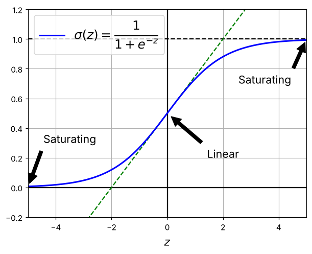
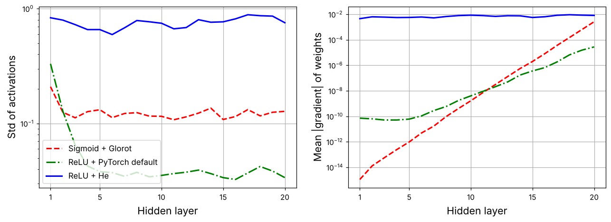
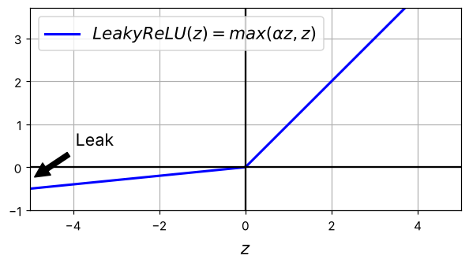
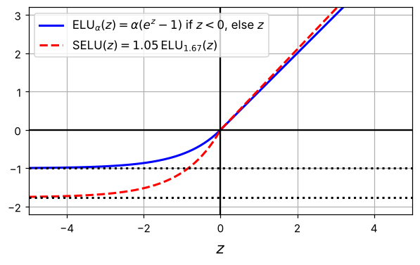
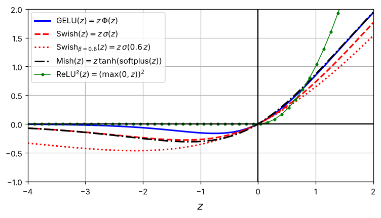
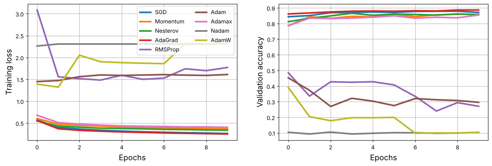
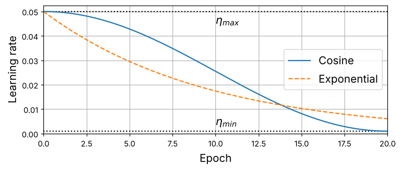
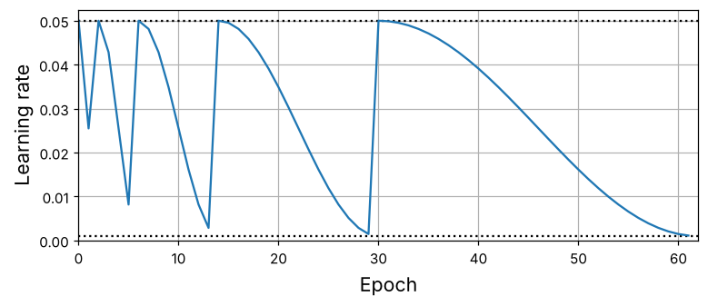
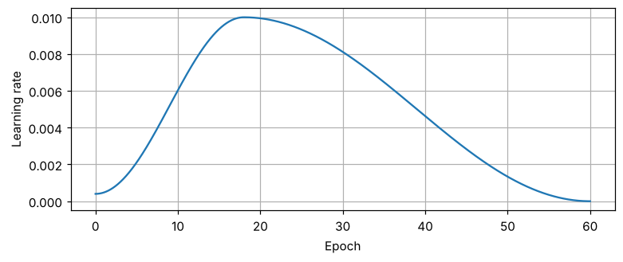

# 11장. 심층 신경망 훈련

[← 10장. 파이토치로 신경망 구축하기](10_neural_nets_with_pytorch.md) · [📚 전체 목차](../README.md) · [📖 용어집](glossary.md) · [12장. 합성곱 신경망을 사용한 심층 컴퓨터 비전 →](12_deep_computer_vision_with_cnns.md)

> 📘 **교재** 『핸즈온 머신러닝 with 사이킷런, 파이토치』 11장 · 노트북 `11_training_deep_neural_networks.ipynb`
>
> 10장에서 만든 MLP는 은닉 층이 2~3개였다. 복잡한 문제를 풀려면 층을 수십 개씩 쌓아야 하는데, 그러면 네 가지 문제가 생긴다 — ① 그레이디언트가 사라지거나 폭주한다 ② 레이블된 데이터가 부족하다 ③ 훈련이 매우 느리다 ④ 파라미터가 많아 과대적합되기 쉽다. 11장은 이 문제를 하나씩 푼다.
>
> - **11.1** 그레이디언트 소실·폭주 — **초기화**(글로럿·He), **활성화 함수**(LeakyReLU·ELU·SELU·GELU·Swish·Mish), **배치 정규화·층 정규화**, **그레이디언트 클리핑**
> - **11.2** 데이터 부족 — **전이 학습**(사전 훈련된 층 재사용·동결·미세 튜닝), 비지도·보조 작업 사전 훈련
> - **11.3** 느린 훈련 — **고속 옵티마이저**(모멘텀·네스테로프·AdaGrad·RMSProp·Adam 계열)
> - **11.4** 학습률 — **스케줄링**(지수·성능 기반·웜업·코사인·1사이클)
> - **11.5** 과대적합 — **규제**(ℓ1·ℓ2·가중치 감쇠, 드롭아웃, MC 드롭아웃, 맥스-노름)
> - **11.6** 무엇부터 쓸 것인가 — 실용적인 가이드라인
>
> ⬅️ **앞에서** 10장의 훈련 루프(정방향 계산 → 손실 → `backward()` → `step()` → `zero_grad()`), `nn.Sequential`, `DataLoader`, `torchmetrics`, `state_dict()`를 그대로 쓴다. 10장에서 "훈련과 평가에서 다르게 동작하는 층이 있다"고만 했던 `nn.BatchNorm1d`와 `nn.Dropout`이 이 장에서 실제로 등장한다. 4장의 학습 스케줄·릿지·라쏘·조기 종료가 신경망 버전으로 다시 나온다.  
> ➡️ **다음으로** 이 장의 전이 학습 실험은 `nn.Linear` 층만 써서 "같은 위치의 패턴"만 재사용할 수 있었다. 12장의 합성곱 층은 이미지 어디에서든 패턴을 찾아내므로 훨씬 잘 전이되고, 이 장의 기법(He 초기화·배치 정규화·옵티마이저·스케줄·드롭아웃)이 깊은 CNN을 훈련하는 기본 도구가 된다.

## 이 장의 흐름

| 단계 | 절 | 핵심 질문 | 결과물 |
|---|---|---|---|
| 1. 불안정한 그레이디언트 | 11.1 | 층이 깊어지면 왜 그레이디언트가 사라지거나 폭주하는가 | 초기화(`nn.init.kaiming_uniform_`), 활성화 함수 7종, `nn.BatchNorm1d`, `nn.LayerNorm`, `clip_grad_norm_` |
| 2. 층 재사용 | 11.2 | 레이블이 20개뿐일 때 어떻게 훈련하는가 | 작업 A의 은닉 층을 작업 B에 재사용 — 테스트 정확도 0.886 → 0.931 |
| 3. 고속 옵티마이저 | 11.3 | 경사 하강법보다 빨리 수렴하려면 | `SGD(momentum, nesterov)`, `Adagrad`, `RMSprop`, `Adam`, `Adamax`, `NAdam`, `AdamW` 9종 비교 |
| 4. 학습률 스케줄링 | 11.4 | 훈련 도중 학습률을 어떻게 바꾸는가 | `ExponentialLR`(검증 0.884), `ReduceLROnPlateau`, `LinearLR`(웜업), `CosineAnnealingLR`, `OneCycleLR` |
| 5. 규제 | 11.5 | 수만~수백만 개의 파라미터가 과대적합되지 않게 하려면 | `weight_decay`, ℓ1·ℓ2 손실 항, `nn.Dropout`, MC 드롭아웃, `apply_max_norm()` |
| 6. 가이드라인 | 11.6 | 이 많은 기법 중 무엇을 기본으로 쓰는가 | 기본 DNN 설정 표, 자기 정규화 네트워크 설정 표 |
| 7. 연습문제 | — | 20층 DNN을 CIFAR10에 훈련하면 | 조기 종료 훈련 함수, 검증 정확도 0.380 → 0.401(BN) → 0.456(SELU) → 0.477(알파 드롭아웃) |

## 데이터

| 데이터 | 형태 | 사용 절 | 비고 |
|---|---|---|---|
| 무작위 텐서 `torch.rand(2, 50)`, `torch.randn(32, 3, 100, 200)` | — | 11.1 | 층·활성화 함수·정규화 층의 입출력 형태 확인용 |
| 패션 MNIST `fetch_openml(name="Fashion-MNIST")` | `(70000, 784)` → `[70000, 1, 28, 28]` | 11.2 | 작업 A(8개 클래스, 56,000장)와 작업 B(2개 클래스, 14,000장)로 나눔 |
| 패션 MNIST (같은 텐서) | `[70000, 1, 28, 28]` | 11.3 ~ 11.5 | 훈련 55,000 / 검증 5,000 / 테스트 10,000. 의류 10종 |
| CIFAR10 `torchvision.datasets.CIFAR10` | 이미지 1장 = `[3, 32, 32]` | 연습문제 8 | 훈련 45,000 / 검증 5,000 / 테스트 10,000. 컬러 이미지 10종 |

> 📌 10장에서는 패션 MNIST를 `torchvision`으로 받았지만, 이 장은 9장처럼 `fetch_openml()`로 받아 **직접 텐서로 만든다**(`reshape(-1, 1, 28, 28) / 255.`). 클래스별로 잘라 작업 A·B를 만들기 쉽기 때문이다. 연습문제의 CIFAR10은 10장과 같은 방식(`torchvision` + `ToImage`·`ToDtype`)으로 받는다.

## 목차

- [0. 준비](#0-준비)
- [1. 그레이디언트 소실과 폭주 문제 (11.1)](#1-그레이디언트-소실과-폭주-문제-111)
   - [1-1. 불안정한 그레이디언트](#1-1-불안정한-그레이디언트)
   - [1-2. 글로럿과 He 초기화](#1-2-글로럿과-he-초기화)
   - [1-3. 보충 코드: 초기화에 따른 신호와 그레이디언트](#1-3-보충-코드-초기화에-따른-신호와-그레이디언트)
   - [1-4. LeakyReLU 계열](#1-4-leakyrelu-계열)
   - [1-5. ELU와 SELU](#1-5-elu와-selu)
   - [1-6. GELU, Swish, Mish와 최신 활성화 함수](#1-6-gelu-swish-mish와-최신-활성화-함수)
   - [1-7. 배치 정규화](#1-7-배치-정규화)
   - [1-8. 층 정규화](#1-8-층-정규화)
   - [1-9. 그레이디언트 클리핑](#1-9-그레이디언트-클리핑)
- [2. 사전 훈련된 층 재사용하기 (11.2)](#2-사전-훈련된-층-재사용하기-112)
   - [2-1. 전이 학습이란](#2-1-전이-학습이란)
   - [2-2. 작업 A와 B로 데이터 나누기](#2-2-작업-a와-b로-데이터-나누기)
   - [2-3. 훈련·평가 함수](#2-3-훈련평가-함수)
   - [2-4. 모델 A와 기준 모델 B](#2-4-모델-a와-기준-모델-b)
   - [2-5. 층 재사용 · 동결 · 미세 튜닝](#2-5-층-재사용--동결--미세-튜닝)
   - [2-6. 비지도 사전 훈련과 보조 작업 사전 훈련](#2-6-비지도-사전-훈련과-보조-작업-사전-훈련)
- [3. 고속 옵티마이저 (11.3)](#3-고속-옵티마이저-113)
   - [3-1. 실험 준비와 기준선 SGD](#3-1-실험-준비와-기준선-sgd)
   - [3-2. 모멘텀 최적화](#3-2-모멘텀-최적화)
   - [3-3. 네스테로프 가속 경사](#3-3-네스테로프-가속-경사)
   - [3-4. AdaGrad](#3-4-adagrad)
   - [3-5. RMSProp](#3-5-rmsprop)
   - [3-6. Adam](#3-6-adam)
   - [3-7. Adamax, Nadam, AdamW](#3-7-adamax-nadam-adamw)
   - [3-8. 옵티마이저 비교](#3-8-옵티마이저-비교)
- [4. 학습률 스케줄링 (11.4)](#4-학습률-스케줄링-114)
   - [4-1. 학습률 스케줄이란](#4-1-학습률-스케줄이란)
   - [4-2. 지수 기반 스케줄링](#4-2-지수-기반-스케줄링)
   - [4-3. 성능 기반 스케줄링](#4-3-성능-기반-스케줄링)
   - [4-4. 웜업](#4-4-웜업)
   - [4-5. 코사인 어닐링](#4-5-코사인-어닐링)
   - [4-6. 1사이클 스케줄링](#4-6-1사이클-스케줄링)
   - [4-7. 스케줄러 목록](#4-7-스케줄러-목록)
- [5. 규제를 사용해 과대적합 피하기 (11.5)](#5-규제를-사용해-과대적합-피하기-115)
   - [5-1. ℓ1과 ℓ2 규제](#5-1-ℓ1과-ℓ2-규제)
   - [5-2. 드롭아웃](#5-2-드롭아웃)
   - [5-3. 몬테 카를로 드롭아웃](#5-3-몬테-카를로-드롭아웃)
   - [5-4. 맥스-노름 규제](#5-4-맥스-노름-규제)
- [6. 실용적인 가이드라인 (11.6)](#6-실용적인-가이드라인-116)
- [7. 연습문제](#7-연습문제)
   - [7-1. 개념 문제 (1~7번)](#7-1-개념-문제-17번)
   - [7-2. 8번 1단계 CIFAR10 적재](#7-2-8번-1단계-cifar10-적재)
   - [7-3. 8번 2단계 20층 DNN](#7-3-8번-2단계-20층-dnn)
   - [7-4. 8번 3단계 NAdam과 조기 종료](#7-4-8번-3단계-nadam과-조기-종료)
   - [7-5. 8번 4단계 배치 정규화](#7-5-8번-4단계-배치-정규화)
   - [7-6. 8번 5단계 SELU 자기 정규화](#7-6-8번-5단계-selu-자기-정규화)
   - [7-7. 8번 6단계 알파 드롭아웃](#7-7-8번-6단계-알파-드롭아웃)
   - [7-8. 8번 7단계 1사이클 스케줄링](#7-8-8번-7단계-1사이클-스케줄링)
   - [7-9. 8번 결과 비교](#7-9-8번-결과-비교)
- [8. 정리](#8-정리)
   - [8-1. 전체 흐름](#8-1-전체-흐름)
   - [8-2. 개념과 코드 대응](#8-2-개념과-코드-대응)
   - [8-3. 방법 비교](#8-3-방법-비교)
   - [8-4. 주요 결과](#8-4-주요-결과)
   - [8-5. 자주 쓴 코드 패턴](#8-5-자주-쓴-코드-패턴)
   - [8-6. 핵심 원칙](#8-6-핵심-원칙)

---

## 0. 준비

```python
import sys
assert sys.version_info >= (3, 10)

IS_COLAB = "google.colab" in sys.modules
IS_KAGGLE = "kaggle_secrets" in sys.modules

if IS_COLAB:
    %pip install -q torchmetrics

from packaging.version import Version
import torch
assert Version(torch.__version__) >= Version("2.6.0")

if torch.cuda.is_available():
    device = "cuda"
elif torch.backends.mps.is_available():
    device = "mps"
else:
    device = "cpu"

device
# 'cuda'

if device == "cpu":
    print("Neural nets can be very slow without a hardware accelerator.")
    if IS_COLAB:
        print("Go to Runtime > Change runtime and select a GPU hardware "
              "accelerator.")
    if IS_KAGGLE:
        print("Go to Settings > Accelerator and select GPU.")

import matplotlib.pyplot as plt
plt.rc('font', size=14)
plt.rc('axes', labelsize=14, titlesize=14)
plt.rc('legend', fontsize=14)
plt.rc('xtick', labelsize=10)
plt.rc('ytick', labelsize=10)
```

모든 장 노트북 맨 앞에 반복되는 환경 확인 + 그래프 글꼴 설정. 각 줄의 의미는 [1장 0. 준비](01_the_machine_learning_landscape.md#0-준비), 장치 선택은 [10장 1-5절](10_neural_nets_with_pytorch.md#1-5-하드웨어-가속) 참고. 이 장에서 달라진 것:

| 코드 | 의미 |
|---|---|
| `%pip install -q torchmetrics` | 코랩에 기본으로 없는 TorchMetrics만 설치 (이 장은 Optuna를 쓰지 않는다) |
| `device`를 준비 단계에서 결정 | 이 장은 처음부터 끝까지 GPU를 쓴다 |
| `if device == "cpu": print(...)` | 가속기가 없으면 경고 — 이 장의 훈련은 CPU로는 매우 느리다 |

> ⚠️ 노트북의 출력은 **코랩 GPU(`cuda`)** 에서 실행한 결과다. 이 노트의 **보충 코드**는 파이토치 2.15(CPU)에서 직접 실행해 확인했다. 패션 MNIST·CIFAR10을 훈련하는 셀의 수치는 모두 노트북 출력 그대로다.

---

## 1. 그레이디언트 소실과 폭주 문제 (11.1)

### 1-1. 불안정한 그레이디언트

> 🎯 **목적** — 층이 깊어지면 왜 아래쪽 층이 훈련되지 않는지, 원인을 활성화 함수와 초기화에서 찾는다.

**개념·원리**

역전파는 출력 층에서 입력 층 쪽으로 오차 그레이디언트를 전달한다(9장). 층을 하나 지날 때마다 그레이디언트에 **그 층의 가중치**와 **활성화 함수의 도함수**가 곱해진다.

| 현상 | 설명 | 결과 |
|---|---|---|
| **그레이디언트 소실** (vanishing gradients) | 아래쪽 층으로 갈수록 그레이디언트가 점점 작아진다 | 아래쪽 층의 가중치가 거의 바뀌지 않아 훈련이 수렴하지 않는다 |
| **그레이디언트 폭주** (exploding gradients) | 반대로 그레이디언트가 점점 커진다 | 가중치가 비정상적으로 크게 갱신되어 훈련이 발산한다. 순환 신경망에서 자주 나타난다 |
| 불안정한 그레이디언트 | 층마다 학습 속도가 크게 달라진다 | 위 두 경우를 묶어 부르는 말 |

원인 (글로럿과 벤지오, 2010): 당시 표준이던 **시그모이드 활성화 함수 + 평균 0·표준편차 1인 정규 분포 초기화** 조합에서는 각 층의 **출력 분산이 입력 분산보다 크다.** 신경망을 따라 올라갈수록 분산이 계속 커져, 위쪽 층에서 활성화 함수가 **포화**된다.

**코드** (그림 11-1 생성)

```python
import numpy as np

def sigmoid(z):
    return 1 / (1 + np.exp(-z))

z = np.linspace(-5, 5, 200)

plt.plot([-5, 5], [0, 0], 'k-')
plt.plot([-5, 5], [1, 1], 'k--')
plt.plot([0, 0], [-0.2, 1.2], 'k-')
plt.plot([-5, 5], [-3/4, 7/4], 'g--')
plt.plot(z, sigmoid(z), "b-", linewidth=2,
         label=r"$\sigma(z) = \dfrac{1}{1+e^{-z}}$")
props = dict(facecolor='black', shrink=0.1)
plt.annotate('Saturating', xytext=(3.5, 0.7), xy=(5, 1), arrowprops=props,
             fontsize=14, ha="center")
plt.annotate('Saturating', xytext=(-3.5, 0.3), xy=(-5, 0), arrowprops=props,
             fontsize=14, ha="center")
plt.annotate('Linear', xytext=(2, 0.2), xy=(0, 0.5), arrowprops=props,
             fontsize=14, ha="center")
plt.grid(True)
plt.axis([-5, 5, -0.2, 1.2])
plt.xlabel("$z$")
plt.legend(loc="upper left", fontsize=16)
plt.show()
```



**결과 해석**

| 구간 | 함숫값 | 기울기 | 역전파에 미치는 영향 |
|---|---|---|---|
| $z \approx 0$ (Linear) | 0.5 근처 | 최대 0.25 (초록 점선의 기울기) | 그레이디언트가 가장 잘 전달되는 구간에서도 **1/4로 줄어든다** |
| $\lvert z \rvert$가 큼 (Saturating) | 0 또는 1에 수렴 | 0에 가까움 | 전달할 그레이디언트가 거의 없다 |

- 시그모이드의 도함수는 $\sigma(z)(1 - \sigma(z))$로 **최댓값이 0.25**다. 층을 20개 지나면 최선의 경우에도 $0.25^{20} \approx 10^{-12}$배가 된다
- 시그모이드의 평균 출력이 0이 아니라 **0.5**라는 점도 문제를 키운다. tanh는 평균이 0이라 조금 낫다
- 해결 방향은 세 가지다 — 신호의 분산을 유지하는 **초기화**(1-2), 포화되지 않는 **활성화 함수**(1-4 ~ 1-6), 층 사이에서 분포를 다시 맞추는 **정규화 층**(1-7, 1-8)

### 1-2. 글로럿과 He 초기화

> 🎯 **목적** — 신호가 정방향·역방향 양쪽으로 잘 흐르도록 가중치의 초기 분산을 정한다.

**개념·원리**

글로럿과 벤지오의 주장: 신호가 사라지거나 폭주하지 않으려면

- 정방향: 각 층의 **출력 분산 = 입력 분산**
- 역방향: 층을 지나기 전후의 **그레이디언트 분산이 같아야** 한다

층의 입력 수(`fan_in`)와 출력 수(`fan_out`)가 다르면 둘을 동시에 만족할 수 없다. 그래서 절충안으로 둘의 평균 $\text{fan}_\text{avg} = (\text{fan}_\text{in} + \text{fan}_\text{out}) / 2$를 쓴다.

```math
\text{글로럿 초기화:}\quad \sigma^2 = \frac{1}{\text{fan}_\text{avg}}
\quad\text{(정규 분포)}
\qquad\text{또는}\qquad
r = \sqrt{\frac{3}{\text{fan}_\text{avg}}}
\quad\text{(} -r \sim +r \text{ 균등 분포)}
```

활성화 함수에 따라 분산의 크기만 달라진다.

| 초기화 | 활성화 함수 | 분산 $\sigma^2$ (정규 분포) | 파이토치 함수 |
|---|---|---|---|
| 글로럿 (Xavier) | 없음, tanh, 시그모이드, 소프트맥스 | $1 / \text{fan}_\text{avg}$ | `nn.init.xavier_uniform_()`, `xavier_normal_()` |
| He (Kaiming) | ReLU, LeakyReLU, ELU, GELU, Swish, Mish, SwiGLU, ReLU² | $2 / \text{fan}_\text{in}$ | `nn.init.kaiming_uniform_()`, `kaiming_normal_()` |
| 르쿤 (LeCun) | SELU | $1 / \text{fan}_\text{in}$ | `kaiming_normal_(mode="fan_in", nonlinearity="linear")` |

- 균등 분포를 쓸 때는 $r = \sqrt{3\sigma^2}$ ($-r \sim +r$ 균등 분포의 분산이 $r^2/3$이기 때문)
- ReLU는 입력의 절반을 0으로 만들어 분산을 반으로 줄인다 → He 초기화가 분산을 **2배**로 키워 보상한다
- `fan_in` = `fan_out`이면 글로럿 초기화와 르쿤 초기화는 같다

**코드 ① — 파이토치 기본 초기화를 He 초기화로 바꾸기**

```python
import torch
import torch.nn as nn

layer = nn.Linear(40, 10)
layer.weight.data *= 6 ** 0.5  # Kaiming init (or 3 ** 0.5 for LeCun init)
torch.zero_(layer.bias.data)
# tensor([0., 0., 0., 0., 0., 0., 0., 0., 0., 0.])
```

```python
layer = nn.Linear(40, 10)
nn.init.kaiming_uniform_(layer.weight)
nn.init.zeros_(layer.bias)
# Parameter containing:
# tensor([0., 0., 0., 0., 0., 0., 0., 0., 0., 0.], requires_grad=True)
```

| 코드 | 의미 |
|---|---|
| `layer.weight.data *= 6 ** 0.5` | 기본 초기화 값에 $\sqrt{6}$을 곱한다 → He 초기화가 된다 (아래 표). $\sqrt{3}$을 곱하면 르쿤 초기화 |
| `.data` | 추적 없이 값만 직접 고친다. autograd 그래프에 기록되지 않는다 |
| `torch.zero_(layer.bias.data)` | 편향을 0으로 (인플레이스) |
| `nn.init.kaiming_uniform_(layer.weight)` | 같은 일을 하는 공식 함수. 이름 끝의 `_` = 인플레이스 |
| `nn.init.zeros_(layer.bias)` | 편향을 0으로 |

왜 $\sqrt{6}$인가 — `nn.Linear`의 기본 초기화가 이미 `fan_in`에 맞춘 균등 분포이기 때문이다.

| | 범위 | 분산 |
|---|---|---|
| `nn.Linear` 기본값 | $\pm\sqrt{1 / \text{fan}_\text{in}}$ | $1 / (3\,\text{fan}_\text{in})$ |
| × $\sqrt{3}$ → 르쿤 | $\pm\sqrt{3 / \text{fan}_\text{in}}$ | $1 / \text{fan}_\text{in}$ |
| × $\sqrt{6}$ → He | $\pm\sqrt{6 / \text{fan}_\text{in}}$ | $2 / \text{fan}_\text{in}$ |

**보충 코드** — 초기화별 범위와 표준편차 확인

```python
torch.manual_seed(42)
layer = nn.Linear(40, 10)
layer.weight.abs().max()                 # tensor(0.1581)   ← 1/√40 = 0.1581
layer.weight.data *= 6 ** 0.5
layer.weight.abs().max()                 # tensor(0.3871)   ← √(6/40) = 0.3873

big = nn.Linear(1000, 1000)
big.weight.std()                                              # 0.0183  ← √(1/3000) = 0.0183
nn.init.kaiming_uniform_(big.weight);  big.weight.std()       # 0.0447  ← √(2/1000) = 0.0447
nn.init.kaiming_normal_(big.weight);   big.weight.std()       # 0.0447
nn.init.xavier_uniform_(big.weight);   big.weight.std()       # 0.0316  ← √(2/2000) = 0.0316
nn.init.kaiming_normal_(big.weight, mode="fan_in", nonlinearity="linear")
big.weight.std()                                              # 0.0316  ← √(1/1000) = 0.0316  (르쿤)
```

- `kaiming_uniform_`과 `kaiming_normal_`은 분포 모양만 다르고 **표준편차가 같다**. 중요한 것은 분포의 종류가 아니라 분산이다
- 파이토치 기본 초기화의 표준편차(0.0183)는 He 초기화(0.0447)의 $1/\sqrt{6} \approx 0.41$배다. ReLU를 쓰는 깊은 신경망에는 **너무 작다** (1-3절에서 확인)

**코드 ② — 모델 전체에 적용**

```python
def use_he_init(module):
    if isinstance(module, nn.Linear):
        nn.init.kaiming_uniform_(module.weight)
        nn.init.zeros_(module.bias)

model = nn.Sequential(nn.Linear(50, 40), nn.ReLU(), nn.Linear(40, 1), nn.ReLU())
model.apply(use_he_init)
# Sequential(
#   (0): Linear(in_features=50, out_features=40, bias=True)
#   (1): ReLU()
#   (2): Linear(in_features=40, out_features=1, bias=True)
#   (3): ReLU()
# )
```

```python
model = nn.Sequential(nn.Linear(50, 40), nn.LeakyReLU(negative_slope=0.2))
model.apply(use_he_init)
```

| 코드 | 의미 |
|---|---|
| `model.apply(fn)` | 모델 안의 **모든 하위 모듈**(자기 자신 포함)에 `fn`을 한 번씩 호출하고 모델을 반환 |
| `isinstance(module, nn.Linear)` | `apply()`는 `nn.ReLU`·`nn.Flatten`에도 호출된다 → 가중치가 있는 `nn.Linear`만 골라 초기화 |

> 📌 `use_he_init()`는 이 장 끝까지 계속 쓴다. 모델을 만든 뒤 `model.apply(use_he_init)` 한 줄을 붙이는 것이 이 장의 기본 패턴이다.

### 1-3. 보충 코드: 초기화에 따른 신호와 그레이디언트

> 🎯 **목적** — 1-1절의 "신호가 사라진다"를 20층 신경망에서 직접 측정한다. (노트북에 없는 실험)

```python
# 보충 코드
import torch.nn.functional as F

def glorot(m):
    if isinstance(m, nn.Linear):
        nn.init.xavier_uniform_(m.weight); nn.init.zeros_(m.bias)

def deep(act, init, L=20, n=100):
    torch.manual_seed(42)
    layers = []
    for _ in range(L):
        layers += [nn.Linear(n, n), act()]
    m = nn.Sequential(*layers, nn.Linear(n, 10))
    if init:
        m.apply(init)
    return m

torch.manual_seed(0)
Xr = torch.randn(256, 100); yr = torch.randint(0, 10, (256,))

for name, act, init in [("Sigmoid + Glorot", nn.Sigmoid, glorot),
                        ("ReLU + PyTorch default", nn.ReLU, None),
                        ("ReLU + He", nn.ReLU, use_he_init)]:
    m = deep(act, init); acts = []
    for mod in m:
        if not isinstance(mod, nn.Linear):       # 활성화 함수 출력의 표준편차 기록
            mod.register_forward_hook(lambda mod, i, o: acts.append(o.std().item()))
    F.cross_entropy(m(Xr), yr).backward()
    grads = [mod.weight.grad.abs().mean().item() for mod in m if isinstance(mod, nn.Linear)][:-1]
```



(보충 그림. 은닉 층 20개 × 뉴런 100개, 무작위 입력 256개로 역전파 한 번. 왼쪽: 층별 활성화 값의 표준편차. 오른쪽: 층별 가중치 그레이디언트의 평균 절댓값. 세로축은 로그 스케일.)

| 조합 | 활성화 표준편차 (1층 / 10층 / 20층) | 가중치 그레이디언트 (1층 / 10층 / 20층) |
|---|---|---|
| 시그모이드 + 글로럿 | 0.209 / 0.116 / 0.128 | $1.1 \times 10^{-15}$ / $1.7 \times 10^{-9}$ / $2.6 \times 10^{-3}$ |
| ReLU + 파이토치 기본 초기화 | 0.331 / 0.035 / 0.034 | $7.1 \times 10^{-11}$ / $4.0 \times 10^{-9}$ / $2.8 \times 10^{-5}$ |
| ReLU + He | 0.833 / 0.747 / 0.755 | $4.5 \times 10^{-3}$ / $8.5 \times 10^{-3}$ / $8.1 \times 10^{-3}$ |

**결과 해석**

- **시그모이드**는 초기화를 맞춰도 20층에서는 버티지 못한다. 20층의 그레이디언트가 1층에 도달하면 $10^{12}$배 작아진다 → 1층은 사실상 훈련되지 않는다. 도함수가 최대 0.25라는 한계(1-1절) 그대로다
- **ReLU + 기본 초기화**: 정방향에서 신호가 10층 만에 1/10로 줄고, 역방향에서도 그레이디언트가 약 $4 \times 10^{5}$배 줄어든다. 분산이 He 초기화의 1/6이라 층마다 신호가 줄어든 결과다
- **ReLU + He**: 활성화 값과 그레이디언트가 20개 층 내내 **같은 자릿수**를 유지한다. 이것이 "신호가 양방향으로 잘 흐른다"의 의미다

> 💡 10장의 얕은 MLP(은닉 층 2~3개)에서는 기본 초기화로도 문제가 드러나지 않았다. 층이 깊어질수록 "층마다 조금씩 줄어드는" 효과가 곱으로 누적되기 때문에 초기화가 중요해진다.

### 1-4. LeakyReLU 계열

> 🎯 **목적** — ReLU의 약점인 "죽은 ReLU" 문제와 이를 피하는 변형을 정리한다.

**개념·원리**

ReLU는 양수에서 포화되지 않고 계산이 빨라 시그모이드를 대체했다. 하지만 **죽은 ReLU**(dying ReLU) 문제가 있다.

| 단계 | 일어나는 일 |
|---|---|
| 1 | 훈련 중 큰 갱신으로 어떤 뉴런의 가중치가 바뀌어, **모든 훈련 샘플에 대해 가중 합이 음수**가 된다 |
| 2 | 그 뉴런은 항상 0을 출력한다 |
| 3 | ReLU는 음수 구간의 기울기가 0이다 → 그레이디언트가 0 → 가중치가 더는 바뀌지 않는다 |
| 4 | 뉴런이 되살아나지 못한다. 학습률이 크면 뉴런의 절반이 죽기도 한다 |

해결: 음수 구간에 작은 기울기 $\alpha$를 남긴다.

```math
\text{LeakyReLU}_\alpha(z) = \max(\alpha z,\ z)
```

| 변형 | $\alpha$ | 파이토치 | 특징 |
|---|---|---|---|
| LeakyReLU | 고정된 하이퍼파라미터 | `nn.LeakyReLU(negative_slope=0.01)` | 기본값 0.01. 0.2처럼 크게 새는 쪽이 성능이 더 좋았다는 실험 결과가 있다 |
| RReLU (randomized) | 훈련 중에는 범위 안에서 **무작위**, 테스트 때는 평균값으로 고정 | `nn.RReLU()` (기본 범위 1/8 ~ 1/3) | 규제 효과가 있어 과대적합을 줄인다 |
| PReLU (parametric) | 역전파로 **학습**되는 파라미터 | `nn.PReLU()` (초깃값 0.25) | 큰 이미지 데이터셋에서는 ReLU보다 훨씬 낫지만, 작은 데이터셋에서는 과대적합 위험 |

**코드** (그림 11-2 생성 + 모델에 적용)

```python
def leaky_relu(z, alpha):
    return np.maximum(alpha * z, z)

z = np.linspace(-5, 5, 200)
plt.plot(z, leaky_relu(z, 0.1), "b-", linewidth=2, label=r"$LeakyReLU(z) = max(\alpha z, z)$")
plt.plot([-5, 5], [0, 0], 'k-')
plt.plot([0, 0], [-1, 3.7], 'k-')
plt.grid(True)
props = dict(facecolor='black', shrink=0.1)
plt.annotate('Leak', xytext=(-3.5, 0.5), xy=(-5, -0.3), arrowprops=props,
             fontsize=14, ha="center")
plt.xlabel("$z$")
plt.axis([-5, 5, -1, 3.7])
plt.gca().set_aspect("equal")
plt.legend()
plt.show()
```



```python
torch.manual_seed(42)
alpha = 0.2
model = nn.Sequential(nn.Linear(50, 40), nn.LeakyReLU(negative_slope=alpha))
nn.init.kaiming_uniform_(model[0].weight, alpha, nonlinearity="leaky_relu")
model(torch.rand(2, 50)).shape
# torch.Size([2, 40])
```

| 코드 | 의미 |
|---|---|
| `nn.LeakyReLU(negative_slope=alpha)` | 음수 구간의 기울기 $\alpha$ = 0.2 |
| `nn.init.kaiming_uniform_(weight, alpha, nonlinearity="leaky_relu")` | 두 번째 인수 `a` = 음수 기울기. 분산을 $\dfrac{2}{(1 + \alpha^2)\,\text{fan}_\text{in}}$으로 맞춘다 |
| `model[0].weight` | `nn.Sequential`의 0번 모듈(`nn.Linear`)의 가중치 |

**결과 해석**

- 그림은 $\alpha$ = 0.1로 그린 것이다. 음수 구간에서도 기울기가 0이 아니므로("Leak") 뉴런이 긴 혼수상태에 빠질 수는 있어도 **완전히 죽지는 않는다**
- LeakyReLU는 음수 입력도 조금 통과시키므로 ReLU만큼 분산이 줄지 않는다 → He 초기화의 분산을 $(1 + \alpha^2)$로 나눠 살짝 줄인다. 보충 확인: $\alpha$ = 0.2일 때 표준편차 0.0439 (ReLU용 0.0447의 0.98배) — 차이가 작아서 1-2절처럼 `use_he_init()`를 그대로 써도 큰 문제는 없다
- ReLU·LeakyReLU·PReLU는 모두 $z = 0$에서 꺾여 **매끄럽지 않다**. 4장의 라쏘처럼 도함수가 갑자기 바뀌는 지점에서는 경사 하강법이 최적점 근처에서 진동할 수 있다 → 매끄러운 변형이 다음 절의 ELU·SELU, 그리고 GELU·Swish·Mish다

### 1-5. ELU와 SELU

> 🎯 **목적** — 음수 구간이 매끄러운 ELU와, 스스로 정규화되는 SELU를 익힌다.

**개념·원리**

```math
\text{ELU}_\alpha(z) =
\begin{cases}
\alpha\,(e^{z} - 1) & z < 0 \\
z & z \ge 0
\end{cases}
\qquad\qquad
\text{SELU}(z) = \lambda \cdot \text{ELU}_\alpha(z)
\quad (\lambda \approx 1.0507,\ \alpha \approx 1.6733)
```

| | ELU | SELU |
|---|---|---|
| 음수 구간 | $-\alpha$로 수렴 ($\alpha$는 보통 1) → 평균 출력이 0에 가까워져 그레이디언트 소실을 줄인다 | $-\lambda\alpha \approx -1.758$로 수렴 |
| 기울기 | 음수에서도 0이 아니다 → 죽은 뉴런 없음 | 같음 |
| 매끄러움 | $\alpha$ = 1이면 $z = 0$에서도 매끄럽다 → 경사 하강법이 덜 흔들린다 | $z = 0$에서 기울기가 달라진다 (양수 쪽 기울기가 $\lambda$) |
| 단점 | 지수 함수 때문에 ReLU보다 **계산이 느리다** (수렴이 빨라 훈련에서는 어느 정도 상쇄되지만, 추론은 더 느리다) | 아래의 조건을 지켜야만 한다 |
| 파이토치 | `nn.ELU()` | `nn.SELU()` |

**SELU의 자기 정규화**(self-normalization): 조건을 지키면 각 층의 출력이 훈련 중에 **평균 0, 표준편차 1을 스스로 유지**한다 → 그레이디언트 소실·폭주가 사라진다.

| 자기 정규화 조건 | 이유 |
|---|---|
| 입력 특성을 표준화 (평균 0, 표준편차 1) | 첫 층의 입력부터 분포가 맞아야 한다 |
| 은닉 층 가중치를 **르쿤 정규 분포 초기화** | 분산 $1 / \text{fan}_\text{in}$ |
| 층을 한 줄로 쌓은 **일반 MLP** 구조만 | 스킵 연결·순환 신경망 등에서는 보장되지 않는다 |
| ℓ1·ℓ2 규제, 맥스-노름, 배치 정규화, 일반 드롭아웃을 쓰지 않는다 | 분포를 흐트러뜨린다. 드롭아웃이 필요하면 **알파 드롭아웃** (5-2절) |

**코드** (그림 11-3 생성)

```python
from scipy.special import erfc

# alpha and scale to self normalize with mean 0 and standard deviation 1
# (see equation 14 in the paper):
alpha_0_1 = -np.sqrt(2 / np.pi) / (erfc(1 / np.sqrt(2)) * np.exp(1 / 2) - 1)
scale_0_1 = (
    (1 - erfc(1 / np.sqrt(2)) * np.sqrt(np.e))
    * np.sqrt(2 * np.pi)
    * (
        2 * erfc(np.sqrt(2)) * np.e ** 2
        + np.pi * erfc(1 / np.sqrt(2)) ** 2 * np.e
        - 2 * (2 + np.pi) * erfc(1 / np.sqrt(2)) * np.sqrt(np.e)
        + np.pi
        + 2
    ) ** (-1 / 2)
)

def elu(z, alpha=1):
    return np.where(z < 0, alpha * (np.exp(z) - 1), z)

def selu(z, scale=scale_0_1, alpha=alpha_0_1):
    return scale * elu(z, alpha)

z = np.linspace(-5, 5, 200)
plt.plot(z, elu(z), "b-", linewidth=2, label=r"ELU$_\alpha(z) = \alpha (e^z - 1)$ if $z < 0$, else $z$")
plt.plot(z, selu(z), "r--", linewidth=2, label=r"SELU$(z) = 1.05 \, $ELU$_{1.67}(z)$")
plt.plot([-5, 5], [0, 0], 'k-')
plt.plot([-5, 5], [-1, -1], 'k:', linewidth=2)
plt.plot([-5, 5], [-1.758, -1.758], 'k:', linewidth=2)
plt.plot([0, 0], [-2.2, 3.2], 'k-')
plt.grid(True)
plt.axis([-5, 5, -2.2, 3.2])
plt.xlabel("$z$")
plt.gca().set_aspect("equal")
plt.legend()
plt.show()
```



| 코드 | 의미 |
|---|---|
| `alpha_0_1`, `scale_0_1` | 평균 0·표준편차 1로 자기 정규화되도록 논문의 식으로 계산한 상수. 계산하면 $\alpha$ = 1.6733, $\lambda$ = 1.0507 |
| `np.where(z < 0, A, B)` | 조건이 참이면 A, 거짓이면 B |
| 점선 두 개 ($-1$, $-1.758$) | ELU와 SELU가 음수 쪽에서 수렴하는 값. $-\lambda\alpha = -1.0507 \times 1.6733 = -1.758$ |

파이토치에서는 층 하나만 바꾸면 된다.

```python
torch.manual_seed(42)
model = nn.Sequential(nn.Linear(50, 40), nn.ELU())
nn.init.kaiming_uniform_(model[0].weight)
model(torch.rand(2, 50)).shape
# torch.Size([2, 40])
```

```python
torch.manual_seed(42)
model = nn.Sequential(nn.Linear(50, 40), nn.SELU())
nn.init.kaiming_uniform_(model[0].weight)
model(torch.rand(2, 50)).shape
# torch.Size([2, 40])
```

> ⚠️ 위의 SELU 셀은 형태만 확인하는 예시라 `kaiming_uniform_`(He)을 그대로 썼다. **자기 정규화**가 목적이라면 르쿤 초기화를 써야 한다 — 연습문제 8번의 `use_lecun_init()` ([7-6절](#7-6-8번-5단계-selu-자기-정규화)).

**보충 코드** — 1,000층에서도 평균 0·표준편차 1이 유지되는가

```python
# 보충 코드
def stats(act, init_fn, L=1000, n=100):
    torch.manual_seed(42)
    x = torch.randn(1000, n); out = {}                 # 표준화된 입력
    with torch.no_grad():
        for i in range(1, L + 1):
            lin = nn.Linear(n, n); init_fn(lin.weight); nn.init.zeros_(lin.bias)
            x = act(lin(x))
            if i in (1, 10, 100, 1000):
                out[i] = (round(x.mean().item(), 3), round(x.std().item(), 3))
    return out

stats(nn.SELU(), lambda w: nn.init.kaiming_normal_(w, mode="fan_in", nonlinearity="linear"))
# {1: (0.002, 1.002), 10: (-0.011, 0.954), 100: (-0.033, 0.924), 1000: (-0.008, 0.971)}
stats(nn.ReLU(), lambda w: nn.init.kaiming_normal_(w))
# {1: (0.566, 0.827), 10: (0.493, 0.758), 100: (0.06, 0.079), 1000: (0.0, 0.0)}
```

| 층 | SELU + 르쿤 (평균, 표준편차) | ReLU + He (평균, 표준편차) |
|---|---|---|
| 1 | (0.002, 1.002) | (0.566, 0.827) |
| 10 | (−0.011, 0.954) | (0.493, 0.758) |
| 100 | (−0.033, 0.924) | (0.060, 0.079) |
| 1,000 | (−0.008, 0.971) | (0.000, 0.000) |

- SELU는 **1,000개 층을 지나도** 평균 ≈ 0, 표준편차 ≈ 1이다. 노트북이 설명하는 그대로다
- ReLU + He는 20층에서는 잘 유지됐지만(1-3절) 100층에서는 신호가 1/10로 줄고 1,000층에서는 사라진다. He 초기화는 "평균적으로" 분산을 유지할 뿐, 스스로 되돌아오는 힘은 없다

> 📌 SELU는 조건이 까다로워 널리 쓰이지는 못했다. 그래도 단순한 MLP를 깊게 쌓아야 할 때는 여전히 좋은 선택이다 (연습문제 8번에서 배치 정규화보다 좋은 결과).

### 1-6. GELU, Swish, Mish와 최신 활성화 함수

> 🎯 **목적** — 최근 모델(특히 트랜스포머)에서 쓰이는 매끄럽고 **단조롭지 않은** 활성화 함수를 정리한다.

**개념·원리**

| 함수 | 식 | 파이토치 | 특징 |
|---|---|---|---|
| **GELU** | $z\,\Phi(z)$ ($\Phi$ = 표준 정규 분포의 누적 분포 함수) | `nn.GELU()` | ReLU를 매끄럽게 만든 형태. 음수 쪽에 얕은 골이 있다 |
| **Swish** (SiLU) | $z\,\sigma(z)$ | `nn.SiLU()` | GELU와 거의 같은 모양. GELU ≈ $z\,\sigma(1.702z)$ |
| **Swish**$_\beta$ | $z\,\sigma(\beta z)$ | 직접 구현 | $\beta$로 모양을 조절. $\beta$를 학습시킬 수도 있다 |
| **SwiGLU** | 입력을 반으로 나눠 $\text{Swish}_\beta(\mathbf{z}_1) \otimes \mathbf{z}_2$ | 직접 구현 | 한쪽 절반이 다른 절반을 얼마나 통과시킬지 조절하는 **게이트** 구조. 최근 대형 언어 모델에서 쓰인다 |
| **Mish** | $z\,\tanh(\text{softplus}(z))$ | `nn.Mish()` | Swish와 비슷하고 음수 쪽 골이 조금 더 깊다 |
| **ReLU²** | $(\max(0, z))^2$ | 직접 구현 | 양수 쪽이 2차 함수. $z = 0$에서 기울기가 0이라 매끄럽게 이어진다 |

공통점: $z$가 크게 음수면 0에 수렴하고, 크게 양수면 $z$에 가까워진다(ReLU² 제외). 그 사이에 **살짝 내려갔다 올라오는 골**이 있다 → 단조 함수가 아니다. 이 복잡한 모양 덕분에 경사 하강법이 복잡한 패턴을 찾기 쉬워진다고 알려져 있다. 대신 지수·tanh 계산이 들어가 ReLU보다 느리다.

**코드** (그림 11-4 생성)

```python
def swish(z, beta=1):
    return z * sigmoid(beta * z)

def approx_gelu(z):
    return swish(z, beta=1.702)

def softplus(z):
    return np.log(1 + np.exp(z))

def mish(z):
    return z * np.tanh(softplus(z))

def relu_squared(z):
    return np.maximum(0, z)**2

z = np.linspace(-4, 2, 50)

beta = 0.6
plt.plot(z, approx_gelu(z), "b-", linewidth=2,
         label=r"GELU$(z) = z\,\Phi(z)$")
plt.plot(z, swish(z), "r--", linewidth=2,
         label=r"Swish$(z) = z\,\sigma(z)$")
plt.plot(z, swish(z, beta), "r:", linewidth=2,
         label=fr"Swish$_{{\beta={beta}}}(z)=z\,\sigma({beta}\,z)$")
plt.plot(z, mish(z), "k-.", linewidth=2,
         label=fr"Mish$(z) = z\,\tanh($softplus$(z))$")
plt.plot(z, relu_squared(z), "g.-", linewidth=1,
         label=fr"ReLU²$(z) = (\max(0, z))^2$")
plt.plot([-4, 2], [0, 0], 'k-')
plt.plot([0, 0], [-2.2, 3.2], 'k-')
plt.grid(True)
plt.axis([-4, 2, -1, 2])
plt.gca().set_aspect("equal")
plt.xlabel("$z$")
plt.legend(loc="upper left")
plt.show()
```



- 그림의 GELU는 정확한 $z\,\Phi(z)$가 아니라 **근사식** `swish(z, beta=1.702)`로 그린 것이다
- 골의 가장 낮은 지점 (보충 계산): GELU −0.170 ($z$ = −0.75), Swish −0.278 ($z$ = −1.28), Mish −0.309 ($z$ = −1.19)

**코드 — SwiGLU**

```python
class SwiGLU(nn.Module):
    def __init__(self, beta=1.0):
        super().__init__()
        self.beta = beta

    def forward(self, x):
        z1, z2 = x.chunk(2, dim=-1)
        param_swish = z1 * torch.sigmoid(self.beta * z1)
        return param_swish * z2

torch.manual_seed(42)
model = nn.Sequential(nn.Linear(50, 2 * 40), SwiGLU(beta=0.2))
nn.init.kaiming_uniform_(model[0].weight)
model(torch.rand(2, 50)).shape
# torch.Size([2, 40])
```

| 코드 | 의미 |
|---|---|
| `x.chunk(2, dim=-1)` | 마지막 차원을 **똑같은 크기 2개**로 나눈다. `[2, 80]` → `[2, 40]` 두 개 |
| `z1 * torch.sigmoid(self.beta * z1)` | $\text{Swish}_\beta(\mathbf{z}_1)$ |
| `param_swish * z2` | 원소별 곱. `z2`가 게이트 역할 |
| `nn.Linear(50, 2 * 40)` | SwiGLU가 출력 차원을 **절반**으로 줄이므로, 앞의 선형 층은 원하는 출력(40)의 2배(80)를 내야 한다 |

**코드 — ReLU²**

```python
import torch.nn.functional as F

class ReLU2(nn.Module):
    def forward(self, x):
        return F.relu(x).square()

torch.manual_seed(42)
model = nn.Sequential(nn.Linear(50, 40), ReLU2())
nn.init.kaiming_uniform_(model[0].weight)
model(torch.rand(2, 50)).shape
# torch.Size([2, 40])
```

- 파라미터가 없는 활성화 함수는 `__init__()` 없이 `forward()`만 정의하면 된다 (10장 6절의 `nn.Module` 상속)

**보충 코드** — 같은 입력에 대한 출력 비교

```python
# 보충 코드
z = torch.tensor([-3., -1., 0., 1., 3.])
```

| 활성화 함수 | $z$ = −3 | −1 | 0 | 1 | 3 |
|---|---|---|---|---|---|
| `nn.ReLU()` | 0 | 0 | 0 | 1 | 3 |
| `nn.LeakyReLU(0.2)` | −0.6 | −0.2 | 0 | 1 | 3 |
| `nn.ELU()` | −0.9502 | −0.6321 | 0 | 1 | 3 |
| `nn.SELU()` | −1.6706 | −1.1113 | 0 | 1.0507 | 3.1521 |
| `nn.GELU()` | −0.0041 | −0.1587 | 0 | 0.8413 | 2.9959 |
| `nn.SiLU()` | −0.1423 | −0.2689 | 0 | 0.7311 | 2.8577 |
| `nn.Mish()` | −0.1456 | −0.3034 | 0 | 0.8651 | 2.9865 |

- ELU·SELU는 음수 쪽에서 **음의 상수로 수렴**하고, GELU·Swish·Mish는 **0으로 되돌아온다**
- SELU만 양수 쪽 기울기가 1이 아니다($\lambda$ = 1.0507)

> 📌 **어떤 활성화 함수를 쓸까** (11.6절·연습문제 4번과 연결)
> - 단순한 작업·얕은 신경망: **ReLU**가 여전히 좋은 기본값. 빠르고, 하드웨어 최적화도 잘 되어 있다
> - 조금 더 좋은 품질: LeakyReLU 계열 — 속도 손해가 거의 없다
> - 크고 복잡한 작업: **Swish**(또는 GELU·Mish) — 품질이 조금 더 좋지만 계산 비용이 든다
> - 깊은 MLP: SELU (자기 정규화 조건을 지킬 수 있을 때)

### 1-7. 배치 정규화

> 🎯 **목적** — 초기화는 훈련 **시작 시점**만 책임진다. 훈련 **도중**에도 층의 입력 분포를 안정시키는 배치 정규화(BN)를 익힌다.

**개념·원리**

각 층의 활성화 함수 앞이나 뒤에 연산을 하나 추가한다. ① 입력을 **미니배치 기준으로** 평균 0·표준편차 1로 만들고 ② 학습되는 두 파라미터로 다시 스케일을 조정하고 이동시킨다.

```math
\begin{aligned}
\boldsymbol{\mu}_B &= \frac{1}{m_B}\sum_{i=1}^{m_B}\mathbf{x}^{(i)}
&\qquad
\boldsymbol{\sigma}_B^2 &= \frac{1}{m_B}\sum_{i=1}^{m_B}\left(\mathbf{x}^{(i)} - \boldsymbol{\mu}_B\right)^2 \\
\hat{\mathbf{x}}^{(i)} &= \frac{\mathbf{x}^{(i)} - \boldsymbol{\mu}_B}{\sqrt{\boldsymbol{\sigma}_B^2 + \varepsilon}}
&\qquad
\mathbf{z}^{(i)} &= \boldsymbol{\gamma} \otimes \hat{\mathbf{x}}^{(i)} + \boldsymbol{\beta}
\end{aligned}
```

| 기호 | 의미 | 파이토치 이름 | 종류 |
|---|---|---|---|
| $\boldsymbol{\gamma}$ | 출력 스케일 | `weight` (초깃값 1) | **파라미터** — 역전파로 학습 |
| $\boldsymbol{\beta}$ | 출력 이동 | `bias` (초깃값 0) | **파라미터** — 역전파로 학습 |
| $\boldsymbol{\mu}$ | 훈련 중 본 평균의 이동 평균 | `running_mean` (초깃값 0) | **버퍼** — 학습되지 않고 갱신만 됨 |
| $\boldsymbol{\sigma}^2$ | 훈련 중 본 분산의 이동 평균 | `running_var` (초깃값 1) | **버퍼** |
| — | 지금까지 처리한 배치 수 | `num_batches_tracked` | **버퍼** |
| $\varepsilon$ | 0으로 나누는 것을 막는 작은 값 | `eps` = 1e-5 | 하이퍼파라미터 |

**훈련과 평가에서 다르게 동작한다** — 10장에서 `model.train()` / `model.eval()`을 꼭 호출해야 한다고 했던 이유다.

| 모드 | 정규화에 쓰는 통계 | 이유 |
|---|---|---|
| `model.train()` | **현재 미니배치**의 평균·분산. 동시에 이동 평균(`running_mean`, `running_var`)을 갱신 | — |
| `model.eval()` | 훈련 중 쌓아 둔 **이동 평균** | 예측할 때는 샘플이 하나뿐일 수도 있고, 같은 샘플의 예측이 배치 구성에 따라 달라지면 안 된다 |

장점과 단점:

| 장점 | 단점 |
|---|---|
| 그레이디언트 소실·폭주가 크게 줄어든다 → 포화되는 활성화 함수도 쓸 수 있다 | 층이 추가되어 에포크당 시간이 늘어난다 (수렴이 빨라 전체 시간은 보통 줄어든다) |
| 가중치 초기화에 덜 민감해진다 | **추론 속도**가 느려진다 → 훈련 후 BN 층을 앞의 선형 층에 합쳐(fuse) 없앨 수 있다 |
| 훨씬 큰 학습률을 쓸 수 있다 | 배치가 작으면 배치 통계가 불안정하다 |
| 미니배치마다 통계가 달라 잡음이 섞인다 → **규제 효과** | 순환 신경망에는 쓰기 어렵다 → 층 정규화 (1-8절) |

**코드 ① — 활성화 함수 뒤에 BN**

```python
torch.manual_seed(42)

model = nn.Sequential(
    nn.Flatten(),
    nn.BatchNorm1d(1 * 28 * 28),
    nn.Linear(1 * 28 * 28, 300),
    nn.ReLU(),
    nn.BatchNorm1d(300),
    nn.Linear(300, 100),
    nn.ReLU(),
    nn.BatchNorm1d(100),
    nn.Linear(100, 10)
)
```

```python
dict(model[1].named_parameters()).keys()
# dict_keys(['weight', 'bias'])

dict(model[1].named_buffers()).keys()
# dict_keys(['running_mean', 'running_var', 'num_batches_tracked'])
```

| 코드 | 의미 |
|---|---|
| `nn.BatchNorm1d(특성 수)` | 입력 `[배치, 특성 수]`를 특성별로 정규화. 인수는 **바로 앞 층의 출력 수** |
| 첫 번째 `nn.BatchNorm1d(784)` | 입력 바로 뒤의 BN = 입력을 표준화하는 역할. `StandardScaler`가 필요 없어진다 |
| `named_parameters()` | 학습되는 파라미터 — $\boldsymbol{\gamma}$(`weight`), $\boldsymbol{\beta}$(`bias`) |
| `named_buffers()` | 학습되지 않지만 모델 상태의 일부인 텐서. `state_dict()`에 함께 저장되고 `model.to(device)`로 함께 옮겨진다 |

**코드 ② — 활성화 함수 앞에 BN**

```python
torch.manual_seed(42)

model = nn.Sequential(
    nn.Flatten(),
    nn.Linear(1 * 28 * 28, 300, bias=False),
    nn.BatchNorm1d(300),
    nn.ReLU(),
    nn.Linear(300, 100, bias=False),
    nn.BatchNorm1d(100),
    nn.ReLU(),
    nn.Linear(100, 10)
)
```

| | 코드 ① | 코드 ② |
|---|---|---|
| 순서 | `Linear` → `ReLU` → **`BatchNorm1d`** | `Linear` → **`BatchNorm1d`** → `ReLU` |
| 앞 선형 층의 편향 | 있음 | **`bias=False`** — BN이 평균을 빼 버리므로 편향은 의미가 없고, BN의 $\boldsymbol{\beta}$가 그 역할을 대신한다 |
| 입력 정규화 | 첫 BN이 담당 | 없음 (입력을 따로 스케일링해야 한다) |
| 학습 파라미터 수 (보충 확인) | 268,978 | 267,010 |
| 버퍼 원소 수 | 2,371 | 802 |

- BN 없는 같은 구조(10장 7절)의 파라미터는 266,610개였다. 코드 ①은 여기에 $2 \times (784 + 300 + 100) = 2{,}368$개가 늘었고, 코드 ②는 편향 400개가 빠지고 BN 파라미터 800개가 늘었다
- 노트북 설명: **활성화 함수 앞에 두는 쪽이 더 잘 작동하는 경우가 꽤 많다.** 어느 쪽이 좋은지는 작업에 따라 다르므로 둘 다 실험해 본다

**보충 코드** — BN 층이 실제로 하는 계산

```python
# 보충 코드
bn = nn.BatchNorm1d(3)
bn.weight.data, bn.bias.data          # (tensor([1., 1., 1.]), tensor([0., 0., 0.]))
bn.running_mean, bn.running_var       # (tensor([0., 0., 0.]), tensor([1., 1., 1.]))
bn.momentum, bn.eps                   # (0.1, 1e-05)

torch.manual_seed(42)
Xb = torch.randn(8, 3) * torch.tensor([1., 5., 10.]) + torch.tensor([0., 10., -20.])
Xb.mean(0)                            # tensor([ -0.1870,   8.9996, -23.3878])

bn.train()
out = bn(Xb)
out.mean(0)                           # tensor([ 3.7e-09, -6.0e-08,  1.2e-07])   ← 0
out.std(0, unbiased=False)            # tensor([1.0000, 1.0000, 1.0000])

bn.running_mean                       # tensor([-0.0187,  0.9000, -2.3388])   ← 0.9 × 0 + 0.1 × 배치 평균
bn.running_var                        # tensor([ 1.0467,  3.1670, 11.7384])   ← 0.9 × 1 + 0.1 × 배치 분산
bn.num_batches_tracked                # tensor(1)

bn.eval()
bn(Xb).mean(0)                        # tensor([-0.1645,  4.5514, -6.1437])   ← 0이 아니다

bn.train()
bn(Xb[:1])
# ValueError: Expected more than 1 value per channel when training, got input size torch.Size([1, 3])
```

| 관찰 | 해석 |
|---|---|
| 훈련 모드 출력의 평균 0, 표준편차 1 | 특성마다 스케일이 달랐지만(1, 5, 10배) 배치 통계로 정규화됐다. $(\mathbf{x} - \boldsymbol{\mu}_B) / \sqrt{\boldsymbol{\sigma}_B^2 + \varepsilon}$를 직접 계산한 값과 일치한다 |
| `running_mean` = 0.1 × 배치 평균 | `momentum=0.1`: 새 값 = 0.9 × 기존 값 + 0.1 × 배치 통계 |
| 평가 모드 출력의 평균이 0이 아님 | 배치 하나만 봐서 이동 평균이 아직 실제 통계에 가깝지 않다. 여러 배치를 거쳐야 수렴한다 |
| 훈련 모드에서 샘플 1개 → 오류 | 샘플 하나로는 분산을 구할 수 없다 |

> ⚠️ **`momentum`의 뜻이 옵티마이저와 반대다.** BN의 `momentum=0.1`은 "새 배치 통계를 10% 반영"한다는 뜻이다. 3절의 모멘텀 옵티마이저에서 `momentum=0.9`는 "이전 값을 90% 유지"한다는 뜻이다.

> 💡 평가 전에 `model.eval()`을 빼먹으면 BN이 **검증 배치 자체의 통계**로 정규화한다. 오류 없이 값만 달라지므로 찾기 어렵다 — 10장의 "조용히 틀리는 실수" 목록에 하나가 더 추가된다.

### 1-8. 층 정규화

> 🎯 **목적** — 배치 차원이 아니라 **특성 차원**으로 정규화하는 층 정규화(LN)와 BN의 차이를 구분한다.

**개념·원리**

| | 배치 정규화 `nn.BatchNorm1d` | 층 정규화 `nn.LayerNorm` |
|---|---|---|
| 평균·분산을 구하는 방향 | **배치 방향** — 특성 하나에 대해 여러 샘플을 모아 | **특성 방향** — 샘플 하나에 대해 여러 특성을 모아 |
| 다른 샘플의 영향 | 받는다 | **받지 않는다** — 샘플마다 독립 |
| 훈련·평가 동작 | 다르다 (배치 통계 / 이동 평균) | **같다** — 이동 평균이 필요 없다 |
| 버퍼 | `running_mean`, `running_var` | 없음 |
| 배치 크기 | 작으면 불안정 | 무관 (1이어도 된다) |
| 주 사용처 | 합성곱 신경망, MLP | 순환 신경망, 트랜스포머 |

**코드**

```python
torch.manual_seed(42)

inputs = torch.randn(32, 3, 100, 200)  # a batch of random RGB images
layer_norm = nn.LayerNorm([100, 200])
result = layer_norm(inputs)  # normalizes over the last two dimensions
```

```python
means = inputs.mean(dim=[2, 3], keepdim=True)
vars_ = inputs.var(dim=[2, 3], keepdim=True, unbiased=False)
stds = torch.sqrt(vars_ + layer_norm.eps)
result2 = layer_norm.weight * (inputs - means) / stds + layer_norm.bias
assert torch.allclose(result, result2)
```

```python
layer_norm = nn.LayerNorm([3, 100, 200])
result = layer_norm(inputs)  # normalizes over the last three dimensions
```

| 코드 | 의미 |
|---|---|
| `torch.randn(32, 3, 100, 200)` | 무작위 RGB 이미지 32장 — `[배치, 채널, 높이, 너비]` |
| `nn.LayerNorm([100, 200])` | 인수 = 정규화할 **마지막 차원들의 형태**. 여기서는 마지막 두 차원(높이·너비) |
| `inputs.mean(dim=[2, 3], keepdim=True)` | 높이·너비 방향 평균 → 형태 `[32, 3, 1, 1]`. **(이미지, 채널)마다** 평균 하나 |
| `inputs.var(..., unbiased=False)` | $m$으로 나누는 분산 ($m - 1$이 아님) |
| `layer_norm.weight`, `layer_norm.bias` | BN의 $\boldsymbol{\gamma}$, $\boldsymbol{\beta}$에 해당. 형태가 `[100, 200]` — 위치마다 하나씩 |
| `assert torch.allclose(result, result2)` | 직접 계산한 값과 층의 출력이 같은지 확인 |
| `nn.LayerNorm([3, 100, 200])` | 마지막 **세** 차원 → **이미지마다** 채널까지 합쳐서 평균·분산 하나 |

**결과 해석** (보충 확인)

| | `nn.LayerNorm([100, 200])` | `nn.LayerNorm([3, 100, 200])` |
|---|---|---|
| 통계를 구하는 단위 | (이미지, 채널) 96개 각각 | 이미지 32장 각각 |
| 파라미터 수 | 40,000 (`weight` 20,000 + `bias` 20,000) | 120,000 |
| 출력 확인 | `result[0, 0]`의 평균 ≈ 0, 표준편차 ≈ 1 | `result[0]` 전체의 평균 ≈ 0, 표준편차 ≈ 1. 채널 하나(`result[0, 0]`)만 보면 평균이 0.007로 정확히 0은 아니다 |
| 버퍼 | 없음 | 없음 |

- `layer_norm.eval()`로 바꿔도 출력이 **완전히 같다** — 훈련·평가 구분이 없다
- 이 예시는 계산 방식을 보여 주려는 것이다. 실제로는 시퀀스 데이터 `[배치, 시간, 특성]`에 `nn.LayerNorm(특성 수)`를 써서 마지막 차원만 정규화하는 경우가 대부분이다 (뒤 장의 RNN·트랜스포머)

### 1-9. 그레이디언트 클리핑

> 🎯 **목적** — 그레이디언트가 폭주할 때 역전파 도중 그 크기를 잘라 내는 방법을 익힌다.

**개념·원리**

**그레이디언트 클리핑**(gradient clipping): `backward()`와 `optimizer.step()` **사이**에서 그레이디언트가 임곗값을 넘지 않도록 자른다. 배치 정규화를 쓰기 어려운 순환 신경망에서 주로 쓴다.

| 방법 | 함수 | 동작 | 방향 |
|---|---|---|---|
| 값 클리핑 | `nn.utils.clip_grad_value_(model.parameters(), clip_value=1.0)` | 그레이디언트의 **원소 하나하나**를 [−1, 1] 범위로 자른다 | **바뀔 수 있다** |
| 노름 클리핑 | `nn.utils.clip_grad_norm_(model.parameters(), max_norm=1.0)` | 그레이디언트 **전체의 ℓ2 노름**이 1을 넘으면 통째로 축소한다 | **유지된다** |

예: 그레이디언트 벡터가 `[0.9, 100.0]`일 때

| | 결과 | 해석 |
|---|---|---|
| 원래 | `[0.9, 100.0]` | 거의 두 번째 축 방향 |
| 값 클리핑 | `[0.9, 1.0]` | 두 축의 **대각선** 방향으로 바뀐다 |
| 노름 클리핑 | `[0.009, 1.0]` | 방향은 그대로, 대신 첫 번째 성분이 거의 사라진다 |

**코드**

노트북에는 독립된 셀이 없고, 2-3절의 `train()` 함수 안에 주석으로 들어 있다.

```python
            loss.backward()
            # Uncomment to activate gradient clipping:
            #nn.utils.clip_grad_norm_(model.parameters(), max_norm=1.0)
            optimizer.step()
```

**보충 코드** — 두 방법 비교

```python
# 보충 코드
torch.manual_seed(42)
m = nn.Linear(3, 1)
loss = (m(torch.tensor([[10., 20., 30.]])) - 100).pow(2).sum()
loss.backward()
m.weight.grad, m.bias.grad
# (tensor([[-1790.5837, -3581.1675, -5371.7515]]), tensor([-179.0584]))

nn.utils.clip_grad_norm_(m.parameters(), max_norm=1.0)     # 반환값 = 자르기 전 노름
# tensor(6702.1431)
m.weight.grad, m.bias.grad
# (tensor([[-0.2672, -0.5343, -0.8015]]), tensor([-0.0267]))    ← 노름 1.0, 방향 유지

# 그레이디언트를 다시 계산한 뒤 값 클리핑을 적용하면
m.zero_grad()
loss = (m(torch.tensor([[10., 20., 30.]])) - 100).pow(2).sum()
loss.backward()
nn.utils.clip_grad_value_(m.parameters(), clip_value=1.0)
# 가중치·편향 그레이디언트 → [-1., -1., -1.], [-1.]             ← 원래 방향과의 코사인 유사도 0.815
```

- 노름 클리핑은 **모든 파라미터의 그레이디언트를 하나의 벡터로 보고** 노름을 계산한다(가중치 3개 + 편향 1개). 반환값(자르기 전 노름)을 기록해 두면 폭주 여부를 모니터링할 수 있다
- 값 클리핑은 네 성분이 모두 −1이 되어 원래의 1 : 2 : 3 비율이 사라졌다

> 📌 **11.1절 정리**
> - 불안정한 그레이디언트의 원인: 층마다 신호의 분산이 달라지는 것 + 포화되는 활성화 함수
> - 초기화: ReLU 계열에는 **He**, SELU에는 **르쿤**, 그 외에는 **글로럿**. `model.apply(use_he_init)`
> - 활성화 함수: 시그모이드 대신 ReLU 계열. 음수 쪽이 살아 있는 변형들이 죽은 뉴런을 막는다
> - 정규화 층: `nn.BatchNorm1d`는 배치 방향(훈련·평가가 다름), `nn.LayerNorm`은 특성 방향(항상 같음)
> - 폭주에는 `clip_grad_norm_()` — `backward()`와 `step()` 사이

---

## 2. 사전 훈련된 층 재사용하기 (11.2)

### 2-1. 전이 학습이란

> 🎯 **목적** — 큰 신경망을 처음부터 훈련하지 않고, 비슷한 작업을 푼 신경망의 층을 가져다 쓰는 방법을 이해한다.

**개념·원리**

**전이 학습**(transfer learning) = 비슷한 작업을 해결한 기존 신경망의 **아래쪽 층을 재사용**하는 것. 훈련이 빨라지고 필요한 훈련 데이터도 크게 줄어든다.

| 층의 위치 | 학습하는 것 | 재사용 가능성 |
|---|---|---|
| 아래쪽 은닉 층 | 저수준 특성 (선, 모서리 등) | **높다** — 작업이 달라도 쓸모가 있다 |
| 위쪽 은닉 층 | 고수준 특성 (작업에 특화된 조합) | 낮다 — 새 작업에 필요한 특성과 다를 수 있다 |
| 출력 층 | 원래 작업의 클래스 | **교체** — 출력 개수부터 다르다 |

절차:

| 단계 | 하는 일 | 이유 |
|---|---|---|
| 1 | 재사용할 층을 **복사**하고 새 출력 층을 붙인다 | 원본 모델을 건드리지 않기 위해 |
| 2 | 재사용한 층을 **동결**(freeze)한다 — `requires_grad = False` | 새 출력 층은 무작위로 초기화되어 처음에 큰 오차를 낸다. 그 큰 그레이디언트가 재사용한 가중치를 망가뜨리지 않게 한다 |
| 3 | 몇 에포크 훈련한다 | 새 출력 층이 그럴듯한 가중치를 갖게 된다 |
| 4 | 동결을 **해제**하고 계속 훈련한다 (**미세 튜닝**) | 재사용한 층을 새 작업에 맞춘다. 보통 학습률을 낮춘다 |

- 훈련 데이터가 적을수록 더 많은 층을 동결하고, 많을수록 더 많은 층을 풀어 준다
- 두 작업의 **입력 크기가 같아야** 한다. 다르면 전처리로 맞춘다
- 작업이 비슷할수록 더 많은 층을 재사용할 수 있다

### 2-2. 작업 A와 B로 데이터 나누기

> 🎯 **목적** — 패션 MNIST를 "데이터가 많은 작업 A"와 "데이터가 20개뿐인 작업 B"로 나눠 전이 학습 실험을 준비한다.

| | 작업 A | 작업 B |
|---|---|---|
| 클래스 | 0(티셔츠/톱)과 2(풀오버)를 **뺀** 8종 — 바지, 드레스, 코트, 샌들, 셔츠, 스니커즈, 가방, 앵클 부츠 | 0(티셔츠/톱)과 2(풀오버) |
| 문제 유형 | 다중 클래스 분류 (8개) | **이진 분류** |
| 훈련 세트 | 49,000장 | **20장** |
| 검증 / 테스트 | 2,000 / 5,000 | 4,980 / 9,000 |

**코드**

```python
from torch.utils.data import TensorDataset, DataLoader
from sklearn.datasets import fetch_openml

fashion_mnist = fetch_openml(name="Fashion-MNIST", as_frame=False)
X = torch.FloatTensor(fashion_mnist.data.reshape(-1, 1, 28, 28) / 255.)
y = torch.from_numpy(fashion_mnist.target.astype(int))
in_B = (y == 0) | (y == 2)  # Pullover or T-shirt/top
X_A, y_A = X[~in_B], y[~in_B]
y_A = torch.maximum(y_A - 2, torch.tensor(0))  # [1,3,4,5,6,7,8,9] => [0,..,7]
X_B, y_B = X[in_B], (y[in_B] == 2).to(dtype=torch.float32).view(-1, 1)

train_set_A = TensorDataset(X_A[:-7_000], y_A[:-7000])
valid_set_A = TensorDataset(X_A[-7_000:-5000], y_A[-7000:-5000])
test_set_A = TensorDataset(X_A[-5_000:], y_A[-5000:])
train_set_B = TensorDataset(X_B[:20], y_B[:20])
valid_set_B = TensorDataset(X_B[20:5000], y_B[20:5000])
test_set_B = TensorDataset(X_B[5_000:], y_B[5000:])

train_loader_A = DataLoader(train_set_A, batch_size=32, shuffle=True)
valid_loader_A = DataLoader(valid_set_A, batch_size=32)
test_loader_A = DataLoader(test_set_A, batch_size=32)
train_loader_B = DataLoader(train_set_B, batch_size=32, shuffle=True)
valid_loader_B = DataLoader(valid_set_B, batch_size=32)
test_loader_B = DataLoader(test_set_B, batch_size=32)
```

| 코드 | 의미 |
|---|---|
| `fashion_mnist.data.reshape(-1, 1, 28, 28) / 255.` | `(70000, 784)` → `[70000, 1, 28, 28]`, 픽셀값 0~255 → 0~1. `torch.FloatTensor`로 `float32` 변환 |
| `fashion_mnist.target.astype(int)` | `fetch_openml()`은 레이블을 **문자열**로 준다 → 정수로 변환 (9장과 같다) |
| `in_B = (y == 0) \| (y == 2)` | 불리언 마스크. `\|` = 원소별 OR |
| `X[~in_B]` | `~` = 원소별 NOT → 작업 A의 샘플 |
| `torch.maximum(y_A - 2, torch.tensor(0))` | 남은 레이블 1, 3, 4, …, 9를 **0 ~ 7**로 다시 매긴다. 1 → max(−1, 0) = 0, 3 → 1, 4 → 2, …, 9 → 7 |
| `(y[in_B] == 2).to(dtype=torch.float32).view(-1, 1)` | 작업 B의 타깃: 풀오버면 1.0, 티셔츠/톱이면 0.0. 형태 `(m, 1)`, `float32` |
| `X_A[:-7_000]`, `X_A[-7_000:-5000]`, `X_A[-5_000:]` | 뒤에서 7,000개를 떼어 검증 2,000 + 테스트 5,000으로 |
| `X_B[:20]` | 작업 B의 훈련 세트는 **처음 20장뿐** |

**결과 해석**

- `nn.CrossEntropyLoss`는 클래스 인덱스가 **0부터 연속**이어야 한다(10장) → 클래스 두 개를 뺀 뒤 번호를 다시 매겼다
- 작업 B의 타깃 형식(`float32`, `(m, 1)`)은 `nn.BCEWithLogitsLoss`가 요구하는 형식이다 ([10장 12-3절](10_neural_nets_with_pytorch.md#12-3-사이킷런-mlp와-파이토치-비교)의 문제 유형별 설정 표)
- 작업 B의 훈련 세트는 배치 크기(32)보다 작다 → **에포크당 갱신이 1번**뿐이다

> ⚠️ **`nn.Linear` 층의 한계** (노트북 설명): 완전 연결 층은 픽셀 위치마다 가중치가 따로 있어서 **같은 위치에 나타나는 패턴만** 재사용할 수 있다. 합성곱 층은 이미지 어디에서든 패턴을 감지하므로 훨씬 잘 전이된다 (12장).

### 2-3. 훈련·평가 함수

> 🎯 **목적** — 이 장 전체에서 쓸 `evaluate_tm()`과 `train()`을 정의한다. 10장의 함수와 거의 같다.

**코드**

```python
import torchmetrics

def evaluate_tm(model, data_loader, metric):
    model.eval()
    metric.reset()
    with torch.no_grad():
        for X_batch, y_batch in data_loader:
            X_batch, y_batch = X_batch.to(device), y_batch.to(device)
            y_pred = model(X_batch)
            metric.update(y_pred, y_batch)
    return metric.compute()

def train(model, optimizer, loss_fn, metric, train_loader, valid_loader,
          n_epochs):
    history = {"train_losses": [], "train_metrics": [], "valid_metrics": []}
    for epoch in range(n_epochs):
        total_loss = 0.0
        metric.reset()
        model.train()
        for X_batch, y_batch in train_loader:
            X_batch, y_batch = X_batch.to(device), y_batch.to(device)
            y_pred = model(X_batch)
            loss = loss_fn(y_pred, y_batch)
            total_loss += loss.item()
            loss.backward()
            # Uncomment to activate gradient clipping:
            #nn.utils.clip_grad_norm_(model.parameters(), max_norm=1.0)
            optimizer.step()
            optimizer.zero_grad()
            metric.update(y_pred, y_batch)
        history["train_losses"].append(total_loss / len(train_loader))
        history["train_metrics"].append(metric.compute().item())
        history["valid_metrics"].append(
            evaluate_tm(model, valid_loader, metric).item())
        print(f"Epoch {epoch + 1}/{n_epochs}, "
              f"train loss: {history['train_losses'][-1]:.4f}, "
              f"train metric: {history['train_metrics'][-1]:.4f}, "
              f"valid metric: {history['valid_metrics'][-1]:.4f}")
    return history
```

10장의 [`evaluate_tm()`·`train2()`](10_neural_nets_with_pytorch.md#5-4-훈련-중-검증과-학습-곡선)와 구조가 같다. 달라진 점만 정리하면:

| 부분 | 내용 |
|---|---|
| 그레이디언트 클리핑 주석 | `backward()`와 `step()` 사이. 주석을 풀면 1-9절의 노름 클리핑이 켜진다 |
| `model.train()` 위치 | 에포크 시작 때마다 호출 — 직전 에포크 끝의 `evaluate_tm()`이 `model.eval()`로 바꿔 놓았기 때문 |
| `metric` 하나를 훈련·검증에 함께 사용 | 훈련 지표를 `compute()`로 꺼낸 **뒤에** `evaluate_tm()`이 `reset()`하므로 섞이지 않는다 |

> 💡 이 장에서 `model.train()` / `model.eval()` 전환이 실제로 의미를 갖는다. 배치 정규화(1-7절)와 드롭아웃(5-2절)이 두 모드에서 다르게 동작하기 때문이다.

### 2-4. 모델 A와 기준 모델 B

> 🎯 **목적** — 재사용할 모델 A를 훈련하고, 비교 기준으로 작업 B를 **처음부터** 훈련한 모델을 만든다.

**코드 — 모델 A**

```python
torch.manual_seed(42)

model_A = nn.Sequential(
    nn.Flatten(),
    nn.Linear(28 * 28, 100),
    nn.ReLU(),
    nn.Linear(100, 100),
    nn.ReLU(),
    nn.Linear(100, 100),
    nn.ReLU(),
    nn.Linear(100, 8)
)
model_A = model_A.to(device)
model_A.apply(use_he_init)

n_epochs = 20
optimizer = torch.optim.SGD(model_A.parameters(), lr=0.005)
xentropy = nn.CrossEntropyLoss()
accuracy = torchmetrics.Accuracy(task="multiclass", num_classes=8).to(device)
history_A = train(model_A, optimizer, xentropy, accuracy,
                  train_loader_A, valid_loader_A, n_epochs)
# Epoch 1/20, train loss: 0.6363, train metric: 0.7845, valid metric: 0.8390
# Epoch 2/20, train loss: 0.3525, train metric: 0.8790, valid metric: 0.8880
# Epoch 3/20, train loss: 0.3054, train metric: 0.8943, valid metric: 0.8975
# ...
# Epoch 19/20, train loss: 0.1726, train metric: 0.9389, valid metric: 0.9180
# Epoch 20/20, train loss: 0.1691, train metric: 0.9394, valid metric: 0.9245
```

**코드 — 기준 모델 B (처음부터 훈련)**

```python
torch.manual_seed(9)

model_B = nn.Sequential(
    nn.Flatten(),
    nn.Linear(28 * 28, 100),
    nn.ReLU(),
    nn.Linear(100, 100),
    nn.ReLU(),
    nn.Linear(100, 100),
    nn.ReLU(),
    nn.Linear(100, 1)
).to(device)
model_B.apply(use_he_init)

n_epochs = 20
optimizer = torch.optim.SGD(model_B.parameters(), lr=0.005)
xentropy = nn.BCEWithLogitsLoss()
accuracy = torchmetrics.Accuracy(task="binary").to(device)
history_B = train(model_B, optimizer, xentropy, accuracy,
                  train_loader_B, valid_loader_B, n_epochs)
# Epoch 1/20, train loss: 1.1117, train metric: 0.4000, valid metric: 0.5032
# Epoch 2/20, train loss: 0.8887, train metric: 0.4000, valid metric: 0.5036
# ...
# Epoch 14/20, train loss: 0.4348, train metric: 1.0000, valid metric: 0.8755
# ...
# Epoch 20/20, train loss: 0.3815, train metric: 1.0000, valid metric: 0.8835

evaluate_tm(model_B, test_loader_B, accuracy)
# tensor(0.8860, device='cuda:0')
```

| | 모델 A | 모델 B |
|---|---|---|
| 은닉 층 | 784 → 100 → 100 → 100 (ReLU) | 같음 |
| 출력 층 | `nn.Linear(100, 8)` | `nn.Linear(100, 1)` |
| 손실 | `nn.CrossEntropyLoss()` | `nn.BCEWithLogitsLoss()` |
| 지표 | `Accuracy(task="multiclass", num_classes=8)` | `Accuracy(task="binary")` |
| 파라미터 수 (보충 확인) | 99,508 | 98,801 |

**결과 해석**

- 모델 A: 20 에포크에 검증 정확도 **0.9245**. 데이터가 49,000장이라 순조롭게 훈련된다
- 모델 B: 훈련 샘플이 20개뿐이라 훈련 정확도가 0.05 단위로 움직인다(0.40 = 8/20). 14 에포크에 훈련 정확도가 1.0이 됐지만 검증은 0.88 근처에서 멈춘다 → 테스트 정확도 **0.8860**
- 훈련 손실이 0.38로 아직 꽤 큰데도 훈련 정확도는 1.0이다. 20개를 "맞히기는" 하지만 확신은 낮다는 뜻이다

### 2-5. 층 재사용 · 동결 · 미세 튜닝

> 🎯 **목적** — 모델 A의 은닉 층을 가져와 작업 B를 풀고, 처음부터 훈련한 모델 B와 비교한다.

**코드 ① — 층 복사 + 새 출력 층**

```python
import copy

torch.manual_seed(43)
reused_layers = copy.deepcopy(model_A[:-1])
model_B_on_A = nn.Sequential(
    *reused_layers,
    nn.Linear(100, 1)  # new output layer for task B
).to(device)
```

| 코드 | 의미 |
|---|---|
| `model_A[:-1]` | `nn.Sequential`을 슬라이싱 → 출력 층을 뺀 나머지(`Flatten` + 은닉 층 3개 + ReLU 3개) |
| `copy.deepcopy(...)` | 가중치까지 **복제**. 복제하지 않으면 두 모델이 같은 파라미터 객체를 공유해서, `model_B_on_A`를 훈련하면 `model_A`도 바뀐다 |
| `*reused_layers` | 모듈들을 풀어서 새 `nn.Sequential`의 인수로 전달 |
| `nn.Linear(100, 1)` | 작업 B용 새 출력 층 (무작위 초기화) |

**코드 ② — 동결하고 출력 층만 훈련**

```python
for layer in model_B_on_A[:-1]:
    for param in layer.parameters():
        param.requires_grad = False

n_epochs = 10
optimizer = torch.optim.SGD(model_B_on_A.parameters(), lr=0.005)
xentropy = nn.BCEWithLogitsLoss()
accuracy = torchmetrics.Accuracy(task="binary").to(device)
history_B = train(model_B_on_A, optimizer, xentropy, accuracy,
                  train_loader_B, valid_loader_B, n_epochs)
# Epoch 1/10, train loss: 0.8847, train metric: 0.4000, valid metric: 0.4723
# Epoch 2/10, train loss: 0.7920, train metric: 0.3000, valid metric: 0.4886
# ...
# Epoch 10/10, train loss: 0.6148, train metric: 0.7500, valid metric: 0.7434
```

**코드 ③ — 동결 해제 후 미세 튜닝**

```python
for layer in model_B_on_A[2:]:
    for param in layer.parameters():
        param.requires_grad = True

n_epochs = 20
optimizer = torch.optim.SGD(model_B_on_A.parameters(), lr=0.005)
xentropy = nn.BCEWithLogitsLoss()
accuracy = torchmetrics.Accuracy(task="binary").to(device)
history_B = train(model_B_on_A, optimizer, xentropy, accuracy,
                  train_loader_B, valid_loader_B, n_epochs)
# Epoch 1/20, train loss: 0.6011, train metric: 0.7500, valid metric: 0.7709
# Epoch 2/20, train loss: 0.5841, train metric: 0.7500, valid metric: 0.7994
# ...
# Epoch 20/20, train loss: 0.3846, train metric: 0.9500, valid metric: 0.9307

evaluate_tm(model_B_on_A, test_loader_B, accuracy)
# tensor(0.9312, device='cuda:0')
```

| 코드 | 의미 |
|---|---|
| `param.requires_grad = False` | 이 파라미터의 그레이디언트를 계산하지 않는다 → `optimizer.step()`이 건드리지 않는다 = **동결** |
| `model_B_on_A[2:]` | 인덱스 2부터 = 첫 번째 ReLU 이후의 모든 층. **인덱스 1(첫 번째 은닉 층)은 풀리지 않는다** |
| 옵티마이저를 다시 생성 | 동결 상태를 바꾼 뒤에는 옵티마이저를 새로 만드는 것이 안전하다 |

**보충 코드** — 단계별로 훈련되는 파라미터 수

```python
# 보충 코드
tr = lambda m: sum(p.numel() for p in m.parameters() if p.requires_grad)

mB = model_B_on_A                                # 노트북과 같은 방식으로 만든 모델 (CPU에서 재현)
mB[1].weight is model_A[1].weight                # False  ← deepcopy로 분리된 객체
torch.equal(mB[1].weight, model_A[1].weight)     # True   ← 값은 같다
sum(p.numel() for p in mB.parameters())          # 98801

# [:-1] 동결 후
tr(mB)                                           # 101    ← 출력 층(100 + 1)만

# [2:] 해제 후
tr(mB)                                           # 20301
[(i, all(p.requires_grad for p in l.parameters())) for i, l in enumerate(mB) if isinstance(l, nn.Linear)]
# [(1, False), (3, True), (5, True), (7, True)]
```

| 단계 | 훈련되는 파라미터 | 비고 |
|---|---|---|
| ② 동결 | 101 / 98,801 | 출력 층뿐 |
| ③ 미세 튜닝 | 20,301 / 98,801 | 은닉 층 2·3 + 출력 층. **첫 번째 은닉 층 78,500개는 계속 동결** |

**결과 해석**

| 모델 | 훈련 | 검증 정확도 | 테스트 정확도 |
|---|---|---|---|
| 모델 B (처음부터) | 20 에포크 | 0.8835 | 0.8860 |
| 모델 B on A — ② 동결 | 10 에포크 | 0.7434 | — |
| 모델 B on A — ③ 미세 튜닝 | + 20 에포크 | 0.9307 | **0.9312** |

- 동결 단계(②)에서는 0.74밖에 나오지 않는다. 재사용한 특성은 "바지·드레스·신발…"을 구분하도록 학습된 것이라, 출력 층 101개 파라미터만으로는 티셔츠와 풀오버를 가르기 어렵다
- 위쪽 은닉 층을 풀어 주자(③) 검증 정확도가 꾸준히 올라 **0.931**이 됐다. 오차율로 보면 11.4% → 6.9%로, 처음부터 훈련한 모델보다 약 40% 줄었다
- 가장 아래 층(인덱스 1)은 끝까지 동결했다 — "아래쪽 층일수록 재사용하기 좋다"(2-1절)는 원칙 그대로다. 20개 샘플로 78,500개 가중치를 건드리지 않는 것이 과대적합도 줄인다

> ⚠️ 이 실험은 훈련 샘플이 20개뿐이라 **난수 시드에 민감하다.** 노트북도 세 모델에 서로 다른 시드(42, 9, 43)를 쓴다. 숫자 하나하나보다 "동결 → 해제"라는 절차를 익히는 것이 목적이고, 작은 완전 연결 신경망에서는 전이 학습의 효과가 원래 크지 않다. 전이 학습이 제대로 힘을 쓰는 것은 일반적인 특성을 학습하는 깊은 합성곱 신경망에서다 (12장).

### 2-6. 비지도 사전 훈련과 보조 작업 사전 훈련

> 🎯 **목적** — 재사용할 만한 모델이 없고 레이블된 데이터도 부족할 때의 대안을 정리한다. (노트북에 코드가 없는 교재 내용)

| 방법 | 상황 | 방식 |
|---|---|---|
| **비지도 사전 훈련** | 레이블 **없는** 데이터는 많다 | 오토인코더나 GAN 같은 비지도 모델을 먼저 훈련 → 그 아래쪽 층을 재사용 → 위에 출력 층을 붙여 레이블된 소량의 데이터로 미세 튜닝 (18장) |
| **보조 작업 사전 훈련** | 원래 작업의 레이블은 적지만, 레이블을 쉽게 얻을 수 있는 **비슷한 작업**이 있다 | 보조 작업으로 먼저 훈련 → 아래쪽 층을 재사용. 예: 얼굴 인식 — 같은 사람인지 판별하는 신경망을 웹에서 모은 사진으로 훈련한 뒤 재사용 |
| **자기 지도 학습** | 레이블이 없다 | 데이터 자체에서 레이블을 만들어 낸다. 예: 문장의 일부 단어를 가리고 맞히기 (1장, 14~15장) |

- 과거에는 층을 하나씩 쌓아 가며 훈련하는 **탐욕적 층별 사전 훈련**을 썼지만, 지금은 비지도 모델 전체를 한 번에 훈련한다

> 📌 **11.2절 정리**
> - 전이 학습 = 아래쪽 층 재사용 + 출력 층 교체
> - 절차: `copy.deepcopy()`로 복사 → `requires_grad = False`로 동결 → 출력 층 훈련 → 일부 해제 후 미세 튜닝
> - 훈련 샘플 20개로 테스트 정확도 0.886 → 0.931

---

## 3. 고속 옵티마이저 (11.3)

### 3-1. 실험 준비와 기준선 SGD

> 🎯 **목적** — 옵티마이저만 바꿔 가며 같은 조건에서 비교할 수 있는 실험 틀을 만든다.

지금까지 훈련 속도를 높이는 방법은 네 가지였다 — 좋은 초기화, 좋은 활성화 함수, 배치 정규화, 사전 훈련된 층 재사용. 다섯 번째가 **일반 경사 하강법보다 빠른 옵티마이저**다.

**코드**

```python
train_set = TensorDataset(X[:55_000], y[:55_000])
valid_set = TensorDataset(X[55_000:60_000], y[55_000:60_000])
test_set = TensorDataset(X[60_000:], y[60_000:])

def build_model(seed=42):
    torch.manual_seed(seed)
    model = nn.Sequential(
        nn.Flatten(),
        nn.Linear(28 * 28, 100),
        nn.ReLU(),
        nn.Linear(100, 100),
        nn.ReLU(),
        nn.Linear(100, 100),
        nn.ReLU(),
        nn.Linear(100, 10)
    ).to(device)
    model.apply(use_he_init)
    return model

def test_optimizer(model, optimizer, n_epochs=10, batch_size=32):
    train_loader = DataLoader(train_set, batch_size=32, shuffle=True)
    valid_loader = DataLoader(valid_set, batch_size=32)
    test_loader = DataLoader(test_set, batch_size=32)
    xentropy = nn.CrossEntropyLoss()
    accuracy = torchmetrics.Accuracy(task="multiclass", num_classes=10)
    history = train(model, optimizer, xentropy, accuracy.to(device),
                    train_loader, valid_loader, n_epochs)
    return history, evaluate_tm(model, test_loader, accuracy)
```

```python
model = build_model()
optimizer = torch.optim.SGD(model.parameters(), lr=0.05)
history_sgd, acc_sgd = test_optimizer(model, optimizer)
# Epoch 1/10, train loss: 0.5710, train metric: 0.7930, valid metric: 0.8436
# Epoch 2/10, train loss: 0.4024, train metric: 0.8530, valid metric: 0.8508
# ...
# Epoch 9/10, train loss: 0.2715, train metric: 0.8978, valid metric: 0.8786
# Epoch 10/10, train loss: 0.2622, train metric: 0.9016, valid metric: 0.8710
```

| 코드 | 의미 |
|---|---|
| `X[:55_000]`, `X[55_000:60_000]`, `X[60_000:]` | 이번에는 10개 클래스 전체. 훈련 55,000 / 검증 5,000 / 테스트 10,000 |
| `build_model(seed=42)` | 784 → 100 → 100 → 100 → 10, ReLU, He 초기화. 파라미터 99,710개. **항상 같은 시드** → 모든 실험이 같은 초기 가중치에서 출발 |
| `test_optimizer(model, optimizer)` | 10 에포크 훈련 후 `(history, 테스트 정확도)` 반환 |

> ⚠️ `test_optimizer()`의 `batch_size` 매개변수는 함수 안에서 쓰이지 않는다(`DataLoader`에 32가 직접 적혀 있다). 값을 바꿔 넘겨도 배치 크기는 32다.

**결과 해석**

- 기준선: 일반 SGD, 학습률 0.05 → 10 에포크 훈련 손실 0.2622, 검증 정확도 0.8710 (최고 0.8786, 9 에포크)
- 초기 가중치와 셔플 순서가 같으므로, 이후 실험에서 **1 에포크 훈련 손실이 0.5710으로 똑같이 나오면** 그 설정이 첫 에포크에 일반 SGD와 똑같이 동작했다는 뜻이다 (4절·5절에서 여러 번 확인된다)

### 3-2. 모멘텀 최적화

> 🎯 **목적** — 이전 그레이디언트를 기억해 가속하는 모멘텀 최적화를 이해한다.

**개념·원리**

일반 경사 하강법은 매 스텝 **현재 기울기만** 보고 $\boldsymbol{\theta} \leftarrow \boldsymbol{\theta} - \eta\nabla_{\boldsymbol{\theta}}J(\boldsymbol{\theta})$로 움직인다. 기울기가 완만하면 아주 느리다. 모멘텀 최적화는 볼링공이 경사를 굴러 내려가듯 **속도를 누적**한다.

```math
\begin{aligned}
\mathbf{m} &\leftarrow \beta\,\mathbf{m} - \eta\,\nabla_{\boldsymbol{\theta}}J(\boldsymbol{\theta}) \\
\boldsymbol{\theta} &\leftarrow \boldsymbol{\theta} + \mathbf{m}
\end{aligned}
```

| 기호 | 의미 |
|---|---|
| $\mathbf{m}$ | 모멘텀 벡터. 그레이디언트를 **속도**가 아니라 **가속도**로 쓴다 |
| $\beta$ | 모멘텀(0 ~ 1). 마찰 역할 — 0이면 일반 SGD와 같고, 보통 **0.9** |
| 종단 속도 | 그레이디언트가 일정하면 속도가 $\dfrac{1}{1 - \beta}$배까지 커진다. $\beta$ = 0.9 → **10배** |

- 길쭉한 골짜기 모양의 손실 함수에서 효과가 크다: 일반 SGD는 가파른 방향으로는 빨리 내려가지만 완만한 골짜기 바닥을 따라가는 데 오래 걸린다. 모멘텀은 골짜기를 따라 점점 빨라진다
- 입력 스케일이 제각각이면 손실 함수가 길쭉해진다(4장). 배치 정규화가 없는 깊은 신경망의 위쪽 층이 바로 그런 입력을 받는다 → 모멘텀이 도움이 된다
- 지역 최솟값을 지나쳐 탈출하는 데도 도움이 된다. 대신 최솟값을 지나쳤다가 돌아오며 **진동**할 수 있다

**코드**

```python
model = build_model()
optimizer = torch.optim.SGD(model.parameters(), momentum=0.9, lr=0.05)
history_momentum, acc_momentum = test_optimizer(model, optimizer)
# Epoch 1/10, train loss: 0.6026, train metric: 0.7829, valid metric: 0.7866
# ...
# Epoch 10/10, train loss: 0.3676, train metric: 0.8689, valid metric: 0.8582
```

- `torch.optim.SGD`에 `momentum=0.9`만 추가하면 된다. 튜닝할 하이퍼파라미터가 하나 늘지만 0.9가 대부분 잘 작동한다

### 3-3. 네스테로프 가속 경사

> 🎯 **목적** — 모멘텀을 '조금 앞을 내다본 위치'에서 계산해 더 빨리 수렴하게 하는 방법을 이해한다.

**개념·원리**

**네스테로프 가속 경사**(NAG): 그레이디언트를 현재 위치 $\boldsymbol{\theta}$가 아니라, 모멘텀 방향으로 **조금 앞선 위치** $\boldsymbol{\theta} + \beta\mathbf{m}$에서 잰다.

```math
\begin{aligned}
\mathbf{m} &\leftarrow \beta\,\mathbf{m} - \eta\,\nabla_{\boldsymbol{\theta}}J(\boldsymbol{\theta} + \beta\,\mathbf{m}) \\
\boldsymbol{\theta} &\leftarrow \boldsymbol{\theta} + \mathbf{m}
\end{aligned}
```

- 모멘텀 벡터는 대체로 최적점 방향을 가리킨다 → 그 방향으로 조금 나아간 곳의 그레이디언트가 더 정확하다
- 골짜기를 가로질러 넘어가려 할 때, 앞선 위치의 그레이디언트가 **되돌아오는 방향**을 미리 알려 준다 → 진동이 줄고 수렴이 빨라진다

**코드**

```python
model = build_model()
optimizer = torch.optim.SGD(model.parameters(),
                            momentum=0.9, nesterov=True, lr=0.05)
history_nesterov, acc_nesterov = test_optimizer(model, optimizer)
# Epoch 1/10, train loss: 0.5486, train metric: 0.8048, valid metric: 0.8118
# ...
# Epoch 10/10, train loss: 0.3372, train metric: 0.8799, valid metric: 0.8566
```

### 3-4. AdaGrad

> 🎯 **목적** — 파라미터마다 학습률을 다르게 조정하는 **적응적 학습률**의 출발점을 이해한다.

**개념·원리**

길쭉한 골짜기에서 경사 하강법은 가장 가파른 방향으로 먼저 내려간다. 그 방향은 전역 최적점을 향하지 않는다. AdaGrad는 **가파른 차원의 학습률을 더 빨리 줄여** 방향을 최적점 쪽으로 바로잡는다.

```math
\begin{aligned}
\mathbf{s} &\leftarrow \mathbf{s} + \nabla_{\boldsymbol{\theta}}J(\boldsymbol{\theta}) \otimes \nabla_{\boldsymbol{\theta}}J(\boldsymbol{\theta}) \\
\boldsymbol{\theta} &\leftarrow \boldsymbol{\theta} - \eta\,\nabla_{\boldsymbol{\theta}}J(\boldsymbol{\theta}) \oslash \sqrt{\mathbf{s} + \varepsilon}
\end{aligned}
```

| 기호 | 의미 |
|---|---|
| $\mathbf{s}$ | 그레이디언트 **제곱의 누적합** (파라미터마다 하나) |
| $\otimes$, $\oslash$ | 원소별 곱셈, 원소별 나눗셈 |
| $\sqrt{\mathbf{s} + \varepsilon}$로 나누기 | 그레이디언트가 계속 컸던 파라미터일수록 스텝이 작아진다 |

| 장점 | 단점 |
|---|---|
| 학습률 $\eta$를 덜 튜닝해도 된다 | $\mathbf{s}$가 **계속 커지기만** 한다 → 학습률이 너무 줄어들어, 전역 최적점에 도달하기 전에 멈춰 버리는 일이 잦다 |
| 단순한 2차 문제(선형 회귀 등)에 효과적 | 깊은 신경망 훈련에는 권장되지 않는다 |

**코드**

```python
model = build_model()
optimizer = torch.optim.Adagrad(model.parameters(), lr=0.05)
history_adagrad, acc_adagrad = test_optimizer(model, optimizer)
# Epoch 1/10, train loss: 0.5605, train metric: 0.8155, valid metric: 0.8612
# ...
# Epoch 10/10, train loss: 0.2511, train metric: 0.9060, valid metric: 0.8864
```

### 3-5. RMSProp

> 🎯 **목적** — AdaGrad가 너무 일찍 멈추는 문제를 최근 그레이디언트만 반영해 해결하는 방법을 이해한다.

**개념·원리**

AdaGrad의 "너무 빨리 느려지는" 문제를, 훈련 시작부터의 모든 그레이디언트가 아니라 **최근 그레이디언트만** 누적해서 해결한다 (지수 감소 평균).

```math
\begin{aligned}
\mathbf{s} &\leftarrow \rho\,\mathbf{s} + (1 - \rho)\,\nabla_{\boldsymbol{\theta}}J(\boldsymbol{\theta}) \otimes \nabla_{\boldsymbol{\theta}}J(\boldsymbol{\theta}) \\
\boldsymbol{\theta} &\leftarrow \boldsymbol{\theta} - \eta\,\nabla_{\boldsymbol{\theta}}J(\boldsymbol{\theta}) \oslash \sqrt{\mathbf{s} + \varepsilon}
\end{aligned}
```

- 감쇠율 $\rho$는 보통 0.9. 파이토치에서는 매개변수 이름이 **`alpha`**이고 기본값은 0.99다

**코드**

```python
model = build_model()
optimizer = torch.optim.RMSprop(model.parameters(), alpha=0.9, lr=0.05)
history_rmsprop, acc_rmsprop = test_optimizer(model, optimizer)
# Epoch 1/10, train loss: 3.0856, train metric: 0.4135, valid metric: 0.4846
# Epoch 2/10, train loss: 1.5592, train metric: 0.4054, valid metric: 0.3360
# ...
# Epoch 10/10, train loss: 1.7721, train metric: 0.3072, valid metric: 0.2708
```

- 훈련에 **실패했다** (검증 정확도 0.27). 이유는 3-8절에서 다룬다

### 3-6. Adam

> 🎯 **목적** — 모멘텀과 RMSProp을 합친 Adam을 이해한다.

**개념·원리**

**Adam**(adaptive moment estimation) = 모멘텀처럼 **그레이디언트의 지수 감소 평균**을, RMSProp처럼 **그레이디언트 제곱의 지수 감소 평균**을 함께 추적한다.

```math
\begin{aligned}
\mathbf{m} &\leftarrow \beta_1\,\mathbf{m} - (1 - \beta_1)\,\nabla_{\boldsymbol{\theta}}J(\boldsymbol{\theta})
&\qquad&\text{(1) 1차 모멘트 — 평균}\\
\mathbf{s} &\leftarrow \beta_2\,\mathbf{s} + (1 - \beta_2)\,\nabla_{\boldsymbol{\theta}}J(\boldsymbol{\theta}) \otimes \nabla_{\boldsymbol{\theta}}J(\boldsymbol{\theta})
&\qquad&\text{(2) 2차 모멘트 — 분산}\\
\hat{\mathbf{m}} &\leftarrow \frac{\mathbf{m}}{1 - \beta_1^{\,t}}
\qquad
\hat{\mathbf{s}} \leftarrow \frac{\mathbf{s}}{1 - \beta_2^{\,t}}
&\qquad&\text{(3)(4) 편향 보정}\\
\boldsymbol{\theta} &\leftarrow \boldsymbol{\theta} + \eta\,\hat{\mathbf{m}} \oslash \sqrt{\hat{\mathbf{s}} + \varepsilon}
&\qquad&\text{(5) 갱신}
\end{aligned}
```

| 기호 | 의미 | 기본값 |
|---|---|---|
| $\beta_1$ | 모멘텀 감쇠 | 0.9 |
| $\beta_2$ | 스케일 감쇠 | 0.999 |
| $t$ | 반복 횟수 (1부터) | — |
| 편향 보정 | $\mathbf{m}$과 $\mathbf{s}$가 0에서 시작해 훈련 초반에 0 쪽으로 치우친다 → 초반에 값을 키워 준다 | — |
| $\eta$ | 학습률 | **0.001** |

- 적응적 학습률 알고리즘이라 $\eta$를 덜 튜닝해도 된다. **기본값 0.001**을 그대로 쓰는 경우가 많다 → 일반 SGD보다 쓰기 쉽다

**코드**

```python
model = build_model()
optimizer = torch.optim.Adam(model.parameters(), betas=(0.9, 0.999), lr=0.05)
history_adam, acc_adam = test_optimizer(model, optimizer)
# Epoch 1/10, train loss: 1.4496, train metric: 0.4273, valid metric: 0.4526
# Epoch 2/10, train loss: 1.4728, train metric: 0.3854, valid metric: 0.3730
# ...
# Epoch 10/10, train loss: 1.6109, train metric: 0.3166, valid metric: 0.2960
```

- `betas=(0.9, 0.999)` = $(\beta_1, \beta_2)$. 기본값과 같다
- 이 실험에서는 RMSProp과 마찬가지로 **실패했다** (검증 정확도 0.30). 3-8절 참고

### 3-7. Adamax, Nadam, AdamW

> 🎯 **목적** — Adam의 세 가지 변형이 각각 무엇을 바꿨는지 정리한다.

**개념·원리**

| 변형 | Adam과의 차이 | 비고 |
|---|---|---|
| **Adamax** | $\mathbf{s}$를 ℓ2 노름(제곱의 평균) 대신 **ℓ∞ 노름(최댓값)** 으로 계산: $\mathbf{s} \leftarrow \max(\beta_2\,\mathbf{s},\ \lvert\nabla_{\boldsymbol{\theta}}J(\boldsymbol{\theta})\rvert)$ | Adam보다 안정적일 수 있지만 데이터에 따라 다르다. 보통은 Adam이 더 낫고, Adam이 문제를 일으킬 때 시도해 볼 선택지 |
| **Nadam** | Adam + **네스테로프** 기법 | Adam보다 조금 빨리 수렴하는 경우가 많다 |
| **AdamW** | Adam + **가중치 감쇠**를 분리해서 적용 | 아래 설명 |

**AdamW와 가중치 감쇠**: 가중치 감쇠(weight decay)는 매 스텝 가중치에 $(1 - \eta\lambda)$ 같은 감쇠 계수를 곱해 크기를 줄이는 규제다. 일반 SGD에서는 **ℓ2 규제와 같다**(5-1절). 하지만 Adam에서는 손실에 넣은 ℓ2 항의 그레이디언트가 $\sqrt{\hat{\mathbf{s}}}$로 나뉘면서 효과가 달라져, 일반화가 잘 안 되는 모델이 나오곤 한다. AdamW는 가중치 감쇠를 **적응적 스케일링 밖에서 따로** 적용해 이 문제를 고친다.

**코드**

```python
model = build_model()
optimizer = torch.optim.Adamax(model.parameters(), betas=(0.9, 0.999), lr=0.05)
history_adamax, acc_adamax = test_optimizer(model, optimizer)
# Epoch 1/10, train loss: 0.6799, train metric: 0.7774, valid metric: 0.7860
# ...
# Epoch 10/10, train loss: 0.4032, train metric: 0.8580, valid metric: 0.8546
```

```python
model = build_model()
optimizer = torch.optim.NAdam(model.parameters(), betas=(0.9, 0.999), lr=0.05)
history_nadam, acc_nadam = test_optimizer(model, optimizer)
# Epoch 1/10, train loss: 2.2631, train metric: 0.1478, valid metric: 0.1046
# Epoch 2/10, train loss: 2.3083, train metric: 0.1001, valid metric: 0.0936
# ...
# Epoch 10/10, train loss: 2.3088, train metric: 0.0985, valid metric: 0.1042
```

```python
model = build_model()
optimizer = torch.optim.AdamW(model.parameters(), betas=(0.9, 0.999),
                              weight_decay=1e-5, lr=0.05)
history_adamw, acc_adamw = test_optimizer(model, optimizer)
# Epoch 1/10, train loss: 1.3913, train metric: 0.4717, valid metric: 0.3906
# ...
# Epoch 8/10, train loss: 2.3188, train metric: 0.0994, valid metric: 0.1006
# Epoch 10/10, train loss: 2.3120, train metric: 0.0975, valid metric: 0.1042
```

- Nadam과 AdamW의 손실 **2.30 ≈ $\ln 10$ = 2.303**: 10개 클래스에 똑같이 0.1씩 확률을 주는 모델의 크로스 엔트로피다. 정확도 0.10도 무작위 추측 수준 → 모델이 완전히 망가져 아무것도 구분하지 못하는 상태다

### 3-8. 옵티마이저 비교

> 🎯 **목적** — 9개 옵티마이저의 학습 곡선을 한 그래프에 놓고, 결과를 올바르게 읽는다.

**코드**

```python
for plot in ("train_losses", "valid_metrics"):
    plt.figure(figsize=(8, 4))
    opt_names = "SGD Momentum Nesterov AdaGrad RMSProp Adam Adamax Nadam AdamW"
    for history, opt_name in zip(
        (history_sgd, history_momentum, history_nesterov, history_adagrad,
         history_rmsprop, history_adam, history_adamax, history_nadam,
         history_adamw), opt_names.split()):
        plt.plot(history[plot], label=opt_name, linewidth=3)

    plt.grid()
    plt.xlabel("Epochs")
    plt.ylabel({"train_losses": "Training loss", "valid_metrics": "Validation accuracy"}[plot])
    plt.legend(loc="upper right")
    plt.show()
```



(노트북은 그래프 두 개를 따로 그린다. 여기서는 노트북에 출력된 에포크별 수치로 두 그래프를 나란히 다시 그렸다. 왼쪽: 훈련 손실, 오른쪽: 검증 정확도.)

**결과 해석**

| 옵티마이저 | 설정 (모두 `lr=0.05`) | 훈련 손실 (1 → 10 에포크) | 검증 정확도 (10 에포크) | 최고 검증 정확도 |
|---|---|---|---|---|
| SGD | — | 0.5710 → 0.2622 | 0.8710 | 0.8786 (9) |
| 모멘텀 | `momentum=0.9` | 0.6026 → 0.3676 | 0.8582 | 0.8604 (6) |
| 네스테로프 | `momentum=0.9, nesterov=True` | 0.5486 → 0.3372 | 0.8566 | 0.8656 (4) |
| **AdaGrad** | — | 0.5605 → **0.2511** | **0.8864** | **0.8864** (9, 10) |
| RMSProp | `alpha=0.9` | 3.0856 → 1.7721 | 0.2708 | 0.4846 (1) |
| Adam | `betas=(0.9, 0.999)` | 1.4496 → 1.6109 | 0.2960 | 0.4526 (1) |
| Adamax | `betas=(0.9, 0.999)` | 0.6799 → 0.4032 | 0.8546 | 0.8546 (10) |
| Nadam | `betas=(0.9, 0.999)` | 2.2631 → 2.3088 | 0.1042 | 0.1056 (3) |
| AdamW | `weight_decay=1e-5` | 1.3913 → 2.3120 | 0.1042 | 0.3906 (1) |

> ⚠️ **이 표를 "Adam 계열은 나쁘다"로 읽으면 안 된다.** 모든 옵티마이저에 **같은 학습률 0.05**를 줬기 때문에 생긴 결과다. Adam·AdamW의 기본 학습률은 0.001, Nadam·Adamax는 0.002, RMSprop은 0.01이다. 0.05는 Adam 기본값의 **50배**다.

| 관찰 | 해석 |
|---|---|
| RMSProp·Adam·Nadam·AdamW가 발산 | 학습률이 너무 크다. 아래 보충 코드처럼 Adam은 그레이디언트 크기와 상관없이 **파라미터마다 학습률만큼** 움직인다 → 0.05씩 움직이면 가중치(표준편차 0.05 ~ 0.14로 초기화)가 한두 스텝 만에 완전히 바뀐다 |
| AdaGrad는 같은 0.05로 가장 좋은 결과 | $\mathbf{s}$가 계속 누적되어 유효 학습률이 스스로 줄어든다 → 큰 초기 학습률을 견딘다. 단점이던 "학습률이 줄어드는 성질"이 여기서는 학습률 스케줄처럼 작용했다 |
| Adamax는 살아남음 | 과거 그레이디언트의 **최댓값**으로 나누므로 스텝이 Adam보다 보수적이다 |
| 모멘텀·네스테로프가 일반 SGD보다 나쁨 | 종단 속도가 10배(3-2절)이므로 유효 학습률이 0.5에 가깝다. 이 문제에서는 너무 크다 |
| 네스테로프가 모멘텀보다 훈련 손실이 낮음 (0.337 < 0.368) | 같은 조건에서 진동이 덜하다 |

**보충 코드** — Adam의 첫 스텝 크기는 그레이디언트 크기와 무관하다

```python
# 보충 코드
for scale in (1e-3, 1.0, 1e3):                       # 그레이디언트 크기를 100만 배까지 바꿔 본다
    w = torch.tensor([1.0], requires_grad=True)
    opt = torch.optim.Adam([w], lr=0.05)
    (scale * w).sum().backward(); opt.step()
    print(scale, round(1 - w.item(), 5))             # 이동 거리
```

| 그레이디언트 | SGD(`lr=0.05`)의 이동 거리 | Adam(`lr=0.05`)의 이동 거리 |
|---|---|---|
| 0.001 | 0.00005 | **0.05** |
| 1 | 0.05 | **0.05** |
| 1000 | 50 | **0.05** |

- Adam의 첫 스텝은 $\eta\,\hat{m} / \sqrt{\hat{s}} = \eta \cdot g / \lvert g \rvert$ → 크기가 항상 $\eta$다. **Adam에서 학습률은 "한 스텝에 파라미터가 움직이는 거리"** 에 가깝다
- SGD에서 학습률은 그레이디언트에 곱하는 **배율**이다. 두 옵티마이저의 학습률은 단위가 다른 셈이라 같은 숫자를 쓸 수 없다

**보충 코드** — 길쭉한 골짜기에서의 비교

손실 $J(\boldsymbol{\theta}) = \frac{1}{2}(0.05\,\theta_1^2 + 2\,\theta_2^2)$, 시작점 $(-4, 2)$, 시작 손실 4.4, 100 스텝.

| 옵티마이저 | 100 스텝 뒤 손실 | 최종 위치 $(\theta_1, \theta_2)$ |
|---|---|---|
| `SGD(lr=0.05)` | 0.2425 | (−3.114, 0.000) |
| `SGD(lr=0.05, momentum=0.9)` | 0.0008 | (−0.170, 0.008) |
| `SGD(lr=0.05, momentum=0.9, nesterov=True)` | 0.0009 | (−0.188, 0.000) |
| `Adagrad(lr=0.05)` | 1.5920 | (−3.113, 1.162) |
| `RMSprop(lr=0.05, alpha=0.9)` | 0.00004 | (−0.037, 0.000) |
| `Adam(lr=0.05)` | 0.0057 | (−0.473, −0.011) |
| `Adam(lr=0.001)` | 3.9936 | (−3.900, 1.901) |

- 일반 SGD: 가파른 $\theta_2$ 방향은 금방 0이 됐지만 완만한 $\theta_1$ 방향은 −4에서 −3.1까지밖에 못 갔다 — 3-2절의 "골짜기 바닥을 따라가는 데 오래 걸린다" 그대로다
- 모멘텀·네스테로프: 완만한 방향으로 가속해 훨씬 멀리 갔다. 네스테로프는 $\theta_2$의 진동이 없다(0.000 vs 0.008)
- AdaGrad: 100 스텝 만에 학습률이 줄어 두 방향 모두 느리다 — "너무 일찍 멈춘다"
- Adam(`lr=0.001`): 스텝당 0.001씩만 움직여 100 스텝에 0.1 이동 — 위의 "이동 거리" 해석과 일치한다
- 이 장난감 문제에서는 0.05가 Adam·RMSProp에 적당했다. **적절한 학습률은 문제의 스케일에 따라 달라진다** — 패션 MNIST 신경망에서는 0.05가 너무 컸을 뿐이다

교재의 옵티마이저 비교 (★ 나쁨 ~ ★★★ 좋음):

| 옵티마이저 | 수렴 속도 | 수렴 품질 |
|---|---|---|
| `SGD` | ★ | ★★★ |
| `SGD(momentum=...)` | ★★ | ★★★ |
| `SGD(momentum=..., nesterov=True)` | ★★ | ★★★ |
| `Adagrad` | ★★★ | ★ (너무 일찍 멈춤) |
| `RMSprop` | ★★★ | ★★ ~ ★★★ |
| `Adam` | ★★★ | ★★ ~ ★★★ |
| `Adamax` | ★★★ | ★★ ~ ★★★ |
| `NAdam` | ★★★ | ★★ ~ ★★★ |
| `AdamW` | ★★★ | ★★ ~ ★★★ |

- 적응적 옵티마이저(RMSProp, Adam 계열)는 빠르게 수렴하지만, 데이터셋에 따라 **일반화가 잘 안 되는** 경우가 있다. 결과가 실망스러우면 네스테로프 가속 경사로 바꿔 본다
- 위의 옵티마이저는 모두 1차 도함수(야코비안)만 쓴다. 2차 도함수(헤시안)를 쓰는 방법은 파라미터 수의 제곱만큼 메모리가 필요해 깊은 신경망에는 쓰기 어렵다

> 📌 **11.3절 정리**
> - 모멘텀: 속도를 누적 (`momentum=0.9`). 네스테로프: 한 발 앞에서 그레이디언트를 잰다 (`nesterov=True`)
> - AdaGrad → RMSProp → Adam: 파라미터마다 학습률을 조정. Adam = 모멘텀 + RMSProp
> - AdamW = Adam + 분리된 가중치 감쇠
> - 옵티마이저를 바꾸면 **학습률도 다시 찾아야 한다.** Adam 계열은 0.001 근처에서 시작한다

---

## 4. 학습률 스케줄링 (11.4)

### 4-1. 학습률 스케줄이란

> 🎯 **목적** — 고정된 학습률의 한계와, 훈련 도중 학습률을 바꾸는 전략의 종류를 정리한다.

**개념·원리**

| 학습률 | 결과 |
|---|---|
| 너무 큼 | 발산한다 (3-8절의 Adam 계열이 그 예) |
| 너무 작음 | 최적점에 수렴은 하지만 시간이 매우 오래 걸린다 |
| 조금 큼 | 처음에는 빠르게 진행하지만 최적점 근처에서 요동치며 자리 잡지 못한다 |
| **훈련 도중 변화** | **큰 학습률로 시작해 빠르게 진행하고, 줄여 가며 정밀하게 수렴** → 고정 학습률보다 좋은 해에 더 빨리 도달 |

이렇게 훈련 중 학습률을 조정하는 전략을 **학습 스케줄**(learning schedule)이라 한다. 4장의 확률적 경사 하강법에서 이미 한 번 썼다(`learning_schedule(t)`).

| 스케줄 | 방식 | 파이토치 (`torch.optim.lr_scheduler`) | 이 노트 |
|---|---|---|---|
| 지수 기반 | 매 에포크 일정 비율을 곱한다: $\eta_t = \eta_0 \cdot \gamma^{\,t}$ | `ExponentialLR` | 4-2 |
| 구간별 고정 | 정해진 에포크마다 계단식으로 줄인다 | `StepLR`, `MultiStepLR` | — |
| 성능 기반 | 검증 지표가 나아지지 않으면 줄인다 | `ReduceLROnPlateau` | 4-3 |
| 웜업 | 처음 몇 에포크 동안 작은 값에서 **올린다** | `LinearLR` | 4-4 |
| 코사인 어닐링 | 코사인 곡선을 따라 줄인다 | `CosineAnnealingLR`, `CosineAnnealingWarmRestarts` | 4-5 |
| 1사이클 | 올렸다가 내린다. 모멘텀은 반대로 | `OneCycleLR` | 4-6 |
| 사용자 정의 | 에포크 → 배율 함수를 직접 준다 | `LambdaLR` | 4-4 |

> 📌 **좋은 초기 학습률 찾기**: 아주 작은 값(예: $10^{-5}$)에서 시작해 수백 번 반복하는 동안 학습률을 지수적으로 키우며 손실을 기록한다. 손실이 다시 치솟기 시작하는 지점보다 **약 10배 작은** 값이 좋은 출발점이다. 스케줄은 이 값을 기준으로 설계한다.

### 4-2. 지수 기반 스케줄링

> 🎯 **목적** — 스케줄러를 훈련 루프에 넣는 방법을 익히고, 고정 학습률과 비교한다.

**코드**

```python
model = build_model()
optimizer = torch.optim.SGD(model.parameters(), lr=0.05)  # or any other optim.
exp_scheduler = torch.optim.lr_scheduler.ExponentialLR(optimizer, gamma=0.9)
```

```python
def train_with_scheduler(model, optimizer, loss_fn, metric, train_loader,
                         valid_loader, n_epochs, scheduler):
    history = {"train_losses": [], "train_metrics": [], "valid_metrics": []}
    for epoch in range(n_epochs):
        losses = []
        metric.reset()
        for X_batch, y_batch in train_loader:
            model.train()
            X_batch, y_batch = X_batch.to(device), y_batch.to(device)
            y_pred = model(X_batch)
            loss = loss_fn(y_pred, y_batch)
            losses.append(loss.item())
            loss.backward()
            optimizer.step()
            optimizer.zero_grad()
            metric.update(y_pred, y_batch)
        history["train_losses"].append(np.mean(losses))
        history["train_metrics"].append(metric.compute().item())
        val_metric = evaluate_tm(model, valid_loader, metric).item()
        history["valid_metrics"].append(val_metric)
        print(f"Epoch {epoch + 1}/{n_epochs}, "
              f"train loss: {history['train_losses'][-1]:.4f}, "
              f"train metric: {history['train_metrics'][-1]:.4f}, "
              f"valid metric: {history['valid_metrics'][-1]:.4f}")
        if isinstance(scheduler, torch.optim.lr_scheduler.ReduceLROnPlateau):
            scheduler.step(val_metric)
        else:
            scheduler.step()
        print(f"Learning rate: {scheduler.get_last_lr()[0]:.5f}")
    return history

def test_scheduler(model, optimizer, scheduler, n_epochs=10, batch_size=32):
    train_loader = DataLoader(train_set, batch_size=32, shuffle=True)
    valid_loader = DataLoader(valid_set, batch_size=32)
    test_loader = DataLoader(test_set, batch_size=32)
    xentropy = nn.CrossEntropyLoss()
    metric = torchmetrics.Accuracy(task="multiclass", num_classes=10).to(device)
    history = train_with_scheduler(
        model, optimizer, xentropy, metric, train_loader, valid_loader,
        n_epochs, scheduler)
    return history, evaluate_tm(model, test_loader, metric)
```

```python
history_exp, acc_exp = test_scheduler(model, optimizer, exp_scheduler)
# Epoch 1/10, train loss: 0.5710, train metric: 0.7930, valid metric: 0.8436
# Learning rate: 0.04500
# Epoch 2/10, train loss: 0.3981, train metric: 0.8549, valid metric: 0.8508
# Learning rate: 0.04050
# Epoch 3/10, train loss: 0.3563, train metric: 0.8692, valid metric: 0.8690
# Learning rate: 0.03645
# ...
# Epoch 10/10, train loss: 0.2489, train metric: 0.9081, valid metric: 0.8836
# Learning rate: 0.01743
```

| 코드 | 의미 |
|---|---|
| `ExponentialLR(optimizer, gamma=0.9)` | 스케줄러는 **옵티마이저를 감싼다.** `step()`을 부를 때마다 옵티마이저의 학습률에 0.9를 곱한다 |
| `scheduler.step()` | **에포크가 끝날 때** 한 번 호출 (`optimizer.step()`은 배치마다) |
| `scheduler.step(val_metric)` | `ReduceLROnPlateau`만 지표를 인수로 받는다 → `isinstance()`로 구분 |
| `scheduler.get_last_lr()[0]` | 방금 설정된 학습률. 리스트인 이유: 옵티마이저가 파라미터 그룹을 여러 개 가질 수 있다(5-1절) |

2-3절의 `train()`과 달라진 점은 **스케줄러 호출 세 줄**뿐이다. (`model.train()`이 배치 루프 안으로 들어가고 손실을 리스트에 모아 `np.mean()`으로 평균 내는 것은 동작에 차이가 없다.)

**결과 해석**

- 출력의 `Learning rate`는 **다음 에포크에 쓸** 학습률이다. 1 에포크는 0.05로 훈련했고(그래서 훈련 손실이 기준선과 같은 0.5710), 2 에포크는 0.045, …, 10 에포크는 $0.05 \times 0.9^{9} = 0.0194$로 훈련했다
- $\eta_t = 0.05 \times 0.9^{\,t}$ → 약 6.6 에포크마다 절반이 된다

| | 훈련 손실 (10 에포크) | 훈련 정확도 | 검증 정확도 (10 에포크) | 최고 검증 정확도 |
|---|---|---|---|---|
| 고정 학습률 0.05 (3-1절) | 0.2622 | 0.9016 | 0.8710 | 0.8786 (9) |
| 지수 기반 (`gamma=0.9`) | **0.2489** | **0.9081** | **0.8836** | 0.8836 (10) |

- 같은 초기 가중치·같은 10 에포크인데 훈련 손실도 검증 정확도도 더 좋다. 고정 학습률은 마지막 에포크에 검증 정확도가 0.8786 → 0.8710으로 흔들렸지만, 스케줄을 쓴 쪽은 끝까지 올라갔다 — "최적점 근처에서 요동치지 않고 자리 잡는다"(4-1절)

### 4-3. 성능 기반 스케줄링

> 🎯 **목적** — 검증 지표를 보고 학습률을 줄이는 `ReduceLROnPlateau`의 동작 조건을 정확히 이해한다.

**코드**

```python
model = build_model()
optimizer = torch.optim.SGD(model.parameters(), lr=0.05)  # or any other optim.
perf_scheduler = torch.optim.lr_scheduler.ReduceLROnPlateau(
    optimizer, mode="max", patience=2, factor=0.1)

history_perf, acc_perf = test_scheduler(model, optimizer, perf_scheduler)
# Epoch 1/10, train loss: 0.5710, train metric: 0.7930, valid metric: 0.8436
# Learning rate: 0.05000
# Epoch 2/10, train loss: 0.4024, train metric: 0.8530, valid metric: 0.8508
# Learning rate: 0.05000
# ...
# Epoch 10/10, train loss: 0.2622, train metric: 0.9016, valid metric: 0.8710
# Learning rate: 0.05000
```

| 매개변수 | 의미 |
|---|---|
| `mode="max"` | 지표가 **클수록 좋다**(정확도). 손실을 넘길 때는 `"min"`(기본값) |
| `patience=2` | 개선이 없는 에포크를 **2번까지 참는다.** 3번 연속이면 줄인다 |
| `factor=0.1` | 줄일 때 학습률에 0.1을 곱한다 |

**결과 해석**

- 10 에포크 동안 학습률이 **한 번도 줄지 않았다.** 출력이 3-1절의 일반 SGD와 완전히 같다 (훈련 손실 0.2622, 검증 정확도 0.8710)
- 검증 정확도: 0.8436 → 0.8508 → 0.8692 → 0.8702 → 0.8738 → 0.8712 → 0.8772 → 0.8784 → 0.8786 → 0.8710. 최고 기록을 못 넘은 에포크가 6번째와 10번째뿐이라 "3번 연속 정체" 조건에 걸리지 않았다

**보충 코드** — 언제 줄어드는지 확인

```python
# 보충 코드
m = nn.Linear(2, 1)
opt = torch.optim.SGD(m.parameters(), lr=0.05)
sched = torch.optim.lr_scheduler.ReduceLROnPlateau(opt, mode="max", patience=2, factor=0.1)
for v in [0.80, 0.85, 0.84, 0.85, 0.849, 0.86, 0.85, 0.85, 0.85]:
    opt.step(); sched.step(v)
    print(sched.get_last_lr()[0])
```

| 에포크 | 1 | 2 | 3 | 4 | 5 | 6 | 7 | 8 | 9 |
|---|---|---|---|---|---|---|---|---|---|
| 검증 지표 | 0.80 | **0.85** | 0.84 | 0.85 | 0.849 | **0.86** | 0.85 | 0.85 | 0.85 |
| 정체 횟수 | 0 | 0 | 1 | 2 | 3 | 0 | 1 | 2 | 3 |
| 학습률 | 0.05 | 0.05 | 0.05 | 0.05 | **0.005** | 0.005 | 0.005 | 0.005 | **0.0005** |

- 정체 횟수가 `patience`(2)를 **넘는** 순간(3번째) 줄인다. 4 에포크의 0.85는 최고 기록과 같을 뿐 넘지 못했으므로 정체로 센다
- 스케줄을 미리 정하지 않아도 되는 것이 장점이다. 대신 검증 지표가 잡음으로 흔들리면 줄어드는 시점이 늦어진다

### 4-4. 웜업

> 🎯 **목적** — 훈련 초반에 학습률을 낮게 시작해 올리는 웜업과, 다른 스케줄러와 함께 쓰는 방법을 익힌다.

**개념·원리**

훈련을 막 시작했을 때는 가중치가 무작위라 그레이디언트가 크고 방향도 불안정하다. Adam 같은 적응적 옵티마이저는 통계($\mathbf{m}$, $\mathbf{s}$)가 아직 쌓이지 않았다. 이때 큰 학습률을 쓰면 훈련이 초반에 망가질 수 있다 → 처음 몇 에포크 동안 학습률을 작은 값에서 목표 값까지 **서서히 올린다**(warmup). 그 뒤에 다른 스케줄(성능 기반, 코사인 등)을 이어 붙인다.

**코드 ① — 웜업 스케줄러 두 가지**

```python
model = build_model()
optimizer = torch.optim.SGD(model.parameters(), lr=0.05)  # or any other optim.
warmup_scheduler = torch.optim.lr_scheduler.LinearLR(
    optimizer, start_factor=0.1, end_factor=1.0, total_iters=3)
```

```python
# 위와 같은 스케줄
model = build_model()
optimizer = torch.optim.SGD(model.parameters(), lr=0.05)  # or any other optim.
warmup_scheduler = torch.optim.lr_scheduler.LambdaLR(
    optimizer,
    lambda epoch: (min(epoch, 3) / 3) * (1.0 - 0.1) + 0.1)
```

| 코드 | 의미 |
|---|---|
| `LinearLR(start_factor=0.1, end_factor=1.0, total_iters=3)` | 학습률 배율을 0.1에서 1.0까지 **3번의 `step()`에 걸쳐 직선으로** 올린다 |
| `LambdaLR(optimizer, 함수)` | `에포크 번호 → 배율` 함수를 직접 준다. 학습률 = 처음 학습률 × 배율 |
| `(min(epoch, 3) / 3) * (1.0 - 0.1) + 0.1` | 에포크 0 → 0.1, 1 → 0.4, 2 → 0.7, 3 이상 → 1.0 |

보충 확인 — 두 스케줄러 모두 `step()`을 부를 때마다 학습률이 **0.005 → 0.02 → 0.035 → 0.05 → 0.05 → …** 로 바뀐다. 스케줄러를 **만드는 순간** 옵티마이저의 학습률이 이미 0.005(= 0.05 × 0.1)로 바뀐다는 점에 주의.

**코드 ② — 웜업 + 성능 기반 스케줄러**

```python
def train_with_warmup(model, optimizer, loss_fn, metric, train_loader,
                      valid_loader, n_epochs, warmup_scheduler, scheduler):
    history = {"train_losses": [], "train_metrics": [], "valid_metrics": []}
    for epoch in range(n_epochs):

        warmup_scheduler.step()

        losses = []
        metric.reset()

        for X_batch, y_batch in train_loader:
            model.train()
            X_batch, y_batch = X_batch.to(device), y_batch.to(device)
            y_pred = model(X_batch)
            loss = loss_fn(y_pred, y_batch)
            losses.append(loss.item())
            loss.backward()
            optimizer.step()
            optimizer.zero_grad()
            metric.update(y_pred, y_batch)
        history["train_losses"].append(np.mean(losses))
        history["train_metrics"].append(metric.compute().item())
        val_metric = evaluate_tm(model, valid_loader, metric).item()
        history["valid_metrics"].append(val_metric)
        print(f"Epoch {epoch + 1}/{n_epochs}, "
              f"train loss: {history['train_losses'][-1]:.4f}, "
              f"train metric: {history['train_metrics'][-1]:.4f}, "
              f"valid metric: {history['valid_metrics'][-1]:.4f}")

        if epoch >= 3:  # deactivate other scheduler(s) during warmup
            scheduler.step(val_metric)

        print(f"Learning rate: {scheduler.get_last_lr()[0]:.5f}")
    return history

def test_warmup_scheduler(model, optimizer, warmup_scheduler, scheduler,
                          n_epochs=10, batch_size=32):
    train_loader = DataLoader(train_set, batch_size=32, shuffle=True)
    valid_loader = DataLoader(valid_set, batch_size=32)
    test_loader = DataLoader(test_set, batch_size=32)
    xentropy = nn.CrossEntropyLoss()
    metric = torchmetrics.Accuracy(task="multiclass", num_classes=10).to(device)
    history = train_with_warmup(
        model, optimizer, xentropy, metric, train_loader, valid_loader,
        n_epochs, warmup_scheduler, scheduler)
    return history, evaluate_tm(model, test_loader, metric)
```

```python
perf_scheduler = torch.optim.lr_scheduler.ReduceLROnPlateau(
    optimizer, mode="max", patience=2, factor=0.1)
test_warmup_scheduler(model, optimizer, warmup_scheduler, perf_scheduler,
                      n_epochs=10, batch_size=32)
# Epoch 1/10, train loss: 0.6286, train metric: 0.7788, valid metric: 0.8356
# Learning rate: 0.00500
# Epoch 2/10, train loss: 0.4498, train metric: 0.8395, valid metric: 0.8394
# Learning rate: 0.00500
# Epoch 3/10, train loss: 0.4023, train metric: 0.8541, valid metric: 0.8656
# Learning rate: 0.00500
# Epoch 4/10, train loss: 0.3603, train metric: 0.8681, valid metric: 0.8708
# Learning rate: 0.05000
# ...
# Epoch 9/10, train loss: 0.2794, train metric: 0.8972, valid metric: 0.8758
# Learning rate: 0.05000
# Epoch 10/10, train loss: 0.2683, train metric: 0.8999, valid metric: 0.8730
# Learning rate: 0.00500
# ({'train_losses': [...], 'train_metrics': [...], 'valid_metrics': [...]},
#  tensor(0.8653, device='cuda:0'))
```

| 코드 | 의미 |
|---|---|
| `warmup_scheduler.step()` | 에포크 **시작**에 호출 |
| `if epoch >= 3: scheduler.step(val_metric)` | 웜업 3 에포크 동안은 성능 기반 스케줄러를 쉬게 한다. 웜업 중의 낮은 성능 때문에 학습률을 줄이면 안 되기 때문 |

**결과 해석**

출력의 `Learning rate`는 실제로 쓴 학습률과 다르다. 같은 순서로 스케줄러만 돌려 확인하면 (보충 코드):

| 에포크 | 1 | 2 | 3 | 4 ~ 10 | (10 에포크 종료 후) |
|---|---|---|---|---|---|
| **실제로 훈련에 쓴** 학습률 | 0.02 | 0.035 | 0.05 | 0.05 | — |
| 출력된 `Learning rate` | 0.005 | 0.005 | 0.005 | 0.05 | 0.005 |

| 관찰 | 해석 |
|---|---|
| 첫 에포크를 0.005가 아니라 **0.02**로 훈련 | `warmup_scheduler.step()`을 첫 에포크 **전에** 한 번 부르기 때문에 배율이 이미 0.4다. 0.005로 훈련한 에포크는 없다 |
| 1~3 에포크에 0.005가 출력됨 | 출력하는 것은 `perf_scheduler.get_last_lr()`이다. 이 스케줄러는 만들어질 때의 학습률(0.005)을 기억하고 있고, 4 에포크에 처음 `step()`이 불릴 때까지 갱신되지 않는다 |
| 1 에포크 훈련 손실 0.6286 > 기준선 0.5710 | 학습률이 0.05보다 낮았다는 증거 |
| 마지막에 0.005 | 7 에포크의 0.8768 이후 0.8700 → 0.8758 → 0.8730으로 3번 연속 정체 → 10 에포크가 끝난 뒤 학습률이 0.1배가 됐다 |

- 검증 정확도 0.8730, 테스트 정확도 **0.8653**. 이 실험에서는 웜업의 이득이 보이지 않는다 — 일반 SGD + 얕은 MLP는 처음부터 0.05로도 안정적으로 훈련됐기 때문이다. 웜업은 Adam 계열 옵티마이저, 큰 학습률, 깊은 모델(특히 트랜스포머)에서 중요해진다

> ⚠️ **`LambdaLR` 웜업과 `ReduceLROnPlateau`를 이렇게 섞으면 11 에포크부터 문제가 생긴다.** `LambdaLR`은 `step()`마다 학습률을 "처음 학습률 × 배율"로 **다시 계산해 덮어쓴다.** 보충 확인: 같은 루프를 12 에포크까지 돌리면 10 에포크 뒤 0.005로 줄었던 학습률이 11 에포크 시작에 **0.05로 되돌아간다.** `LinearLR`은 현재 학습률을 기준으로 바꾸기 때문에 0.005가 유지된다. 가장 안전한 방법은 웜업이 끝나면(`epoch >= 3`) 웜업 스케줄러의 `step()`을 더 부르지 않는 것이다.

### 4-5. 코사인 어닐링

> 🎯 **목적** — 코사인 곡선을 따라 학습률을 줄이는 스케줄과, 주기적으로 되돌리는 웜 리스타트를 익힌다.

**개념·원리**

```math
\eta_t = \eta_\text{min} + \frac{1}{2}\left(\eta_\text{max} - \eta_\text{min}\right)\left(1 + \cos\frac{t\,\pi}{T_\text{max}}\right)
```

| 기호 | 의미 |
|---|---|
| $\eta_\text{max}$ | 시작 학습률 (옵티마이저에 준 `lr`) |
| $\eta_\text{min}$ | 마지막 학습률 (`eta_min`) |
| $T_\text{max}$ | 반 주기의 길이 = $\eta_\text{max}$에서 $\eta_\text{min}$까지 가는 에포크 수 (`T_max`) |

**코드 ① — 지수 기반과 비교하는 그림**

```python
t = np.linspace(0, 20, 400)
eta_min = 0.001
eta_max = 0.05
t2 = 20
eta_cos_t = eta_min + 0.5 * (eta_max - eta_min) * (1 + np.cos(t / t2 * np.pi))
eta_exp_t = 0.9 ** t * eta_max

plt.figure(figsize=(8, 3))
plt.hlines([eta_min, eta_max], 0, 20, color="k", linestyle="dotted")
plt.plot(t, eta_cos_t, label="Cosine")
plt.plot(t, eta_exp_t, "--", label="Exponential")
plt.legend(loc="center right")
plt.text(10, eta_min + 0.0025, r"$\eta_\text{min}$")
plt.text(10, eta_max - 0.005, r"$\eta_\text{max}$")
plt.axis([0, 20, 0, eta_max * 1.05])
plt.grid(True)
plt.xlabel("Epoch")
plt.ylabel("Learning rate")
plt.show()
```



```python
model = build_model()
optimizer = torch.optim.SGD(model.parameters(), lr=0.05)  # or any other optim.
cosine_scheduler = torch.optim.lr_scheduler.CosineAnnealingLR(
    optimizer, T_max=20, eta_min=0.001)
```

| 에포크 | 0 | 5 | 10 | 15 | 20 |
|---|---|---|---|---|---|
| 코사인 (`T_max=20`, `eta_min=0.001`) | 0.0500 | 0.0428 | 0.0255 | 0.0082 | 0.0010 |
| 지수 기반 (`gamma=0.9`) | 0.0500 | 0.0295 | 0.0174 | 0.0103 | 0.0061 |

- 지수 기반은 **초반에 가장 빨리** 줄어든다. 코사인은 초반에 높은 학습률을 오래 유지하다가 중반에 빠르게 줄고, 끝에서 다시 천천히 $\eta_\text{min}$에 닿는다
- 코사인은 정해진 에포크 수($T_\text{max}$)에 맞춰 정확히 $\eta_\text{min}$에 도착한다. 지수 기반은 0에 한없이 가까워질 뿐 끝이 정해져 있지 않다

**코드 ② — 웜 리스타트**

```python
model = build_model()
optimizer = torch.optim.SGD(model.parameters(), lr=0.05)  # or any other optim.
cosine_repeat_scheduler = torch.optim.lr_scheduler.CosineAnnealingWarmRestarts(
    optimizer, T_0=2, T_mult=2, eta_min=0.001)

lrs = []
for epoch in range(62):
    lrs.append(cosine_repeat_scheduler.get_last_lr()[0])
    cosine_repeat_scheduler.step()

plt.figure(figsize=(8, 3))
plt.hlines([eta_min, eta_max], 0, 64, color="k", linestyle="dotted")
plt.plot(lrs, label="Cosine")
plt.text(30.5, eta_max - 0.005, r"$\eta_\text{max}$")
plt.text(58, eta_min + 0.003, r"$\eta_\text{min}$")
plt.axis([0, 62, 0, eta_max * 1.05])
plt.grid(True)
plt.xlabel("Epoch")
plt.ylabel("Learning rate")
plt.show()
```



| 매개변수 | 의미 |
|---|---|
| `T_0=2` | 첫 주기의 길이 (에포크) |
| `T_mult=2` | 주기가 끝날 때마다 길이를 2배로 |
| `eta_min=0.001` | 각 주기의 최저 학습률 |

- 주기 길이 2 → 4 → 8 → 16 → 32 에포크. 학습률이 $\eta_\text{max}$(0.05)로 **되돌아가는** 시점은 에포크 0, 2, 6, 14, 30 (보충 확인)
- 62 에포크 = 2 + 4 + 8 + 16 + 32 → 다섯 주기가 정확히 끝나는 길이다
- 학습률을 갑자기 올리면 모델이 지금 머물던 지역 최솟값에서 튀어나와 더 좋은 곳을 찾을 기회가 생긴다. 주기가 점점 길어지므로 뒤로 갈수록 한곳에서 오래 정밀하게 수렴한다
- 이 셀은 스케줄러만 돌려 그림을 그린 것이다. 노트북은 코사인 스케줄러로 모델을 훈련하지는 않는다

### 4-6. 1사이클 스케줄링

> 🎯 **목적** — 학습률을 올렸다 내리는 1사이클 방식과 `OneCycleLR`의 사용법을 익힌다.

**개념·원리**

| 구간 | 학습률 | 모멘텀 |
|---|---|---|
| 전반 | 초기 학습률에서 최대 학습률 `max_lr`까지 **올린다** | 높은 값(0.95)에서 낮은 값(0.85)으로 **내린다** |
| 후반 | 다시 **내린다** | 다시 **올린다** |
| 마지막 | 초기 학습률보다 몇 자릿수 낮은 값까지 떨어뜨린다 | 높은 값 유지 |

- 학습률과 모멘텀을 **반대로** 움직인다: 학습률이 클 때는 모멘텀을 줄여 발산을 막는다
- 높은 학습률 구간이 규제처럼 작용해, 같은 정확도에 훨씬 적은 에포크로 도달하는 경우가 많다
- `max_lr`은 4-1절의 방법으로 찾은 값을 쓰고, 초기 학습률은 그보다 훨씬 낮게 잡는다

**코드** (노트북에서는 연습문제 8번 7단계에 나온다)

```python
n_epochs = 60
optimizer = torch.optim.NAdam(model.parameters(), lr=1e-3)
scheduler = torch.optim.lr_scheduler.OneCycleLR(
    optimizer, epochs=n_epochs, steps_per_epoch=len(train_loader), max_lr=1e-2)
```

| 매개변수 | 의미 |
|---|---|
| `max_lr=1e-2` | 최대 학습률. 옵티마이저에 준 `lr=1e-3`은 **무시**되고, 초기 학습률은 `max_lr / 25`가 된다 |
| `epochs`, `steps_per_epoch` | 전체 스텝 수 = `epochs × steps_per_epoch`. 이 스케줄러는 **배치마다** `step()`을 부르는 것을 전제로 한다 |

**보충 코드** — 60 에포크 × 352 배치(45,000 / 128)의 실제 스케줄



(보충 그림. `scheduler.step()`을 배치마다 21,120번 호출했을 때의 학습률.)

| 시점 | 학습률 | 비고 |
|---|---|---|
| 시작 | 0.0004 | `max_lr / 25` (`div_factor=25`) |
| 약 18 에포크 (전체의 30%) | **0.01** | `pct_start=0.3` — 기본값은 전반이 30%, 후반이 70% |
| 끝 | 0.00000004 | 초기 학습률 / 10,000 (`final_div_factor=1e4`) |
| NAdam의 $\beta_1$ | 0.95 → 0.85 → 0.95 | 모멘텀이 학습률과 반대로 움직인다 (Adam 계열은 `betas[0]`을 조절) |

- 파이토치의 `OneCycleLR`은 기본적으로 직선이 아니라 **코사인 곡선**으로 오르내린다(`anneal_strategy="cos"`)

> ⚠️ 노트북의 연습문제 풀이는 이 스케줄러를 `train_with_early_stopping()`에 넘기는데, 그 함수는 `scheduler.step()`을 **에포크마다 한 번**만 부른다. 보충 확인: 21,120 스텝짜리 스케줄에서 60번만 진행하면 학습률은 0.000400 → 0.000402로 **거의 변하지 않는다.** 즉 그 실험은 사실상 고정 학습률 0.0004로 훈련한 것이다 ([7-8절](#7-8-8번-7단계-1사이클-스케줄링)). 1사이클을 제대로 쓰려면 `optimizer.step()` 바로 뒤에서 배치마다 `scheduler.step()`을 불러야 한다.

### 4-7. 스케줄러 목록

> 🎯 **목적** — 파이토치가 제공하는 학습률 스케줄러를 한눈에 정리한다.

**코드**

```python
import re

DOCS_URL = "https://pytorch.org/docs/stable/generated/torch.optim.lr_scheduler"
for name in sorted(dir(torch.optim.lr_scheduler)):
    scheduler = getattr(torch.optim.lr_scheduler, name)
    if (not name.startswith("_") and isinstance(scheduler, type) and
        issubclass(scheduler, torch.optim.lr_scheduler.LRScheduler)):
            print(f"• {DOCS_URL}.{name}.html")
# • https://pytorch.org/docs/stable/generated/torch.optim.lr_scheduler.ChainedScheduler.html
# • https://pytorch.org/docs/stable/generated/torch.optim.lr_scheduler.ConstantLR.html
# ...
# • https://pytorch.org/docs/stable/generated/torch.optim.lr_scheduler.StepLR.html
```

`torch.optim.lr_scheduler` 모듈에서 `LRScheduler`를 상속한 클래스를 모두 찾아 문서 주소를 출력한다. 16개가 나온다(기반 클래스 `LRScheduler` 포함).

| 분류 | 클래스 |
|---|---|
| 일정 비율·계단식 감소 | `ExponentialLR`, `StepLR`, `MultiStepLR`, `MultiplicativeLR`, `PolynomialLR` |
| 고정·선형 변화 (웜업) | `ConstantLR`, `LinearLR` |
| 코사인 | `CosineAnnealingLR`, `CosineAnnealingWarmRestarts` |
| 순환 | `CyclicLR`, `OneCycleLR` |
| 성능 기반 | `ReduceLROnPlateau` |
| 사용자 정의 | `LambdaLR` |
| 스케줄러 결합 | `SequentialLR`(정해진 에포크에 다음 스케줄러로 교체), `ChainedScheduler`(여러 스케줄러를 동시에 적용) |

> 📌 **11.4절 정리**
> - 스케줄러는 옵티마이저를 감싼다. `optimizer.step()`은 배치마다, `scheduler.step()`은 보통 에포크마다 (`OneCycleLR`은 배치마다)
> - `ReduceLROnPlateau`만 `step(지표)`. `patience`번을 **넘게** 정체해야 줄어든다
> - 출력되는 학습률이 실제로 쓴 학습률인지 항상 확인한다 — `optimizer.param_groups[0]["lr"]`이 진짜 값이다
> - 지수 기반 스케줄만으로 검증 정확도 0.871 → 0.884

---

## 5. 규제를 사용해 과대적합 피하기 (11.5)

심층 신경망은 파라미터가 수만에서 수백만 개다. 그만큼 자유도가 높아 훈련 세트에 과대적합되기 쉽다. 지금까지 나온 규제 방법은 **조기 종료**(4장·9장)와 **배치 정규화**(1-7절의 부수 효과)였다. 이 절은 네 가지를 더한다.

### 5-1. ℓ1과 ℓ2 규제

> 🎯 **목적** — 4장의 릿지(ℓ2)·라쏘(ℓ1)를 신경망에 적용하는 세 가지 방법을 익힌다.

**개념·원리**

| 규제 | 손실에 더하는 항 | 효과 | 4장 |
|---|---|---|---|
| ℓ2 | $\lambda \sum w^2$ | 가중치를 전체적으로 작게 만든다 | 릿지 |
| ℓ1 | $\lambda \sum \lvert w \rvert$ | 많은 가중치를 **정확히 0**으로 만든다 → 희소 모델 | 라쏘 |

- 보통 **가중치에만** 적용하고 **편향과 배치 정규화 파라미터에는 적용하지 않는다.** 이들은 수가 적어 과대적합에 거의 기여하지 않고, 억지로 줄이면 모델의 표현력만 해친다
- 일반 SGD에서 ℓ2 규제는 **가중치 감쇠**와 같다: 매 스텝 가중치에 1보다 조금 작은 수를 곱하는 효과

**코드 ① — 옵티마이저의 `weight_decay`**

```python
model = build_model()
optimizer = torch.optim.SGD(model.parameters(), lr=0.05, weight_decay=1e-4)
history = test_optimizer(model, optimizer)
# Epoch 1/10, train loss: 0.5705, train metric: 0.7923, valid metric: 0.8528
# Epoch 2/10, train loss: 0.4025, train metric: 0.8528, valid metric: 0.8410
# ...
# Epoch 8/10, train loss: 0.2823, train metric: 0.8946, valid metric: 0.8846
# Epoch 10/10, train loss: 0.2641, train metric: 0.9015, valid metric: 0.8666
```

- 가장 간단하다. 그러나 `model.parameters()`를 통째로 넘겼으므로 **편향에도** 감쇠가 적용된다
- 출력되는 `train loss`에는 규제 항이 포함되지 않는다 (옵티마이저가 그레이디언트에 직접 더하기 때문)

**코드 ② — 손실에 ℓ2 항을 직접 더하기**

```python
n_epochs = 3
train_loader = DataLoader(train_set, batch_size=32, shuffle=True)
loss_fn = nn.CrossEntropyLoss()

model = build_model()
optimizer = torch.optim.SGD(model.parameters(), lr=0.05)
params_to_regularize = [
    param for name, param in model.named_parameters()
    if not "bias" in name and not "bn" in name]
for epoch in range(n_epochs):
    total_loss = 0.0
    total_l2_loss = 0.0
    for X_batch, y_batch in train_loader:
        model.train()
        X_batch, y_batch = X_batch.to(device), y_batch.to(device)
        y_pred = model(X_batch)
        main_loss = loss_fn(y_pred, y_batch)
        l2_loss = sum(param.pow(2.0).sum() for param in params_to_regularize)
        loss = main_loss + 1e-4 * l2_loss
        total_loss += loss.item()
        total_l2_loss += l2_loss.item()
        loss.backward()
        optimizer.step()
        optimizer.zero_grad()
    print(f"Epoch {epoch + 1}/{n_epochs}"
          f" – l2 loss: {total_l2_loss / len(train_loader):.3f}"
          f" – loss: {total_loss / len(train_loader):.3f}")
# Epoch 1/3 – l2 loss: 637.471 – loss: 0.634
# Epoch 2/3 – l2 loss: 647.278 – loss: 0.467
# Epoch 3/3 – l2 loss: 649.363 – loss: 0.427
```

| 코드 | 의미 |
|---|---|
| `model.named_parameters()` | `(이름, 파라미터)` 쌍. 이 모델에서는 `1.weight`, `1.bias`, `3.weight`, … |
| `if not "bias" in name and not "bn" in name` | 이름에 `bias`나 `bn`이 들어간 파라미터를 제외 → 가중치 텐서 4개(원소 99,400개)만 남는다 |
| `param.pow(2.0).sum()` | 텐서 하나의 원소 제곱합. `sum(...)`으로 모든 가중치 텐서를 합친다 |
| `loss = main_loss + 1e-4 * l2_loss` | 규제 강도 $\lambda$ = 1e-4. 10장 6-5절의 "손실 여러 개를 스칼라 하나로 합쳐 `backward()`"와 같은 패턴 |

> ⚠️ `"bn" in name` 조건은 층에 `bn1`처럼 **이름을 붙인 경우에만** 걸러진다. `nn.Sequential`에 그냥 넣으면 이름이 `1.weight`, `2.bias` 같은 숫자라 배치 정규화 층의 `weight`($\boldsymbol{\gamma}$)는 걸러지지 않는다. `build_model()`에는 BN 층이 없어 여기서는 문제가 없다.

**코드 ③ — 파라미터 그룹으로 `weight_decay`를 따로 주기**

```python
n_epochs = 3
train_loader = DataLoader(train_set, batch_size=32, shuffle=True)
loss_fn = nn.CrossEntropyLoss()

model = build_model()
params_to_regularize = [
    param for name, param in model.named_parameters()
    if not "bias" in name and not "bn" in name]
params_bias_and_bn = [
    param for name, param in model.named_parameters()
    if "bias" in name or "bn" in name]
optimizer = torch.optim.SGD([
    {"params": params_to_regularize, "weight_decay": 1e-4},
    {"params": params_bias_and_bn, "weight_decay": 0},
    ], lr=0.05)
for epoch in range(n_epochs):
    total_loss = 0.0
    for X_batch, y_batch in train_loader:
        model.train()
        X_batch, y_batch = X_batch.to(device), y_batch.to(device)
        y_pred = model(X_batch)
        loss = loss_fn(y_pred, y_batch)
        total_loss += loss.item()
        loss.backward()
        optimizer.step()
        optimizer.zero_grad()
    print(f"Epoch {epoch + 1}/{n_epochs}"
          f" – loss: {total_loss / len(train_loader):.3f}")
# Epoch 1/3 – loss: 0.570
# Epoch 2/3 – loss: 0.403
# Epoch 3/3 – loss: 0.361
```

| 코드 | 의미 |
|---|---|
| `torch.optim.SGD([{...}, {...}], lr=0.05)` | 옵티마이저에 **파라미터 그룹**의 리스트를 준다. 그룹마다 하이퍼파라미터를 다르게 줄 수 있고, 지정하지 않은 것(`lr`)은 바깥의 값을 쓴다 |
| `{"params": ..., "weight_decay": 0}` | 편향에는 감쇠를 적용하지 않는다 |

- 같은 방법으로 **층마다 다른 학습률**을 줄 수도 있다 (미세 튜닝에서 아래쪽 층의 학습률을 낮출 때)

**코드 ④ — ℓ1 규제**

```python
# (코드 ②와 같고, 규제 항만 다르다)
        l1_loss = sum(param.abs().sum() for param in params_to_regularize)
        loss = main_loss + 1e-4 * l1_loss
# Epoch 1/3 – l1 loss: 5703.592 – loss: 1.144
# Epoch 2/3 – l1 loss: 5098.592 – loss: 0.919
# Epoch 3/3 – l1 loss: 4552.979 – loss: 0.829
```

- ℓ1 규제는 옵티마이저에 해당 옵션이 없어 손실에 직접 더해야 한다

**결과 해석**

| 방법 | 1 → 3 에포크 손실 | 규제 항의 크기 | 해석 |
|---|---|---|---|
| 규제 없음 (3-1절) | 0.571 → 0.362 | — | 기준 |
| ② ℓ2 손실 항 | 0.634 → 0.427 | 637 → 649 (**증가**) | 출력된 손실 = 주 손실 + 1e-4 × 637 ≈ 주 손실 + 0.064. 0.634 − 0.064 = 0.570으로 기준과 같다 → 이 강도의 ℓ2는 훈련을 거의 바꾸지 않는다 |
| ③ `weight_decay` 그룹 | 0.570 → 0.361 | (출력에 포함 안 됨) | 기준과 사실상 같다 |
| ④ ℓ1 손실 항 | 1.144 → 0.829 | 5,704 → 4,553 (**감소**) | 1e-4 × 5,704 ≈ 0.57 → 규제 항이 주 손실만큼 크다. 가중치 절댓값의 합이 3 에포크 만에 20% 줄었다 |

- 초기 가중치(He 초기화)의 제곱합은 615.6, 절댓값 합은 5,993.6이다 (보충 확인). ℓ2 쪽은 훈련하면서 가중치가 오히려 커졌고(615.6 → 649), ℓ1 쪽은 줄었다. **같은 $\lambda$ = 1e-4라도 ℓ1 항이 약 10배 크기 때문**이다 — 가중치가 1보다 훨씬 작으면 $\lvert w \rvert \gg w^2$
- 노트북의 ① 실험(10 에포크): 검증 정확도 최고 0.8846(8 에포크), 최종 0.8666. 기준선(최고 0.8786, 최종 0.8710)과 뚜렷한 차이는 없다. 이 모델은 10 에포크 안에 과대적합이 심하지 않아 규제의 효과가 드러나기 어렵다

**보충 코드** — `weight_decay`와 ℓ2 손실 항의 관계

```python
# 보충 코드 — 같은 초깃값에서 SGD 한 스텝 후의 가중치 차이 (최대 절댓값)
# weight_decay=1e-4   vs  손실 + 1e-4 * Σw²   →  1.3e-06   (다르다)
# weight_decay=1e-4   vs  손실 + 5e-5 * Σw²   →  0.0       (같다)
# weight_decay=2e-4   vs  손실 + 1e-4 * Σw²   →  0.0       (같다)
```

- `weight_decay=λ`는 그레이디언트에 $\lambda w$를 더한다. $\lambda \sum w^2$을 미분하면 $2\lambda w$다 → **`weight_decay=λ`는 손실 항 $\frac{\lambda}{2}\sum w^2$과 같다.** 코드 ②(1e-4 × Σw²)는 코드 ①·③(`weight_decay=1e-4`)보다 **두 배 강한** 규제다
- 이 등가 관계는 일반 SGD에서만 성립한다. Adam에서는 다르고, 그래서 AdamW가 필요하다 (3-7절)

### 5-2. 드롭아웃

> 🎯 **목적** — 가장 널리 쓰이는 신경망 규제 기법인 드롭아웃의 원리와 `nn.Dropout`의 동작을 익힌다.

**개념·원리**

**드롭아웃**(dropout): 훈련 스텝마다 각 뉴런(입력 뉴런 포함, 출력 뉴런 제외)을 확률 $p$로 **일시적으로 꺼 버린다.** 꺼진 뉴런은 그 스텝에서 0을 출력한다. 다음 스텝에는 다시 켜질 수 있다. 훈련이 끝나면 아무것도 끄지 않는다.

| 항목 | 내용 |
|---|---|
| 드롭아웃 비율 $p$ | 보통 10 ~ 50%. 순환 신경망 20 ~ 30%, 합성곱 신경망 40 ~ 50% |
| 왜 효과가 있는가 ① | 뉴런이 특정 이웃 뉴런에 의존할 수 없다 → 각자 쓸모 있는 특성을 학습하고, 입력의 작은 변화에 덜 민감해진다 |
| 왜 효과가 있는가 ② | 스텝마다 **다른 신경망**을 훈련하는 셈이다. 최종 모델은 이 수많은 신경망을 평균한 **앙상블**로 볼 수 있다 (6장) |
| 스케일 보정 | 훈련 중에는 뉴런의 $(1 - p)$만 살아 있다 → 다음 층이 받는 입력의 합이 평가 때보다 작다. 훈련 중 살아남은 출력을 $\dfrac{1}{1 - p}$배로 **키워서** 맞춘다 |

**코드**

```python
torch.manual_seed(42)
model = nn.Sequential(
    nn.Flatten(),
    nn.Dropout(p=0.2), nn.Linear(28 * 28, 100), nn.ReLU(),
    nn.Dropout(p=0.2), nn.Linear(100, 100), nn.ReLU(),
    nn.Dropout(p=0.2), nn.Linear(100, 10)
).to(device)
model.apply(use_he_init)
optimizer = torch.optim.SGD(model.parameters(), lr=0.01, momentum=0.9)
history_dropout, acc_dropout = test_optimizer(model, optimizer, batch_size=32)
# Epoch 1/10, train loss: 0.6795, train metric: 0.7514, valid metric: 0.8384
# Epoch 2/10, train loss: 0.5101, train metric: 0.8142, valid metric: 0.8498
# ...
# Epoch 9/10, train loss: 0.3989, train metric: 0.8513, valid metric: 0.8688
# Epoch 10/10, train loss: 0.3937, train metric: 0.8556, valid metric: 0.8738
```

| 코드 | 의미 |
|---|---|
| `nn.Dropout(p=0.2)` | 입력 원소를 20% 확률로 0으로 만들고 나머지를 1/0.8 = 1.25배. **각 `nn.Linear` 앞에** 둔다 |
| 첫 번째 `nn.Dropout` | 입력 픽셀의 20%를 가린다 |
| 모델 구조 | 은닉 층이 **2개**(784 → 100 → 100 → 10, 파라미터 89,610개)로 `build_model()`과 다르다 |
| `lr=0.01, momentum=0.9` | 옵티마이저 설정도 앞의 실험들과 다르다 → 수치를 직접 비교할 수는 없다 |

**결과 해석**

- **훈련 정확도(0.8556)가 검증 정확도(0.8738)보다 낮다.** 과소적합이 아니다 — 훈련 지표는 드롭아웃이 **켜진** 상태(뉴런 20%가 꺼진 모델)로 재고, 검증 지표는 `evaluate_tm()`의 `model.eval()` 덕분에 드롭아웃이 **꺼진** 온전한 모델로 재기 때문이다
- 따라서 드롭아웃을 쓸 때 훈련 손실과 검증 손실을 그대로 비교하면 과대적합 여부를 잘못 판단할 수 있다. 훈련 세트의 성능도 `model.eval()` 상태에서 따로 재야 공정하다

**보충 코드** — `nn.Dropout`의 두 모드

```python
# 보충 코드
torch.manual_seed(42)
d = nn.Dropout(p=0.2); x = torch.ones(10)

d.train(); d(x)
# tensor([1.2500, 1.2500, 1.2500, 1.2500, 1.2500, 1.2500, 0.0000, 0.0000, 1.2500, 1.2500])
d.eval(); d(x)
# tensor([1., 1., 1., 1., 1., 1., 1., 1., 1., 1.])

d.train(); big = d(torch.ones(100000))
(big == 0).float().mean(), big.mean()        # (tensor(0.2025), tensor(0.9968))
```

- 훈련 모드: 약 20%가 0, 나머지는 1.25 → **평균은 1 그대로**(0.997). 평가 모드: 아무 일도 하지 않는다
- 파이토치는 스케일 보정을 **훈련 쪽에서** 하므로, 평가·배포 때는 드롭아웃 층이 없는 것과 같다

실전 팁:

| 상황 | 조치 |
|---|---|
| 과대적합된다 | 드롭아웃 비율을 올린다 |
| 훈련 세트에 과소적합된다 | 드롭아웃 비율을 내린다 |
| 층의 뉴런 수가 많다 | 비율을 올리고, 작은 층은 내린다 |
| 최신 구조 | 마지막 은닉 층 **뒤에만** 드롭아웃을 두는 경우가 많다. 전체에 두는 것이 너무 강하면 시도 |
| 수렴 속도 | 드롭아웃은 수렴을 상당히 늦춘다. 대신 적절히 튜닝하면 더 좋은 모델이 나온다 |
| SELU 자기 정규화 네트워크 | 일반 드롭아웃은 자기 정규화를 깨뜨린다 → **`nn.AlphaDropout`** |

**보충 코드** — 알파 드롭아웃은 평균과 표준편차를 보존한다

```python
# 보충 코드
torch.manual_seed(42)
sel = F.selu(torch.randn(100000))            # SELU 출력: 평균 0.003, 표준편차 1.006

ad = nn.AlphaDropout(0.1); ad.train(); a = ad(sel)
dd = nn.Dropout(0.1);      dd.train(); b = dd(sel)
```

| | 평균 | 표준편차 |
|---|---|---|
| SELU 출력 | 0.003 | 1.006 |
| + `nn.AlphaDropout(0.1)` | 0.002 | **1.005** |
| + `nn.Dropout(0.1)` | 0.002 | 1.061 |

- 일반 드롭아웃은 평균은 지키지만 표준편차를 키운다. 알파 드롭아웃은 꺼진 뉴런을 0이 아니라 SELU의 음수 포화값 쪽으로 보낸 뒤 전체를 다시 조정해 **평균과 표준편차를 모두** 유지한다

### 5-3. 몬테 카를로 드롭아웃

> 🎯 **목적** — 훈련이 끝난 드롭아웃 모델을 **재훈련 없이** 더 좋게 쓰고, 예측의 불확실성까지 얻는 방법을 익힌다.

**개념·원리**

**MC 드롭아웃**: 예측할 때도 드롭아웃을 **켠 채로** 같은 입력을 여러 번 통과시키고 그 결과를 평균한다.

| 일반 예측 | MC 드롭아웃 |
|---|---|
| 드롭아웃 끔 → 예측 1번 | 드롭아웃 켬 → 예측 $N$번 (서로 다른 뉴런이 꺼진 $N$개의 신경망) → 평균 |
| 확률 하나 | 확률의 **평균**과 **표준편차** — 예측이 얼마나 흔들리는지 알 수 있다 |
| 빠름 | $N$배 느림 |

- 9장에서 본 **과잉 확신** 문제를 줄인다. 의료·금융처럼 위험에 민감한 분야에서는 "틀릴 수 있다"는 신호가 중요하다

**코드 ① — 드롭아웃 층만 훈련 모드로**

```python
model.eval()
for module in model.modules():
    if isinstance(module, nn.Dropout):
        module.train()

X_new = torch.FloatTensor(fashion_mnist.data[:3].reshape(3, 1, 28, 28) / 255)
X_new = X_new.to(device)

torch.manual_seed(42)
with torch.no_grad():
    X_new_repeated = X_new.repeat_interleave(100, dim=0)
    y_logits_all = model(X_new_repeated).reshape(3, 100, 10)
    y_probas_all = torch.nn.functional.softmax(y_logits_all, dim=-1)
    y_probas = y_probas_all.mean(dim=1)
```

| 코드 | 의미 | 형태 |
|---|---|---|
| `model.eval()` | 먼저 모델 전체를 평가 모드로 | — |
| `for module in model.modules(): ... module.train()` | `nn.Dropout` 층**만** 훈련 모드로 되돌린다. (배치 정규화 층이 있다면 평가 모드로 남아야 한다) | — |
| `fashion_mnist.data[:3]` | 데이터의 처음 3장 | `[3, 1, 28, 28]` |
| `X_new.repeat_interleave(100, dim=0)` | 각 이미지를 **연달아** 100번 복제 | `[300, 1, 28, 28]` |
| `model(...).reshape(3, 100, 10)` | 300개의 로짓을 `[이미지, 반복, 클래스]`로 | `[3, 100, 10]` |
| `softmax(..., dim=-1)` | 반복마다 확률로 변환 | `[3, 100, 10]` |
| `.mean(dim=1)` | 100번의 **확률**을 평균 | `[3, 10]` |

- `repeat_interleave`는 `[a, a, …, b, b, …, c, c, …]` 순서로 복제한다 → `reshape(3, 100, 10)`으로 이미지별로 깔끔하게 묶인다. (`repeat(100, 1, 1, 1)`은 `[a, b, c, a, b, c, …]` 순서라 이렇게 묶을 수 없다)
- 반복을 `for` 문으로 돌리지 않고 **배치 하나로** 처리한다. 드롭아웃 마스크는 행마다 따로 뽑히므로 300개 행이 모두 다른 신경망을 지나간다

```python
y_probas.round(decimals=2)
# tensor([[0.0000, 0.0000, 0.0000, 0.0000, 0.0000, 0.0000, 0.0000, 0.0100, 0.0000, 0.9900],
#         [0.9900, 0.0000, 0.0000, 0.0000, 0.0000, 0.0000, 0.0100, 0.0000, 0.0000, 0.0000],
#         [0.4100, 0.0400, 0.0400, 0.2300, 0.0400, 0.0000, 0.2300, 0.0000, 0.0100, 0.0000]],
#        device='cuda:0')

y_std = y_probas_all.std(dim=1)
y_std.round(decimals=2)
# tensor([[0.0000, 0.0000, 0.0000, 0.0000, 0.0000, 0.0000, 0.0000, 0.0200, 0.0000, 0.0200],
#         [0.0200, 0.0000, 0.0000, 0.0000, 0.0000, 0.0000, 0.0200, 0.0000, 0.0000, 0.0000],
#         [0.1700, 0.0300, 0.0300, 0.1300, 0.0500, 0.0000, 0.0900, 0.0000, 0.0100, 0.0000]],
#        device='cuda:0')
```

**결과 해석**

| 이미지 | 가장 높은 평균 확률 | 표준편차 | 해석 |
|---|---|---|---|
| 1 | 클래스 9(앵클 부츠) 0.99 | 0.02 | 100개의 신경망이 거의 한목소리 → 확실 |
| 2 | 클래스 0(티셔츠/톱) 0.99 | 0.02 | 확실 |
| 3 | 클래스 0(티셔츠/톱) **0.41**, 클래스 3(드레스) 0.23, 클래스 6(셔츠) 0.23 | **0.17**, 0.13, 0.09 | 불확실. 꺼지는 뉴런에 따라 예측이 크게 흔들린다 |

- 세 번째 이미지에서 모델은 티셔츠·드레스·셔츠 사이에서 망설인다. 평균 확률이 0.41이고 표준편차가 0.17이므로 이 예측은 **믿기 어렵다**는 것을 숫자로 알 수 있다 — 일반 예측 한 번으로는 얻을 수 없는 정보다
- 이 세 장은 훈련 세트의 처음 3장이다(`train_set = X[:55_000]`). 모델이 이미 본 이미지인데도 세 번째는 불확실하다

**코드 ② — `McDropout` 층과 평균 예측 함수**

```python
class McDropout(nn.Dropout):
    def forward(self, input):
        return F.dropout(input, self.p, training=True)
```

```python
def mean_prediction(model, X, n_repeats):
    X_new_repeated = X_new.repeat_interleave(n_repeats, dim=0)
    y_logits = model(X_new_repeated)
    y_logits_all = y_logits.reshape(X.shape[0], n_repeats, *y_logits.shape[1:])
    y_probas_all = torch.nn.functional.softmax(y_logits_all, dim=-1)
    return y_probas_all.mean(dim=1)

with torch.no_grad():
  y_mean_pred = mean_prediction(model, X_new, 100)

y_mean_pred.round(decimals=2)
# tensor([[0.0000, 0.0000, 0.0000, 0.0000, 0.0000, 0.0000, 0.0000, 0.0200, 0.0000, 0.9800],
#         [0.9800, 0.0000, 0.0000, 0.0000, 0.0000, 0.0000, 0.0200, 0.0000, 0.0000, 0.0000],
#         [0.4300, 0.0500, 0.0400, 0.2100, 0.0400, 0.0000, 0.2100, 0.0000, 0.0100, 0.0000]],
#        device='cuda:0')
```

| 코드 | 의미 |
|---|---|
| `class McDropout(nn.Dropout)` | `nn.Dropout`을 상속하고 `forward()`만 바꾼다 |
| `F.dropout(input, self.p, training=True)` | 모듈의 모드와 상관없이 **항상** 드롭아웃을 적용. 모델을 만들 때 `nn.Dropout` 대신 이 층을 쓰면 `model.eval()` 뒤에 모드를 따로 되돌릴 필요가 없다 |
| `*y_logits.shape[1:]` | 로짓의 나머지 차원을 그대로 풀어 넣는다 → 출력 형태가 달라도 동작 |

- 두 번째 실행의 결과(0.98, 0.98, 0.43)는 첫 번째(0.99, 0.99, 0.41)와 조금 다르다. 드롭아웃 마스크가 무작위이기 때문이다. 반복 횟수를 늘릴수록 평균이 안정된다

> ⚠️ `mean_prediction()`은 매개변수 `X`를 받지만 첫 줄에서 전역 변수 **`X_new`**를 복제한다. 여기서는 `X`와 `X_new`가 같아서 문제가 없지만, 다른 데이터를 넘기면 틀린 결과가 나온다. `X.repeat_interleave(...)`로 써야 한다.

### 5-4. 맥스-노름 규제

> 🎯 **목적** — 손실에 항을 더하지 않고 가중치의 크기를 직접 제한하는 규제를 익힌다.

**개념·원리**

**맥스-노름 규제**(max-norm regularization): 각 뉴런으로 들어오는 가중치 벡터 $\mathbf{w}$의 ℓ2 노름이 $r$을 넘지 못하게 한다 — $\lVert \mathbf{w} \rVert_2 \le r$.

- 손실 함수에 규제 항을 **추가하지 않는다.** 대신 매 훈련 스텝 **뒤에** 노름을 계산해, 넘으면 $\mathbf{w} \leftarrow \mathbf{w}\,\dfrac{r}{\lVert \mathbf{w} \rVert_2}$로 줄인다
- $r$을 줄이면 규제가 강해진다
- 배치 정규화를 쓰지 않을 때 불안정한 그레이디언트를 완화하는 데도 도움이 된다

**코드**

```python
def apply_max_norm(model, max_norm=2, epsilon=1e-8, dim=1):
    with torch.no_grad():
        for name, param in model.named_parameters():
            if 'bias' not in name:
                actual_norm = param.norm(p=2, dim=dim, keepdim=True)
                target_norm = torch.clamp(actual_norm, 0, max_norm)
                param *= target_norm / (epsilon + actual_norm)
```

```python
torch.manual_seed(42)

n_epochs = 3
train_loader = DataLoader(train_set, batch_size=32, shuffle=True)
loss_fn = nn.CrossEntropyLoss()

model = build_model()
optimizer = torch.optim.SGD(model.parameters(), lr=0.05)
for epoch in range(n_epochs):
    total_loss = 0.0
    for X_batch, y_batch in train_loader:
        model.train()
        X_batch, y_batch = X_batch.to(device), y_batch.to(device)
        y_pred = model(X_batch)
        loss = loss_fn(y_pred, y_batch)
        total_loss += loss.item()
        loss.backward()
        optimizer.step()
        optimizer.zero_grad()
        apply_max_norm(model)
    print(f"Epoch {epoch + 1}/{n_epochs}"
          f" – loss: {total_loss / len(train_loader):.3f}")
# Epoch 1/3 – loss: 0.571
# Epoch 2/3 – loss: 0.402
# Epoch 3/3 – loss: 0.361
```

| 코드 | 의미 |
|---|---|
| `with torch.no_grad():` | 가중치를 직접 고치는 연산은 추적하지 않는다 (10장 1-6절의 수동 갱신과 같다) |
| `param.norm(p=2, dim=1, keepdim=True)` | `nn.Linear`의 가중치는 `(출력 수, 입력 수)` → `dim=1`로 줄이면 **행마다**, 즉 **뉴런마다** 들어오는 가중치의 노름. 형태 `(출력 수, 1)` |
| `torch.clamp(actual_norm, 0, max_norm)` | 노름이 `max_norm`보다 크면 `max_norm`으로, 아니면 그대로 |
| `param *= target_norm / (epsilon + actual_norm)` | 넘은 행은 `max_norm / 노름`배로 줄고, 안 넘은 행은 1배(그대로). `epsilon`은 0으로 나누는 것을 방지 |
| `apply_max_norm(model)` | `optimizer.step()` **뒤에**, 매 배치마다 호출 |

**보충 코드** — 행별로 잘리는지 확인

```python
# 보충 코드
lin = nn.Linear(2, 3)
with torch.no_grad():
    lin.weight.copy_(torch.tensor([[3., 4.], [0.6, 0.8], [0., 2.5]]))
lin.weight.norm(dim=1)          # tensor([5.0000, 1.0000, 2.5000])

apply_max_norm(lin)
lin.weight.data
# tensor([[1.2000, 1.6000],     ← 노름 5 → 2 (방향 유지)
#         [0.6000, 0.8000],     ← 노름 1 → 그대로
#         [0.0000, 2.0000]])    ← 노름 2.5 → 2
```

**결과 해석**

- 3 에포크 손실(0.571 → 0.402 → 0.361)이 규제 없는 기준선(0.5710 → 0.4024 → 0.3620)과 **같다.** 보충 확인: `build_model()`의 초기 가중치는 뉴런당 노름이 평균 1.4, 최대 1.6 정도다(He 초기화에서 뉴런당 노름의 기댓값은 $\sqrt{2} \approx 1.41$). `max_norm=2`에 닿지 않으므로 이 짧은 훈련에서는 제약이 거의 작동하지 않은 것으로 보인다
- 맥스-노름은 가중치가 **커졌을 때만** 개입한다. ℓ2 규제가 모든 가중치를 계속 0 쪽으로 당기는 것과 다르다

> 📌 **11.5절 정리**
>
> | 규제 | 구현 | 개입 시점 |
> |---|---|---|
> | ℓ2 / 가중치 감쇠 | `weight_decay=` 또는 손실에 `Σw²` 추가 | 매 스텝, 모든 가중치 |
> | ℓ1 | 손실에 `Σ\|w\|` 추가 | 매 스텝 → 희소 모델 |
> | 드롭아웃 | `nn.Dropout(p)` | 훈련 모드에서만 |
> | MC 드롭아웃 | 드롭아웃만 `train()` + 여러 번 예측 평균 | 예측 시 (재훈련 불필요) |
> | 맥스-노름 | `step()` 뒤에 `apply_max_norm()` | 노름이 한계를 넘을 때만 |

---

## 6. 실용적인 가이드라인 (11.6)

> 🎯 **목적** — 이 장의 수많은 기법 중 무엇을 기본으로 고를지 정리한다. (노트북에 코드가 없는 교재 내용)

**기본 DNN 설정** — 대부분의 경우 튜닝 없이도 잘 작동하는 출발점

| 하이퍼파라미터 | 기본값 | 이 노트 |
|---|---|---|
| 가중치 초기화 | He 초기화 | 1-2 |
| 활성화 함수 | 얕으면 ReLU, 깊으면 Swish | 1-4 ~ 1-6 |
| 정규화 | 얕으면 없음, 깊으면 배치 정규화 | 1-7 |
| 규제 | 조기 종료, 필요하면 가중치 감쇠 | 5-1 |
| 옵티마이저 | 네스테로프 가속 경사 또는 AdamW | 3-3, 3-7 |
| 학습률 스케줄 | 성능 기반 스케줄링 또는 1사이클 | 4-3, 4-6 |

**자기 정규화 네트워크 설정** — 완전 연결 층을 단순하게 쌓은 깊은 MLP일 때

| 하이퍼파라미터 | 기본값 | 이 노트 |
|---|---|---|
| 가중치 초기화 | 르쿤 초기화 | 1-2 |
| 활성화 함수 | SELU | 1-5 |
| 정규화 | 없음 (자기 정규화) | 1-5 |
| 규제 | 필요하면 알파 드롭아웃 | 5-2 |
| 옵티마이저 | 네스테로프 가속 경사 | 3-3 |
| 학습률 스케줄 | 성능 기반 스케줄링 또는 1사이클 | 4-3, 4-6 |

- 어느 쪽이든 **입력 특성을 정규화**한다
- 비슷한 문제를 푼 **사전 훈련된 신경망**이 있으면 일부를 재사용한다(2절). 레이블 없는 데이터가 많으면 비지도 사전 훈련, 비슷한 작업의 레이블이 많으면 보조 작업 사전 훈련을 고려한다(2-6절)

예외 상황:

| 요구 사항 | 조치 |
|---|---|
| **희소 모델**이 필요하다 | ℓ1 규제를 쓰고, 훈련 후 아주 작은 가중치를 0으로 만든다 (연습문제 6번) |
| **빠른 응답**(낮은 지연 시간)이 필요하다 | 층 수를 줄인다. ReLU·LeakyReLU처럼 빠른 활성화 함수를 쓴다. 훈련 후 배치 정규화 층을 앞 층에 합친다. 희소 모델을 만든다. 부동소수점 정밀도를 32비트에서 16비트·8비트로 낮춘다 |
| **위험에 민감**하거나 예측 속도가 중요하지 않다 | MC 드롭아웃으로 성능을 높이고, 더 믿을 만한 확률 추정과 불확실성 추정을 얻는다 (5-3절) |

> 💡 이 표는 "먼저 시도할 조합"이다. 3-8절에서 봤듯이 옵티마이저를 바꾸면 학습률을 다시 찾아야 하고, 연습문제 8번에서 보듯이 배치 정규화·SELU·드롭아웃의 효과는 모델과 데이터에 따라 달라진다. 결국 검증 세트로 확인해야 한다.

---

## 7. 연습문제

### 7-1. 개념 문제 (1~7번)

| 번호 | 질문 | 답 요약 |
|---|---|---|
| 1 | 글로럿 초기화와 He 초기화가 해결하려는 문제 | 적어도 훈련 초기에, 각 층의 **출력 표준편차를 입력 표준편차에 최대한 가깝게** 만든다 → 그레이디언트 소실·폭주 문제를 줄인다 — 1-2절 |
| 2 | He 초기화로 무작위로 고른 값이라면, 모든 가중치를 **같은 값**으로 초기화해도 되는가 | **안 된다.** 아래 풀이 |
| 3 | 편향을 0으로 초기화해도 되는가 | **된다.** 가중치처럼 초기화하는 사람도 있지만 큰 차이는 없다 |
| 4 | 어떤 경우에 어떤 활성화 함수를 쓰는가 | 아래 표 |
| 5 | `SGD` 옵티마이저의 `momentum`을 1에 너무 가깝게(예: 0.99999) 설정하면 | 속도가 매우 빨라져 전역 최솟값 쪽으로 가기는 하지만, **모멘텀 때문에 최솟값을 지나친다.** 느려졌다가 되돌아오고, 다시 가속해 또 지나치는 일을 반복한다. 여러 번 진동한 뒤에야 수렴하므로 작은 `momentum`보다 훨씬 오래 걸린다 — 3-2절(종단 속도 $1/(1-\beta)$ = 10만 배) |
| 6 | 희소 모델을 만드는 방법 | ① 평소처럼 훈련한 뒤 아주 작은 가중치를 0으로 만든다(`torch.nn.utils.prune`) ② 더 희소하게 만들려면 훈련 중 **ℓ1 규제**를 쓴다 — 5-1절 |
| 7 | 드롭아웃은 훈련 속도를 늦추는가? 추론 속도는? MC 드롭아웃은? | 훈련: **늦춘다** (대략 2배). 추론: 영향 **없다** (훈련 중에만 켜진다). MC 드롭아웃: 훈련 때는 드롭아웃과 같고, 추론 때도 켜져 있어 한 번의 추론이 조금 느려진다. 더 중요한 것은 보통 **10번 이상** 추론을 반복해 평균하므로 예측이 10배 이상 느려진다는 점 — 5-2절, 5-3절 |

**2번 — 대칭성 깨기**

가중치를 무작위로 뽑는 중요한 목적은 **대칭성을 깨는 것**이다. 모든 가중치가 같은 값이면(0이 아니더라도) 한 층의 모든 뉴런이 똑같은 출력을 내고, 역전파에서도 똑같은 그레이디언트를 받는다 → 훈련 내내 똑같은 가중치를 유지한다. 층마다 뉴런이 하나뿐인 것과 같고, 속도만 느리다.

```python
# 보충 코드
torch.manual_seed(0)
net = nn.Sequential(nn.Linear(4, 3), nn.Tanh(), nn.Linear(3, 1))
for p in net.parameters():
    nn.init.constant_(p, 0.5)                    # 모든 가중치·편향을 0.5로

X = torch.randn(64, 4); y = torch.randn(64, 1)
opt = torch.optim.SGD(net.parameters(), lr=0.1)
for _ in range(100):
    F.mse_loss(net(X), y).backward(); opt.step(); opt.zero_grad()

net[0].weight.data
# tensor([[0.4990, 0.4994, 0.3930, 0.5485],
#         [0.4990, 0.4994, 0.3930, 0.5485],
#         [0.4990, 0.4994, 0.3930, 0.5485]])
net[2].weight.data
# tensor([[-0.1033, -0.1033, -0.1033]])
```

- 100번 훈련한 뒤에도 은닉 뉴런 3개의 가중치가 **완전히 같다.** 값은 바뀌었지만 세 뉴런이 함께 움직였다 → 역전파로는 대칭을 깰 수 없다

**4번 — 활성화 함수 선택**

| 위치 | 활성화 함수 | 언제 |
|---|---|---|
| 은닉 층 | **ReLU** | 좋은 기본값. 빠르고 결과가 좋다. 정확히 0을 출력할 수 있다는 점이 유용할 때도 있다(18장). 최적화된 구현과 하드웨어 가속의 이점도 있다 |
| 은닉 층 | LeakyReLU 계열 | ReLU에 비해 속도를 크게 해치지 않으면서 모델의 품질을 높일 수 있다 |
| 은닉 층 | GELU, Swish, Mish | 큰 신경망·복잡한 문제에서 품질이 조금 더 좋지만 계산 비용이 든다 |
| 출력 층 | tanh | 정해진 범위(기본 −1 ~ 1)의 수를 출력해야 할 때. 요즘 은닉 층에는 잘 쓰지 않는다(순환 신경망 제외) |
| 출력 층 | 시그모이드 | 확률을 추정할 때(이진 분류). 은닉 층에는 거의 쓰지 않는다(예외: 변이형 오토인코더의 코딩 층, 18장) |
| 출력 층 | 소프트플러스 | 출력이 항상 **양수**여야 할 때 |
| 출력 층 | 소프트맥스 | 상호 배타적인 클래스의 확률을 추정할 때. 은닉 층에는 거의(또는 전혀) 쓰지 않는다 |

**6번 — 가지치기**

```python
# 보충 코드
import torch.nn.utils.prune as prune

torch.manual_seed(42)
lin = nn.Linear(100, 100)
prune.l1_unstructured(lin, name="weight", amount=0.3)    # 절댓값이 작은 30%를 0으로
(lin.weight == 0).float().mean()                         # tensor(0.3000)
[n for n, _ in lin.named_parameters()]                   # ['bias', 'weight_orig']
[n for n, _ in lin.named_buffers()]                      # ['weight_mask']
```

- 가지치기를 하면 원래 가중치는 `weight_orig`라는 파라미터로 옮겨지고, 0/1로 된 `weight_mask` 버퍼가 생긴다. `weight` = `weight_orig` × `weight_mask`

### 7-2. 8번 1단계 CIFAR10 적재

> 🎯 **목적** — 8번 문제: CIFAR10 이미지 데이터셋으로 깊은 신경망을 훈련하며 이 장의 기법을 차례로 적용한다. 먼저 데이터를 준비한다.

**코드**

```python
import torchvision
import torchvision.transforms.v2 as T

toTensor = T.Compose([T.ToImage(), T.ToDtype(torch.float32, scale=True)])
train_and_valid_set = torchvision.datasets.CIFAR10(
    root="datasets", train=True, download=True, transform=toTensor)
test_set = torchvision.datasets.CIFAR10(
    root="datasets", train=False, download=True, transform=toTensor)

torch.manual_seed(42)
train_set, valid_set = torch.utils.data.random_split(
    train_and_valid_set, [45_000, 5_000])

batch_size = 128
train_loader = DataLoader(train_set, batch_size=batch_size)
valid_loader = DataLoader(valid_set, batch_size=batch_size)
test_loader = DataLoader(test_set, batch_size=batch_size)
```

| 항목 | 값 |
|---|---|
| 이미지 | 32 × 32 픽셀 컬러 → `[3, 32, 32]`, 0 ~ 1 |
| 클래스 | 10종 |
| 훈련 / 검증 / 테스트 | 45,000 / 5,000 / 10,000 |
| 배치 크기 | 128 → 에포크당 352 배치 |

- 적재 방식은 [10장 7-1절](10_neural_nets_with_pytorch.md#7-1-토치비전으로-데이터-적재)의 패션 MNIST와 같고 클래스 이름만 `CIFAR10`으로 바뀌었다. 조기 종료에 쓸 검증 세트 5,000장을 떼어 낸다

> ⚠️ `train_loader`에 **`shuffle=True`가 없다.** 매 에포크 같은 순서로 배치가 나온다. `random_split()`이 한 번 섞어 주기는 하지만, 10장에서 강조한 "훈련 세트는 에포크마다 섞는다"와 다르다. 아래 결과는 이 설정으로 나온 값이다.

### 7-3. 8번 2단계 20층 DNN

> 🎯 **목적** — 뉴런 100개짜리 은닉 층 **20개**를 쌓는다. (너무 많지만, 그것이 이 연습문제의 요점이다.) He 초기화와 Swish 활성화 함수를 쓴다.

**코드**

```python
def use_he_init(module):
    if isinstance(module, nn.Linear):
        nn.init.kaiming_uniform_(module.weight)
        nn.init.zeros_(module.bias)

def build_deep_model(n_hidden, n_neurons, n_inputs, n_outputs):
    layers = [nn.Flatten(), nn.Linear(n_inputs, n_neurons), nn.SiLU()]
    for _ in range(n_hidden - 1):
        layers += [nn.Linear(n_neurons, n_neurons), nn.SiLU()]

    layers += [nn.Linear(n_neurons, n_outputs)]
    model = torch.nn.Sequential(*layers)
    model.apply(use_he_init)
    return model

torch.manual_seed(42)
model = build_deep_model(
    n_hidden=20, n_neurons=100, n_inputs=3 * 32 * 32, n_outputs=10
).to(device)
```

| 코드 | 의미 |
|---|---|
| `layers = [...]`, `layers += [...]` | 층을 **파이썬 리스트**에 모은 뒤 `nn.Sequential(*layers)`로 한 번에 등록. 층 수를 매개변수로 받을 수 있다 (10장 연습문제 15번의 `CoverTypeModel`과 같은 발상) |
| `nn.SiLU()` | Swish (1-6절) |
| `n_inputs=3 * 32 * 32` | 3,072 — `nn.Flatten()`이 `[3, 32, 32]`를 펼친다 |

- 모듈 42개(Flatten 1 + Linear 21 + SiLU 20), 파라미터 **500,210개** (보충 확인): 첫 층 307,300 + 은닉 층 19 × 10,100 + 출력 층 1,010

### 7-4. 8번 3단계 NAdam과 조기 종료

> 🎯 **목적** — 조기 종료를 직접 구현한 훈련 함수를 만들고, NAdam으로 훈련한다.

**코드**

```python
import time

def train_with_early_stopping(model, optimizer, loss_fn, metric, train_loader,
                              valid_loader, n_epochs, patience=10,
                              checkpoint_path=None, scheduler=None):
    checkpoint_path = checkpoint_path or "my_checkpoint.pt"
    history = {"train_losses": [], "train_metrics": [], "valid_metrics": []}
    best_metric = 0.0
    patience_counter = 0
    for epoch in range(n_epochs):
        total_loss = 0.0
        metric.reset()
        model.train()
        t0 = time.time()
        for X_batch, y_batch in train_loader:
            X_batch, y_batch = X_batch.to(device), y_batch.to(device)
            y_pred = model(X_batch)
            loss = loss_fn(y_pred, y_batch)
            total_loss += loss.item()
            loss.backward()
            optimizer.step()
            optimizer.zero_grad()
            metric.update(y_pred, y_batch)

        train_metric = metric.compute().item()
        valid_metric = evaluate_tm(model, valid_loader, metric).item()
        if valid_metric > best_metric:
            torch.save(model.state_dict(), checkpoint_path)
            best_metric = valid_metric
            best = " (best)"
            patience_counter = 0
        else:
            patience_counter += 1
            best = ""

        t1 = time.time()
        history["train_losses"].append(total_loss / len(train_loader))
        history["train_metrics"].append(train_metric)
        history["valid_metrics"].append(valid_metric)
        print(f"Epoch {epoch + 1}/{n_epochs}, "
              f"train loss: {history['train_losses'][-1]:.4f}, "
              f"train metric: {history['train_metrics'][-1]:.4f}, "
              f"valid metric: {history['valid_metrics'][-1]:.4f}{best}"
              f" in {t1 - t0:.1f}s"
        )
        if scheduler is not None:
            scheduler.step()
        if patience_counter >= patience:
            print("Early stopping!")
            break

    model.load_state_dict(torch.load(checkpoint_path))
    return history
```

`train()`(2-3절)에 추가된 부분:

| 코드 | 의미 |
|---|---|
| `if valid_metric > best_metric:` | 검증 지표가 최고 기록을 넘으면 |
| `torch.save(model.state_dict(), checkpoint_path)` | 그 시점의 가중치를 파일로 저장(**체크포인트**) — 10장 9-2절의 방법 |
| `patience_counter` | 개선이 없는 에포크 수. 기록을 넘으면 0으로 되돌린다 |
| `if patience_counter >= patience: break` | `patience`(기본 10) 에포크 동안 개선이 없으면 훈련을 멈춘다 |
| `model.load_state_dict(torch.load(checkpoint_path))` | 훈련이 끝나면(중단되든 끝까지 가든) **가장 좋았던 가중치로 되돌린다** |
| `scheduler.step()` | 스케줄러를 주면 **에포크마다** 한 번 호출 |
| `time.time()` | 에포크당 소요 시간 측정 |

- 9장에서 사이킷런이 `early_stopping=True` 한 줄로 해 주던 일을 직접 쓴 것이다 (10장 12-3절의 "조기 종료: 직접 구현해야 한다")
- `best_metric = 0.0`에서 시작해 `>`로 비교하므로 **클수록 좋은 지표**(정확도)를 전제로 한다. 손실이나 RMSE를 넘기려면 초깃값과 부등호를 바꿔야 한다

```python
optimizer = torch.optim.NAdam(model.parameters(), lr=2e-3)
criterion = nn.CrossEntropyLoss()
accuracy = torchmetrics.Accuracy(task="multiclass", num_classes=10).to(device)

n_epochs = 100
history = train_with_early_stopping(model, optimizer, criterion, accuracy,
                                    train_loader, valid_loader, n_epochs)
# Epoch 1/100, train loss: 2.1743, train metric: 0.1644, valid metric: 0.1786 (best) in 13.3s
# Epoch 2/100, train loss: 2.0251, train metric: 0.2202, valid metric: 0.2406 (best) in 12.7s
# Epoch 3/100, train loss: 1.9205, train metric: 0.2679, valid metric: 0.2634 (best) in 13.5s
# Epoch 4/100, train loss: 2.0932, train metric: 0.2575, valid metric: 0.2656 (best) in 12.5s
# ...
# Epoch 15/100, train loss: 1.6673, train metric: 0.3899, valid metric: 0.3802 (best) in 12.9s
# ...
# Epoch 25/100, train loss: 1.6192, train metric: 0.4069, valid metric: 0.3650 in 12.5s
# Early stopping!
```

**결과 해석**

- 15 에포크의 **0.3802**가 최고. 이후 10 에포크 동안 넘지 못해 25 에포크에서 멈췄고, 모델은 15 에포크의 가중치로 되돌아갔다
- 학습률 2e-3은 NAdam의 기본값이다(3-8절). 노트북 저자는 몇 가지 값을 시도해 골랐다고 적고 있다 — "구조나 하이퍼파라미터를 바꿀 때마다 학습률을 다시 찾아야 한다"가 이 문제의 조건이다
- 4 에포크에서 훈련 손실이 1.92 → 2.09로 튀고, 10 에포크에서 검증 정확도가 0.28로 떨어지는 등 훈련이 **불안정하다.** 20개 층을 정규화 없이 쌓은 결과다
- 훈련 정확도 0.39, 검증 정확도 0.38 — 과대적합이 아니라 **훈련 자체가 잘 안 되는** 상태

> ⚠️ 노트북의 설명문은 이 모델이 "검증 정확도 43% 미만, 에포크당 약 4초"라고 적고 있지만, 저장된 출력은 최고 0.3802, 에포크당 약 12.7초다. 설명문이 이전 실행 기준으로 쓰인 것으로 보인다. 이 노트는 저장된 출력을 따른다.

### 7-5. 8번 4단계 배치 정규화

> 🎯 **목적** — 배치 정규화를 추가하고 학습 곡선을 비교한다. 더 빨리 수렴하는가? 더 좋은 모델인가? 훈련 속도는?

**코드**

```python
def build_deep_model_with_batch_norm(n_hidden, n_neurons, n_inputs, n_outputs):
    layers = [nn.Flatten(), nn.Linear(n_inputs, n_neurons),
              nn.BatchNorm1d(n_neurons), nn.SiLU()]
    for _ in range(n_hidden - 1):
        layers += [nn.Linear(n_neurons, n_neurons),
                   nn.BatchNorm1d(n_neurons), nn.SiLU()]

    layers += [nn.Linear(n_neurons, n_outputs)]
    model = torch.nn.Sequential(*layers)
    model.apply(use_he_init)
    return model

torch.manual_seed(42)
model = build_deep_model_with_batch_norm(
    n_hidden=20, n_neurons=100, n_inputs=3 * 32 * 32, n_outputs=10
).to(device)

optimizer = torch.optim.NAdam(model.parameters(), lr=2e-3)
criterion = nn.CrossEntropyLoss()
accuracy = torchmetrics.Accuracy(task="multiclass", num_classes=10).to(device)

n_epochs = 100
history = train_with_early_stopping(model, optimizer, criterion, accuracy,
                                    train_loader, valid_loader, n_epochs)
# Epoch 1/100, train loss: 1.9239, train metric: 0.2956, valid metric: 0.3274 (best) in 13.9s
# Epoch 2/100, train loss: 1.6310, train metric: 0.4108, valid metric: 0.3422 (best) in 13.9s
# ...
# Epoch 6/100, train loss: 1.2951, train metric: 0.5411, valid metric: 0.4008 (best) in 14.2s
# Epoch 7/100, train loss: 1.2437, train metric: 0.5605, valid metric: 0.3852 in 13.9s
# ...
# Epoch 16/100, train loss: 0.9253, train metric: 0.6765, valid metric: 0.3646 in 14.3s
# Early stopping!
```

- 구조: `Linear` → `BatchNorm1d` → `SiLU` (활성화 함수 **앞**에 BN, 1-7절의 코드 ②). 다만 앞 선형 층에 `bias=False`를 주지 않았다 — 동작에는 문제가 없고 쓸모없는 편향 2,000개가 남을 뿐이다
- 파라미터 504,210개 (BN 20개 × 200 = 4,000개 증가), 버퍼 4,020개 (보충 확인)

**결과 해석**

| 질문 | 답 | 근거 |
|---|---|---|
| 더 빨리 수렴하는가 | **그렇다** | 1 에포크 검증 정확도 0.327 (BN 없이 0.179). 최고점에 6 에포크 만에 도달 (BN 없이 15 에포크) |
| 더 좋은 모델인가 | **조금** | 최고 검증 정확도 0.4008 (BN 없이 0.3802) |
| 훈련 속도는 | 에포크당 **약 10% 느리다** | 약 14.0초 (BN 없이 약 12.7초). 그래도 16 에포크에 끝나 전체 시간은 줄었다 |

- 훈련 손실이 매 에포크 매끄럽게 줄어든다 (BN 없을 때의 요동이 사라졌다) → 훈련이 **안정**됐다
- 그러나 훈련 정확도는 0.68까지 오르는데 검증 정확도는 6 에포크 이후 0.36 ~ 0.39에 머문다 → **과대적합.** 배치 정규화가 "훈련이 안 되는 문제"는 풀었지만, 50만 개 파라미터의 MLP가 이미지를 외우는 문제는 그대로다. BN의 규제 효과만으로는 부족하다

### 7-6. 8번 5단계 SELU 자기 정규화

> 🎯 **목적** — Swish를 SELU로 바꾸고, 자기 정규화 조건(1-5절)을 맞춘다 — 입력 표준화, 르쿤 정규 분포 초기화, 완전 연결 층만 쌓기, 배치 정규화 없음.

**코드 ① — 입력을 표준화하는 층**

```python
class Standardize(nn.Module):
    def __init__(self, sample):
        super().__init__()
        flat = torch.flatten(sample, start_dim=1)
        mean = flat.mean(dim=0, keepdim=True)
        std = flat.std(dim=0, keepdim=True)
        self.register_buffer("mean", mean)
        self.register_buffer("std", std)

    def forward(self, x):
        return (x - self.mean) / self.std

all_images = torch.stack([img for img, _ in train_set])
standardize = Standardize(all_images)
```

| 코드 | 의미 |
|---|---|
| `torch.stack([img for img, _ in train_set])` | 훈련 이미지 45,000장을 텐서 하나로 → `[45000, 3, 32, 32]` |
| `torch.flatten(sample, start_dim=1)` | `[45000, 3072]` |
| `flat.mean(dim=0, keepdim=True)` | **픽셀 위치별** 평균 → `[1, 3072]`. 표준편차도 같다 |
| `self.register_buffer("mean", mean)` | 텐서를 **버퍼**로 등록. 학습되지 않지만 `state_dict()`에 저장되고 `model.to(device)`로 함께 옮겨진다 — 배치 정규화의 `running_mean`과 같은 종류 (1-7절) |
| `forward()` | `(x - 평균) / 표준편차` |

- 데이터셋을 미리 표준화해 새 데이터 로더를 만들어도 된다. 층으로 만들면 **전처리가 모델 안에 들어가** 저장·배포할 때 함께 따라간다
- 통계는 **훈련 세트로만** 계산한다 (2장부터 이어진 원칙)
- 그냥 `self.mean = mean`으로 대입하면 일반 속성이 되어 저장도, 장치 이동도 되지 않는다 — 10장에서 "층은 `self.`에 대입해야 등록된다"고 했던 것의 텐서 버전이다

**코드 ② — 르쿤 초기화와 모델**

```python
def use_lecun_init(module):
    if isinstance(module, nn.Linear):
        nn.init.kaiming_normal_(module.weight, mode="fan_in",
                                nonlinearity="linear")
        nn.init.zeros_(module.bias)

def build_deep_model_with_selu(n_hidden, n_neurons, n_inputs, n_outputs):
    layers = [nn.Flatten(), standardize,
              nn.Linear(n_inputs, n_neurons), nn.SELU()]
    for _ in range(n_hidden - 1):
        layers += [nn.Linear(n_neurons, n_neurons), nn.SELU()]

    layers += [nn.Linear(n_neurons, n_outputs)]
    model = torch.nn.Sequential(*layers)
    model.apply(use_lecun_init)
    return model

torch.manual_seed(42)
model = build_deep_model_with_selu(
    n_hidden=20, n_neurons=100, n_inputs=3 * 32 * 32, n_outputs=10
).to(device)

optimizer = torch.optim.SGD(model.parameters(), lr=1e-3)
criterion = nn.CrossEntropyLoss()
accuracy = torchmetrics.Accuracy(task="multiclass", num_classes=10).to(device)

n_epochs = 100
history = train_with_early_stopping(model, optimizer, criterion, accuracy,
                                    train_loader, valid_loader, n_epochs)
# Epoch 1/100, train loss: 2.0557, train metric: 0.2615, valid metric: 0.3162 (best) in 12.8s
# Epoch 2/100, train loss: 1.8506, train metric: 0.3348, valid metric: 0.3490 (best) in 12.2s
# ...
# Epoch 29/100, train loss: 1.2511, train metric: 0.5596, valid metric: 0.4564 (best) in 12.5s
# ...
# Epoch 39/100, train loss: 1.1467, train metric: 0.6034, valid metric: 0.4524 in 12.5s
# Early stopping!
```

| 코드 | 의미 |
|---|---|
| `kaiming_normal_(weight, mode="fan_in", nonlinearity="linear")` | `nonlinearity="linear"`면 이득(gain)이 1 → 분산 $1/\text{fan}_\text{in}$ = **르쿤 정규 분포 초기화**. 파이토치에 르쿤 초기화 전용 함수는 없다 |
| `[nn.Flatten(), standardize, ...]` | 펼친 직후에 표준화 층 |
| `torch.optim.SGD(model.parameters(), lr=1e-3)` | 이 단계만 NAdam이 아니라 **일반 SGD**를 썼다 |

**결과 해석**

- 최고 검증 정확도 **0.4564** (29 에포크). Swish(0.380), Swish + 배치 정규화(0.401)보다 높다
- 일반 SGD에 학습률 0.001인데도 **검증 정확도가 20 에포크 연속으로 매 에포크 올랐다.** 정규화 층 없이 20개 층이 이렇게 매끄럽게 훈련된다 → 자기 정규화가 작동하고 있다
- 에포크당 약 12.5초 — 배치 정규화 층이 없어 BN 모델(14.0초)보다 빠르다
- 후반에는 훈련 정확도(0.60)와 검증 정확도(0.45)의 차이가 벌어진다 → 여전히 과대적합 → 다음 단계에서 규제를 넣는다

### 7-7. 8번 6단계 알파 드롭아웃

> 🎯 **목적** — 자기 정규화를 깨지 않는 알파 드롭아웃으로 모델을 규제한다.

**코드**

```python
def build_deep_model_with_alpha_dropout(n_hidden, n_neurons, n_inputs,
                                        n_outputs, dropout_rate):
    layers = [nn.Flatten(), standardize,
              nn.Linear(n_inputs, n_neurons), nn.SELU(),
              nn.AlphaDropout(dropout_rate)]
    for _ in range(n_hidden - 1):
        layers += [nn.Linear(n_neurons, n_neurons), nn.SELU(),
                   nn.AlphaDropout(dropout_rate)]

    layers += [nn.Linear(n_neurons, n_outputs)]
    model = torch.nn.Sequential(*layers)
    model.apply(use_lecun_init)
    return model

torch.manual_seed(42)
model = build_deep_model_with_alpha_dropout(
    n_hidden=20, n_neurons=100, n_inputs=3 * 32 * 32, n_outputs=10,
    dropout_rate=0.1
).to(device)

optimizer = torch.optim.NAdam(model.parameters(), lr=1e-3)
criterion = nn.CrossEntropyLoss()
accuracy = torchmetrics.Accuracy(task="multiclass", num_classes=10).to(device)

n_epochs = 100
history = train_with_early_stopping(model, optimizer, criterion, accuracy,
                                    train_loader, valid_loader, n_epochs)
# Epoch 1/100, train loss: 2.1558, train metric: 0.1955, valid metric: 0.1844 (best) in 13.7s
# ...
# Epoch 47/100, train loss: 1.3962, train metric: 0.5142, valid metric: 0.4766 (best) in 13.6s
# ...
# Epoch 57/100, train loss: 1.3930, train metric: 0.5175, valid metric: 0.4408 in 13.7s
# Early stopping!
```

- `nn.AlphaDropout(0.1)`을 각 SELU **뒤에** 20개 넣었다. 비율 10%
- 옵티마이저는 다시 NAdam (학습률 1e-3)

**결과 해석**

- 최고 검증 정확도 **0.4766** (47 에포크) — 이 연습문제에서 가장 높다
- 훈련 정확도(0.52)와 검증 정확도(0.44 ~ 0.48)의 차이가 5단계(0.60 vs 0.45)보다 **작다** → 규제가 작동했다. 다만 훈련 정확도는 드롭아웃이 켜진 상태로 잰 값이라는 점(5-2절)을 감안해야 한다
- 검증 정확도가 에포크마다 0.42 ~ 0.48 사이를 오르내린다. 5단계의 매끄러운 곡선과 대조적이다 — 옵티마이저가 NAdam이고 드롭아웃의 잡음이 더해졌다
- 수렴에 47 에포크가 걸렸다 (5단계 29 에포크) — "드롭아웃은 수렴을 늦춘다"

> 📌 문제의 뒷부분 — "재훈련 없이 MC 드롭아웃으로 정확도를 높일 수 있는지" — 은 노트북에 풀이 코드가 없다. 5-3절의 방법(모델을 `eval()`로 둔 뒤 `nn.AlphaDropout` 층만 `train()`으로 되돌리고 여러 번 예측해 평균)을 그대로 적용하면 된다. 테스트 세트 평가도 노트북에는 없다.

### 7-8. 8번 7단계 1사이클 스케줄링

> 🎯 **목적** — 1사이클 스케줄로 다시 훈련해 훈련 속도와 정확도가 나아지는지 본다.

**코드**

```python
torch.manual_seed(42)
model = build_deep_model_with_alpha_dropout(
    n_hidden=20, n_neurons=100, n_inputs=3 * 32 * 32, n_outputs=10,
    dropout_rate=0.1
).to(device)

n_epochs = 60
optimizer = torch.optim.NAdam(model.parameters(), lr=1e-3)
scheduler = torch.optim.lr_scheduler.OneCycleLR(
    optimizer, epochs=n_epochs, steps_per_epoch=len(train_loader), max_lr=1e-2)
criterion = nn.CrossEntropyLoss()
accuracy = torchmetrics.Accuracy(task="multiclass", num_classes=10).to(device)

history = train_with_early_stopping(model, optimizer, criterion, accuracy,
                                    train_loader, valid_loader, n_epochs,
                                    patience=20, scheduler=scheduler)
# Epoch 1/60, train loss: 2.2694, train metric: 0.1694, valid metric: 0.2430 (best) in 13.7s
# ...
# Epoch 57/60, train loss: 1.2508, train metric: 0.5606, valid metric: 0.4634 (best) in 13.2s
# ...
# Epoch 60/60, train loss: 1.2397, train metric: 0.5661, valid metric: 0.4564 in 13.2s
```

**결과 해석**

- 최고 검증 정확도 **0.4634** (57 에포크). 60 에포크를 끝까지 돌았다(`patience=20`)
- 6단계(0.4766)보다 조금 낮지만, 훈련 손실은 더 낮고(1.24 vs 1.39) 곡선이 훨씬 안정적이다

> ⚠️ **이 결과로 1사이클의 효과를 판단할 수는 없다.** 4-6절에서 확인했듯이 `train_with_early_stopping()`은 `scheduler.step()`을 에포크마다 한 번만 부르는데, `OneCycleLR`은 21,120 스텝(60 × 352)짜리 스케줄로 만들어졌다. 60번만 진행하면 학습률은 0.000400에서 0.000402로 변할 뿐이다. 즉 이 실험은 **고정 학습률 0.0004의 NAdam**(6단계의 1e-3보다 2.5배 낮은 학습률)으로 훈련한 것과 같다. 곡선이 안정적이고 수렴이 느린 것도 낮은 학습률로 설명된다. 스케줄을 의도대로 적용하려면 `OneCycleLR(optimizer, max_lr=1e-2, total_steps=n_epochs)`처럼 전체 스텝 수를 에포크 수에 맞추거나, 배치 루프 안에서 `scheduler.step()`을 호출해야 한다.

### 7-9. 8번 결과 비교

| 단계 | 모델 | 옵티마이저 | 최고 검증 정확도 (에포크) | 멈춘 에포크 | 에포크당 시간 |
|---|---|---|---|---|---|
| 3 | Swish + He | NAdam 2e-3 | 0.3802 (15) | 25 | 약 12.7초 |
| 4 | + 배치 정규화 | NAdam 2e-3 | 0.4008 (6) | 16 | 약 14.0초 |
| 5 | SELU + 르쿤 + 입력 표준화 | SGD 1e-3 | 0.4564 (29) | 39 | 약 12.5초 |
| 6 | + 알파 드롭아웃 0.1 | NAdam 1e-3 | **0.4766** (47) | 57 | 약 13.7초 |
| 7 | 6단계 + `OneCycleLR` (사실상 고정 4e-4) | NAdam | 0.4634 (57) | 60 (끝까지) | 약 13.5초 |

| 관찰 | 해석 |
|---|---|
| 3 → 4: 수렴이 빨라지고 안정됨 | 배치 정규화가 불안정한 그레이디언트를 잡았다. 대신 과대적합이 드러났다 |
| 4 → 5: 0.401 → 0.456 | 단순한 MLP 구조에서는 SELU 자기 정규화가 배치 정규화보다 잘 작동했다. 5단계는 **입력 표준화**도 함께 추가됐다는 점을 감안해야 한다 (3·4단계는 0 ~ 1 스케일링만) |
| 5 → 6: 0.456 → 0.477 | 규제로 과대적합이 줄었다 |
| 전체적으로 50%를 넘지 못함 | 단계마다 옵티마이저·학습률이 달라 엄밀한 비교는 아니다. 그보다 **완전 연결 신경망이 이미지에 맞지 않는 구조**라는 한계가 크다 |

- 20개 층의 MLP에 이 장의 기법을 다 써도 CIFAR10 검증 정확도는 48% 수준이다. 픽셀을 한 줄로 펼치면 이미지의 공간 구조가 사라지고, 위치마다 가중치를 따로 배워야 한다(2-2절의 `nn.Linear` 한계). 12장의 합성곱 신경망이 이 문제를 푼다

---

## 8. 정리

### 8-1. 전체 흐름

```
[11.1 그레이디언트 소실과 폭주]
원인 : 층마다 신호의 분산이 변함 + 포화되는 활성화 함수 (시그모이드 도함수 ≤ 0.25)
  ├ 초기화   : 글로럿 1/fan_avg (tanh·시그모이드) · He 2/fan_in (ReLU 계열) · 르쿤 1/fan_in (SELU)
  │            model.apply(use_he_init)            20층 ReLU: 기본 초기화는 그레이디언트 4×10⁵배 감소, He는 유지
  ├ 활성화   : ReLU → LeakyReLU/RReLU/PReLU (죽은 ReLU 방지) → ELU/SELU (매끄러움, 자기 정규화)
  │            → GELU/Swish(SiLU)/Mish/SwiGLU/ReLU² (매끄럽고 비단조)
  ├ 정규화   : nn.BatchNorm1d (배치 방향, train ≠ eval, running_mean/var 버퍼)
  │            nn.LayerNorm   (특성 방향, train = eval, 버퍼 없음)
  └ 클리핑   : loss.backward() → nn.utils.clip_grad_norm_(params, max_norm=1.0) → optimizer.step()

[11.2 사전 훈련된 층 재사용]
모델 A (8 클래스, 49,000장)                                                → 검증 0.9245
모델 B (2 클래스, 20장) 처음부터                                            → 테스트 0.8860
copy.deepcopy(model_A[:-1]) + nn.Linear(100, 1)
  → requires_grad = False (동결) → 10 에포크                               → 검증 0.7434
  → [2:] requires_grad = True (해제) → 20 에포크                           → 테스트 0.9312

[11.3 고속 옵티마이저]   build_model() 784-100-100-100-10, lr=0.05, 10 에포크
SGD 0.871 · 모멘텀 0.858 · 네스테로프 0.857 · AdaGrad 0.886 · Adamax 0.855
RMSProp 0.271 · Adam 0.296 · Nadam 0.104 · AdamW 0.104      ← lr=0.05가 Adam 기본값(0.001)의 50배

[11.4 학습률 스케줄링]
scheduler = ...LR(optimizer, ...) → 에포크마다 scheduler.step()  (ReduceLROnPlateau는 step(지표))
ExponentialLR(gamma=0.9)                                                   → 검증 0.8836 (고정 0.8710)
ReduceLROnPlateau(mode="max", patience=2, factor=0.1)                      → 10 에포크 동안 발동 안 함
LinearLR / LambdaLR 웜업 → CosineAnnealingLR / WarmRestarts → OneCycleLR (배치마다 step)

[11.5 규제]
weight_decay=λ  ≡  손실 + (λ/2)Σw²  (SGD에서)   ·   ℓ1: 손실 + λΣ|w|
파라미터 그룹 : SGD([{"params": 가중치, "weight_decay": 1e-4}, {"params": 편향, "weight_decay": 0}])
nn.Dropout(p=0.2) : train에서만 20%를 0으로, 나머지 ×1.25                  → 훈련 0.856 < 검증 0.874
MC 드롭아웃 : model.eval() + Dropout만 train() → repeat_interleave(100) → softmax → mean / std
맥스-노름  : optimizer.step() 뒤 apply_max_norm(model, max_norm=2)

[11.6 가이드라인]
기본 : He + ReLU(얕음)/Swish(깊음) + BN(깊음) + 조기 종료·가중치 감쇠 + NAG/AdamW + 성능 기반/1사이클
MLP  : 르쿤 + SELU + 알파 드롭아웃 + NAG

[연습문제 8] CIFAR10, 은닉 층 20개 × 100
Swish 0.380 → + BN 0.401 → SELU 0.456 → + 알파 드롭아웃 0.477
```

### 8-2. 개념과 코드 대응

| 단계 | 핵심 코드 | 핵심 원칙 |
|---|---|---|
| He 초기화 | `nn.init.kaiming_uniform_(layer.weight)`, `nn.init.zeros_(layer.bias)` | ReLU 계열에는 분산 $2/\text{fan}_\text{in}$ |
| 모델 전체 초기화 | `model.apply(use_he_init)` | `isinstance(module, nn.Linear)`로 대상만 고른다 |
| 르쿤 초기화 | `nn.init.kaiming_normal_(w, mode="fan_in", nonlinearity="linear")` | SELU 자기 정규화의 조건 |
| 활성화 함수 | `nn.LeakyReLU(0.2)`, `nn.ELU()`, `nn.SELU()`, `nn.GELU()`, `nn.SiLU()`, `nn.Mish()` | 얕으면 ReLU, 깊으면 Swish |
| 사용자 정의 활성화 | `class ReLU2(nn.Module): def forward(self, x): ...` | 파라미터가 없으면 `forward()`만 |
| 배치 정규화 | `nn.Linear(n, m, bias=False)` → `nn.BatchNorm1d(m)` → `nn.ReLU()` | BN 앞 선형 층의 편향은 불필요. `train()`/`eval()` 필수 |
| 층 정규화 | `nn.LayerNorm(마지막 차원들의 형태)` | 샘플마다 독립, 모드 구분 없음 |
| 그레이디언트 클리핑 | `nn.utils.clip_grad_norm_(model.parameters(), max_norm=1.0)` | `backward()`와 `step()` 사이 |
| 층 재사용 | `copy.deepcopy(model_A[:-1])` | 복제하지 않으면 원본이 함께 바뀐다 |
| 동결 | `param.requires_grad = False` | 새 출력 층이 자리 잡을 때까지 |
| 모멘텀 | `torch.optim.SGD(params, lr, momentum=0.9, nesterov=True)` | 종단 속도 10배 |
| Adam 계열 | `torch.optim.Adam`, `NAdam`, `AdamW(weight_decay=...)` | 학습률은 0.001 근처에서 시작 |
| 스케줄러 | `torch.optim.lr_scheduler.ExponentialLR(optimizer, gamma=0.9)` → `scheduler.step()` | 옵티마이저를 감싼다. 에포크 끝에 호출 |
| 성능 기반 | `ReduceLROnPlateau(optimizer, mode="max", patience=2, factor=0.1)` → `step(val_metric)` | 지표를 넘겨야 한다 |
| 가중치 감쇠 | `torch.optim.SGD(params, lr, weight_decay=1e-4)` | 편향·BN에는 적용하지 않는다 → 파라미터 그룹 |
| ℓ1 / ℓ2 손실 항 | `loss = main_loss + 1e-4 * sum(p.abs().sum() for p in params)` | 스칼라 하나로 합쳐 `backward()` |
| 드롭아웃 | `nn.Dropout(p=0.2)` (각 `nn.Linear` 앞) | 훈련 모드에서만 작동 |
| MC 드롭아웃 | `X.repeat_interleave(n, dim=0)` → `reshape(m, n, k)` → `softmax` → `mean(dim=1)` | 확률을 평균한다 |
| 맥스-노름 | `param *= clamp(norm, 0, r) / (eps + norm)` | `step()` 뒤, `no_grad()` 안에서 |
| 조기 종료 | `torch.save(model.state_dict(), path)` … `model.load_state_dict(torch.load(path))` | 최고 시점의 가중치로 복원 |
| 버퍼 | `self.register_buffer("mean", mean)` | 학습되지 않는 상태도 모델과 함께 저장·이동 |

### 8-3. 방법 비교

**초기화**

| 초기화 | 활성화 함수 | 분산 | 파이토치 |
|---|---|---|---|
| 글로럿 | 없음, tanh, 시그모이드, 소프트맥스 | $1/\text{fan}_\text{avg}$ | `xavier_uniform_`, `xavier_normal_` |
| He | ReLU 계열, GELU, Swish, Mish | $2/\text{fan}_\text{in}$ | `kaiming_uniform_`, `kaiming_normal_` |
| 르쿤 | SELU | $1/\text{fan}_\text{in}$ | `kaiming_normal_(mode="fan_in", nonlinearity="linear")` |
| (`nn.Linear` 기본값) | — | $1/(3\,\text{fan}_\text{in})$ | — |

**정규화 층**

| | `nn.BatchNorm1d` | `nn.LayerNorm` |
|---|---|---|
| 통계 방향 | 배치 (특성별) | 특성 (샘플별) |
| 학습 파라미터 | `weight`, `bias` | `weight`, `bias` |
| 버퍼 | `running_mean`, `running_var`, `num_batches_tracked` | 없음 |
| `train()` / `eval()` | 다르게 동작 | 같음 |
| 배치 크기 1 | 훈련 불가 | 가능 |

**옵티마이저**

| 옵티마이저 | 핵심 아이디어 | 주요 하이퍼파라미터 (기본값) |
|---|---|---|
| SGD | 그레이디언트 방향으로 한 걸음 | `lr` |
| 모멘텀 | 과거 그레이디언트를 속도로 누적 | `momentum` (0.9 권장) |
| 네스테로프 | 한 발 앞선 위치의 그레이디언트 | `nesterov=True` |
| AdaGrad | 그레이디언트 제곱의 누적합으로 나눔 | `lr` (0.01) |
| RMSProp | 누적합 → 지수 감소 평균 | `alpha` (0.99), `lr` (0.01) |
| Adam | 모멘텀 + RMSProp + 편향 보정 | `betas` ((0.9, 0.999)), `lr` (0.001) |
| Adamax | ℓ∞ 노름 | `lr` (0.002) |
| Nadam | Adam + 네스테로프 | `lr` (0.002) |
| AdamW | Adam + 분리된 가중치 감쇠 | `weight_decay` (0.01), `lr` (0.001) |

**규제**

| 규제 | 훈련 시 | 평가 시 | 4장·9장의 대응 |
|---|---|---|---|
| 조기 종료 | 검증 지표 감시 + 체크포인트 | — | 4장 조기 종료, 9장 `early_stopping=True` |
| ℓ2 / 가중치 감쇠 | 가중치를 0 쪽으로 | — | 릿지, `MLPRegressor(alpha=...)` |
| ℓ1 | 가중치를 정확히 0으로 | — | 라쏘 |
| 배치 정규화 | 배치 통계의 잡음 | 이동 평균 사용 | — |
| 드롭아웃 | 뉴런을 확률 $p$로 끔, ×$1/(1-p)$ | 아무것도 안 함 | 앙상블(6장)의 근사 |
| MC 드롭아웃 | 드롭아웃과 같음 | 드롭아웃을 켜고 여러 번 평균 | — |
| 맥스-노름 | 스텝 뒤 노름 제한 | — | — |

### 8-4. 주요 결과

| 실험 | 지표 | 값 |
|---|---|---|
| `nn.Linear(1000, 1000)` 가중치 표준편차 | 기본 / He / 글로럿 / 르쿤 | 0.0183 / 0.0447 / 0.0316 / 0.0316 |
| 20층 ReLU, 1층 가중치 그레이디언트 (보충) | 기본 초기화 / He | $7.1 \times 10^{-11}$ / $4.5 \times 10^{-3}$ |
| 20층 시그모이드 + 글로럿 (보충) | 1층 / 20층 그레이디언트 | $1.1 \times 10^{-15}$ / $2.6 \times 10^{-3}$ |
| SELU + 르쿤, 1,000층 (보충) | 출력 평균 / 표준편차 | −0.008 / 0.971 |
| BN 모델 파라미터 수 | 활성화 뒤 BN / 활성화 앞 BN(`bias=False`) | 268,978 / 267,010 |
| 모델 A (8 클래스) | 검증 정확도 (20 에포크) | 0.9245 |
| 모델 B (20장, 처음부터) | 검증 / 테스트 정확도 | 0.8835 / 0.8860 |
| 모델 B on A, 동결 10 에포크 | 검증 정확도 | 0.7434 |
| 모델 B on A, 미세 튜닝 20 에포크 | 검증 / 테스트 정확도 | 0.9307 / **0.9312** |
| SGD `lr=0.05` (기준선) | 훈련 손실 / 검증 정확도 (10 에포크) | 0.2622 / 0.8710 |
| 모멘텀 / 네스테로프 | 검증 정확도 | 0.8582 / 0.8566 |
| AdaGrad | 훈련 손실 / 검증 정확도 | 0.2511 / **0.8864** |
| RMSProp / Adam (`lr=0.05`) | 검증 정확도 | 0.2708 / 0.2960 |
| Adamax | 검증 정확도 | 0.8546 |
| Nadam / AdamW (`lr=0.05`) | 검증 정확도 | 0.1042 / 0.1042 |
| `ExponentialLR(gamma=0.9)` | 훈련 손실 / 검증 정확도 | 0.2489 / **0.8836** |
| `ReduceLROnPlateau` | 검증 정확도 (학습률 변화 없음) | 0.8710 |
| 웜업 + `ReduceLROnPlateau` | 검증 / 테스트 정확도 | 0.8730 / 0.8653 |
| `weight_decay=1e-4` | 검증 정확도 (최고 / 10 에포크) | 0.8846 / 0.8666 |
| ℓ2 손실 항 (1e-4), 3 에포크 | Σw² / 손실 | 649.4 / 0.427 |
| ℓ1 손실 항 (1e-4), 3 에포크 | Σ\|w\| / 손실 | 4,553.0 / 0.829 |
| 드롭아웃 0.2 (은닉 층 2개, 모멘텀) | 훈련 / 검증 정확도 | 0.8556 / 0.8738 |
| MC 드롭아웃 (100회), 세 번째 이미지 | 최고 평균 확률 / 표준편차 | 0.41 / 0.17 |
| 맥스-노름 (`max_norm=2`), 3 에포크 | 손실 | 0.361 |
| CIFAR10 20층 Swish | 최고 검증 정확도 | 0.3802 |
| CIFAR10 + 배치 정규화 | 최고 검증 정확도 | 0.4008 |
| CIFAR10 SELU | 최고 검증 정확도 | 0.4564 |
| CIFAR10 SELU + 알파 드롭아웃 | 최고 검증 정확도 | **0.4766** |
| 파라미터 수 | `build_model()` / 모델 A / 드롭아웃 모델 / CIFAR10 20층 / + BN | 99,710 / 99,508 / 89,610 / 500,210 / 504,210 |

### 8-5. 자주 쓴 코드 패턴

| 패턴 | 용도 | 위치 |
|---|---|---|
| `model.apply(use_he_init)` | 모델의 모든 `nn.Linear`를 He 초기화 | 1-2 ~ |
| `nn.init.xxx_(tensor)` | 인플레이스 초기화 | 1-2, 7-6 |
| `dict(module.named_parameters()).keys()`, `named_buffers()` | 모듈의 파라미터·버퍼 이름 확인 | 1-7 |
| `x.chunk(2, dim=-1)` | 텐서를 같은 크기로 나누기 | 1-6 |
| `in_B = (y == 0) \| (y == 2)` → `X[in_B]`, `X[~in_B]` | 불리언 마스크로 클래스 고르기 | 2-2 |
| `model[:-1]`, `model[2:]` | `nn.Sequential` 슬라이싱 | 2-5 |
| `for param in layer.parameters(): param.requires_grad = False` | 동결 | 2-5 |
| `build_model()` → 옵티마이저 생성 → `test_optimizer(model, optimizer)` | 같은 초기 가중치에서 설정만 바꿔 비교 | 3절 ~ 5절 |
| `scheduler.step()` / `scheduler.step(val_metric)` / `scheduler.get_last_lr()[0]` | 스케줄러 진행·확인 | 4절 |
| `[p for name, p in model.named_parameters() if not "bias" in name]` | 가중치만 고르기 | 5-1 |
| `torch.optim.SGD([{"params": a, ...}, {"params": b, ...}], lr=...)` | 파라미터 그룹 | 5-1 |
| `model.eval()` 후 `for m in model.modules(): if isinstance(m, nn.Dropout): m.train()` | 특정 종류의 층만 모드 전환 | 5-3 |
| `X.repeat_interleave(n, dim=0)` → `.reshape(m, n, -1)` | 같은 입력을 여러 번 한 배치로 | 5-3 |
| `layers = [...]; layers += [...]; nn.Sequential(*layers)` | 층 수를 매개변수로 받는 모델 | 7-3 ~ 7-7 |
| `if valid_metric > best_metric: torch.save(model.state_dict(), path)` | 체크포인트 + 조기 종료 | 7-4 |
| `self.register_buffer("이름", 텐서)` | 학습되지 않는 상태 등록 | 7-6 |

### 8-6. 핵심 원칙

1. 깊은 신경망의 첫 번째 적은 **불안정한 그레이디언트**다. 층마다 조금씩 줄거나 커지는 효과가 곱으로 누적된다. 얕은 신경망에서 통하던 기본 설정이 20층에서는 통하지 않는다.
2. 초기화는 활성화 함수와 **짝을 맞춘다** — ReLU 계열에는 He, SELU에는 르쿤, 나머지에는 글로럿. 편향은 0으로 두어도 되지만 가중치는 반드시 무작위여야 대칭이 깨진다.
3. 초기화는 훈련의 출발점만 책임진다. 훈련 내내 분포를 잡아 주는 것은 **정규화 층**이다. 배치 정규화는 훈련과 평가에서 다르게 동작하므로 `model.train()` / `model.eval()` 전환이 이제 실제로 결과를 바꾼다.
4. 비슷한 작업의 모델이 있으면 **처음부터 훈련하지 않는다.** 아래쪽 층을 복사하고, 동결한 채 새 출력 층을 먼저 훈련한 뒤, 위쪽부터 풀어 가며 미세 튜닝한다.
5. 옵티마이저를 바꾸면 **학습률도 다시 찾는다.** SGD의 학습률은 그레이디언트에 곱하는 배율이고, Adam의 학습률은 한 스텝의 이동 거리에 가깝다. 같은 0.05가 한쪽에서는 최선이고 다른 쪽에서는 발산이다.
6. 학습률은 **고정하지 않는 편이 낫다.** 크게 시작해 줄이기만 해도 같은 에포크에 더 좋은 해에 도달한다. 다만 스케줄러가 실제로 의도한 학습률을 만들고 있는지(`step()`의 호출 시점과 횟수) 직접 확인한다.
7. 규제는 **가중치에만** 건다. 편향과 정규화 층의 파라미터는 파라미터 그룹으로 분리한다. `weight_decay=λ`와 손실 항 `λΣw²`은 2배 차이가 난다.
8. 드롭아웃을 쓰면 훈련 지표가 검증 지표보다 나쁘게 나오는 것이 정상이다. 훈련 지표는 "일부가 꺼진" 모델의 성적이다.
9. 예측 하나의 확률은 과신하기 쉽다. MC 드롭아웃은 재훈련 없이 **예측이 얼마나 흔들리는지**를 알려 준다.
10. 이 장의 기법을 모두 써도 구조가 데이터에 맞지 않으면 한계가 있다(CIFAR10 MLP 48%). 기법은 "훈련이 되게" 만드는 도구이고, 무엇을 훈련할지는 **구조**의 문제다.

---

> ➡️ **다음 장 — [12장. 합성곱 신경망을 사용한 심층 컴퓨터 비전](12_deep_computer_vision_with_cnns.md)**  
> 완전 연결 층은 픽셀 위치마다 가중치를 따로 배운다. 그래서 전이 학습에서는 같은 위치의 패턴만 재사용할 수 있었고, CIFAR10에서는 20개 층을 쌓아도 정확도가 50%를 넘지 못했다. 12장의 합성곱 층은 작은 필터 하나를 이미지 전체에 공유해 어디에서든 패턴을 찾는다. 이 장의 He 초기화·배치 정규화·옵티마이저·학습률 스케줄·드롭아웃·전이 학습이 깊은 CNN을 훈련하는 데 그대로 쓰인다.

[← 10장. 파이토치로 신경망 구축하기](10_neural_nets_with_pytorch.md) · [📚 전체 목차](../README.md) · [📖 용어집](glossary.md) · [12장. 합성곱 신경망을 사용한 심층 컴퓨터 비전 →](12_deep_computer_vision_with_cnns.md)
