# 12장. 합성곱 신경망을 사용한 심층 컴퓨터 비전

[← 11장. 심층 신경망 훈련](11_training_deep_neural_networks.md) · [📚 전체 목차](../README.md) · [📖 용어집](glossary.md) · [13장. RNN과 CNN을 사용한 시퀀스 처리 →](13_processing_sequences_using_rnns_and_cnns.md)

> 📘 **교재** 『핸즈온 머신러닝 with 사이킷런, 파이토치』 12장 · 노트북 `12_deep_computer_vision_with_cnns.ipynb`
>
> 10장에서 만든 패션 MNIST 분류기는 이미지를 784개 숫자로 **펼쳐서** 완전 연결 층에 넣었다. 이 방식은 픽셀이 어디에 붙어 있었는지를 버리고, 이미지가 커지면 파라미터 수가 감당할 수 없게 늘어난다. 12장은 이미지의 2차원 구조를 그대로 쓰는 **합성곱 신경망(CNN)** 을 다룬다.
>
> - **12.1~12.2** 시각 피질에서 얻은 아이디어(국부 수용장)와 **합성곱 층** — 필터, 특성 맵, 패딩, 스트라이드
> - **12.3~12.4** **풀링 층** — 최대·평균 풀링, 깊이 방향 풀링, 전역 평균 풀링
> - **12.5~12.6** CNN 구조의 발전(LeNet-5 → AlexNet → GoogLeNet → ResNet → Xception → SENet → ConvNeXt)과 **ResNet-34** 직접 구현
> - **12.7~12.8** 토치비전의 **사전 훈련 모델**을 그대로 쓰기, 꽃 102종 분류로 **전이 학습**하기
> - **12.9~12.12** 분류 너머의 작업 — **위치 추정**(바운딩 박스), **객체 탐지**(YOLO), **객체 추적**, **시맨틱 분할**
>
> ⬅️ **앞에서** 10장의 훈련 루프(`DataLoader` → `model(X)` → 손실 → `backward()` → `step()`)와 `nn.Module` 상속, `torchvision` 데이터 적재를 그대로 쓴다. 바뀌는 것은 **층의 종류**(`nn.Linear` → `nn.Conv2d`)다. [11장](11_training_deep_neural_networks.md)의 He 초기화·[배치 정규화](11_training_deep_neural_networks.md#1-7-배치-정규화)·[드롭아웃](11_training_deep_neural_networks.md#5-2-드롭아웃)·[AdamW](11_training_deep_neural_networks.md#3-7-adamax-nadam-adamw)·[전이 학습](11_training_deep_neural_networks.md#2-5-층-재사용--동결--미세-튜닝)이 그대로 부품으로 쓰인다(처음 나올 때 한 줄씩 다시 설명한다).  
> ➡️ **다음으로** CNN은 격자 모양 데이터(이미지)의 **공간** 구조를 다룬다. 13장은 순서가 있는 데이터(시계열)의 **시간** 구조를 다루는 순환 신경망(RNN)으로 넘어간다. 1차원 합성곱 층은 거기서 다시 쓰인다.

## 🎓 강의를 시작하며

> 🎤 **이 장을 한 문장으로** — CNN은 **"작은 돋보기(필터)를 이미지 전체에 밀고 다니며 같은 패턴을 찾는"** 신경망이고, 이 아이디어 하나로 컴퓨터 비전이 바뀌었다.

숨은그림찾기를 할 때 우리는 그림 전체를 한 번에 보지 않는다. 작은 영역을 훑으며 "여기 우산 손잡이 같은 곡선이 있네"를 찾는다. 그리고 그 곡선이 그림 **어디에 있든** 알아본다. CNN이 정확히 이렇다.

| CNN의 핵심 아이디어 | 왜 좋은가 |
|---|---|
| **국부 연결** — 뉴런은 작은 영역만 본다 | 파라미터가 확 줄어든다 |
| **가중치 공유** — 같은 필터를 모든 위치에 | 패턴이 어디 있든 찾는다 (이동 등변성) |
| **층 쌓기** — 아래층은 선·모서리, 위층은 눈·바퀴 | 단순한 패턴을 조립해 복잡한 개념을 만든다 |
| **풀링** — 영역마다 대표값만 | 크기를 줄이고 작은 이동에 둔감해진다 |

이 장의 후반은 이 엔진을 실전에 붙이는 법이다. 유명 구조(LeNet → ResNet → EfficientNet), 사전 훈련 모델 빌려 쓰기(전이 학습), 그리고 분류를 넘어 **어디에 있는지**(위치 추정·객체 탐지)와 **픽셀마다 무엇인지**(분할)까지.

> 🏁 **이 장이 끝나면** 합성곱 층의 출력 크기와 파라미터 수를 손으로 계산하고, 사전 훈련 모델로 내 이미지 분류기를 만들 수 있어야 한다.

---

## 이 장의 흐름

| 단계 | 절 | 핵심 질문 | 결과물 |
|---|---|---|---|
| 1. 아이디어 | 12.1 | 왜 이미지에는 완전 연결 층이 맞지 않는가 | 국부 수용장, 저수준 → 고수준 특성의 계층 |
| 2. 합성곱 층 | 12.2 | 필터 하나가 이미지 전체를 훑으면 무엇이 나오는가 | `nn.Conv2d`, 특성 맵 `[2, 32, 64, 114]`, 파라미터 4,736개 |
| 3. 풀링 층 | 12.3~12.4 | 특성 맵을 줄이면서 무엇을 얻고 무엇을 잃는가 | `nn.MaxPool2d`, `nn.AvgPool2d`, `nn.AdaptiveAvgPool2d` |
| 4. CNN 쌓기 | 12.5 | 합성곱·풀링·완전 연결 층을 어떻게 배치하는가 | 패션 MNIST CNN, 검증 정확도 최고 **0.914** (10장 MLP 0.891) |
| 5. 유명 구조 | 12.5 | 층을 깊게 쌓으려고 무엇을 발명했는가 | 인셉션 모듈, 스킵 연결, 분리 합성곱, SE 블록 |
| 6. ResNet-34 | 12.6 | 스킵 연결을 코드로 어떻게 쓰는가 | `ResidualUnit`, `ResNet34` (약 2,129만 파라미터) |
| 7. 사전 훈련 모델 | 12.7 | 남이 훈련한 모델을 어떻게 가져다 쓰는가 | ConvNeXt-Base, 샘플 이미지 → `palace`, `daisy` |
| 8. 전이 학습 | 12.8 | 데이터가 1,020장뿐일 때는 | 헤드 교체 + 동결, 검증 정확도 0.867 → 0.891 |
| 9. 위치 추정 | 12.9 | 물체가 **어디** 있는지도 예측하려면 | `FlowerLocator`(출력 2개), `BoundingBoxes`, IoU |
| 10. 객체 탐지 | 12.10 | 물체가 여러 개면 | NMS, FCN, YOLO(`ultralytics`), mAP |
| 11. 객체 추적 | 12.11 | 영상에서 같은 물체를 따라가려면 | `model.track()`, 트랙 ID |
| 12. 시맨틱 분할 | 12.12 | 픽셀마다 클래스를 붙이려면 | `fcn_resnet50`, `person` 마스크 |

## 데이터

| 데이터 | 형태 | 사용 절 | 비고 |
|---|---|---|---|
| 샘플 이미지 `load_sample_images()` | `(2, 427, 640, 3)` | 12.2 ~ 12.4, 12.7 | 중국 사원(`china.jpg`)과 꽃(`flower.jpg`). 사이킷런에 들어 있다 |
| 패션 MNIST `torchvision.datasets.FashionMNIST` | 이미지 1장 = `[1, 28, 28]` | 12.5 | 훈련 55,000 / 검증 5,000 / 테스트 10,000. 10장과 같은 분할 |
| Flowers102 `torchvision.datasets.Flowers102` | 크기가 제각각인 컬러 사진 | 12.8 ~ 12.9 | 꽃 **102종**. 훈련 1,020 / 검증 1,020 / 테스트 6,149 — 훈련 세트가 클래스당 **10장**뿐이다 |
| `soccer.jpg`, `traffic.jpg`, `cars.mp4` | 사진 2장, 영상 243프레임 | 12.10 ~ 12.12 | 교재 사이트(`homl.info`)에서 내려받는 예시 |
| MNIST `torchvision.datasets.MNIST` | `[1, 28, 28]` | 연습문제 8 | 훈련 55,000 / 검증 5,000 / 테스트 10,000 |
| hymenoptera (개미·벌) | 컬러 사진 | 연습문제 9 | 파이토치 전이 학습 튜토리얼의 데이터. 훈련 244 / 검증 77 / 테스트 76 |

> 📌 이 장의 이미지 텐서는 모두 **`[배치, 채널, 높이, 너비]`** 순서다(파이토치 규약). 사이킷런·맷플롯립·PIL은 `[높이, 너비, 채널]` 순서이므로 넘겨줄 때마다 `permute()`로 축을 바꾼다.

## 목차

- [0. 준비](#0-준비)
- [1. 시각 피질 구조 (12.1)](#1-시각-피질-구조-121)
- [2. 합성곱 층 (12.2)](#2-합성곱-층-122)
   - [2-1. 합성곱 층의 구조](#2-1-합성곱-층의-구조)
   - [2-2. 필터와 특성 맵](#2-2-필터와-특성-맵)
   - [2-3. 여러 가지 특성 맵 쌓기](#2-3-여러-가지-특성-맵-쌓기)
   - [2-4. 파이토치로 합성곱 층 구현하기](#2-4-파이토치로-합성곱-층-구현하기)
   - [2-5. 패딩과 스트라이드](#2-5-패딩과-스트라이드)
   - [2-6. 파라미터 형태와 F.conv2d](#2-6-파라미터-형태와-fconv2d)
   - [2-7. 보충 코드: 합성곱을 손으로 계산하기](#2-7-보충-코드-합성곱을-손으로-계산하기)
   - [2-8. 메모리 요구 사항](#2-8-메모리-요구-사항)
- [3. 풀링 층 (12.3)](#3-풀링-층-123)
- [4. 파이토치로 풀링 층 구현하기 (12.4)](#4-파이토치로-풀링-층-구현하기-124)
   - [4-1. 최대 풀링과 평균 풀링](#4-1-최대-풀링과-평균-풀링)
   - [4-2. 깊이 방향 풀링](#4-2-깊이-방향-풀링)
   - [4-3. 전역 평균 풀링](#4-3-전역-평균-풀링)
- [5. CNN 구조 (12.5)](#5-cnn-구조-125)
   - [5-1. 전형적인 CNN 구조](#5-1-전형적인-cnn-구조)
   - [5-2. 패션 MNIST CNN 만들기](#5-2-패션-mnist-cnn-만들기)
   - [5-3. 훈련과 결과](#5-3-훈련과-결과)
   - [5-4. LeNet-5](#5-4-lenet-5)
   - [5-5. AlexNet](#5-5-alexnet)
   - [5-6. GoogLeNet](#5-6-googlenet)
   - [5-7. VGGNet](#5-7-vggnet)
   - [5-8. ResNet](#5-8-resnet)
   - [5-9. Xception](#5-9-xception)
   - [5-10. SENet](#5-10-senet)
   - [5-11. 그 외 주목할 구조](#5-11-그-외-주목할-구조)
   - [5-12. 올바른 CNN 구조 선택](#5-12-올바른-cnn-구조-선택)
- [6. 파이토치로 ResNet-34 CNN 구현하기 (12.6)](#6-파이토치로-resnet-34-cnn-구현하기-126)
   - [6-1. 잔차 유닛](#6-1-잔차-유닛)
   - [6-2. ResNet-34 모델](#6-2-resnet-34-모델)
   - [6-3. 보충 코드: 구조 확인](#6-3-보충-코드-구조-확인)
- [7. TorchVision의 사전 훈련 모델 사용하기 (12.7)](#7-torchvision의-사전-훈련-모델-사용하기-127)
   - [7-1. 모델과 가중치 불러오기](#7-1-모델과-가중치-불러오기)
   - [7-2. 전처리](#7-2-전처리)
   - [7-3. 예측](#7-3-예측)
- [8. 사전 훈련된 모델을 사용한 전이 학습 (12.8)](#8-사전-훈련된-모델을-사용한-전이-학습-128)
   - [8-1. 데이터 적재](#8-1-데이터-적재)
   - [8-2. 헤드 교체와 동결](#8-2-헤드-교체와-동결)
   - [8-3. 헤드 훈련](#8-3-헤드-훈련)
   - [8-4. 전체 미세 튜닝](#8-4-전체-미세-튜닝)
   - [8-5. 데이터 증강](#8-5-데이터-증강)
- [9. 분류와 위치 추정 (12.9)](#9-분류와-위치-추정-129)
   - [9-1. 출력이 두 개인 모델](#9-1-출력이-두-개인-모델)
   - [9-2. 손실과 평가 지표: IoU](#9-2-손실과-평가-지표-iou)
   - [9-3. BoundingBoxes와 변환](#9-3-boundingboxes와-변환)
   - [9-4. 바운딩 박스가 있는 데이터셋 만들기](#9-4-바운딩-박스가-있는-데이터셋-만들기)
- [10. 객체 탐지 (12.10)](#10-객체-탐지-1210)
   - [10-1. 슬라이딩 윈도와 NMS](#10-1-슬라이딩-윈도와-nms)
   - [10-2. 완전 합성곱 신경망](#10-2-완전-합성곱-신경망)
   - [10-3. YOLO로 객체 탐지](#10-3-yolo로-객체-탐지)
   - [10-4. mAP](#10-4-map)
- [11. 객체 추적 (12.11)](#11-객체-추적-1211)
- [12. 시맨틱 분할 (12.12)](#12-시맨틱-분할-1212)
   - [12-1. 시맨틱 분할과 업샘플링](#12-1-시맨틱-분할과-업샘플링)
   - [12-2. 사전 훈련된 FCN으로 분할하기](#12-2-사전-훈련된-fcn으로-분할하기)
- [13. 연습문제](#13-연습문제)
   - [13-1. 개념 문제 (1~7번)](#13-1-개념-문제-17번)
   - [13-2. 2번 파라미터 수와 메모리 계산](#13-2-2번-파라미터-수와-메모리-계산)
   - [13-3. 8번 MNIST 고정확도 CNN](#13-3-8번-mnist-고정확도-cnn)
   - [13-4. 9번 전이 학습으로 이미지 분류](#13-4-9번-전이-학습으로-이미지-분류)
   - [13-5. 10번 객체 탐지 튜토리얼](#13-5-10번-객체-탐지-튜토리얼)
- [14. 정리](#14-정리)
   - [14-1. 전체 흐름](#14-1-전체-흐름)
   - [14-2. 개념과 코드 대응](#14-2-개념과-코드-대응)
   - [14-3. CNN 구조 비교](#14-3-cnn-구조-비교)
   - [14-4. 주요 결과](#14-4-주요-결과)
   - [14-5. 자주 쓴 코드 패턴](#14-5-자주-쓴-코드-패턴)
   - [14-6. 핵심 원칙](#14-6-핵심-원칙)
   - [14-7. 일타 복습: 5분 셀프 테스트](#14-7-일타-복습-5분-셀프-테스트)

---

## 0. 준비

```python
import sys
assert sys.version_info >= (3, 10)

IS_COLAB = "google.colab" in sys.modules
IS_KAGGLE = "kaggle_secrets" in sys.modules

if IS_COLAB:
    %pip install -q torchmetrics

from packaging.version import Version
import torch
assert Version(torch.__version__) >= Version("2.6.0")

if torch.cuda.is_available():
    device = "cuda"
elif torch.backends.mps.is_available():
    device = "mps"
else:
    device = "cpu"

device
# 'cuda'

if device == "cpu":
    print("Neural nets can be very slow without a hardware accelerator.")
    if IS_COLAB:
        print("Go to Runtime > Change runtime and select a GPU hardware "
              "accelerator.")
    if IS_KAGGLE:
        print("Go to Settings > Accelerator and select GPU.")

import matplotlib.pyplot as plt
plt.rc('font', size=14)
plt.rc('axes', labelsize=14, titlesize=14)
plt.rc('legend', fontsize=14)
plt.rc('xtick', labelsize=10)
plt.rc('ytick', labelsize=10)
```

모든 장 노트북 맨 앞에 반복되는 환경 확인 + 그래프 글꼴 설정. 각 줄의 의미는 [1장 0. 준비](01_the_machine_learning_landscape.md#0-준비), 장치 선택은 [10장 1-5절](10_neural_nets_with_pytorch.md#1-5-하드웨어-가속) 참고. 이 장에서 달라진 것:

| 코드 | 의미 |
|---|---|
| `%pip install -q torchmetrics` | 코랩에 기본으로 없는 TorchMetrics 설치 (10장과 달리 Optuna는 쓰지 않는다) |
| `if device == "cpu": print(...)` | 가속기가 없으면 **경고**를 출력. CNN은 MLP보다 계산량이 훨씬 많아 CPU로는 매우 느리다 |
| (12.10절) `%pip install -q ultralytics` | 객체 탐지 절에서 YOLO를 쓰기 위해 따로 설치 |

> ⚠️ 노트북의 출력은 **코랩 GPU(`cuda`)** 에서 실행한 결과다. 이 노트의 **보충 코드**는 파이토치 2.15 · 토치비전 0.29(CPU)에서 직접 실행해 확인했다. 인터넷에서 가중치·데이터를 내려받아야 하는 실험(패션 MNIST 훈련, ConvNeXt 예측, 전이 학습, YOLO, 분할)은 다시 돌리지 않고 **노트북에 저장된 출력**을 그대로 옮겼다.

---

## 1. 시각 피질 구조 (12.1)

> 🎯 **목적** — 합성곱 신경망이 어디에서 온 아이디어인지, 완전 연결 층과 무엇이 다른지 큰 그림을 잡는다.

<!-- 일타 -->
> 💬 **일타 강의 — 뇌의 시각 피질에서 빌려 온 아이디어**
>
> 고양이 시각 피질 실험에서, 뉴런마다 시야의 **작은 영역에만** 반응하고(국부 수용장), 어떤 뉴런은 가로선에, 어떤 뉴런은 세로선에 반응하며, 위로 갈수록 더 큰 영역의 더 복잡한 모양에 반응한다는 게 밝혀졌다. CNN은 이 구조를 그대로 옮긴 것이다.
>
> - **핵심 한 줄**: 완전 연결 층에 이미지를 넣으면 100×100 이미지 하나에 뉴런 하나당 가중치 1만 개. CNN은 작은 필터를 **공유**해 이 문제를 없앤다


**개념·원리**

1958~1959년 데이비드 허블과 토르스텐 비셀이 고양이(이후 원숭이)의 시각 피질을 실험해 밝힌 것:

| 발견 | 내용 | CNN에서 대응하는 것 |
|---|---|---|
| **국부 수용장** | 시각 피질의 뉴런은 시야 전체가 아니라 **좁은 일부 영역**의 자극에만 반응한다. 뉴런마다 맡은 영역이 다르고 서로 겹치며, 합치면 시야 전체를 덮는다 | 합성곱 층의 뉴런은 입력의 작은 사각 영역에만 연결된다 |
| 방향 선택성 | 같은 영역을 보는 뉴런이라도 어떤 것은 수평선에만, 어떤 것은 다른 각도의 선에만 반응한다 | 필터마다 다른 패턴을 감지한다 |
| 계층 구조 | 수용장이 더 큰 뉴런은 저수준 패턴이 조합된 **더 복잡한 패턴**에 반응한다 → 고수준 뉴런은 이웃한 저수준 뉴런의 출력을 입력으로 받는다 | 층을 쌓을수록 선 → 모서리·질감 → 물체 부분 → 물체 |

이 연구에서 영감을 받아 1980년 **네오코그니트론**(후쿠시마 구니히코)이 나왔고, 1998년 얀 르쿤 등의 **LeNet-5**(수표의 손글씨 숫자 인식에 쓰임)로 이어졌다. LeNet-5에는 완전 연결 층·시그모이드 같은 익숙한 부품 외에 두 가지 새 부품이 있었다 → **합성곱 층**과 **풀링 층**. 이 장의 2절~4절.

**왜 완전 연결 층으로는 안 되는가**

| | 완전 연결 층 (10장) | 합성곱 층 (이 장) |
|---|---|---|
| 입력 | 1차원으로 펼친 벡터 — 픽셀의 위치 관계를 모른다 | 2차원 격자 그대로 — 가까운 픽셀끼리 묶어서 본다 |
| 연결 | 모든 입력 × 모든 뉴런 | 뉴런마다 작은 영역만 (**부분 연결**) |
| 가중치 | 연결마다 따로 | 같은 필터를 모든 위치에서 재사용 (**가중치 공유**) |
| 한 위치에서 배운 패턴 | 그 위치에서만 감지 | 이미지 **어디에서든** 감지 |

보충 계산 — 100 × 100 픽셀 흑백 이미지(입력 10,000개)에 첫 층 뉴런 1,000개를 완전 연결하면 가중치만 $10{,}000 \times 1{,}000 = 1{,}000$만 개다. 이 장에서 실제로 쓰는 70 × 120 컬러 이미지로 같은 비교를 하면 차이가 더 크다 (2-6절에서 확인).

> 💡 CNN은 "이미지는 **가까운 픽셀끼리 관련이 깊고**, 같은 패턴이 **여러 위치에 반복해서** 나타난다"는 사전 지식을 구조에 미리 넣은 신경망이다. 이 가정이 맞는 데이터(사진, 음성 스펙트로그램 등)에서는 훨씬 적은 파라미터와 데이터로 더 잘 일반화한다 ([연습문제 1번](#13-1-개념-문제-17번)).

---

## 2. 합성곱 층 (12.2)

<!-- 일타 -->
> 💬 **일타 강의 — 필터 = 특정 패턴에 반응하는 도장**
>
> 필터는 작은 가중치 격자(예: 3×3)다. 이미지 위를 밀면서 각 위치에서 "픽셀 × 필터"를 더한 값을 적는다. 패턴이 필터와 비슷한 곳에서 값이 크게 나온다. 그 결과 지도가 **특성 맵**이다. 필터가 32개면 특성 맵도 32장.
>
> - **출력 크기 공식**: ⌊(n + 2p − f) / s⌋ + 1 (n 입력, p 패딩, f 필터, s 스트라이드). `padding="same"`이고 s = 1이면 크기 유지
> - **파라미터 수**: (필터 높이 × 너비 × 입력 채널 + 1) × 필터 수. **이미지 크기와 무관**하다!
> - **헷갈림 주의**: 파라미터는 적지만 **메모리**는 많이 먹는다. 훈련 중엔 모든 층의 특성 맵을 역전파용으로 저장하기 때문


### 2-1. 합성곱 층의 구조

> 🎯 **목적** — 합성곱 층의 뉴런이 입력의 어느 부분과 연결되는지, 패딩과 스트라이드가 무엇을 바꾸는지 정리한다.

**개념·원리**

합성곱 층의 뉴런은 격자 모양으로 배열되어 있고, 각 뉴런은 **앞 층의 작은 사각 영역(수용장)** 에만 연결된다.

| 용어 | 기호 | 의미 |
|---|---|---|
| 수용장(커널) 크기 | $f_h \times f_w$ | 뉴런 하나가 보는 영역의 높이 × 너비. 예: 3 × 3, 7 × 7 |
| 스트라이드 | $s_h$, $s_w$ | 한 수용장에서 다음 수용장까지의 간격. 1이면 한 칸씩, 2면 두 칸씩 이동 |
| 제로 패딩 | $p$ | 입력 둘레에 0을 덧붙이는 것. 출력 크기를 입력과 같게 유지할 때 쓴다 |

- 스트라이드가 1이면: $i$행 $j$열의 뉴런은 앞 층의 $i$ ~ $i + f_h - 1$행, $j$ ~ $j + f_w - 1$열에 연결된다
- 스트라이드가 $s_h$, $s_w$이면: $i \times s_h$ ~ $i \times s_h + f_h - 1$행, $j \times s_w$ ~ $j \times s_w + f_w - 1$열 → 수용장이 띄엄띄엄 놓여 **출력이 작아진다**

**출력 크기 공식** (한 방향 기준. 입력 크기 $n$, 커널 $f$, 패딩 $p$, 스트라이드 $s$)

```math
n_{\text{out}} = \left\lfloor \frac{n + 2p - f}{s} \right\rfloor + 1
```

| 설정 | 입력 70 × 120에 7 × 7 커널 | 계산 (높이) |
|---|---|---|
| 패딩 없음, 스트라이드 1 | 64 × 114 | $\lfloor (70 - 7)/1 \rfloor + 1 = 64$ — 커널 크기 − 1 = 6만큼 줄어든다 |
| 패딩 3, 스트라이드 1 (`"same"`) | 70 × 120 | $\lfloor (70 + 6 - 7)/1 \rfloor + 1 = 70$ |
| 패딩 3, 스트라이드 2 | 35 × 60 | $\lfloor (70 + 6 - 7)/2 \rfloor + 1 = 35$ — 절반 |

(이 세 경우는 2-5절에서 코드로 확인한다.)

> 📌 **저수준 → 고수준.** 첫 번째 합성곱 층은 입력 이미지의 작은 영역에서 선·색 변화 같은 저수준 특성을 찾는다. 두 번째 층은 첫 번째 층 출력의 작은 영역을 보므로, 원본 이미지 기준으로는 **더 넓은 영역**의 조합된 패턴을 본다. 층을 쌓을수록 수용장이 넓어진다 (5-7절 보충 계산).

### 2-2. 필터와 특성 맵

> 🎯 **목적** — 필터(합성곱 커널)가 이미지에서 어떤 패턴을 찾아 특성 맵을 만드는지 이해한다.

**개념·원리**

| 용어 | 의미 |
|---|---|
| **필터**(= 합성곱 **커널**) | 뉴런의 가중치를 수용장 크기의 작은 이미지로 본 것. 7 × 7 필터 = 가중치 49개(채널당) |
| **특성 맵** | **같은 필터**를 쓰는 뉴런들로 이루어진 출력 격자. 그 필터가 찾는 패턴이 이미지의 어디에 얼마나 강하게 있는지 보여 준다 |

예: 가운데 세로줄만 1이고 나머지는 0인 7 × 7 필터 → 수용장 안에서 가운데 세로줄의 값만 더한다 → **세로선**이 있는 곳에서 출력이 커진다. 가로줄 필터는 **가로선**을 강조한다 (2-7절에서 직접 만들어 본다).

> 💡 필터를 사람이 설계하지 않는다. 훈련 중에 합성곱 층이 **작업에 쓸모 있는 필터를 스스로 학습**하고, 위쪽 층은 이를 조합해 더 복잡한 패턴을 학습한다.

### 2-3. 여러 가지 특성 맵 쌓기

> 🎯 **목적** — 필터 여러 개와 입력 채널 여러 개가 있을 때 합성곱 층의 출력이 어떻게 계산되는지 이해한다.

**개념·원리**

실제 합성곱 층은 필터를 하나만 쓰지 않는다. **필터 여러 개 → 특성 맵 여러 장**을 출력하므로 출력은 3차원(채널 × 높이 × 너비)이다.

- 한 특성 맵 안의 모든 뉴런은 **같은 가중치와 편향을 공유**한다. 다른 특성 맵의 뉴런은 다른 파라미터를 쓴다
- 뉴런의 수용장은 앞 층의 **모든 특성 맵(채널)에 걸쳐** 있다 → 필터는 실제로 3차원이다 (입력 채널 수 × $f_h$ × $f_w$)
- 입력 이미지도 채널을 가진다: 컬러 = 3채널(R, G, B), 흑백 = 1채널

합성곱 층 뉴런 하나의 출력:

```math
z_{i,j,k} = b_k + \sum_{u=0}^{f_h-1}\ \sum_{v=0}^{f_w-1}\ \sum_{k'=0}^{f_{n'}-1} x_{i',\,j',\,k'} \cdot w_{u,\,v,\,k',\,k}
\qquad
\begin{cases} i' = i \times s_h + u \\ j' = j \times s_w + v \end{cases}
```

| 기호 | 의미 |
|---|---|
| $z_{i,j,k}$ | 합성곱 층 $l$의 $k$번째 특성 맵에서 $i$행 $j$열 뉴런의 출력 (활성화 함수 적용 전) |
| $s_h$, $s_w$ | 수직·수평 스트라이드 |
| $f_h$, $f_w$ | 수용장의 높이·너비 |
| $f_{n'}$ | 앞 층($l - 1$)의 특성 맵 수 = 입력 채널 수 |
| $x_{i',j',k'}$ | 앞 층의 $k'$번째 특성 맵에서 $i'$행 $j'$열 뉴런의 출력 (첫 층이면 입력 이미지의 픽셀) |
| $b_k$ | $k$번째 특성 맵의 편향 — 특성 맵 전체의 밝기를 조절하는 다이얼 |
| $w_{u,v,k',k}$ | $k$번째 특성 맵의 뉴런과, 수용장 안 $u$행 $v$열 · $k'$번째 입력 채널 사이의 가중치 |

읽는 법: **수용장 안의 모든 입력(모든 채널)에 필터 가중치를 곱해 더하고 편향을 더한다.** 9장의 $\mathbf{x}^\top\mathbf{w} + b$와 같은 가중 합인데, 더하는 범위가 작은 영역으로 제한되고 가중치가 위치마다 재사용될 뿐이다. (2-7절에서 이 식을 손으로 계산해 `nn.Conv2d`의 출력과 맞춰 본다.)

> 📌 가중치 공유 덕분에 한 위치에서 패턴을 인식하도록 학습하면 **다른 모든 위치에서도** 그 패턴을 인식한다. 완전 연결 층은 한 위치에서 배운 패턴을 그 위치에서만 알아본다.

### 2-4. 파이토치로 합성곱 층 구현하기

> 🎯 **목적** — 샘플 이미지 2장을 파이토치 형식의 텐서로 만들고 `nn.Conv2d`를 통과시켜 출력 형태를 확인한다.

**코드** — 이미지 적재

```python
import numpy as np
import torch
from sklearn.datasets import load_sample_images

sample_images = np.stack(load_sample_images()["images"])
sample_images = torch.tensor(sample_images, dtype=torch.float32) / 255

sample_images.shape
# torch.Size([2, 427, 640, 3])

sample_images_permuted = sample_images.permute(0, 3, 1, 2)
sample_images_permuted.shape
# torch.Size([2, 3, 427, 640])
```

| 코드 | 의미 |
|---|---|
| `load_sample_images()["images"]` | 사이킷런에 들어 있는 사진 2장(`uint8`, 0~255)의 리스트 |
| `np.stack(...)` | 두 장을 한 배열로 쌓음 → `(2, 427, 640, 3)` = `[배치, 높이, 너비, 채널]` |
| `torch.tensor(..., dtype=torch.float32) / 255` | 실수 텐서로 바꾸고 0~1 범위로 스케일 |
| `.permute(0, 3, 1, 2)` | 축 순서를 `[배치, 채널, 높이, 너비]`로 재배열. 원래의 3번 축(채널)을 1번 자리로 |

```python
def plot_image(image):
    plt.imshow(image.permute(1, 2, 0))
    plt.axis("off")

plt.figure(figsize=(8, 4))
for index, image in enumerate(sample_images_permuted):
    plt.subplot(1, 2, index + 1)
    plot_image(image)
```

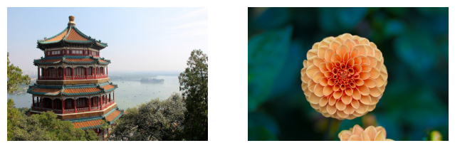

- `plot_image()`: 맷플롯립은 `[높이, 너비, 채널]`을 기대하므로 그릴 때는 `permute(1, 2, 0)`로 **되돌린다**. 이 함수는 장 끝까지 계속 쓴다

중앙을 잘라 작은 이미지로:

```python
import torchvision
import torchvision.transforms.v2 as T

cropped_images = T.CenterCrop((70, 120))(sample_images_permuted)
cropped_images.shape
# torch.Size([2, 3, 70, 120])
```

| 코드 | 의미 |
|---|---|
| `torchvision.transforms.v2` | 토치비전의 변환 API(버전 2). 관례적으로 `T`로 줄여 쓴다 |
| `T.CenterCrop((70, 120))` | 이미지 **중앙**에서 높이 70 × 너비 120을 잘라 내는 변환. 변환 객체를 만든 뒤 함수처럼 호출한다 |

**코드** — 합성곱 층

```python
import torch.nn as nn

torch.manual_seed(42)
conv_layer = nn.Conv2d(in_channels=3, out_channels=32, kernel_size=7)
fmaps = conv_layer(cropped_images)

fmaps.shape
# torch.Size([2, 32, 64, 114])
```

| 매개변수 | 값 | 의미 |
|---|---|---|
| `in_channels` | 3 | 입력 채널 수 (RGB). **앞 층의 출력 채널 수와 같아야 한다** |
| `out_channels` | 32 | 필터 수 = 출력 특성 맵 수 |
| `kernel_size` | 7 | 7 × 7 필터. 튜플 `(높이, 너비)`도 가능 |
| `stride` | 1 (기본값) | 한 칸씩 이동 |
| `padding` | 0 (기본값) | 패딩 없음 |

**결과 해석**

| 차원 | 입력 | 출력 | 이유 |
|---|---|---|---|
| 배치 | 2 | 2 | 이미지 2장 |
| 채널 | 3 | **32** | 필터 32개 → 특성 맵 32장 |
| 높이 | 70 | **64** | 패딩이 없어 $70 - 7 + 1 = 64$ |
| 너비 | 120 | **114** | $120 - 7 + 1 = 114$ |

- `nn.Conv2d`의 **2d**는 공간 차원이 2개(높이·너비)라는 뜻이다. 입력 텐서는 배치·채널을 포함해 4차원
- `nn.Conv2d`에는 **활성화 함수가 들어 있지 않다.** `nn.Linear`와 마찬가지로 뒤에 `nn.ReLU()`를 따로 붙여야 한다. 붙이지 않고 합성곱 층만 쌓으면 선형 연산의 연속이라 층 하나와 다를 바 없다 (9장 1-6절과 같은 이유)

```python
# extra code – 이미지마다 처음 두 특성 맵을 그린다
plt.figure(figsize=(8, 4))
for image_idx in (0, 1):
    for fmap_idx in (0, 1):
        plt.subplot(2, 2, image_idx * 2 + fmap_idx + 1)
        plt.imshow(fmaps[image_idx, fmap_idx].detach(), cmap="gray")
        plt.axis("off")

plt.show()
```

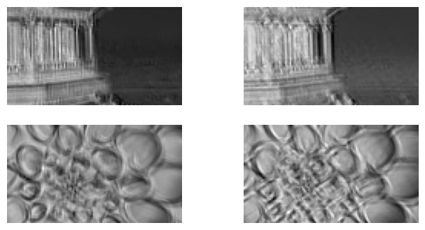

(위: 사원 이미지의 0번·1번 특성 맵, 아래: 꽃 이미지의 0번·1번 특성 맵.)

- `fmaps[image_idx, fmap_idx]`: 이미지 하나의 특성 맵 하나 → 2차원 `(64, 114)`. `.detach()`는 autograd 추적을 끊어 맷플롯립에 넘길 수 있게 한다
- 필터는 **무작위로 초기화된 상태**인데도 윤곽선이 강조된 그림이 나온다. 무작위 필터는 대개 **경계선 감지기**처럼 동작한다. 합성곱 층은 이런 필터에서 출발해 훈련하면서 작업에 맞는 필터로 다듬어 간다

### 2-5. 패딩과 스트라이드

> 🎯 **목적** — 출력 크기를 조절하는 패딩·스트라이드의 효과를 계산하고 확인한다.

**코드**

```python
conv_layer = nn.Conv2d(in_channels=3, out_channels=32, kernel_size=7,
                       padding="same")
fmaps = conv_layer(cropped_images)
fmaps.shape
# torch.Size([2, 32, 70, 120])
```

```python
# extra code – 스트라이드 2일 때의 출력 형태
conv_layer = nn.Conv2d(in_channels=3, out_channels=32, kernel_size=7, stride=2,
                       padding=3)
fmaps = conv_layer(cropped_images)
fmaps.shape
# torch.Size([2, 32, 35, 60])
```

| `padding` | 의미 |
|---|---|
| `0` 또는 `"valid"` (기본값) | 패딩 없음. 출력이 커널 크기 − 1만큼 줄어든다 |
| `"same"` | 출력 크기가 입력과 **같아지도록** 필요한 만큼 0을 덧붙인다. 7 × 7 커널이면 사방에 3씩 |
| 정수 `p` | 사방에 `p`픽셀씩 0을 덧붙인다 |

**결과 해석**

| 설정 | 출력 | 2-1절 공식 |
|---|---|---|
| `kernel_size=7` | `[2, 32, 64, 114]` | $70 - 7 + 1 = 64$ |
| `kernel_size=7, padding="same"` | `[2, 32, 70, 120]` | $70 + 6 - 7 + 1 = 70$ |
| `kernel_size=7, stride=2, padding=3` | `[2, 32, 35, 60]` | $\lfloor 69 / 2 \rfloor + 1 = 35$ |

> ⚠️ **`padding="same"`은 스트라이드 1일 때만 쓸 수 있다.** 스트라이드가 2 이상이면 패딩을 숫자로 직접 줘야 한다. 그래서 위 코드가 `padding=3`이다. 커널 크기가 홀수 $f$일 때 `padding=(f - 1) // 2`로 두면 스트라이드 2에서 출력이 정확히 절반(올림)이 된다.
>
> ```python
> # 보충 코드
> nn.Conv2d(3, 32, kernel_size=7, stride=2, padding="same")
> # ValueError: padding='same' is not supported for strided convolutions
>
> nn.Conv2d(3, 32, kernel_size=3, stride=2, padding=1)(cropped_images).shape
> # torch.Size([2, 32, 35, 60])      ← 3×3 커널이면 padding=1
> nn.Conv2d(3, 32, kernel_size=3, stride=2)(cropped_images).shape
> # torch.Size([2, 32, 34, 59])      ← 패딩이 없으면 ⌊(70−3)/2⌋+1 = 34
> ```

### 2-6. 파라미터 형태와 F.conv2d

> 🎯 **목적** — 합성곱 층 가중치 텐서의 모양을 이해하고 함수형 API로 직접 합성곱한다.

**코드**

```python
conv_layer.weight.shape
# torch.Size([32, 3, 7, 7])

conv_layer.bias.shape
# torch.Size([32])
```

| 파라미터 | 형태 | 의미 |
|---|---|---|
| `weight` | `[32, 3, 7, 7]` = **[출력 채널, 입력 채널, 커널 높이, 커널 너비]** | 3 × 7 × 7짜리 필터가 32개 |
| `bias` | `[32]` | 특성 맵마다 편향 하나 |

파라미터 수 = $32 \times (3 \times 7 \times 7) + 32 = 4{,}704 + 32 = \mathbf{4{,}736}$

> 💡 **파라미터 수가 입력 이미지 크기와 무관하다.** 70 × 120 이미지든 427 × 640 이미지든 같은 4,736개다. 같은 입력·출력 크기를 완전 연결 층으로 만들면 가중치가 (3 × 70 × 120) × (32 × 64 × 114) ≈ **58.8억 개**다. 가중치 공유와 부분 연결의 효과다.
>
> ```python
> # 보충 코드
> sum(p.numel() for p in nn.Conv2d(3, 32, kernel_size=7).parameters())   # 4736
> 3 * 70 * 120 * 32 * 64 * 114                                           # 5883494400
> ```

함수형 API — 필터를 직접 넘기기:

```python
# extra code – torch.nn.functional.conv2d() 사용법
import torch.nn.functional as F

torch.manual_seed(42)
filters = torch.randn([2, 3, 7, 7])
biases = torch.zeros([2])
fmaps = F.conv2d(cropped_images, filters, biases, stride=1, padding="same")

fmaps.shape
# torch.Size([2, 2, 70, 120])
```

| | `nn.Conv2d` | `F.conv2d()` |
|---|---|---|
| 종류 | 모듈 (층) | 함수 |
| 가중치 | 층이 만들고 보관·학습 | **호출할 때 직접** 넘긴다 `(입력, 필터, 편향, ...)` |
| 용도 | 모델을 만들 때 | 정해 둔 필터를 적용해 볼 때, 사용자 정의 층 내부 |

- 필터 텐서 `[2, 3, 7, 7]` → 출력 채널 2개. 채널 수는 필터 텐서의 첫 차원이 결정한다

### 2-7. 보충 코드: 합성곱을 손으로 계산하기

> 🎯 **목적** — 2-3절의 식이 `nn.Conv2d`가 실제로 하는 계산인지 확인하고, 손으로 만든 필터가 무엇을 강조하는지 본다.

**① 출력값 하나를 직접 계산**

```python
# 보충 코드
torch.manual_seed(42)
conv = nn.Conv2d(3, 32, kernel_size=7)
fm = conv(cropped_images)

i, j, k = 10, 20, 5                                  # 0번 이미지, 5번 특성 맵의 10행 20열
patch = cropped_images[0, :, i:i+7, j:j+7]           # 수용장: [3, 7, 7]
manual = (patch * conv.weight[k]).sum() + conv.bias[k]

manual.item(), fm[0, k, i, j].item()
# (-0.011294..., -0.011294...)
torch.allclose(manual, fm[0, k, i, j], atol=1e-5)    # True
```

| 식 | 코드 |
|---|---|
| 수용장 $x_{i',j',k'}$ ($i' = i + u$, $j' = j + v$, 모든 채널 $k'$) | `cropped_images[0, :, i:i+7, j:j+7]` |
| 필터 $w_{u,v,k',k}$ | `conv.weight[k]` — 형태 `[3, 7, 7]` |
| $\sum\sum\sum x \cdot w + b_k$ | `(patch * conv.weight[k]).sum() + conv.bias[k]` |

→ 원소별로 곱해 전부 더한 값이 층의 출력과 일치한다. 합성곱 층 = **이 계산을 모든 위치 $(i, j)$와 모든 필터 $k$에 대해 반복**하는 것.

**② 작은 이미지에 세로선·가로선 필터**

```python
# 보충 코드
img = torch.zeros(1, 1, 5, 5); img[0, 0, :, 2] = 1      # 가운데에 세로선이 있는 5×5 이미지
fv = torch.zeros(1, 1, 3, 3); fv[0, 0, :, 1] = 1        # 세로선 필터
fh = torch.zeros(1, 1, 3, 3); fh[0, 0, 1, :] = 1        # 가로선 필터

F.conv2d(img, fv, padding="same")[0, 0]
# tensor([[0., 0., 2., 0., 0.],
#         [0., 0., 3., 0., 0.],
#         [0., 0., 3., 0., 0.],
#         [0., 0., 3., 0., 0.],
#         [0., 0., 2., 0., 0.]])

F.conv2d(img, fh, padding="same")[0, 0]
# tensor([[0., 1., 1., 1., 0.],
#         [0., 1., 1., 1., 0.],
#         [0., 1., 1., 1., 0.],
#         [0., 1., 1., 1., 0.],
#         [0., 1., 1., 1., 0.]])
```

| 필터 | 결과 | 해석 |
|---|---|---|
| 세로선 | 선이 있는 열에서만 3 (위아래 끝은 2) | 필터의 세 칸이 모두 선 위에 놓일 때 최대 → 세로선에 **강하게, 좁게** 반응 |
| 가로선 | 선 주변 세 열에 걸쳐 1 | 세 칸 중 한 칸만 선에 걸린다 → **약하게, 번져서** 반응 |

- 세로선 필터 결과의 맨 위·맨 아래가 3이 아니라 **2**인 이유: 패딩으로 덧붙인 0이 수용장에 들어와 세 칸 중 두 칸만 실제 픽셀이기 때문 → 아래 ③의 "어두운 띠"와 같은 현상

**③ 노트북: 실제 이미지에 세로선·가로선 필터**

```python
# extra code – 필터 두 개를 직접 만들어 그림 12-5와 비슷한 이미지를 얻는다
plt.figure(figsize=(8, 4))
filters = torch.zeros([2, 3, 7, 7])
filters[0, :, :, 3] = 1
filters[1, :, 3, :] = 1
fmaps = F.conv2d(cropped_images, filters, biases, stride=1, padding="same")

for image_idx in (0, 1):
    for fmap_idx in (0, 1):
        plt.subplot(2, 2, image_idx * 2 + fmap_idx + 1)
        plt.imshow(fmaps[image_idx, fmap_idx], cmap="gray")
        plt.axis("off")

plt.show()
```

| 코드 | 의미 |
|---|---|
| `filters[0, :, :, 3] = 1` | 0번 필터: 모든 채널에서 가운데 **열**(3번)만 1 → 세로선 필터 |
| `filters[1, :, 3, :] = 1` | 1번 필터: 모든 채널에서 가운데 **행**(3번)만 1 → 가로선 필터 |

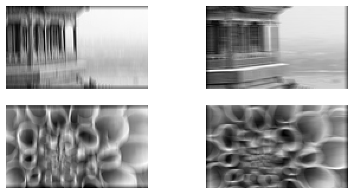

(왼쪽 열: 세로선 필터, 오른쪽 열: 가로선 필터.)

**결과 해석**

- 왼쪽(세로선 필터): 사원의 기둥처럼 **세로 방향** 구조가 또렷하고 가로 방향은 뭉개진다. 오른쪽(가로선 필터): 난간·지붕선처럼 **가로 방향** 구조가 또렷하다
- 왼쪽 두 그림은 **위·아래** 가장자리에, 오른쪽 두 그림은 **좌·우** 가장자리에 어두운 띠가 있다 → **제로 패딩 때문**이다. 가장자리에서는 필터의 일부가 0으로 채운 영역에 걸쳐 온전히 활성화되지 못한다. 2-4절 그림은 패딩 없이 만들었기 때문에 이 띠가 없었다

```python
# 보충 코드 — 모든 픽셀이 1인 이미지로 띠의 크기 확인
ones = torch.ones(1, 3, 70, 120)
o = F.conv2d(ones, filters, biases, padding="same")
o[0, 0, :5, 0]      # tensor([12., 15., 18., 21., 21.])   ← 세로선 필터, 맨 위 5행
o[0, 1, 0, :5]      # tensor([12., 15., 18., 21., 21.])   ← 가로선 필터, 맨 왼쪽 5열
```

- 필터에 1이 21개(7칸 × 3채널) 있으므로 안쪽에서는 21. 맨 위 행에서는 7칸 중 4칸만 이미지 안이라 $4 \times 3 = 12$ → 가장자리 3픽셀이 어두워진다

> 📌 실제로 필터를 손으로 만들 일은 거의 없다. 합성곱 층이 알아서 학습한다. 이 실험은 "필터 = 찾고 싶은 패턴의 틀"이라는 것을 눈으로 확인하기 위한 것이다.

### 2-8. 메모리 요구 사항

> 🎯 **목적** — CNN이 파라미터는 적은데도 메모리를 많이 쓰는 이유를 계산으로 확인한다.

**개념·원리**

합성곱 층의 메모리는 파라미터가 아니라 **출력(특성 맵)** 이 대부분을 차지한다. 훈련 중에는 역전파를 위해 **정방향 계산의 모든 중간값을 보관**해야 하기 때문이다.

예: 5 × 5 필터, 스트라이드 1, `"same"` 패딩으로 150 × 100 크기의 특성 맵 200개를 출력하는 합성곱 층. 입력은 150 × 100 RGB 이미지.

| 항목 | 계산 | 값 |
|---|---|---|
| 파라미터 수 | $(5 \times 5 \times 3 + 1) \times 200$ | **15,200개** — 완전 연결 층에 비하면 아주 적다 |
| 출력 값의 수 (샘플 1개) | $200 \times 150 \times 100$ | 300만 개 |
| 출력 메모리 (샘플 1개, 32비트) | $3{,}000{,}000 \times 4$바이트 | **12 MB** |
| 출력 메모리 (배치 100개) | $12 \text{ MB} \times 100$ | **1.2 GB** — 이 층 하나만으로 |

```python
# 보충 코드
c = nn.Conv2d(3, 200, kernel_size=5, padding="same")
sum(p.numel() for p in c.parameters())        # 15200
c(torch.zeros(1, 3, 100, 150)).shape          # torch.Size([1, 200, 100, 150])
200 * 150 * 100 * 4 / 1e6                     # 12.0  (MB)
```

| | 예측(추론) | 훈련 |
|---|---|---|
| 보관해야 하는 것 | 연속한 **두 층**의 출력만 (다음 층을 계산하면 앞 층은 해제 가능) | **모든 층**의 출력 (역방향 계산에 필요) |
| 필요한 메모리 | 가장 큰 두 층의 합 | 모든 층의 합 × 배치 크기 |

> ⚠️ 훈련 중 메모리 부족(out of memory) 오류가 나면: **배치 크기 줄이기** → 스트라이드를 키우거나 층을 줄여 특성 맵 줄이기 → 32비트 대신 16비트 실수 쓰기 → 여러 장치에 나누기 순으로 시도한다 ([연습문제 3번](#13-1-개념-문제-17번)). 메모리 계산 연습은 [연습문제 2번](#13-2-2번-파라미터-수와-메모리-계산).

---

## 3. 풀링 층 (12.3)

> 🎯 **목적** — 풀링 층이 무엇을 하고, 왜 쓰며, 어떤 대가를 치르는지 정리한다.

<!-- 일타 -->
> 💬 **일타 강의 — 풀링 = 요약해서 크기 줄이기**
>
> 2×2 최대 풀링은 네 칸 중 **가장 큰 값만** 남긴다. 가로세로가 반으로, 면적은 1/4로 줄어든다. 학습할 파라미터는 **없다**. 덕분에 계산량이 줄고, 패턴이 한두 픽셀 움직여도 결과가 비슷하다(작은 불변성).
>
> - **헷갈림 주의**: 불변성이 항상 좋은 건 아니다. 분할처럼 **정확한 위치**가 필요한 작업에서는 정보를 버리는 셈이다


**개념·원리**

**풀링 층** = 입력을 **부표본(subsampling)**, 즉 축소하는 층. 합성곱 층처럼 작은 수용장을 옮겨 가며 보지만, **가중치가 없다.** 수용장 안의 값을 최댓값이나 평균 같은 집계 함수로 합칠 뿐이다.

| 종류 | 수용장 안에서 | 특징 |
|---|---|---|
| **최대 풀링** | 가장 큰 값만 통과, 나머지는 버림 | 가장 강한 특성만 남긴다. 가장 많이 쓰인다 |
| **평균 풀링** | 평균 | 정보 손실은 적지만 대체로 성능이 최대 풀링보다 낮다 |

2 × 2 커널, 스트라이드 2 → 높이와 너비가 각각 절반 → 면적 1/4. 즉 **입력값의 75%를 버린다.**

풀링의 효과:

| 효과 | 설명 |
|---|---|
| 계산량·메모리·파라미터 감소 | 특성 맵이 작아지면 뒤따르는 층의 연산과 (완전 연결 층의) 파라미터가 줄어든다 → 과대적합 위험도 감소 |
| 수용장 확대 | 뒤 층의 뉴런이 원본 이미지의 더 넓은 영역을 보게 된다 |
| 작은 이동에 대한 **불변성** | 입력이 몇 픽셀 움직여도 풀링 창 안의 최댓값이 같으면 출력이 그대로다 |

**보충 코드** — 최대 풀링의 이동 불변성

```python
# 보충 코드
mp = nn.MaxPool2d(kernel_size=2)
a = torch.zeros(1, 1, 4, 4); a[0, 0, 1, 1] = 1     # (1, 1)에 점 하나
b = torch.zeros(1, 1, 4, 4); b[0, 0, 0, 0] = 1     # 같은 풀링 창 안에서 한 칸 이동
c = torch.zeros(1, 1, 4, 4); c[0, 0, 1, 2] = 1     # 옆 풀링 창으로 한 칸 이동

mp(a)[0, 0].tolist(), mp(b)[0, 0].tolist(), mp(c)[0, 0].tolist()
# ([[1.0, 0.0], [0.0, 0.0]],  [[1.0, 0.0], [0.0, 0.0]],  [[0.0, 1.0], [0.0, 0.0]])
```

- `a`와 `b`는 입력이 다른데 출력이 같다 → 창 **안**에서의 이동에는 불변
- `c`는 창의 경계를 넘어갔으므로 출력이 달라진다 → 불변성은 **작은 이동에 한해, 부분적으로만** 성립한다. 풀링 층을 여러 번 거치면 더 큰 이동까지 흡수한다

**최대 풀링의 단점**

| 단점 | 설명 |
|---|---|
| 파괴적 | 2 × 2 커널만으로도 값의 75%가 사라진다 |
| 불변성이 해가 되는 작업 | **시맨틱 분할**(12절)처럼 픽셀 단위 위치가 중요한 작업에서는 입력이 한 픽셀 움직이면 출력도 한 픽셀 움직여야 한다. 이때 필요한 것은 불변성(invariance)이 아니라 **등변성**(equivariance) — 입력의 변화가 출력에 그대로 반영되는 성질 |

> 📌 최대 풀링 vs 평균 풀링: 평균은 모든 값을 반영하지만 강한 특성이 약한 값에 희석된다. 최대는 가장 강한 신호만 남겨 다음 층에 더 뚜렷한 신호를 넘기고, 이동 불변성도 더 강하며 계산도 조금 가볍다. 그래서 중간 층에는 대부분 최대 풀링을 쓴다.

---

## 4. 파이토치로 풀링 층 구현하기 (12.4)

<!-- 일타 -->
> 💬 **일타 강의 — 전역 평균 풀링 = 특성 맵 한 장을 숫자 하나로**
>
> 최대·평균 풀링 외에 꼭 알아야 할 하나는 **전역 평균 풀링**이다. 특성 맵 한 장 전체를 평균 하나로 줄인다. "이 이미지에 바퀴 패턴이 전체적으로 얼마나 있나"만 남긴다. 현대 CNN은 마지막에 이걸 쓰고 바로 출력 층으로 간다.
>
> - **핵심 한 줄**: 전역 평균 풀링 덕분에 거대한 완전 연결 층이 필요 없어져 파라미터가 크게 준다


### 4-1. 최대 풀링과 평균 풀링

> 🎯 **목적** — 풀링 층으로 특성 맵을 줄이고, 두 풀링 방식의 차이를 본다.

**코드**

```python
max_pool = nn.MaxPool2d(kernel_size=2)
output_max = max_pool(cropped_images)

avg_pool = nn.AvgPool2d(kernel_size=2)
output_avg = avg_pool(cropped_images)
```

| 매개변수 | 기본값 | 의미 |
|---|---|---|
| `kernel_size` | (필수) | 풀링 창의 크기 |
| `stride` | **`kernel_size`와 같은 값** | 창이 겹치지 않게 이동. `nn.Conv2d`의 기본값(1)과 다르다 |
| `padding` | 0 | 패딩 없음 |

```python
# extra code – 스트라이드 2 풀링의 결과를 그린다
fig = plt.figure(figsize=(8, 6))

ax1 = plt.subplot2grid((2, 3), (0, 0), rowspan=2, colspan=2)
ax1.imshow(cropped_images[0].permute(1, 2, 0))
ax1.axis('off')
ax1.set_title("Original image")

ax2 = plt.subplot2grid((2, 3), (0, 2))
ax2.imshow(output_max[0].permute(1, 2, 0))
ax2.axis('off')
ax2.set_title("Max pooling")

ax3 = plt.subplot2grid((2, 3), (1, 2))
ax3.imshow(output_avg[0].permute(1, 2, 0))
ax3.axis('off')
ax3.set_title("Avg pooling")

plt.tight_layout()
plt.show()
```

- `plt.subplot2grid((2, 3), (0, 0), rowspan=2, colspan=2)`: 2행 3열 격자에서 (0, 0)부터 2행 × 2열을 차지하는 큰 칸. 원본은 크게, 풀링 결과는 실제 비율대로 작게 그리기 위한 배치

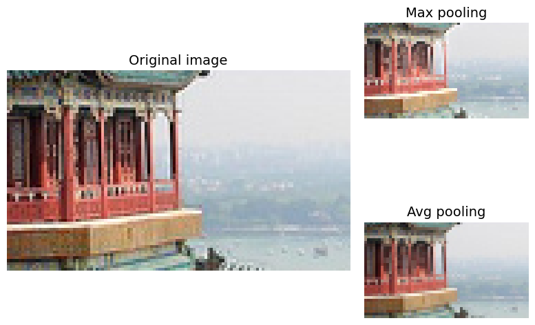

**결과 해석**

```python
# 보충 코드
output_max.shape, output_avg.shape
# (torch.Size([2, 3, 35, 60]), torch.Size([2, 3, 35, 60]))
sum(p.numel() for p in max_pool.parameters())     # 0
```

- `[2, 3, 70, 120]` → `[2, 3, 35, 60]`. 높이·너비가 절반, **채널 수는 그대로** (풀링은 채널마다 따로 적용)
- 파라미터 0개. 학습하는 것이 없다
- 최대 풀링 결과가 평균 풀링보다 조금 **밝고 거칠다** — 창마다 가장 밝은 픽셀만 골랐기 때문. 평균 풀링은 부드럽게 줄인 축소본에 가깝다

**보충 코드** — 숫자로 확인

```python
# 보충 코드
x = torch.tensor([[[[1., 5., 3., 2., 9.],
                    [4., 2., 1., 0., 9.],
                    [7., 8., 6., 5., 9.],
                    [3., 1., 2., 4., 9.],
                    [9., 9., 9., 9., 9.]]]])       # [1, 1, 5, 5]

nn.MaxPool2d(2)(x)[0, 0]
# tensor([[5., 3.],
#         [8., 6.]])
nn.AvgPool2d(2)(x)[0, 0]
# tensor([[3.0000, 1.5000],
#         [4.7500, 4.2500]])
nn.MaxPool2d(2, ceil_mode=True)(x).shape
# torch.Size([1, 1, 3, 3])
```

- 왼쪽 위 창 `[[1, 5], [4, 2]]` → 최대 5, 평균 3.0
- 입력이 5 × 5(홀수)면 **마지막 행·열이 버려진다**(값 9가 출력 어디에도 없다). 출력 크기는 $\lfloor 5/2 \rfloor = 2$. `ceil_mode=True`를 주면 남는 가장자리도 창으로 쳐서 3 × 3이 된다

### 4-2. 깊이 방향 풀링

> 🎯 **목적** — 공간 방향(높이·너비)이 아니라 **채널 방향**으로 최댓값을 취하는 풀링을 직접 만든다.

**개념·원리**

보통의 풀링은 채널마다 공간을 줄인다. 깊이 방향 풀링은 반대로 **공간 크기는 그대로 두고 채널 수를 줄인다.** 같은 위치의 여러 특성 맵 값 중 최댓값만 남긴다.

쓸모: 같은 패턴을 조금씩 다르게(예: 여러 각도로 회전한 숫자) 감지하는 필터들을 한 그룹으로 묶어 깊이 방향 최대 풀링을 하면, 그룹 안의 어느 필터가 반응했든 출력이 같다 → **회전 같은 변형에 대한 불변성**을 학습할 수 있다. 두께·밝기·기울기·색에도 같은 방식이 가능하다.

파이토치에는 이 층이 없으므로 `F.max_pool1d()`를 이용해 만든다.

**코드**

```python
import torch.nn.functional as F

class DepthMaxPool2(torch.nn.Module):
    def __init__(self, kernel_size, stride=None, padding=0):
        super().__init__()
        self.kernel_size = kernel_size
        self.stride = stride if stride is not None else kernel_size
        self.padding = padding

    def forward(self, inputs):
        batch, channels, height, width = inputs.shape
        Z = inputs.view(batch, channels, height * width)  # 공간 차원 합치기
        Z = Z.permute(0, 2, 1)  # 공간 차원과 채널 차원 맞바꾸기
        Z = F.max_pool1d(Z, kernel_size=self.kernel_size, stride=self.stride,
                         padding=self.padding)  # 최대 풀링 계산
        Z = Z.permute(0, 2, 1)  # 공간 차원과 채널 차원 되돌리기
        return Z.view(batch, -1, height, width)  # 공간 차원 다시 펼치기
```

| 단계 | 형태 (입력 `[2, 32, 70, 120]`, `kernel_size=4`) | 하는 일 |
|---|---|---|
| 입력 | `[2, 32, 70, 120]` | |
| `view(batch, channels, height * width)` | `[2, 32, 8400]` | 높이·너비를 한 줄로 |
| `permute(0, 2, 1)` | `[2, 8400, 32]` | 채널을 **마지막 차원**으로 |
| `F.max_pool1d(...)` | `[2, 8400, 8]` | 마지막 차원(채널)을 4개씩 묶어 최댓값 |
| `permute(0, 2, 1)` | `[2, 8, 8400]` | 원래 순서로 |
| `view(batch, -1, height, width)` | `[2, 8, 70, 120]` | 공간 차원 복원 |

- `F.max_pool1d()`는 **마지막 차원**을 따라 풀링한다. 그래서 채널을 마지막으로 옮겼다가 되돌린다
- 채널 차원을 `-1`로 두는 이유: 풀링 뒤의 채널 수(32 / 4 = 8)를 자동으로 맞추기 위해

**보충 코드** — 확인

```python
# 보충 코드
torch.manual_seed(42)
z = torch.randn(2, 32, 70, 120)
out = DepthMaxPool2(4)(z)
out.shape
# torch.Size([2, 8, 70, 120])

torch.equal(out[:, 0], z[:, :4].max(dim=1).values)                       # True
torch.equal(out, z.view(2, 8, 4, 70, 120).max(dim=2).values)             # True
```

- 출력의 0번 채널 = 입력의 0~3번 채널 중 위치별 최댓값. 32개 채널이 4개씩 8그룹으로 묶였다

> ⚠️ **`permute()`를 거친 텐서를 그대로 넣으면 오류가 난다.** `view()`는 메모리에 연속으로 놓인 텐서에만 쓸 수 있는데, `permute()`는 데이터를 옮기지 않고 축만 바꿔 읽기 때문에 연속이 아니다. 2-4절의 `cropped_images`가 바로 그런 텐서다.
>
> ```python
> # 보충 코드
> cropped_images.is_contiguous()                       # False
> DepthMaxPool2(3)(cropped_images)
> # RuntimeError: view size is not compatible with input tensor's size and stride ... Use .reshape(...) instead.
> DepthMaxPool2(3)(cropped_images.contiguous()).shape  # torch.Size([2, 1, 70, 120])
> ```
>
> 합성곱 층의 출력은 연속이므로 모델 안에서 쓸 때는 문제없다. 임의의 입력을 받으려면 `forward()`의 `view()`를 `reshape()`로 바꾸면 된다.

### 4-3. 전역 평균 풀링

> 🎯 **목적** — 특성 맵 한 장 전체를 숫자 하나로 줄이는 층을 세 가지 방법으로 만든다.

**개념·원리**

**전역 평균 풀링(global average pooling)** = 특성 맵마다 **전체 평균**을 계산. 특성 맵 한 장 → 숫자 하나. `[배치, 채널, 높이, 너비]` → `[배치, 채널, 1, 1]`.

- 특성 맵의 위치 정보를 모두 버리므로 매우 파괴적이다
- 그래도 **출력 층 바로 앞**에서 유용하다: 마지막 합성곱 층의 특성 맵을 채널당 숫자 하나로 요약한 뒤 완전 연결 층에 넘긴다. 펼쳐서(`Flatten`) 넘기는 것보다 **파라미터가 훨씬 적고**, **입력 이미지 크기가 달라도** 동작한다
- GoogLeNet 이후 대부분의 CNN이 이 구조로 끝난다 (5-6절, 6절)

**코드**

```python
# ① 커널 크기를 입력 크기와 똑같이 — 불편하다
global_avg_pool = nn.AvgPool2d(kernel_size=(70, 120))
output = global_avg_pool(cropped_images)

# ② 적응형 풀링 — 권장
global_avg_pool = nn.AdaptiveAvgPool2d(output_size=1)
output = global_avg_pool(cropped_images)

# ③ 모듈 없이 평균 계산
output = cropped_images.mean(dim=(2, 3), keepdim=True)
```

| 방법 | 코드 | 특징 |
|---|---|---|
| ① | `nn.AvgPool2d(kernel_size=(70, 120))` | 입력 크기를 **미리 알아야** 하고, 크기가 바뀌면 고쳐야 한다 |
| ② | `nn.AdaptiveAvgPool2d(output_size=1)` | **출력 크기**를 지정하면 커널·스트라이드를 알아서 정한다. 입력 크기와 무관 |
| ③ | `X.mean(dim=(2, 3), keepdim=True)` | 높이(2)·너비(3) 차원의 평균. `keepdim=True`로 `[배치, 채널, 1, 1]` 유지 |

**결과 해석**

```python
# 보충 코드
o1 = nn.AvgPool2d(kernel_size=(70, 120))(cropped_images)
o2 = nn.AdaptiveAvgPool2d(output_size=1)(cropped_images)
o3 = cropped_images.mean(dim=(2, 3), keepdim=True)

o1.shape, o2.shape, o3.shape
# (torch.Size([2, 3, 1, 1]), torch.Size([2, 3, 1, 1]), torch.Size([2, 3, 1, 1]))
torch.allclose(o1, o2, atol=1e-5), torch.allclose(o2, o3, atol=1e-5)     # (True, True)

o2.flatten(1)
# tensor([[0.6434, 0.5972, 0.5825],      ← 사원: R, G, B 평균이 비슷 (회색빛 하늘)
#         [0.7631, 0.2601, 0.1085]])     ← 꽃: R이 압도적 (붉은 꽃)

nn.AdaptiveAvgPool2d(1)(sample_images_permuted).shape        # torch.Size([2, 3, 1, 1])   ← 427×640 입력도 그대로
nn.AdaptiveAvgPool2d((2, 3))(sample_images_permuted).shape   # torch.Size([2, 3, 2, 3])   ← 출력 크기를 2×3으로
```

- 세 방법의 결과가 같다(부동소수점 오차 수준의 차이만 있다)
- 이미지에 직접 적용하면 채널별 평균 색이 나온다. 꽃 이미지는 R 평균 0.76, B 평균 0.11 → 평균만으로도 "붉은 이미지"라는 것은 남는다. 반대로 꽃이 **어디에** 있는지는 완전히 사라졌다
- `AdaptiveAvgPool2d`는 입력이 70 × 120이든 427 × 640이든 같은 형태를 출력한다 → 뒤에 오는 완전 연결 층의 입력 수가 고정된다

> 📌 `nn.AdaptiveMaxPool2d`도 있다. "적응형(adaptive)" = 커널 크기가 아니라 **원하는 출력 크기**를 지정하는 풀링.

---

## 5. CNN 구조 (12.5)

<!-- 일타 -->
> 💬 **일타 강의 — CNN 족보 — 무엇이 하나씩 발전했나**
>
> 외울 건 구조가 아니라 **각 구조가 들고 온 아이디어 하나**다. LeNet(합성곱+풀링 기본형), AlexNet(ReLU·드롭아웃·증강, 딥러닝 붐), GoogLeNet(인셉션·1×1 합성곱으로 채널 압축), VGG(3×3을 깊게), **ResNet(스킵 연결 — 입력을 출력에 더해 152층도 훈련)**, Xception(깊이별 분리 합성곱), SENet(채널별 중요도 재조정), EfficientNet(깊이·너비·해상도를 함께 키우기).
>
> - **핵심 한 줄**: 딱 하나만 기억하면 **ResNet의 스킵 연결**. 층이 "전부"를 배우는 대신 **입력과의 차이(잔차)만** 배우면 되니 훈련이 쉬워지고, 그레이디언트가 지름길로 흐른다
> - **1×1 합성곱의 정체**: 공간은 그대로 두고 **채널끼리 섞어 개수를 줄이는** 층. 병목층으로 계산량을 확 줄인다


### 5-1. 전형적인 CNN 구조

> 🎯 **목적** — 합성곱 → 풀링 반복 → 완전 연결 층으로 이어지는 기본 구조를 이해한다.

**개념·원리**

```
입력 이미지
  → [합성곱 + ReLU] × 몇 번 → 풀링
  → [합성곱 + ReLU] × 몇 번 → 풀링
  → ...                                   ← 이미지는 점점 작아지고(높이·너비 ↓), 깊어진다(채널 ↑)
  → 펼치기(또는 전역 평균 풀링)
  → [완전 연결 + ReLU] × 몇 번
  → 출력 층 (클래스 수만큼의 로짓)
```

| 설계 관례 | 이유 |
|---|---|
| 뒤로 갈수록 **필터 수를 늘린다** (64 → 128 → 256) | 저수준 특성(선, 점)은 종류가 적지만 이를 조합한 고수준 특성은 종류가 많다 |
| 풀링 층 뒤에서 **필터 수를 두 배로** | 풀링이 공간 크기를 1/4로 줄였으므로, 채널을 두 배로 늘려도 계산량·메모리가 폭증하지 않는다 |
| **작은 커널(3 × 3)을 여러 층** 쌓는다 | 큰 커널 하나보다 파라미터·계산량이 적고 비선형성이 더 많이 들어간다 (5-7절 보충 계산) |
| 첫 번째 층만 큰 커널 + 스트라이드 2를 쓰기도 한다 | 입력 채널이 3개뿐이라 큰 커널도 비용이 작고, 정보를 많이 잃지 않으면서 공간 크기를 일찍 줄일 수 있다 |

### 5-2. 패션 MNIST CNN 만들기

> 🎯 **목적** — 10장에서 MLP로 풀었던 패션 MNIST를 기본적인 CNN으로 다시 푼다.

**코드**

```python
from functools import partial

torch.manual_seed(42)  # extra code – 재현 가능한 결과를 위해
DefaultConv2d = partial(nn.Conv2d, kernel_size=3, padding="same")
model = nn.Sequential(
    DefaultConv2d(in_channels=1, out_channels=64, kernel_size=7), nn.ReLU(),
    nn.MaxPool2d(kernel_size=2),
    DefaultConv2d(in_channels=64, out_channels=128), nn.ReLU(),
    DefaultConv2d(in_channels=128, out_channels=128), nn.ReLU(),
    nn.MaxPool2d(kernel_size=2),
    DefaultConv2d(in_channels=128, out_channels=256), nn.ReLU(),
    DefaultConv2d(in_channels=256, out_channels=256), nn.ReLU(),
    nn.MaxPool2d(kernel_size=2),
    nn.Flatten(),
    nn.Linear(in_features=2304, out_features=128), nn.ReLU(),
    nn.Dropout(0.5),
    nn.Linear(in_features=128, out_features=64), nn.ReLU(),
    nn.Dropout(0.5),
    nn.Linear(in_features=64, out_features=10),
).to(device)
```

| 코드 | 의미 |
|---|---|
| `partial(nn.Conv2d, kernel_size=3, padding="same")` | `functools.partial` — 일부 인수를 **미리 채워 둔** 새 함수(클래스)를 만든다. 같은 설정을 반복해 쓰지 않기 위한 것 |
| `DefaultConv2d(..., kernel_size=7)` | 미리 채운 값은 호출할 때 덮어쓸 수 있다. 첫 층만 7 × 7 |
| `in_channels=1` | 패션 MNIST는 흑백 → 채널 1개 |
| `nn.Flatten()` | `[배치, 256, 3, 3]` → `[배치, 2304]`. 완전 연결 층은 1차원 입력을 받는다 |
| `nn.Dropout(0.5)` | **드롭아웃**([11장 5-2절](11_training_deep_neural_networks.md#5-2-드롭아웃)의 규제 기법) — 훈련 중 매 스텝마다 입력의 50%를 무작위로 0으로 만든다. 특정 뉴런에 의존하지 못하게 해 과대적합을 줄인다. 평가(`model.eval()`) 때는 꺼진다 |
| `nn.Linear(64, 10)` | 출력 층. 로짓 10개 — 소프트맥스는 손실 함수 안에 있다 (10장 7-2절) |

**보충 코드** — 층별 출력 형태와 파라미터 수

```python
# 보충 코드
X = torch.randn(1, 1, 28, 28)
for idx, layer in enumerate(model):
    X = layer(X)
    print(idx, layer.__class__.__name__, tuple(X.shape),
          sum(p.numel() for p in layer.parameters()))
```

| 층 | 출력 형태 | 파라미터 수 | 계산 |
|---|---|---|---|
| 입력 | `[1, 28, 28]` | | |
| `Conv2d(1, 64, 7)` | `[64, 28, 28]` | 3,200 | $(1 \times 7 \times 7 + 1) \times 64$ |
| `MaxPool2d(2)` | `[64, 14, 14]` | 0 | |
| `Conv2d(64, 128, 3)` | `[128, 14, 14]` | 73,856 | $(64 \times 9 + 1) \times 128$ |
| `Conv2d(128, 128, 3)` | `[128, 14, 14]` | 147,584 | $(128 \times 9 + 1) \times 128$ |
| `MaxPool2d(2)` | `[128, 7, 7]` | 0 | |
| `Conv2d(128, 256, 3)` | `[256, 7, 7]` | 295,168 | $(128 \times 9 + 1) \times 256$ |
| `Conv2d(256, 256, 3)` | `[256, 7, 7]` | 590,080 | $(256 \times 9 + 1) \times 256$ |
| `MaxPool2d(2)` | `[256, 3, 3]` | 0 | $\lfloor 7/2 \rfloor = 3$ — 마지막 행·열은 버려진다 |
| `Flatten()` | `[2304]` | 0 | $256 \times 3 \times 3$ |
| `Linear(2304, 128)` | `[128]` | 295,040 | $2304 \times 128 + 128$ |
| `Linear(128, 64)` | `[64]` | 8,256 | |
| `Linear(64, 10)` | `[10]` | 650 | |
| **합계** | | **1,413,834** | 합성곱 1,109,888 + 완전 연결 303,946 |

- `padding="same"` 덕분에 합성곱 층은 공간 크기를 바꾸지 않는다. **크기를 줄이는 것은 풀링 층뿐** → 28 → 14 → 7 → 3
- 채널은 1 → 64 → 128 → 256으로 풀링을 지날 때마다 두 배
- `nn.Linear(in_features=2304, ...)`의 **2304는 직접 계산해서 적어야 한다.** 입력 이미지 크기나 앞쪽 구조를 바꾸면 이 숫자도 바뀐다 → 틀리면 형태 오류. 이를 피하는 방법이 6절의 `nn.LazyLinear`와 전역 평균 풀링이다
- 10장 MLP(266,610개)보다 파라미터가 약 5.3배 많다. 합성곱 층은 파라미터당 연산량도 훨씬 많다(같은 필터를 모든 위치에 적용) → GPU 없이는 느리다

### 5-3. 훈련과 결과

> 🎯 **목적** — 기본 CNN을 패션 MNIST로 훈련하고 MLP와 성능을 비교한다.

**코드** — 훈련·평가 함수 (10장의 `evaluate_tm()`, `train2()`와 같은 구조)

```python
import torchmetrics

def evaluate_tm(model, data_loader, metric):
    model.eval()
    metric.reset()
    with torch.no_grad():
        for X_batch, y_batch in data_loader:
            X_batch, y_batch = X_batch.to(device), y_batch.to(device)
            y_pred = model(X_batch)
            metric.update(y_pred, y_batch)
    return metric.compute()

def train(model, optimizer, loss_fn, metric, train_loader, valid_loader,
          n_epochs):
    history = {"train_losses": [], "train_metrics": [], "valid_metrics": []}
    for epoch in range(n_epochs):
        total_loss = 0.0
        metric.reset()
        model.train()
        for X_batch, y_batch in train_loader:
            X_batch, y_batch = X_batch.to(device), y_batch.to(device)
            y_pred = model(X_batch)
            loss = loss_fn(y_pred, y_batch)
            total_loss += loss.item()
            loss.backward()
            optimizer.step()
            optimizer.zero_grad()
            metric.update(y_pred, y_batch)
        history["train_losses"].append(total_loss / len(train_loader))
        history["train_metrics"].append(metric.compute().item())
        history["valid_metrics"].append(
            evaluate_tm(model, valid_loader, metric).item())
        print(f"Epoch {epoch + 1}/{n_epochs}, "
              f"train loss: {history['train_losses'][-1]:.4f}, "
              f"train metric: {history['train_metrics'][-1]:.4f}, "
              f"valid metric: {history['valid_metrics'][-1]:.4f}")
    return history
```

각 줄의 의미는 [10장 5절](10_neural_nets_with_pytorch.md#5-모델-평가-105) 참고. 이 장에서 이 두 함수가 특히 중요한 이유:

| 코드 | 이 장에서의 역할 |
|---|---|
| `model.train()` | **드롭아웃을 켜고**, 배치 정규화가 배치 통계를 쓰게 한다 |
| `model.eval()` | 드롭아웃을 끄고, 배치 정규화가 저장해 둔 이동 평균을 쓰게 한다 |

→ 10장의 MLP에는 모드에 따라 달라지는 층이 없어 형식적이었지만, 이 장의 모델은 **모드를 틀리면 결과가 달라진다.**

데이터 적재 (10장 7-1절과 같다):

```python
import torchvision
import torchvision.transforms.v2 as T

toTensor = T.Compose([T.ToImage(), T.ToDtype(torch.float32, scale=True)])

train_and_valid_data = torchvision.datasets.FashionMNIST(
    root="datasets", train=True, download=True, transform=toTensor)
test_data = torchvision.datasets.FashionMNIST(
    root="datasets", train=False, download=True, transform=toTensor)

torch.manual_seed(42)
train_data, valid_data = torch.utils.data.random_split(
    train_and_valid_data, [55_000, 5_000])

from torch.utils.data import DataLoader

torch.manual_seed(42)
train_loader = DataLoader(train_data, batch_size=32, shuffle=True)
valid_loader = DataLoader(valid_data, batch_size=32)
test_loader = DataLoader(test_data, batch_size=32)
```

- 10장에서는 `nn.Flatten()`을 모델 맨 앞에 뒀다. 여기서는 `[1, 28, 28]` 이미지가 **그대로** 합성곱 층에 들어간다

훈련:

```python
n_epochs = 20
optimizer = torch.optim.AdamW(model.parameters())
xentropy = nn.CrossEntropyLoss()
accuracy = torchmetrics.Accuracy(task="multiclass", num_classes=10).to(device)
history = train(model, optimizer, xentropy, accuracy,
                train_loader, valid_loader, n_epochs)
```

| 코드 | 의미 |
|---|---|
| `torch.optim.AdamW(model.parameters())` | **AdamW** 옵티마이저([11장 3-7절](11_training_deep_neural_networks.md#3-7-adamax-nadam-adamw)). 파라미터마다 학습률을 자동으로 조절하는 Adam에 가중치 감쇠를 올바르게 결합한 것. 학습률 기본값 0.001, 가중치 감쇠 기본값 0.01. SGD보다 학습률 튜닝에 덜 민감하다 |

**결과 해석**

```
Epoch 1/20, train loss: 0.9146, train metric: 0.6494, valid metric: 0.8144
Epoch 2/20, train loss: 0.5088, train metric: 0.8181, valid metric: 0.8542
Epoch 3/20, train loss: 0.4230, train metric: 0.8528, valid metric: 0.8674
...
Epoch 10/20, train loss: 0.2742, train metric: 0.9060, valid metric: 0.8994
Epoch 11/20, train loss: 0.2615, train metric: 0.9101, valid metric: 0.9062
...
Epoch 18/20, train loss: 0.2120, train metric: 0.9267, valid metric: 0.9142
Epoch 19/20, train loss: 0.2037, train metric: 0.9285, valid metric: 0.9094
Epoch 20/20, train loss: 0.2055, train metric: 0.9299, valid metric: 0.9066
```

| 모델 | 파라미터 수 | 검증 정확도 (최고) | 검증 정확도 (20 에포크) |
|---|---|---|---|
| MLP 784 → 300 → 100 → 10 (10장) | 266,610 | 0.8910 | 0.8716 |
| CNN (이 절) | 1,413,834 | **0.9142** (18 에포크) | **0.9066** |

- 검증 정확도가 MLP의 89.1%에서 **91.4%** 로 올랐다. 오류율로 보면 10.9% → 8.6%
- 첫 에포크의 **훈련 정확도(0.649)가 검증 정확도(0.814)보다 훨씬 낮다.** 과소적합이 아니다. ① 훈련 정확도는 에포크 **도중**의 평균이라 초반의 서툰 예측이 섞여 있고 ② 훈련 중에는 **드롭아웃이 켜져** 뉴런 절반이 꺼진 채로 예측하기 때문이다. 검증은 에포크가 끝난 뒤 드롭아웃을 끄고 잰다
- 10 에포크 이후로는 훈련 정확도(0.930)가 검증 정확도(0.907)를 앞지른다. 드롭아웃이 있어도 과대적합이 서서히 시작된다
- 노트북은 테스트 세트 평가까지 하지는 않는다

### 5-4. LeNet-5

> 🎯 **목적** — 최초의 대표적 CNN 구조를 살펴본다.

**개념·원리**

1998년 얀 르쿤이 만든, 가장 널리 알려진 CNN 구조. MNIST 손글씨 숫자 인식에 쓰였다.

| 층 | 종류 | 특성 맵 수 | 크기 | 커널 크기 | 스트라이드 | 활성화 함수 |
|---|---|---|---|---|---|---|
| Out | 완전 연결 | – | 10 | – | – | RBF |
| F6 | 완전 연결 | – | 84 | – | – | tanh |
| C5 | 합성곱 | 120 | 1 × 1 | 5 × 5 | 1 | tanh |
| S4 | 평균 풀링 | 16 | 5 × 5 | 2 × 2 | 2 | tanh |
| C3 | 합성곱 | 16 | 10 × 10 | 5 × 5 | 1 | tanh |
| S2 | 평균 풀링 | 6 | 14 × 14 | 2 × 2 | 2 | tanh |
| C1 | 합성곱 | 6 | 28 × 28 | 5 × 5 | 1 | tanh |
| In | 입력 | 1 | 32 × 32 | – | – | – |

(표는 아래에서 위로 읽는다. 입력이 맨 아래.)

지금과 다른 점:

| 항목 | LeNet-5 | 요즘 |
|---|---|---|
| 입력 | 28 × 28 MNIST 이미지를 제로 패딩해 32 × 32로 만들고 정규화. 이후 층에는 패딩이 없어 크기가 계속 줄어든다 | 층마다 `"same"` 패딩 |
| 풀링 | 평균을 낸 뒤 **학습되는 계수**를 곱하고 **학습되는 편향**을 더한 다음(특성 맵마다 하나씩) 활성화 함수 적용 | 파라미터 없는 최대 풀링 |
| C3의 연결 | C3 특성 맵의 뉴런 대부분이 S2의 6개 특성 맵 중 **3~4개에만** 연결 | 모든 입력 채널에 연결 |
| 출력 층 | 입력 벡터와 가중치 벡터 사이의 **유클리드 거리 제곱**을 출력 (RBF) | 로짓 + 크로스 엔트로피. 나쁜 예측에 더 큰 벌점 → 그레이디언트가 크고 수렴이 빠르다 |
| 활성화 함수 | tanh | ReLU 계열 |

**보충 코드** — 요즘 부품으로 근사한 LeNet-5의 형태 확인

```python
# 보충 코드 (학습되는 풀링 계수, C3의 부분 연결, RBF 출력은 생략한 근사)
lenet = nn.Sequential(
    nn.Conv2d(1, 6, 5), nn.Tanh(), nn.AvgPool2d(2), nn.Tanh(),
    nn.Conv2d(6, 16, 5), nn.Tanh(), nn.AvgPool2d(2), nn.Tanh(),
    nn.Conv2d(16, 120, 5), nn.Tanh(), nn.Flatten(),
    nn.Linear(120, 84), nn.Tanh(), nn.Linear(84, 10))
# 32×32 입력 → C1 [6, 28, 28] → S2 [6, 14, 14] → C3 [16, 10, 10] → S4 [16, 5, 5] → C5 [120, 1, 1] → 84 → 10
sum(p.numel() for p in lenet.parameters())      # 61706
```

- 표의 크기 열과 일치한다. C5는 5 × 5 입력에 5 × 5 커널을 적용해 1 × 1이 된다 → 사실상 완전 연결 층이다 (10-2절의 "완전 연결 층 = 합성곱 층"과 같은 원리)
- 약 6만 개 파라미터. 5-2절의 CNN(141만 개)과 비교하면 당시 하드웨어의 제약이 보인다

### 5-5. AlexNet

> 🎯 **목적** — 딥러닝 붐을 연 구조와 그 핵심 기법(ReLU, 드롭아웃, 데이터 증강)을 정리한다.

**개념·원리**

2012년 ILSVRC(이미지넷 대회)에서 **톱-5 오류율 17%** 로 우승(2위는 26%). 알렉스 크리체프스키·일리야 수츠케버·제프리 힌턴. 딥러닝이 컴퓨터 비전의 주류가 된 계기.

LeNet-5와 비슷하지만 **훨씬 크고 깊으며**, 합성곱 층 위에 풀링 층을 매번 놓지 않고 **합성곱 층끼리 바로 쌓은** 첫 구조다.

| 층 | 종류 | 특성 맵 수 | 크기 | 커널 크기 | 스트라이드 | 패딩 | 활성화 함수 |
|---|---|---|---|---|---|---|---|
| Out | 완전 연결 | – | 1,000 | – | – | – | 소프트맥스 |
| F10 | 완전 연결 | – | 4,096 | – | – | – | ReLU |
| F9 | 완전 연결 | – | 4,096 | – | – | – | ReLU |
| S8 | 최대 풀링 | 256 | 6 × 6 | 3 × 3 | 2 | valid | – |
| C7 | 합성곱 | 256 | 13 × 13 | 3 × 3 | 1 | same | ReLU |
| C6 | 합성곱 | 384 | 13 × 13 | 3 × 3 | 1 | same | ReLU |
| C5 | 합성곱 | 384 | 13 × 13 | 3 × 3 | 1 | same | ReLU |
| S4 | 최대 풀링 | 256 | 13 × 13 | 3 × 3 | 2 | valid | – |
| C3 | 합성곱 | 256 | 27 × 27 | 5 × 5 | 1 | same | ReLU |
| S2 | 최대 풀링 | 96 | 27 × 27 | 3 × 3 | 2 | valid | – |
| C1 | 합성곱 | 96 | 55 × 55 | 11 × 11 | 4 | valid | ReLU |
| In | 입력 | 3 (RGB) | 227 × 227 | – | – | – | – |

과대적합을 줄이려고 쓴 기법:

| 기법 | 내용 |
|---|---|
| **드롭아웃** | 훈련 중 F9, F10의 출력에 50% 드롭아웃 |
| **데이터 증강** | 훈련 이미지를 무작위로 이동·좌우 반전·조명 변경해 훈련 세트를 인공적으로 늘린다 (8-5절) |
| LRN (국부 응답 정규화) | C1, C3의 ReLU 뒤에 적용. 가장 강하게 활성화된 뉴런이 **같은 위치의 이웃 특성 맵** 뉴런을 억제한다 → 특성 맵들이 서로 다른 특성을 맡도록 유도. 요즘은 배치 정규화가 대신한다 |

- 3 × 3 커널에 스트라이드 2인 **겹치는** 최대 풀링을 쓴다 (창이 한 칸씩 겹친다)
- 크기 확인: C1 $\lfloor (227 - 11)/4 \rfloor + 1 = 55$, S2 $\lfloor (55 - 3)/2 \rfloor + 1 = 27$, S4 $\lfloor (27 - 3)/2 \rfloor + 1 = 13$, S8 $\lfloor (13 - 3)/2 \rfloor + 1 = 6$ — 표와 일치

### 5-6. GoogLeNet

> 🎯 **목적** — 인셉션 모듈과 1×1 합성곱으로 파라미터를 줄인 구조를 이해한다.

**개념·원리**

2014년 ILSVRC 우승. 구글의 크리스티언 세게디 등. 톱-5 오류율을 **7% 아래**로 낮췄다. AlexNet보다 훨씬 깊은데 파라미터는 약 1/10(약 600만 개 vs 6,000만 개)이다. 비결은 **인셉션 모듈**.

```
                     ┌→ [1×1 합성곱] ─────────────────┐
                     ├→ [1×1 합성곱] → [3×3 합성곱] ──┤
앞 층의 출력 ────────┤                                 ├→ 깊이 방향으로 연결(concat)
                     ├→ [1×1 합성곱] → [5×5 합성곱] ──┤
                     └→ [3×3 최대 풀링] → [1×1 합성곱] ┘
```

| 요소 | 설명 |
|---|---|
| 네 갈래 병렬 경로 | 같은 입력을 **서로 다른 크기의 커널**(1 × 1, 3 × 3, 5 × 5)과 풀링으로 동시에 처리 → 여러 스케일의 패턴을 한 번에 잡는다 |
| 모두 스트라이드 1, `"same"` 패딩 | 네 출력의 높이·너비가 입력과 같다 → 채널 방향으로 이어 붙일 수 있다 |
| 깊이 연결 | `torch.concat([...], dim=1)` — 10장 와이드 & 딥 모델의 `concat`과 같은 연산을 채널 차원에 적용 |

**1 × 1 합성곱 층이 왜 필요한가**

1 × 1 커널은 한 번에 픽셀 하나만 보므로 공간 패턴은 잡지 못한다. 대신:

| 역할 | 설명 |
|---|---|
| 채널 방향 패턴 | 같은 위치의 여러 특성 맵 값을 조합한다 |
| **병목 층** | 입력보다 적은 수의 특성 맵을 출력 → 차원을 줄여 뒤따르는 3 × 3, 5 × 5 합성곱의 계산량과 파라미터를 크게 줄인다 |
| 더 강력한 합성곱 | `[1 × 1, 3 × 3]` 쌍은 단순한 선형 필터 하나가 아니라 2층 신경망이 이미지를 훑는 것처럼 동작한다 |

```python
# 보충 코드 — 병목의 효과 (256채널 입력 → 256채널 출력)
3 * 3 * 256 * 256 + 256                                               # 590080   ← 3×3 합성곱 하나
(256 * 64 + 64) + (3 * 3 * 64 * 64 + 64) + (64 * 256 + 256)           # 70016    ← 1×1(256→64) → 3×3(64→64) → 1×1(64→256)

c11 = nn.Conv2d(192, 16, kernel_size=1)
c11(torch.randn(1, 192, 28, 28)).shape                                # torch.Size([1, 16, 28, 28])
sum(p.numel() for p in c11.parameters())                              # 3088
```

- 1 × 1 합성곱은 공간 크기는 그대로 두고 **채널 수만** 바꾼다(192 → 16). 파라미터는 $192 \times 16 + 16 = 3{,}088$개뿐
- 3 × 3 합성곱을 병목 사이에 끼우면 파라미터가 59만 → 7만으로 **약 1/8**

전체 구조의 특징:

- 인셉션 모듈 **9개**를 쌓는다. 모듈 안의 합성곱 층 수(필터 수)는 모듈마다 다르다
- 앞부분: 7 × 7 합성곱(스트라이드 2) → 최대 풀링 → LRN → 1 × 1·3 × 3 합성곱 → LRN → 최대 풀링. 이미지 크기를 빠르게 줄여 계산량을 줄인다
- 끝부분: **전역 평균 풀링** → 드롭아웃 → 완전 연결(1,000) → 소프트맥스. 전역 평균 풀링이 거대한 완전 연결 층을 대신해 파라미터를 크게 줄였다 (4-3절)
- 원 논문에는 중간에 보조 분류기 2개가 있었다(그레이디언트 소실 완화·규제 목적). 효과가 작다고 밝혀져 지금은 흔히 뺀다

### 5-7. VGGNet

> 🎯 **목적** — 작은 3×3 필터를 깊게 쌓는 단순한 구조를 정리한다.

**개념·원리**

2014년 ILSVRC 2위. 옥스퍼드 VGG 연구실의 카렌 시모니언·앤드루 지서먼.

- 구조가 매우 단순하다: **합성곱 2~3개 → 풀링**을 반복(변형에 따라 합성곱 층이 총 16개 또는 19개), 끝에 완전 연결 층 2개와 출력 층
- **3 × 3 필터만** 사용하되 필터를 많이 쓴다

**보충 계산** — 왜 작은 커널을 여러 층 쌓는가

```python
# 보충 코드 — 수용장 크기: 커널 k, 스트라이드 1인 층을 쌓을 때마다 (k − 1)씩 넓어진다
def rf(layers):                       # layers = [(커널, 스트라이드), ...]
    r, jump, out = 1, 1, []
    for k, s in layers:
        r += (k - 1) * jump; jump *= s
        out.append(r)
    return out

rf([(3, 1)] * 2), rf([(5, 1)])        # ([3, 5], [5])     ← 3×3 두 층 = 5×5 한 층
rf([(3, 1)] * 3), rf([(7, 1)])        # ([3, 5, 7], [7])  ← 3×3 세 층 = 7×7 한 층
```

| 같은 수용장 | 큰 커널 한 층 (64 → 64채널) | 3 × 3 여러 층 | 비선형(ReLU) 횟수 |
|---|---|---|---|
| 5 × 5 | $5 \times 5 \times 64 \times 64 + 64 = 102{,}464$ | 2층: $2 \times 36{,}928 = 73{,}856$ | 1 → 2 |
| 7 × 7 | $7 \times 7 \times 64 \times 64 + 64 = 200{,}768$ | 3층: $3 \times 36{,}928 = 110{,}784$ | 1 → 3 |

→ 같은 넓이를 보면서 파라미터는 적고 비선형성은 많다. 이후 거의 모든 CNN이 3 × 3 커널을 기본으로 쓴다.

- 단점: 맨 끝의 완전 연결 층이 거대해 파라미터가 매우 많다(VGG-16 약 1억 3,800만 개 — 5-12절 표)

### 5-8. ResNet

> 🎯 **목적** — 층을 100개 이상 쌓을 수 있게 만든 **스킵 연결**과 **잔차 학습**을 이해한다.

**개념·원리**

2015년 ILSVRC 우승. 마이크로소프트의 허카이밍(Kaiming He) 등. 톱-5 오류율 **3.6% 미만**. 우승 모델은 152개 층(34, 50, 101층 변형도 있다). "더 적은 파라미터로 더 깊게"라는 흐름을 확인해 준 모델.

**스킵 연결(지름길 연결)** = 어떤 층에 들어가는 신호를, 몇 층 위의 출력에도 **그대로 더해 주는** 연결.

```
        ┌──────────────── 스킵 연결 (x를 그대로) ───────────────┐
        │                                                        ↓
  x ────┴→ [3×3 합성곱] → [BN] → [ReLU] → [3×3 합성곱] → [BN] → (+) → [ReLU] → 출력
                              f(x)                               f(x) + x
```

**잔차 학습**

| | 목표 함수 $h(\mathbf{x})$를 얻으려면 층들이 학습해야 하는 것 |
|---|---|
| 일반 신경망 | $h(\mathbf{x})$ 자체 |
| 스킵 연결이 있을 때 | $f(\mathbf{x}) = h(\mathbf{x}) - \mathbf{x}$ — 입력과의 **차이(잔차)** 만 |

왜 도움이 되는가:

| 이유 | 설명 |
|---|---|
| 항등 함수에서 출발 | 신경망을 초기화하면 가중치가 0에 가까워 출력도 0에 가깝다. 스킵 연결이 있으면 이때 출력 ≈ **입력의 복사본** → 신경망이 항등 함수를 모델링하는 상태에서 시작한다. 목표 함수가 항등 함수에 가까운 경우(흔하다) 훈련이 훨씬 빠르다 |
| 신호가 막히지 않는다 | 스킵 연결을 타고 신호가 전체를 가로질러 흐른다 → 아직 학습을 시작하지 못한 층이 중간에 있어도 그 위·아래 층이 학습을 진행할 수 있다. 역전파의 그레이디언트도 같은 길로 아래층까지 전달된다 |

심층 잔차 신경망 = **잔차 유닛(residual unit, RU)** 을 쌓은 것. 각 잔차 유닛은 스킵 연결이 있는 작은 신경망이다.

**ResNet-34의 구조**

| 구간 | 내용 | 출력 (입력 224 × 224) |
|---|---|---|
| 앞부분 | 7 × 7 합성곱(64, 스트라이드 2) → BN → ReLU → 3 × 3 최대 풀링(스트라이드 2) | 64 × 56 × 56 |
| 잔차 유닛 × 3 | 특성 맵 64개 | 64 × 56 × 56 |
| 잔차 유닛 × 4 | 특성 맵 128개 (첫 유닛에서 스트라이드 2) | 128 × 28 × 28 |
| 잔차 유닛 × 6 | 특성 맵 256개 (첫 유닛에서 스트라이드 2) | 256 × 14 × 14 |
| 잔차 유닛 × 3 | 특성 맵 512개 (첫 유닛에서 스트라이드 2) | 512 × 7 × 7 |
| 끝부분 | 전역 평균 풀링 → 완전 연결 | 클래스 수 |

- GoogLeNet과 시작(드롭아웃은 없다)·끝이 같고, 가운데가 단순한 잔차 유닛의 반복이다
- 잔차 유닛 = 3 × 3 합성곱 2개(각각 배치 정규화, 첫 번째 뒤에 ReLU). **잔차 유닛 안에는 풀링 층이 없다**
- 몇 유닛마다 **특성 맵 수는 두 배, 높이·너비는 절반**(스트라이드 2인 합성곱 사용). 이때 입력과 출력의 형태가 달라져 그대로 더할 수 없다 → 스킵 연결 쪽에 **1 × 1 합성곱(스트라이드 2, 출력 채널 수는 주 경로와 같게)** 을 넣어 형태를 맞춘다
- 층 수 세기: 합성곱 1 + 잔차 유닛 16개 × 합성곱 2 + 완전 연결 1 = **34** (6-3절에서 코드로 확인)

> 📌 **배치 정규화(BN)** ([11장 1-7절](11_training_deep_neural_networks.md#1-7-배치-정규화)) — 층의 출력을 배치 단위로 평균 0·분산 1이 되게 정규화한 뒤, 학습되는 스케일과 이동을 적용하는 층. 깊은 신경망의 훈련을 안정시키고 빠르게 한다. 합성곱 층 뒤에는 `nn.BatchNorm2d(채널 수)`를 쓴다 — 채널마다 평균·분산을 계산한다.

**더 깊은 ResNet (ResNet-50, 101, 152)**

잔차 유닛을 **병목 구조**로 바꾼다 (5-6절의 병목 층과 같은 생각):

| | ResNet-34의 잔차 유닛 | ResNet-152의 잔차 유닛 (특성 맵 256개 구간) |
|---|---|---|
| 구성 | 3 × 3 (256) → 3 × 3 (256) | 1 × 1 (64) → 3 × 3 (64) → 1 × 1 (256) |
| 생각 | | 채널을 1/4로 줄이고 → 3 × 3 연산 → 다시 복원 |

- ResNet-152: 특성 맵 256개인 유닛 3개 → 512개인 유닛 8개 → 1,024개인 유닛 **36개** → 2,048개인 유닛 3개

### 5-9. Xception

> 🎯 **목적** — 공간 패턴과 채널 간 패턴을 **따로** 학습하는 깊이별 분리 합성곱 층을 이해하고 구현한다.

**개념·원리**

2016년 프랑수아 숄레가 제안. GoogLeNet(인셉션)의 변형으로, 인셉션 모듈을 **깊이별 분리 합성곱 층**(depthwise separable convolution, 줄여서 분리 합성곱 층)으로 바꿨다.

| | 일반 합성곱 층 | 분리 합성곱 층 |
|---|---|---|
| 가정 | 필터 하나가 공간 패턴(예: 타원)과 채널 간 패턴(예: 입 + 코 + 눈 = 얼굴)을 **동시에** 잡는다 | 두 종류의 패턴을 **따로** 모델링할 수 있다 |
| 1단계 | | **깊이별(depthwise) 합성곱** — 입력 채널**마다 공간 필터 하나**를 적용. 채널을 섞지 않는다 |
| 2단계 | | **점별(pointwise) 합성곱** — 1 × 1 합성곱으로 채널을 조합 |

**코드**

```python
class SeparableConv2d(nn.Module):
    def __init__(self, in_channels, out_channels, kernel_size, stride=1,
                 padding=0):
        super().__init__()
        self.depthwise_conv = nn.Conv2d(
            in_channels, in_channels, kernel_size, stride=stride,
            padding=padding, groups=in_channels)
        self.pointwise_conv = nn.Conv2d(
            in_channels, out_channels, kernel_size=1, stride=1, padding=0)

    def forward(self, inputs):
        return self.pointwise_conv(self.depthwise_conv(inputs))
```

| 코드 | 의미 |
|---|---|
| `groups=in_channels` | 입력 채널을 `groups`개의 묶음으로 나눠 **묶음끼리만** 합성곱한다. 묶음 수 = 채널 수이면 채널마다 따로 → 깊이별 합성곱. 기본값 `groups=1`은 일반 합성곱 |
| `nn.Conv2d(in_channels, in_channels, ...)` | 깊이별 합성곱은 채널 수를 바꾸지 않는다 |
| `kernel_size=1` | 점별 합성곱. 채널 수를 `out_channels`로 바꾼다 |

**보충 코드** — 파라미터 수 비교 (128 → 256채널, 3 × 3)

```python
# 보충 코드
n_params = lambda m: sum(p.numel() for p in m.parameters())
sep = SeparableConv2d(128, 256, kernel_size=3, padding=1)
reg = nn.Conv2d(128, 256, kernel_size=3, padding=1)

sep.depthwise_conv.weight.shape, sep.pointwise_conv.weight.shape, reg.weight.shape
# (torch.Size([128, 1, 3, 3]), torch.Size([256, 128, 1, 1]), torch.Size([256, 128, 3, 3]))

n_params(sep.depthwise_conv), n_params(sep.pointwise_conv), n_params(sep), n_params(reg)
# (1280, 33024, 34304, 295168)

x = torch.randn(2, 128, 14, 14)
sep(x).shape, reg(x).shape
# (torch.Size([2, 256, 14, 14]), torch.Size([2, 256, 14, 14]))
```

| | 가중치 형태 | 파라미터 수 |
|---|---|---|
| 깊이별 합성곱 | `[128, 1, 3, 3]` — 필터마다 입력 채널 **1개**만 본다 | $128 \times 9 + 128 = 1{,}280$ |
| 점별 합성곱 | `[256, 128, 1, 1]` | $256 \times 128 + 256 = 33{,}024$ |
| **분리 합성곱 합계** | | **34,304** |
| 일반 합성곱 | `[256, 128, 3, 3]` | $256 \times 128 \times 9 + 256 = 295{,}168$ |

→ 출력 형태는 같은데 파라미터는 **약 1/8.6**. 파라미터·메모리·계산량이 적고 대체로 성능도 더 좋다.

- Xception의 구성: 일반 합성곱 층 2개로 시작 → 분리 합성곱 층 34개 + 최대 풀링 층 몇 개 → 전역 평균 풀링 → 완전 연결 출력 층
- 분리 합성곱 층은 공간 필터가 입력 채널당 하나뿐이라, **채널이 너무 적은 층 뒤**(예: 채널이 3개인 입력 이미지 바로 뒤)에는 쓰지 않는다. 그래서 앞부분은 일반 합성곱이다

> 💡 인셉션 모듈은 "공간 패턴과 채널 패턴을 함께 보는 층 + 채널 패턴만 보는 1 × 1 층"의 조합이었다. 분리 합성곱 층은 이를 끝까지 밀어붙여 **둘을 완전히 나눈** 것이다. 그래서 Xception = Extreme Inception.

### 5-10. SENet

> 🎯 **목적** — 채널마다 중요도를 재조정하는 SE 블록을 이해한다.

**개념·원리**

2017년 ILSVRC 우승. 톱-5 오류율 **2.25%**. 인셉션 네트워크나 ResNet 같은 기존 구조의 모든 인셉션 모듈·잔차 유닛에 **SE 블록**(squeeze-and-excitation)이라는 작은 신경망을 덧붙인다 → SE-Inception, SE-ResNet.

SE 블록은 유닛의 출력을 **채널(깊이) 차원으로만** 분석해 어떤 특성 맵들이 함께 활성화되는지 학습하고, 이를 바탕으로 **특성 맵을 보정**한다.

예: 사진에서 입·코·눈은 보통 함께 나타난다. 입과 코의 특성 맵이 강하게 활성화됐는데 눈의 특성 맵이 약하다면, SE 블록이 눈의 특성 맵을 키워 준다(그리고 관련 없는 특성 맵은 줄인다) → 애매한 상황을 정리해 준다.

| 단계 | 층 | 형태 (특성 맵 256개일 때) | 의미 |
|---|---|---|---|
| ① 압축(squeeze) | 전역 평균 풀링 | `[256, H, W]` → `[256]` | 특성 맵마다 평균 활성화 값 하나 |
| ② | 완전 연결 + ReLU | `[256]` → `[16]` | 뉴런 수를 보통 **1/16**로 줄인다 → 채널 조합의 일반적인 표현(임베딩)을 학습하도록 강제 |
| ③ 자극(excitation) | 완전 연결 + 시그모이드 | `[16]` → `[256]` | 특성 맵마다 0~1 사이의 **보정 계수** |
| ④ | 원래 특성 맵 × 보정 계수 | `[256, H, W]` | 중요한 특성 맵은 유지, 덜 중요한 특성 맵은 축소 |

**보충 코드** — SE 블록 구현 (교재 설명을 코드로 옮긴 것)

```python
# 보충 코드
class SEBlock(nn.Module):
    def __init__(self, channels, ratio=16):
        super().__init__()
        self.squeeze = nn.AdaptiveAvgPool2d(1)
        self.excite = nn.Sequential(
            nn.Flatten(),
            nn.Linear(channels, channels // ratio), nn.ReLU(),
            nn.Linear(channels // ratio, channels), nn.Sigmoid())

    def forward(self, x):
        w = self.excite(self.squeeze(x))               # [배치, 채널] — 0~1
        return x * w.view(x.shape[0], -1, 1, 1)        # 채널마다 스케일 조정

torch.manual_seed(42)
se = SEBlock(256)
x = torch.randn(2, 256, 14, 14)
se(x).shape                                 # torch.Size([2, 256, 14, 14])   ← 형태 그대로
sum(p.numel() for p in se.parameters())     # 8464
```

- `w.view(배치, -1, 1, 1)`: `[2, 256]` → `[2, 256, 1, 1]`. 브로드캐스팅으로 특성 맵 한 장 전체에 같은 계수를 곱한다
- 파라미터 $256 \times 16 + 16 + 16 \times 256 + 256 = 8{,}464$개. 3 × 3 합성곱 하나(59만 개)에 비하면 아주 작은 추가 비용으로 성능을 올린다

### 5-11. 그 외 주목할 구조

> 🎯 **목적** — Xception 이후 등장한 구조들의 핵심 아이디어를 짧게 정리한다.

| 구조 | 핵심 아이디어 |
|---|---|
| **ResNeXt** | 잔차 유닛 안을 여러 갈래의 병렬 경로(그룹 합성곱)로 나눈다 → 같은 파라미터 수로 더 높은 정확도 |
| **DenseNet** | **밀집 블록** — 블록 안의 각 층이 **앞선 모든 층의 출력**을 연결(concat)해 입력으로 받는다. 특성을 재사용하므로 적은 파라미터로 높은 정확도 |
| **MobileNet** | 깊이별 분리 합성곱 기반의 **경량** 모델. 모바일·웹 환경을 겨냥. 이후 버전에서 역 잔차 블록·SE 블록 등을 더했다 |
| **CSPNet** | 블록에 들어오는 특성 맵을 둘로 나눠 **한쪽만** 블록을 통과시키고 나머지는 그대로 넘겨 끝에서 합친다 → 계산량 감소. YOLO 계열의 백본에 쓰인다 |
| **EfficientNet** | **복합 스케일링**(compound scaling) — 작은 기준 모델을 찾은 뒤, 깊이(층 수)·너비(채널 수)·해상도(입력 크기)를 **하나의 계수로 함께** 키운다. 세 가지를 따로 키우는 것보다 효율적 |
| **ConvNeXt** | 2022년. 비전 트랜스포머(16장)에서 효과가 확인된 설계를 ResNet에 차례로 적용해 CNN을 현대화했다 — 큰 커널(7 × 7)의 깊이별 합성곱, 역 병목, 층 정규화, GELU 활성화 함수 등. 7~8절에서 이 모델을 쓴다 |

### 5-12. 올바른 CNN 구조 선택

> 🎯 **목적** — 정확도·속도·크기 기준으로 구조를 고르는 방법을 정리한다.

**개념·원리**

정확도만 볼 수 없다. **모델 크기**(파라미터 수·파일 크기), **추론 속도**(CPU / GPU), 배포 환경(서버 / 모바일)에 따라 답이 달라진다.

토치비전이 제공하는 사전 훈련 가중치의 공식 수치 (이미지넷 1K 검증 세트, `weights.meta`에서 읽은 값):

| 모델 (가중치) | 톱-1 정확도 | 톱-5 정확도 | 파라미터 수 | 파일 크기 |
|---|---|---|---|---|
| `alexnet` (V1) | 56.52% | 79.07% | 61.1M | 233 MB |
| `vgg16` (V1) | 71.59% | 90.38% | 138.4M | 528 MB |
| `googlenet` (V1) | 69.78% | 89.53% | 6.6M | 50 MB |
| `resnet34` (V1) | 73.31% | 91.42% | 21.8M | 83 MB |
| `resnet50` (V2) | 80.86% | 95.43% | 25.6M | 98 MB |
| `resnet152` (V2) | 82.28% | 96.00% | 60.2M | 230 MB |
| `resnext50_32x4d` (V2) | 81.20% | 95.34% | 25.0M | 96 MB |
| `densenet121` (V1) | 74.43% | 91.97% | 8.0M | 31 MB |
| `mobilenet_v3_large` (V2) | 75.27% | 92.57% | 5.5M | 21 MB |
| `efficientnet_b0` (V1) | 77.69% | 93.53% | 5.3M | 20 MB |
| `efficientnet_v2_s` (V1) | 84.23% | 96.88% | 21.5M | 83 MB |
| `convnext_tiny` (V1) | 82.52% | 96.15% | 28.6M | 109 MB |
| `convnext_base` (V1) | 84.06% | 96.87% | 88.6M | 338 MB |
| `convnext_large` (V1) | 84.41% | 96.98% | 197.8M | 755 MB |

```python
# 보충 코드 — 표의 값을 읽는 방법 (가중치를 내려받지 않아도 된다)
w = torchvision.models.ConvNeXt_Base_Weights.IMAGENET1K_V1
w.meta["_metrics"], w.meta["num_params"]
# ({'ImageNet-1K': {'acc@1': 84.062, 'acc@5': 96.87}}, 88591464)
```

| 관찰 | 근거 |
|---|---|
| 파라미터가 많다고 정확한 것이 아니다 | VGG-16(138M)이 71.6%, EfficientNet-B0(5.3M)가 77.7% |
| 구조의 발전이 곧 효율의 발전 | AlexNet → GoogLeNet: 파라미터 1/9로 정확도 +13%p |
| 같은 구조도 **훈련 방법**에 따라 크게 달라진다 | ResNet-50: V1 76.13% → V2 80.86% (더 나은 훈련 레시피) |
| 작은 모델이 필요하면 | MobileNet, EfficientNet-B0 (약 20 MB) |
| 정확도가 우선이면 | ConvNeXt, EfficientNetV2 |

> 📌 톱-1 정확도 = 모델의 1순위 예측이 정답인 비율. 톱-5 정확도 = 상위 5개 예측 안에 정답이 있는 비율. 이미지넷은 1,000개 클래스에 비슷한 것(개 품종만 100종 이상)이 많아 톱-5를 함께 본다. 앞 절들의 "톱-5 오류율" = 1 − 톱-5 정확도.

---

## 6. 파이토치로 ResNet-34 CNN 구현하기 (12.6)

<!-- 일타 -->
> 💬 **일타 강의 — 잔차 유닛 = '원래 입력 + 보정값'**
>
> 잔차 유닛은 두 합성곱 층의 출력에 **입력을 그대로 더한다**. 그래서 층이 할 일은 "완전히 새 출력 만들기"가 아니라 "입력을 얼마나 고칠지"가 된다. 아무것도 할 필요가 없으면 0만 내면 된다 — 쉬운 일이다.
>
> - **헷갈림 주의**: 크기나 채널 수가 바뀌는 유닛에서는 입력을 그대로 더할 수 없어서 1×1 합성곱(스트라이드 2)으로 모양을 맞춘다


### 6-1. 잔차 유닛

> 🎯 **목적** — 5-8절의 잔차 유닛을 `nn.Module`로 만든다. 스킵 연결은 `forward()`의 덧셈 한 번이다.

**코드**

```python
class ResidualUnit(nn.Module):
    def __init__(self, in_channels, out_channels, stride=1):
        super().__init__()
        DefaultConv2d = partial(
            nn.Conv2d, kernel_size=3, stride=1, padding=1, bias=False)
        self.main_layers = nn.Sequential(
            DefaultConv2d(in_channels, out_channels, stride=stride),
            nn.BatchNorm2d(out_channels),
            nn.ReLU(),
            DefaultConv2d(out_channels, out_channels),
            nn.BatchNorm2d(out_channels),
        )
        if stride > 1:
            self.skip_connection = nn.Sequential(
                DefaultConv2d(in_channels, out_channels, kernel_size=1,
                              stride=stride, padding=0),
                nn.BatchNorm2d(out_channels),
            )
        else:
            self.skip_connection = nn.Identity()

    def forward(self, inputs):
        return F.relu(self.main_layers(inputs) + self.skip_connection(inputs))
```

| 코드 | 의미 |
|---|---|
| `partial(nn.Conv2d, kernel_size=3, stride=1, padding=1, bias=False)` | 기본 설정: 3 × 3, 크기 유지(`padding=1`), **편향 없음** |
| `bias=False` | 바로 뒤의 배치 정규화가 이동(편향) 파라미터를 가지고 있어 합성곱의 편향은 중복이다 |
| `self.main_layers` | 주 경로: 합성곱 → BN → ReLU → 합성곱 → BN. **마지막 ReLU는 여기 없다** — 덧셈 뒤에 적용해야 하기 때문 |
| `DefaultConv2d(..., stride=stride)` | 첫 번째 합성곱만 스트라이드를 받는다. `stride=2`면 여기서 높이·너비가 절반이 된다 |
| `if stride > 1:` | 주 경로가 형태를 바꾸는 경우 → 스킵 경로도 **1 × 1 합성곱(같은 스트라이드) + BN**으로 형태를 맞춘다 |
| `nn.Identity()` | 입력을 그대로 돌려주는 모듈. 형태가 같을 때의 스킵 연결. `forward()`에서 두 경우를 구분하지 않아도 되게 해 준다 |
| `F.relu(주 경로 + 스킵 경로)` | $\text{ReLU}(f(\mathbf{x}) + \mathbf{x})$ — 더한 **뒤에** 활성화 함수 |

> ⚠️ 이 구현은 **스트라이드가 2일 때만** 스킵 경로에 1 × 1 합성곱을 넣는다. `stride=1`인데 `in_channels ≠ out_channels`이면 덧셈에서 형태 오류가 난다. ResNet-34에서는 채널이 바뀌는 곳이 곧 스트라이드 2인 곳이라 문제가 없다.

### 6-2. ResNet-34 모델

> 🎯 **목적** — 잔차 유닛을 쌓아 ResNet-34 전체 모델을 만든다.

**코드**

```python
class ResNet34(nn.Module):
    def __init__(self):
        super().__init__()
        layers = [
            nn.Conv2d(in_channels=3, out_channels=64, kernel_size=7, stride=2,
                      padding=3, bias=False),
            nn.BatchNorm2d(num_features=64),
            nn.ReLU(),
            nn.MaxPool2d(kernel_size=3, stride=2, padding=1),
        ]
        prev_filters = 64
        for filters in [64] * 3 + [128] * 4 + [256] * 6 + [512] * 3:
            stride = 1 if filters == prev_filters else 2
            layers.append(ResidualUnit(prev_filters, filters, stride=stride))
            prev_filters = filters
        layers += [
            nn.AdaptiveAvgPool2d(output_size=1),
            nn.Flatten(),
            nn.LazyLinear(10),
        ]
        self.resnet = nn.Sequential(*layers)

    def forward(self, inputs):
        return self.resnet(inputs)
```

| 코드 | 의미 |
|---|---|
| `[64] * 3 + [128] * 4 + [256] * 6 + [512] * 3` | 잔차 유닛 16개의 필터 수를 나열한 리스트 `[64, 64, 64, 128, 128, 128, 128, 256, ...]` |
| `stride = 1 if filters == prev_filters else 2` | 필터 수가 **바뀌는 순간**(64 → 128 등)에만 스트라이드 2. 그 유닛에서 채널 두 배·크기 절반 |
| `nn.AdaptiveAvgPool2d(output_size=1)` → `nn.Flatten()` | 전역 평균 풀링 → `[배치, 512]` |
| `nn.LazyLinear(10)` | **입력 수를 적지 않는** `nn.Linear`. 처음 데이터가 통과할 때 입력 형태를 보고 `in_features`를 정한다. 5-2절의 2304처럼 직접 계산할 필요가 없다 |
| `nn.Sequential(*layers)` | 리스트를 풀어서 인수로 전달. 파이썬 리스트에 담아 두기만 하면 파라미터가 등록되지 않으므로(10장) 반드시 `nn.Sequential`이나 `nn.ModuleList`에 넣는다 |

```python
torch.manual_seed(42)
model = ResNet34().to(device)
images = torch.randn(2, 3, 224, 224).to(device)
model(images)
# tensor([[ 0.2233, -1.0281,  0.8846,  0.5195,  0.1329, -0.0356,  0.0158,  0.2011,
#           1.3775,  0.3885],
#         [ 0.2202, -1.0636,  1.1203,  0.5913,  0.0325, -0.1761,  0.0831,  0.0497,
#           1.7335,  0.7540]], device='cuda:0', grad_fn=<AddmmBackward0>)
```

- 무작위 이미지 2장 → 로짓 10개씩. 훈련 전이라 값에 의미는 없고, **형태가 맞게 흘러가는지** 확인하는 용도다

### 6-3. 보충 코드: 구조 확인

> 🎯 **목적** — 직접 만든 ResNet-34의 출력 크기와 파라미터 수를 확인한다.

```python
# 보충 코드
n_params = lambda m: sum(p.numel() for p in m.parameters())

u1 = ResidualUnit(64, 64)
u2 = ResidualUnit(64, 128, stride=2)
x = torch.randn(2, 64, 56, 56)
u1(x).shape, n_params(u1)        # (torch.Size([2, 64, 56, 56]), 73984)
u2(x).shape, n_params(u2)        # (torch.Size([2, 128, 28, 28]), 230144)   ← 채널 2배, 크기 절반
n_params(u2.skip_connection)     # 8448    ← 1×1 합성곱 64×128 + BN 2×128
```

```python
torch.manual_seed(42)
model = ResNet34()
model.resnet[-1]
# LazyLinear(in_features=0, out_features=10, bias=True)        ← 아직 입력 수를 모른다

out = model(torch.randn(2, 3, 224, 224))
model.resnet[-1]
# Linear(in_features=512, out_features=10, bias=True)          ← 첫 호출 뒤 일반 Linear로 바뀐다

n_params(model)
# 21289802
```

층을 따라가며 출력 형태가 바뀌는 지점:

| 위치 | 층 | 출력 형태 |
|---|---|---|
| 0 | `Conv2d(3, 64, 7, stride=2)` | `[64, 112, 112]` |
| 3 | `MaxPool2d(3, stride=2)` | `[64, 56, 56]` |
| 4 ~ 6 | 잔차 유닛 × 3 (64) | `[64, 56, 56]` |
| 7 ~ 10 | 잔차 유닛 × 4 (128) | `[128, 28, 28]` |
| 11 ~ 16 | 잔차 유닛 × 6 (256) | `[256, 14, 14]` |
| 17 ~ 19 | 잔차 유닛 × 3 (512) | `[512, 7, 7]` |
| 20 | `AdaptiveAvgPool2d(1)` | `[512, 1, 1]` |
| 22 | `Linear(512, 10)` | `[10]` |

- 224 → 112 → 56 → 28 → 14 → 7. 다섯 번 절반이 되어 **1/32**. 채널은 3 → 64 → 128 → 256 → 512

```python
# 보충 코드 — 층 수와 토치비전 구현과의 비교
n_conv = sum(1 for m in model.modules() if isinstance(m, nn.Conv2d))                      # 36
n_skip = sum(1 for m in model.resnet
             if isinstance(m, ResidualUnit) and not isinstance(m.skip_connection, nn.Identity))   # 3
n_conv - n_skip + 1                                                                       # 34

n_params(torchvision.models.resnet34(weights=None))                                       # 21797672
n_params(model) - (512 * 10 + 10) + (512 * 1000 + 1000)                                   # 21797672
```

| 확인한 것 | 결과 |
|---|---|
| "34층"의 뜻 | 합성곱 36개 중 스킵 경로의 1 × 1 합성곱 3개를 빼면 33개 + 완전 연결 1개 = **34** |
| 토치비전의 `resnet34`와 비교 | 출력 층을 1,000개 클래스로 맞추면 파라미터 수가 **21,797,672개로 정확히 같다** → 같은 구조 |

> ⚠️ `LazyLinear`가 있는 모델은 **첫 정방향 계산 전에는 파라미터가 확정되지 않는다.** 옵티마이저를 만들거나 파라미터 수를 세기 전에 더미 입력을 한 번 통과시켜야 한다. 노트북이 모델을 만들자마자 `model(images)`를 호출하는 이유이기도 하다.

> 💡 **스킵 연결 = 항등 함수에서 출발.** 주 경로 마지막 배치 정규화의 스케일을 0으로 두면 $f(\mathbf{x}) = 0$이 되어, 유닛 전체가 입력을 그대로 내보낸다.
>
> ```python
> # 보충 코드
> u = ResidualUnit(64, 64)
> nn.init.zeros_(u.main_layers[4].weight)          # 마지막 BN의 스케일 γ = 0
> xx = torch.randn(1, 64, 8, 8).relu()             # 앞 유닛의 ReLU를 거친 입력(음수 없음)
> torch.allclose(u(xx), xx)                        # True
> ```
>
> 이 상태에서 훈련을 시작하면 16개 유닛이 모두 "아무것도 안 하는 층"으로 출발해, 필요한 만큼만 잔차를 학습한다. 실제로 토치비전의 ResNet에는 이렇게 초기화하는 옵션(`zero_init_residual=True`)이 있다.

---

## 7. TorchVision의 사전 훈련 모델 사용하기 (12.7)

<!-- 일타 -->
> 💬 **일타 강의 — 남이 수백만 장으로 훈련한 모델을 바로 쓰기**
>
> 토치비전에는 ImageNet으로 훈련된 모델이 준비되어 있다. 핵심은 **그 모델이 훈련될 때와 똑같은 전처리**(크기, 정규화 평균·표준편차)를 해 주는 것. 가중치 객체가 그 전처리를 함께 제공한다.
>
> - **헷갈림 주의**: 전처리를 다르게 하면 모델이 이상한 답을 낸다. 사람 눈엔 같은 사진이어도 모델 입력은 다르다


### 7-1. 모델과 가중치 불러오기

> 🎯 **목적** — 직접 구현·훈련하지 않고, 이미지넷으로 훈련된 모델을 한 줄로 가져온다.

**코드**

```python
weights = torchvision.models.ConvNeXt_Base_Weights.IMAGENET1K_V1
model = torchvision.models.convnext_base(weights=weights).to(device)
# Downloading: "https://download.pytorch.org/models/convnext_base-6075fbad.pth" to /root/.cache/torch/hub/checkpoints/convnext_base-6075fbad.pth
# 100%|██████████| 338M/338M [00:05<00:00, 62.7MB/s]

torch.hub.get_dir()
# '/root/.cache/torch/hub'
```

| 코드 | 의미 |
|---|---|
| `torchvision.models.convnext_base(...)` | 모델 **구조**를 만드는 함수 |
| `ConvNeXt_Base_Weights.IMAGENET1K_V1` | **가중치**를 가리키는 열거형 값. 어떤 데이터(`IMAGENET1K`)로 훈련한 몇 번째 버전(`V1`)인지 이름에 들어 있다 |
| `weights=weights` | 가중치를 내려받아 모델에 넣는다. `weights=None`이면 무작위 초기화 상태의 구조만 만든다 |
| `torch.hub.get_dir()` | 내려받은 가중치가 저장되는 캐시 폴더. 한 번 받으면 다시 받지 않는다 |

```python
torchvision.models.list_models()
# ['alexnet', 'convnext_base', 'convnext_large', 'convnext_small', 'convnext_tiny',
#  'deeplabv3_mobilenet_v3_large', ..., 'resnet34', 'resnet50', ..., 'vit_b_16', ..., 'wide_resnet50_2']

list(torchvision.models.get_model_weights("convnext_base"))
# [ConvNeXt_Base_Weights.IMAGENET1K_V1]
```

| 코드 | 의미 |
|---|---|
| `list_models()` | 토치비전이 제공하는 모든 모델 이름. 분류 모델뿐 아니라 객체 탐지(`fasterrcnn_...`, `retinanet_...`), 분할(`fcn_...`, `deeplabv3_...`), 영상(`r3d_18`), 양자화 모델까지 섞여 있다 (보충 실행 환경 기준 121개) |
| `get_model_weights(이름)` | 그 모델에 쓸 수 있는 가중치 목록. 모델에 따라 `IMAGENET1K_V1`, `IMAGENET1K_V2` 등 여러 개다 |

### 7-2. 전처리

> 🎯 **목적** — 사전 훈련 모델이 기대하는 형식(크기·정규화)으로 이미지를 변환한다.

**개념·원리**

사전 훈련 모델은 **훈련 때와 똑같이 전처리한 입력**을 기대한다. 크기·스케일·정규화가 다르면 정확도가 크게 떨어진다. 모델마다 전처리가 다르므로, 가중치 객체가 자기에게 맞는 변환을 들고 있다.

**코드**

```python
transform = weights.transforms()
preprocessed_images = transform(sample_images_permuted)
```

```python
# 보충 코드
weights.transforms()
# ImageClassification(
#     crop_size=[224]
#     resize_size=[232]
#     mean=[0.485, 0.456, 0.406]
#     std=[0.229, 0.224, 0.225]
#     interpolation=InterpolationMode.BILINEAR
# )
preprocessed_images.shape                 # torch.Size([2, 3, 224, 224])
preprocessed_images.min(), preprocessed_images.max()     # (tensor(-2.1179), tensor(2.6400))
```

| 단계 | 내용 |
|---|---|
| ① 크기 조정 | 짧은 변이 **232**픽셀이 되도록 (쌍선형 보간) |
| ② 중앙 자르기 | 가운데 **224 × 224** |
| ③ 스케일 | 0~1 범위의 실수로 |
| ④ 정규화 | 채널별로 $(x - \text{mean}) / \text{std}$. `mean`·`std`는 이미지넷 훈련 세트의 RGB 평균·표준편차 |

- `[2, 3, 427, 640]` → `[2, 3, 224, 224]`. 값의 범위가 0~1에서 약 −2.1 ~ 2.6으로 바뀌었다 (정규화)
- `mean=[0.485, 0.456, 0.406]`, `std=[0.229, 0.224, 0.225]` — 이미지넷으로 훈련한 대부분의 모델이 쓰는 값. 이 장에서 계속 나온다

### 7-3. 예측

> 🎯 **목적** — 사전 훈련된 모델로 이미지를 분류하고 상위 클래스를 확인한다.

**코드**

```python
model.eval()
with torch.no_grad():
    y_logits = model(preprocessed_images.to(device))

y_logits
# tensor([[ 0.9411, -0.3203, -0.3067,  ...,  0.2111,  0.4626, -0.2570],
#         [-0.6901, -0.6672, -0.8607,  ...,  0.9288,  4.1106, -0.8371]],
#        device='cuda:0')

y_logits.shape
# torch.Size([2, 1000])

y_pred = torch.argmax(y_logits, dim=1)
y_pred
# tensor([698, 985], device='cuda:0')
```

| 코드 | 의미 |
|---|---|
| `model.eval()` | 평가 모드. 사전 훈련 모델로 예측할 때 **반드시** 먼저 호출한다(드롭아웃·배치 정규화 등이 훈련 모드로 동작하면 예측이 흔들린다) |
| `y_logits.shape` = `[2, 1000]` | 이미지 2장 × 이미지넷 **1,000개 클래스**의 로짓 |
| `torch.argmax(y_logits, dim=1)` | 이미지마다 로짓이 가장 큰 클래스의 번호 |

클래스 번호 → 이름:

```python
weights.meta.keys()
# dict_keys(['min_size', 'categories', 'recipe', '_docs', 'num_params', '_metrics', '_ops', '_file_size'])

class_names = weights.meta["categories"]
[class_names[class_id] for class_id in y_pred]
# ['palace', 'daisy']
```

| `weights.meta`의 키 | 내용 |
|---|---|
| `categories` | 클래스 이름 1,000개의 리스트 (인덱스 = 클래스 번호) |
| `num_params` | 파라미터 수 (88,591,464) |
| `_metrics` | 공식 정확도 (5-12절 표의 출처) |
| `min_size` | 입력 이미지의 최소 크기 `(32, 32)` |
| `recipe` | 훈련 방법 문서의 주소 |

상위 3개 예측:

```python
y_top3_logits, y_top3_class_ids = y_logits.topk(k=3, dim=1)
[[class_names[class_id] for class_id in top3] for top3 in y_top3_class_ids]
# [['palace', 'monastery', 'lakeside'], ['daisy', 'pot', 'ant']]

y_top3_logits.softmax(dim=1)
# tensor([[0.8618, 0.1185, 0.0197],
#         [0.8106, 0.0964, 0.0930]], device='cuda:0')
```

**결과 해석**

| 이미지 | 1순위 | 2순위 | 3순위 |
|---|---|---|---|
| 사원 | `palace` (궁전) | `monastery` (수도원) | `lakeside` (호숫가) |
| 꽃 | `daisy` (데이지) | `pot` (화분) | `ant` (개미) |

- 두 이미지 모두 그럴듯하다. 이미지넷 1,000개 클래스에 "중국 사원"이라는 클래스는 없으므로 가장 가까운 `palace`·`monastery`가 나왔다. 꽃 이미지도 1,000개 클래스 중 꽃에 해당하는 것이 몇 안 되어 `daisy`로 분류됐다
- 훈련 코드를 한 줄도 쓰지 않고 얻은 결과다

> ⚠️ **위의 0.8618은 "전체 1,000개 클래스 중 palace일 확률"이 아니다.** `y_top3_logits.softmax(dim=1)`은 **상위 3개 로짓끼리만** 소프트맥스를 계산한 것이라 세 값의 합이 1이다. 나머지 997개 클래스가 빠졌으므로 실제 확률보다 크게 나온다. 전체 확률은 `y_logits.softmax(dim=1)`을 먼저 계산한 뒤 `topk()`를 적용해야 한다.
>
> ```python
> # 보충 코드 — 클래스가 6개인 작은 예
> lg = torch.tensor([[5.0, 3.0, 1.2, 1.0, 0.9, 0.5]])
> lg.topk(3, dim=1).values.softmax(dim=1)      # tensor([[0.8638, 0.1169, 0.0193]])   ← 상위 3개끼리만
> lg.softmax(dim=1).topk(3, dim=1).values      # tensor([[0.8308, 0.1124, 0.0186]])   ← 전체 기준 확률
> ```

---

## 8. 사전 훈련된 모델을 사용한 전이 학습 (12.8)

<!-- 일타 -->
> 💬 **일타 강의 — 몸통은 빌리고 머리만 새로**
>
> 사전 훈련된 CNN의 몸통(합성곱 층들)은 이미 "선·질감·모양"을 볼 줄 안다. 출력 층(머리)만 내 클래스 수에 맞게 바꾸고, 몸통을 얼린 채 머리를 먼저 훈련한 뒤, 몸통을 녹여 작은 학습률로 전체를 다듬는다.
>
> - **핵심 한 줄**: 데이터가 적을수록 전이 학습 + 데이터 증강의 효과가 크다
> - **헷갈림 주의**: 데이터 증강은 **훈련 세트에만**. 검증·테스트는 원본 그대로


### 8-1. 데이터 적재

> 🎯 **목적** — 이미지넷에 없는 클래스(꽃 102종)를, 클래스당 훈련 이미지 10장만으로 분류하는 모델을 만든다.

**개념·원리**

**전이 학습** = 큰 데이터셋으로 훈련된 모델의 **아래쪽 층(특성 추출기)을 재사용**하고, 위쪽(출력 층)만 새 작업에 맞게 바꿔 훈련하는 것.

- 아래쪽 층이 배운 선·질감·형태 같은 특성은 다른 이미지 작업에도 그대로 쓸모 있다
- 훈련 데이터가 적어도 되고, 훈련이 빠르다. 처음부터 훈련하면 1,020장으로는 8,800만 개 파라미터를 제대로 학습시킬 수 없다

**코드**

```python
DefaultFlowers102 = partial(torchvision.datasets.Flowers102, root="datasets",
                            transform=weights.transforms(), download=True)
train_set = DefaultFlowers102(split="train")
valid_set = DefaultFlowers102(split="val")
test_set = DefaultFlowers102(split="test")

from torch.utils.data import DataLoader

train_loader = DataLoader(train_set, batch_size=32, shuffle=True)
valid_loader = DataLoader(valid_set, batch_size=32)
test_loader = DataLoader(test_set, batch_size=32)
```

| 코드 | 의미 |
|---|---|
| `torchvision.datasets.Flowers102` | 옥스퍼드 꽃 102종 데이터셋. 훈련·검증·테스트가 **미리 나뉘어** 있어 `split`으로 고른다 |
| `transform=weights.transforms()` | 사전 훈련 모델의 전처리(7-2절)를 **그대로** 적용 → 모든 이미지가 `[3, 224, 224]`, 이미지넷 정규화 |
| `partial(...)` | 세 번 반복되는 인수를 미리 채워 둔다 |

| 분할 | 이미지 수 | 비고 |
|---|---|---|
| 훈련 | 1,020 | 클래스당 **10장** |
| 검증 | 1,020 | 클래스당 10장 |
| 테스트 | 6,149 | |

```python
class_names = ['pink primrose', 'hard-leaved pocket orchid', 'canterbury bells', 'sweet pea',
               'english marigold', 'tiger lily', ..., 'trumpet creeper', 'blackberry lily']   # 102개
```

- 노트북은 클래스 이름 102개를 리스트로 직접 적어 둔다 (전체 목록은 노트북 참고)

```python
# extra code – 훈련 세트에서 클래스 0~11의 첫 이미지를 그린다
transform = torchvision.transforms.Compose([
    torchvision.transforms.ToTensor(),
    torchvision.transforms.CenterCrop(500),
])
flowers_to_display = DefaultFlowers102(split="train", transform=transform)
sample_flowers = sorted({y: img for img, y in flowers_to_display}.items())[:12]

plt.figure(figsize=(10, 6))
for class_id, image in sample_flowers:
    if class_id == 12: break
    plt.subplot(3, 4, class_id + 1)
    plot_image(image)
    plt.title(f"{class_id}: {class_names[class_id]}", fontsize=11)

plt.show()
```

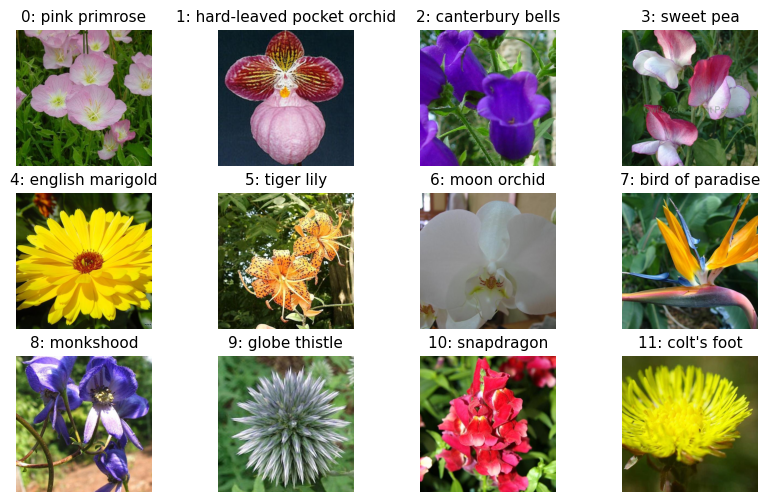

- `{y: img for img, y in flowers_to_display}`: 레이블을 키로 하는 딕셔너리 → 클래스마다 이미지 한 장만 남는다. `sorted(...)[:12]`로 클래스 0~11만
- 비슷하게 생긴 꽃이 많다. 종을 구분하려면 꽃잎 모양·무늬 같은 **세밀한 특성**이 필요하다

### 8-2. 헤드 교체와 동결

> 🎯 **목적** — 출력 층을 새 작업에 맞게 바꾸고, 나머지 층을 동결한다.

**코드**

```python
[name for name, child in model.named_children()]
# ['features', 'avgpool', 'classifier']

model.classifier
# Sequential(
#   (0): LayerNorm2d((1024,), eps=1e-06, elementwise_affine=True)
#   (1): Flatten(start_dim=1, end_dim=-1)
#   (2): Linear(in_features=1024, out_features=1000, bias=True)
# )
```

| 부분 | 역할 | 출력 형태 (입력 `[3, 224, 224]`) |
|---|---|---|
| `features` | 합성곱 블록들 — **특성 추출기** | `[1024, 7, 7]` |
| `avgpool` | 전역 평균 풀링 | `[1024, 1, 1]` |
| `classifier` | 층 정규화 → 펼치기 → 완전 연결(1,000) — **헤드** | `[1000]` |

```python
n_classes = 102  # len(class_names) == 102
model.classifier[2] = nn.Linear(1024, n_classes).to(device)
```

- `model.classifier[2] = ...`: `nn.Sequential`의 원소를 인덱스로 **바꿔 끼운다.** 1,000개 클래스용 출력 층을 버리고, 무작위로 초기화된 102개 클래스용 층으로 교체. 입력 수 1,024는 그대로
- 새 층은 CPU에 만들어지므로 `.to(device)`로 모델과 같은 장치로 옮긴다

```python
for param in model.parameters():
    param.requires_grad = False

for param in model.classifier.parameters():
    param.requires_grad = True
```

| 코드 | 의미 |
|---|---|
| `param.requires_grad = False` | 이 파라미터의 그레이디언트를 계산하지 않는다 → 옵티마이저가 갱신하지 않는다 = **동결** |
| 두 번째 반복문 | 헤드(`classifier`)만 다시 훈련 가능하게 |

**왜 동결하는가** — 새 출력 층은 무작위 상태라 처음에는 오차가 크다. 이 큰 오차의 그레이디언트가 아래로 흘러가면 **잘 학습된 사전 훈련 가중치를 망가뜨린다.** 그래서 처음에는 아래층을 얼리고 새 층만 훈련한다.

```python
# 보충 코드 (가중치 없이 구조만 만들어 확인)
trainable = sum(p.numel() for p in model.parameters() if p.requires_grad)
trainable, sum(p.numel() for p in model.parameters())
# (106598, 87671014)
```

- 훈련되는 파라미터는 층 정규화 2,048 + 새 출력 층 104,550 = **106,598개**. 전체 8,767만 개의 **0.12%**

### 8-3. 헤드 훈련

> 🎯 **목적** — 동결한 상태에서 새 헤드만 훈련한다.

**코드**

```python
n_epochs = 5
optimizer = torch.optim.AdamW(model.parameters())
xentropy = nn.CrossEntropyLoss()
accuracy = torchmetrics.Accuracy(task="multiclass",
                                 num_classes=102).to(device)
history = train(model, optimizer, xentropy, accuracy,
                train_loader, valid_loader, n_epochs)
```

- 옵티마이저에 `model.parameters()` 전체를 넘겼지만, 동결된 파라미터는 그레이디언트가 없어(`grad`가 `None`) 갱신되지 않는다

**결과 해석**

```
Epoch 1/5, train loss: 4.2828, train metric: 0.1422, valid metric: 0.6206
Epoch 2/5, train loss: 3.0120, train metric: 0.6667, valid metric: 0.7725
Epoch 3/5, train loss: 2.0645, train metric: 0.8520, valid metric: 0.8314
Epoch 4/5, train loss: 1.3685, train metric: 0.9206, valid metric: 0.8559
Epoch 5/5, train loss: 0.9400, train metric: 0.9441, valid metric: 0.8667
```

같은 설정으로 5 에포크 더:

```python
history = train(model, optimizer, xentropy, accuracy,
                train_loader, valid_loader, n_epochs)
```

```
Epoch 1/5, train loss: 0.6781, train metric: 0.9539, valid metric: 0.8804
Epoch 2/5, train loss: 0.5177, train metric: 0.9627, valid metric: 0.8873
Epoch 3/5, train loss: 0.3888, train metric: 0.9775, valid metric: 0.8980
Epoch 4/5, train loss: 0.3104, train metric: 0.9882, valid metric: 0.8980
Epoch 5/5, train loss: 0.2463, train metric: 0.9892, valid metric: 0.8912
```

| 시점 | 훈련 손실 | 훈련 정확도 | 검증 정확도 |
|---|---|---|---|
| 1 에포크 | 4.283 | 0.142 | 0.621 |
| 5 에포크 | 0.940 | 0.944 | 0.867 |
| 10 에포크 | 0.246 | 0.989 | **0.891** (최고 0.898) |

- 첫 에포크의 훈련 손실 4.28 ≈ $\ln 102 = 4.62$ 근처 — 102개 중 무작위로 찍는 수준에서 출발했다는 뜻
- **출력 층 하나만 훈련**했는데 5 에포크 만에 검증 정확도 86.7%, 10 에포크에 약 89%. 클래스당 10장으로 얻은 결과다. 사전 훈련된 특성 추출기가 이미 꽃을 구분할 수 있는 특성을 만들어 내고 있었다
- 훈련 정확도(0.989)와 검증 정확도(0.891)의 차이가 벌어진다 → 헤드만 더 훈련해서는 얻을 것이 별로 없다

### 8-4. 전체 미세 튜닝

> 🎯 **목적** — 동결을 풀고 작은 학습률로 전체 모델을 훈련한다.

**코드**

```python
for param in model.parameters():
    param.requires_grad = True

history = train(model, optimizer, xentropy, accuracy,
                train_loader, valid_loader, n_epochs)
```

- 모든 층의 동결을 풀고, **같은 옵티마이저(학습률 기본값 0.001)** 로 5 에포크 더 훈련한다

**결과 해석**

```
Epoch 1/5, train loss: 0.6871, train metric: 0.8294, valid metric: 0.8186
Epoch 2/5, train loss: 0.2714, train metric: 0.9245, valid metric: 0.8549
Epoch 3/5, train loss: 0.1438, train metric: 0.9598, valid metric: 0.7853
Epoch 4/5, train loss: 0.1595, train metric: 0.9529, valid metric: 0.8029
Epoch 5/5, train loss: 0.1626, train metric: 0.9490, valid metric: 0.8127
```

| 단계 | 검증 정확도 |
|---|---|
| 헤드만 훈련 (10 에포크 후) | 0.891 |
| 동결 해제 직후 1 에포크 | 0.819 |
| 동결 해제 후 5 에포크 | **0.813** (도중 최고 0.855) |

- 동결을 풀자 검증 정확도가 **오히려 떨어졌다**(0.891 → 0.813). 훈련 손실도 0.246에서 0.687로 튀었다가 내려온다
- 원인으로 보이는 것: 학습률 0.001은 새 출력 층을 훈련하기에는 적당하지만, **이미 잘 학습된 8,800만 개의 가중치를 미세하게 조정하기에는 너무 크다.** 첫 몇 스텝에 사전 훈련 가중치가 크게 흔들려 원래의 좋은 특성이 손상되고, 1,020장으로는 복구하지 못한다

> ⚠️ **동결을 푼 뒤에는 학습률을 크게 낮춰야 한다.** 일반적인 절차:
>
> | 단계 | 내용 |
> |---|---|
> | ① | 아래층 동결, 새 헤드만 훈련 (적당한 학습률) — [11장 2-5절](11_training_deep_neural_networks.md#2-5-층-재사용--동결--미세-튜닝)과 같은 절차 |
> | ② | 동결 해제 (전부 또는 위쪽 층부터 조금씩) |
> | ③ | **훨씬 작은 학습률**(예: 1/10 ~ 1/100)로 옵티마이저를 새로 만들어 전체를 훈련 |
> | ④ | 검증 점수를 지켜보며 가장 좋았던 시점의 모델을 쓴다 |
>
> 노트북의 이 실험은 ③을 건너뛰면 어떻게 되는지를 보여 준다.

> 📌 이 장의 `train()`은 매 에포크 `model.train()`을 호출한다. ConvNeXt는 배치 정규화 대신 **층 정규화**를 쓰므로 괜찮지만, ResNet처럼 배치 정규화가 있는 모델을 동결해 쓸 때는 주의해야 한다. `requires_grad=False`로 가중치를 얼려도 훈련 모드에서는 배치 정규화의 **이동 평균 통계가 계속 갱신**되기 때문이다. 동결한 부분은 `eval()` 모드로 따로 두는 방법을 쓴다.

### 8-5. 데이터 증강

> 🎯 **목적** — 훈련 이미지를 무작위로 변형해 과대적합을 줄인다.

**개념·원리**

**데이터 증강** = 훈련 이미지에 **레이블이 바뀌지 않는 범위의 무작위 변형**(반전, 회전, 자르기, 색 변화)을 가해 매번 조금씩 다른 이미지를 보여 주는 것. 훈련 세트가 인공적으로 늘어나는 효과 → 과대적합을 줄이는 규제. 3장에서 MNIST 이미지를 상하좌우로 이동시켜 훈련 세트를 늘린 것과 같은 생각이다. 훈련 세트가 클래스당 10장뿐인 이 문제에 특히 유용하다.

**코드**

```python
import torchvision.transforms.v2 as T

transform = T.Compose([
    T.RandomHorizontalFlip(p=0.5),
    T.RandomRotation(degrees=30),
    T.RandomResizedCrop(size=(224, 224), scale=(0.8, 1.0)),
    T.ColorJitter(brightness=0.2, contrast=0.2, saturation=0.2, hue=0.1),
    T.ToImage(),
    T.ToDtype(torch.float32, scale=True),
    T.Normalize(mean=[0.485, 0.456, 0.406], std=[0.229, 0.224, 0.225]),
])
```

| 변환 | 의미 |
|---|---|
| `T.RandomHorizontalFlip(p=0.5)` | 50% 확률로 좌우 반전 |
| `T.RandomRotation(degrees=30)` | −30° ~ +30° 사이의 무작위 각도로 회전 |
| `T.RandomResizedCrop(size=(224, 224), scale=(0.8, 1.0))` | 원본 면적의 80~100%인 영역을 무작위로 잘라 224 × 224로 크기 조정 |
| `T.ColorJitter(brightness=0.2, contrast=0.2, saturation=0.2, hue=0.1)` | 밝기·대비·채도를 ±20%, 색조를 ±0.1 범위에서 무작위로 변경 |
| `T.ToImage()`, `T.ToDtype(torch.float32, scale=True)` | PIL 이미지 → 텐서, 0~1 실수 (10장 7-1절) |
| `T.Normalize(mean, std)` | 이미지넷 평균·표준편차로 정규화 — 사전 훈련 모델이 기대하는 입력 (7-2절) |

- 앞의 네 줄이 **증강**(무작위), 뒤의 세 줄이 **전처리**(고정)
- 증강은 **훈련 세트에만** 적용한다. 검증·테스트 세트는 `weights.transforms()` 같은 고정된 전처리만 쓴다 (연습문제 9번이 이렇게 나눈다)
- 변환은 `DataLoader`가 이미지를 꺼낼 때마다 실행된다 → 같은 이미지라도 에포크마다 다른 모습으로 들어간다

> ⚠️ 증강은 **레이블을 바꾸지 않는 변형**이어야 한다. 꽃은 좌우를 뒤집어도 같은 꽃이지만, 글자·숫자·교통 표지판은 뒤집으면 다른 것이 될 수 있다. 색이 종을 구분하는 단서인 데이터에서 색조를 크게 바꾸는 것도 해롭다.

노트북은 이 변환을 정의만 하고 다시 훈련하지는 않는다. 대신 다음 절에서 이 `transform`이 **바운딩 박스**까지 함께 변환하는 것을 보여 준다.

---

## 9. 분류와 위치 추정 (12.9)

<!-- 일타 -->
> 💬 **일타 강의 — '무엇'에 '어디'를 더하기**
>
> 분류 출력 옆에 숫자 4개(박스의 중심·크기 또는 모서리 좌표)를 예측하는 회귀 출력을 하나 더 달면 위치 추정이 된다. 손실도 두 개(분류 + 박스)를 더한다. 박스가 얼마나 맞았는지는 **IoU**(겹친 면적 ÷ 합친 면적)로 잰다.
>
> - **헷갈림 주의**: 이미지를 뒤집거나 자르는 증강을 하면 **박스 좌표도 똑같이** 바꿔야 한다 → `BoundingBoxes`를 함께 변환


### 9-1. 출력이 두 개인 모델

> 🎯 **목적** — 이미지 속 물체가 **무엇인지**(분류)와 **어디에 있는지**(위치 추정)를 함께 예측하는 모델을 만든다.

**개념·원리**

물체의 위치 = 물체를 둘러싼 **바운딩 박스** → 숫자 4개(중심의 x·y 좌표, 너비, 높이)를 예측하는 **회귀** 문제.

| | 분류 | 위치 추정 |
|---|---|---|
| 출력 | 클래스 수만큼의 로짓 (102개) | 숫자 4개 |
| 문제 유형 | 분류 | 회귀 |
| 손실 | 크로스 엔트로피 | MSE 등 |

→ 특성 추출기는 함께 쓰고 **출력(헤드)만 두 개** 두면 된다. 10장 6-5절의 다중 출력 모델과 같은 구조.

**코드**

```python
class FlowerLocator(nn.Module):
    def __init__(self, base_model):
        super().__init__()
        self.base_model = base_model
        self.localization_head = nn.Sequential(
            nn.Flatten(),
            nn.Linear(base_model.classifier[2].in_features, 4)
        )

    def forward(self, X):
        features = self.base_model.features(X)
        pool = self.base_model.avgpool(features)
        y_pred_logits = self.base_model.classifier(pool)
        y_pred_bbox = self.localization_head(pool)
        return y_pred_logits, y_pred_bbox

torch.manual_seed(42)
locator_model = FlowerLocator(model).to(device)
```

| 코드 | 의미 |
|---|---|
| `base_model` | 8절에서 미세 튜닝한 ConvNeXt 모델을 통째로 받는다 |
| `base_model.classifier[2].in_features` | 기존 출력 층의 입력 수(1,024)를 읽어 온다 → 숫자를 직접 적지 않는다 |
| `self.localization_head` | 새로 추가하는 **위치 추정 헤드**: 펼치기 → 완전 연결(1,024 → 4) |
| `forward()` | `base_model(X)`를 한 번에 호출하지 않고 `features` → `avgpool`을 **따로** 호출해 중간 결과 `pool`을 얻은 뒤, 두 헤드에 각각 넘긴다 |

```
X → features → avgpool ─┬→ classifier         → 로짓 102개  (무슨 꽃인가)
                        └→ localization_head  → 숫자 4개    (어디에 있는가)
```

```python
preproc_images = torch.randn(2, 3, 224, 224)  # 전처리된 이미지의 배치
y_pred_logits, y_pred_bbox = locator_model(preprocessed_images.to(device))
```

- 반환값이 튜플 `(로짓, 바운딩 박스)`. 노트북은 7절에서 만든 `preprocessed_images`(샘플 이미지 2장)를 넣는다

```python
# 보충 코드 (가중치 없이 구조만 만들어 확인)
y_pred_logits.shape, y_pred_bbox.shape
# (torch.Size([2, 102]), torch.Size([2, 4]))
sum(p.numel() for p in locator_model.localization_head.parameters())     # 4100
```

> ⚠️ **이 모델은 아직 훈련할 수 없다.** Flowers102에는 바운딩 박스 레이블이 **없다.** 위치 추정을 훈련하려면 이미지마다 박스를 직접 그려 넣어야 한다(레이블링 도구나 크라우드소싱을 쓴다). 레이블을 구하는 것이 이런 프로젝트에서 가장 비용이 큰 부분인 경우가 많다. 노트북은 훈련까지 가지 않고, 박스가 2개뿐인 작은 데이터셋으로 **입력 파이프라인**만 만들어 본다 (9-4절).

### 9-2. 손실과 평가 지표: IoU

> 🎯 **목적** — 바운딩 박스 예측을 평가하는 IoU를 이해하고 계산한다.

**개념·원리**

훈련할 때는 두 손실을 **가중 합**으로 합친다 (10장 6-5절의 `0.8 * main_loss + 0.2 * aux_loss`와 같은 방식):

```python
# 보충 코드 — 훈련 스텝의 손실 계산 스케치
y_pred_logits, y_pred_bbox = locator_model(X_batch)
loss = xentropy(y_pred_logits, y_label) + bbox_weight * mse(y_pred_bbox, y_bbox)
```

- 바운딩 박스 좌표는 이미지 크기로 나눠 **0~1 범위로 정규화**해 두는 것이 보통이다. 너비·높이는 범위가 넓으므로 제곱근을 예측하게 하기도 한다(큰 박스의 10픽셀 오차가 작은 박스의 10픽셀 오차보다 덜 중요하게)

MSE는 훈련용 손실로는 쓸 만하지만, **박스를 얼마나 잘 맞혔는지 평가하는 지표로는 부적합**하다. 가장 널리 쓰는 지표는 **IoU**(intersection over union):

```math
\text{IoU} = \frac{\text{예측 박스} \cap \text{타깃 박스의 넓이}}{\text{예측 박스} \cup \text{타깃 박스의 넓이}}
```

| IoU | 의미 |
|---|---|
| 1 | 두 박스가 완전히 일치 |
| 0 | 전혀 겹치지 않음 |
| 0.5 이상 | 흔히 "맞혔다"고 보는 기준 |

**보충 코드**

```python
# 보충 코드
b1 = torch.tensor([[50., 50., 150., 150.]])                 # 타깃 박스 (x1, y1, x2, y2)
b2 = torch.tensor([[100., 100., 200., 200.],                # 대각선으로 50픽셀 어긋남
                   [ 50.,  50., 150., 150.],                # 똑같은 박스
                   [200., 200., 300., 300.],                # 겹치지 않음
                   [ 60.,  60., 160., 160.]])               # 10픽셀만 어긋남
torchvision.ops.box_iou(b1, b2)
# tensor([[0.1429, 1.0000, 0.0000, 0.6807]])
```

| 예측 박스 | 교집합 | 합집합 | IoU |
|---|---|---|---|
| 50픽셀 어긋남 | $50 \times 50 = 2{,}500$ | $10{,}000 \times 2 - 2{,}500 = 17{,}500$ | 0.143 |
| 똑같음 | 10,000 | 10,000 | 1.000 |
| 겹치지 않음 | 0 | 20,000 | 0.000 |
| 10픽셀 어긋남 | $90 \times 90 = 8{,}100$ | $20{,}000 - 8{,}100 = 11{,}900$ | 0.681 |

- 100 × 100 박스가 가로·세로로 **10픽셀씩만** 어긋나도 IoU는 0.68로 떨어진다. 절반(50픽셀)씩 어긋나면 0.14 → IoU는 꽤 엄격한 지표다
- `torchvision.ops.box_iou(A, B)`: A의 모든 박스와 B의 모든 박스 사이의 IoU 행렬. 입력은 `(x1, y1, x2, y2)` 형식

(그림은 10-1절의 IoU·NMS 보충 그림 왼쪽 참고.)

### 9-3. BoundingBoxes와 변환

> 🎯 **목적** — 이미지를 자르고 돌리고 크기를 바꾸면 바운딩 박스도 **같이** 바뀌어야 한다. 토치비전의 변환 API v2가 이를 자동으로 처리하는 것을 확인한다.

**코드**

```python
import torchvision.tv_tensors

bbox = torchvision.tv_tensors.BoundingBoxes(
    [[377, 199, 248, 262]],  # 중심 x=377, 중심 y=199, 너비=248, 높이=262
    format="CXCYWH",  # 다른 형식: "XYXY", "XYWH"
    canvas_size=(500, 754)  # 전처리 전 원본 이미지 크기
)
```

| 인수 | 의미 |
|---|---|
| 좌표 `[[...]]` | 박스 하나당 숫자 4개. 이미지 하나에 박스가 여러 개일 수 있어 2차원 |
| `format` | 숫자 4개를 읽는 방법 (아래 표) |
| `canvas_size` | 박스가 놓인 이미지의 `(높이, 너비)`. 변환이 좌표를 올바르게 옮기려면 필요하다 |

| 형식 | 숫자 4개의 의미 | 같은 박스 |
|---|---|---|
| `"CXCYWH"` | 중심 x, 중심 y, 너비, 높이 | `[377, 199, 248, 262]` |
| `"XYXY"` | 왼쪽 위 x·y, 오른쪽 아래 x·y | `[253, 68, 501, 330]` |
| `"XYWH"` | 왼쪽 위 x·y, 너비, 높이 | `[253, 68, 248, 262]` |

```python
# 보충 코드
torchvision.ops.box_convert(bbox, "cxcywh", "xyxy")     # tensor([[253.,  68., 501., 330.]])
torchvision.ops.box_convert(bbox, "cxcywh", "xywh")     # tensor([[253.,  68., 248., 262.]])
```

- 왼쪽 위 x = $377 - 248/2 = 253$, 오른쪽 아래 x = $377 + 248/2 = 501$

> 📌 `tv_tensors` — 텐서에 "이것은 이미지다 / 바운딩 박스다 / 마스크다"라는 **종류 정보**를 붙인 텐서 하위 클래스(`Image`, `BoundingBoxes`, `Mask`, `Video`). 변환 API v2는 이 종류를 보고 알맞은 연산을 고른다. 예: 색 변환은 이미지에만 적용하고 박스는 건드리지 않는다.

변환 API v2는 바운딩 박스를 지원한다:

```python
transform(bbox)
# BoundingBoxes([[ 90,  91, 120, 154]], format=BoundingBoxFormat.CXCYWH, canvas_size=(224, 224), clamping_mode=soft)
```

- 8-5절의 증강 변환을 박스에 적용 → 좌표가 바뀌고 `canvas_size`가 `(500, 754)` → `(224, 224)`로 바뀌었다
- 무작위 변환이므로 실행할 때마다 값이 다르다

중첩된 자료 구조도 지원한다 — 그 안의 이미지와 바운딩 박스를 찾아 **같은 무작위 변형**을 적용한다:

```python
torch.manual_seed(42)

# 첫 번째 훈련 이미지를 전처리 없이 적재
first_image = torchvision.datasets.Flowers102(root="datasets", split="train")[0][0]

preproc_image, preproc_target = transform(
    (first_image, {"label": 0, "bbox": bbox})
)
preproc_bbox = preproc_target["bbox"]
```

| 입력의 원소 | 변환 결과 |
|---|---|
| `first_image` (PIL 이미지) | 반전·회전·자르기·색 변화·정규화가 적용된 `[3, 224, 224]` 텐서 |
| `"label": 0` (정수) | 그대로 |
| `"bbox": bbox` (`BoundingBoxes`) | 이미지와 **같은** 반전·회전·자르기가 적용된 박스. 색 변화·정규화는 적용되지 않는다 |

바운딩 박스 그리기:

```python
def get_image_with_bbox(image, bbox, width=5, color="white"):
    bbox_xyxy = torchvision.ops.box_convert(bbox, "cxcywh", "xyxy")
    return torchvision.utils.draw_bounding_boxes(
        image, bbox_xyxy, width=width, colors=color)

first_image_ts = T.ToImage()(first_image)
image_with_bbox = get_image_with_bbox(first_image_ts, bbox)
plot_image(image_with_bbox)
plt.show()
```

| 코드 | 의미 |
|---|---|
| `torchvision.ops.box_convert(bbox, "cxcywh", "xyxy")` | 박스 형식 변환. `draw_bounding_boxes()`가 XYXY 형식을 요구하기 때문 |
| `torchvision.utils.draw_bounding_boxes(image, boxes, width, colors)` | 이미지 텐서 위에 박스를 그린 **새 이미지 텐서**를 반환 |

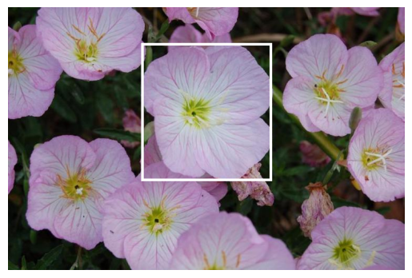

변환된 이미지와 박스:

```python
def denormalize(image, mean=[0.485, 0.456, 0.406], std=[0.229, 0.224, 0.225]):
    return (image * torch.tensor(std).view(-1, 1, 1)
            + torch.tensor(mean).view(-1, 1, 1))

image_with_bbox2 = get_image_with_bbox(
    denormalize(preproc_image), preproc_bbox, width=2, color="yellow")
plot_image(image_with_bbox2)
```

- `denormalize()`: 정규화의 역연산 $x \times \text{std} + \text{mean}$ → 화면에 그릴 수 있는 0~1 범위로 되돌린다. `view(-1, 1, 1)`은 `[3]`을 `[3, 1, 1]`로 바꿔 채널별로 브로드캐스팅되게 한다

박스가 그려진 이미지를 통째로 변환해 비교:

```python
torch.manual_seed(42)

preproc_image2, preproc_target2 = transform(
    (image_with_bbox, {"label": 0, "bbox": bbox})
)
image_and_bbox3 = get_image_with_bbox(
    denormalize(preproc_image2), preproc_target2["bbox"], width=2, color="yellow")
plot_image(image_and_bbox3)
```

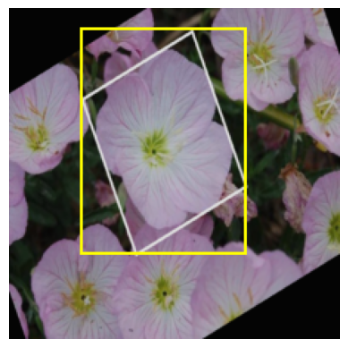

(흰색: 원본 박스가 그려진 이미지를 그대로 회전·자른 것 — 박스도 함께 **기울어졌다.** 노란색: 변환 API가 계산한 새 바운딩 박스.)

**결과 해석**

- 이미지가 회전하자 흰색 박스도 기울어졌다. 그런데 바운딩 박스는 항상 **축에 나란한 직사각형**이어야 한다 → 변환 API는 기울어진 박스 **전체를 감싸는** 가장 작은 직사각형(노란색)을 새 박스로 계산한다
- 그래서 변환된 박스는 **꽃보다 조금 크다.** 회전 각도가 클수록 박스가 더 부정확해진다 (시드를 바꿔 가며 실행하면 확인할 수 있다)
- 네 모서리의 검은 영역은 회전으로 생긴 빈 공간이다

> ⚠️ 위치 추정·객체 탐지에서는 **회전 증강을 조심해서** 써야 한다. 큰 회전은 박스 레이블을 헐겁게 만들어 모델이 실제보다 큰 박스를 예측하도록 가르친다. 좌우 반전·크기 조정·평행 이동은 박스를 정확하게 옮기므로 안전하다.

### 9-4. 바운딩 박스가 있는 데이터셋 만들기

> 🎯 **목적** — 이미지와 박스를 함께 변환하는 데이터셋을 만든다.

**코드**

```python
bboxes = [
    torchvision.tv_tensors.BoundingBoxes(
        [[377, 199, 248, 262]],
        format="CXCYWH",
        canvas_size=(500, 754)
    ),
    torchvision.tv_tensors.BoundingBoxes(
        [[314, 248, 437, 445]],
        format="CXCYWH",
        canvas_size=(500, 624)  # 이미지마다 크기가 다르다
    )
]
```

```python
class FlowersWithBBox(torch.utils.data.Dataset):
    def __init__(self, root, bboxes, transform=None, split="train"):
        self.image_dataset = torchvision.datasets.Flowers102(root=root,
                                                             split=split)
        self.bboxes = bboxes
        self.transform = transform

    def __len__(self):
        return len(self.bboxes)

    def __getitem__(self, index):
        raw_image, label = self.image_dataset[index]
        image = torchvision.tv_tensors.Image(raw_image)
        bbox = self.bboxes[index]
        preproc_image, preproc_bbox = self.transform(image, bbox)
        return preproc_image, {"label": label, "bbox": preproc_bbox}

train_set_with_bboxes = FlowersWithBBox("datasets", bboxes, transform=transform)
```

| 코드 | 의미 |
|---|---|
| `torch.utils.data.Dataset` 상속 | 사용자 정의 데이터셋. `__len__()`과 `__getitem__()`을 구현한다 (10장 6-4절) |
| `self.image_dataset` | 원본 Flowers102를 **변환 없이** 감싼다 → 이미지와 레이블을 가져오는 용도 |
| `__len__()` | 박스가 있는 이미지 수만큼만 (여기서는 2) |
| `torchvision.tv_tensors.Image(raw_image)` | 이미지를 `Image` 타입으로 감싼다 |
| `self.transform(image, bbox)` | 이미지와 박스를 **함께** 넘겨 같은 무작위 변형을 적용 |
| 반환값 | `(이미지, {"label": ..., "bbox": ...})` — 타깃이 딕셔너리 |

```python
train_loader_with_bboxes = DataLoader(train_set_with_bboxes, batch_size=2)
for images, label_and_bbox in train_loader_with_bboxes:
    label = label_and_bbox["label"]
    bbox = label_and_bbox["bbox"]
    # 여기서 모델을 훈련할 수 있다
```

- `DataLoader`는 딕셔너리 타깃도 키별로 묶어 배치로 만든다 (10장 6-4절). 반복문 안에 9-2절의 손실 계산과 `backward()` → `step()`을 넣으면 훈련 루프가 된다
- 박스가 2개뿐이라 실제 훈련은 불가능하다. 시간과 노력을 들여 전체 데이터셋에 박스를 붙이면 `FlowerLocator`를 훈련할 수 있다

> 📌 **변환은 데이터셋 안에서 이미지와 박스에 동시에** 적용해야 한다. 이미지에만 증강을 적용하고 박스는 원본 좌표를 그대로 쓰면, 박스가 엉뚱한 곳을 가리키는 레이블로 훈련하게 된다 — 오류 없이 조용히 틀리는 종류의 실수다.

---

## 10. 객체 탐지 (12.10)

<!-- 일타 -->
> 💬 **일타 강의 — 한 번만 보고 여러 물체 찾기**
>
> 객체가 여러 개면 위치 추정을 이미지 곳곳에서 해야 한다. 슬라이딩 윈도는 너무 느리다. **완전 합성곱 신경망**은 이미지 전체를 한 번 통과시키면 격자 칸마다 예측을 내놓는다. YOLO가 이 방식이다. 같은 물체에 박스가 여럿 생기면 **NMS**로 가장 확신하는 것만 남긴다.
>
> - **핵심 한 줄**: 탐지 성능 지표 = **mAP** (클래스별 PR 곡선 아래 면적의 평균)


### 10-1. 슬라이딩 윈도와 NMS

> 🎯 **목적** — 이미지 안의 **여러 물체**를 찾아 각각 분류하고 박스를 치는 문제를, 9절의 "물체 하나" 모델에서 출발해 생각해 본다.

**개념·원리**

**객체 탐지** = 한 이미지에서 여러 물체를 분류하고 위치를 추정하는 작업.

몇 년 전까지 흔했던 방법 — **슬라이딩 윈도**:

| 단계 | 내용 |
|---|---|
| ① | 물체 하나를 분류·위치 추정하도록 훈련한 CNN을 준비 |
| ② | 이 CNN을 이미지 위에서 격자 모양으로 **옮겨 가며** 각 위치에서 예측 |
| ③ | 물체 크기가 제각각이므로 **여러 크기의 창**으로 반복 |

문제 1 — 같은 물체가 조금씩 다른 위치에서 **여러 번** 탐지된다. → 불필요한 박스를 지우는 후처리가 필요하다: **NMS**(non-max suppression, 비최대 억제).

| NMS 단계 | 내용 |
|---|---|
| ① | 모델이 박스마다 **존재 여부 점수**(objectness, 그 박스에 실제로 물체가 있을 확률)도 출력하게 한다. 점수가 임곗값보다 낮은 박스를 모두 지운다 |
| ② | 남은 박스 중 점수가 **가장 높은** 박스를 고르고, 그 박스와 **많이 겹치는**(IoU가 임곗값, 예를 들어 60%보다 큰) 박스를 모두 지운다 |
| ③ | 지울 박스가 없을 때까지 ②를 반복한다 |

**보충 코드**

```python
# 보충 코드
boxes = torch.tensor([[100., 100., 200., 200.],     # 0 ┐
                      [105., 105., 205., 205.],     # 1 ├ 같은 물체를 가리키는 박스 3개
                      [110.,  95., 210., 195.],     # 2 ┘
                      [300., 300., 400., 400.],     # 3 ┐ 다른 물체를 가리키는 박스 2개
                      [305., 300., 405., 400.]])    # 4 ┘
scores = torch.tensor([0.90, 0.80, 0.70, 0.95, 0.60])

torchvision.ops.box_iou(boxes, boxes)
# tensor([[1.0000, 0.8223, 0.7467, 0.0000, 0.0000],
#         [0.8223, 1.0000, 0.7467, 0.0000, 0.0000],
#         [0.7467, 0.7467, 1.0000, 0.0000, 0.0000],
#         [0.0000, 0.0000, 0.0000, 1.0000, 0.9048],
#         [0.0000, 0.0000, 0.0000, 0.9048, 1.0000]])

torchvision.ops.nms(boxes, scores, iou_threshold=0.5)     # tensor([3, 0])
torchvision.ops.nms(boxes, scores, iou_threshold=0.9)     # tensor([3, 0, 1, 2])
```

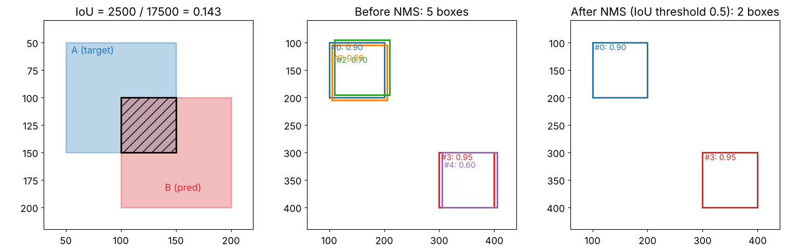

(보충 그림. 왼쪽: 9-2절의 IoU 계산 — 빗금 친 교집합 2,500 ÷ 합집합 17,500 = 0.143. 가운데: NMS 전의 박스 5개와 점수. 오른쪽: NMS 후 남은 2개.)

| 순서 | 고른 박스 | 지워지는 박스 (임곗값 0.5) |
|---|---|---|
| 1 | 3번 (0.95, 최고 점수) | 4번 (IoU 0.905) |
| 2 | 0번 (0.90, 남은 것 중 최고) | 1번 (IoU 0.822), 2번 (IoU 0.747) |
| 결과 | `[3, 0]` — 물체마다 박스 하나 | |

- `torchvision.ops.nms()`는 남길 박스의 **인덱스**를 점수가 높은 순으로 반환한다
- 임곗값을 0.9로 올리면 0·1·2번끼리의 IoU(0.75~0.82)가 임곗값보다 작아 **지워지지 않는다** → 같은 물체에 박스가 3개 남는다. 반대로 너무 낮추면 서로 가까이 붙어 있는 **다른** 물체의 박스까지 지운다

문제 2 — CNN을 수많은 위치·크기에서 반복 실행하므로 **매우 느리다.** → 다음 절의 완전 합성곱 신경망이 해결한다.

### 10-2. 완전 합성곱 신경망

> 🎯 **목적** — 완전 연결 층을 합성곱 층으로 바꾸면, 이미지를 **한 번만** 통과시켜 슬라이딩 윈도와 같은 결과를 얻을 수 있음을 확인한다.

**개념·원리**

**완전 합성곱 신경망(FCN)** = 완전 연결 층 없이 **합성곱 층(과 풀링 층)만으로** 이루어진 신경망. 2015년 시맨틱 분할 논문에서 처음 제안됐다.

핵심 관찰: **CNN 맨 위의 완전 연결 층은 합성곱 층으로 바꿀 수 있다.**

| | 완전 연결 층 | 같은 일을 하는 합성곱 층 |
|---|---|---|
| 입력 | 특성 맵 `[C, 7, 7]`을 펼친 벡터 | 특성 맵 `[C, 7, 7]` 그대로 |
| 설정 | 뉴런 200개 | 필터 **200개**, 커널 크기 = **입력 특성 맵 크기**(7 × 7), 패딩 없음 |
| 출력 | 숫자 200개 | 1 × 1 특성 맵 200개 |
| 계산 | 입력 전체의 가중 합 | 입력 전체의 가중 합 — **완전히 같다** |

그 위의 다른 완전 연결 층들은 1 × 1 합성곱 층으로 바꾼다.

**보충 코드** — 훈련된 완전 연결 층의 가중치를 합성곱 층으로 옮기기

```python
# 보충 코드
torch.manual_seed(42)
dense = nn.Linear(256 * 7 * 7, 200)
conv = nn.Conv2d(256, 200, kernel_size=7)
with torch.no_grad():
    conv.weight.copy_(dense.weight.view(200, 256, 7, 7))    # [200, 12544] → [200, 256, 7, 7]
    conv.bias.copy_(dense.bias)

x = torch.randn(2, 256, 7, 7)
dense(x.flatten(1)).shape, conv(x).shape
# (torch.Size([2, 200]), torch.Size([2, 200, 1, 1]))
torch.allclose(dense(x.flatten(1)), conv(x).flatten(1), atol=1e-4)      # True
```

- 가중치 행렬의 형태만 바꿔 넣었는데 두 층의 출력이 같다. `nn.Flatten`이 `[채널, 높이, 너비]` 순서로 펼치므로 `view(200, 256, 7, 7)`로 그대로 되돌릴 수 있다

**그래서 무엇이 좋아지는가** — 완전 연결 층은 입력 크기가 고정이지만, 합성곱 층은 **어떤 크기의 입력도** 받는다.

```python
# 보충 코드 — 특성 맵이 두 배(14×14)로 커지면
xl = torch.randn(2, 256, 14, 14)
conv(xl).shape
# torch.Size([2, 200, 8, 8])
dense(xl.flatten(1))
# RuntimeError: mat1 and mat2 shapes cannot be multiplied (2x50176 and 12544x200)
```

| 입력 특성 맵 | 완전 연결 층 | 합성곱 층 |
|---|---|---|
| 7 × 7 | 출력 200개 | `[200, 1, 1]` — 예측 1개 |
| 14 × 14 | **오류** | `[200, 8, 8]` — 예측 **64개** ($14 - 7 + 1 = 8$) |

- 224 × 224 이미지에서 7 × 7 특성 맵이 나오는 CNN이라면, 448 × 448 이미지를 넣었을 때 14 × 14 특성 맵 → 8 × 8 출력이 된다. 출력의 각 칸은 원본 이미지 위에서 **224 × 224 창을 일정 간격으로 옮겨 가며 예측한 것**과 같다
- 슬라이딩 윈도는 CNN을 64번 실행해야 하지만, FCN은 **한 번**이다. 겹치는 영역의 합성곱 계산을 공유하기 때문에 훨씬 효율적이다 → "이미지를 한 번만 본다(You Only Look Once)"가 다음 절 모델의 이름이 된다

([연습문제 6번](#13-1-개념-문제-17번)이 이 변환을 묻는다.)

### 10-3. YOLO로 객체 탐지

> 🎯 **목적** — 사전 훈련된 YOLO 모델로 사진 속 물체를 탐지한다.

**개념·원리**

**YOLO**(You Only Look Once) — 2015년 조지프 레드먼 등이 제안한 빠르고 정확한 객체 탐지 구조. 이후 여러 연구 그룹이 버전을 계속 발전시켰다.

| 특징 | 설명 |
|---|---|
| 한 번의 정방향 계산 | 이미지를 격자로 나누고, 격자 칸마다 **박스 좌표 + 존재 여부 점수 + 클래스 확률**을 한꺼번에 출력한다. 영상에서 실시간으로 동작할 만큼 빠르다 |
| 완전 합성곱 구조 | 10-2절의 FCN 방식 → 다양한 크기의 입력을 처리 |
| 후처리 | 겹치는 박스를 NMS(10-1절)로 정리 |

- 다른 대표적인 탐지 모델: **SSD**, **Faster R-CNN**(2단계 방식 — 후보 영역을 먼저 찾고 분류), **RetinaNet**, **EfficientDet**. 토치비전에도 `fasterrcnn_resnet50_fpn`, `retinanet_resnet50_fpn`, `ssd300_vgg16` 등이 들어 있다 (7-1절 목록)

**코드**

```python
if IS_COLAB or IS_KAGGLE:
    %pip install -q ultralytics

from ultralytics import YOLO

model = YOLO('yolov9m.pt')
images = ["https://homl.info/soccer.jpg", "https://homl.info/traffic.jpg"]
results = model(images)
# 0: 640x640 5 persons, 2 sports balls, 39.5ms
# 1: 640x640 3 persons, 7 cars, 1 motorcycle, 11 trucks, 39.5ms
# Speed: 7.4ms preprocess, 39.5ms inference, 11.2ms postprocess per image at shape (1, 3, 640, 640)
```

| 코드 | 의미 |
|---|---|
| `ultralytics` | YOLO 계열 모델을 쉽게 쓸 수 있게 해 주는 라이브러리. 코랩에 기본으로 없어 설치한다 |
| `YOLO('yolov9m.pt')` | 사전 훈련된 YOLOv9 가중치를 내려받아 모델 생성. 이름 끝의 글자가 모델 크기를 나타낸다(`m` = 중간 크기). 큰 모델일수록 정확하고 느리다 |
| `model(images)` | 파일 경로·URL·PIL 이미지·넘파이 배열 등을 받는다. 전처리(640 × 640으로 크기 조정) → 추론 → 후처리(NMS)까지 한 번에 수행 |
| `results` | 이미지마다 결과 객체 하나 |

```python
results[0].to_df()
# shape: (7, 4)
# ┌─────────────┬───────┬────────────┬─────────────────────────────────┐
# │ name        ┆ class ┆ confidence ┆ box                             │
# ╞═════════════╪═══════╪════════════╪═════════════════════════════════╡
# │ sports ball ┆ 32    ┆ 0.96214    ┆ {245.35733,286.03003,300.62509… │
# │ person      ┆ 0     ┆ 0.93886    ┆ {380.47516,52.46332,548.28998,… │
# │ person      ┆ 0     ┆ 0.93407    ┆ {234.47824,31.53568,365.06076,… │
# │ person      ┆ 0     ┆ 0.93391    ┆ {85.80923,19.24835,247.10776,4… │
# │ person      ┆ 0     ┆ 0.82737    ┆ {41.21783,74.47363,175.22491,3… │
# │ person      ┆ 0     ┆ 0.40399    ┆ {613.49725,372.65881,639.71979… │
# │ sports ball ┆ 32    ┆ 0.33764    ┆ {23.80591,337.59879,46.33569,3… │
# └─────────────┴───────┴────────────┴─────────────────────────────────┘

results[0].summary()[0]
# {'name': 'sports ball',
#  'class': 32,
#  'confidence': 0.96214,
#  'box': {'x1': 245.35733, 'y1': 286.03003, 'x2': 300.62509, 'y2': 343.57184}}
```

| 열 | 의미 |
|---|---|
| `name`, `class` | 클래스 이름과 번호. 이 모델은 COCO 데이터셋의 80개 클래스로 훈련됐다 (`person` = 0, `sports ball` = 32) |
| `confidence` | 탐지 신뢰도. 높은 순으로 정렬되어 있다 |
| `box` | 박스 좌표 `x1, y1, x2, y2` — **XYXY 형식**, 원본 이미지의 픽셀 단위 |

- `to_df()`: 결과를 데이터프레임으로. `summary()`: 탐지된 물체마다 딕셔너리 하나인 리스트

```python
import PIL

results[0].save("my_annotated_soccer.jpg")
PIL.Image.open("my_annotated_soccer.jpg")
```

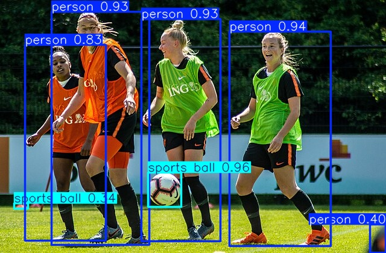

```python
results[1].save("my_annotated_traffic.jpg")
PIL.Image.open("my_annotated_traffic.jpg")
```

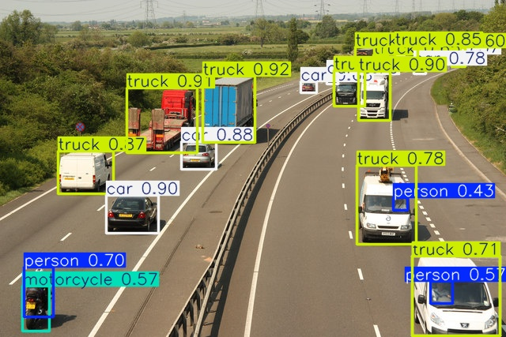

**결과 해석**

| 이미지 | 탐지 결과 | 추론 시간 |
|---|---|---|
| 축구 | 사람 5, 공 2 | 39.5 ms |
| 도로 | 사람 3, 승용차 7, 오토바이 1, 트럭 11 | 39.5 ms |

- 이미지 한 장을 **약 40 ms**(초당 약 25장)에 처리했다 — 물체가 7개든 22개든 시간은 같다. 한 번의 정방향 계산으로 모든 물체를 찾기 때문이다
- 축구 이미지: 신뢰도 0.83 이상인 5개(공 1, 사람 4)는 확실하다. 신뢰도 0.40인 `person`과 0.34인 `sports ball`은 가장자리의 불확실한 탐지다 → **신뢰도 임곗값**을 어디에 두느냐에 따라 결과가 달라진다. 3장의 정밀도/재현율 트레이드오프와 같다
- 도로 이미지: 멀리 있는 작은 차량, 차 안에 앉은 사람(`person 0.43`, `0.57`)까지 찾았다. 작고 서로 겹친 물체가 많은 곳에서는 박스가 겹쳐 보인다

### 10-4. mAP

> 🎯 **목적** — 객체 탐지 모델을 평가하는 대표 지표 mAP가 3장의 정밀도/재현율과 어떻게 이어지는지 본다.

**개념·원리**

탐지 결과 하나가 "맞았다"고 하려면: **클래스가 맞고**, 타깃 박스와의 **IoU가 임곗값(예: 0.5) 이상**이어야 한다. 이 기준으로 정밀도와 재현율을 계산한다.

| 용어 | 의미 |
|---|---|
| 정밀도 | 모델이 내놓은 탐지 중 맞은 비율 |
| 재현율 | 실제 물체 중 모델이 찾아낸 비율 |
| 신뢰도 임곗값을 낮추면 | 재현율 ↑, 정밀도는 대체로 ↓ (3장) |

정밀도/재현율 곡선을 숫자 하나로 요약하고 싶다. 그런데 곡선에는 재현율이 올라갈 때 **정밀도도 함께 올라가는** 구간이 있을 수 있다(특히 재현율이 낮은 쪽). 그런 구간에서는 재현율이 더 높은 쪽이 무조건 낫다. 그래서:

| 단계 | 내용 |
|---|---|
| ① | 각 재현율 수준에서 "**그 재현율 이상에서 얻을 수 있는 최대 정밀도**"를 구한다 |
| ② | 이 최대 정밀도들의 평균 = **AP**(average precision, 평균 정밀도) — 클래스 하나에 대한 값 |
| ③ | 모든 클래스의 AP를 평균 = **mAP**(mean average precision) |

**코드**

```python
def maximum_precisions(precisions):
    return np.flip(np.maximum.accumulate(np.flip(precisions)))
```

```python
import numpy as np

recalls = np.linspace(0, 1, 11)

precisions = [0.91, 0.94, 0.96, 0.94, 0.95, 0.92, 0.80, 0.60, 0.45, 0.20, 0.10]
max_precisions = maximum_precisions(precisions)
mAP = max_precisions.mean()
plt.plot(recalls, precisions, "ro--", label="Precision")
plt.plot(recalls, max_precisions, "bo-", label="Max Precision")
plt.xlabel("Recall")
plt.ylabel("Precision")
plt.plot([0, 1], [mAP, mAP], "b:", linewidth=3, label="mAP")
plt.grid(True)
plt.axis([0, 1, 0, 1])
plt.legend(loc="lower center")
plt.show()
```

| 코드 | 의미 |
|---|---|
| `np.linspace(0, 1, 11)` | 재현율 0%, 10%, …, 100%의 11개 지점 |
| `np.flip(precisions)` | 배열을 뒤집는다 (재현율이 높은 쪽부터) |
| `np.maximum.accumulate(...)` | **누적 최댓값** — 앞에서부터 지금까지 본 값 중 가장 큰 값 |
| 다시 `np.flip(...)` | 원래 순서로. 결과 = 각 위치에서 "자신과 그 **오른쪽**(더 높은 재현율) 값들 중 최댓값" |

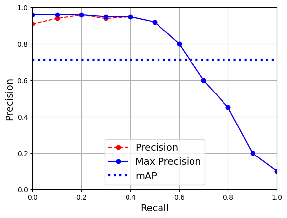

**결과 해석**

```python
# 보충 코드
max_precisions            # array([0.96, 0.96, 0.96, 0.95, 0.95, 0.92, 0.8 , 0.6 , 0.45, 0.2 , 0.1 ])
max_precisions.mean()     # 0.7136
np.mean(precisions)       # 0.7064
```

| 재현율 | 0.0 | 0.1 | 0.2 | 0.3 | 0.4 | 0.5 | 0.6 | 0.7 | 0.8 | 0.9 | 1.0 |
|---|---|---|---|---|---|---|---|---|---|---|---|
| 정밀도 | 0.91 | 0.94 | 0.96 | 0.94 | 0.95 | 0.92 | 0.80 | 0.60 | 0.45 | 0.20 | 0.10 |
| 최대 정밀도 | **0.96** | **0.96** | 0.96 | **0.95** | 0.95 | 0.92 | 0.80 | 0.60 | 0.45 | 0.20 | 0.10 |

- 재현율 0%·10%에서의 정밀도(0.91, 0.94)는 재현율 20%에서의 정밀도(0.96)보다 낮다 → 재현율을 20%로 올려도 정밀도가 오히려 좋아지므로 굳이 0%·10%에 머물 이유가 없다. 그래서 0.96으로 **끌어올린다.** 0.3 → 0.4 구간(0.94 → 0.95)도 같다
- 빨간 점선(원래 정밀도)이 울퉁불퉁한 곳을 파란 실선(최대 정밀도)이 평평하게 덮는다. 파란 점선이 평균 **0.714**
- 엄밀히 말해 이 예는 클래스 하나에 대한 **AP**다. 클래스가 여러 개면 클래스별 AP를 평균해 mAP를 얻는다

> 📌 mAP 뒤에 붙는 숫자: **mAP@0.5** = IoU 임곗값 0.5로 계산한 mAP. **mAP@[.50:.95]** = IoU 임곗값을 0.50부터 0.95까지 0.05 간격으로 바꿔 가며 구한 mAP의 평균 — 박스를 **정밀하게** 맞혀야 점수가 높다. COCO 벤치마크의 기본 지표.

---

## 11. 객체 추적 (12.11)

> 🎯 **목적** — 영상의 프레임마다 탐지한 물체들 가운데 **같은 물체를 같은 번호로** 이어 붙인다.

<!-- 일타 -->
> 💬 **일타 강의 — 탐지 + 연결 = 추적**
>
> 매 프레임 물체를 탐지한 뒤, 이전 프레임의 물체와 **같은 물체끼리 짝짓는** 것이 추적이다. 위치 예측(칼만 필터)과 외형 유사도로 짝을 맞춘다.


**개념·원리**

**객체 추적** = 영상에서 물체를 탐지하고, 프레임이 바뀌어도 각 물체를 **같은 것으로 식별**해 따라가는 작업. 어려운 이유:

| 어려움 | 예 |
|---|---|
| 물체가 움직인다 | 프레임마다 위치가 달라진다 |
| 크기·모양이 변한다 | 카메라에 가까워지거나 멀어진다, 방향을 튼다 |
| 가려진다 | 다른 물체 뒤로 잠깐 사라졌다 나타난다 |
| 서로 비슷하다 | 같은 색·차종의 차량이 나란히 달린다 |
| 조명·배경이 바뀐다 | |

대표적인 접근 — **탐지 후 연결**(tracking by detection): 프레임마다 탐지 모델을 돌린 뒤, 이번 프레임의 탐지 결과를 이전 프레임까지 추적하던 물체들과 **짝짓는다.** DeepSORT 계열 추적기의 구성:

| 구성 요소 | 역할 |
|---|---|
| 칼만 필터 | 지금까지의 궤적으로 물체의 **다음 위치를 예측**한다. 물체는 대체로 부드럽게 움직인다는 가정 |
| 외형 특성 | 딥러닝 모델로 탐지된 물체의 **생김새**를 벡터로 뽑아, 기존 물체와 얼마나 닮았는지 잰다 |
| 헝가리 알고리즘 | (예측 위치와의 거리 + 외형 유사도)를 비용으로, 탐지 결과와 기존 물체를 **가장 싸게 일대일로** 짝짓는다 |

- 위치만 보면 두 물체가 교차할 때 번호가 뒤바뀌기 쉽다. 외형을 함께 보면 "빨간 차는 계속 빨간 차"로 이어 갈 수 있다

**코드**

```python
my_video = "https://homl.info/cars.mp4"
results = model.track(source=my_video, stream=True, save=True)
for frame_results in results:
    summary = frame_results.summary()  # 앞의 summary와 비슷 + 트랙 ID
    track_ids = [obj["track_id"] for obj in summary]
    print("Track ids:", track_ids)
```

| 코드 | 의미 |
|---|---|
| `model.track(...)` | 10-3절의 YOLO 모델로 프레임마다 탐지하고, 내장 추적기로 프레임 사이를 연결한다. Ultralytics의 기본 추적기는 BoT-SORT이고 ByteTrack으로 바꿀 수 있다 |
| `stream=True` | 결과를 한꺼번에 리스트로 돌려주지 않고 프레임마다 하나씩 내놓는 **제너레이터**. 긴 영상에서 메모리가 넘치지 않게 한다 |
| `save=True` | 박스와 트랙 ID가 그려진 영상을 파일로 저장 |
| `obj["track_id"]` | 탐지된 물체에 부여된 **추적 번호**. 같은 물체는 프레임이 바뀌어도 같은 번호를 유지한다 |

**결과 해석**

```
video 1/1 (frame 1/243) /content/cars.mp4: 384x640 1 person, 8 cars, 1 bus, 1 truck, 59.6ms
Track ids: [1, 2, 3, 4, 5, 6, 7, 8, 9, 10, 11]
video 1/1 (frame 2/243) /content/cars.mp4: 384x640 1 person, 8 cars, 1 bus, 1 truck, 27.4ms
Track ids: [1, 2, 3, 4, 5, 6, 7, 8, 9, 10, 11]
video 1/1 (frame 3/243) /content/cars.mp4: 384x640 8 cars, 1 bus, 1 truck, 27.5ms
Track ids: [1, 2, 3, 4, 5, 6, 7, 8, 9, 10]
video 1/1 (frame 4/243) /content/cars.mp4: 384x640 7 cars, 1 bus, 1 truck, 27.8ms
Track ids: [1, 2, 3, 4, 5, 6, 7, 8, 10]
...
video 1/1 (frame 15/243) /content/cars.mp4: 384x640 7 cars, 1 bus, 1 truck, 27.5ms
Track ids: [1, 2, 3, 4, 5, 6, 7, 8, 10]
video 1/1 (frame 16/243) /content/cars.mp4: 384x640 7 cars, 2 trucks, 27.3ms
Track ids: [1, 2, 3, 4, 5, 6, 7, 8, 10]
...
video 1/1 (frame 234/243) /content/cars.mp4: 384x640 2 cars, 27.6ms
Track ids: [7, 8]
video 1/1 (frame 235/243) /content/cars.mp4: 384x640 1 car, 1 truck, 27.6ms
Track ids: [7, 8]
...
```

(노트북에 저장된 출력은 가운데가 잘려 있어 처음 16프레임과 마지막 십여 프레임만 남아 있다.)

| 프레임 | 탐지 | 트랙 ID | 일어난 일 |
|---|---|---|---|
| 1~2 | 사람 1, 승용차 8, 버스 1, 트럭 1 | 1 ~ 11 | 물체 11개에 번호 부여 |
| 3 | 승용차 8, 버스 1, 트럭 1 | 1 ~ 10 | 사람이 탐지되지 않음 → 11번이 빠짐 |
| 4~15 | 승용차 7, 버스 1, 트럭 1 | 1 ~ 8, 10 | 승용차 한 대가 사라짐 → 9번이 빠짐. **나머지 번호는 그대로** |
| 16 | 승용차 7, **트럭 2** | 1 ~ 8, 10 | 버스가 트럭으로 **분류만 바뀜** — 트랙 ID는 변하지 않는다 |
| 234 → 235 | 승용차 2 → 승용차 1 + 트럭 1 | 7, 8 | 영상 끝에 남은 두 대. 여기서도 분류는 흔들리지만 번호는 유지 |

- 총 243프레임, 프레임당 약 27 ms (첫 프레임만 59.6 ms — 첫 실행의 준비 비용이 섞인다)
- 번호는 **당겨지지 않는다.** 9번·11번이 사라져도 10번은 계속 10번이다
- 16번째 프레임이 추적의 의미를 잘 보여 준다. 탐지 모델은 같은 차량을 프레임에 따라 버스라고도 트럭이라고도 하지만, 추적기는 위치와 외형으로 **"같은 물체"** 임을 유지한다. 프레임별 분류보다 물체의 **동일성**이 더 안정적인 정보다
- 첫 프레임에서 7번·8번을 받은 물체는 마지막 프레임까지 같은 번호로 남아 있다 — 화면에 가장 오래 머문 차량

> 📌 추적 결과가 있으면 "몇 대가 지나갔는가(고유 트랙 ID의 수)", "각 차량이 화면에 얼마나 머물렀는가", "어느 방향으로 움직였는가" 같은 질문에 답할 수 있다. 프레임별 탐지만으로는 같은 차를 여러 번 세게 된다.

---

## 12. 시맨틱 분할 (12.12)

<!-- 일타 -->
> 💬 **일타 강의 — 픽셀마다 이름표 붙이기**
>
> 시맨틱 분할은 모든 픽셀에 클래스를 붙인다. CNN은 층을 지날수록 해상도가 줄어드니, 마지막에 **업샘플링**(전치 합성곱 등)으로 원래 크기로 되돌리고, 아래층의 세밀한 정보를 스킵 연결로 다시 더해 경계를 살린다.
>
> - **헷갈림 주의**: 시맨틱 분할은 "사람 픽셀"만 구분하고 **누가 누구인지는** 모른다. 개체까지 나누는 건 인스턴스 분할


### 12-1. 시맨틱 분할과 업샘플링

> 🎯 **목적** — 픽셀마다 클래스를 예측하는 문제에서, CNN이 줄여 놓은 해상도를 어떻게 되살리는지 이해한다.

**개념·원리**

**시맨틱 분할** = 이미지의 **모든 픽셀**을 그 픽셀이 속한 물체의 클래스(도로, 자동차, 보행자, 건물, …)로 분류하는 작업.

| 작업 | 출력 | 같은 클래스의 물체 여러 개 |
|---|---|---|
| 분류 (7~8절) | 이미지당 클래스 하나 | |
| 위치 추정 (9절) | 클래스 + 박스 하나 | |
| 객체 탐지 (10절) | 물체마다 클래스 + 박스 | 구분한다 |
| **시맨틱 분할** | **픽셀마다** 클래스 | **구분하지 않는다** — 나란히 선 사람들이 하나의 `person` 덩어리가 된다 |
| 인스턴스 분할 | 물체마다 픽셀 마스크 | 구분한다 (대표 모델: Mask R-CNN — 토치비전의 `maskrcnn_resnet50_fpn`) |

**가장 큰 어려움** — 일반적인 CNN을 통과하면 **위치 정보가 점점 사라진다.** 스트라이드가 1보다 큰 층(풀링, 스트라이드 2 합성곱)을 지날 때마다 해상도가 절반이 된다. 6-3절의 ResNet-34는 224 × 224 입력을 7 × 7로 줄였다(1/32). 분류에는 "어딘가에 사람이 있다"로 충분하지만, 분할은 "**어느 픽셀**이 사람인가"를 알아야 한다 ([연습문제 7번](#13-1-개념-문제-17번)).

2015년 FCN 논문의 해법:

| 단계 | 내용 |
|---|---|
| ① | 사전 훈련된 CNN을 **FCN으로 변환**한다 (10-2절). 출력 = 원본보다 훨씬 작은(예: 1/32) 클래스별 특성 맵 |
| ② | **업샘플링 층**을 붙여 해상도를 원본 크기로 되돌린다 |
| ③ | 한 번에 32배 키우면 너무 뭉툭하다 → **아래쪽 층에서 오는 스킵 연결**을 더해, 풀링으로 잃어버린 세밀한 위치 정보를 되찾는다. 예: 2배 업샘플링 → 해상도가 같은 아래층 출력과 더하기 → 다시 업샘플링 … |

**업샘플링 방법**

| 방법 | 내용 | 학습 여부 |
|---|---|---|
| 쌍선형 보간 | 이웃 픽셀 값을 거리로 가중 평균해 사이를 채운다. `F.interpolate(mode="bilinear")` | 학습하지 않는다. 4~8배까지는 무난 |
| **전치 합성곱 층** | 입력 픽셀 사이에 빈칸(0)을 끼워 넣어 늘린 뒤 일반 합성곱을 하는 것과 같다. `nn.ConvTranspose2d` | **학습한다** — 어떻게 늘릴지를 데이터에서 배운다 |

- 전치 합성곱에서 스트라이드는 "필터가 얼마나 이동하는가"가 아니라 **입력을 얼마나 늘릴 것인가**를 뜻한다. 스트라이드가 클수록 출력이 **커진다** (일반 합성곱과 반대)

**보충 코드** — 전치 합성곱

```python
# 보충 코드
t = torch.tensor([[[[1., 2.],
                    [3., 4.]]]])                          # [1, 1, 2, 2]

tk = nn.ConvTranspose2d(1, 1, kernel_size=2, stride=2, bias=False)
nn.init.ones_(tk.weight)                                  # 모든 가중치를 1로
tk(t)[0, 0]
# tensor([[1., 1., 2., 2.],
#         [1., 1., 2., 2.],
#         [3., 3., 4., 4.],
#         [3., 3., 4., 4.]])

tk3 = nn.ConvTranspose2d(1, 1, kernel_size=3, stride=2, bias=False)
nn.init.ones_(tk3.weight)
tk3(t)[0, 0]
# tensor([[ 1.,  1.,  3.,  2.,  2.],
#         [ 1.,  1.,  3.,  2.,  2.],
#         [ 4.,  4., 10.,  6.,  6.],
#         [ 3.,  3.,  7.,  4.,  4.],
#         [ 3.,  3.,  7.,  4.,  4.]])
```

| 설정 | 출력 | 해석 |
|---|---|---|
| 커널 2, 스트라이드 2 | 4 × 4 | 입력 픽셀 하나가 **커널 크기의 도장**을 찍는다. 도장 간격(스트라이드) = 도장 크기 → 겹치지 않고 2배 확대 |
| 커널 3, 스트라이드 2 | 5 × 5 | 도장(3 × 3)이 간격(2)보다 커서 **겹친다.** 겹친 곳은 더해진다 → 가운데 10 = 1 + 2 + 3 + 4 |

- 가중치가 모두 1이라 단순한 복사가 됐지만, 실제로는 이 도장의 모양(가중치)을 **학습**한다

전치 합성곱의 출력 크기: $n_{\text{out}} = (n - 1) \times s - 2p + f + \text{output\_padding}$

```python
# 보충 코드 — 클래스 21개짜리 저해상도 예측을 키우기
x = torch.randn(1, 21, 28, 28)
nn.ConvTranspose2d(21, 21, kernel_size=3, stride=2, padding=1, output_padding=1)(x).shape
# torch.Size([1, 21, 56, 56])        ← (28−1)×2 − 2 + 3 + 1 = 56. 정확히 2배
nn.ConvTranspose2d(21, 21, kernel_size=64, stride=32, padding=16)(torch.randn(1, 21, 7, 7)).shape
# torch.Size([1, 21, 224, 224])      ← 7×7을 한 번에 32배
F.interpolate(x, scale_factor=8, mode="bilinear", align_corners=False).shape
# torch.Size([1, 21, 224, 224])      ← 학습 없는 쌍선형 보간으로 8배
```

> 📌 해상도를 **덜 줄이는** 방법도 있다. **팽창 합성곱**(dilated / atrous convolution, `nn.Conv2d(..., dilation=2)`)은 필터의 칸 사이를 띄워서 적용한다. 3 × 3 필터에 `dilation=2`를 주면 파라미터는 9개 그대로인데 5 × 5 영역을 본다 → 스트라이드로 해상도를 줄이지 않고도 수용장을 넓힐 수 있다. 다음 절에서 쓰는 토치비전의 FCN 모델이 이 방식이다.

### 12-2. 사전 훈련된 FCN으로 분할하기

> 🎯 **목적** — 사전 훈련된 분할 모델로 픽셀마다 클래스를 예측한다.

**코드**

```python
from pathlib import Path
import urllib.request

def download_file(url, path):
    path = Path(path)
    if not path.is_file():
        path.parent.mkdir(parents=True, exist_ok=True)
        urllib.request.urlretrieve(url, path)

download_file("https://homl.info/soccer.jpg", "datasets/images/soccer.jpg")
```

- 파일이 없을 때만 내려받는 도우미 함수. `parents=True, exist_ok=True` → 중간 폴더까지 만들고, 이미 있어도 오류를 내지 않는다

```python
from torchvision.models.segmentation import fcn_resnet50, FCN_ResNet50_Weights

weights = FCN_ResNet50_Weights.DEFAULT
model = fcn_resnet50(weights=weights)
model.eval()

img = PIL.Image.open("datasets/images/soccer.jpg")
transform = weights.transforms()
batch = transform(img).unsqueeze(0)  # unsqueeze()는 크기 1인 차원을 추가한다

with torch.no_grad():
    masks = model(batch)["out"].softmax(dim=1)

class_names = weights.meta["categories"]
name_to_id = {name: class_id for class_id, name in enumerate(class_names)}
mask = masks[0, name_to_id["person"]]
```

| 코드 | 의미 |
|---|---|
| `fcn_resnet50` | ResNet-50을 백본(특성 추출기)으로 쓰는 FCN 분할 모델 |
| `FCN_ResNet50_Weights.DEFAULT` | 그 모델의 **가장 좋은** 가중치를 가리키는 별칭 (여기서는 `COCO_WITH_VOC_LABELS_V1`) |
| `weights.transforms()` | 이 모델의 전처리 — 짧은 변을 520픽셀로 크기 조정 + 이미지넷 정규화. **중앙 자르기는 없다**(모든 픽셀을 분류해야 하므로) |
| `.unsqueeze(0)` | `[3, H, W]` → `[1, 3, H, W]`. 이미지 한 장을 배치로 만든다 |
| `model(batch)["out"]` | 분할 모델은 **딕셔너리**를 반환한다. `"out"` = `[배치, 클래스 수, H, W]` 로짓. 높이·너비가 **입력과 같다** |
| `.softmax(dim=1)` | **클래스 차원**에 소프트맥스 → 픽셀마다 21개 클래스의 확률 (합 1) |
| `name_to_id` | 클래스 이름 → 번호 딕셔너리 |
| `masks[0, name_to_id["person"]]` | 0번 이미지의 `person` 채널 → `[H, W]`. 각 픽셀이 사람일 확률 |

```python
# 보충 코드
weights.meta["categories"]
# ['__background__', 'aeroplane', 'bicycle', 'bird', 'boat', 'bottle', 'bus', 'car', 'cat', 'chair', 'cow',
#  'diningtable', 'dog', 'horse', 'motorbike', 'person', 'pottedplant', 'sheep', 'sofa', 'train', 'tvmonitor']
```

- 클래스 **21개** = 배경 1 + 물체 20종(PASCAL VOC의 분류 체계). `person`은 15번

```python
plt.imshow(mask, cmap="binary")
plt.axis('off')
plt.show()
```

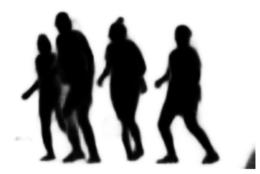

```python
masked_image = mask.unsqueeze(0) * denormalize(batch.squeeze(0))
plot_image(masked_image)
```

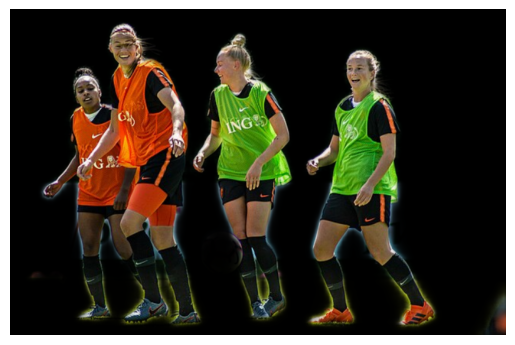

| 코드 | 의미 |
|---|---|
| `cmap="binary"` | 0 = 흰색, 1 = 검은색 → 사람일 확률이 높은 픽셀이 검게 |
| `batch.squeeze(0)` | 배치 차원 제거 `[1, 3, H, W]` → `[3, H, W]` |
| `denormalize(...)` | 9-3절의 함수. 정규화를 되돌려 0~1 범위로 |
| `mask.unsqueeze(0) * ...` | `[1, H, W]` × `[3, H, W]` → 브로드캐스팅으로 세 채널 모두에 마스크를 곱한다. 사람이 아닌 픽셀(확률 ≈ 0)은 검게 지워진다 |

**결과 해석**

- 축구 선수들의 윤곽이 픽셀 단위로 분리됐다. 10-3절의 박스와 달리 **몸의 모양**을 따라간다
- 겹쳐 있는 선수들은 **하나의 덩어리**로 이어진다. 시맨틱 분할은 "이 픽셀은 사람이다"만 알려 줄 뿐 "몇 번째 사람인가"는 모른다 → 사람 수를 세려면 인스턴스 분할이나 객체 탐지가 필요하다
- 공은 지워졌다. 이 모델의 21개 클래스에 공이 없어 배경으로 분류됐기 때문이다

**보충 코드** — 이 모델이 해상도를 다루는 방식

```python
# 보충 코드 (가중치 없이 구조만 만들어 확인)
fcn = fcn_resnet50(weights=None, weights_backbone=None, num_classes=21).eval()
with torch.no_grad():
    x = torch.randn(1, 3, 224, 320)
    fcn.backbone(x)["out"].shape       # torch.Size([1, 2048, 28, 40])   ← 백본 출력: 입력의 1/8
    fcn(x)["out"].shape                # torch.Size([1, 21, 224, 320])   ← 최종 출력: 입력과 같은 크기
```

| 단계 | 형태 | 비고 |
|---|---|---|
| 입력 | `[3, 224, 320]` | 정사각형이 아니어도 된다 (완전 합성곱 구조) |
| 백본 (ResNet-50) | `[2048, 28, 40]` | 분류용 ResNet은 1/32까지 줄이지만, 이 모델은 뒤쪽 블록의 스트라이드를 **팽창 합성곱**으로 바꿔 **1/8**에서 멈춘다 |
| 분류 헤드 | `[21, 28, 40]` | 저해상도 위치마다 21개 클래스의 로짓 |
| 업샘플링 | `[21, 224, 320]` | 쌍선형 보간으로 8배 |

> 💡 분류(7절)와 분할(12절)의 출력 처리는 **같은 연산을 다른 차원에** 쓴 것이다. 분류: `[배치, 클래스]` 로짓 → `softmax(dim=1)` → `argmax(dim=1)`로 이미지당 클래스 하나. 분할: `[배치, 클래스, H, W]` 로짓 → `softmax(dim=1)` → `argmax(dim=1)`로 **픽셀당** 클래스 하나(`[배치, H, W]`). 손실도 같은 `nn.CrossEntropyLoss`를 쓴다 — 픽셀 하나하나가 분류 문제다.

---

## 13. 연습문제

### 13-1. 개념 문제 (1~7번)

| 번호 | 질문 | 답 요약 |
|---|---|---|
| 1 | 이미지 분류에서 CNN이 완전 연결 DNN보다 나은 점 | 아래 표 |
| 2 | 3 × 3 커널·스트라이드 2·`"same"` 패딩 합성곱 층 3개(특성 맵 100 → 200 → 400), 입력 200 × 300 RGB. 파라미터 수와 필요한 메모리는 | [13-2절](#13-2-2번-파라미터-수와-메모리-계산) |
| 3 | CNN 훈련 중 GPU 메모리가 부족할 때 시도할 다섯 가지 | ① **미니배치 크기 줄이기** ② 하나 이상의 층에서 스트라이드를 키워 차원 줄이기 ③ 층을 하나 이상 제거 ④ 32비트 대신 **16비트 실수** 사용 ⑤ CNN을 여러 장치에 분산 — 2-8절 |
| 4 | 같은 스트라이드의 합성곱 층 대신 최대 풀링 층을 넣는 이유 | 최대 풀링 층은 **파라미터가 전혀 없다.** 합성곱 층은 파라미터가 꽤 많다(2번 참고) — 3절 |
| 5 | AlexNet, GoogLeNet, ResNet, SENet, Xception, EfficientNet, ConvNeXt의 주요 혁신 | 아래 표 |
| 6 | 완전 합성곱 신경망이란. 완전 연결 층을 합성곱 층으로 바꾸는 방법 | 아래 풀이 |
| 7 | 시맨틱 분할의 주된 기술적 어려움 | 신호가 CNN의 층(특히 **풀링 층과 스트라이드가 1보다 큰 층**)을 지나며 **공간 정보를 많이 잃는다.** 픽셀마다 클래스를 정확히 예측하려면 이 공간 정보를 어떻게든 복원해야 한다 — 12-1절 |

**1번 — CNN의 장점**

| 장점 | 설명 |
|---|---|
| 파라미터가 훨씬 적다 | 연속한 층이 **부분적으로만 연결**되고 **가중치를 많이 재사용**한다 → 훈련이 빠르고, 과대적합 위험이 작고, 훈련 데이터가 덜 필요하다 |
| 위치에 상관없이 감지 | 어떤 특성을 감지하는 커널을 학습하면 이미지 **어디에서든** 그 특성을 감지한다. DNN은 한 위치에서 배운 특성을 그 위치에서만 감지한다. 이미지에는 반복되는 특성이 많으므로 CNN이 더 적은 샘플로 더 잘 일반화한다 |
| 픽셀 배치에 대한 사전 지식 | DNN은 픽셀이 어떻게 놓여 있는지(가까운 픽셀이 가깝다는 것)를 모른다. CNN의 구조에는 이 지식이 들어 있다. 아래층은 작은 영역의 특성을, 위층은 이를 조합한 큰 특성을 찾는다 — 대부분의 자연 이미지에 잘 맞는다 |

**5번 — 구조별 혁신**

| 구조 | 혁신 | 이 노트 |
|---|---|---|
| AlexNet (vs. LeNet-5) | 훨씬 **크고 깊다.** 합성곱 층 위에 풀링 층을 매번 놓지 않고 **합성곱 층끼리 바로 쌓는다** | 5-5 |
| GoogLeNet | **인셉션 모듈** → 이전 구조보다 훨씬 깊으면서 파라미터는 더 적다 | 5-6 |
| ResNet | **스킵 연결** → 100층을 훌쩍 넘길 수 있다. 단순함과 일관성도 혁신이라 할 만하다 | 5-8, 6 |
| SENet | 인셉션 모듈·잔차 유닛마다 **SE 블록**(2층 밀집 신경망)을 붙여 특성 맵의 상대적 중요도를 보정 | 5-10 |
| Xception | **깊이별 분리 합성곱 층** — 공간 패턴과 깊이(채널) 방향 패턴을 따로 본다 | 5-9 |
| EfficientNet | **복합 스케일링** — 더 큰 계산 예산에 맞춰 모델을 효율적으로 키우는 방법 | 5-11 |
| ConvNeXt | 비전 트랜스포머에 쓰인 기법들로 CNN 구조를 **현대화** | 5-11 |

**6번 — 완전 합성곱 신경망**

- FCN = **합성곱 층과 풀링 층만으로** 이루어진 신경망. (최소 크기 이상이면) 어떤 높이·너비의 이미지든 효율적으로 처리한다
- 객체 탐지와 시맨틱 분할에 가장 유용하다. 이미지를 **한 번만** 보면 되기 때문 (CNN을 이미지의 여러 부분에 여러 번 실행하지 않는다)
- 완전 연결 층이 위에 있는 CNN을 FCN으로 바꾸는 방법:

| 대상 | 바꾸는 방법 |
|---|---|
| 가장 아래의 완전 연결 층 | 커널 크기 = **그 층의 입력 크기**, 필터 수 = **뉴런 수**, `"valid"` 패딩인 합성곱 층. 스트라이드는 보통 1(더 크게 해도 된다). 활성화 함수는 원래 층과 같게 |
| 나머지 완전 연결 층 | 같은 방식이되 **1 × 1** 필터 |

- 완전 연결 층의 가중치 행렬의 형태만 알맞게 바꾸면 **이미 훈련된** CNN도 이렇게 변환할 수 있다 → 10-2절의 보충 코드가 이 변환이다

### 13-2. 2번 파라미터 수와 메모리 계산

> 🎯 **목적** — 합성곱 층의 파라미터 수, 예측할 때와 훈련할 때의 메모리를 손으로 계산한다.

문제: 3 × 3 커널, 스트라이드 2, `"same"` 패딩인 합성곱 층 3개. 아래층부터 특성 맵 100개, 200개, 400개. 입력은 200 × 300 픽셀 RGB 이미지. 32비트 부동소수점.

**① 파라미터 수**

| 층 | 필터 하나의 가중치 | 편향 포함 | × 필터 수 | 파라미터 수 |
|---|---|---|---|---|
| 1 | $3 \times 3 \times 3 = 27$ | 28 | × 100 | 2,800 |
| 2 | $3 \times 3 \times 100 = 900$ | 901 | × 200 | 180,200 |
| 3 | $3 \times 3 \times 200 = 1{,}800$ | 1,801 | × 400 | 720,400 |
| **합계** | | | | **903,400** |

**② 특성 맵 크기와 메모리**

스트라이드 2 + `"same"` 패딩 → 층마다 높이·너비가 절반(올림).

| 층 | 특성 맵 크기 | 메모리 (샘플 1개) = 4바이트 × 높이 × 너비 × 특성 맵 수 |
|---|---|---|
| 1 | 100 × 150 | $4 \times 100 \times 150 \times 100 = 6{,}000{,}000$ (6 MB) |
| 2 | 50 × 75 | $4 \times 50 \times 75 \times 200 = 3{,}000{,}000$ (3 MB) |
| 3 | 25 × 38 | $4 \times 25 \times 38 \times 400 = 1{,}520{,}000$ (약 1.5 MB) |

**③ 샘플 하나를 예측할 때**

- 한 층의 계산이 끝나면 **그 앞 층의 메모리는 해제**할 수 있다 → 동시에 필요한 것은 연속한 두 층뿐. 가장 큰 순간은 2번 층을 막 계산했고 1번 층이 아직 남아 있을 때: $6 + 3 = 9$ MB
- 파라미터: $903{,}400 \times 4 = 3{,}613{,}600$바이트 (약 3.6 MB)
- 합계: 최소 **12,613,600바이트 (약 12.6 MB)**

**④ 샘플 50개 미니배치로 훈련할 때**

- 역전파를 하려면 정방향 계산의 **모든 값을 역방향 계산이 시작될 때까지 보관**해야 한다 → 모든 층의 합 × 배치 크기

| 항목 | 계산 | 값 |
|---|---|---|
| 층 출력 | $(6 + 3 + 1.5) \text{ MB} \times 50$ | 525 MB |
| 입력 이미지 | $50 \times 4 \times 200 \times 300 \times 3$ | 36 MB |
| 파라미터 | | 3.6 MB |
| 그레이디언트 | 역방향 계산이 내려가면서 차례로 해제할 수 있다고 보고 무시 | – |
| **합계** | | **약 564.6 MB** — 낙관적인 최솟값 |

**보충 코드** — 검산

```python
# 보충 코드
net = nn.Sequential(nn.Conv2d(3, 100, 3, stride=2, padding=1),
                    nn.Conv2d(100, 200, 3, stride=2, padding=1),
                    nn.Conv2d(200, 400, 3, stride=2, padding=1))
X = torch.randn(1, 3, 200, 300)
for layer in net:
    X = layer(X); print(tuple(X.shape))
# (1, 100, 100, 150)
# (1, 200, 50, 75)
# (1, 400, 25, 38)
sum(p.numel() for p in net.parameters())       # 903400
```

- 형태와 파라미터 수가 손 계산과 일치한다
- 파이토치에서는 스트라이드 2에 `padding="same"`을 쓸 수 없으므로(2-5절) `padding=1`로 같은 효과를 냈다. 75 → 38은 $\lfloor (75 + 2 - 3)/2 \rfloor + 1 = 38$ — 홀수 크기는 올림이 된다
- 3번 층의 메모리를 1.52 MB 그대로 쓰면 층 출력은 526 MB, 합계는 약 565.6 MB다. 풀이는 1.5 MB로 어림했다

> 💡 **예측 12.6 MB vs 훈련 565 MB — 약 45배.** 파라미터는 90만 개(3.6 MB)뿐인데 훈련 메모리의 대부분은 **보관해야 하는 특성 맵 × 배치 크기**다. 메모리가 부족할 때 배치 크기부터 줄이는 이유다 (3번).

### 13-3. 8번 MNIST 고정확도 CNN

> 🎯 **목적** — CNN을 직접 만들어 MNIST에서 가능한 한 높은 정확도를 낸다.

**코드** — 데이터 (패션 MNIST와 같은 방식)

```python
toTensor = T.Compose([T.ToImage(), T.ToDtype(torch.float32, scale=True)])

train_and_valid_data = torchvision.datasets.MNIST(
    root="datasets", train=True, download=True, transform=toTensor)
test_data = torchvision.datasets.MNIST(
    root="datasets", train=False, download=True, transform=toTensor)

torch.manual_seed(42)
train_data, valid_data = torch.utils.data.random_split(
    train_and_valid_data, [55_000, 5_000])

torch.manual_seed(42)
train_loader = DataLoader(train_data, batch_size=32, shuffle=True)
valid_loader = DataLoader(valid_data, batch_size=32)
test_loader = DataLoader(test_data, batch_size=32)
```

**코드** — 모델

```python
class MnistModel(nn.Module):
    def __init__(self):
        super().__init__()
        self.conv1 = nn.Conv2d(1, 32, kernel_size=3, padding=1)
        self.conv2 = nn.Conv2d(32, 64, kernel_size=3, padding=1)
        self.pool = nn.MaxPool2d(2)
        self.flatten = nn.Flatten()
        self.dropout1 = nn.Dropout(0.25)
        self.fc1 = nn.Linear(1 * 28 * 28 * 32 // 2, 128)
        self.dropout2 = nn.Dropout(0.5)
        self.fc2 = nn.Linear(128, 10)

        for m in self.modules():
            if isinstance(m, nn.Conv2d) or isinstance(m, nn.Linear):
                nn.init.kaiming_normal_(m.weight, nonlinearity="relu")
                if m.bias is not None:
                    nn.init.zeros_(m.bias)

    def forward(self, x):
        x = F.relu(self.conv1(x))
        x = F.relu(self.conv2(x))
        x = self.pool(x)
        x = self.flatten(x)
        x = self.dropout1(x)
        x = F.relu(self.fc1(x))
        x = self.dropout2(x)
        return self.fc2(x)
```

| 코드 | 의미 |
|---|---|
| 구조 | 합성곱 2개 → 최대 풀링 1개 → 드롭아웃 25% → 완전 연결(128) → 드롭아웃 50% → 출력 층 |
| `1 * 28 * 28 * 32 // 2` | `fc1`의 입력 수 = 12,544. 풀링 뒤의 형태 `[64, 14, 14]` → $64 \times 14 \times 14 = 12{,}544$와 같은 값 |
| `self.modules()` | 모델 안의 모든 모듈(자기 자신과 하위 모듈)을 차례로 돌려준다 |
| `nn.init.kaiming_normal_(m.weight, nonlinearity="relu")` | **카이밍(He) 초기화**([11장 1-2절](11_training_deep_neural_networks.md#1-2-글로럿과-he-초기화)) — ReLU에 맞춰 분산을 정한 정규 분포로 가중치를 초기화. 깊은 신경망에서 신호가 사라지거나 폭주하지 않게 한다 |
| `nn.init.zeros_(m.bias)` | 편향은 0으로 |
| `F.relu(...)` | 활성화 함수를 모듈(`nn.ReLU`) 대신 **함수**로 `forward()` 안에서 적용. 결과는 같다 |

```python
# 보충 코드
{n: p.numel() for n, p in MnistModel().named_parameters()}
# {'conv1.weight': 288, 'conv1.bias': 32, 'conv2.weight': 18432, 'conv2.bias': 64,
#  'fc1.weight': 1605632, 'fc1.bias': 128, 'fc2.weight': 1280, 'fc2.bias': 10}
sum(p.numel() for p in MnistModel().parameters())      # 1625866
```

- 파라미터 162만 개 중 **`fc1`이 160만 개(98.8%)** 다. 풀링을 한 번만 해서 펼친 벡터가 12,544차원으로 크기 때문 → 2-6절·4-3절에서 본 대로, 파라미터를 잡아먹는 것은 합성곱 층이 아니라 **펼친 뒤의 완전 연결 층**이다

**코드** — 훈련과 평가

```python
torch.manual_seed(42)
mnist_model = MnistModel().to(device)

n_epochs = 10
optimizer = torch.optim.AdamW(mnist_model.parameters())
xentropy = nn.CrossEntropyLoss()
accuracy = torchmetrics.Accuracy(task="multiclass",
                                 num_classes=10).to(device)
history = train(mnist_model, optimizer, xentropy, accuracy,
                train_loader, valid_loader, n_epochs)
```

```
Epoch 1/10, train loss: 0.2208, train metric: 0.9348, valid metric: 0.9836
Epoch 2/10, train loss: 0.0917, train metric: 0.9729, valid metric: 0.9858
...
Epoch 7/10, train loss: 0.0363, train metric: 0.9885, valid metric: 0.9890
Epoch 8/10, train loss: 0.0319, train metric: 0.9895, valid metric: 0.9892
Epoch 9/10, train loss: 0.0283, train metric: 0.9912, valid metric: 0.9880
Epoch 10/10, train loss: 0.0271, train metric: 0.9913, valid metric: 0.9892
```

```python
evaluate_tm(mnist_model, test_loader, accuracy)
# tensor(0.9901, device='cuda:0')
```

**결과 해석**

| 지표 | 값 |
|---|---|
| 검증 정확도 (1 에포크) | 0.9836 |
| 검증 정확도 (10 에포크) | 0.9892 |
| **테스트 정확도** | **0.9901** |

- 첫 에포크에 이미 검증 정확도 98.4%. 10 에포크 뒤 테스트 정확도 **약 99%**
- 5-3절과 같은 현상: 드롭아웃 때문에 처음에는 훈련 정확도(0.935)가 검증 정확도(0.984)보다 낮다
- 99.5~99.7%까지 올리려면: **이미지 증강**, **배치 정규화**, 1사이클 같은 **학습률 스케줄**, 필요하면 **앙상블**을 더한다

### 13-4. 9번 전이 학습으로 이미지 분류

> 🎯 **목적** — 클래스당 100장 남짓한 데이터에 8절의 전이 학습 절차를 처음부터 끝까지 적용한다.

**① 데이터** — 파이토치 전이 학습 튜토리얼의 hymenoptera(개미·벌) 데이터셋

```python
from pathlib import Path
import urllib.request
import zipfile

def download_hymenoptera_dataset():
    data_dir = Path("datasets")
    url = "https://download.pytorch.org/tutorial/hymenoptera_data.zip"
    zip_path = data_dir / "hymenoptera_data.zip"
    data_dir.mkdir(parents=True, exist_ok=True)
    if not zip_path.exists():
        print("Downloading...",  end="")
        urllib.request.urlretrieve(url, zip_path)
        print(" Done.")
    unzipped_dir = data_dir / "hymenoptera_data"
    if not unzipped_dir.exists():
        print("Extracting...", end="")
        with zipfile.ZipFile(zip_path, "r") as zf:
            zf.extractall(data_dir)
        print(" Done.")
    return unzipped_dir

hymenoptera_dir = download_hymenoptera_dataset()
```

- 압축 파일이 없으면 내려받고, 풀린 폴더가 없으면 푼다. 폴더 구조는 `train/ants`, `train/bees`, `val/ants`, `val/bees`

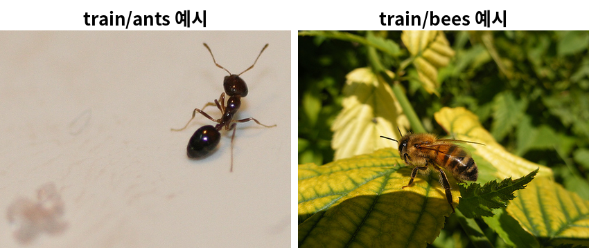

(노트북이 `PIL.Image.open()`으로 띄운 훈련 이미지 두 장. 크기·배경·구도가 제각각인 실제 사진이라 전처리에서 크기를 맞춰야 한다.)

**②③ 분할과 입력 파이프라인**

```python
from torchvision.datasets import ImageFolder
import torchvision.transforms.v2 as T

train_transforms = T.Compose([
    T.RandomResizedCrop(224),
    T.RandomHorizontalFlip(),
    T.ToImage(),
    T.ToDtype(torch.float32, scale=True),
    T.Normalize([0.485, 0.456, 0.406], [0.229, 0.224, 0.225])
])
valid_test_transforms = T.Compose([
    T.Resize(232),
    T.CenterCrop(224),
    T.ToImage(),
    T.ToDtype(torch.float32, scale=True),
    T.Normalize([0.485, 0.456, 0.406], [0.229, 0.224, 0.225])
])
train_set = ImageFolder(hymenoptera_dir / "train", train_transforms)
valid_test_set = ImageFolder(hymenoptera_dir / "val", valid_test_transforms)

torch.manual_seed(42)
valid_set, test_set = torch.utils.data.random_split(valid_test_set, [0.5, 0.5])
class_names = train_set.classes

batch_size = 32
train_loader = DataLoader(train_set, batch_size=batch_size, shuffle=True)
valid_loader = DataLoader(valid_set, batch_size=batch_size)
test_loader = DataLoader(test_set, batch_size=batch_size)
```

| 코드 | 의미 |
|---|---|
| `ImageFolder(폴더, 변환)` | **하위 폴더 이름 = 클래스**인 폴더 구조를 데이터셋으로 읽는다. 직접 모은 사진을 분류할 때 가장 간단한 방법. `classes` 속성에 클래스 이름(`['ants', 'bees']`)이 들어 있다 |
| `train_transforms` | **증강 있음** — 무작위 크기·위치로 잘라 224 × 224로(`RandomResizedCrop`), 무작위 좌우 반전 |
| `valid_test_transforms` | **증강 없음** — 232로 크기 조정 → 중앙 224 자르기. 7-2절의 `weights.transforms()`와 같은 처리 |
| `random_split(valid_test_set, [0.5, 0.5])` | 개수 대신 **비율**을 줄 수도 있다. 원래의 `val` 폴더를 반으로 나눠 검증·테스트 세트로 |

| 세트 | 이미지 수 | 출처 |
|---|---|---|
| 훈련 | 244 | `train` 폴더 |
| 검증 | 77 | `val` 폴더(153장)의 절반 |
| 테스트 | 76 | `val` 폴더의 나머지 절반 |

(이미지 수는 노트북의 정확도 출력에서 확인한 값이다. 예: 테스트 정확도 0.9868 = 75/76.)

**④ 사전 훈련 모델 미세 튜닝**

```python
weights = torchvision.models.ConvNeXt_Base_Weights.IMAGENET1K_V1
model = torchvision.models.convnext_base(weights=weights).to(device)

model.classifier[2] = nn.Linear(1024, 2).to(device)

for param in model.parameters():
    param.requires_grad = False

for param in model.classifier.parameters():
    param.requires_grad = True

n_epochs = 5
optimizer = torch.optim.AdamW(model.parameters(), lr=1e-3)
xentropy = nn.CrossEntropyLoss()
accuracy = torchmetrics.Accuracy(task="multiclass", num_classes=2).to(device)
history = train(model, optimizer, xentropy, accuracy,
                train_loader, valid_loader, n_epochs)
```

- 8-2절과 같은 절차: 헤드 교체 → 전체 동결 → 헤드만 해제
- 이진 분류인데 출력을 **2개**로 두고 `CrossEntropyLoss`를 쓴다(출력 1개 + `BCEWithLogitsLoss` 대신). 다른 데이터셋으로 바꿀 때 클래스 수만 고치면 되게 하기 위해서다

```
Epoch 1/5, train loss: 0.4842, train metric: 0.8484, valid metric: 1.0000
Epoch 2/5, train loss: 0.2104, train metric: 0.9672, valid metric: 1.0000
Epoch 3/5, train loss: 0.1236, train metric: 0.9713, valid metric: 1.0000
Epoch 4/5, train loss: 0.1082, train metric: 0.9631, valid metric: 1.0000
Epoch 5/5, train loss: 0.0545, train metric: 0.9918, valid metric: 1.0000
```

```python
evaluate_tm(model, test_loader, accuracy)
# tensor(0.9868, device='cuda:0')
```

**결과 해석**

| 지표 | 값 |
|---|---|
| 검증 정확도 | 1.0000 (1 에포크부터) |
| **테스트 정확도** | **0.9868** (76장 중 75장) |

- 훈련 이미지 244장, 출력 층 하나만 5 에포크 훈련해 테스트 정확도 **98.7%**
- 검증 정확도가 첫 에포크부터 100%다. 개미와 벌은 이미지넷 1,000개 클래스에 이미 들어 있는 종류라, 사전 훈련된 특성만으로 거의 구분된다. 다만 검증 세트가 77장뿐이므로 "100%"를 그대로 믿기보다 "오류가 거의 없다" 정도로 읽는 것이 맞다
- 훈련 정확도가 검증보다 낮은 것은 훈련 세트에만 **증강**이 적용되어 더 어려운 이미지를 보기 때문이다
- 8절의 꽃 분류(102개 클래스, 검증 89%)보다 훨씬 쉬운 문제다. 클래스가 2개뿐이고 사전 훈련 데이터와 겹친다

### 13-5. 10번 객체 탐지 튜토리얼

파이토치의 [객체 탐지 미세 튜닝 튜토리얼](https://homl.info/detectiontuto)을 따라 해 보는 문제. 노트북에 별도 풀이는 없다.

---

## 14. 정리

### 14-1. 전체 흐름

```
[12.1 시각 피질]
국부 수용장 + 저수준 → 고수준 계층              ← 네오코그니트론(1980) → LeNet-5(1998)

[12.2 합성곱 층]
이미지 [배치, 채널, 높이, 너비]  (넘파이·PIL은 [높이, 너비, 채널] → permute)
nn.Conv2d(3, 32, kernel_size=7)                  → [2, 32, 64, 114], 파라미터 4,736개 (가중치 [32, 3, 7, 7])
  ├ padding="same"                               → [2, 32, 70, 120]   (스트라이드 1일 때만)
  └ stride=2, padding=3                          → [2, 32, 35, 60]
출력 크기 = ⌊(n + 2p − f) / s⌋ + 1               메모리는 파라미터가 아니라 특성 맵이 차지한다

[12.3~12.4 풀링 층]
nn.MaxPool2d(2) / nn.AvgPool2d(2)                → 높이·너비 절반, 파라미터 0, 값의 75% 버림
DepthMaxPool2 (직접 구현)                        → 채널 방향 최댓값
nn.AdaptiveAvgPool2d(1)                          → [배치, 채널, 1, 1]  전역 평균 풀링

[12.5 CNN 구조]
[Conv + ReLU]×n → Pool → … (채널 ↑, 크기 ↓) → Flatten → Linear + Dropout → 로짓
패션 MNIST CNN (141만 파라미터, AdamW)           → 검증 정확도 0.914  (MLP 0.891)
LeNet-5 → AlexNet(깊게, ReLU·드롭아웃·증강) → GoogLeNet(인셉션, 1×1 병목) → VGGNet(3×3만)
        → ResNet(스킵 연결) → Xception(분리 합성곱) → SENet(SE 블록) → EfficientNet · ConvNeXt

[12.6 ResNet-34]
ResidualUnit : F.relu(main_layers(x) + skip_connection(x))      skip = nn.Identity() 또는 1×1 Conv + BN
ResNet34     : 7×7 Conv → MaxPool → RU×(3, 4, 6, 3) → AdaptiveAvgPool2d(1) → Flatten → LazyLinear

[12.7 사전 훈련 모델]
weights = ConvNeXt_Base_Weights.IMAGENET1K_V1 → convnext_base(weights=weights)
weights.transforms()(이미지) → model.eval() + no_grad() → argmax / topk → weights.meta["categories"]
                                                 → 'palace', 'daisy'

[12.8 전이 학습]  Flowers102 (102종, 훈련 1,020장)
model.classifier[2] = nn.Linear(1024, 102) → 전체 requires_grad=False → classifier만 True
헤드만 훈련 10 에포크                            → 검증 0.891
동결 해제 후 같은 학습률로 5 에포크              → 검증 0.813  ✗ (학습률을 낮춰야 한다)
데이터 증강 : RandomHorizontalFlip · RandomRotation · RandomResizedCrop · ColorJitter

[12.9 분류와 위치 추정]
FlowerLocator : features → avgpool ─┬ classifier → 로짓 102개
                                    └ localization_head → 박스 4개
tv_tensors.BoundingBoxes(format="CXCYWH", canvas_size=...) → transform((image, {"bbox": bbox}))
평가 지표 IoU = 교집합 / 합집합

[12.10 객체 탐지]
슬라이딩 윈도 + NMS → 완전 합성곱 신경망(FC 층 → 합성곱 층) → YOLO
YOLO('yolov9m.pt')(images) → results[i].summary() / .save()     약 40 ms / 장
평가 지표 mAP = 재현율별 최대 정밀도의 평균(AP)을 클래스에 대해 평균

[12.11 객체 추적]
model.track(source=영상, stream=True) → obj["track_id"]          프레임이 바뀌어도 같은 물체는 같은 번호

[12.12 시맨틱 분할]
fcn_resnet50(weights=...)(batch)["out"].softmax(dim=1) → [1, 21, H, W] → masks[0, person]
해상도 복원 : 쌍선형 보간 / nn.ConvTranspose2d / 스킵 연결 / 팽창 합성곱
```

### 14-2. 개념과 코드 대응

| 단계 | 핵심 코드 | 핵심 원칙 |
|---|---|---|
| 이미지 텐서 | `X.permute(0, 3, 1, 2)` | 파이토치는 `[배치, 채널, 높이, 너비]` |
| 합성곱 층 | `nn.Conv2d(in_channels, out_channels, kernel_size)` | 가중치 `[출력 채널, 입력 채널, 커널 높이, 커널 너비]`. 파라미터 수는 이미지 크기와 무관 |
| 크기 유지 | `padding="same"` | 스트라이드 1에서만. 그 외에는 `padding=(k - 1) // 2` |
| 크기 줄이기 | `stride=2` 또는 `nn.MaxPool2d(2)` | 풀링은 파라미터가 없다 |
| 전역 평균 풀링 | `nn.AdaptiveAvgPool2d(1)` → `nn.Flatten()` | 입력 크기와 무관하게 `[배치, 채널]` |
| 설정 재사용 | `partial(nn.Conv2d, kernel_size=3, padding="same")` | 반복되는 인수를 미리 채운다 |
| 규제 | `nn.Dropout(0.5)` | `model.train()` / `model.eval()`에 따라 켜지고 꺼진다 |
| 배치 정규화 | `nn.Conv2d(..., bias=False)` → `nn.BatchNorm2d(채널 수)` | BN 앞의 합성곱에는 편향이 필요 없다 |
| 스킵 연결 | `F.relu(self.main_layers(x) + self.skip_connection(x))` | 형태가 다르면 스킵 경로에 1 × 1 합성곱 |
| 분리 합성곱 | `nn.Conv2d(c, c, k, groups=c)` → `nn.Conv2d(c, out, 1)` | 공간 패턴과 채널 패턴을 따로 |
| 입력 수 자동 | `nn.LazyLinear(10)` | 첫 정방향 계산에서 `in_features` 결정 |
| 사전 훈련 모델 | `convnext_base(weights=weights)` | 구조 함수 + 가중치 열거형 |
| 전처리 | `weights.transforms()` | 훈련 때와 **같은** 전처리를 써야 한다 |
| 클래스 이름 | `weights.meta["categories"]` | |
| 헤드 교체 | `model.classifier[2] = nn.Linear(1024, n_classes)` | 출력 층만 새 작업에 맞게 |
| 동결 | `param.requires_grad = False` | 새 층의 큰 그레이디언트로부터 사전 훈련 가중치를 보호 |
| 데이터 증강 | `T.Compose([T.RandomHorizontalFlip(), ...])` | 훈련 세트에만. 레이블을 바꾸지 않는 변형만 |
| 바운딩 박스 | `tv_tensors.BoundingBoxes(..., format, canvas_size)` | 이미지와 **함께** 변환한다 |
| 박스 도구 | `torchvision.ops.box_convert`, `box_iou`, `nms` | 형식 변환 · IoU · 중복 제거 |
| 다중 헤드 | `return y_pred_logits, y_pred_bbox` | 특성 추출기는 공유, 손실은 가중 합 |
| 객체 탐지 | `YOLO('yolov9m.pt')(images)` | 한 번의 정방향 계산으로 모든 물체 |
| 객체 추적 | `model.track(source=..., stream=True)` | 트랙 ID로 프레임을 잇는다 |
| 시맨틱 분할 | `model(batch)["out"].softmax(dim=1)` | 픽셀마다 분류. 출력 크기 = 입력 크기 |
| 업샘플링 | `nn.ConvTranspose2d`, `F.interpolate` | 줄어든 해상도를 되돌린다 |

### 14-3. CNN 구조 비교

| 구조 | 연도 | 핵심 부품 | 해결한 문제 |
|---|---|---|---|
| LeNet-5 | 1998 | 합성곱 + 평균 풀링 + tanh | CNN의 기본 틀 |
| AlexNet | 2012 | 더 크고 깊게, ReLU, 드롭아웃, 데이터 증강 | 대규모 이미지 분류에서 딥러닝의 우위를 보임 (톱-5 오류율 17%) |
| GoogLeNet | 2014 | 인셉션 모듈, 1 × 1 병목, 전역 평균 풀링 | 깊이를 늘리면서 파라미터를 1/10로 |
| VGGNet | 2014 | 3 × 3 합성곱만 반복 | 단순한 구조로도 깊으면 된다 |
| ResNet | 2015 | 스킵 연결(잔차 학습), 배치 정규화 | 100층 이상을 훈련 가능하게 (3.6% 미만) |
| Xception | 2016 | 깊이별 분리 합성곱 | 파라미터·연산 절감 |
| SENet | 2017 | SE 블록 | 특성 맵의 중요도를 보정 (2.25%) |
| EfficientNet | 2019 | 복합 스케일링 | 깊이·너비·해상도를 균형 있게 확장 |
| ConvNeXt | 2022 | 트랜스포머식 설계를 반영한 CNN | CNN의 현대화 |

층의 종류별 비교:

| 층 | 파라미터 | 공간 크기 | 채널 수 | 용도 |
|---|---|---|---|---|
| `nn.Conv2d(c_in, c_out, k)` | $(c_{in} k^2 + 1)\, c_{out}$ | 패딩·스트라이드에 따라 | $c_{in} \to c_{out}$ | 특성 추출 |
| `nn.Conv2d(c_in, c_out, 1)` | $(c_{in} + 1)\, c_{out}$ | 그대로 | $c_{in} \to c_{out}$ | 채널 조합·병목 |
| 분리 합성곱 | $(k^2 + 1)\, c_{in} + (c_{in} + 1)\, c_{out}$ | 패딩·스트라이드에 따라 | $c_{in} \to c_{out}$ | 가벼운 특성 추출 |
| `nn.MaxPool2d(2)` | 0 | 절반 | 그대로 | 축소, 이동 불변성 |
| `nn.AdaptiveAvgPool2d(1)` | 0 | 1 × 1 | 그대로 | 출력 층 앞 요약 |
| `nn.ConvTranspose2d` | 합성곱과 같은 방식 | **커진다** | $c_{in} \to c_{out}$ | 업샘플링 |

작업별 비교:

| 작업 | 출력 | 손실 / 평가 지표 | 이 장의 모델 |
|---|---|---|---|
| 분류 | 이미지당 로짓 | 크로스 엔트로피 / 정확도 | 패션 MNIST CNN, ConvNeXt |
| 분류 + 위치 추정 | 로짓 + 박스 4개 | 크로스 엔트로피 + MSE / IoU | `FlowerLocator` |
| 객체 탐지 | 물체마다 클래스 + 박스 + 신뢰도 | / mAP | YOLOv9 |
| 객체 추적 | 탐지 + 트랙 ID | | YOLOv9 + 추적기 |
| 시맨틱 분할 | 픽셀마다 로짓 | 픽셀별 크로스 엔트로피 | FCN-ResNet50 |

### 14-4. 주요 결과

| 실험 | 지표 | 값 |
|---|---|---|
| `Conv2d(3, 32, 7)` (입력 70 × 120) | 출력 형태 / 파라미터 수 | `[2, 32, 64, 114]` / 4,736 |
| 같은 입출력의 완전 연결 층 | 가중치 수 | 약 58.8억 |
| 5 × 5 합성곱, 특성 맵 200개 (150 × 100) | 파라미터 / 출력 메모리(샘플 1개 / 100개) | 15,200 / 12 MB / 1.2 GB |
| 패션 MNIST CNN | 파라미터 수 | 1,413,834 |
| 패션 MNIST CNN, AdamW 20 에포크 | 검증 정확도 (최고 / 최종) | **0.9142** / 0.9066 |
| (비교) 10장 MLP | 검증 정확도 (최고) | 0.8910 |
| 3 × 3 합성곱 vs 분리 합성곱 (128 → 256) | 파라미터 수 | 295,168 / 34,304 (약 1/8.6) |
| 3 × 3 합성곱 vs 병목 (256 → 256) | 파라미터 수 | 590,080 / 70,016 |
| SE 블록 (256채널) | 파라미터 수 | 8,464 |
| ResNet-34 (출력 10개 / 1,000개) | 파라미터 수 | 21,289,802 / 21,797,672 |
| ConvNeXt-Base | 파라미터 수 / 이미지넷 톱-1 | 88,591,464 / 84.06% |
| ConvNeXt-Base, 샘플 이미지 | 예측 | `palace`, `daisy` |
| Flowers102 전이 학습, 헤드만 5 에포크 | 검증 정확도 | 0.8667 |
| 〃 헤드만 10 에포크 | 검증 정확도 (최종 / 최고) | **0.8912** / 0.8980 |
| 〃 동결 해제 후 5 에포크 (학습률 그대로) | 검증 정확도 | 0.8127 |
| 〃 훈련되는 파라미터 (헤드만) | 개수 / 비율 | 106,598 / 0.12% |
| IoU (100 × 100 박스, 10픽셀 / 50픽셀 어긋남) | | 0.681 / 0.143 |
| YOLOv9m, 축구 / 도로 이미지 | 탐지 물체 수 / 추론 시간 | 7 / 22 / 39.5 ms |
| 객체 추적 `cars.mp4` | 프레임 수 / 첫 프레임의 트랙 수 | 243 / 11 |
| AP 예제 | 정밀도 평균 / 최대 정밀도 평균 | 0.706 / **0.714** |
| 연습 2번 | 파라미터 / 예측 메모리 / 훈련 메모리(배치 50) | 903,400 / 12.6 MB / 약 565 MB |
| 연습 8번 MNIST CNN | 검증 / 테스트 정확도 | 0.9892 / **0.9901** |
| 연습 9번 개미·벌 전이 학습 | 검증 / 테스트 정확도 | 1.0000 / **0.9868** |

### 14-5. 자주 쓴 코드 패턴

| 패턴 | 용도 | 위치 |
|---|---|---|
| `images.permute(0, 3, 1, 2)` / `image.permute(1, 2, 0)` | 채널 축을 앞으로 / 그릴 때 뒤로 | 2-4 |
| `import torchvision.transforms.v2 as T` | 변환 API v2 | 2-4 ~ |
| `T.Compose([T.ToImage(), T.ToDtype(torch.float32, scale=True)])` | PIL → 0~1 실수 텐서 | 5-3, 13-3 |
| `DefaultConv2d = partial(nn.Conv2d, kernel_size=3, padding="same")` | 기본 설정을 채운 층 | 5-2, 6-1 |
| `X = layer(X); print(X.shape)` (층을 하나씩 통과) | 층별 출력 형태 확인 | 5-2, 6-3, 13-2 |
| `sum(p.numel() for p in model.parameters())` | 파라미터 수 | 전체 |
| `history = train(model, optimizer, xentropy, accuracy, train_loader, valid_loader, n_epochs)` | 훈련 + 에포크별 검증 | 5-3, 8-3, 13-3, 13-4 |
| `torch.optim.AdamW(model.parameters())` | 이 장의 기본 옵티마이저 | 5-3 ~ |
| `weights = ...Weights.IMAGENET1K_V1` → `model = 모델함수(weights=weights)` → `weights.transforms()` | 사전 훈련 모델 + 맞는 전처리 | 7, 12-2, 13-4 |
| `model.eval()` + `with torch.no_grad():` | 예측 | 7-3, 12-2 |
| `for p in model.parameters(): p.requires_grad = False` → 헤드만 `True` | 동결 | 8-2, 13-4 |
| `model.classifier[2] = nn.Linear(1024, n).to(device)` | 헤드 교체 | 8-2, 13-4 |
| `image.unsqueeze(0)` / `batch.squeeze(0)` | 배치 차원 추가 / 제거 | 12-2 |
| `denormalize(image)` | 정규화를 되돌려 그리기 | 9-3, 12-2 |
| `torchvision.ops.box_convert(bbox, "cxcywh", "xyxy")` | 박스 형식 변환 | 9-3 |
| `download_file(url, path)` | 없을 때만 내려받기 | 12-2 |

### 14-6. 핵심 원칙

1. CNN은 이미지의 구조를 **부분 연결**과 **가중치 공유**로 신경망에 넣은 것이다. 필터 하나가 이미지 전체를 훑으므로 파라미터 수가 이미지 크기와 무관하고, 한 곳에서 배운 패턴을 어디서든 알아본다.
2. 형태를 항상 따라간다. 합성곱 층은 **채널 수**를 바꾸고(`out_channels`), 스트라이드와 풀링이 **공간 크기**를 줄인다. 출력 크기는 $\lfloor (n + 2p - f)/s \rfloor + 1$.
3. CNN의 메모리는 파라미터가 아니라 **특성 맵 × 배치 크기**가 차지한다. 훈련은 모든 층의 출력을 보관해야 하므로 예측보다 훨씬 많은 메모리가 든다.
4. 풀링은 파라미터 없이 크기를 줄이고 작은 이동에 대한 불변성을 주지만, 정보를 버린다. 위치가 중요한 작업(분할)에서는 그 대가를 되돌려야 한다.
5. 전형적인 설계: 뒤로 갈수록 **공간은 작게, 채널은 많게**. 큰 커널 하나보다 3 × 3 여러 층. 끝은 전역 평균 풀링 + 완전 연결 층.
6. CNN 구조의 역사는 "**어떻게 더 깊게, 더 적은 파라미터로**"의 역사다. 1 × 1 병목, 스킵 연결, 분리 합성곱이 그 답이었고, 스킵 연결은 층이 **항등 함수에서 출발**하게 해 수백 층의 훈련을 가능하게 했다.
7. 대부분의 경우 직접 만들지 않는다. **사전 훈련 모델**을 가져와, 그 모델이 훈련될 때와 **같은 전처리**를 적용해 쓴다.
8. 데이터가 적으면 **전이 학습**이다. 헤드를 바꾸고 → 아래층을 동결해 헤드를 먼저 훈련하고 → 동결을 푼 뒤에는 **학습률을 낮춰** 미세 튜닝한다. 학습률을 그대로 두면 사전 훈련 가중치가 망가진다.
9. 데이터 증강은 훈련 세트에만, **레이블을 바꾸지 않는 변형**만 쓴다. 바운딩 박스 같은 레이블은 이미지와 함께 변환해야 한다.
10. 분류 → 위치 추정 → 객체 탐지 → 분할로 갈수록 출력이 세밀해질 뿐, **뼈대는 같은 CNN 특성 추출기**다. 헤드와 손실이 달라지고, 평가 지표가 정확도에서 IoU·mAP로 바뀐다.

<!-- 일타 -->
### 14-7. 일타 복습: 5분 셀프 테스트

> 🧠 답을 보기 전에 **소리 내어** 먼저 답해 보자. 막히면 그 개념이 나온 절로 돌아가서 다시 읽고 오면 된다. 정답은 ▶를 눌러 펼친다.

**Q1. 입력 32×32, 필터 5×5, 패딩 0, 스트라이드 1이면 출력 크기는? 패딩 2라면?**

<details><summary>정답 보기</summary>

⌊(32 + 0 − 5)/1⌋ + 1 = **28**. 패딩 2면 ⌊(32 + 4 − 5)/1⌋ + 1 = **32**(크기 유지).

</details>

**Q2. 입력 채널 3, 3×3 필터 64개인 합성곱 층의 파라미터 수는?**

<details><summary>정답 보기</summary>

(3 × 3 × 3 + 1) × 64 = **1,792**개. 입력 이미지 크기와 무관하다.

</details>

**Q3. CNN이 완전 연결 신경망보다 이미지에 유리한 두 가지 이유는?**

<details><summary>정답 보기</summary>

① **국부 연결 + 가중치 공유**로 파라미터가 훨씬 적다 ② 같은 필터를 모든 위치에 쓰므로 패턴이 **어디에 있든** 감지한다(이동에 강함).

</details>

**Q4. ResNet의 스킵 연결이 깊은 네트워크 훈련을 쉽게 만드는 이유는?**

<details><summary>정답 보기</summary>

층이 전체 함수가 아니라 입력과의 **차이(잔차)** 만 배우면 되고, 역전파 때 그레이디언트가 스킵 연결을 따라 **아래층까지 바로** 전달되어 소실이 줄어든다.

</details>

**Q5. 전이 학습에서 사전 훈련 모델의 전처리를 그대로 써야 하는 이유는?**

<details><summary>정답 보기</summary>

모델의 가중치는 특정 크기·정규화(평균·표준편차)를 거친 입력에 맞춰 학습됐다. 다른 분포의 입력을 넣으면 같은 사진이라도 모델에게는 다른 데이터가 된다.

</details>

**Q6. IoU가 0.5라는 건 무슨 뜻인가?**

<details><summary>정답 보기</summary>

예측 박스와 정답 박스가 **겹친 면적이 둘을 합친 면적의 절반**이라는 뜻. 1이면 완벽히 일치, 0이면 전혀 안 겹친다.

</details>

---

> ➡️ **다음 장 — [13장. RNN과 CNN을 사용한 시퀀스 처리](13_processing_sequences_using_rnns_and_cnns.md)**  
> 이 장의 입력은 한 장의 이미지였다. 주가·승객 수·센서 값처럼 **시간 순서**가 있는 데이터는 "앞에서 본 것"을 기억하며 처리해야 한다. 13장에서 순환 신경망(RNN)으로 시계열을 예측하고, 긴 시퀀스에서 생기는 문제를 LSTM·GRU와 1차원 합성곱 층으로 다룬다.

[← 11장. 심층 신경망 훈련](11_training_deep_neural_networks.md) · [📚 전체 목차](../README.md) · [📖 용어집](glossary.md) · [13장. RNN과 CNN을 사용한 시퀀스 처리 →](13_processing_sequences_using_rnns_and_cnns.md)
