# 13장. RNN과 CNN을 사용한 시퀀스 처리

[← 12장. 합성곱 신경망을 사용한 심층 컴퓨터 비전](12_deep_computer_vision_with_cnns.md) · [📚 전체 목차](../README.md) · [📖 용어집](glossary.md) · [14장. RNN과 어텐션을 사용한 자연어 처리 →](14_nlp_with_rnns_and_attention.md)

> 📘 **교재** 『핸즈온 머신러닝 with 사이킷런, 파이토치』 13장 · 노트북 `13_processing_sequences_using_rnns_and_cnns.ipynb`
>
> 지금까지의 모델은 입력 하나를 받아 출력 하나를 냈다. 이 장은 **순서가 있는 데이터(시퀀스)** 를 다룬다. 내일의 승객 수는 어제·지난주·작년의 승객 수와 관련이 있으므로, 모델이 **앞에서 본 것을 기억**하며 시퀀스를 읽어야 한다. 이를 위해 출력(은닉 상태)을 다음 타임 스텝의 입력으로 다시 넣는 **순환 신경망(RNN)** 을 만들고, 시카고 대중교통 승객 수 **시계열을 예측**한다.
>
> - **13.1** 순환 뉴런과 순환 층. 타임 스텝마다 같은 가중치를 반복 적용하는 **메모리 셀**, 그리고 시퀀스-투-시퀀스·시퀀스-투-벡터·벡터-투-시퀀스 같은 **입출력 형태**
> - **13.2** RNN을 펼친 뒤 일반 역전파를 적용하는 **BPTT**(시간에 따른 역전파)
> - **13.3** 시카고 철도 승객 수 예측. 나이브 예측·**ARMA 계열(SARIMA)** 같은 기준 모델 → 선형 모델 → 단순 RNN → 심층 RNN → **다변량** 입력 → **14일 앞**을 한 번에 예측 → **시퀀스-투-시퀀스** 모델
> - **13.4** 긴 시퀀스의 두 가지 문제. **불안정한 그레이디언트**(층 정규화)와 **짧은 단기 기억**(LSTM·GRU), 그리고 RNN 대신·함께 쓰는 **1차원 합성곱 층**과 **WaveNet**
>
> ⬅️ **앞에서** 훈련 루프·`torchmetrics`·`DataLoader`·`nn.Module`은 [10장](10_neural_nets_with_pytorch.md), [성능 기반 학습률 스케줄](11_training_deep_neural_networks.md#4-3-성능-기반-스케줄링)·[그레이디언트 소실·폭주](11_training_deep_neural_networks.md#1-그레이디언트-소실과-폭주-문제-111)·[배치 정규화](11_training_deep_neural_networks.md#1-7-배치-정규화)·[층 정규화](11_training_deep_neural_networks.md#1-8-층-정규화)·[그레이디언트 클리핑](11_training_deep_neural_networks.md#1-9-그레이디언트-클리핑)은 11장, **합성곱 층**(커널·스트라이드·패딩)은 [12장](12_deep_computer_vision_with_cnns.md)과 같다. 12장의 `nn.Conv2d`를 시간 축 하나만 미는 `nn.Conv1d`로 바꿔 쓴다.  
> ➡️ **다음으로** 이 장의 시퀀스는 숫자(승객 수)였다. 14장은 같은 순환 층(`nn.GRU`)에 **텍스트**를 넣는다. 텍스트를 토큰·임베딩으로 바꾸는 과정, 그리고 이 장에서 이름만 나온 **인코더–디코더**·양방향 RNN·상태가 있는 RNN을 거쳐 **어텐션**까지 간다.

## 🎓 강의를 시작하며

> 🎤 **이 장을 한 문장으로** — RNN은 **"방금 전까지의 기억"을 다음 단계로 넘겨주며** 시퀀스를 한 칸씩 읽는 신경망이다.

책을 읽을 때 우리는 단어 하나하나를 따로 이해하지 않는다. **앞 문장의 기억**을 안고 다음 단어를 읽는다. RNN의 뉴런도 그렇다. 매 타임 스텝 "현재 입력 + 이전의 내 상태"를 받아 새 상태를 만든다. 이 상태가 **기억**이다.

이 장은 시계열(시카고 대중교통 승객 수)로 이야기를 풀어 간다.

1. **기준선부터** — "지난주 같은 요일과 같겠지"(나이브 예측)를 못 이기면 아무 의미 없다
2. **통계 모델** — ARIMA·SARIMA는 강력한 비교 대상이다
3. **RNN** — 단순 RNN → 깊은 RNN → 여러 스텝 예측 → 시퀀스-투-시퀀스
4. **긴 시퀀스의 병** — 기억이 금방 사라진다 → **LSTM·GRU**(게이트로 기억 관리), **1D 합성곱·WaveNet**(시간 축 CNN)

> 🏁 **이 장이 끝나면** "LSTM의 세 게이트가 각각 무엇을 하나"와 "왜 시계열 모델은 나이브 예측과 꼭 비교해야 하나"를 설명할 수 있어야 한다.

---

## 이 장의 흐름

| 단계 | 절 | 핵심 질문 | 결과물 |
|---|---|---|---|
| 1. 순환 뉴런 | 13.1 | 이전 출력을 기억하는 뉴런은 어떻게 생겼나 | $\mathbf{Y}_{(t)} = \phi(\mathbf{X}_{(t)}\mathbf{W}_x + \mathbf{Y}_{(t-1)}\mathbf{W}_y + \mathbf{b})$, 타임 스텝으로 펼치기 |
| 2. 입출력 형태 | 13.1 | 시퀀스를 넣고 무엇을 꺼내나 | 시퀀스-투-시퀀스 / 시퀀스-투-벡터 / 벡터-투-시퀀스 / 인코더–디코더 |
| 3. BPTT | 13.2 | 반복되는 가중치를 어떻게 훈련하나 | 펼친 네트워크에 역전파, 같은 가중치의 그레이디언트를 모두 더한다 |
| 4. 시계열 살펴보기 | 13.3 | 데이터에 어떤 패턴이 있고, 이기기 쉬운 기준은 | 주간 계절성, **나이브 예측** MAE 42,143 · MAPE 9.0% |
| 5. ARMA 계열 | 13.3 | 통계 모델로는 얼마나 예측하나 | SARIMA(1,0,0)(0,1,1,7), 매일 재훈련 → MAE **32,041** |
| 6. 데이터 준비 | 13.3 | 시계열 하나를 지도 학습 데이터로 바꾸려면 | `TimeSeriesDataset`(길이 56 윈도 → 다음 날 값), 2016~2018 훈련 / 2019.1~5 검증 |
| 7. 선형 모델·RNN | 13.3 | 신경망은 기준 모델을 이기나 | 선형 37,726 → 단순 RNN **30,511** → 심층 RNN 29,279 |
| 8. 다변량 입력 | 13.3 | 버스 승객 수·내일 요일 종류를 같이 넣으면 | 5개 특성 입력 → MAE **23,227** (가장 좋은 다음 날 예측) |
| 9. 여러 스텝 앞 | 13.3 | 14일 앞까지 예측하려면 | 하나씩 예측해 이어 붙이기 / 14개를 한 번에 출력(시퀀스-투-벡터) |
| 10. 시퀀스-투-시퀀스 | 13.3 | 모든 타임 스텝에서 14일 앞을 예측하면 | `unfold()`로 만든 타깃 `[56, 14]`, 더 많은 훈련 신호 |
| 11. 불안정한 그레이디언트 | 13.4 | 긴 시퀀스에서 훈련이 불안정하면 | 메모리 셀 안의 **층 정규화** |
| 12. 단기 기억 | 13.4 | 먼 과거를 기억하려면 | `nn.LSTM`·`nn.GRU`, 셀 버전(`nn.LSTMCell`·`nn.GRUCell`) |
| 13. 1D 합성곱 | 13.4 | 시퀀스를 줄여 RNN의 부담을 덜려면 | `nn.Conv1d(kernel_size=4, stride=2)` + GRU |
| 14. WaveNet | 13.4 | RNN 없이 합성곱만으로 긴 패턴을 보려면 | **인과적 합성곱** + 팽창률 1·2·4·8, 수용장 31 |

## 데이터

| 데이터 | 형태 | 사용 절 | 비고 |
|---|---|---|---|
| 시카고 교통국(CTA) 일일 승객 수 (`ridership.tgz`) | `date`(인덱스), `day_type`(W/A/U), `bus`, `rail` | 13.3 ~ 13.4, 연습문제 9 | 2001-01-01 ~ 2021-11-30, 7,701행 → 중복 제거 후 **7,639일**. `rail`은 철도 탑승 수, `bus`는 버스 탑승 수 |
| ↳ 단변량 분할 (`rail`, 100만으로 나눔) | `[일수, 1]` | 13.3 ~ 13.4 | 훈련 2016-01 ~ 2018-12 (**1,096일**) / 검증 2019-01 ~ 2019-05 (**151일**) / 테스트 2019-06 ~ (914일) |
| ↳ 다변량 (`rail`, `bus`, 다음 날 요일 종류 원-핫 3개) | `[일수, 5]` | 13.3 ~ 13.4 | 같은 기간으로 분할 |
| 바흐 코랄 (`homl.info/bach`) | 코랄 382곡, 곡마다 `[타임 스텝, 4]` 정수(피아노 음 번호) | 연습문제 10 | 곡 길이 100~640 스텝, 음 36(C2)~81(A5), 0 = 쉼표 |

> 📌 이 장의 입력 텐서 형태는 **`[배치, 타임 스텝, 특성]`** 이다. 순환 층을 모두 `batch_first=True`로 만들기 때문이다(기본값 `False`이면 `[타임 스텝, 배치, 특성]`). 반대로 `nn.Conv1d`는 **`[배치, 채널(특성), 타임 스텝]`** 을 기대하므로 합성곱 층 앞뒤에서 `permute(0, 2, 1)`로 마지막 두 축을 바꾼다.

> ⚠️ **테스트 기간(2019-06 ~ 2021-11)에는 코로나19가 들어 있다.** 2020년 3월부터 승객 수가 급감해 훈련 기간(2016~2018)과 분포가 완전히 달라진다. 노트북도 테스트 세트로는 아무것도 평가하지 않는다. 실제로 이런 시계열을 다룬다면 **분포가 바뀐 시점 이후의 데이터로 다시 훈련**해야 한다.

## 목차

- [0. 준비](#0-준비)
- [1. 순환 뉴런과 순환 층 (13.1)](#1-순환-뉴런과-순환-층-131)
   - [1-1. 순환 뉴런](#1-1-순환-뉴런)
   - [1-2. 메모리 셀](#1-2-메모리-셀)
   - [1-3. 입력과 출력 시퀀스](#1-3-입력과-출력-시퀀스)
   - [1-4. 보충 코드: 순환 층을 직접 펼쳐 보기](#1-4-보충-코드-순환-층을-직접-펼쳐-보기)
- [2. RNN 훈련하기 (13.2)](#2-rnn-훈련하기-132)
   - [2-1. BPTT](#2-1-bptt)
   - [2-2. 보충 코드: 시간을 거슬러 줄어드는 그레이디언트](#2-2-보충-코드-시간을-거슬러-줄어드는-그레이디언트)
- [3. 시계열 예측하기 (13.3)](#3-시계열-예측하기-133)
   - [3-1. 데이터 적재와 정리](#3-1-데이터-적재와-정리)
   - [3-2. 주간 계절성과 나이브 예측](#3-2-주간-계절성과-나이브-예측)
   - [3-3. 연간 계절성과 추세](#3-3-연간-계절성과-추세)
   - [3-4. ARMA 모델 계열](#3-4-arma-모델-계열)
   - [3-5. 머신러닝 모델을 위한 데이터 준비](#3-5-머신러닝-모델을-위한-데이터-준비)
   - [3-6. 훈련·평가 함수](#3-6-훈련평가-함수)
   - [3-7. 선형 모델로 예측하기](#3-7-선형-모델로-예측하기)
   - [3-8. 간단한 RNN으로 예측하기](#3-8-간단한-rnn으로-예측하기)
   - [3-9. 심층 RNN으로 예측하기](#3-9-심층-rnn으로-예측하기)
   - [3-10. 다변량 시계열 예측하기](#3-10-다변량-시계열-예측하기)
   - [3-11. 여러 타임 스텝 앞을 예측하기](#3-11-여러-타임-스텝-앞을-예측하기)
   - [3-12. 시퀀스-투-시퀀스 모델로 예측하기](#3-12-시퀀스-투-시퀀스-모델로-예측하기)
   - [3-13. 다음 날 예측 결과 비교](#3-13-다음-날-예측-결과-비교)
- [4. 긴 시퀀스 다루기 (13.4)](#4-긴-시퀀스-다루기-134)
   - [4-1. 불안정한 그레이디언트 문제와 층 정규화](#4-1-불안정한-그레이디언트-문제와-층-정규화)
   - [4-2. 단기 기억 문제와 LSTM](#4-2-단기-기억-문제와-lstm)
   - [4-3. GRU](#4-3-gru)
   - [4-4. 1차원 합성곱 층으로 시퀀스 처리하기](#4-4-1차원-합성곱-층으로-시퀀스-처리하기)
   - [4-5. WaveNet](#4-5-wavenet)
   - [4-6. 보충 실험: WaveNet이 멈춘 이유](#4-6-보충-실험-wavenet이-멈춘-이유)
   - [4-7. 보충 실험: 2 에포크 비교를 50 에포크로](#4-7-보충-실험-2-에포크-비교를-50-에포크로)
- [5. 연습문제](#5-연습문제)
   - [5-1. 개념 문제 (1~8번)](#5-1-개념-문제-18번)
   - [5-2. 9번: 철도와 버스 승객 수를 함께 예측하기](#5-2-9번-철도와-버스-승객-수를-함께-예측하기)
   - [5-3. 10번: 바흐 코랄 생성하기](#5-3-10번-바흐-코랄-생성하기)
   - [5-4. 11·12번](#5-4-1112번)
- [6. 정리](#6-정리)
   - [6-1. 전체 흐름](#6-1-전체-흐름)
   - [6-2. 개념과 코드 대응](#6-2-개념과-코드-대응)
   - [6-3. 방법 비교](#6-3-방법-비교)
   - [6-4. 주요 결과](#6-4-주요-결과)
   - [6-5. 자주 쓴 코드 패턴](#6-5-자주-쓴-코드-패턴)
   - [6-6. 핵심 원칙](#6-6-핵심-원칙)
   - [6-7. 5분 셀프 테스트](#6-7-5분-셀프-테스트)

---

## 0. 준비

```python
import sys
assert sys.version_info >= (3, 10)

IS_COLAB = "google.colab" in sys.modules
IS_KAGGLE = "kaggle_secrets" in sys.modules

if IS_COLAB:
    %pip install -q torchmetrics

from packaging.version import Version
import torch
assert Version(torch.__version__) >= Version("2.6.0")

if torch.cuda.is_available():
    device = "cuda"
elif torch.backends.mps.is_available():
    device = "mps"
else:
    device = "cpu"

device
# 'cuda'

if device == "cpu":
    print("Neural nets can be very slow without a hardware accelerator.")
    if IS_COLAB:
        print("Go to Runtime > Change runtime and select a GPU hardware "
              "accelerator.")
    if IS_KAGGLE:
        print("Go to Settings > Accelerator and select GPU.")

import matplotlib.pyplot as plt
plt.rc('font', size=14)
plt.rc('axes', labelsize=14, titlesize=14)
plt.rc('legend', fontsize=14)
plt.rc('xtick', labelsize=10)
plt.rc('ytick', labelsize=10)
```

모든 장 노트북 맨 앞에 반복되는 환경 확인 + 그래프 글꼴 설정. 각 줄의 의미는 [1장 0. 준비](01_the_machine_learning_landscape.md#0-준비), 장치 선택은 [10장 1-5절](10_neural_nets_with_pytorch.md#1-5-하드웨어-가속), CPU 경고는 [12장 0. 준비](12_deep_computer_vision_with_cnns.md#0-준비) 참고.

- 12·14장과 달리 이 장은 훈련 함수 `train()`을 맨 앞이 아니라 **데이터를 준비한 뒤**(3-6절) 정의한다. 시계열 회귀용으로 조금 바뀐 버전이기 때문이다
- ARMA 모델에 쓰는 **statsmodels**는 코랩에 기본으로 깔려 있지 않을 수 있어 3-4절에서 따로 설치한다

> ⚠️ 노트북의 출력은 **코랩 GPU(`cuda`)** 에서 실행한 결과다. 이 노트의 **보충 코드**는 파이토치 2.15 · statsmodels 0.15 · 판다스 3.0(CPU)에서 승객 수 데이터를 직접 내려받아 실행해 확인했다. 노트북의 훈련 수치는 모두 노트북 출력 그대로 옮겼고, 4-6·4-7절의 **보충 실험**만 CPU에서 직접 훈련한 결과다(같은 시드로 돌린 시퀀스-투-시퀀스 RNN이 노트북 47,338 → CPU 46,308로 장치에 따라 조금 다르다). 바흐 코랄 데이터는 내려받지 않았다.

---

## 1. 순환 뉴런과 순환 층 (13.1)

> 🎯 **목적** — 피드포워드 신경망에 "이전 타임 스텝의 출력"이라는 입력을 하나 더 붙여, 시퀀스를 기억하며 처리하는 뉴런을 만든다.

> 💬 **시간 축으로 펼치면 아주 깊은 신경망**
>
> 순환 뉴런을 시간 축으로 **펼치면**, 같은 층을 타임 스텝 수만큼 복사해 이어 붙인 깊은 네트워크가 된다. 모든 복사본이 **같은 가중치를 공유**한다는 점만 다르다.
>
> - **입출력 모양 네 가지**: 시퀀스→시퀀스(매일 다음 날 예측), 시퀀스→벡터(리뷰 전체 → 감성 점수), 벡터→시퀀스(이미지 → 캡션), 인코더–디코더(문장 → 번역)
> - **헷갈림 주의**: 파이토치 `nn.RNN`의 입력 모양은 기본 `(시퀀스 길이, 배치, 특성)`이다. `batch_first=True`를 주면 배치가 앞으로 온다


**개념·원리**

[9장](09_artificial_neural_networks.md)~12장의 신경망은 모두 **피드포워드** 신경망이었다. 신호가 입력층에서 출력층으로 한 방향으로만 흐른다. **순환 신경망(RNN, recurrent neural network)** 은 여기에 **뒤로 향하는 연결**을 더한다. 출력이 다음 타임 스텝에서 다시 입력으로 들어온다.

| 용어 | 의미 |
|---|---|
| **시퀀스** | 순서가 의미 있는 값의 나열. 시계열(일별 승객 수, 주가, 센서 값), 문장(단어의 나열), 오디오, 동영상 프레임 |
| **타임 스텝** $t$ | 시퀀스 안의 위치. 이 장에서는 하루 |
| **시계열** | 시간 간격이 일정한 시퀀스. 타임 스텝마다 값이 하나면 **단변량**(univariate), 여러 개면 **다변량**(multivariate) 시계열 |
| **예측**(forecasting) | 시계열의 미래 값을 맞히는 것. 과거의 빠진 값을 채우는 것은 **값 대체**(imputation) |

> 💡 RNN은 **임의 길이**의 시퀀스를 다룰 수 있다. 9~12장의 모델은 입력 크기가 고정이었지만, RNN은 같은 셀을 시퀀스 길이만큼 반복할 뿐이므로 길이 50짜리로 훈련해 길이 100짜리를 넣어도 된다.

### 1-1. 순환 뉴런

> 🎯 **목적** — 순환 뉴런 하나와 순환 층 하나가 타임 스텝마다 무엇을 계산하는지 식으로 정리한다.

**개념·원리**

가장 단순한 **순환 뉴런**은 타임 스텝 $t$마다 입력 $\mathbf{x}_{(t)}$와 **자기 자신의 이전 출력** $\hat{y}_{(t-1)}$을 받는다. 첫 타임 스텝에는 이전 출력이 없으므로 보통 0으로 둔다.

이 뉴런을 시간 축으로 늘어놓으면(**타임 스텝으로 펼친다**, unrolling) 같은 뉴런이 타임 스텝마다 한 번씩 나오는 깊은 피드포워드 신경망처럼 보인다.

```
             ŷ(0)        ŷ(1)        ŷ(2)            ŷ(t)
              ↑           ↑           ↑               ↑
  0 ──→ [ 뉴런 ] ──→ [ 뉴런 ] ──→ [ 뉴런 ] ──→ … ──→ [ 뉴런 ]
              ↑           ↑           ↑               ↑
             x(0)        x(1)        x(2)            x(t)
           (모든 칸이 같은 가중치를 공유한다)
```

순환 뉴런 여러 개를 모은 **순환 층**은 타임 스텝마다 입력 벡터 $\mathbf{x}_{(t)}$와 이전 출력 벡터 $\mathbf{y}_{(t-1)}$을 모두 받는다. 미니배치 전체에 대해 쓰면:

$$\mathbf{Y}_{(t)} = \phi\left(\mathbf{X}_{(t)}\mathbf{W}_x + \mathbf{Y}_{(t-1)}\mathbf{W}_y + \mathbf{b}\right) = \phi\left([\mathbf{X}_{(t)}\ \ \mathbf{Y}_{(t-1)}]\,\mathbf{W} + \mathbf{b}\right), \quad \mathbf{W} = \begin{bmatrix}\mathbf{W}_x \\ \mathbf{W}_y\end{bmatrix}$$

| 기호 | 형태 | 의미 |
|---|---|---|
| $\mathbf{X}_{(t)}$ | $[m, n_\text{inputs}]$ | 타임 스텝 $t$에서 샘플 $m$개의 입력 |
| $\mathbf{Y}_{(t)}$ | $[m, n_\text{neurons}]$ | 타임 스텝 $t$에서 층의 출력 |
| $\mathbf{W}_x$ | $[n_\text{inputs}, n_\text{neurons}]$ | 현재 입력에 곱하는 가중치 |
| $\mathbf{W}_y$ | $[n_\text{neurons}, n_\text{neurons}]$ | **이전 출력**에 곱하는 가중치 (순환 가중치) |
| $\mathbf{b}$ | $[n_\text{neurons}]$ | 편향 |
| $\phi$ | | 활성화 함수. RNN은 보통 **tanh**(이유는 4-1절) |
| $[\mathbf{X}_{(t)}\ \mathbf{Y}_{(t-1)}]$ | $[m, n_\text{inputs} + n_\text{neurons}]$ | 두 행렬을 가로로 이어 붙인 것 → 가중치를 하나의 행렬 $\mathbf{W}$로 쓸 수 있다 |

- $\mathbf{Y}_{(t)}$는 $\mathbf{X}_{(t)}$와 $\mathbf{Y}_{(t-1)}$의 함수, $\mathbf{Y}_{(t-1)}$은 다시 $\mathbf{X}_{(t-1)}$과 $\mathbf{Y}_{(t-2)}$의 함수 … → 결국 $\mathbf{Y}_{(t)}$는 **처음부터 지금까지의 모든 입력**의 함수다
- 가장 중요한 점: 모든 타임 스텝이 **같은 $\mathbf{W}$, $\mathbf{b}$를 공유**한다. 12장의 합성곱 층이 이미지의 모든 위치에 같은 필터를 쓴 것처럼, RNN은 모든 시점에 같은 가중치를 쓴다

> 💡 위 식의 오른쪽 형태 $\phi([\mathbf{X}_{(t)}\ \mathbf{Y}_{(t-1)}]\mathbf{W} + \mathbf{b})$가 3-8절에서 직접 만드는 메모리 셀 그대로다. `torch.cat((X_t, H), dim=1)`으로 이어 붙이고 `nn.Linear(input_size + hidden_size, hidden_size)` 하나에 통과시킨다.

### 1-2. 메모리 셀

> 🎯 **목적** — "기억"을 담는 은닉 상태와 출력을 구분한다.

**개념·원리**

타임 스텝 $t$의 순환 뉴런 출력은 이전 타임 스텝의 모든 입력에 대한 함수이므로 일종의 **메모리**를 가졌다고 할 수 있다. 타임 스텝에 걸쳐 어떤 상태를 보존하는 신경망 구성 요소를 **메모리 셀**(memory cell, 또는 그냥 셀)이라 한다.

$$\mathbf{h}_{(t)} = f\left(\mathbf{x}_{(t)},\ \mathbf{h}_{(t-1)}\right)$$

| 용어 | 의미 |
|---|---|
| **은닉 상태** $\mathbf{h}_{(t)}$ | 타임 스텝 $t$에서 셀의 상태. 이전 상태와 현재 입력으로 만든다 |
| **출력** $\hat{\mathbf{y}}_{(t)}$ | 타임 스텝 $t$에서 셀이 내보내는 값. 단순 RNN 셀은 출력 = 은닉 상태이지만, **LSTM처럼 둘이 다른 셀도 있다**(4-2절) |
| **단순 RNN 셀** | 층 하나짜리 셀. 약 10 타임 스텝 정도의 짧은 패턴만 학습할 수 있다(문제에 따라 다르다) |

> 📌 파이토치의 순환 층은 두 가지를 돌려준다. **`outputs`**: 마지막 층이 **모든 타임 스텝**에서 낸 출력 `[배치, 타임 스텝, 은닉 차원]`. **`hidden_states`**(이 장 코드에서는 `last_state`): **모든 층**의 **마지막 타임 스텝** 은닉 상태 `[층 수, 배치, 은닉 차원]`. 14장까지 계속 나오는 구분이다.

### 1-3. 입력과 출력 시퀀스

> 🎯 **목적** — RNN을 어떤 모양의 입력·출력 문제에 쓸 수 있는지 정리한다.

**개념·원리**

| 형태 | 입력 → 출력 | 예 | 이 장에서 |
|---|---|---|---|
| **시퀀스-투-시퀀스** | 시퀀스 → 시퀀스 (타임 스텝마다 출력) | 시계열 예측(매일 다음 날 값을 출력), 음성 → 텍스트 | 3-12절 `Seq2SeqRnnModel`, 4-5절 WaveNet |
| **시퀀스-투-벡터** | 시퀀스 → 마지막 출력 하나 (나머지 무시) | 영화 리뷰 → 감성 점수, 지난 56일 → 내일 승객 수 | 3-8 ~ 3-11절 대부분의 모델 (`outputs[:, -1]`) |
| **벡터-투-시퀀스** | 같은 벡터를 매 스텝 넣거나 첫 스텝에만 넣음 → 시퀀스 | 이미지(또는 CNN 출력) → 캡션 | |
| **인코더–디코더** | 시퀀스-투-벡터(**인코더**) 뒤에 벡터-투-시퀀스(**디코더**) | 기계 번역: 문장 전체를 읽은 뒤 번역 시작 | [14장 3절](14_nlp_with_rnns_and_attention.md#3-신경망-기계-번역을-위한-인코더-디코더-네트워크-143) |

- 인코더–디코더가 단순 시퀀스-투-시퀀스 RNN보다 번역에 잘 맞는 이유: 문장의 마지막 단어가 번역문의 첫 단어에 영향을 줄 수 있다. 단어를 하나씩 읽자마자 번역하면 이 정보를 쓸 수 없다 (연습문제 → [14장 6-1절](14_nlp_with_rnns_and_attention.md#6-1-개념-문제-16번) 2번)

### 1-4. 보충 코드: 순환 층을 직접 펼쳐 보기

> 🎯 **목적** — `nn.RNN`이 1-1절의 식을 타임 스텝마다 반복할 뿐이라는 것, 그리고 두 출력(`outputs`·`hidden_states`)의 관계를 확인한다.

**보충 코드** — 3-8절의 직접 만든 셀(`Linear` + `tanh` 반복)과 `nn.RNN`에 같은 가중치를 넣고 결과를 비교한다.

```python
import torch
import torch.nn as nn

class SimpleRnnManual(nn.Module):        # 3-8절의 첫 번째 SimpleRnnModel
    def __init__(self, input_size, hidden_size, output_size):
        super().__init__()
        self.hidden_size = hidden_size
        self.memory_cell = nn.Sequential(
            nn.Linear(input_size + hidden_size, hidden_size), nn.Tanh())
        self.output = nn.Linear(hidden_size, output_size)

    def forward(self, X):
        batch_size, window_length, dimensionality = X.shape
        H = torch.zeros(batch_size, self.hidden_size)
        for X_t in X.transpose(0, 1):
            H = self.memory_cell(torch.cat((X_t, H), dim=1))
        return self.output(H)

class SimpleRnnModel(nn.Module):         # 3-8절의 두 번째 SimpleRnnModel
    def __init__(self, input_size, hidden_size, output_size):
        super().__init__()
        self.rnn = nn.RNN(input_size, hidden_size, batch_first=True)
        self.output = nn.Linear(hidden_size, output_size)

    def forward(self, X):
        outputs, last_state = self.rnn(X)
        return self.output(outputs[:, -1])

torch.manual_seed(0)
manual = SimpleRnnManual(1, 32, 1)
builtin = SimpleRnnModel(1, 32, 1)
with torch.no_grad():
    W = manual.memory_cell[0].weight                # [32, 1 + 32]
    builtin.rnn.weight_ih_l0.copy_(W[:, :1])        # W_x : 입력 부분
    builtin.rnn.weight_hh_l0.copy_(W[:, 1:])        # W_y : 이전 상태 부분
    builtin.rnn.bias_ih_l0.copy_(manual.memory_cell[0].bias)
    builtin.rnn.bias_hh_l0.zero_()                  # nn.RNN은 편향이 2개 → 하나는 0으로
    builtin.output.load_state_dict(manual.output.state_dict())

    X = torch.randn(4, 56, 1)                       # [배치, 타임 스텝, 특성]
    print(torch.allclose(manual(X), builtin(X), atol=1e-6))
    outputs, h = builtin.rnn(X)
    print(outputs.shape, h.shape, torch.allclose(outputs[:, -1], h[0]))
# True
# torch.Size([4, 56, 32]) torch.Size([1, 4, 32]) True
```

| 코드 | 의미 |
|---|---|
| `X.transpose(0, 1)` | `[배치, 시간, 특성]` → `[시간, 배치, 특성]`. `for`문이 첫 축을 따라 돌기 때문에 타임 스텝 하나씩 `[배치, 특성]`을 꺼내게 된다 |
| `torch.cat((X_t, H), dim=1)` | 1-1절 식의 $[\mathbf{X}_{(t)}\ \mathbf{Y}_{(t-1)}]$. `[4, 1]`과 `[4, 32]`를 이어 `[4, 33]` |
| `weight_ih_l0` / `weight_hh_l0` | `nn.RNN`의 $\mathbf{W}_x^\top$ `[32, 1]` / $\mathbf{W}_y^\top$ `[32, 32]`. `ih` = input→hidden, `hh` = hidden→hidden, `l0` = 0번 층 |
| `bias_ih_l0`, `bias_hh_l0` | `nn.RNN`은 편향을 두 벌 둔다(cuDNN 호환). 수학적으로는 둘의 합이 $\mathbf{b}$ 하나다 |
| `outputs[:, -1]` == `h[0]` | 층이 하나면 **마지막 타임 스텝의 출력 = 마지막 은닉 상태** |

**결과 해석**

| 모델 | 파라미터 수 | 계산 |
|---|---|---|
| 직접 만든 셀 | 1,121 | `Linear(33, 32)` 1,088 + `Linear(32, 1)` 33 |
| `nn.RNN` | 1,153 | $\mathbf{W}_x$ 32 + $\mathbf{W}_y$ 1,024 + 편향 32×**2** + `Linear(32, 1)` 33 |

- 두 모델은 같은 계산을 한다. 차이는 편향 32개뿐(위처럼 하나를 0으로 두면 결과가 같다)
- 이 RNN은 입력이 1개, 뉴런이 32개라서 파라미터 대부분(1,024개)이 **순환 가중치** $\mathbf{W}_y$에 있다. 이전 상태를 어떻게 다음 상태로 넘길지가 RNN의 핵심이라는 뜻이다

> 💡 `nn.RNN`은 파이썬 `for`문 대신 C++/cuDNN 안에서 반복하므로 훨씬 빠르다. 직접 만든 셀은 **반복 사이에 무언가를 끼워 넣고 싶을 때**(4-1절의 층 정규화) 쓴다.

---

## 2. RNN 훈련하기 (13.2)

> 🎯 **목적** — 타임 스텝마다 같은 가중치를 쓰는 네트워크를 어떻게 경사 하강법으로 훈련하는지 이해한다.

> 💬 **펼친 네트워크에 역전파 = BPTT**
>
> RNN 훈련은 펼친 네트워크에 보통의 역전파를 하는 것이다(시간을 거슬러 가는 역전파, BPTT). 같은 가중치가 모든 스텝에 쓰였으니 그레이디언트도 **모든 스텝에서 합산**된다.
>
> - **핵심 한 줄**: 시퀀스가 길면 펼친 네트워크가 깊어진다 → 11장의 그레이디언트 소실·폭주가 **시간 축으로** 그대로 나타난다


### 2-1. BPTT

> 🎯 **목적** — RNN이 시간 축으로 펼쳐진 네트워크로 역전파되는 방식(BPTT)을 이해한다.

**개념·원리**

RNN을 훈련하는 방법은 단순하다. 1-1절처럼 **타임 스텝으로 펼친 다음, 보통의 역전파를 적용**한다. 이를 **BPTT**(backpropagation through time, 시간에 따른 역전파)라 한다.

| 단계 | 내용 |
|---|---|
| ① 정방향 | 펼친 네트워크를 따라 타임 스텝 0부터 끝까지 출력을 계산한다 |
| ② 비용 계산 | 비용 함수 $\mathcal{L}(\mathbf{Y}_{(0)}, \ldots, \mathbf{Y}_{(T)}; \mathbf{Y}_\text{target})$로 출력 시퀀스를 평가한다. **일부 출력은 무시**할 수 있다. 시퀀스-투-벡터 RNN은 마지막 출력만 쓴다 |
| ③ 역방향 | 비용의 그레이디언트를 펼친 네트워크를 따라 거꾸로 전파한다. 비용에 쓰인 출력에서만 그레이디언트가 출발한다 |
| ④ 가중치 업데이트 | 모든 타임 스텝이 **같은 $\mathbf{W}$, $\mathbf{b}$** 를 쓰므로, 역전파 동안 타임 스텝별 그레이디언트를 **모두 더해서** 업데이트한다 |

- 파이토치에서는 아무것도 할 필요가 없다. 3-8절의 직접 만든 셀처럼 `for`문으로 펼쳐도 autograd가 계산 그래프를 기록해 두었다가 `loss.backward()` 한 번으로 BPTT를 해 준다([10장 1-6절](10_neural_nets_with_pytorch.md#1-6-자동-미분-autograd))

> ⚠️ 펼친 RNN은 **타임 스텝 수만큼 깊은 네트워크**다. 윈도 길이 56이면 층이 56개인 셈이다. 그래서 [11장](11_training_deep_neural_networks.md#1-그레이디언트-소실과-폭주-문제-111)의 **그레이디언트 소실·폭주** 문제가 그대로, 더 심하게 나타난다. 같은 $\mathbf{W}_y$를 타임 스텝마다 반복해 곱하기 때문이다. 해결책은 4절.

### 2-2. 보충 코드: 시간을 거슬러 줄어드는 그레이디언트

> 🎯 **목적** — 마지막 출력의 손실이 몇 타임 스텝 앞의 입력까지 그레이디언트를 전달하는지 직접 잰다.

**보충 코드**

```python
import torch, torch.nn as nn

def grad_by_step(cls, n_seeds=20, forget_bias=None):
    g = torch.zeros(56)
    for seed in range(n_seeds):
        torch.manual_seed(seed)
        rnn, out = cls(1, 32, batch_first=True), nn.Linear(32, 1)
        if forget_bias is not None:           # LSTM 망각 게이트 편향 (4-2절)
            with torch.no_grad():
                rnn.bias_ih_l0[32:64] = forget_bias
                rnn.bias_hh_l0[32:64] = 0
        X = torch.randn(16, 56, 1, requires_grad=True)
        outputs, _ = rnn(X)
        out(outputs[:, -1]).sum().backward()  # 시퀀스-투-벡터: 마지막 출력만 손실에
        g += X.grad.abs().mean(dim=(0, 2))    # 타임 스텝별 입력 그레이디언트 크기
    return g / n_seeds

for name, kwargs in [("RNN", dict(cls=nn.RNN)), ("GRU", dict(cls=nn.GRU)),
                     ("LSTM", dict(cls=nn.LSTM)),
                     ("LSTM (forget bias 3)", dict(cls=nn.LSTM, forget_bias=3.0))]:
    g = grad_by_step(**kwargs)
    print(f"{name:21s} t=55: {g[55]:.4f}  t=40: {g[40]:.1e}  t=20: {g[20]:.1e}  t=0: {g[0]:.1e}")
# RNN                   t=55: 0.0380  t=40: 9.1e-06  t=20: 5.2e-10  t=0: 1.1e-13
# GRU                   t=55: 0.0220  t=40: 2.1e-05  t=20: 3.1e-09  t=0: 8.3e-13
# LSTM                  t=55: 0.0106  t=40: 5.4e-06  t=20: 1.6e-09  t=0: 2.4e-13
# LSTM (forget bias 3)  t=55: 0.0114  t=40: 4.0e-03  t=20: 4.2e-03  t=0: 8.7e-03
```

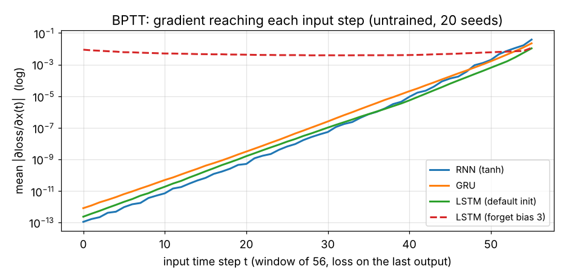

**결과 해석**

- 훈련 전 단순 RNN에서 마지막 출력의 손실이 **15 스텝 앞**(t=40)의 입력에 주는 그레이디언트는 바로 앞 스텝의 약 1/4,000, **55 스텝 앞**(t=0)에는 $10^{-13}$ 수준이다 → 사실상 0. 경사 하강법은 먼 과거의 입력을 어떻게 쓸지 **배울 신호를 받지 못한다** = **단기 기억** 문제
- 로그 눈금에서 **직선**으로 줄어든다 = 스텝마다 **일정한 비율**로 곱해져 줄어든다. 같은 $\mathbf{W}_y$와 tanh의 기울기(≤ 1)를 타임 스텝마다 반복해 곱하기 때문이다
- 훈련 전에는 GRU·LSTM도 똑같이 줄어든다. LSTM의 장점은 구조 자체가 아니라 **장기 상태를 거의 그대로 넘기는 길을 학습할 수 있다**는 데 있다. 망각 게이트 편향을 크게(3) 두어 처음부터 "잊지 않도록" 시작하면 그레이디언트가 56 스텝을 거슬러도 거의 줄지 않는다(점선). 이 길이 어떻게 생기는지는 4-2절

> 📌 파이토치 `nn.LSTM`의 편향은 게이트 4개를 이어 붙인 `[4 × 은닉 차원]` 벡터이고 순서는 **입력·망각·셀·출력** 게이트다. 그래서 `[32:64]`가 망각 게이트다. 케라스의 `unit_forget_bias=True`(기본값)는 망각 게이트 편향을 1로 초기화하지만, 파이토치는 기본값이 다른 편향과 같은 작은 균등 분포다.

---

## 3. 시계열 예측하기 (13.3)

> 🎯 **목적** — 시카고 철도 승객 수로 **다음 날** 승객 수를 예측한다. 이기기 쉬운 기준 모델(나이브 예측, SARIMA)부터 만들고, 선형 모델 → RNN → 심층 RNN → 다변량 RNN으로 점점 개선한 뒤, **14일 앞**을 예측하는 모델로 넓힌다.

> 💬 **시계열은 기준선과의 싸움**
>
> "다음 주 월요일 승객 수 = 이번 주 월요일 승객 수"라는 **나이브 예측**은 바보 같아 보이지만, 주간 계절성이 강한 데이터에서는 놀랄 만큼 강하다. 이걸 못 이기는 모델은 버린다.
>
> - **계절성·추세 제거**: 7일 차분(오늘 − 7일 전)을 하면 주간 패턴이 지워지고, 남는 건 '평소와 다른 부분'이다
> - **핵심 한 줄**: 모델 비교 지표는 MAE·MAPE. **같은 기간**으로 비교해야 공정하다
> - **헷갈림 주의**: 시계열은 **무작위로 섞어 나누면 안 된다**. 미래로 과거를 예측하는 누수가 생긴다. 시간 순서대로 훈련 → 검증 → 테스트


**개념·원리**

교재의 설정: 당신은 시카고 교통국(CTA)의 데이터 과학자다. 매일 다음 날의 버스·철도 승객 수를 예측해야 한다. 2001년부터의 일별 승객 수 데이터가 있다.

| 용어 | 의미 |
|---|---|
| **계절성**(seasonality) | 일정한 주기로 반복되는 패턴. 이 데이터는 **주간**(평일 많고 주말 적음)과 **연간**(여름·겨울 차이) 계절성이 있다 |
| **추세**(trend) | 장기적으로 늘거나 줄어드는 경향 |
| **나이브 예측** | 과거 값을 그대로 복사하는 예측. 계절성이 강한 시계열에서는 **한 주기 전 값**(지난주 같은 요일)을 쓴다. 이기기 의외로 어려운 기준선 |
| **차분**(differencing) | 시계열에서 시차가 있는 자기 자신을 뺀 것. 주기와 같은 시차로 빼면 계절성이 사라진다 |

### 3-1. 데이터 적재와 정리

> 🎯 **목적** — 승객 수 CSV를 내려받아 날짜 인덱스를 가진 데이터프레임으로 만든다.

**코드**

```python
from pathlib import Path
import pandas as pd
import tarfile
import urllib.request

def download_and_extract_ridership_data():
    tarball_path = Path("datasets/ridership.tgz")
    if not tarball_path.is_file():
        Path("datasets").mkdir(parents=True, exist_ok=True)
        url = "https://github.com/ageron/data/raw/main/ridership.tgz"
        urllib.request.urlretrieve(url, tarball_path)
        with tarfile.open(tarball_path) as housing_tarball:
            housing_tarball.extractall(path="datasets", filter="data")

download_and_extract_ridership_data()

path = Path("datasets/ridership/CTA_-_Ridership_-_Daily_Boarding_Totals.csv")
df = pd.read_csv(path, parse_dates=["service_date"])
df.columns = ["date", "day_type", "bus", "rail", "total"]  # shorter names
df = df.sort_values("date").set_index("date")
df = df.drop("total", axis=1)  # no need for total, it's just bus + rail
df = df.drop_duplicates()  # remove duplicated months (2011-10 and 2014-07)

df.head()
#            day_type     bus    rail
# date
# 2001-01-01        U  297192  126455
# 2001-01-02        W  780827  501952
# 2001-01-03        W  824923  536432
# 2001-01-04        W  870021  550011
# 2001-01-05        W  890426  557917
```

| 코드 | 의미 |
|---|---|
| `download_and_extract_ridership_data()` | [2장](02_end_to_end_machine_learning_project.md)의 주택 데이터 내려받기 함수와 같은 구조. 변수 이름 `housing_tarball`도 거기서 그대로 가져왔다 |
| `extractall(..., filter="data")` | 압축 파일 안의 위험한 경로(절대 경로, `..`)를 막는 안전 필터(파이썬 3.12+) |
| `parse_dates=["service_date"]` | 날짜 문자열 열을 `datetime`으로 읽는다 |
| `df.columns = [...]` | 원래 열 이름 `service_date, day_type, bus, rail_boardings, total_rides`를 짧게 |
| `sort_values("date").set_index("date")` | 날짜순 정렬 후 날짜를 인덱스로 → `df["2019-03":"2019-05"]`처럼 **날짜 문자열로 슬라이싱**할 수 있다 |
| `drop("total", axis=1)` | `total`은 `bus + rail`이므로 뺀다 |
| `drop_duplicates()` | 원본에 두 달(2011-10, 2014-07)이 중복으로 들어 있다 |

`day_type` 값:

| 값 | 뜻 | 일수 |
|---|---|---|
| `W` | 평일 (Weekday) | 5,336 |
| `A` | 토요일 (sAturday) | 1,087 |
| `U` | 일요일·공휴일 (sUnday/holiday) | 1,216 |

**보충 코드** — 크기와 기간

```python
len(df), df.index.min(), df.index.max()
# (7639, Timestamp('2001-01-01 00:00:00'), Timestamp('2021-11-30 00:00:00'))
```

- 원본 7,701행에서 중복 62행을 지워 **7,639일**, 2001-01-01 ~ 2021-11-30

> ⚠️ `drop_duplicates()`는 **모든 열 값이 같은 행**을 지운다. 인덱스(날짜)는 비교하지 않는다. 이 데이터에서는 중복 달이 날짜까지 같아 문제가 없었지만, 날짜가 다른데 승객 수가 우연히 같은 날이 있었다면 그 날도 지워졌을 것이다. 날짜 기준으로 지우려면 `df[~df.index.duplicated()]`가 더 정확하다.

### 3-2. 주간 계절성과 나이브 예측

> 🎯 **목적** — 2019년 봄 석 달을 그려 패턴을 보고, "지난주 같은 요일 값"이라는 나이브 예측의 오차를 잰다.

**코드**

```python
import matplotlib.pyplot as plt

df["2019-03":"2019-05"].plot(grid=True, marker=".", figsize=(8, 3.5))
plt.show()
```

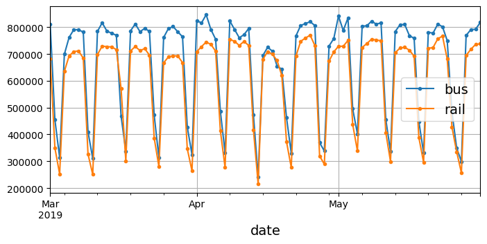

- 판다스 날짜 슬라이싱은 **양 끝을 포함**한다. `"2019-03":"2019-05"`는 3월 1일 ~ 5월 31일
- 매주 같은 모양이 반복된다. 평일에 많고 토·일에 크게 줄어든다 → **주간 계절성**이 매우 강하다. 버스와 철도가 비슷하게 움직인다

**코드** — 7일 시차와 7일 차분

```python
diff_7 = df[["bus", "rail"]].diff(7)["2019-03":"2019-05"]

fig, axs = plt.subplots(2, 1, sharex=True, figsize=(8, 5))
df.plot(ax=axs[0], legend=False, marker=".")  # original time series
df.shift(7).plot(ax=axs[0], grid=True, legend=False, linestyle=":")  # lagged
diff_7.plot(ax=axs[1], grid=True, marker=".")  # 7-day difference time series
axs[0].set_ylim([170_000, 900_000])  # extra code – beautifies the plot
plt.show()
```

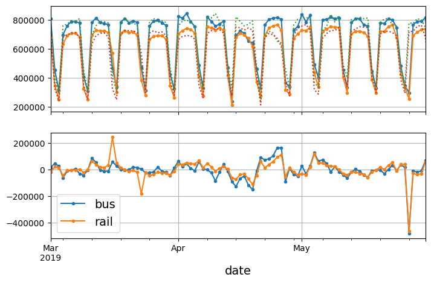

| 코드 | 의미 |
|---|---|
| `df.shift(7)` | 값을 7칸(7일) 뒤로 민다. 3월 8일 자리에 3월 1일 값이 온다 → **7일 시차**(lag) 시계열. 위 그림의 점선 |
| `.diff(7)` | `df - df.shift(7)`. 오늘 값 − 지난주 같은 요일 값 → 아래 그림 |

- 위 그림에서 실선(원래)과 점선(7일 전)이 거의 겹친다 → **"지난주 같은 요일 값"이 좋은 예측**이다. 이것이 **나이브 예측**(naive forecasting)이다
- 아래 그림(차분)은 주간 패턴이 사라지고 0 근처에서 움직인다. 차분 = 나이브 예측의 **오차**다
- 5월 말의 큰 음수(약 −47만): 5월 27일 메모리얼 데이(공휴일). 지난주 같은 요일은 평일이라 크게 틀린다

```python
list(df.loc["2019-05-25":"2019-05-27"]["day_type"])
# ['A', 'U', 'U']
```

- 5월 27일(월요일)이 `U` → 공휴일이다. **다음 날의 요일 종류**를 알면 이런 날을 더 잘 예측할 수 있다 → 3-10절의 다변량 입력에 넣는다

**코드** — 나이브 예측의 오차

```python
diff_7.abs().mean()   # 평균 절댓값 오차 (MAE)
# bus     43915.608696
# rail    42143.271739

targets = df[["bus", "rail"]]["2019-03":"2019-05"]
(diff_7 / targets).abs().mean()   # 평균 절댓값 백분율 오차 (MAPE)
# bus     0.082938
# rail    0.089948
```

| 지표 | 식 | 버스 | 철도 |
|---|---|---|---|
| **MAE** (평균 절댓값 오차, MAD라고도 한다) | $\frac{1}{n}\sum \lvert y - \hat{y}\rvert$ | 43,916명 | **42,143명** |
| **MAPE** (평균 절댓값 백분율 오차) | $\frac{1}{n}\sum \left\lvert \frac{y - \hat{y}}{y}\right\rvert$ | 8.3% | **9.0%** |

- MAE는 단위가 원래 값과 같아(명) 해석하기 쉽다. MAPE는 단위가 없어 버스·철도처럼 **규모가 다른 시계열을 비교**할 때 좋다
- 버스는 MAE가 더 크지만 승객 수 자체도 더 많아서 MAPE는 오히려 더 작다
- 이 장의 목표: **철도 MAE 42,143**(나이브 예측)을 이기는 것

> 📌 노트북 출력의 MAE는 3~5월 92일 기준이다. 3-5절부터 모델을 평가하는 검증 구간(2019-02-26 ~ 05-31, 95일)으로 같은 나이브 예측을 계산하면 철도 MAE는 **41,274**다(보충 코드로 계산). 이 노트의 그래프에서는 신경망과 같은 구간에서 계산한 41,274를 기준선으로 썼다.

### 3-3. 연간 계절성과 추세

> 🎯 **목적** — 월평균으로 긴 기간을 보고, 연간 계절성과 장기 추세를 확인한다.

**코드**

```python
period = slice("2001", "2019")
df_monthly = df.select_dtypes(include="number").resample('ME').mean()
rolling_average_12_months = df_monthly.loc[period].rolling(window=12).mean()

fig, ax = plt.subplots(figsize=(8, 4))
df_monthly[period].plot(ax=ax, marker=".")
rolling_average_12_months.plot(ax=ax, grid=True, legend=False)
plt.show()
```

| 코드 | 의미 |
|---|---|
| `select_dtypes(include="number")` | 숫자 열(`bus`, `rail`)만. 문자열 열 `day_type`은 평균을 낼 수 없다 |
| `.resample('ME').mean()` | 일별 데이터를 **월 단위로 묶어** 평균. `'ME'` = month end(각 월의 마지막 날을 인덱스로). 7,639일 → 251개월 |
| `.rolling(window=12).mean()` | 12개월 **이동 평균**. 연간 계절성을 평평하게 지워 추세만 남긴다. 처음 11개월은 `NaN` |

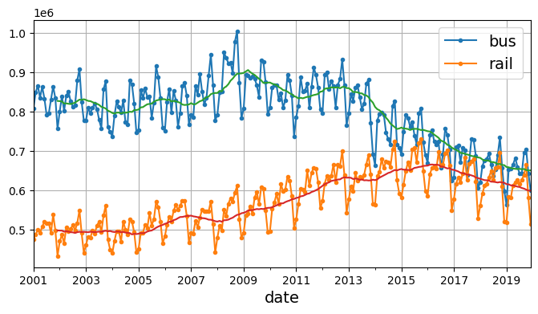

- **연간 계절성**: 매년 비슷한 모양으로 오르내린다(철도는 여름에 많고 겨울에 적다)
- **추세**: 철도는 2001~2015년 꾸준히 늘다가 줄어들기 시작하고, 버스는 2009년 이후 계속 줄어든다

```python
df_monthly.diff(12)[period].plot(grid=True, marker=".", figsize=(8, 3))
plt.show()
```

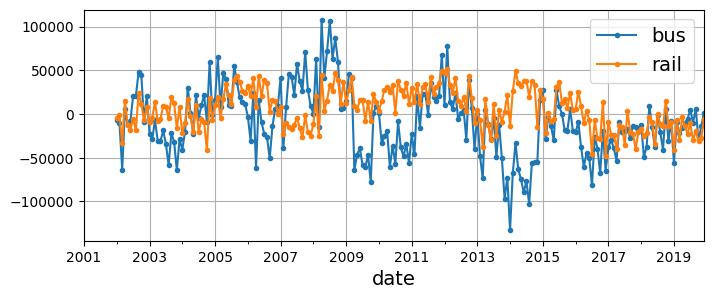

- **12개월 차분**(올해 이 달 − 작년 이 달)을 하면 연간 계절성이 사라진다. 남은 값이 0보다 크면 작년보다 늘어난 것 → 추세를 본다

> 💡 차분은 시계열에서 계절성과 추세를 제거해 **정상**(stationary) 시계열로 만드는 기본 도구다. 정상 시계열은 통계적 성질(평균·분산·자기 상관)이 시간에 따라 변하지 않는다. 다음 절의 ARMA 모델은 정상 시계열을 가정하므로 차분이 모델 안에 들어간다.

### 3-4. ARMA 모델 계열

> 🎯 **목적** — 신경망 전에 고전 통계 모델 SARIMA로 예측해 더 강한 기준선을 만든다.

**개념·원리**

| 모델 | 예측 식 / 아이디어 |
|---|---|
| **AR**($p$) 자기 회귀 | 과거 $p$개 값의 가중 합: $\hat{y}_{(t)} = \sum_{i=1}^{p} \alpha_i\, y_{(t-i)}$ |
| **MA**($q$) 이동 평균 | 과거 $q$개 **예측 오차**의 가중 합: $\sum_{i=1}^{q} \theta_i\, \epsilon_{(t-i)}$, $\epsilon_{(t)} = y_{(t)} - \hat{y}_{(t)}$ |
| **ARMA**($p$, $q$) | 둘을 더한다: $\hat{y}_{(t)} = \sum_{i=1}^{p}\alpha_i y_{(t-i)} + \sum_{i=1}^{q}\theta_i \epsilon_{(t-i)}$. 시계열이 **정상**이라고 가정 |
| **ARIMA**($p$, $d$, $q$) | 시계열을 $d$번 **차분**한 뒤 ARMA를 적용하고, 예측 뒤에 차분을 되돌린다. 1번 차분은 선형 추세를, 2번 차분은 2차 추세를 없앤다 |
| **SARIMA**($p$, $d$, $q$)($P$, $D$, $Q$, $s$) | ARIMA에 **계절** 성분을 추가. 주기 $s$로 같은 일을 한 번 더: 주기 $s$로 $D$번 계절 차분하고, $s$, $2s$, … 시차의 값($P$개)과 오차($Q$개)를 쓴다 |

- 여기서 "이동 평균"은 3-3절의 이동 평균(rolling mean)과 이름만 같고 **다른 개념**이다
- 이 밖에 외부 변수를 넣는 ARIMAX·SARIMAX, 분산이 변하는 시계열을 위한 GARCH 등이 있다

**코드** — 2019년 1~5월로 SARIMA를 훈련해 6월 1일 예측

```python
if IS_COLAB:
    %pip install -q -U statsmodels

from statsmodels.tsa.arima.model import ARIMA

origin, today = "2019-01-01", "2019-05-31"
rail_series = df.loc[origin:today]["rail"].asfreq("D")
model = ARIMA(rail_series,
              order=(1, 0, 0),
              seasonal_order=(0, 1, 1, 7))
model = model.fit()
y_pred = model.forecast()  # returns 427,758.6

y_pred.iloc[0]  # ARIMA forecast
# np.float64(427758.6262875742)
df["rail"].loc["2019-06-01"]  # target value
# np.int64(379044)
df["rail"].loc["2019-05-25"]  # naive forecast (value from one week earlier)
# np.int64(426932)
```

| 코드 | 의미 |
|---|---|
| `.asfreq("D")` | 인덱스의 빈도를 "일(Day)"로 지정. statsmodels가 시계열의 간격을 알아야 미래 날짜를 만들 수 있다. 빠진 날이 있으면 `NaN`으로 채워진다(이 구간은 151일 모두 있다) |
| `order=(1, 0, 0)` | $p=1$(어제 값 1개), $d=0$(일반 차분 없음), $q=0$ |
| `seasonal_order=(0, 1, 1, 7)` | 주기 $s=7$(주간)로 $D=1$번 **계절 차분**(= 3-2절의 7일 차분), $Q=1$(지난주 같은 요일의 오차 1개) |
| `model.fit()` | 계수를 추정. 보충 코드로 확인한 값: AR 계수 0.649, 계절 MA 계수 −0.665 |
| `model.forecast()` | 다음 스텝(6월 1일) 예측. 판다스 시리즈로 돌려준다 → `.iloc[0]` |

- 6월 1일(토요일) 실제 값 379,044명. SARIMA 예측 427,759(오차 약 4.9만), 나이브 예측 426,932(5월 25일 토요일 값, 오차 약 4.8만) → 이 하루만 보면 비슷하다. 하루로는 판단할 수 없으니 여러 날로 평가한다

**코드** — 3~5월 매일 예측하며 평가

```python
origin, start_date, end_date = "2019-01-01", "2019-03-01", "2019-05-31"
time_period = pd.date_range(start_date, end_date)
rail_series = df.loc[origin:end_date]["rail"].asfreq("D")
y_preds = []
for today in time_period.shift(-1):
    model = ARIMA(rail_series[origin:today],  # train on data up to "today"
                  order=(1, 0, 0),
                  seasonal_order=(0, 1, 1, 7))
    model = model.fit()  # note that we retrain the model every day!
    y_pred = model.forecast().iloc[0]
    y_preds.append(y_pred)

y_preds = pd.Series(y_preds, index=time_period)
mae = (y_preds - rail_series[time_period]).abs().mean()  # returns 32,040.7

mae
# np.float64(32040.72009292839)
```

| 코드 | 의미 |
|---|---|
| `pd.date_range(start_date, end_date)` | 3월 1일 ~ 5월 31일, 92일 |
| `time_period.shift(-1)` | 날짜를 하루씩 앞당김 → 2월 28일 ~ 5월 30일. 각 날을 "오늘"로 두고 **내일**을 예측한다 |
| `rail_series[origin:today]` | 오늘까지의 데이터만으로 훈련. **미래를 보지 않는다** |
| 루프 안의 `fit()` | 매일 새 데이터를 넣어 **다시 훈련**한다(92번) |

```python
# extra code – displays the SARIMA forecasts
fig, ax = plt.subplots(figsize=(8, 3))
rail_series.loc[time_period].plot(label="True", ax=ax, marker=".", grid=True)
ax.plot(y_preds, color="r", marker=".", label="SARIMA Forecasts")
plt.legend()
plt.show()
```

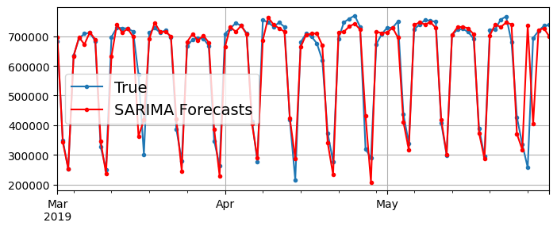

**결과 해석**

| 방법 | 철도 MAE (2019-03 ~ 05) |
|---|---|
| 나이브 예측 | 42,143 |
| **SARIMA** (매일 재훈련) | **32,041** (약 24% 개선) |

- 예측이 대부분의 날을 잘 따라간다. 크게 틀리는 날은 공휴일(5월 27일 등)처럼 패턴에서 벗어난 날이다
- 이제 기준선은 **MAE 32,041**이다

> 💡 SARIMA의 하이퍼파라미터($p, d, q, P, D, Q, s$)는 교재의 예시값이다. 그리드 서치로 고를 수도 있다(가장 간단한 방법). 아래 ACF·PACF 그림도 전통적인 선택 도구다.

**코드** — 자기 상관 함수(ACF)와 편자기 상관 함수(PACF)

```python
# extra code – shows how to plot the Autocorrelation Function (ACF) and the
#              Partial Autocorrelation Function (PACF)
from statsmodels.graphics.tsaplots import plot_acf, plot_pacf

fig, axs = plt.subplots(nrows=1, ncols=2, figsize=(15, 5))
plot_acf(df[period]["rail"], ax=axs[0], lags=35)
axs[0].grid()
plot_pacf(df[period]["rail"], ax=axs[1], lags=35, method="ywm")
axs[1].grid()
plt.show()
```

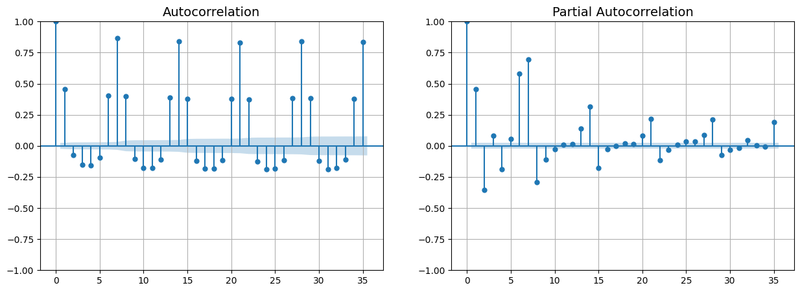

| 함수 | 의미 | 그림에서 |
|---|---|---|
| **ACF** (autocorrelation function) | 시계열과 $k$일 시차 시계열 사이의 상관 계수 | 7, 14, 21, 28, 35일에 0.8 이상으로 튄다 → **7일 주기** |
| **PACF** (partial ACF) | 그 사이 시차($1 \ldots k-1$)의 영향을 뺀 $k$일 시차의 **직접** 상관 | 1, 6, 7, 8일 근처가 크고 이후 빠르게 줄어든다 |

- 전통적인 규칙: PACF가 시차 $p$ 뒤로 끊기면 AR($p$), ACF가 시차 $q$ 뒤로 끊기면 MA($q$) 성분을 고려한다
- 파란 띠: 상관이 0이라고 볼 수 있는 신뢰 구간. 띠 밖의 막대가 의미 있는 상관이다
- `method="ywm"`: 율–워커(Yule–Walker) 방정식으로 PACF를 계산하는 방법 중 하나

### 3-5. 머신러닝 모델을 위한 데이터 준비

> 🎯 **목적** — 긴 시계열 하나를 (지난 56일 윈도, 다음 날 값) 쌍의 데이터셋으로 바꾼다.

**개념·원리**

목표: 지난 **8주(56일)** 데이터로 내일 철도 승객 수를 예측한다. 시계열에서 길이 56짜리 **윈도**를 한 칸씩 밀며 잘라내고, 각 윈도 바로 다음 날 값을 타깃으로 쓴다.

```
시계열 :  y0 y1 y2 y3 y4 y5 …
윈도 0 : [y0 … y55] → 타깃 y56
윈도 1 : [y1 … y56] → 타깃 y57
윈도 2 : [y2 … y57] → 타깃 y58
…
```

**코드**

```python
class TimeSeriesDataset(torch.utils.data.Dataset):
    def __init__(self, series, window_length):
        self.series = series
        self.window_length = window_length

    def __len__(self):
        return len(self.series) - self.window_length

    def __getitem__(self, idx):
        if idx >= len(self):
            raise IndexError("dataset index out of range")
        end = idx + self.window_length  # 1st index after window
        window = self.series[idx : end]
        target = self.series[end]
        return window, target
```

| 코드 | 의미 |
|---|---|
| `__len__` | 길이 $N$ 시계열에서 윈도 수 = $N - L$ (마지막 윈도도 타깃이 하나 있어야 한다) |
| `__getitem__` | `idx`번 윈도 `series[idx : idx+L]`과 타깃 `series[idx+L]` |
| `raise IndexError` | `for window, target in dataset:`처럼 **직접 반복**할 때 필요하다. 파이썬은 `__getitem__`만 있는 객체를 0, 1, 2, … 로 부르다가 `IndexError`가 나면 멈춘다. 이 검사가 없으면 텐서 슬라이싱이 빈 윈도를 돌려주며 오류가 늦게 난다 |

**코드** — 작은 예로 확인

```python
my_series = torch.tensor([[0], [1], [2], [3], [4], [5]])
my_dataset = TimeSeriesDataset(my_series, window_length=3)
for window, target in my_dataset:
    print("Window:", window, " Target:", target)
# Window: tensor([[0], [1], [2]])  Target: tensor([3])
# Window: tensor([[1], [2], [3]])  Target: tensor([4])
# Window: tensor([[2], [3], [4]])  Target: tensor([5])
```

- 시계열을 `[타임 스텝, 특성]` 2D 텐서로 둔다(여기서는 특성 1개). 그래서 윈도는 `[3, 1]`, 타깃은 `[1]`이다

```python
from torch.utils.data import DataLoader
torch.manual_seed(0)
my_loader = DataLoader(my_dataset, batch_size=2, shuffle=True)
for X, y in my_loader:
    print("X:", X, " y:", y)
# X: tensor([[[0], [1], [2]],
#            [[2], [3], [4]]])  y: tensor([[3], [5]])
# X: tensor([[[1], [2], [3]]])  y: tensor([[4]])
```

- 배치로 묶으면 `X`는 `[배치, 타임 스텝, 특성]` = `[2, 3, 1]`, `y`는 `[배치, 1]` → 순환 층(`batch_first=True`)이 기대하는 형태 그대로다
- 윈도 3개를 배치 2로 나누므로 마지막 배치는 1개

**코드** — 기간으로 분할

```python
rail_train = torch.FloatTensor(df[["rail"]]["2016-01":"2018-12"].values / 1e6)
rail_valid = torch.FloatTensor(df[["rail"]]["2019-01":"2019-05"].values / 1e6)
rail_test = torch.FloatTensor(df[["rail"]]["2019-06":].values / 1e6)

window_length = 56
train_set = TimeSeriesDataset(rail_train, window_length)
train_loader = DataLoader(train_set, batch_size=32, shuffle=True)
valid_set = TimeSeriesDataset(rail_valid, window_length)
valid_loader = DataLoader(valid_set, batch_size=32)
test_set = TimeSeriesDataset(rail_test, window_length)
test_loader = DataLoader(test_set, batch_size=32)
```

| 코드 | 의미 |
|---|---|
| `df[["rail"]]` | 대괄호 두 겹 → 데이터프레임(열 1개) → `.values`가 `[일수, 1]` 2D 배열 |
| `/ 1e6` | 백만 명 단위로 스케일. 값이 0.2~0.8 범위가 되어 훈련이 안정된다. 오차를 원래 단위로 볼 때는 `* 1e6` |
| 기간별 분할 | **시간 순서로** 나눈다. 무작위로 섞어 나누면 미래 데이터로 과거를 예측하는 셈이 되어(데이터 누설) 검증 점수가 부풀려진다 |
| `shuffle=True` (훈련만) | 윈도들은 섞어도 된다. 윈도 **안의** 순서는 그대로다 |

**보충 코드** — 세트 크기

```python
for name, s in [("train", rail_train), ("valid", rail_valid), ("test", rail_test)]:
    ds = TimeSeriesDataset(s, 56)
    print(name, len(s), len(ds), len(DataLoader(ds, batch_size=32)))
# train 1096 1040 33
# valid  151   95  3
# test   914  858 27
```

| 세트 | 기간 | 일수 | 윈도 수 | 배치 수 | 타깃 기간 |
|---|---|---|---|---|---|
| 훈련 | 2016-01-01 ~ 2018-12-31 | 1,096 | 1,040 | 33 | 2016-02-26 ~ 2018-12-31 |
| 검증 | 2019-01-01 ~ 2019-05-31 | 151 | **95** | 3 | 2019-02-26 ~ 2019-05-31 |
| 테스트 | 2019-06-01 ~ 2021-11-30 | 914 | 858 | 27 | |

- 훈련 데이터가 **윈도 1,040개**뿐이다. 이미지·텍스트 장과 비교하면 아주 작은 데이터셋 → 검증 점수가 에포크마다 크게 흔들린다(3-13절 그래프)
- 검증 세트도 앞 56일은 윈도로만 쓰이고 타깃은 **2월 26일부터** 95일이다. 3-2절의 나이브 예측(3월 1일부터)과 구간이 조금 다르다
- 훈련은 2016년부터만 쓴다. 더 오래된 데이터는 추세가 달라(3-3절 그림) 오히려 방해가 될 수 있고, 무엇보다 이 장의 모델은 작다

### 3-6. 훈련·평가 함수

> 🎯 **목적** — 회귀용 훈련 루프를 정의한다. 12·14장 `train()`의 원형이다.

**코드**

```python
import torchmetrics

def evaluate_tm(model, data_loader, metric):
    model.eval()
    metric.reset()
    with torch.no_grad():
        for X_batch, y_batch in data_loader:
            X_batch, y_batch = X_batch.to(device), y_batch.to(device)
            y_pred = model(X_batch)
            metric.update(y_pred, y_batch)
    return metric.compute()

def train(model, optimizer, loss_fn, metric, train_loader, valid_loader,
          n_epochs, patience=10, factor=0.1):
    scheduler = torch.optim.lr_scheduler.ReduceLROnPlateau(
        optimizer, mode="min", patience=patience, factor=factor)
    history = {"train_losses": [], "train_metrics": [], "valid_metrics": []}
    for epoch in range(n_epochs):
        total_loss = 0.0
        metric.reset()
        model.train()
        for X_batch, y_batch in train_loader:
            X_batch, y_batch = X_batch.to(device), y_batch.to(device)
            y_pred = model(X_batch)
            loss = loss_fn(y_pred, y_batch)
            total_loss += loss.item()
            loss.backward()
            optimizer.step()
            optimizer.zero_grad()
            metric.update(y_pred, y_batch)
        history["train_losses"].append(total_loss / len(train_loader))
        history["train_metrics"].append(metric.compute().item())
        val_metric = evaluate_tm(model, valid_loader, metric).item()
        history["valid_metrics"].append(val_metric)
        scheduler.step(val_metric)
        print(f"Epoch {epoch + 1}/{n_epochs}, "
              f"train loss: {history['train_losses'][-1]:.4f}, "
              f"train metric: {history['train_metrics'][-1]:.4f}, "
              f"valid metric: {history['valid_metrics'][-1]:.4f}")
    return history
```

[10장](10_neural_nets_with_pytorch.md)의 훈련 루프에 [성능 기반 학습률 스케줄](11_training_deep_neural_networks.md#4-3-성능-기반-스케줄링)을 붙인 것이다.

| 코드 | 의미 |
|---|---|
| `ReduceLROnPlateau(optimizer, mode="min", ...)` | 검증 지표가 `patience` 에포크 넘게 **최저 기록**을 갱신하지 못하면 학습률에 `factor`를 곱한다. 지표가 MAE라 작을수록 좋으므로 `mode="min"`(14장은 정확도라 `"max"`) |
| `patience=10, factor=0.1` | 기본값. 10 에포크 동안 나아지지 않으면 학습률을 1/10로 |
| `scheduler.step(val_metric)` | 에포크마다 검증 MAE를 알려 준다 |
| `history` | 에포크별 훈련 손실, 훈련 지표, 검증 지표 |

### 3-7. 선형 모델로 예측하기

> 🎯 **목적** — 윈도 56개 값의 가중 합으로 내일을 예측하는 가장 단순한 신경망을 훈련한다.

**코드**

```python
import torch.nn as nn
import torchmetrics

torch.manual_seed(42)
model = nn.Sequential(nn.Flatten(), nn.Linear(window_length, 1)).to(device)
loss_fn = nn.HuberLoss()
optimizer = torch.optim.SGD(model.parameters(), lr=0.003, momentum=0.9)
metric = torchmetrics.MeanAbsoluteError().to(device)

history = train(model, optimizer, loss_fn, metric, train_loader,
                valid_loader, n_epochs=50)
```

| 코드 | 의미 |
|---|---|
| `nn.Flatten()` | `[배치, 56, 1]` → `[배치, 56]` |
| `nn.Linear(56, 1)` | 56일 값의 가중 합 + 편향. 파라미터 57개. AR(56) 모델과 같은 형태다 |
| `nn.HuberLoss()` | 오차가 작으면(기본 `delta=1.0` 이하) MSE처럼 제곱, 크면 MAE처럼 선형. MAE를 최적화하고 싶지만 0 근처에서 미분이 매끄러운 손실이 필요할 때. 이상치(공휴일)에 덜 민감하다 |
| `SGD(lr=0.003, momentum=0.9)` | [모멘텀 최적화](11_training_deep_neural_networks.md#3-2-모멘텀-최적화) |
| `MeanAbsoluteError()` | 평가 지표 MAE. 손실(후버)과 지표(MAE)를 따로 둔다 |

```
Epoch 1/50, train loss: 0.0154, train metric: 0.1458, valid metric: 0.1235
...
Epoch 22/50, train loss: 0.0038, train metric: 0.0544, valid metric: 0.0386
...
Epoch 44/50, train loss: 0.0032, train metric: 0.0490, valid metric: 0.0379
...
Epoch 50/50, train loss: 0.0032, train metric: 0.0485, valid metric: 0.0377
```

```python
evaluate_tm(model, valid_loader, metric).item() * 1e6
# 37725.720554590225
```

**결과 해석**

| 지표 | 값 |
|---|---|
| 검증 MAE (50 에포크) | **37,726** |
| 나이브 예측 (같은 구간) | 41,274 |
| SARIMA (3~5월, 매일 재훈련) | 32,041 |

- 나이브 예측보다는 낫지만 **SARIMA를 이기지 못한다**
- 손실 값(0.0032)이 작은 이유: 백만 단위 오차(0.04 정도)에 후버 손실 $\frac{1}{2}e^2$을 적용했기 때문 ($\frac{1}{2} \times 0.05^2 ≈ 0.0013$ 수준). `delta=1.0`보다 오차가 훨씬 작으므로 이 장에서 후버 손실은 사실상 **MSE의 절반**처럼 동작한다
- 훈련 MAE(0.0485)가 검증 MAE(0.0377)보다 **크다**. 과대적합의 반대처럼 보이는 이유는 두 가지다. ① 훈련 지표는 에포크 **동안** 가중치가 바뀌는 중에 배치별로 모은 값이다([10장](10_neural_nets_with_pytorch.md)에서 본 것과 같다). ② 훈련 구간(3년, 1,040일)과 검증 구간(95일)은 기간이 달라 예측 난이도가 같지 않다. 검증 구간이 짧을수록 이런 차이가 커진다

> ⚠️ SARIMA는 **매일 재훈련**했고 평가 구간(3~5월)도 다르다. 엄밀히 공정한 비교는 아니지만, 교재도 이 숫자를 기준선으로 쓴다.

### 3-8. 간단한 RNN으로 예측하기

> 🎯 **목적** — 메모리 셀을 직접 만들어 RNN을 구현하고, 같은 모델을 `nn.RNN`으로 다시 만든다.

**코드** — 직접 만든 메모리 셀

```python
class SimpleRnnModel(nn.Module):
    def __init__(self, input_size, hidden_size, output_size):
        super().__init__()
        self.hidden_size = hidden_size
        self.memory_cell = nn.Sequential(
            nn.Linear(input_size + hidden_size, hidden_size),
            nn.Tanh()
        )
        self.output = nn.Linear(hidden_size, output_size)

    def forward(self, X):
        batch_size, window_length, dimensionality = X.shape
        X_time_first = X.transpose(0, 1)
        H = torch.zeros(batch_size, self.hidden_size, device=X.device)
        for X_t in X_time_first:
            XH = torch.cat((X_t, H), dim=1)
            H = self.memory_cell(XH)
        return self.output(H)
```

| 코드 | 의미 |
|---|---|
| `nn.Linear(input_size + hidden_size, hidden_size)` + `nn.Tanh()` | 1-1절의 $\phi([\mathbf{X}_{(t)}\ \mathbf{H}_{(t-1)}]\mathbf{W} + \mathbf{b})$ |
| `X.transpose(0, 1)` | `[배치, 56, 1]` → `[56, 배치, 1]`. 타임 스텝을 첫 축으로 → `for`문이 하루씩 꺼낸다 |
| `H = torch.zeros(..., device=X.device)` | 초기 은닉 상태 = 0. 입력과 **같은 장치**에 만들어야 한다 |
| `H = self.memory_cell(XH)` | 매 스텝 같은 셀(같은 가중치)로 상태를 갱신 |
| `self.output(H)` | 마지막 은닉 상태 `[배치, 32]` → `[배치, 1]`. **시퀀스-투-벡터** |

- 은닉 상태는 32차원이지만 예측할 값은 1개다. 32개 뉴런을 그대로 출력으로 쓰지 않고 **선형 출력 층**을 하나 더 둔다. 순환 층의 tanh 출력은 −1~1로 묶여 있다는 점도 출력 층을 따로 두는 이유다

**코드** — 반복해서 쓸 훈련 함수

```python
# extra code – defines a utility function we'll reuse several time
def fit_and_evaluate(model, train_loader, valid_loader, lr, n_epochs=50,
                     patience=20, factor=0.1):
    loss_fn = nn.HuberLoss()
    optimizer = torch.optim.SGD(model.parameters(), lr=lr, momentum=0.95)
    metric = torchmetrics.MeanAbsoluteError().to(device)
    history = train(model, optimizer, loss_fn, metric,
                    train_loader, valid_loader, n_epochs=n_epochs,
                    patience=patience, factor=factor)
    return min(history["valid_metrics"]) * 1e6
```

- 후버 손실 + 모멘텀 0.95 SGD + MAE 지표를 묶었다. `patience=20`으로 늘렸다
- **최고 검증 MAE**(`min`)를 원래 단위(`* 1e6`)로 돌려준다. 마지막 에포크 값이 아니라는 점에 주의(아래 결과 해석)

```python
torch.manual_seed(42)
univar_model = SimpleRnnModel(input_size=1, hidden_size=32, output_size=1)
univar_model = univar_model.to(device)
fit_and_evaluate(univar_model, train_loader, valid_loader, lr=0.05, n_epochs=50)
```

```
Epoch 1/50, train loss: 0.0523, train metric: 0.2600, valid metric: 0.2126
...
Epoch 39/50, train loss: 0.0027, train metric: 0.0445, valid metric: 0.0362
...
Epoch 44/50, train loss: 0.0032, train metric: 0.0511, valid metric: 0.0305
...
Epoch 50/50, train loss: 0.0029, train metric: 0.0506, valid metric: 0.0584
30511.004850268364
```

**코드** — `nn.RNN`으로 같은 모델

```python
class SimpleRnnModel(nn.Module):
    def __init__(self, input_size, hidden_size, output_size):
        super().__init__()
        self.rnn = nn.RNN(input_size, hidden_size, batch_first=True)
        self.output = nn.Linear(hidden_size, output_size)

    def forward(self, X):
        outputs, last_state = self.rnn(X)
        return self.output(outputs[:, -1])

torch.manual_seed(42)
univar_model = SimpleRnnModel(input_size=1, hidden_size=32, output_size=1)
univar_model = univar_model.to(device)
fit_and_evaluate(univar_model, train_loader, valid_loader, lr=0.05, n_epochs=50)
```

| 코드 | 의미 |
|---|---|
| `nn.RNN(input_size, hidden_size, batch_first=True)` | 단순 RNN 층. 활성화 함수 기본값 `nonlinearity="tanh"`, 층 수 기본값 1 |
| `outputs, last_state = self.rnn(X)` | `outputs` `[배치, 56, 32]`(모든 스텝), `last_state` `[1, 배치, 32]`(마지막 스텝, 층별). 초기 상태를 주지 않으면 0 |
| `outputs[:, -1]` | 마지막 타임 스텝의 출력 `[배치, 32]` (= `last_state[0]`, 1-4절) |

```
Epoch 1/50, train loss: 0.0487, train metric: 0.2535, valid metric: 0.1329
...
Epoch 27/50, train loss: 0.0027, train metric: 0.0435, valid metric: 0.0307
...
Epoch 50/50, train loss: 0.0023, train metric: 0.0380, valid metric: 0.0321
30659.500509500504
```

**결과 해석**

| 모델 | 파라미터 | 최고 검증 MAE | 마지막 에포크 |
|---|---|---|---|
| 선형 모델 | 57 | 37,726 | 37,726 |
| 단순 RNN (직접 만든 셀) | 1,121 | **30,511** (44 에포크) | 58,400 |
| 단순 RNN (`nn.RNN`) | 1,153 | **30,660** (27 에포크) | 32,100 |
| SARIMA (참고) | | 32,041 | |

- RNN이 드디어 **SARIMA를 이겼다**. 파라미터가 1,100여 개뿐인 작은 모델이다
- 두 구현은 같은 계산이지만(1-4절), 가중치 초기화 방식이 달라 학습 경로와 결과가 조금 다르다
- ⚠️ `fit_and_evaluate()`는 **최고 에포크의 점수**를 돌려준다. 직접 만든 셀의 마지막 에포크는 58,400으로 나이브 예측보다도 나쁘다. 검증 MAE가 에포크마다 크게 흔들리는데(3-13절 그래프) 그중 가장 좋은 값을 고른 것이므로 낙관적인 추정이다. 실제로는 최고 에포크의 가중치를 저장해 두거나(체크포인트) 조기 종료를 써야 그 점수를 얻는다

> 💡 은닉 상태에 쓰는 tanh는 출력을 −1~1로 제한한다. 그래서 **입력 스케일링**이 중요하다. 승객 수를 그대로(수십만) 넣으면 tanh가 바로 포화된다 → 3-5절에서 백만으로 나눈 이유다.

### 3-9. 심층 RNN으로 예측하기

> 🎯 **목적** — 순환 층을 여러 개 쌓는다.

**개념·원리**

순환 층을 쌓으면 **심층 RNN**이 된다. 아래 층의 **모든 타임 스텝 출력**(시퀀스)이 위 층의 입력 시퀀스가 된다.

```
          ŷ(t)
           ↑   (마지막 층, 마지막 스텝)
층 3:  ●→●→●→…→●
       ↑ ↑ ↑   ↑
층 2:  ●→●→●→…→●
       ↑ ↑ ↑   ↑
층 1:  ●→●→●→…→●
       ↑ ↑ ↑   ↑
      x0 x1 x2 … x55
```

**코드**

```python
class DeepRnnModel(nn.Module):
    def __init__(self, input_size, hidden_size, output_size, num_layers):
        super().__init__()
        self.rnn = nn.RNN(input_size, hidden_size, num_layers=num_layers,
                          batch_first=True)
        self.output = nn.Linear(hidden_size, output_size)

    def forward(self, X):
        outputs, last_state = self.rnn(X)
        return self.output(outputs[:, -1])

torch.manual_seed(42)
deep_model = DeepRnnModel(
    input_size=1, hidden_size=32, output_size=1, num_layers=3).to(device)
fit_and_evaluate(deep_model, train_loader, valid_loader, lr=0.07, n_epochs=50)
```

| 코드 | 의미 |
|---|---|
| `num_layers=3` | 층 3개를 하나의 모듈 안에 쌓는다. 노트북은 처음에 `num_layers=3`을 고정했다가 인자로 바꿨다 |
| `outputs` | **마지막(3번째) 층**의 모든 타임 스텝 출력 `[배치, 56, 32]` |
| `last_state` | **3개 층 모두**의 마지막 상태 `[3, 배치, 32]` |
| `lr=0.07` | 단순 RNN(0.05)보다 조금 크게 |

```
Epoch 1/50, train loss: 0.0632, train metric: 0.2830, valid metric: 0.2212
...
Epoch 33/50, train loss: 0.0028, train metric: 0.0461, valid metric: 0.0293
...
Epoch 50/50, train loss: 0.0029, train metric: 0.0455, valid metric: 0.0318
29279.254376888275
```

**보충 코드** — 파라미터 수

```python
{k: v.numel() for k, v in nn.RNN(1, 32, num_layers=3).named_parameters()}
# {'weight_ih_l0': 32,   'weight_hh_l0': 1024, 'bias_ih_l0': 32, 'bias_hh_l0': 32,
#  'weight_ih_l1': 1024, 'weight_hh_l1': 1024, 'bias_ih_l1': 32, 'bias_hh_l1': 32,
#  'weight_ih_l2': 1024, 'weight_hh_l2': 1024, 'bias_ih_l2': 32, 'bias_hh_l2': 32}
# 합계 5,344 + 출력 층 33 = 5,377
```

- 2·3번째 층은 입력이 아래 층의 32차원 출력이라 `weight_ih`도 `[32, 32]` = 1,024개다

**결과 해석**

| 모델 | 파라미터 | 최고 검증 MAE |
|---|---|---|
| 단순 RNN | 1,153 | 30,660 |
| **심층 RNN** (3층) | 5,377 | **29,279** |

- 조금 나아졌지만 크게 차이 나지 않는다. 이 데이터는 단변량이고 작아서 층을 늘린 효과가 제한적이다
- 교재는 이 결과를 보고 "이 정도 작업에는 단순 RNN도 충분히 강력하다"고 정리한다. 다음 절에서는 층 대신 **입력 정보**를 늘린다

> 💡 `num_layers`로 쌓는 대신 `nn.RNN` 여러 개를 `nn.Sequential`로 쌓을 수는 없다. 순환 층은 `(outputs, hidden)` **튜플**을 돌려주기 때문이다. 층 사이에 드롭아웃만 넣고 싶다면 `nn.RNN(..., num_layers=3, dropout=0.2)`처럼 쓴다(마지막 층 뒤에는 적용되지 않는다).

### 3-10. 다변량 시계열 예측하기

> 🎯 **목적** — 철도 승객 수뿐 아니라 버스 승객 수와 **내일의 요일 종류**도 입력으로 넣는다.

**코드**

```python
df_mulvar = df[["rail", "bus"]] / 1e6  # use both rail & bus series as input
df_mulvar["next_day_type"] = df["day_type"].shift(-1)  # we know tomorrow's type
df_mulvar = pd.get_dummies(df_mulvar, dtype=float)  # one-hot encode day type

mulvar_train = torch.FloatTensor(df_mulvar["2016-01":"2018-12"].values)
mulvar_valid = torch.FloatTensor(df_mulvar["2019-01":"2019-05"].values)
mulvar_test = torch.FloatTensor(df_mulvar["2019-06":].values)
```

| 코드 | 의미 |
|---|---|
| `df["day_type"].shift(-1)` | 요일 종류를 **하루 앞당김** → 오늘 행에 **내일**의 요일 종류. 내일이 평일인지 공휴일인지는 미리 알 수 있는 정보다 |
| `pd.get_dummies(..., dtype=float)` | 문자열 열을 원-핫 열 3개로: `next_day_type_A`, `_U`, `_W`. 숫자 열은 그대로 둔다 |
| 결과 열 | `rail`, `bus`, `next_day_type_A`, `next_day_type_U`, `next_day_type_W` → 특성 **5개** |

**보충 코드** — 확인

```python
df_mulvar.loc["2019-03-01":"2019-03-04"].round(4)
#               rail     bus  next_day_type_A  next_day_type_U  next_day_type_W
# date
# 2019-03-01  0.6830  0.8122              1.0              0.0              0.0
# 2019-03-02  0.3494  0.4541              0.0              1.0              0.0
# 2019-03-03  0.2522  0.3135              0.0              0.0              1.0
# 2019-03-04  0.6354  0.6991              0.0              0.0              1.0
```

- 3월 1일(금) 행에 **내일**(토요일 = `A`)이 들어 있다
- 마지막 날(2021-11-30)은 내일 정보가 없어 `NaN` → 원-핫 세 열이 모두 0이 된다(테스트 세트 끝 하나라 영향은 없다)

**코드** — 데이터셋과 모델

```python
class MulvarTimeSeriesDataset(TimeSeriesDataset):
    def __getitem__(self, idx):
        window, target = super().__getitem__(idx)
        return window, target[:1]

window_length = 56
mulvar_train_set = MulvarTimeSeriesDataset(mulvar_train, window_length)
mulvar_train_loader = DataLoader(mulvar_train_set, batch_size=32, shuffle=True)
mulvar_valid_set = MulvarTimeSeriesDataset(mulvar_valid, window_length)
mulvar_valid_loader = DataLoader(mulvar_valid_set, batch_size=32)
mulvar_test_set = MulvarTimeSeriesDataset(mulvar_test, window_length)
mulvar_test_loader = DataLoader(mulvar_test_set, batch_size=32)

torch.manual_seed(42)
mulvar_model = SimpleRnnModel(input_size=5, hidden_size=32, output_size=1)
mulvar_model = mulvar_model.to(device)
fit_and_evaluate(mulvar_model, mulvar_train_loader, mulvar_valid_loader, lr=0.05, n_epochs=50)
```

| 코드 | 의미 |
|---|---|
| `target[:1]` | 부모 클래스의 타깃은 다음 날의 5개 특성 전부 → 첫 번째(`rail`)만 남긴다. `[0]`이 아니라 `[:1]`이라 형태가 `[1]`로 유지된다 |
| `input_size=5` | 윈도가 `[56, 5]`. 모델 코드는 그대로이고 입력 크기만 바뀐다 |

```
Epoch 1/50, train loss: 0.0652, train metric: 0.2960, valid metric: 0.0526
...
Epoch 18/50, train loss: 0.0012, train metric: 0.0347, valid metric: 0.0232
...
Epoch 50/50, train loss: 0.0010, train metric: 0.0297, valid metric: 0.0252
23227.36755013466
```

**결과 해석**

| 모델 | 입력 | 최고 검증 MAE |
|---|---|---|
| 단순 RNN | 철도 | 30,660 |
| **다변량 RNN** | 철도 + 버스 + 내일 요일 종류 | **23,227** |

- 큰 개선(약 24%). 노트북의 다음 날 예측 중 **가장 좋은 결과**다
- 개선의 대부분은 **내일의 요일 종류**에서 온다. 특히 공휴일(`U`)인 평일을 알면 3-2절에서 본 큰 오차를 피할 수 있다. 버스 승객 수는 철도와 상관이 높아 추가 정보는 적다
- 1 에포크부터 검증 MAE가 0.0526으로 이미 낮다. 요일 정보가 학습을 크게 쉽게 만든다

**코드** — 철도와 버스를 함께 예측 (다중 작업)

```python
class MultaskTimeSeriesDataset(TimeSeriesDataset):
    def __getitem__(self, idx):
        window, target = super().__getitem__(idx)
        return window, target[:2]

window_length = 56
multask_train_set = MultaskTimeSeriesDataset(mulvar_train, window_length)
multask_train_loader = DataLoader(multask_train_set, batch_size=32, shuffle=True)
multask_valid_set = MultaskTimeSeriesDataset(mulvar_valid, window_length)
multask_valid_loader = DataLoader(multask_valid_set, batch_size=32)
multask_test_set = MultaskTimeSeriesDataset(mulvar_test, window_length)
multask_test_loader = DataLoader(multask_test_set, batch_size=32)

torch.manual_seed(42)
multask_model = SimpleRnnModel(input_size=5, hidden_size=32, output_size=2)
multask_model = multask_model.to(device)
fit_and_evaluate(multask_model, multask_train_loader, multask_valid_loader, lr=0.03, n_epochs=50)
# ...
# Epoch 50/50, train loss: 0.0012, train metric: 0.0338, valid metric: 0.0263
# 24694.617837667465
```

- `target[:2]` → 타깃이 `[rail, bus]` 2개, `output_size=2`. 바뀐 것은 이 두 곳뿐이다
- 하나의 모델이 여러 값을 함께 예측하는 **다중 작업 학습**(multitask learning). 한 작업에서 배운 특성이 다른 작업에도 도움이 될 수 있다

```python
# extra code – evaluates the naive forecasts for bus
bus_naive = df_mulvar["2019-01":"2019-05"]["bus"].shift(7)[window_length:]
bus_target = df_mulvar["2019-01":"2019-05"]["bus"][window_length:]
(bus_target - bus_naive).abs().mean() * 1e6
# np.float64(43441.63157894738)

# extra code – evaluates the multitask RNN's forecasts both rail and bus
multask_model.eval()
Y_pred_valid = [multask_model(X.to(device)) for X, _ in multask_valid_loader]
Y_pred_valid = torch.cat(Y_pred_valid, dim=0)
Y_valid = torch.cat([Y.to(device) for _, Y in multask_valid_loader], dim=0)
for idx, name in enumerate(["bus", "rail"]):
    mae = (Y_pred_valid[:, idx] - Y_valid[:, idx]).abs().mean()
    print(name, int(mae * 1e6))
# bus 26178
# rail 26441
```

| 코드 | 의미 |
|---|---|
| `[window_length:]` | 검증 구간에서 모델이 예측하는 날(2월 26일 ~)만 남겨 같은 구간에서 비교 |
| `torch.cat(..., dim=0)` | 배치별 예측을 이어 붙여 `[95, 2]` |
| `Y_pred_valid[:, idx]` | 열별 MAE |

⚠️ 위 루프의 이름 순서 `["bus", "rail"]`은 **틀렸다**. 타깃 `target[:2]`의 순서는 `df_mulvar`의 열 순서 `rail, bus`이므로 0번 열이 철도, 1번 열이 버스다. 바르게 읽으면:

| 시계열 | 나이브 예측 | 다중 작업 RNN | 단일 작업 RNN |
|---|---|---|---|
| 철도 | 41,274 | **26,178** | 23,227 (다변량) |
| 버스 | 43,442 | **26,441** | |

- 다중 작업 모델은 철도만 예측하는 모델(23,227)보다 철도 예측이 조금 나쁘지만, **모델 하나로 두 값을 모두** 나이브 예측보다 훨씬 잘 예측한다
- 노트북은 다중 작업 모델의 `torch.no_grad()`도 생략했다. 평가만 할 때는 감싸는 것이 좋다(메모리 절약)

### 3-11. 여러 타임 스텝 앞을 예측하기

> 🎯 **목적** — 다음 날 하나가 아니라 **14일 앞**까지 예측한다. 두 가지 방법을 비교한다.

**방법 ① — 하나씩 예측해 입력 끝에 붙이기**

3-8절의 단변량 RNN으로 다음 날을 예측하고, 그 예측을 **실제 값처럼** 입력 끝에 붙여 다시 다음 날을 예측하기를 14번 반복한다.

```python
univar_model.eval()
n_steps = 14
with torch.no_grad():
    X = rail_valid[:window_length].unsqueeze(dim=0).to(device)
    for step_ahead in range(n_steps):
        y_pred_one = univar_model(X)
        X = torch.cat([X, y_pred_one.unsqueeze(dim=1)], dim=1)

    Y_pred = X[0, -n_steps:, 0]
```

| 코드 | 의미 |
|---|---|
| `rail_valid[:window_length].unsqueeze(dim=0)` | 검증 구간 첫 56일(2019-01-01 ~ 02-25) → `[1, 56, 1]` |
| `y_pred_one` | `[1, 1]` = `[배치, 특성]` |
| `.unsqueeze(dim=1)` | `[1, 1, 1]` = `[배치, 타임 스텝, 특성]`. **타임 스텝 축(1번)** 을 추가한다 |
| `torch.cat([X, ...], dim=1)` | 시간 축으로 이어 붙여 길이 57, 58, … 70 |
| `X[0, -n_steps:, 0]` | 마지막 14개 = 예측값 |

> ⚠️ 노트북에 적힌 수정 사항: 원래 코드는 `unsqueeze(dim=0)`이었다. 배치가 1이라 결과는 같았지만, 배치가 여러 개면 형태가 맞지 않아 실패한다. 축 번호를 **의미대로**(여기서는 시간 축) 고르는 습관이 중요하다.

- RNN은 입력 길이가 늘어나도 그대로 처리한다(57, 58, … 70 스텝)

```python
# extra code – generates Figure 13–11
Y_pred_s = pd.Series(Y_pred.cpu() * 1e6,
                     index=pd.date_range("2019-02-26", "2019-03-11"))
fig, ax = plt.subplots(figsize=(8, 3.5))
df["2019-02-01":"2019-03-11"]["rail"].plot(label="True", marker=".", ax=ax)
Y_pred_s.plot(label="Predictions", grid=True, marker="x", color="r", ax=ax)
ax.vlines("2019-02-25", 0, 1e6, color="k", linestyle="--", label="Today")
ax.set_ylim([200_000, 800_000])
plt.legend(loc="center left")
plt.show()
```

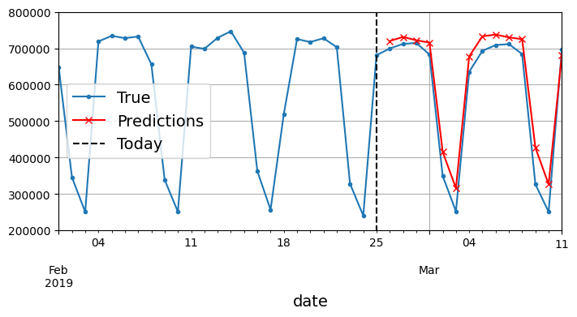

- 2월 26일 ~ 3월 11일(14일)을 예측했다. 주간 패턴은 잘 따라가지만 주말을 실제보다 높게 예측한다
- 단점: 앞의 예측 오차가 다음 예측의 입력이 되어 **오차가 누적**된다. 먼 미래일수록 부정확해지기 쉽다
- 다변량 모델로는 이 방법을 쓰기 어렵다. 다음 날의 버스 승객 수와 요일 종류도 함께 예측해야 하기 때문이다

**방법 ② — 14개 값을 한 번에 출력 (시퀀스-투-벡터)**

```python
class ForecastAheadDataset(TimeSeriesDataset):
    def __len__(self):
        return len(self.series) - self.window_length - 14 + 1

    def __getitem__(self, idx):
        end = idx + self.window_length  # 1st index after window
        window = self.series[idx : end]
        target = self.series[end : end + 14, 0]  # 0 = rail ridership
        return window, target

window_length = 56
ahead_train_set = ForecastAheadDataset(mulvar_train, window_length)
ahead_train_loader = DataLoader(ahead_train_set, batch_size=32, shuffle=True)
ahead_valid_set = ForecastAheadDataset(mulvar_valid, window_length)
ahead_valid_loader = DataLoader(ahead_valid_set, batch_size=32)
ahead_test_set = ForecastAheadDataset(mulvar_test, window_length)
ahead_test_loader = DataLoader(ahead_test_set, batch_size=32)

torch.manual_seed(42)
ahead_model = SimpleRnnModel(input_size=5, hidden_size=32, output_size=14)
ahead_model = ahead_model.to(device)
fit_and_evaluate(ahead_model, ahead_train_loader, ahead_valid_loader, lr=0.05, n_epochs=50)
# ...
# Epoch 50/50, train loss: 0.0033, train metric: 0.0471, valid metric: 0.0348
# 32950.77010989189
```

| 코드 | 의미 |
|---|---|
| `__len__` | 윈도 뒤에 14일이 남아 있어야 하므로 $N - L - 14 + 1$. 훈련 1,027개, 검증 **82개** |
| `self.series[end : end + 14, 0]` | 다음 14일의 **철도**(0번 열) → 타깃 `[14]` |
| `output_size=14` | 출력 층이 14개 값을 낸다 |

```python
ahead_model.eval()
with torch.no_grad():
    window = mulvar_valid[:window_length]  # shape [56, 5]
    X = window.unsqueeze(dim=0)            # shape [1, 56, 5]
    Y_pred = ahead_model(X.to(device))     # shape [1, 14]
```

**결과 해석**

- 검증 MAE **32,951** = 14일 **전체**(1일 후 ~ 14일 후) 예측 오차의 평균이다. 다음 날만 예측한 다변량 RNN(23,227)과 직접 비교하면 안 된다. 먼 날일수록 어렵다
- 방법 ①보다 **오차가 누적되지 않고**, 한 번의 순전파로 14개를 얻으므로 빠르다. 다변량 입력도 그대로 쓸 수 있다
- 교재는 이 방법이 잘 동작한다고 보고, 다음 절에서 더 개선한다

### 3-12. 시퀀스-투-시퀀스 모델로 예측하기

> 🎯 **목적** — 마지막 타임 스텝에서만 14일을 예측하지 말고, **모든 타임 스텝에서** 그다음 14일을 예측하도록 훈련한다.

**개념·원리**

3-11절 모델은 윈도 하나(56일)에서 **마지막 스텝의 출력만** 손실에 썼다. 대신 타임 스텝 0에서는 1~14일, 타임 스텝 1에서는 2~15일, …, 마지막 타임 스텝 55에서는 56~69일을 예측하게 한다.

| | 시퀀스-투-벡터 (3-11) | 시퀀스-투-시퀀스 (이 절) |
|---|---|---|
| 출력 | `[배치, 14]` | `[배치, 56, 14]` |
| 윈도 하나의 손실 항 | 14개 | 56 × 14 = **784개** |
| 그레이디언트 | 마지막 스텝에서만 출발 → 시간을 거슬러 흘러야 함 | **모든 스텝**에서 출발 → 각 스텝에 바로 도달 |

- 손실에 훨씬 많은 항이 들어가 **훈련 신호가 풍부**해지고, 그레이디언트가 긴 시간을 거슬러 갈 필요가 없어 **훈련이 안정되고 빨라진다**(2-2절의 문제를 덜어 준다)
- 모델은 **인과적**(causal)이어야 한다. 타임 스텝 $t$의 예측은 $t$까지의 입력만 봐야 한다. 순환 층은 원래 과거만 보므로 문제없다
- 추론할 때는 마지막 스텝의 출력만 쓴다. 나머지는 훈련용이다

**코드** — 타깃 만들기

```python
class Seq2SeqDataset(ForecastAheadDataset):
    def __getitem__(self, idx):
        end = idx + self.window_length  # 1st index after window
        window = self.series[idx : end]
        target_period = self.series[idx + 1 : end + 14, 0]
        target = target_period.unfold(dimension=0, size=14, step=1)
        return window, target

torch.tensor([0, 1, 2, 3, 4, 5]).unfold(dimension=0, size=4, step=1)
# tensor([[0, 1, 2, 3],
#         [1, 2, 3, 4],
#         [2, 3, 4, 5]])
```

| 코드 | 의미 |
|---|---|
| `self.series[idx + 1 : end + 14, 0]` | 윈도 다음 날부터 마지막 예측일까지 철도 값 56 + 13 = **69개** |
| `.unfold(dimension=0, size=14, step=1)` | 길이 14 윈도를 1칸씩 밀며 잘라 행으로 쌓는다 → `[69 − 14 + 1, 14]` = **`[56, 14]`**. 행 $t$ = 타임 스텝 $t$의 정답(다음 14일) |
| `ForecastAheadDataset` 상속 | `__len__`(윈도 뒤 14일 필요)을 그대로 쓴다 |

**보충 코드** — 타깃 확인

```python
seq_valid_set = Seq2SeqDataset(mulvar_valid, 56)
window, target = seq_valid_set[0]
window.shape, target.shape
# (torch.Size([56, 5]), torch.Size([56, 14]))
torch.equal(target[0], mulvar_valid[1:15, 0]), torch.equal(target[55], mulvar_valid[56:70, 0])
# (True, True)
```

- 0번 행 = 1~14일, 55번 행 = 56~69일. 행마다 한 칸씩 밀린다

**코드** — 모델

```python
window_length = 56
seq_train_set = Seq2SeqDataset(mulvar_train, window_length)
seq_train_loader = DataLoader(seq_train_set, batch_size=32, shuffle=True)
seq_valid_set = Seq2SeqDataset(mulvar_valid, window_length)
seq_valid_loader = DataLoader(seq_valid_set, batch_size=32)
seq_test_set = Seq2SeqDataset(mulvar_test, window_length)
seq_test_loader = DataLoader(seq_test_set, batch_size=32)

class Seq2SeqRnnModel(SimpleRnnModel):
    def forward(self, X):
        outputs, last_state = self.rnn(X)
        return self.output(outputs)
```

- 차이는 `outputs[:, -1]` → **`outputs`** 하나. 모든 타임 스텝의 출력 `[배치, 56, 32]`에 출력 층을 적용해 `[배치, 56, 14]`

`nn.Linear`에 3D 입력을 넣을 수 있는 이유:

```python
torch.matmul(torch.randn(2, 3, 5, 7), torch.randn(2, 3, 7, 11)).shape
# torch.Size([2, 3, 5, 11])
torch.matmul(torch.randn(2, 3, 5, 7), torch.randn(7, 11)).shape   # 브로드캐스팅
# torch.Size([2, 3, 5, 11])
nn.Linear(32, 14)(torch.randn(10, 56, 32)).shape
# torch.Size([10, 56, 14])
```

- `nn.Linear`는 내부에서 `torch.matmul()`을 쓴다. `matmul`은 **마지막 두 축**으로 행렬 곱을 하고 앞의 축들은 배치처럼 다룬다. 가중치 행렬 `[7, 11]`은 앞 축으로 브로드캐스팅된다
- 그래서 `nn.Linear`는 **마지막 축에만** 작용하고, `[배치, 56, 32]` 입력이면 56개 타임 스텝 각각에 **같은** 선형 변환을 적용한다. 타임 스텝마다 따로 반복할 필요가 없다

**코드** — 훈련

```python
torch.manual_seed(42)
seq_model = Seq2SeqRnnModel(input_size=5, hidden_size=32, output_size=14)
seq_model = seq_model.to(device)
fit_and_evaluate(seq_model, seq_train_loader, seq_valid_loader, lr=1.0, n_epochs=65,
                 patience=5, factor=0.5)
```

```
Epoch 1/65, train loss: 0.0332, train metric: 0.1934, valid metric: 0.1210
Epoch 2/65, train loss: 0.0084, train metric: 0.0975, valid metric: 0.0756
Epoch 3/65, train loss: 0.0050, train metric: 0.0695, valid metric: 0.0662
...
Epoch 12/65, ..., valid metric: 0.0473
...
Epoch 65/65, train loss: 0.0028, train metric: 0.0445, valid metric: 0.0479
47337.66242861748
```

- `lr=1.0`: 앞 절들(0.03 ~ 0.07)보다 훨씬 큰 학습률. 대신 `patience=5, factor=0.5`로 5 에포크 정체마다 학습률을 절반으로 줄인다. 노트북이 고른 값이다(4-6절 보충 실험에서 이 설정을 CPU로 다시 돌려 46,308을 얻었다)
- 검증 MAE **47,338**은 **모든 타임 스텝(56개) × 14일**의 평균이다. 타임 스텝 0은 하루치 데이터만 보고 14일을 예측해야 하므로 당연히 크게 틀린다 → 3-11절(32,951)과 직접 비교할 수 없다. 공정하게 비교하려면 **마지막 스텝**만 봐야 한다

**코드** — 예측하기

```python
seq_model.eval()
with torch.no_grad():
    some_window = mulvar_valid[:window_length]  # shape [56, 5]
    X = some_window.unsqueeze(dim=0)            # shape [1, 56, 5]
    Y_preds = seq_model(X.to(device))           # shape [1, 56, 14]
    Y_pred = Y_preds[:, -1]                     # shape [1, 14]
```

- 추론할 때는 마지막 스텝의 14개 예측 `Y_preds[:, -1]`만 쓴다

**코드** — 며칠 뒤를 예측하느냐에 따른 오차

```python
with torch.no_grad():
    X = mulvar_valid.unsqueeze(dim=0).to(device)  # shape [1, 151, 5]
    Y_preds_valid = seq_model(X).cpu()            # shape [1, 151, 14]

for ahead in range(1, 14 + 1):
    y_preds = Y_preds_valid[0, window_length : -ahead, ahead - 1]
    y_true = rail_valid[window_length + ahead:, 0]
    mae = (y_preds - y_true).abs().mean() * 1e6
    print(f"MAE for +{ahead}:\t{mae:,.0f}")
```

| 코드 | 의미 |
|---|---|
| `mulvar_valid.unsqueeze(dim=0)` | 검증 구간 **전체 151일을 시퀀스 하나**로 넣는다. RNN은 길이가 달라도 된다. 타임 스텝 $t$의 출력은 $t$까지의 모든 날을 본 예측 |
| `Y_preds_valid[0, 56 : -ahead, ahead - 1]` | 타임 스텝 56부터(앞부분은 정보가 부족하므로 제외), `ahead`일 뒤 예측(열 `ahead-1`). 정답이 있는 스텝까지만(`-ahead`) |
| `rail_valid[56 + ahead:, 0]` | 그에 대응하는 실제 값 |

```
MAE for +1:   23,689      MAE for +8:   39,569
MAE for +2:   35,101      MAE for +9:   39,459
MAE for +3:   37,545      MAE for +10:  39,747
MAE for +4:   39,053      MAE for +11:  40,008
MAE for +5:   39,728      MAE for +12:  38,468
MAE for +6:   40,121      MAE for +13:  37,255
MAE for +7:   39,105      MAE for +14:  35,862
```

**보충 코드** — 같은 구간에서 나이브 예측과 비교

```python
rv = mulvar_valid[:, 0]
for ahead in range(1, 15):
    lag = 7 if ahead <= 7 else 14            # 가장 가까운 지난 같은 요일
    y_true = rv[56 + ahead:]
    y_naive = rv[56 + ahead - lag : len(rv) - lag]
    print(ahead, round(((y_naive - y_true).abs().mean() * 1e6).item()))
# +1 41,440  +2 41,828  +3 42,143 … +7 42,941  +8 41,871 … +14 44,086
```

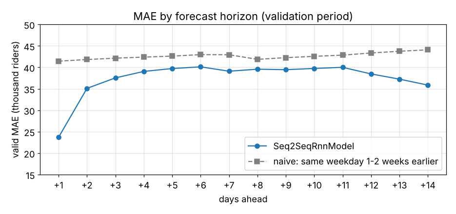

**결과 해석**

- **+1일 MAE 23,689** — 다음 날만 예측하도록 훈련한 다변량 RNN(23,227)과 거의 같다. 14일을 함께 예측하면서도 다음 날 예측 성능을 잃지 않았다
- +2일부터 오차가 3.5만 ~ 4만으로 커진다. 그래도 **14일 모두 나이브 예측(4.1만 ~ 4.4만)보다 낫다**
- +12 ~ +14일에서 오차가 다시 줄어든다. 원인은 분명하지 않다. 평가하는 날이 81 ~ 94일뿐이고 `ahead`마다 평가 구간이 조금씩 달라(+14일은 앞쪽 13일이 빠진다) 이 정도 차이는 잡음일 수 있다

> 💡 순환 층 뒤의 `nn.Linear`는 **커널 크기 1인 1차원 합성곱**과 같다. 아래 노트북 코드가 이를 확인한다. 4-4절에서 1D 합성곱을 본격적으로 쓴다.

```python
# extra code: show that a Conv1d with kernel_size=1 is equivalent to
# a Linear layer when applied to a time series, if you permute the
# last two dimensions of the inputs and outputs.
torch.manual_seed(42)
with torch.no_grad():
    X = torch.randn(10, 56, 32)
    conv1d = nn.Conv1d(32, 14, kernel_size=1)
    linear = nn.Linear(32, 14)
    linear.weight.data = conv1d.weight.squeeze(dim=2)
    linear.bias.data = conv1d.bias
    result1 = conv1d(X.permute(0, 2, 1)).permute(0, 2, 1)
    result2 = linear(X)

torch.allclose(result1, result2, atol=1e-7)
# True
```

| 코드 | 의미 |
|---|---|
| `nn.Conv1d(32, 14, kernel_size=1)` | 입력 채널 32 → 출력 채널 14, 한 타임 스텝만 보는 커널. 가중치 `[14, 32, 1]` |
| `conv1d.weight.squeeze(dim=2)` | `[14, 32]` = `nn.Linear(32, 14)`의 가중치 형태 |
| `X.permute(0, 2, 1)` | `Conv1d`는 `[배치, 채널, 길이]`를 기대 → `[10, 32, 56]`. 결과도 되돌린다 |

### 3-13. 다음 날 예측 결과 비교

> 🎯 **목적** — 3-7 ~ 3-10절의 다음 날 예측 모델을 한눈에 비교한다.

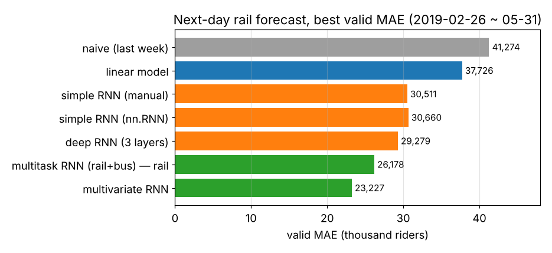

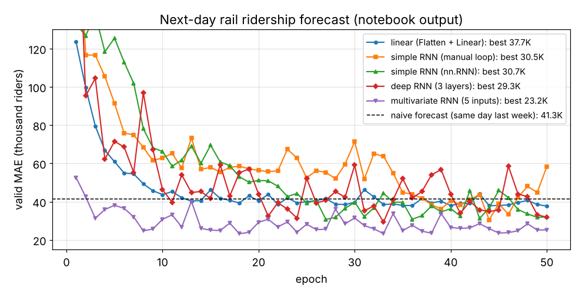

(노트북 출력값으로 그린 그래프. 다중 작업 RNN은 3-10절에서 바로잡은 철도 MAE)

| 모델 | 입력 | 파라미터 | 최고 검증 MAE | 나이브 대비 |
|---|---|---|---|---|
| 나이브 예측 (지난주 같은 요일) | | 0 | 41,274 | – |
| 선형 모델 | 철도 56일 | 57 | 37,726 | −9% |
| (SARIMA, 3~5월·매일 재훈련) | 철도 | | (32,041) | |
| 단순 RNN (직접 만든 셀) | 철도 56일 | 1,121 | 30,511 | −26% |
| 단순 RNN (`nn.RNN`) | 철도 56일 | 1,153 | 30,660 | −26% |
| 심층 RNN (3층) | 철도 56일 | 5,377 | 29,279 | −29% |
| 다중 작업 RNN (철도 예측) | 5개 특성 | 1,314 | 26,178 | −37% |
| **다변량 RNN** | 5개 특성 | 1,281 | **23,227** | **−44%** |

- 가장 큰 개선은 **모델을 바꿀 때(선형 → RNN)** 와 **입력 정보를 늘릴 때(→ 다변량)** 생겼다. 층을 쌓는 효과(→ 심층 RNN)는 작았다
- 곡선을 보면 모든 RNN의 검증 MAE가 에포크마다 크게 흔들린다(±1만 이상). 검증 타깃이 95일뿐이고 학습률이 크기 때문이다. "최고 에포크"를 고른 수치는 운이 섞인 값이다
- 선형 모델은 곡선이 매끄럽지만 일찍 정체한다. 다변량 RNN은 1 에포크부터 낮다

---

## 4. 긴 시퀀스 다루기 (13.4)

> 🎯 **목적** — 긴 시퀀스로 RNN을 훈련할 때 생기는 두 문제, **불안정한 그레이디언트**와 **짧은 단기 기억**을 다루는 방법을 익힌다.

> 💬 **기억을 관리하는 게이트**
>
> 단순 RNN은 수십 스텝만 지나도 앞 내용을 잊는다. **LSTM**은 기억 저장소(장기 상태 c)를 따로 두고 세 개의 문지기를 세운다. **삭제 게이트**(무엇을 잊을지), **입력 게이트**(무엇을 새로 적을지), **출력 게이트**(지금 무엇을 꺼내 쓸지). 장기 상태는 곱하고 더하는 것만 거치므로 정보가 오래 살아남는다. **GRU**는 이걸 게이트 두 개로 줄인 간소화 버전이다.
>
> - **핵심 한 줄**: 게이트 = 0~1 사이 값(시그모이드)을 곱하는 **밸브**. 1이면 통과, 0이면 차단
> - **다른 길 — 1D 합성곱**: 시간 축으로 필터를 밀어 긴 시퀀스를 짧게 줄인다. **팽창 합성곱**을 쌓으면(WaveNet) 층마다 보는 범위가 2배씩 늘어 아주 긴 과거도 본다
> - **헷갈림 주의**: 시계열용 합성곱은 **인과적**이어야 한다. 미래 스텝을 보면 반칙


**개념·원리**

긴 시퀀스를 처리하는 RNN은 펼치면 아주 깊은 네트워크가 된다(2-1절).

| 문제 | 원인 | 이 절의 해결책 |
|---|---|---|
| **불안정한 그레이디언트** | 같은 가중치를 타임 스텝마다 반복해 곱한다 → 소실·폭주 | 좋은 초기화·옵티마이저·드롭아웃, 포화 활성화 함수(tanh), 작은 학습률, **그레이디언트 클리핑**, **층 정규화** (4-1) |
| **단기 기억 문제** | 타임 스텝마다 정보가 조금씩 변형·손실되어 오래된 입력의 흔적이 사라진다(2-2절 그림) | 장기 기억 경로를 가진 셀 **LSTM**(4-2)·**GRU**(4-3), 시퀀스를 줄이는 **1D 합성곱**(4-4), 합성곱만 쓰는 **WaveNet**(4-5) |

### 4-1. 불안정한 그레이디언트 문제와 층 정규화

> 🎯 **목적** — 심층 신경망의 그레이디언트 대책 중 RNN에 맞는 것과 맞지 않는 것을 구분하고, 메모리 셀 안에 층 정규화를 넣는다.

**개념·원리**

[11장](11_training_deep_neural_networks.md)의 기법 중 좋은 가중치 초기화, 고속 옵티마이저, 드롭아웃은 RNN에도 그대로 도움이 된다. 다른 것들은 주의가 필요하다.

| 기법 | RNN에서 | 이유 |
|---|---|---|
| ReLU 같은 **수렴하지 않는 활성화 함수** | 오히려 불안정해질 수 있다 | 경사 하강법이 첫 타임 스텝의 출력을 조금 키우도록 가중치를 바꾸면, **같은 가중치**가 모든 타임 스텝에 쓰이므로 두 번째 스텝 출력도 조금 커지고, 세 번째도 … → 출력이 **폭주**한다. 수렴하는 함수 **tanh**가 RNN의 기본값인 이유 |
| 작은 학습률 | 도움이 된다 | 폭주를 줄인다 |
| **그레이디언트 클리핑** | 도움이 된다 | `loss.backward()` 뒤, `optimizer.step()` 앞에 `torch.nn.utils.clip_grad_norm_(model.parameters(), max_norm=1.0)` ([11장 1-9절](11_training_deep_neural_networks.md#1-9-그레이디언트-클리핑)) |
| **배치 정규화** | 잘 맞지 않는다 | 타임 스텝 **사이**(가로 방향)에 넣으면 모든 스텝이 같은 BN 층을 공유해야 하는데, 스텝마다 입력·은닉 상태의 통계가 다르다. 순환 층 사이(세로 방향)에만 넣을 수 있지만 효과가 작다 |
| **층 정규화** | 잘 맞는다 | 배치가 아니라 **샘플 하나의 특성 축**으로 정규화한다. 타임 스텝마다 그 스텝의 값으로 바로 계산하고, 훈련·추론 때 동작이 같다 |

> 📌 층 정규화의 계산은 [11장 1-8절](11_training_deep_neural_networks.md#1-8-층-정규화). 샘플마다 특성들의 평균·표준편차로 정규화한 뒤 학습되는 스케일 $\gamma$·이동 $\beta$를 적용한다.

**코드** — 메모리 셀 안에 층 정규화

```python
class SimpleRnnModelWithLN(nn.Module):
    def __init__(self, input_size, hidden_size, output_size):
        super().__init__()
        self.hidden_size = hidden_size
        self.memory_cell = nn.Sequential(
            nn.Linear(input_size + hidden_size, hidden_size),
            nn.LayerNorm(hidden_size),
            nn.Tanh()
        )
        self.output = nn.Linear(hidden_size, output_size)

    def forward(self, X):
        batch_size, window_length, dimensionality = X.shape
        X_time_first = X.transpose(0, 1)
        H = torch.zeros(batch_size, self.hidden_size, device=X.device)
        for X_t in X_time_first:
            XH = torch.cat((X_t, H), dim=1)
            H = self.memory_cell(XH)
        return self.output(H)

torch.manual_seed(42)
rnn_with_ln_model = SimpleRnnModelWithLN(input_size=5, hidden_size=32, output_size=14)
rnn_with_ln_model = rnn_with_ln_model.to(device)
fit_and_evaluate(rnn_with_ln_model, ahead_train_loader, ahead_valid_loader,
                 lr=0.05, n_epochs=2)
# Epoch 1/2, train loss: 0.0693, train metric: 0.2941, valid metric: 0.1618
# Epoch 2/2, train loss: 0.0207, train metric: 0.1647, valid metric: 0.1438
# 143809.512257576
```

| 코드 | 의미 |
|---|---|
| `nn.Linear` → `nn.LayerNorm(hidden_size)` → `nn.Tanh()` | 선형 변환 뒤, **활성화 함수 앞**에 층 정규화. 3-8절의 직접 만든 셀에 한 줄 추가 |
| `nn.LayerNorm(32)` | 마지막 축(32개 특성)으로 정규화. 학습 파라미터 $\gamma$, $\beta$ 각 32개 → 총 1,742개 |
| `ahead_train_loader` | 3-11절의 14일 앞 예측(시퀀스-투-벡터) 데이터 |
| `n_epochs=2` | **시연용**. 이 절의 셀들(층 정규화·LSTM·GRU·1D 합성곱)은 모두 2 에포크만 훈련한다 |

- `nn.RNN`은 셀 내부를 바꿀 수 없으므로, 반복 사이에 층을 끼워 넣으려면 이렇게 **직접 만든 셀**을 써야 한다(1-4절에서 예고한 경우)
- 타임 스텝마다 은닉 상태가 정규화되므로 값의 크기가 스텝을 거치며 커지거나 줄어드는 일을 막는다

> ⚠️ 2 에포크 결과(143,810)는 모델의 실력이 아니다. 같은 데이터의 단순 RNN도 2 에포크에는 114,203이다(보충 실험, 4-7절). 이 장 후반의 2 에포크 숫자들은 **코드가 돌아가는지 보여 주는 용도**로만 읽는다.

### 4-2. 단기 기억 문제와 LSTM

> 🎯 **목적** — 게이트로 장기 상태를 관리하는 LSTM 셀의 구조를 이해하고, `nn.LSTM`과 `nn.LSTMCell`로 쓴다.

**개념·원리**

**LSTM**(long short-term memory, 장단기 메모리) 셀은 1997년 호흐라이터와 슈미트후버가 제안했다. 바깥에서 보면 보통 셀과 같지만 상태가 **두 개**다.

| 상태 | 기호 | 역할 |
|---|---|---|
| **단기 상태** | $\mathbf{h}_{(t)}$ | 셀의 출력이기도 하다. 다음 층·다음 스텝으로 간다 |
| **장기 상태** | $\mathbf{c}_{(t)}$ | 셀 안에서만 흐르는 "컨베이어 벨트". 원소별 곱·덧셈만 거치므로 정보가 오래 보존된다 |

타임 스텝마다 현재 입력 $\mathbf{x}_{(t)}$와 이전 단기 상태 $\mathbf{h}_{(t-1)}$이 **완전 연결 층 4개**에 들어간다.

$$\begin{aligned}
\mathbf{i}_{(t)} &= \sigma(\mathbf{W}_{xi}\mathbf{x}_{(t)} + \mathbf{W}_{hi}\mathbf{h}_{(t-1)} + \mathbf{b}_i) && \text{입력 게이트}\\
\mathbf{f}_{(t)} &= \sigma(\mathbf{W}_{xf}\mathbf{x}_{(t)} + \mathbf{W}_{hf}\mathbf{h}_{(t-1)} + \mathbf{b}_f) && \text{삭제(망각) 게이트}\\
\mathbf{g}_{(t)} &= \tanh(\mathbf{W}_{xg}\mathbf{x}_{(t)} + \mathbf{W}_{hg}\mathbf{h}_{(t-1)} + \mathbf{b}_g) && \text{새 기억 후보 (주 층)}\\
\mathbf{o}_{(t)} &= \sigma(\mathbf{W}_{xo}\mathbf{x}_{(t)} + \mathbf{W}_{ho}\mathbf{h}_{(t-1)} + \mathbf{b}_o) && \text{출력 게이트}\\
\mathbf{c}_{(t)} &= \mathbf{f}_{(t)} \otimes \mathbf{c}_{(t-1)} + \mathbf{i}_{(t)} \otimes \mathbf{g}_{(t)}\\
\mathbf{h}_{(t)} &= \mathbf{y}_{(t)} = \mathbf{o}_{(t)} \otimes \tanh(\mathbf{c}_{(t)})
\end{aligned}$$

| 층 / 게이트 | 활성화 | 하는 일 |
|---|---|---|
| **주 층** $\mathbf{g}$ | tanh | 기본 RNN 셀이 하던 계산. 현재 입력과 이전 단기 상태를 분석한 새 정보 |
| **삭제 게이트** $\mathbf{f}$ | 시그모이드 (0~1) | 장기 상태의 **어느 부분을 지울지**. 0이면 지우고 1이면 유지 |
| **입력 게이트** $\mathbf{i}$ | 시그모이드 | $\mathbf{g}$의 **어느 부분을 장기 상태에 더할지** |
| **출력 게이트** $\mathbf{o}$ | 시그모이드 | 장기 상태의 **어느 부분을 이번 출력으로 내보낼지** |
| $\otimes$ | | 원소별 곱. 시그모이드 출력(0~1)을 곱하는 것이 "문을 여닫는" 게이트 역할을 한다 |

- 장기 상태는 **지우고(× $\mathbf{f}$) 더하는(+ $\mathbf{i} \otimes \mathbf{g}$)** 것만 한다. 행렬 곱도 활성화 함수도 거치지 않는다. 삭제 게이트가 1에 가까우면 $\mathbf{c}_{(t)} ≈ \mathbf{c}_{(t-1)}$ → 정보와 그레이디언트가 수십·수백 스텝을 거의 그대로 지나간다. 2-2절에서 망각 게이트 편향을 크게 두었을 때 그레이디언트가 줄지 않았던 이유다
- 요약하면 LSTM은 **중요한 입력을 알아보고**(입력 게이트), **필요한 만큼 보관하고**(삭제 게이트), **필요할 때 꺼내는**(출력 게이트) 법을 배운다

> 📌 **핍홀 연결**(peephole): 게이트들이 $\mathbf{h}_{(t-1)}$뿐 아니라 장기 상태 $\mathbf{c}_{(t-1)}$도 보게 하는 LSTM 변형(2000년). 파이토치 `nn.LSTM`에는 없다. 반대로 파이토치 `nn.LSTM`에는 출력 차원을 줄이는 `proj_size` 옵션이 있다.

**코드** — `nn.LSTM`

```python
class LstmModel(nn.Module):
    def __init__(self, input_size, hidden_size, output_size):
        super().__init__()
        self.rnn = nn.LSTM(input_size, hidden_size, batch_first=True)
        self.output = nn.Linear(hidden_size, output_size)

    def forward(self, X):
        outputs, last_state = self.rnn(X)
        return self.output(outputs[:, -1])

torch.manual_seed(42)
lstm_model = LstmModel(input_size=5, hidden_size=32, output_size=14)
lstm_model = lstm_model.to(device)
fit_and_evaluate(lstm_model, ahead_train_loader, ahead_valid_loader,
                 lr=0.05, n_epochs=2)
# Epoch 1/2, train loss: 0.0940, train metric: 0.3618, valid metric: 0.2087
# Epoch 2/2, train loss: 0.0258, train metric: 0.1747, valid metric: 0.1717
# 171688.5268688202
```

| 코드 | 의미 |
|---|---|
| `nn.LSTM(...)` | `nn.RNN`을 바꾸기만 하면 된다. 나머지 코드는 3-11절과 같다 |
| `last_state` | LSTM은 **튜플 `(h, c)`** 를 돌려준다. 각각 `[층 수, 배치, 은닉 차원]` |
| `outputs[:, -1]` | 출력은 단기 상태 $\mathbf{h}$만이다. 장기 상태 $\mathbf{c}$는 `last_state[1]`에만 있다 |

**코드** — `nn.LSTMCell`로 직접 반복

```python
class LstmModel(nn.Module):
    def __init__(self, input_size, hidden_size, output_size):
        super().__init__()
        self.hidden_size = hidden_size
        self.memory_cell = nn.LSTMCell(input_size, hidden_size)
        self.output = nn.Linear(hidden_size, output_size)

    def forward(self, X):
        batch_size, window_length, dimensionality = X.shape
        X_time_first = X.transpose(0, 1)
        H = torch.zeros(batch_size, self.hidden_size, device=X.device)
        C = torch.zeros(batch_size, self.hidden_size, device=X.device)
        for X_t in X_time_first:
            H, C = self.memory_cell(X_t, (H, C))
        return self.output(H)

torch.manual_seed(42)
lstm_model = LstmModel(input_size=5, hidden_size=32, output_size=14)
lstm_model = lstm_model.to(device)
fit_and_evaluate(lstm_model, ahead_train_loader, ahead_valid_loader, lr=0.05, n_epochs=2)
# Epoch 1/2, train loss: 0.0940, train metric: 0.3618, valid metric: 0.2087
# Epoch 2/2, train loss: 0.0258, train metric: 0.1747, valid metric: 0.1717
# 171688.46726417542
```

| 코드 | 의미 |
|---|---|
| `nn.LSTMCell(input_size, hidden_size)` | **한 타임 스텝**만 계산하는 셀. `nn.LSTM`의 내부 셀 |
| `H, C = self.memory_cell(X_t, (H, C))` | 두 상태를 튜플로 받아 새 두 상태를 돌려준다 |

- 결과가 `nn.LSTM` 버전과 **소수점 아래까지 같다**(171,688.53 vs 171,688.47). 파라미터 이름·형태·초기화 순서가 같아서 같은 시드로 같은 가중치가 만들어지기 때문이다. 마지막 자리 차이는 cuDNN과 파이썬 반복의 부동소수점 연산 순서 차이다
- 셀 버전은 느리지만 4-1절처럼 반복 사이에 무언가를 넣을 수 있다

**보충 코드** — 파라미터 형태와 두 구현 확인

```python
{k: tuple(v.shape) for k, v in nn.LSTM(5, 32).named_parameters()}
# {'weight_ih_l0': (128, 5), 'weight_hh_l0': (128, 32),
#  'bias_ih_l0': (128,), 'bias_hh_l0': (128,)}

torch.manual_seed(0)
lstm, cell = nn.LSTM(5, 32, batch_first=True), nn.LSTMCell(5, 32)
with torch.no_grad():
    for name in ["weight_ih", "weight_hh", "bias_ih", "bias_hh"]:
        getattr(cell, name).copy_(getattr(lstm, name + "_l0"))
    X = torch.randn(3, 10, 5)
    outputs, (h, c) = lstm(X)
    H = C = torch.zeros(3, 32)
    for x in X.transpose(0, 1):
        H, C = cell(x, (H, C))
print(torch.allclose(outputs[:, -1], H, atol=1e-6), h.shape, c.shape)
# True torch.Size([1, 3, 32]) torch.Size([1, 3, 32])
```

- 가중치 행 수가 **128 = 4 × 32**: 게이트 4개(입력·삭제·주 층·출력 순)의 가중치를 한 행렬에 이어 붙였다
- 파라미터 수: 4 × (5×32 + 32×32 + 32 + 32) = 4,992 + 출력 층 462 = **5,454**. 같은 크기 단순 RNN(1,710)의 약 3배

### 4-3. GRU

> 🎯 **목적** — LSTM을 단순화한 GRU 셀을 이해하고 쓴다.

**개념·원리**

**GRU**(gated recurrent unit, 게이트 순환 유닛) 셀은 2014년 조경현 등이 인코더–디코더 논문에서 제안했다. LSTM을 간소화한 버전인데 성능은 비슷하다.

$$\begin{aligned}
\mathbf{r}_{(t)} &= \sigma(\mathbf{W}_{xr}\mathbf{x}_{(t)} + \mathbf{W}_{hr}\mathbf{h}_{(t-1)} + \mathbf{b}_r) && \text{리셋 게이트}\\
\mathbf{z}_{(t)} &= \sigma(\mathbf{W}_{xz}\mathbf{x}_{(t)} + \mathbf{W}_{hz}\mathbf{h}_{(t-1)} + \mathbf{b}_z) && \text{업데이트 게이트}\\
\mathbf{n}_{(t)} &= \tanh\left(\mathbf{W}_{xn}\mathbf{x}_{(t)} + \mathbf{r}_{(t)} \otimes (\mathbf{W}_{hn}\mathbf{h}_{(t-1)} + \mathbf{b}_{hn}) + \mathbf{b}_{xn}\right) && \text{새 상태 후보}\\
\mathbf{h}_{(t)} &= (1 - \mathbf{z}_{(t)}) \otimes \mathbf{n}_{(t)} + \mathbf{z}_{(t)} \otimes \mathbf{h}_{(t-1)}
\end{aligned}$$

| LSTM과의 차이 | 내용 |
|---|---|
| 상태 하나 | 장기·단기 상태를 **$\mathbf{h}_{(t)}$ 하나로 합쳤다** |
| 게이트 하나로 삭제·입력을 함께 | **업데이트 게이트** $\mathbf{z}$가 "이전 상태를 얼마나 유지할지"를 정하면, 나머지 $(1-\mathbf{z})$만큼 새 후보를 받아들인다. 새 정보를 넣는 만큼 옛 정보를 지운다 |
| 출력 게이트 없음 | 매 스텝 전체 상태를 출력한다 |
| 리셋 게이트 | 이전 상태의 **어느 부분을 새 후보 계산에 보여 줄지** 정한다 |

- $\mathbf{z} ≈ 1$이면 $\mathbf{h}_{(t)} ≈ \mathbf{h}_{(t-1)}$ → LSTM의 장기 상태처럼 정보와 그레이디언트가 그대로 지나간다
- 파이토치의 식은 위와 같다(업데이트 게이트가 **이전 상태** 쪽에 곱해진다). 교재 그림·다른 자료에서는 $\mathbf{z}$와 $1-\mathbf{z}$의 자리가 반대로 쓰인 경우도 있는데, 게이트가 학습되므로 의미는 같다

**코드**

```python
class GruModel(nn.Module):
    def __init__(self, input_size, hidden_size, output_size):
        super().__init__()
        self.rnn = nn.GRU(input_size, hidden_size, batch_first=True)
        self.output = nn.Linear(hidden_size, output_size)

    def forward(self, X):
        outputs, last_state = self.rnn(X)
        return self.output(outputs[:, -1])

torch.manual_seed(42)
gru_model = GruModel(input_size=5, hidden_size=32, output_size=14)
gru_model = gru_model.to(device)
fit_and_evaluate(gru_model, ahead_train_loader, ahead_valid_loader,
                 lr=0.05, n_epochs=2)
# Epoch 1/2, train loss: 0.0813, train metric: 0.3289, valid metric: 0.1561
# Epoch 2/2, train loss: 0.0212, train metric: 0.1757, valid metric: 0.1410
# 141033.56003761292
```

`nn.GRUCell` 버전도 LSTM과 같은 방식이다. 상태가 하나라 더 간단하다.

```python
class GruModel(nn.Module):
    def __init__(self, input_size, hidden_size, output_size):
        super().__init__()
        self.hidden_size = hidden_size
        self.memory_cell = nn.GRUCell(input_size, hidden_size)
        self.output = nn.Linear(hidden_size, output_size)

    def forward(self, X):
        batch_size, window_length, dimensionality = X.shape
        X_time_first = X.transpose(0, 1)
        H = torch.zeros(batch_size, self.hidden_size, device=X.device)
        for X_t in X_time_first:
            H = self.memory_cell(X_t, H)
        return self.output(H)
# ... (같은 훈련) → 141033.3216190338
```

**결과 해석**

| 셀 | 가중치 블록 | 파라미터 (입력 5, 은닉 32, 출력 14) | 2 에포크 검증 MAE |
|---|---|---|---|
| 단순 RNN | 1 | 1,710 | 114,203 (보충 실험) |
| RNN + 층 정규화 | 1 | 1,742 | 143,810 |
| GRU | **3** (리셋·업데이트·후보) | 4,206 | 141,034 |
| LSTM | **4** (입력·삭제·주·출력) | 5,454 | 171,689 |

- 2 에포크로는 어느 셀이 나은지 판단할 수 없다. 50 에포크까지 돌린 결과는 4-7절
- GRU는 순환 가중치가 LSTM의 3/4(블록 3개 vs 4개)이라 더 가볍고 빠르면서 성능은 비슷한 경우가 많아 널리 쓰인다. 14장도 GRU를 쓴다

> 💡 LSTM·GRU 덕분에 RNN은 단순 RNN보다 훨씬 긴 시퀀스를 다룰 수 있게 됐다. 그래도 **100 타임 스텝 이상**의 아주 긴 패턴(오디오 샘플, 긴 시계열, 긴 문장)은 여전히 어렵다. 다음 두 절은 합성곱 층으로 이 문제를 줄인다.

### 4-4. 1차원 합성곱 층으로 시퀀스 처리하기

> 🎯 **목적** — 스트라이드가 있는 1D 합성곱으로 시퀀스 길이를 절반으로 줄인 뒤 GRU에 넣는다.

**개념·원리**

[12장](12_deep_computer_vision_with_cnns.md)의 2D 합성곱 층은 필터를 이미지의 가로·세로로 밀었다. **1D 합성곱 층**은 필터를 **시간 축 하나**로만 민다.

| | `nn.Conv2d` (12장) | `nn.Conv1d` (이 절) |
|---|---|---|
| 입력 형태 | `[배치, 채널, 높이, 너비]` | `[배치, 채널, 길이]` |
| 커널 | `[출력 채널, 입력 채널, kh, kw]` | `[출력 채널, 입력 채널, k]` |
| 하는 일 | 국부적인 공간 패턴(모서리 등) 감지 | 국부적인 **시간 패턴**(짧은 시퀀스 모양) 감지. 필터 하나 = 패턴 하나 |

- 시계열의 특성(여기서는 `rail` 하나)이 **채널** 역할을 한다
- **스트라이드 2**로 시퀀스 길이를 절반으로 줄이면(**다운샘플링**) 뒤의 GRU가 처리할 스텝 수가 줄어 **더 긴 패턴을 감지**하기 쉬워진다. 합성곱 층은 짧은 패턴을 알아보고, GRU는 줄어든 시퀀스에서 긴 패턴을 본다
- 합성곱 층은 상태가 없어 **병렬로** 계산할 수 있고, 순환이 아니라 그레이디언트 문제도 덜하다

**코드** — 모델

```python
class DownsamplingModel(nn.Module):
    def __init__(self, input_size, hidden_size, output_size):
        super().__init__()
        self.conv = nn.Conv1d(input_size, hidden_size, kernel_size=4, stride=2)
        self.gru = nn.GRU(hidden_size, hidden_size, batch_first=True)
        self.linear = nn.Linear(hidden_size, output_size)

    def forward(self, X):
        Z = X.permute(0, 2, 1)  # treat time as a spatial dimension
        Z = self.conv(Z)
        Z = Z.permute(0, 2, 1)  # swap back time & features dimensions
        Z = torch.relu(Z)
        Z, _states = self.gru(Z)
        return self.linear(Z)
```

| 코드 | 의미 |
|---|---|
| `nn.Conv1d(1, 32, kernel_size=4, stride=2)` | 4일짜리 필터 32개를 2일씩 밀며 적용. 패딩 없음 |
| `X.permute(0, 2, 1)` | `[배치, 112, 1]` → `[배치, 1, 112]` (채널을 1번 축으로) |
| 합성곱 출력 | `[배치, 32, 55]`. 길이 $\lfloor (112 - 4)/2 \rfloor + 1 = 55$ |
| 다시 `permute(0, 2, 1)` | `[배치, 55, 32]` → GRU 입력 형태 |
| `torch.relu(Z)` | 합성곱 뒤 활성화 |
| `self.linear(Z)` | GRU의 **모든 스텝** 출력에 적용 → `[배치, 55, 14]` (시퀀스-투-시퀀스) |

**코드** — 타깃 맞추기

합성곱 출력의 각 스텝이 어느 날까지 보았는지에 맞춰 타깃을 자른다. 노트북의 그림:

```
  |-----0-----||-----2----||-----4----||--...-||------52------||------54------|
         |-----1----||-----3----||-----5--...-51------||------53------|
X:  0  1  2  3  4  5  6  7  8  9 10 11 12 ...  104 105 106 107 108 109 110 111
Y:      from 4     6     8    10    12    ...      106     108     110     112
         to 17    19    21    23    25    ...      119     121     123     125
```

```python
class DownsampledDataset(Seq2SeqDataset):
    def __getitem__(self, idx):
        window, target = super().__getitem__(idx)
        return window, target[3::2]  # crop the first 3 targets and downsample

window_length = 112
dseq_train_set = DownsampledDataset(rail_train, window_length)
dseq_train_loader = DataLoader(dseq_train_set, batch_size=32, shuffle=True)
dseq_valid_set = DownsampledDataset(rail_valid, window_length)
dseq_valid_loader = DataLoader(dseq_valid_set, batch_size=32)
dseq_test_set = DownsampledDataset(rail_test, window_length)
dseq_test_loader = DataLoader(dseq_test_set, batch_size=32)

torch.manual_seed(42)
dseq_model = DownsamplingModel(input_size=1, hidden_size=32, output_size=14)
dseq_model = dseq_model.to(device)
fit_and_evaluate(dseq_model, dseq_train_loader, dseq_valid_loader,
                 lr=0.2, n_epochs=2)
# Epoch 1/2, train loss: 0.0595, train metric: 0.2736, valid metric: 0.1971
# Epoch 2/2, train loss: 0.0204, train metric: 0.1694, valid metric: 0.1572
# 157236.17374897003
```

| 코드 | 의미 |
|---|---|
| `window_length = 112` | 윈도를 2배로 늘렸다. 합성곱이 절반으로 줄이므로 GRU가 보는 길이는 55 |
| `Seq2SeqDataset`의 타깃 | `[112, 14]` — 타임 스텝 $t$의 다음 14일 |
| `target[3::2]` | 3, 5, 7, …, 111번 행 → **55개**. 합성곱 출력 $i$는 입력 $2i \ldots 2i+3$을 보므로 마지막으로 본 날이 $2i+3$ → 그 다음 14일($2i+4 \ldots 2i+17$)이 타깃 |
| `rail_train` | 이 절은 **단변량**(철도만)이라 `input_size=1` |

**보충 코드** — 타깃이 맞는지 확인

```python
d = DownsampledDataset(rail_train, 112)
X, y = d[0]
X.shape, y.shape
# (torch.Size([112, 1]), torch.Size([55, 14]))
torch.equal(y[0], rail_train[4:18, 0]), torch.equal(y[-1], rail_train[112:126, 0])
# (True, True)
DownsamplingModel(1, 32, 14)(X.unsqueeze(0)).shape
# torch.Size([1, 55, 14])
```

- 첫 출력은 0~3일을 보고 4~17일을, 마지막 출력은 108~111일을 보고 112~125일을 예측한다 → 위 그림과 일치
- 파라미터 수 6,958 (합성곱 160 + GRU 6,336 + 출력 462)

> ⚠️ 합성곱 출력 $i$는 입력 $2i+3$까지 본다. 패딩을 쓰면 아직 오지 않은 미래 값을 보게 될 수 있다. 이 모델은 패딩이 없고 타깃을 정확히 맞춰 **인과성**을 지켰다. 다음 절의 WaveNet은 왼쪽 패딩으로 같은 일을 한다.

### 4-5. WaveNet

> 🎯 **목적** — 팽창률을 두 배씩 늘린 **인과적 합성곱**을 쌓아, RNN 없이 긴 시퀀스를 처리한다.

**개념·원리**

**WaveNet**은 2016년 딥마인드가 오디오(음성) 생성을 위해 발표한 구조다. 순환 층 없이 1D 합성곱 층만 쌓는다.

| 아이디어 | 내용 |
|---|---|
| **인과적 합성곱** (causal) | 출력 $t$가 입력 $t$와 **그 이전**만 보도록 왼쪽에만 패딩한다. 시퀀스-투-시퀀스 예측에 미래가 새지 않는다 |
| **팽창 합성곱** (dilated) | 커널의 원소 사이를 띄운다. 팽창률 $d$인 크기 2 커널은 입력 $t$와 $t-d$를 본다 |
| 팽창률 두 배씩 | 1, 2, 4, 8, …로 쌓으면 층마다 **수용장이 두 배**가 된다. 아래 층은 짧은 패턴, 위 층은 긴 패턴을 본다 |
| 블록 반복 | 원래 WaveNet은 팽창률 1, 2, 4, …, 512인 층 10개 블록을 3번 쌓았다. 블록 하나의 수용장 1,024 |

노트북의 그림(팽창률 1, 2, …의 인과적 합성곱):

```
 ⋮
C2  /\ /\ /\ /\ /\ /\ /\ /\ /\ /\ /\ /\ /\...
   \  /  \  /  \  /  \  /  \  /  \  /  \
     /    \      /    \      /    \
C1  /\ /\ /\ /\ /\ /\ /\ /\ /\ /\ /\  /\ /...\
X: 0  1  2  3  4  5  6  7  8  9  10 11 12 ... 111
Y: 1  2  3  4  5  6  7  8  9  10 11 12 13 ... 112
 /14 15 16 17 18 19 20 21 22  23 24 25 26 ... 125
```

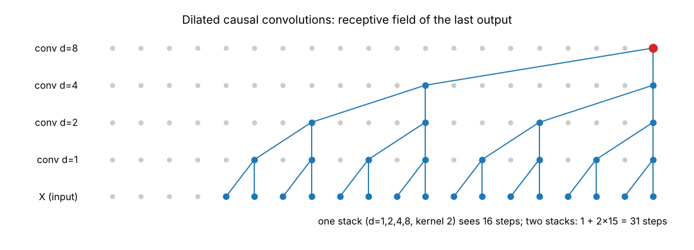

- 크기 2 커널, 팽창률 1·2·4·8 블록 하나의 수용장 = $1 + (1+2+4+8) = 16$ 스텝. 블록 두 개면 $1 + 2 \times 15 = 31$ 스텝

**코드** — 인과적 합성곱 두 가지 구현

```python
import torch.nn.functional as F

class CausalConv1d(nn.Conv1d):
    def forward(self, X):
        padding = (self.kernel_size[0] - 1) * self.dilation[0]
        X = F.pad(X, (padding, 0))
        return super().forward(X)
```

| 코드 | 의미 |
|---|---|
| `class CausalConv1d(nn.Conv1d)` | `nn.Conv1d`를 상속하고 `forward()`만 바꾼다 |
| `(kernel_size - 1) * dilation` | 출력 길이를 입력과 같게 하려면 필요한 패딩 크기. 크기 2·팽창률 8이면 8 |
| `F.pad(X, (padding, 0))` | 마지막 축의 **왼쪽에만** 0을 `padding`개 붙인다. `(왼쪽, 오른쪽)` |

```python
class CausalConv1d(nn.Module):
    def __init__(self, in_channels, out_channels, kernel_size, dilation=1, **kwargs):
        super().__init__()
        self.pad = (kernel_size - 1) * dilation
        self.conv = nn.Conv1d(in_channels, out_channels, kernel_size, padding=self.pad, dilation=dilation, **kwargs)

    def forward(self, x):
        out = self.conv(x)
        return out[:, :, :-self.pad] if self.pad > 0 else out
```

- **촙**(chomp) 방식: 양쪽에 보통 패딩을 하고, 출력 오른쪽 끝의 `pad`개를 잘라 낸다. 오른쪽 패딩 때문에 생긴 "미래를 본" 출력을 버리는 것이다
- 두 구현은 같은 결과를 낸다. 노트북은 두 번째 정의가 첫 번째를 덮어쓰므로 아래 WaveNet은 촙 방식을 쓴다

**보충 코드** — 인과성과 두 구현 확인

```python
# 위 두 구현을 각각 CausalConv1d_pad, CausalConv1d_chomp라는 이름으로 정의했다고 하자
torch.manual_seed(0)
pad_version = CausalConv1d_pad(3, 4, kernel_size=2, dilation=4)    # 첫 번째 구현
chomp_version = CausalConv1d_chomp(3, 4, kernel_size=2, dilation=4)  # 두 번째 구현
chomp_version.conv.load_state_dict(pad_version.state_dict())
x = torch.randn(2, 3, 30)
print(torch.allclose(pad_version(x), chomp_version(x), atol=1e-6))
# True

x2 = x.clone()
x2[..., 10:] += 100                       # t=10 이후 입력만 크게 바꿈
print(torch.allclose(pad_version(x)[..., :10], pad_version(x2)[..., :10]))
# True  → t<10의 출력은 미래 입력의 영향을 받지 않는다
```

**코드** — WaveNet 모델

```python
class WavenetModel(nn.Module):
    def __init__(self, input_size, hidden_size, output_size):
        super().__init__()
        layers = []
        for dilation in (1, 2, 4, 8) * 2:
            conv = CausalConv1d(input_size, hidden_size, kernel_size=2,
                                dilation=dilation)
            layers += [conv, nn.ReLU()]
            input_size = hidden_size
        self.convs = nn.Sequential(*layers)
        self.output = nn.Linear(hidden_size, output_size)

    def forward(self, X):
        Z = X.permute(0, 2, 1)
        Z = self.convs(Z)
        Z = Z.permute(0, 2, 1)
        return self.output(Z)

torch.manual_seed(42)
wavenet_model = WavenetModel(input_size=5, hidden_size=32, output_size=14)
wavenet_model = wavenet_model.to(device)
```

| 코드 | 의미 |
|---|---|
| `(1, 2, 4, 8) * 2` | 튜플 반복 → `(1, 2, 4, 8, 1, 2, 4, 8)`. 블록 2개, 층 8개 |
| `CausalConv1d(..., kernel_size=2, dilation=d)` + `nn.ReLU()` | 층마다 32채널. 길이는 그대로 56 |
| `input_size = hidden_size` | 첫 층만 입력 5채널, 이후는 32채널 |
| `self.output` | 타임 스텝마다 14일 예측 → `[배치, 56, 14]` (시퀀스-투-시퀀스, 3-12절과 같은 데이터) |

**보충 코드** — 파라미터 수와 수용장

```python
sum(p.numel() for p in wavenet_model.parameters())
# 15374

X = torch.randn(1, 56, 5, requires_grad=True)
wavenet_model.cpu()(X)[0, 40].sum().backward()     # 타임 스텝 40의 출력
nz = (X.grad[0].abs().sum(dim=1) > 0).nonzero().flatten()
nz.min().item(), nz.max().item(), len(nz)
# (10, 40, 31)
```

- 타임 스텝 40의 출력은 입력 10 ~ 40, **31개 스텝**에만 의존한다(그레이디언트가 0이 아닌 입력) → 위 그림의 계산과 같다. 윈도(56)보다 수용장이 짧다
- 41 이후의 그레이디언트가 0 → **인과성** 확인

**코드** — 훈련

```python
fit_and_evaluate(wavenet_model, seq_train_loader, seq_valid_loader,
                 lr=0.1, n_epochs=150)
```

```
Epoch 1/150, train loss: 0.0847, train metric: 0.3390, valid metric: 0.1920
Epoch 2/150, train loss: 0.0191, train metric: 0.1731, valid metric: 0.1560
Epoch 3/150, train loss: 0.0167, train metric: 0.1527, valid metric: 0.1408
Epoch 4/150, train loss: 0.0162, train metric: 0.1594, valid metric: 0.1502
...
Epoch 35/150, ..., valid metric: 0.1467
(노트북 출력에서 36 ~ 115 에포크는 잘려 있다)
Epoch 150/150, train loss: 0.0161, train metric: 0.1579, valid metric: 0.1468
140761.01779937744
```

**결과 해석**

- 최고 검증 MAE **140,761** (3 에포크). 같은 데이터의 시퀀스-투-시퀀스 RNN(47,338)보다 3배 나쁘다
- 4 에포크부터 **146 에포크 동안 훈련 손실(0.0161)과 검증 MAE(0.1468)가 전혀 움직이지 않는다** → 모델이 학습을 멈췄다. 교재가 보여 주려던 결과가 아니라 **훈련 실패**다. 원인은 다음 절의 보충 실험

> 📌 원래 WaveNet은 이 모델보다 훨씬 정교하다. 각 층에 **게이트 활성화**(tanh × 시그모이드, LSTM의 게이트와 비슷), **잔차 연결**(12장 ResNet), **스킵 연결**을 쓰고, 오디오의 각 샘플을 256개 값 중 하나로 분류한다. 이 노트북의 모델은 "팽창 인과적 합성곱 쌓기"라는 핵심 아이디어만 남긴 것이다.

### 4-6. 보충 실험: WaveNet이 멈춘 이유

> 🎯 **목적** — 4-5절의 WaveNet이 왜 4 에포크 만에 학습을 멈췄는지 확인하고, 훈련되게 고친다.

**보충 코드** — 노트북 설정 그대로(SGD `lr=0.1`, 모멘텀 0.95) CPU에서 30 에포크 훈련 후 ReLU 출력 확인

```python
# ... 노트북과 같은 데이터·시드로 훈련 (fit_and_evaluate, lr=0.1, n_epochs=30)
# → 최고 검증 MAE 140,761  (노트북 GPU 결과와 소수점까지 같다)

wavenet_model.eval()
with torch.no_grad():
    X = next(iter(seq_valid_loader))[0]
    Z = X.permute(0, 2, 1)
    for i, layer in enumerate(wavenet_model.convs):
        Z = layer(Z)
        if isinstance(layer, nn.ReLU):
            active = (Z > 0).float()
            dead = int((active.amax(dim=(0, 2)) == 0).sum())   # 배치 전체에서 한 번도 안 켜진 채널
            print(i, f"active ratio {active.mean():.3f}", "dead channels", dead)
    print("pred std", wavenet_model(X).std().item())
# 1  active ratio 0.326 dead channels 7
# 3  active ratio 0.539 dead channels 4
# 5  active ratio 0.393 dead channels 10
# 7  active ratio 0.637 dead channels 8
# 9  active ratio 0.404 dead channels 14
# 11 active ratio 0.251 dead channels 22
# 13 active ratio 0.031 dead channels 30
# 15 active ratio 0.125 dead channels 28
# pred std 0.00020311222760938108
```

**결과 해석**

- 마지막 두 ReLU 층에서 32채널 중 **30개, 28개가 죽었다**(배치 전체에서 출력이 항상 0). 마지막 층의 활성 비율은 3%뿐이다
- 그 결과 예측의 표준편차가 0.0002(백만 단위 → 약 200명) → 입력과 상관없이 **거의 같은 값만 출력**한다. 출력 층의 편향만 학습된 상태다
- 죽은 ReLU는 그레이디언트가 0이라 다시 살아나지 못한다 → 손실이 영원히 그대로다. [11장의 죽은 ReLU 문제](11_training_deep_neural_networks.md#1-4-leakyrelu-계열)다. 훈련 초기 SGD의 업데이트가 ReLU 입력을 음수 쪽으로 밀어 버린 것으로 보인다(아래처럼 학습률을 1/10로 줄여도 같았으므로 학습률 크기만의 문제는 아니다)

**보충 실험** — 옵티마이저만 바꿔 보기 (CPU, 같은 시드)

| 설정 | 에포크 | 최고 검증 MAE | 결과 |
|---|---|---|---|
| WaveNet, SGD `lr=0.1` (노트북) | 150 | 140,761 | 4 에포크부터 정지 |
| WaveNet, SGD `lr=0.01` | 100 | 137,576 | 역시 4 에포크부터 정지 |
| **WaveNet, NAdam `lr=1e-3`** | 100 | **49,560** (48 에포크) | 정상적으로 학습 |
| 참고: `Seq2SeqRnnModel`, SGD `lr=1.0` | 65 | 46,308 | 노트북 47,338 |

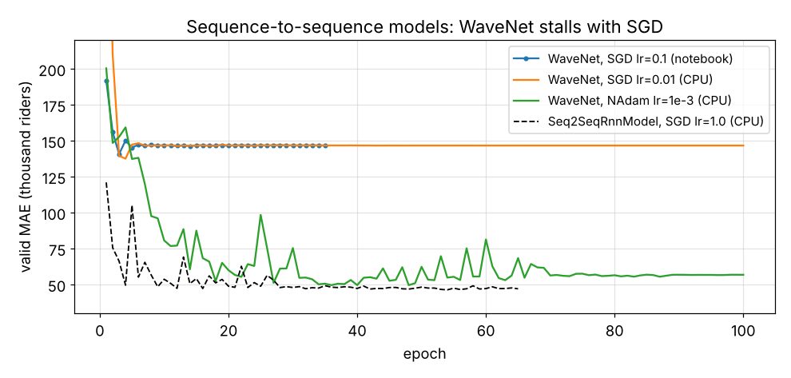

- 학습률을 1/10로 줄여도 SGD + 모멘텀 0.95로는 같은 일이 일어났다. **NAdam**(11장 3-7절)으로 바꾸자 정상적으로 학습해 시퀀스-투-시퀀스 RNN과 비슷한 수준(49,560 vs 46,308)이 됐다
- NAdam은 파라미터마다 그레이디언트 크기로 스텝을 나눠 조절하므로 업데이트 크기가 파라미터별로 고르게 제한된다. 이것이 차이를 만든 것으로 보이지만, 원인을 따로 분리해 확인하지는 않았다
- 다른 해결책(시험하지 않음): ReLU 대신 LeakyReLU·GELU, 층마다 배치·층 정규화, 원래 WaveNet처럼 잔차 연결. 5-3절 바흐 모델은 합성곱 층마다 `BatchNorm1d`를 넣고 NAdam을 쓴다

> 💡 교훈: 훈련 로그에서 **손실이 소수점 넷째 자리까지 그대로**라면 모델이 무언가를 배우다 막힌 것이 아니라 **멈춘** 것이다. 예측값의 분산과 층별 활성 비율을 찍어 보면 바로 진단된다.

### 4-7. 보충 실험: 2 에포크 비교를 50 에포크로

> 🎯 **목적** — 4-1 ~ 4-4절은 2 에포크만 훈련해 셀을 비교할 수 없었다. 같은 설정으로 50 에포크를 돌려 본다.

**보충 실험** — 3-11절의 14일 앞 예측(시퀀스-투-벡터) 데이터, 같은 시드, CPU

| 모델 | 2 에포크 | SGD `lr=0.05` 50 에포크 | NAdam `lr=3e-3` 50 에포크 |
|---|---|---|---|
| 단순 RNN | 114,203 | **32,951** (노트북 3-11절과 같다) | **32,941** |
| LSTM | 171,689 | 88,284 (아직 감소 중) | 36,867 |
| GRU | 141,034 | 67,477 (아직 감소 중) | 35,136 |
| 1D 합성곱 + GRU (단변량, 4-4절) | 157,236 | 67,171 (아직 감소 중) | |

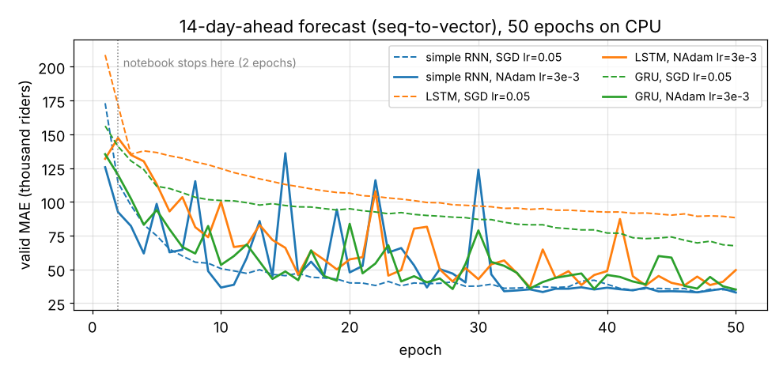

**결과 해석**

- 2 에포크 시점의 순위(RNN < GRU < LSTM)는 50 에포크까지 그대로였지만, **2 에포크 숫자로는 실력을 알 수 없다**. 모두 50 에포크 사이에 2~5배 좋아졌다
- 이 설정(SGD + 모멘텀)에서 LSTM·GRU는 단순 RNN보다 **훨씬 느리게** 학습한다. 학습률 0.05는 단순 RNN에 맞춰 고른 값이고, 셀 종류마다 따로 맞추지 않았다. 원인을 따로 확인하지는 않았다
- NAdam으로 바꾸면 LSTM·GRU도 금방 따라오지만 **단순 RNN을 넘지는 못했다**. 이 문제는 윈도가 56일이고 중요한 정보(1주·2주 전 같은 요일)가 비교적 가깝다. 단순 RNN으로도 충분한 기억 길이라 LSTM·GRU의 장점이 드러나지 않는다
- 정리하면, LSTM·GRU는 **수백 스텝 떨어진 의존성**이 있을 때 진가를 보인다. 짧은 패턴이 중심인 문제라면 단순한 모델부터 시도하고, 옵티마이저와 학습률을 셀 종류에 맞게 다시 고르는 것이 먼저다

> ⚠️ 이 표는 시드 하나, 하이퍼파라미터 탐색 없이 돌린 결과다. 검증 MAE가 에포크마다 크게 흔들리므로(그래프) 수천 명 차이는 의미 있는 차이가 아니다.

---

## 5. 연습문제

### 5-1. 개념 문제 (1~8번)

| 번호 | 질문 | 답 요약 |
|---|---|---|
| 1 | 시퀀스-투-시퀀스·시퀀스-투-벡터·벡터-투-시퀀스 RNN의 응용 분야 | 아래 |
| 2 | RNN 층 입력의 차원 수와 각 차원의 의미, 출력은 | 3차원 `[배치, 타임 스텝, 특성]`, 출력 `[배치, 타임 스텝, 뉴런 수]` |
| 3 | 심층 시퀀스-투-시퀀스 RNN을 파이토치로 만들려면 | `num_layers` / 셀(`nn.RNNCell` 등)로 직접 반복 |
| 4 | 일별 단변량 시계열로 다음 7일을 예측하는 가장 간단한 구조 | 출력 7개인 시퀀스-투-벡터 RNN (또는 시퀀스-투-시퀀스) |
| 5 | RNN 훈련의 주요 어려움과 해결책 | 불안정한 그레이디언트, 짧은 단기 기억 |
| 6 | LSTM 셀의 구조 | 아래 |
| 7 | RNN 안에 1D 합성곱 층을 쓰는 이유 | 병렬화, 그레이디언트 안정, 다운샘플링 |
| 8 | 동영상 분류 신경망 구조 | CNN(프레임별) → 시퀀스-투-벡터 RNN → 소프트맥스 |

**1번 — RNN 응용 분야** (1-3절)

| 형태 | 예 |
|---|---|
| 시퀀스-투-시퀀스 | 날씨(또는 다른 시계열) 예측, 기계 번역(인코더–디코더), 동영상 캡션 생성, 음성 → 텍스트, 음악 생성(또는 다른 시퀀스 생성), 노래의 코드 식별 |
| 시퀀스-투-벡터 | 음악 장르 분류, 서평 감성 분석, 뇌 임플란트 신호로 실어증 환자가 떠올린 단어 예측, 시청 기록으로 사용자가 영화를 볼 확률 예측(추천 시스템의 **협업 필터링** 구현 중 하나) |
| 벡터-투-시퀀스 | 이미지 캡션 생성, 현재 아티스트의 임베딩으로 플레이리스트 생성, 파라미터 집합으로 멜로디 생성, (자율 주행 카메라) 이미지에서 보행자 위치 찾기 |

**2번 — 입력과 출력의 형태** (0절 📌, 3-5절)

- `batch_first=True`이면 입력은 `[배치 크기, 타임 스텝 수, 타임 스텝마다의 특성 수]`
- 예: 타임 스텝 10개, 스텝마다 값 2개(기온, 풍속)인 시계열 5개 → `[5, 10, 2]`
- 출력도 3차원이고 앞의 두 차원은 같으며 마지막 차원이 뉴런 수다. 뉴런 32개 층이면 `[5, 10, 32]`
- `batch_first=False`(기본값)이면 앞의 두 차원이 바뀐다

**3번 — 심층 시퀀스-투-시퀀스 RNN** (3-9절, 4-1 ~ 4-3절)

- 가장 간단하고 효율적인 방법: `nn.RNN`·`nn.LSTM`·`nn.GRU`에 `num_layers`를 원하는 층 수로
- 타임 스텝 사이에 드롭아웃·층 정규화를 넣는 등 더 유연하게 하려면 사용자 정의 모듈에서 반복 루프를 직접 구현한다. `nn.RNNCell`·`nn.LSTMCell`·`nn.GRUCell`을 타임 스텝마다 실행하며 입력과 은닉 상태를 함께 넘긴다

**4번 — 다음 7일 예측** (3-11 ~ 3-12절)

- 가장 간단한 구조: RNN 층을 쌓고 **출력 7개**인 층을 둔다. 시계열에서 무작위 윈도(예: 연속 30일 입력, 다음 7일 값 벡터 타깃)로 훈련 → **시퀀스-투-벡터**
- 또는 **시퀀스-투-시퀀스**: 타깃이 입력과 같은 길이의 시퀀스이고 타임 스텝마다 값 7개($t+1 \ldots t+7$)

**5번 — RNN 훈련의 어려움** (2-2절, 4절)

| 어려움 | 해결책 |
|---|---|
| 불안정한 그레이디언트 (폭주·소실) | 작은 학습률, 포화 활성화 함수(기본값 tanh), 그레이디언트 클리핑, 층 정규화, 타임 스텝마다 드롭아웃 |
| 매우 제한된 단기 기억 | LSTM·GRU 층 (그레이디언트 문제에도 도움) |

- 두 문제 모두 시퀀스가 길수록 심해진다
- 더 최근 구조인 **트랜스포머**(15장)와 **상태 공간 모델**(SSM, 부록 E)은 훨씬 긴 기억을 가진다

**6번 — LSTM 셀의 구조** (4-2절)

- 단기 상태 벡터와 장기 상태 벡터를 가진다
- 타임 스텝마다 입력과 이전 단기 상태가 단순 RNN 셀(주 층)과 **게이트 3개**에 들어간다
   - **삭제 게이트**: 장기 상태에서 무엇을 지울지
   - **입력 게이트**: 단순 RNN 셀 출력의 어느 부분을 장기 상태에 더할지
   - **출력 게이트**: (tanh를 거친) 장기 상태의 어느 부분을 이번 스텝에 출력할지
- 새 단기 상태 = 셀의 출력

**7번 — 1D 합성곱 층을 쓰는 이유** (4-4 ~ 4-5절)

- RNN 층은 본질적으로 순차적이다. 타임 스텝 $t$의 출력을 계산하려면 이전 모든 스텝을 먼저 계산해야 한다 → **병렬화가 불가능**하다(완전히 선형인 RNN, 예를 들어 현대의 SSM은 예외)
- 1D 합성곱 층은 타임 스텝 사이에 상태를 갖지 않아(기억이 없다) **병렬화하기 좋다**. 각 출력은 입력의 작은 윈도만으로 계산된다
- 순환이 아니므로 **불안정한 그레이디언트를 덜 겪는다**
- RNN 앞에서 입력을 효율적으로 **전처리**할 수 있다. 예: 시간 해상도를 줄여(다운샘플링) RNN이 장기 패턴을 감지하도록 돕는다
- 합성곱 층만으로 만들 수도 있다 → WaveNet

**8번 — 동영상 분류 구조**

- 초당 1프레임 정도를 뽑아 모든 프레임을 같은 CNN(예: 사전 훈련된 Xception, 데이터가 적으면 동결)에 통과시킨다
- CNN 출력 시퀀스를 **시퀀스-투-벡터 RNN**에 넣고, 그 출력을 소프트맥스 층에 넣어 클래스 확률을 얻는다. 비용 함수는 크로스 엔트로피
- 오디오도 쓰려면: 스트라이드 있는 1D 합성곱 층을 쌓아 초당 수천 오디오 프레임을 초당 1개로 줄이고(이미지 수에 맞춤), 그 출력을 시퀀스-투-벡터 RNN 입력에 (마지막 차원으로) 이어 붙인다
- 다만 지금은 **트랜스포머와 SSM**이 동영상 분류에 훨씬 좋은 선택이다 (15장, 16장, 부록 E)

### 5-2. 9번: 철도와 버스 승객 수를 함께 예측하기

> 🎯 **목적** — `Seq2SeqRnnModel`을 고쳐 **철도와 버스**의 다음 14일을 함께 예측한다. 출력이 14개에서 28개로 늘어난다.

**코드** — 데이터셋

```python
class Seq2SeqRailBusDataset(torch.utils.data.Dataset):
    def __init__(self, series, window_length, forecast_ahead):
        self.series = series
        self.window_length = window_length
        self.forecast_ahead = forecast_ahead

    def __len__(self):
        return len(self.series) - self.window_length - self.forecast_ahead + 1

    def __getitem__(self, idx):
        if idx >= len(self):
            raise IndexError("dataset index out of range")
        end = idx + self.window_length  # 1st index after window
        window = self.series[idx : end]
        target_period = self.series[idx + 1 : end + self.forecast_ahead, :2]
        target = target_period.unfold(dimension=0, size=self.forecast_ahead,
                                      step=1)
        return window, target

window_length = 56
forecast_ahead = 14
seq2seq_rb_train_set = Seq2SeqRailBusDataset(mulvar_train, window_length,
                                             forecast_ahead)
seq2seq_rb_train_loader = DataLoader(seq2seq_rb_train_set, batch_size=32,
                                     shuffle=True)
seq2seq_rb_valid_set = Seq2SeqRailBusDataset(mulvar_valid, window_length,
                                             forecast_ahead)
seq2seq_rb_valid_loader = DataLoader(seq2seq_rb_valid_set, batch_size=32)
seq2seq_rb_test_set = Seq2SeqRailBusDataset(mulvar_test, window_length,
                                            forecast_ahead)
seq2seq_rb_test_loader = DataLoader(seq2seq_rb_test_set, batch_size=32)
```

| 코드 | 의미 |
|---|---|
| `forecast_ahead` | 14를 하드코딩하지 않고 인자로 |
| `self.series[..., :2]` | 철도·버스 두 열 → `[69, 2]` |
| `.unfold(dimension=0, size=14, step=1)` | 0번 축으로 윈도를 만들고 **윈도 축을 맨 뒤에** 붙인다 → `[56, 2, 14]` (3-12절의 `[56, 14]`에 시계열 축이 추가) |

**코드** — 모델 (LSTM 기반)

```python
class Seq2SeqRailBusModel(nn.Module):
    def __init__(self, input_size, hidden_size, output_length, output_size):
        super().__init__()
        self.rnn = nn.LSTM(input_size, hidden_size, batch_first=True)
        self.output = nn.Linear(hidden_size, output_length * output_size)
        self.output_length = output_length
        self.output_size = output_size

    def forward(self, X):
        B, L, _ = X.shape
        outputs, last_state = self.rnn(X)
        preds = self.output(outputs)
        return preds.view(B, L, self.output_size, self.output_length)

torch.manual_seed(42)
seq2seq_rb_model = Seq2SeqRailBusModel(input_size=5, hidden_size=32,
                                       output_length=14, output_size=2)
seq2seq_rb_model = seq2seq_rb_model.to(device)
fit_and_evaluate(seq2seq_rb_model, seq2seq_rb_train_loader,
                 seq2seq_rb_valid_loader, lr=1.0, n_epochs=65,
                 patience=5, factor=0.5)
# Epoch 1/65, train loss: 0.0532, train metric: 0.2550, valid metric: 0.1607
# ...
# Epoch 62/65, train loss: 0.0034, train metric: 0.0501, valid metric: 0.0472
# ...
# Epoch 65/65, train loss: 0.0033, train metric: 0.0494, valid metric: 0.0501
# 47222.3274409771
```

| 코드 | 의미 |
|---|---|
| `nn.Linear(32, 14 * 2)` | 타임 스텝마다 28개 값 |
| `preds.view(B, L, 2, 14)` | `[B, 56, 28]` → `[B, 56, 2, 14]`. 타깃 형태에 맞춘다. 앞 14개가 철도, 뒤 14개가 버스 |

**결과 해석**

- 검증 MAE **47,222** — 두 시계열 × 56 스텝 × 14일의 평균. 철도만 예측한 `Seq2SeqRnnModel`(47,338)과 거의 같다. 출력을 두 배로 늘렸는데도 비슷한 정확도를 유지했다
- 노트북은 하이퍼파라미터를 거의 조정하지 않았다. 더 오래 훈련하거나 Optuna([10장](10_neural_nets_with_pytorch.md))로 튜닝할 수 있다

```python
seq2seq_rb_model.eval()
with torch.no_grad():
    some_window = mulvar_valid[:window_length]  # shape [56, 5]
    X = some_window.unsqueeze(dim=0)            # shape [1, 56, 5]
    Y_preds = seq2seq_rb_model(X.to(device))    # shape [1, 56, 2, 14]
    Y_pred = Y_preds[0, -1]                     # shape [2, 14]
```

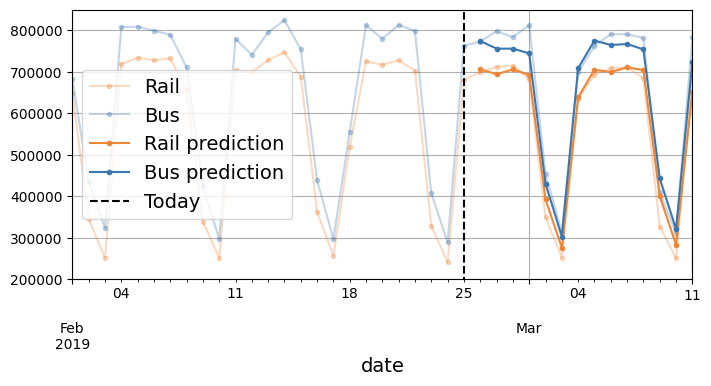

- 2월 26일 ~ 3월 11일의 철도(주황)·버스(파랑) 예측. 두 시계열의 주간 패턴을 모두 따라간다

### 5-3. 10번: 바흐 코랄 생성하기

> 🎯 **목적** — 바흐 코랄 382곡으로 **다음 음을 예측**하는 모델을 훈련하고, 그 예측을 이어 붙여 새 코랄을 생성한다. 14장 char-RNN의 음악 버전이다.

**1단계 — 데이터 적재**

```python
def download_bach_chorales():
    bach_chorales_dir = Path("datasets/jsb_chorales")
    if not bach_chorales_dir.exists():
        tarball_path = Path("datasets/jsb_chorales.tgz")
        if not tarball_path.exists():
            Path("datasets").mkdir(parents=True, exist_ok=True)
            print("Downloading...", end="")
            urllib.request.urlretrieve("https://homl.info/bach", tarball_path)
            print("Done.")
        with tarfile.open(tarball_path) as housing_tarball:
            print("Decompressing...", end="")
            housing_tarball.extractall(path="datasets", filter="data")
            print("Done.")
    return bach_chorales_dir

bach_chorales_dir = download_bach_chorales()

print(Path(bach_chorales_dir / "train" / "chorale_000.csv").read_text()[:84] + "...")
# note0,note1,note2,note3
# 74,70,65,58
# 74,70,65,58
# 74,70,65,58
# 74,70,65,58
# 75,70,58,55
# ...
```

- `train`·`valid`·`test` 폴더에 코랄마다 CSV 파일 하나. 한 행 = 한 타임 스텝(화음) = 성부 4개(소프라노·알토·테너·베이스)의 음 번호

```python
import csv

def load_chorales(bach_chorales_dir):
    chorales = {"train": [], "valid": [], "test": []}
    for subset, chorale_list in chorales.items():
        for chorale_path in sorted((bach_chorales_dir / subset).glob("*.csv")):
            with chorale_path.open() as f:
                reader = csv.reader(f)
                next(reader)  # skip header row
                chorale = [[int(note) for note in row] for row in reader]
                chorale_list.append(torch.tensor(chorale))
    return chorales

chorales = load_chorales(bach_chorales_dir)
chorales["train"][0][:5]
# tensor([[74, 70, 65, 58],
#         [74, 70, 65, 58],
#         [74, 70, 65, 58],
#         [74, 70, 65, 58],
#         [75, 70, 58, 55]])
```

**보충 코드** — 데이터 크기 (데이터를 직접 내려받아 확인)

```python
{k: len(v) for k, v in chorales.items()}
# {'train': 229, 'valid': 76, 'test': 77}
lens = [len(c) for v in chorales.values() for c in v]
min(lens), max(lens), sum(lens) / len(lens)
# (100, 640, 242.2...)
all(len(c) % 4 == 0 for v in chorales.values() for c in v)
# True
```

- 훈련 229곡, 검증 76곡, 테스트 77곡. 곡 길이는 화음 100 ~ 640개(평균 242개)이고 **모두 4의 배수**다(4/4박자)
- 음 범위 36(C2) ~ 81(A5), 0(쉼표)은 전체의 0.35%뿐

**코드** — 소리로 듣기 (간단한 신시사이저)

```python
from IPython.display import Audio

def notes_to_frequencies(notes):
    # Frequency doubles when you go up one octave; there are 12 semi-tones
    # per octave; Note A on octave 4 is 440 Hz, and it is note number 69.
    return 2 ** ((notes - 69) / 12) * 440

def frequencies_to_samples(frequencies, tempo, sample_rate):
    note_duration = 60 / tempo # the tempo is measured in beats per minutes
    frequencies = (note_duration * frequencies).round() / note_duration
    n_samples = int(note_duration * sample_rate)
    time = torch.linspace(0, note_duration, n_samples)
    sine_waves = torch.sin(2 * torch.pi * frequencies.reshape(-1, 1) * time)
    sine_waves *= (frequencies > 9.).reshape(-1, 1)
    return sine_waves.reshape(-1)

def chords_to_samples(chords, tempo, sample_rate):
    freqs = notes_to_frequencies(chords)
    freqs = torch.cat([freqs, freqs[-1:]], dim=0) # make last note a bit longer
    merged = torch.stack([frequencies_to_samples(melody, tempo, sample_rate)
                          for melody in freqs.T]).mean(dim=0)
    n_fade_out_samples = sample_rate * 60 // tempo # fade out last note
    fade_out = torch.linspace(1., 0., n_fade_out_samples)**2
    merged[-n_fade_out_samples:] *= fade_out
    return merged

def play_chords(chords, tempo=160, amplitude=0.1, sample_rate=44100):
    samples = amplitude * chords_to_samples(chords, tempo, sample_rate)
    return display(Audio(samples, rate=sample_rate))
```

| 함수 | 하는 일 |
|---|---|
| `notes_to_frequencies` | 음 번호 → 주파수(Hz). 69번(A4) = 440Hz, 12번(한 옥타브)마다 2배. 36번 ≈ 65.4Hz, 81번 = 880Hz. 쉼표 0 → 약 8.2Hz |
| `frequencies_to_samples` | 성부 하나의 음들을 사인파로. 박자마다 파형이 0 근처에서 끝나도록 주파수를 반올림해 "딸깍" 소리를 줄인다. 9Hz 이하(쉼표 포함)는 무음 |
| `chords_to_samples` | 성부 4개의 파형을 평균해 합치고, 마지막 화음을 늘려 페이드아웃 |
| `play_chords` | 주피터에서 오디오 위젯으로 재생 |

- 노트북 설명대로 MIDI 플레이어 같은 더 간단한 방법도 있다. 이해하지 않아도 되는 부분이다

**전처리 아이디어**

화음 4개 음을 한 번에 예측하면 서로 어울리지 않는 음 조합이 나오기 쉽다(저자가 직접 해 봤다고 한다). 대신 **음 하나씩** 예측한다.

| 단계 | 내용 |
|---|---|
| 아르페지오로 펼치기 | 화음을 연속된 음으로 펼친다: [75, 70, 60, 55], [77, 69, 62, 50] → [75, 70, 60, 55, 77, 69, 62, 50]. 모델은 한 칸 밀린 시퀀스를 예측한다(시퀀스-투-시퀀스) |
| SOS 토큰 | 코랄 맨 앞에 **시작 토큰**(1번)을 붙인다. 아무것도 없이 처음부터 생성할 때 넣을 입력이 생긴다 |
| 음 번호 이동 | 0(쉼표)과 1(SOS)을 뺀 음 36 ~ 81을 **2 ~ 47**로 → 클래스 **48개** |
| 원-핫 인코딩 | 음을 원-핫 벡터로. 14장의 임베딩도 가능하지만 48개는 원-핫으로 충분하다 |
| 위치 특성 3개 | ① 화음 안 음의 순서(0 ~ 3, 즉 성부) ② 화음 번호 mod 4(4/4박자 안의 박) ③ 곡 안의 **진행률**(0 ~ 1). 진행률로 생성할 곡 길이를 조절하고 마무리를 준비하게 한다 |

**코드** — 전처리와 데이터셋

```python
def preprocess_note_indices(note_indices, length=None):
    notes_one_hot = F.one_hot(note_indices, num_classes=48).to(torch.float32)
    if length is None:
        length = len(note_indices)

    idx = torch.arange(len(note_indices), dtype=torch.float32,
                       device=note_indices.device).view(-1, 1) - 1
    return torch.cat([
        notes_one_hot,
        idx % 4,
        idx % 16 // 4,
        idx / (length - 1)
    ], dim=-1)

class BachDataset(torch.utils.data.Dataset):
    def __init__(self, chorales, window_length):
        self.chorales = chorales
        self.windows = []
        sos = torch.tensor([1])
        for chorale in chorales:
            notes = chorale.view(-1)
            note_indices = torch.cat([sos, F.relu(notes - 34)])
            X = preprocess_note_indices(note_indices)
            for index in range(len(notes) - window_length):
                self.windows.append((
                    X[index : index + window_length],
                    note_indices[index + 1 : index + window_length + 1]
                ))

    def __len__(self):
        return len(self.windows)

    def __getitem__(self, index):
        return self.windows[index]

window_length = 128
train_set = BachDataset(chorales["train"], window_length)
valid_set = BachDataset(chorales["valid"], window_length)
test_set = BachDataset(chorales["test"], window_length)
```

| 코드 | 의미 |
|---|---|
| `chorale.view(-1)` | `[화음 수, 4]` → `[화음 수 × 4]`. 행 우선으로 펼치므로 화음 순서대로 아르페지오가 된다 |
| `F.relu(notes - 34)` | 36 ~ 81 → 2 ~ 47, 쉼표 0 → −34 → ReLU로 **0 유지**. ReLU를 `max(x, 0)` 계산에 쓴 재치 있는 한 줄 |
| `idx = arange(...) - 1` | SOS가 위치 −1, 첫 음이 0이 되도록 한 칸 당긴다 |
| `idx % 4` | 화음 안 성부(0 ~ 3) |
| `idx % 16 // 4` | 화음 번호 mod 4: 음 16개 = 화음 4개 = 한 마디 |
| `idx / (length - 1)` | 진행률. 생성할 때는 `length`에 **목표 길이**를 넣어 진행률을 계산한다 |
| 윈도 | 길이 128(화음 32개 = 8마디), 입력 `[128, 51]`, 타깃 = 한 칸 밀린 음 번호 `[128]` |

**보충 코드** — 화음 두 개로 전처리 확인

```python
chords = torch.tensor([[75, 70, 60, 55], [77, 69, 62, 50]])
note_indices = torch.cat([torch.tensor([1]), F.relu(chords.view(-1) - 34)])
note_indices
# tensor([ 1, 41, 36, 26, 21, 43, 35, 28, 16])
X = preprocess_note_indices(note_indices)
X.shape, X[:, 48:]
# torch.Size([9, 51])
# [[3, 3, -0.125],   ← SOS (위치 −1: −1 % 4 = 3, 파이썬 나머지는 음수가 아니다)
#  [0, 0,  0.000],   ← 75 (화음 0, 소프라노)
#  [1, 0,  0.125],
#  [2, 0,  0.250],
#  [3, 0,  0.375],   ← 55 (화음 0, 베이스)
#  [0, 1,  0.500],   ← 77 (화음 1, 소프라노)
#  ...
#  [3, 1,  0.875]]
note_indices.where(note_indices < 2, note_indices + 34)
# tensor([ 1, 75, 70, 60, 55, 77, 69, 62, 50])   ← 원래 음 번호로 복원
```

**코드** — 첫 윈도 확인과 데이터 로더

```python
X, y = train_set[0]
X.shape, y.shape
# (torch.Size([128, 51]), torch.Size([128]))

X[:, :48].argmax(dim=1)
# tensor([ 1, 40, 36, 31, 24, 40, 36, 31, 24, 40, 36, 31, 24, 40, 36, 31, 24, 41, ...])
y
# tensor([40, 36, 31, 24, 40, 36, 31, 24, 40, 36, 31, 24, 40, 36, 31, 24, 41, 36, ...])

torch.manual_seed(42)
batch_size = 32
train_loader = DataLoader(train_set, batch_size=batch_size, shuffle=True)
valid_loader = DataLoader(valid_set, batch_size=batch_size)
test_loader = DataLoader(test_set, batch_size=batch_size)
```

- `y`는 입력 음 번호를 한 칸 앞당긴 것이다(SOS 다음 음부터)
- 윈도 수(보충 코드): 훈련 191,600 / 검증 63,904 / 테스트 65,744. 곡마다 한 음씩 밀며 잘라서 승객 수 데이터보다 훨씬 많다

**2단계 — 모델과 훈련**

작은 WaveNet 같은 구조: 팽창률이 두 배씩 늘어나는 `CausalConv1d` 4개(사이에 배치 정규화) → LSTM 1개(장기 패턴) → 선형 층(음 로짓 48개).

```python
class BachModel(nn.Module):
    def __init__(self, n_inputs=51, conv_dim=32, lstm_dim=64, n_notes=48):
        super().__init__()
        conv_layers = []
        for idx in range(4):
            conv_layers += [
                CausalConv1d(n_inputs, conv_dim, kernel_size=2, dilation=2**idx),
                nn.ReLU(),
                nn.BatchNorm1d(conv_dim),
            ]
            n_inputs = conv_dim

        self.conv_stack = nn.Sequential(*conv_layers)
        self.lstm = nn.LSTM(input_size=conv_dim, hidden_size=lstm_dim, batch_first=True)
        self.output = nn.Linear(lstm_dim, n_notes)

    def forward(self, X):
        Z = X.transpose(1, 2)
        Z = self.conv_stack(Z)
        Z = Z.transpose(1, 2)
        Z, _ = self.lstm(Z)
        Z = self.output(Z)
        return Z.transpose(1, 2)

torch.manual_seed(42)
bach_model = BachModel().to(device)

torch.manual_seed(42)
optimizer = torch.optim.NAdam(bach_model.parameters(), lr=1e-4)
criterion = nn.CrossEntropyLoss()
accuracy = torchmetrics.Accuracy(task="multiclass", num_classes=48).to(device)
history = train(bach_model, optimizer, criterion, accuracy, train_loader,
                valid_loader, n_epochs=5)
```

| 코드 | 의미 |
|---|---|
| `dilation=2**idx` | 1, 2, 4, 8 → 수용장 16음(화음 4개 = 한 마디) |
| `nn.BatchNorm1d(conv_dim)` | `[배치, 채널, 길이]`의 채널마다 정규화. 순환 층이 아닌 합성곱 층 사이라 배치 정규화를 쓸 수 있다(4-1절) |
| `nn.LSTM(32, 64)` | 합성곱 출력 시퀀스에서 긴 패턴을 본다 |
| `Z.transpose(1, 2)` (마지막) | 출력 `[배치, 128, 48]` → `[배치, 48, 128]`. `CrossEntropyLoss`는 **클래스 축이 1번**이어야 한다 (14장 char-RNN의 `permute(0, 2, 1)`과 같다) |
| `NAdam(lr=1e-4)` | 승객 수 모델들의 SGD 대신 NAdam. 4-6절에서 본 것처럼 ReLU 합성곱 스택에 더 안정적이다 |
| `train(...)` | 3-6절의 함수. `mode="min"`인 스케줄러에 **정확도**를 넘기므로 사실상 잘못된 방향이지만 5 에포크에 `patience=10`이라 학습률이 바뀌지 않아 영향은 없다 |

```
Epoch 1/5, train loss: 1.1154, train metric: 0.7213, valid metric: 0.8167
Epoch 2/5, train loss: 0.5759, train metric: 0.8341, valid metric: 0.8269
Epoch 3/5, train loss: 0.5259, train metric: 0.8438, valid metric: 0.8290
Epoch 4/5, train loss: 0.4980, train metric: 0.8501, valid metric: 0.8307
Epoch 5/5, train loss: 0.4780, train metric: 0.8546, valid metric: 0.8319
```

```python
evaluate_tm(bach_model, test_loader, accuracy)
# tensor(0.8254, device='cuda:0')
```

**보충 코드** — 파라미터 수와 비교 기준

```python
{name: sum(p.numel() for p in m.parameters()) for name, m in BachModel().named_children()}
# {'conv_stack': 9792, 'lstm': 25088, 'output': 3120}   합계 38,000

# 나이브 기준: "같은 성부의 이전 화음 음(4칸 전)을 그대로 반복" (검증 윈도의 모든 타깃 위치)
# valid 0.7807, test 0.7640
```

**결과 해석**

| 방법 | 검증 정확도 | 테스트 정확도 |
|---|---|---|
| 나이브: 4칸 전 음 반복 (보충 코드) | 78.1% | 76.4% |
| **BachModel** (5 에포크) | **83.2%** | **82.5%** |

- 다음 음을 83% 맞힌다. 하지만 바흐 코랄은 같은 화음이 여러 박 이어지는 경우가 많아서(첫 윈도도 같은 화음 4번 반복으로 시작한다) **이전 화음의 같은 성부를 그대로 반복**하기만 해도 78%다. 모델이 나이브 기준을 넘어 배운 것은 약 5%p다
- 노트북 설명대로 이 연습문제에서는 테스트 세트가 꼭 필요하지 않다. 최종 평가는 **생성한 음악을 들어 보는 것**이기 때문이다. 테스트 세트를 훈련 세트에 합쳐 다시 훈련해도 된다
- 하이퍼파라미터 탐색은 거의 하지 않았다. LSTM을 `Conv1d` 층으로 바꾸거나 층 수·학습률·옵티마이저를 바꿔 볼 수 있다

**3단계 — 코랄 생성**

```python
def generate_chorale(model, seed_chords, num_chords):
    target_length = num_chords * 4 + 1
    notes = seed_chords.to(device).view(-1)
    sos = torch.tensor([1], dtype=torch.long, device=device)
    note_indices = torch.cat([sos, F.relu(notes - 34)])
    while len(note_indices) < target_length:
        X = preprocess_note_indices(note_indices, target_length)
        with torch.no_grad():
            new_note_logits = model(X.unsqueeze(0))

        new_note_index = new_note_logits[0, :, -1].argmax(keepdim=True)
        note_indices = torch.cat([note_indices, new_note_index])
        print(f"\r{len(note_indices) / target_length:.1%}", end="")

    notes = note_indices.where(note_indices < 2, note_indices + 34)
    return notes[1:].reshape(-1, 4)

seed_chords = chorales["valid"][1][:8]
torch.manual_seed(42)
chorale = generate_chorale(bach_model, seed_chords, 64).cpu()
play_chords(chorale)
```

| 코드 | 의미 |
|---|---|
| `target_length = num_chords * 4 + 1` | 음 수 + SOS. 64화음 = 16마디(4/4박자) |
| `seed_chords` | 검증 코랄 하나의 처음 8화음을 **시작 재료**로 준다 |
| `preprocess_note_indices(note_indices, target_length)` | 진행률을 **목표 길이 기준**으로 계산 → 모델이 곡이 얼마나 남았는지 안다 |
| `new_note_logits[0, :, -1]` | 마지막 위치의 로짓 48개 (출력이 `[1, 48, 길이]`) |
| `.argmax(keepdim=True)` | 가장 확률이 높은 음 하나 → `[1]` (이어 붙이려고 차원 유지) |
| `note_indices.where(note_indices < 2, note_indices + 34)` | 2 ~ 47을 다시 36 ~ 81로. 0·1은 그대로 |
| `notes[1:].reshape(-1, 4)` | SOS를 떼고 4개씩 묶어 화음으로 |

- 매 스텝 **전체 시퀀스를 다시 넣는다**(14장 char-RNN의 생성과 같다). 짧은 곡이라 괜찮지만 비효율적이다
- 문제: 항상 가장 확률이 높은 음을 고르므로 **너무 보수적**이다. 이전 음을 반복하는 것이 대개 "충분히 괜찮은" 선택이라 같은 음을 계속 반복하는 지루한 곡이 되기 쉽고, 몇 번을 실행해도 같은 곡이 나온다

**코드** — 온도 샘플링

```python
def generate_chorale_v2(model, seed_chords, num_chords, temperature=1):
    target_length = num_chords * 4 + 1
    notes = seed_chords.to(device).view(-1)
    sos = torch.tensor([1], dtype=torch.long, device=device)
    note_indices = torch.cat([sos, F.relu(notes - 34)])
    while len(note_indices) < target_length:
        X = preprocess_note_indices(note_indices, target_length)
        with torch.no_grad():
            new_note_logits = model(X.unsqueeze(0))

        new_note_probas = F.softmax(new_note_logits[0, :, -1] / temperature, dim=0)
        new_note_index = torch.multinomial(new_note_probas, num_samples=1)
        note_indices = torch.cat([note_indices, new_note_index])
        print(f"\r{len(note_indices) / target_length:.1%}", end="")

    notes = note_indices.where(note_indices < 2, note_indices + 34)
    return notes[1:].reshape(-1, 4)

seed_chords = chorales["valid"][1][:8]
generated_chorales = {}
for temperature in (0.6, 1.0, 1.1):
    torch.manual_seed(42)
    print("Temperature:", temperature)
    chorale = generate_chorale_v2(bach_model, seed_chords, 52, temperature).cpu()
    generated_chorales[temperature] = chorale
    play_chords(chorale)
```

| 코드 | 의미 |
|---|---|
| `logits / temperature` | **온도**. 높으면 확률이 고르게 퍼져 덜 그럴듯한 음도 뽑힌다(대담), 낮으면 가장 그럴듯한 음에 몰린다(보수적) |
| `torch.multinomial(probas, num_samples=1)` | 확률에 비례해 무작위로 하나 뽑는다. 예: C3 75%, G3 25%면 그 비율로 |
| 온도 0.6 / 1.0 / 1.1 | 차가운 / 보통 / 뜨거운 코랄 |

- 노트북 설명의 `F.multinomial()`은 오타이고 코드처럼 `torch.multinomial()`이 맞다
- 같은 기법이 [14장 1-5절](14_nlp_with_rnns_and_attention.md#1-5-가짜-셰익스피어-텍스트-생성하기)에서 텍스트 생성에 다시 나온다(온도별 확률 분포 그림도 거기 있다)

```python
import soundfile as sf

def save_chorale(filepath, chords, tempo=160, amplitude=0.1, sample_rate=44100):
    samples = amplitude * chords_to_samples(chords, tempo, sample_rate)
    sf.write(filepath, samples, sample_rate)

save_chorale("my_chorale.mp3", generated_chorales[0.6])
```

- `soundfile`(libsndfile)로 오디오 파일 저장. 친구들에게 생성한 코랄과 진짜 코랄을 섞어 보내 어느 것이 진짜인지 맞혀 보게 하는 실험을 제안한다
- 구글의 Coconet 모델(바흐 탄생 기념 구글 두들에 쓰였다)도 참고로 소개한다

### 5-4. 11·12번

| 번호 | 과제 | 노트북 |
|---|---|---|
| 11 | **QuickDraw** 스케치 분류: NDJSON 파일(`json.loads()`)의 펜 획 목록을 하나의 시퀀스로 이어 붙이고, 각 스텝에 (x, y, 현재 획 안의 진행률) 특성 3개를 둔 RNN 분류기 | 빈 셀 |
| 12 | **"yes"/"no" 음성 분류**: 직접 녹음 → `torchaudio.load()`로 읽고 스테레오는 채널 평균으로 모노 → `torchaudio.transforms.Vad`로 단어 단위로 자르기 → `MelSpectrogram`으로 짧은 시퀀스(채널은 많은)로 바꾼 뒤 이진 분류 RNN | 빈 셀 |

노트북에는 문제만 있고 풀이 셀이 비어 있다. 풀이가 공개되면 이 절에 추가한다.

---

## 6. 정리

### 6-1. 전체 흐름

```
[13.1 ~ 13.2 순환 뉴런과 BPTT]
Y(t) = tanh([X(t) Y(t-1)] W + b)   모든 타임 스텝이 같은 W, b를 공유
nn.RNN(input, hidden, batch_first=True) → outputs [B, T, H] (모든 스텝), h [층, B, H] (마지막 스텝)
BPTT = 펼친 네트워크에 역전파 + 같은 가중치의 그레이디언트 합
훈련 전 단순 RNN: 55 스텝 앞 입력의 그레이디언트 ~1e-13  (LSTM 망각 편향 3이면 ~1e-2)

[13.3 시계열 예측]  CTA 일일 승객 수 7,639일 → 철도 / 1e6
나이브 예측 (지난주 같은 요일)          MAE 42,143 (3~5월), MAPE 9.0%
SARIMA(1,0,0)(0,1,1,7), 매일 재훈련       MAE 32,041
TimeSeriesDataset(window=56) → (윈도 [56, 1], 다음 날 [1])   훈련 1,040 / 검증 95 윈도
train(): ReduceLROnPlateau(mode="min"), HuberLoss, MAE 지표, SGD(momentum 0.95)
Flatten + Linear(56, 1)                 → 37,726
SimpleRnnModel (직접 셀 / nn.RNN, 32)    → 30,511 / 30,660   ★ SARIMA 추월
DeepRnnModel (num_layers=3)             → 29,279
다변량 [rail, bus, 내일 요일 원-핫 3]     → 23,227   ★ 최고 (다중 작업: 철도 26,178 / 버스 26,441)
14일 앞: 하나씩 이어 붙이기 / ForecastAheadDataset + output 14 (32,951, 14일 평균)
Seq2Seq: target = series[idx+1 : end+14].unfold(0, 14, 1) → [56, 14],  self.output(outputs)
         → 47,338 (모든 스텝 평균),  마지막 스텝 +1일 23,689 … +14일 35,862 (나이브 4.1~4.4만)

[13.4 긴 시퀀스]
셀 안의 층 정규화 : Linear → LayerNorm → Tanh (직접 만든 셀)
LSTM : 장기 c + 단기 h, 게이트 i·f·o + 주 층 g       nn.LSTM / nn.LSTMCell  (가중치 4블록)
GRU  : 상태 h 하나, 리셋 r · 업데이트 z              nn.GRU / nn.GRUCell    (가중치 3블록)
1D 합성곱 : Conv1d(k=4, s=2) → GRU, window 112 → 55,  target[3::2]
WaveNet : CausalConv1d(k=2, dilation 1·2·4·8 ×2) + ReLU,  수용장 31
         노트북 SGD → 140,761 (죽은 ReLU로 정지)  /  보충: NAdam → 49,560
보충 50 에포크 (14일 앞) : RNN 32,951 · GRU 35,136 · LSTM 36,867 (NAdam)

[연습문제]
9  철도+버스 Seq2Seq (LSTM, 출력 28 → view(B, L, 2, 14))     → 47,222
10 바흐: 아르페지오 + SOS + 원-핫 48 + 위치 3 → CausalConv×4(BN) + LSTM → 83.2% (나이브 78.1%)
   생성: argmax(보수적) → 온도 샘플링 torch.multinomial
```

### 6-2. 개념과 코드 대응

| 단계 | 핵심 코드 | 핵심 원칙 |
|---|---|---|
| 순환 층 | `outputs, h = nn.RNN(in, hid, batch_first=True)(X)` | `outputs` = 마지막 층·모든 스텝, `h` = 모든 층·마지막 스텝 |
| 직접 만든 셀 | `for X_t in X.transpose(0, 1): H = cell(torch.cat((X_t, H), 1))` | 반복 사이에 층을 끼울 때만 |
| 셀 모듈 | `nn.LSTMCell`·`nn.GRUCell` / `H, C = cell(X_t, (H, C))` | 같은 시드면 층 버전과 같은 가중치 |
| 윈도 데이터셋 | `series[idx:idx+L]`, `series[idx+L]` | 시간 순서로 분할, 윈도만 섞기 |
| 다변량 입력 | `df["day_type"].shift(-1)` → `pd.get_dummies(..., dtype=float)` | 미래에 미리 알 수 있는 정보는 입력이 된다 |
| 시퀀스-투-벡터 | `self.output(outputs[:, -1])` | 마지막 스텝의 출력만 |
| 여러 스텝 출력 | `nn.Linear(hidden, 14)` | 오차 누적 없이 한 번에 |
| 시퀀스-투-시퀀스 | `self.output(outputs)`, 타깃 `.unfold(0, 14, 1)` | 모든 스텝에서 손실 → 훈련 신호 증가 |
| 3D에 선형 층 | `nn.Linear`는 마지막 축에만 작용 | = `Conv1d(kernel_size=1)` |
| 회귀 손실·지표 | `nn.HuberLoss()`, `torchmetrics.MeanAbsoluteError()` | 손실과 지표를 따로 |
| 학습률 스케줄 | `ReduceLROnPlateau(mode="min")`, `scheduler.step(val_mae)` | 지표 방향에 맞춰 `mode` |
| 층 정규화 | `nn.Sequential(nn.Linear, nn.LayerNorm, nn.Tanh)` | 배치 정규화 대신 |
| 1D 합성곱 | `conv(X.permute(0, 2, 1)).permute(0, 2, 1)` | 채널 축을 1번으로 |
| 인과적 합성곱 | `F.pad(X, ((k-1)*d, 0))` 또는 양쪽 패딩 후 오른쪽 잘라 내기 | 출력 $t$는 입력 $\le t$만 |
| 생성 | `torch.multinomial(F.softmax(logits / T, 0), 1)` | 온도로 다양성 조절 |

### 6-3. 방법 비교

**순환 셀**

| | 단순 RNN | LSTM | GRU |
|---|---|---|---|
| 상태 | $\mathbf{h}$ | $\mathbf{h}$(단기) + $\mathbf{c}$(장기) | $\mathbf{h}$ |
| 게이트 | 없음 | 입력·삭제·출력 | 리셋·업데이트 |
| 가중치 블록 (파라미터, 입력 5·은닉 32·출력 14) | 1 (1,710) | 4 (5,454) | 3 (4,206) |
| 기억 길이 | 짧다 (약 10 스텝) | 길다 | 길다 |
| 이 장의 14일 예측 (50 에포크, NAdam) | 32,941 | 36,867 | 35,136 |
| 파이토치 | `nn.RNN` / `nn.RNNCell` | `nn.LSTM` / `nn.LSTMCell` | `nn.GRU` / `nn.GRUCell` |

**시퀀스 처리 층**

| | 순환 층 | 1D 합성곱 | 팽창 인과적 합성곱 (WaveNet) |
|---|---|---|---|
| 한 출력이 보는 범위 | 처음부터 지금까지 전부 | 커널 크기 | 팽창률로 지수적으로 넓어지는 수용장 |
| 병렬화 | 불가 (순차) | 가능 | 가능 |
| 그레이디언트 | 시간을 거슬러 소실·폭주 | 층 수만큼만 | 층 수만큼만 |
| 인과성 | 원래 인과적 | 패딩·타깃을 맞춰야 | 왼쪽 패딩으로 보장 |
| 이 장 | 3절 전체, 4-1 ~ 4-3 | 4-4 (다운샘플링) | 4-5, 5-3 |

**여러 스텝 앞 예측**

| 방법 | 출력 | 장점 | 단점 | 이 장 |
|---|---|---|---|---|
| 하나씩 이어 붙이기 | 다음 1스텝 × 반복 | 모델 그대로 | 오차 누적, 다변량 입력에 쓰기 어렵다 | 3-11 ① |
| 시퀀스-투-벡터 | 마지막 스텝에서 14개 | 빠르다, 오차 누적 없음 | 훈련 신호가 마지막 스텝뿐 | 3-11 ② |
| 시퀀스-투-시퀀스 | 모든 스텝에서 14개 | 훈련 신호 풍부, 안정적 | 타깃 준비가 복잡 | 3-12 |

**시계열 기준 모델**

| 방법 | 철도 MAE | 비고 |
|---|---|---|
| 나이브 (지난주 같은 요일) | 42,143 (3~5월) / 41,274 (검증 구간) | 반드시 먼저 계산할 기준선 |
| SARIMA | 32,041 | 매일 재훈련, 하이퍼파라미터 7개 |
| 선형 모델 | 37,726 | |

### 6-4. 주요 결과

| 실험 | 지표 | 값 |
|---|---|---|
| 데이터 | 일수 (중복 제거 후) | 7,639 |
| 훈련 / 검증 / 테스트 | 일수 | 1,096 / 151 / 914 |
| 윈도 56 데이터셋 | 훈련 / 검증 윈도 | 1,040 / 95 |
| 나이브 예측 (3~5월) | 철도 MAE / MAPE | 42,143 / 9.0% |
| 나이브 예측 (3~5월) | 버스 MAE / MAPE | 43,916 / 8.3% |
| SARIMA(1,0,0)(0,1,1,7) | 6월 1일 예측 / 실제 | 427,759 / 379,044 |
| SARIMA 매일 재훈련 | 철도 MAE | 32,041 |
| 선형 모델 (57 파라미터) | 검증 MAE | 37,726 |
| 단순 RNN 직접 셀 (1,121) | 최고 검증 MAE | 30,511 |
| 단순 RNN `nn.RNN` (1,153) | 최고 검증 MAE | 30,660 |
| 심층 RNN 3층 (5,377) | 최고 검증 MAE | 29,279 |
| **다변량 RNN** (1,281) | 최고 검증 MAE | **23,227** |
| 다중 작업 RNN (철도 / 버스) | 검증 MAE | 26,178 / 26,441 |
| 14일 앞 시퀀스-투-벡터 | 최고 검증 MAE (14일 평균) | 32,951 |
| 14일 앞 시퀀스-투-시퀀스 | 최고 검증 MAE (모든 스텝 평균) | 47,338 |
| 〃 마지막 스텝 | +1일 / +7일 / +14일 MAE | 23,689 / 39,105 / 35,862 |
| 2 에포크: RNN+LN / LSTM / GRU / Conv1d+GRU | 검증 MAE | 143,810 / 171,689 / 141,034 / 157,236 |
| WaveNet (15,374 파라미터, 수용장 31) | 최고 검증 MAE | 140,761 (학습 정지) |
| WaveNet + NAdam (보충) | 최고 검증 MAE | 49,560 |
| 14일 앞 50 에포크 NAdam (보충) | RNN / GRU / LSTM | 32,941 / 35,136 / 36,867 |
| 연습문제 9 철도+버스 Seq2Seq | 최고 검증 MAE | 47,222 |
| 연습문제 10 바흐 (38,000 파라미터) | 검증 / 테스트 정확도 | 83.19% / 82.54% |
| 바흐 나이브 (4칸 전 음 반복, 보충) | 검증 / 테스트 정확도 | 78.1% / 76.4% |

### 6-5. 자주 쓴 코드 패턴

| 패턴 | 용도 | 위치 |
|---|---|---|
| `df.sort_values("date").set_index("date")`, `df["2019-03":"2019-05"]` | 날짜 인덱스 슬라이싱 (양 끝 포함) | 3-1, 3-2 |
| `df.shift(7)`, `df.diff(7)` | 시차·차분 | 3-2 |
| `df.resample('ME').mean()`, `.rolling(window=12).mean()` | 월 단위 집계, 이동 평균 | 3-3 |
| `ARIMA(series.asfreq("D"), order=..., seasonal_order=...).fit().forecast()` | SARIMA | 3-4 |
| `torch.FloatTensor(df[["rail"]][...].values / 1e6)` | 시계열 → `[일수, 1]` 텐서, 스케일링 | 3-5 |
| `class ...Dataset(TimeSeriesDataset)` + `super().__getitem__(idx)` | 타깃만 바꾼 데이터셋 | 3-10 ~ 3-12, 4-4 |
| `fit_and_evaluate(model, train_loader, valid_loader, lr, ...)` | 후버 손실 + SGD + MAE, 최고 점수 반환 | 3-8 ~ 4-5 |
| `outputs, last_state = self.rnn(X)` → `self.output(outputs[:, -1])` | 시퀀스-투-벡터 | 3-8 ~ 4-3 |
| `self.output(outputs)` | 시퀀스-투-시퀀스 | 3-12, 4-4, 5-2 |
| `X.unsqueeze(dim=0)` / `y.unsqueeze(dim=1)` | 배치 축 / 시간 축 추가 | 3-11 |
| `tensor.unfold(dimension=0, size=14, step=1)` | 슬라이딩 윈도 타깃 | 3-12, 5-2 |
| `X.permute(0, 2, 1)` → `nn.Conv1d` → `.permute(0, 2, 1)` | 합성곱용 축 바꾸기 | 4-4, 4-5, 5-3 |
| `F.pad(X, (left, 0))` | 왼쪽만 패딩 (인과적) | 4-5 |
| `(Z > 0).float().amax(dim=(0, 2)) == 0` | 죽은 ReLU 채널 찾기 | 4-6 |
| `F.relu(notes - 34)` / `x.where(x < 2, x + 34)` | 음 번호 이동과 복원 | 5-3 |
| `torch.multinomial(F.softmax(logits / T, dim=0), num_samples=1)` | 온도 샘플링 | 5-3 |

### 6-6. 핵심 원칙

1. RNN은 **같은 가중치를 타임 스텝마다 반복**하며 은닉 상태로 과거를 요약한다. 그래서 임의 길이의 시퀀스를 처리하고, 펼치면 시퀀스 길이만큼 깊은 네트워크가 된다.
2. 순환 층의 두 출력을 구분한다. **`outputs`(모든 스텝)** 는 시퀀스-투-시퀀스에, **마지막 스텝**은 시퀀스-투-벡터에 쓴다.
3. 시계열 모델을 만들기 전에 **나이브 예측**(지난 주기의 값)과 고전 통계 모델(SARIMA)로 기준선을 만든다. 생각보다 이기기 어렵다.
4. 시계열은 **시간 순서로** 나누고, 지표는 같은 구간에서 비교한다. MAE는 해석하기 쉽고, MAPE는 규모가 다른 시계열을 비교할 때 쓴다.
5. 모델을 키우는 것보다 **입력 정보**를 늘리는 것이 더 효과적일 수 있다. 내일의 요일 종류처럼 **미래에 미리 알 수 있는 정보**는 훌륭한 특성이다 (29,279 → 23,227).
6. 여러 스텝을 예측할 때는 한 번에 출력하고, 가능하면 **모든 타임 스텝에서 예측(시퀀스-투-시퀀스)** 하도록 훈련해 훈련 신호를 늘린다. 평가는 마지막 스텝·예측 거리별로 따로 본다.
7. 긴 시퀀스의 **불안정한 그레이디언트**에는 tanh, 작은 학습률, 그레이디언트 클리핑, 층 정규화를, **짧은 기억**에는 장기 상태 경로가 있는 LSTM·GRU를 쓴다. 그래도 수백 스텝을 넘으면 어렵다.
8. **1D 합성곱**은 병렬로 계산되고 그레이디언트가 안정적이다. 스트라이드로 시퀀스를 줄여 RNN을 돕거나, **팽창 인과적 합성곱**(WaveNet)만으로 긴 수용장을 만든다.
9. 훈련 결과를 숫자 하나로 믿지 않는다. 2 에포크 비교, 흔들리는 검증 점수 중 최고값, **손실이 꼼짝하지 않는 로그**(죽은 ReLU)는 모두 의심할 신호다. 예측값의 분산과 층별 활성 비율을 찍어 보면 원인이 보인다.
10. 생성 모델은 다음 값을 예측하는 모델을 **자기 출력으로 반복 호출**한 것이다. 가장 그럴듯한 값만 고르면 반복적이 되므로 **온도 샘플링**으로 다양성을 조절한다 → 14장 텍스트 생성으로 이어진다.

### 6-7. 5분 셀프 테스트

> 🧠 답을 보기 전에 **소리 내어** 먼저 답해 보자. 막히면 그 개념이 나온 절로 돌아가서 다시 읽고 오면 된다. 정답은 ▶를 눌러 펼친다.

**Q1. RNN을 시간 축으로 펼쳤을 때 일반 심층 신경망과 다른 점은?**

<details><summary>정답 보기</summary>

모든 타임 스텝의 층이 **같은 가중치를 공유**한다. 그래서 그레이디언트도 모든 스텝에서 합산된다.

</details>

**Q2. 시계열 모델을 나이브 예측과 꼭 비교해야 하는 이유는?**

<details><summary>정답 보기</summary>

계절성이 강한 데이터에서는 "지난 주기와 같다"는 단순 예측도 매우 정확할 수 있다. 복잡한 모델이 이를 못 이기면 쓸 이유가 없다.

</details>

**Q3. 시계열 데이터를 무작위로 섞어 훈련·테스트로 나누면 안 되는 이유는?**

<details><summary>정답 보기</summary>

미래 데이터가 훈련에 들어가 과거를 예측하는 **누수**가 생긴다. 실제 상황(과거로 미래 예측)과 달라 성능이 부풀려진다. 시간 순서대로 나눈다.

</details>

**Q4. LSTM의 세 게이트는 각각 무엇을 결정하나?**

<details><summary>정답 보기</summary>

삭제 게이트: 장기 상태에서 **무엇을 지울지**. 입력 게이트: 새 정보 중 **무엇을 장기 상태에 더할지**. 출력 게이트: 장기 상태에서 **무엇을 이번 출력으로 내보낼지**.

</details>

**Q5. LSTM의 장기 상태가 정보를 오래 보존하는 이유는?**

<details><summary>정답 보기</summary>

장기 상태는 원소별 곱(삭제 게이트)과 덧셈(입력 게이트)만 거치고 행렬 곱·활성화 함수를 지나지 않는다. 삭제 게이트가 1에 가까우면 거의 그대로 다음 스텝으로 전달된다.

</details>

**Q6. WaveNet이 팽창 합성곱을 쓰는 이유는?**

<details><summary>정답 보기</summary>

팽창률을 1, 2, 4, 8…로 두 배씩 키우며 쌓으면 층 수에 대해 **수용 범위가 지수적으로** 넓어진다. 적은 층으로 아주 긴 과거를 볼 수 있다.

</details>

---

> ➡️ **다음 장 — [14장. RNN과 어텐션을 사용한 자연어 처리](14_nlp_with_rnns_and_attention.md)**  
> 이 장의 시퀀스는 승객 수와 음표 번호였다. 14장은 같은 순환 층에 **텍스트**를 넣는다. 텍스트를 토큰 → ID → 임베딩으로 바꾸고, 바흐 코랄처럼 다음 글자를 예측해 셰익스피어 문체를 생성하고(char-RNN), 감성을 분류하고, 이 장에서 이름만 나온 **인코더–디코더**로 번역한 뒤, RNN의 짧은 기억을 넘어서는 **어텐션**을 붙인다.

[← 12장. 합성곱 신경망을 사용한 심층 컴퓨터 비전](12_deep_computer_vision_with_cnns.md) · [📚 전체 목차](../README.md) · [📖 용어집](glossary.md) · [14장. RNN과 어텐션을 사용한 자연어 처리 →](14_nlp_with_rnns_and_attention.md)
