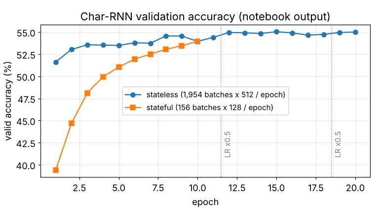
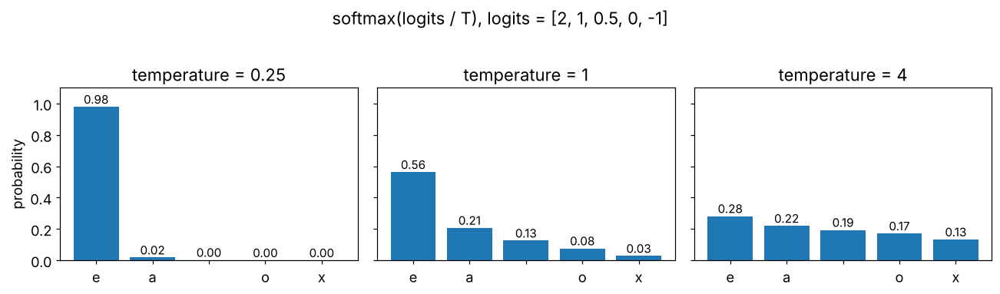
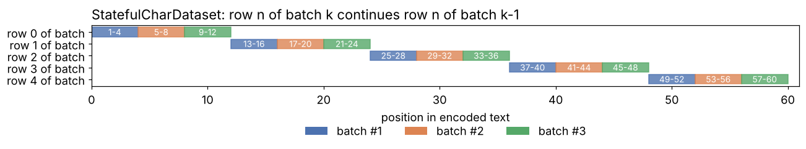
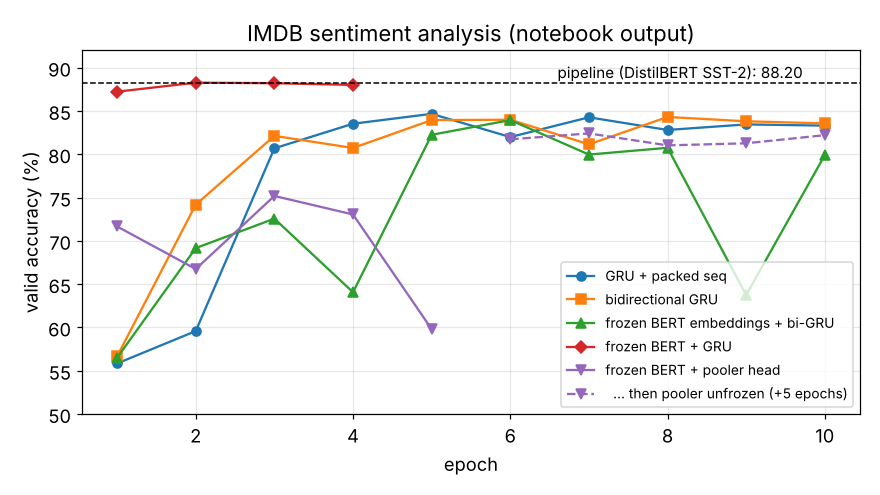
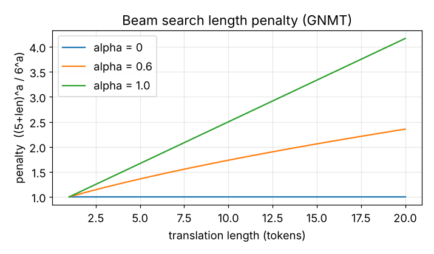
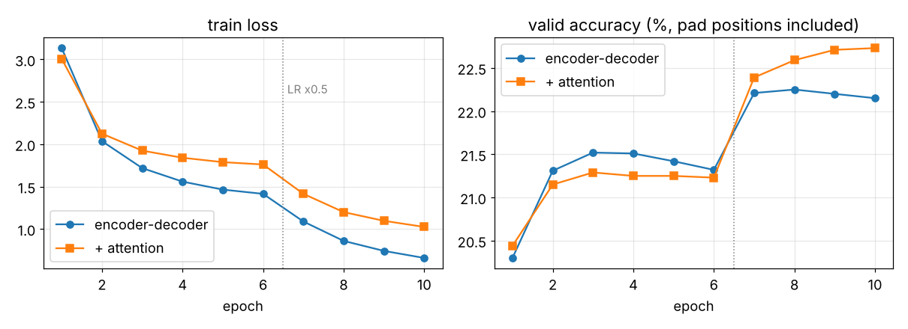

# 14장. RNN과 어텐션을 사용한 자연어 처리

[← 13장. RNN과 CNN을 사용한 시퀀스 처리](13_processing_sequences_using_rnns_and_cnns.md) · [📚 전체 목차](../README.md) · [15장. 자연어 처리와 챗봇을 위한 트랜스포머 →](15_transformers_for_nlp_and_chatbots.md)

> 📘 **교재** 『핸즈온 머신러닝 with 사이킷런, 파이토치』 14장 · 노트북 `14_nlp_with_rnns_and_attention.ipynb`
>
> 13장의 RNN은 숫자 시퀀스(시계열)를 다뤘다. 14장은 같은 RNN에 **텍스트**를 넣는다. 텍스트는 숫자가 아니므로 먼저 **토큰으로 자르고 → 정수 ID로 바꾸고 → 임베딩 벡터로 바꾸는** 단계가 필요하다. 그다음 RNN으로 텍스트를 **생성**하고, **분류**하고, 다른 언어로 **번역**한다. 마지막으로 RNN의 기억력 한계를 넘어서는 **어텐션 메커니즘**을 붙인다.
>
> - **14.1** 문자 단위 RNN(char-RNN)으로 다음 글자를 예측해 **셰익스피어 문체의 텍스트를 생성**한다. 임베딩, 온도 샘플링, 상태가 있는 RNN
> - **14.2** IMDB 영화 리뷰 **감성 분석**. 서브워드 토큰화(BPE·BBPE·WordPiece·유니그램), 패킹된 시퀀스, 양방향 RNN, **사전 훈련된 임베딩·언어 모델(BERT) 재사용**, 허깅 페이스의 작업별 클래스·`Trainer`·`pipeline`
> - **14.3** 영어 → 스페인어 **신경망 기계 번역(NMT)**. 인코더–디코더 구조, 교사 강요, 탐욕적 디코딩과 **빔 검색**
> - **14.4** 디코더가 매 스텝 입력 문장의 필요한 부분을 골라 보는 **어텐션 메커니즘**(루옹 어텐션)
>
> ⬅️ **앞에서** [13장](13_processing_sequences_using_rnns_and_cnns.md)의 순환 층(`nn.GRU`)과 "**은닉 상태**를 다음 타임 스텝으로 넘긴다"는 RNN의 기본 동작을 그대로 쓴다(처음 나올 때 한 줄씩 다시 설명한다). 훈련 루프·`torchmetrics`·`state_dict` 저장은 [10장](10_neural_nets_with_pytorch.md), [NAdam](11_training_deep_neural_networks.md#3-7-adamax-nadam-adamw)·[학습률 스케줄](11_training_deep_neural_networks.md)·[전이 학습(동결)](11_training_deep_neural_networks.md#2-5-층-재사용--동결--미세-튜닝)은 11장, 사전 훈련 모델을 가져다 쓰는 방식은 [12장 7~8절](12_deep_computer_vision_with_cnns.md#7-torchvision의-사전-훈련-모델-사용하기-127)과 같다.  
> ➡️ **다음으로** 14.4의 어텐션은 아직 RNN에 **덧붙인** 부품이다. 15장은 RNN을 아예 걷어 내고 **어텐션만으로** 만든 트랜스포머로 넘어간다. 이 장에서 이름만 등장한 BERT·GPT-2가 바로 트랜스포머다.

## 이 장의 흐름

| 단계 | 절 | 핵심 질문 | 결과물 |
|---|---|---|---|
| 1. 문자 데이터셋 | 14.1 | 텍스트를 RNN이 먹을 수 있는 텐서로 어떻게 바꾸는가 | 문자 39개 어휘, `CharDataset`(길이 50 윈도 → 한 글자 밀린 타깃) |
| 2. 임베딩 | 14.1 | 정수 ID를 어떤 벡터로 바꿔 넣는가 | `nn.Embedding(어휘 크기, 차원)` — 훈련되는 조회 테이블 |
| 3. char-RNN | 14.1 | 다음 글자를 예측하는 모델은 | `ShakespeareModel`(임베딩 → GRU 2층 → 선형), 검증 정확도 **55.0%** |
| 4. 텍스트 생성 | 14.1 | 예측을 이어 붙여 글을 쓰려면 | `torch.multinomial` + **온도**, `extend_text()` |
| 5. 상태가 있는 RNN | 14.1 | 윈도보다 긴 패턴을 배우려면 | `StatefulCharDataset`, 배치 사이에 은닉 상태 유지 |
| 6. 토큰화 | 14.2 | 단어도 문자도 아닌 단위로 자르려면 | 허깅 페이스 `tokenizers`로 BPE·BBPE·WordPiece·유니그램 훈련, 사전 훈련된 토크나이저(GPT-2·BERT·ALBERT) |
| 7. 감성 분석 RNN | 14.2 | 길이가 제각각인 리뷰를 어떻게 배치로 묶고 분류하는가 | 패딩 + 어텐션 마스크, **패킹된 시퀀스**, **양방향 GRU** → 검증 정확도 약 84% |
| 8. 사전 훈련 재사용 | 14.2 | 남이 학습한 임베딩·언어 모델을 쓰면 | BERT 임베딩 + GRU, **BERT 출력** + GRU → 검증 정확도 **88.3%** |
| 9. 허깅 페이스 도구 | 14.2 | 더 짧은 코드로 같은 일을 하려면 | `BertForSequenceClassification`, `Trainer`, `pipeline` (88.2%) |
| 10. 인코더–디코더 | 14.3 | 길이가 다른 문장으로 번역하려면 | `NmtModel`(인코더 GRU의 마지막 상태 → 디코더 GRU), 교사 강요 |
| 11. 디코딩 | 14.3 | 번역문을 한 토큰씩 어떻게 고르는가 | 탐욕적 `translate()`, `beam_search()` + 길이 페널티 |
| 12. 어텐션 | 14.4 | 긴 문장도 잊지 않으려면 | `attention(query, key, value)`, `NmtModelWithAttention` → 긴 문장 번역 개선 |

## 데이터

| 데이터 | 형태 | 사용 절 | 비고 |
|---|---|---|---|
| 셰익스피어 작품 텍스트 (`homl.info/shakespeare`) | 문자열 1개, 1,115,394자 | 14.1 | 안드레이 카파시의 char-RNN 프로젝트에서 쓴 데이터. 앞 100만 자 훈련 / 6만 자 검증 / 나머지 55,394자 테스트 |
| IMDB 영화 리뷰 (`load_dataset("imdb")`) | `{"text": 리뷰, "label": 0 또는 1}` | 14.2 | 원래 훈련 25,000 → **훈련 20,000 / 검증 5,000**으로 나눔, 테스트 25,000. 레이블 1 = 긍정, 0 = 부정. 클래스가 반반이다 |
| Tatoeba 영어–스페인어 (`ageron/tatoeba_mt_train`, `eng-spa`) | `{"source_text": 영어, "target_text": 스페인어, ...}` | 14.3 ~ 14.4 | 원래의 검증 분할 197,299쌍을 **훈련 157,839 / 검증 39,460**으로 나눔, 테스트 24,514쌍 |
| 사전 훈련 모델 (허깅 페이스 허브) | | 14.2, 추가 자료 | `bert-base-uncased`, `gpt2`, `albert-base-v2`, `distilbert-base-uncased-finetuned-sst-2-english` 등. 처음 쓸 때 내려받는다 |

> 📌 이 장의 텐서 형태는 대부분 **`[배치, 시퀀스 길이]`**(토큰 ID) → 임베딩 뒤 **`[배치, 시퀀스 길이, 임베딩 차원]`** 이다. 순환 층을 모두 `batch_first=True`로 만들기 때문이다(기본값 `False`이면 `[시퀀스 길이, 배치, 차원]`). 단, 순환 층이 돌려주는 **은닉 상태는 `batch_first`와 상관없이 `[층 수 × 방향 수, 배치, 은닉 차원]`** 이라는 점을 장 내내 주의해야 한다.

## 목차

- [0. 준비](#0-준비)
- [1. char-RNN으로 셰익스피어 문체 생성하기 (14.1)](#1-char-rnn으로-셰익스피어-문체-생성하기-141)
   - [1-1. 훈련 데이터셋 만들기](#1-1-훈련-데이터셋-만들기)
   - [1-2. 임베딩](#1-2-임베딩)
   - [1-3. char-RNN 모델 만들기](#1-3-char-rnn-모델-만들기)
   - [1-4. 훈련과 결과](#1-4-훈련과-결과)
   - [1-5. 가짜 셰익스피어 텍스트 생성하기](#1-5-가짜-셰익스피어-텍스트-생성하기)
   - [1-6. 상태가 있는 RNN](#1-6-상태가-있는-rnn)
- [2. 허깅 페이스 라이브러리를 사용한 감성 분석 (14.2)](#2-허깅-페이스-라이브러리를-사용한-감성-분석-142)
   - [2-1. IMDB 데이터셋 적재](#2-1-imdb-데이터셋-적재)
   - [2-2. 토큰화의 세 가지 단위](#2-2-토큰화의-세-가지-단위)
   - [2-3. BPE 토크나이저 훈련](#2-3-bpe-토크나이저-훈련)
   - [2-4. 보충 코드: BPE 병합을 손으로 따라가기](#2-4-보충-코드-bpe-병합을-손으로-따라가기)
   - [2-5. 인코딩과 디코딩](#2-5-인코딩과-디코딩)
   - [2-6. 배치 처리: 패딩·잘라내기·어텐션 마스크](#2-6-배치-처리-패딩잘라내기어텐션-마스크)
   - [2-7. BBPE](#2-7-bbpe)
   - [2-8. WordPiece](#2-8-wordpiece)
   - [2-9. 유니그램 언어 모델](#2-9-유니그램-언어-모델)
   - [2-10. 사전 훈련된 토크나이저](#2-10-사전-훈련된-토크나이저)
   - [2-11. 감성 분석 모델 만들기](#2-11-감성-분석-모델-만들기)
   - [2-12. 패킹된 시퀀스](#2-12-패킹된-시퀀스)
   - [2-13. 양방향 RNN](#2-13-양방향-rnn)
   - [2-14. 사전 훈련된 임베딩 재사용](#2-14-사전-훈련된-임베딩-재사용)
   - [2-15. 사전 훈련된 언어 모델 재사용](#2-15-사전-훈련된-언어-모델-재사용)
   - [2-16. 작업별 클래스](#2-16-작업별-클래스)
   - [2-17. 트레이너 API](#2-17-트레이너-api)
   - [2-18. 파이프라인](#2-18-파이프라인)
- [3. 신경망 기계 번역을 위한 인코더-디코더 네트워크 (14.3)](#3-신경망-기계-번역을-위한-인코더-디코더-네트워크-143)
   - [3-1. 인코더–디코더 구조](#3-1-인코더디코더-구조)
   - [3-2. 데이터셋과 토크나이저](#3-2-데이터셋과-토크나이저)
   - [3-3. 배치 만들기와 교사 강요](#3-3-배치-만들기와-교사-강요)
   - [3-4. NMT 모델](#3-4-nmt-모델)
   - [3-5. 훈련과 결과](#3-5-훈련과-결과)
   - [3-6. 번역하기: 탐욕적 디코딩](#3-6-번역하기-탐욕적-디코딩)
   - [3-7. 빔 검색](#3-7-빔-검색)
- [4. 어텐션 메커니즘 (14.4)](#4-어텐션-메커니즘-144)
   - [4-1. 병목 문제와 어텐션의 아이디어](#4-1-병목-문제와-어텐션의-아이디어)
   - [4-2. 바다나우 어텐션과 루옹 어텐션](#4-2-바다나우-어텐션과-루옹-어텐션)
   - [4-3. 점곱 어텐션 구현](#4-3-점곱-어텐션-구현)
   - [4-4. 보충 코드: 어텐션 가중치와 패딩 마스크](#4-4-보충-코드-어텐션-가중치와-패딩-마스크)
   - [4-5. 어텐션을 추가한 NMT 모델](#4-5-어텐션을-추가한-nmt-모델)
   - [4-6. 훈련과 번역 결과](#4-6-훈련과-번역-결과)
- [5. 추가 자료: 사전 훈련된 임베딩 탐색](#5-추가-자료-사전-훈련된-임베딩-탐색)
- [6. 연습문제](#6-연습문제)
   - [6-1. 개념 문제 (1~6번)](#6-1-개념-문제-16번)
   - [6-2. 7번 이후](#6-2-7번-이후)
- [7. 정리](#7-정리)
   - [7-1. 전체 흐름](#7-1-전체-흐름)
   - [7-2. 개념과 코드 대응](#7-2-개념과-코드-대응)
   - [7-3. 방법 비교](#7-3-방법-비교)
   - [7-4. 주요 결과](#7-4-주요-결과)
   - [7-5. 자주 쓴 코드 패턴](#7-5-자주-쓴-코드-패턴)
   - [7-6. 핵심 원칙](#7-6-핵심-원칙)

---

## 0. 준비

```python
import sys
assert sys.version_info >= (3, 10)

IS_COLAB = "google.colab" in sys.modules
IS_KAGGLE = "kaggle_secrets" in sys.modules

if IS_COLAB:
    %pip install -q torchmetrics

from packaging.version import Version
import torch
assert Version(torch.__version__) >= Version("2.6.0")

if torch.cuda.is_available():
    device = "cuda"
elif torch.backends.mps.is_available():
    device = "mps"
else:
    device = "cpu"

device
# 'cuda'

if device == "cpu":
    print("Neural nets can be very slow without a hardware accelerator.")
    if IS_COLAB:
        print("Go to Runtime > Change runtime and select a GPU hardware "
              "accelerator.")
    if IS_KAGGLE:
        print("Go to Settings > Accelerator and select GPU.")

import matplotlib.pyplot as plt
plt.rc('font', size=14)
plt.rc('axes', labelsize=14, titlesize=14)
plt.rc('legend', fontsize=14)
plt.rc('xtick', labelsize=10)
plt.rc('ytick', labelsize=10)
```

모든 장 노트북 맨 앞에 반복되는 환경 확인 + 그래프 글꼴 설정. 각 줄의 의미는 [1장 0. 준비](01_the_machine_learning_landscape.md#0-준비), 장치 선택은 [10장 1-5절](10_neural_nets_with_pytorch.md#1-5-하드웨어-가속), CPU 경고는 [12장 0. 준비](12_deep_computer_vision_with_cnns.md#0-준비) 참고. 이 장에서는 그래프를 거의 그리지 않는다. 대신 노트북 맨 앞에 두 함수를 더 정의한다.

**코드** — 훈련·평가 함수 (12장 버전에 두 가지가 추가됐다)

```python
import torchmetrics

def evaluate_tm(model, data_loader, metric):
    model.eval()
    metric.reset()
    with torch.no_grad():
        for X_batch, y_batch in data_loader:
            X_batch, y_batch = X_batch.to(device), y_batch.to(device)
            y_pred = model(X_batch)
            metric.update(y_pred, y_batch)
    return metric.compute()

def train(model, optimizer, loss_fn, metric, train_loader, valid_loader,
          n_epochs, patience=2, factor=0.5, epoch_callback=None):
    scheduler = torch.optim.lr_scheduler.ReduceLROnPlateau(
        optimizer, mode="max", patience=patience, factor=factor)
    history = {"train_losses": [], "train_metrics": [], "valid_metrics": []}
    for epoch in range(n_epochs):
        total_loss = 0.0
        metric.reset()
        model.train()
        if epoch_callback is not None:
            epoch_callback(model, epoch)
        for index, (X_batch, y_batch) in enumerate(train_loader):
            X_batch, y_batch = X_batch.to(device), y_batch.to(device)
            y_pred = model(X_batch)
            loss = loss_fn(y_pred, y_batch)
            total_loss += loss.item()
            loss.backward()
            optimizer.step()
            optimizer.zero_grad()
            metric.update(y_pred, y_batch)
            train_metric = metric.compute().item()
            print(f"\rBatch {index + 1}/{len(train_loader)}", end="")
            print(f", loss={total_loss/(index+1):.4f}", end="")
            print(f", {train_metric=:.2%}", end="")
        history["train_losses"].append(total_loss / len(train_loader))
        history["train_metrics"].append(train_metric)
        val_metric = evaluate_tm(model, valid_loader, metric).item()
        history["valid_metrics"].append(val_metric)
        scheduler.step(val_metric)
        print(f"\rEpoch {epoch + 1}/{n_epochs},                      "
              f"train loss: {history['train_losses'][-1]:.4f}, "
              f"train metric: {history['train_metrics'][-1]:.2%}, "
              f"valid metric: {history['valid_metrics'][-1]:.2%}")
    return history
```

12장 [5-3절](12_deep_computer_vision_with_cnns.md#5-3-훈련과-결과)의 `train()`과 뼈대는 같다. 달라진 것:

| 코드 | 의미 |
|---|---|
| `ReduceLROnPlateau(optimizer, mode="max", patience=2, factor=0.5)` | **성능 기반 학습률 스케줄**([11장](11_training_deep_neural_networks.md)). 검증 지표가 최고 기록을 `patience`(2) 에포크 넘게 갱신하지 못하면 학습률에 `factor`(0.5)를 곱한다. 지표가 정확도라 클수록 좋으므로 `mode="max"` |
| `scheduler.step(val_metric)` | 에포크가 끝날 때마다 검증 지표를 스케줄러에 알려 준다 |
| `epoch_callback=None` | 에포크 시작마다 호출할 함수(선택). 1-6절의 상태가 있는 RNN에서 **에포크마다 은닉 상태를 초기화**하는 데 쓴다 |
| `print(f"\r...", end="")` | 배치마다 같은 줄을 덮어써 진행 상황을 보여 준다. `\r`은 줄 맨 앞으로 커서를 되돌린다. `{train_metric=:.2%}`는 `train_metric=58.32%`처럼 **변수 이름과 값을 함께** 찍는 f-문자열 문법 |
| `{...:.2%}` | 정확도를 백분율로 출력 (12장까지는 소수 `0.9142` 형식이었다) |

> 💡 이 장의 훈련 로그에는 **학습률이 반으로 줄어든 순간**이 보인다. 예: char-RNN(1-4절)은 11 에포크 뒤에 학습률이 줄어 12 에포크의 훈련 손실이 1.3137 → 1.3049로 한 번 더 뚝 떨어지고, NMT 모델(3-5절)은 6 에포크 뒤에 줄어 7 에포크의 손실이 1.41 → 1.09로 떨어진다.

**코드** — GPU 메모리 정리 함수

```python
import gc

def del_vars(variable_names=[]):
    for name in variable_names:
        try:
            del globals()[name]
        except KeyError:
            pass  # ignore variables that have already been deleted
    gc.collect()
    if device == "cuda":
        torch.cuda.empty_cache()
```

| 코드 | 의미 |
|---|---|
| `del globals()[name]` | 이름(문자열)으로 전역 변수를 지운다. 이미 지워졌으면 `KeyError` → 무시 |
| `gc.collect()` | 파이썬 가비지 컬렉터를 바로 실행해 참조가 끊긴 객체(모델·텐서)를 회수 |
| `torch.cuda.empty_cache()` | 파이토치가 붙잡아 두고 있던(캐시된) GPU 메모리를 반납 |

- 이 장은 BERT(약 1억 1천만 파라미터) 같은 큰 모델을 여러 번 내려받아 쓰므로, 절이 끝날 때마다 다 쓴 모델을 지운다
- ⚠️ 주피터·코랩은 셀의 출력값을 `Out` 딕셔너리에 저장해 둔다. 셀 출력이 큰 텐서·모델이었다면 변수를 지워도 `Out`이 참조를 쥐고 있어 메모리가 풀리지 않는다 → 노트북은 `Out.clear()`를 함께 호출한다

> ⚠️ 노트북의 출력은 **코랩 GPU(`cuda`)** 에서 실행한 결과다(트랜스포머스 4.56). 이 노트의 **보충 코드**는 파이토치 2.15 · 토크나이저스 0.23(CPU)에서 직접 실행해 확인했다. 데이터셋·사전 훈련 모델을 내려받아야 하는 실험(모든 훈련, 토크나이저 훈련, BERT, 파이프라인)은 다시 돌리지 않고 **노트북에 저장된 출력**을 그대로 옮겼다. 이 장의 그래프는 모두 노트북 출력값으로 직접 그린 것이다.

---

## 1. char-RNN으로 셰익스피어 문체 생성하기 (14.1)

> 🎯 **목적** — 문자 단위로 "다음 글자"를 예측하는 RNN을 훈련하고, 그 예측을 한 글자씩 이어 붙여 새 텍스트를 생성한다.

**개념·원리**

2015년 안드레이 카파시가 블로그 글 「The Unreasonable Effectiveness of Recurrent Neural Networks」에서 보인 실험을 따라 한다. 셰익스피어 작품 전체를 문자 단위로 RNN에 보여 주고 **다음 글자를 맞히도록** 훈련하면, 그 모델로 셰익스피어풍 텍스트를 한 글자씩 생성할 수 있다.

| 용어 | 의미 |
|---|---|
| **언어 모델** | 앞의 텍스트가 주어졌을 때 **다음 토큰의 확률 분포**를 예측하는 모델. 이 절의 char-RNN은 토큰이 문자인 언어 모델이다 |
| **char-RNN** | 문자 단위 RNN. 어휘가 작고(이 절은 39개) 철자·구두점·줄바꿈 형식까지 배운다. 대신 단어 하나를 만드는 데 여러 스텝이 걸려 긴 의존성을 배우기 어렵다 |
| **자기 회귀 생성** | 예측한 글자를 입력 끝에 붙이고 다시 예측하는 과정을 반복해 텍스트를 만드는 것 |

> 💡 레이블을 사람이 붙이지 않는다. 텍스트 자체에서 "다음 글자"를 정답으로 뽑아 쓴다 → [1장](01_the_machine_learning_landscape.md)의 **자기 지도 학습**이다. 그래서 레이블 없는 텍스트를 얼마든지 훈련 데이터로 쓸 수 있고, 15장의 대규모 언어 모델(GPT)도 같은 원리로 사전 훈련된다.

### 1-1. 훈련 데이터셋 만들기

> 🎯 **목적** — 셰익스피어 텍스트를 문자 ID 텐서로 바꾸고, (입력 윈도, 한 글자 밀린 타깃 윈도) 쌍을 돌려주는 `Dataset`을 만든다.

**코드** — 내려받기

```python
from pathlib import Path
import urllib.request

def download_shakespeare_text():
    path = Path("datasets/shakespeare/shakespeare.txt")
    if not path.is_file():
        path.parent.mkdir(parents=True, exist_ok=True)
        url = "https://homl.info/shakespeare"
        urllib.request.urlretrieve(url, path)
    return path.read_text()

shakespeare_text = download_shakespeare_text()
```

```python
# extra code – shows a short text sample
print(shakespeare_text[:80])
```

```
First Citizen:
Before we proceed any further, hear me speak.

All:
Speak, speak.
```

- 파일이 없을 때만 내려받아 `datasets/shakespeare/`에 저장하고, 텍스트 전체를 **문자열 하나**로 읽는다 (12장 연습문제의 `download_hymenoptera_dataset()`과 같은 패턴)

**코드** — 어휘와 인코딩

```python
vocab = sorted(set(shakespeare_text.lower()))
"".join(vocab)
# "\n !$&',-.3:;?abcdefghijklmnopqrstuvwxyz"

char_to_id = {char: index for index, char in enumerate(vocab)}
id_to_char = {index: char for index, char in enumerate(vocab)}

char_to_id["a"]     # 13
id_to_char[13]      # 'a'
```

| 코드 | 의미 |
|---|---|
| `shakespeare_text.lower()` | **모두 소문자로.** 대문자를 따로 두면 어휘가 커지고 같은 글자를 두 번 배워야 한다. 대신 생성된 텍스트도 소문자뿐이다 |
| `sorted(set(...))` | 텍스트에 나오는 서로 다른 문자를 정렬 → **어휘**(vocabulary). 줄바꿈·공백·구두점 13개 + 알파벳 26개 = **39개** |
| `char_to_id` / `id_to_char` | 문자 ↔ 정수 ID 사전. ID는 정렬 순서 → `'\n'`이 0, `' '`이 1, … `'a'`가 13 |

```python
import torch

def encode_text(text):
    return torch.tensor([char_to_id[char] for char in text.lower()])

def decode_text(char_ids):
    return "".join([id_to_char[char_id.item()] for char_id in char_ids])

encoded = encode_text("Hello, world!")
encoded
# tensor([20, 17, 24, 24, 27,  6,  1, 35, 27, 30, 24, 16,  2])

decode_text(encoded)
# 'hello, world!'
```

- `encode_text()`: 문자열 → 문자 ID의 1차원 텐서. 어휘에 없는 문자가 들어오면 `KeyError`가 난다 (이 데이터에서는 없다)
- `decode_text()`: ID 텐서 → 문자열. `char_id.item()`으로 0차원 텐서를 파이썬 정수로 꺼낸다
- 되돌린 결과가 `'hello, world!'` — 소문자화 때문에 원문과 완전히 같지는 않다

**코드** — 데이터셋 클래스

```python
from torch.utils.data import Dataset, DataLoader

class CharDataset(Dataset):
    def __init__(self, text, window_length):
        self.encoded_text = encode_text(text)
        self.window_length = window_length

    def __len__(self):
        return len(self.encoded_text) - self.window_length

    def __getitem__(self, idx):
        if idx >= len(self):
            raise IndexError("dataset index out of range")
        end = idx + self.window_length
        window = self.encoded_text[idx : end]
        target = self.encoded_text[idx + 1 : end + 1]
        return window, target
```

| 코드 | 의미 |
|---|---|
| `Dataset` 상속 | [10장](10_neural_nets_with_pytorch.md)에서 본 사용자 정의 데이터셋. `__len__()`과 `__getitem__()`만 있으면 `DataLoader`가 배치로 묶어 준다 |
| `__len__()` | 만들 수 있는 윈도 수 = 텍스트 길이 − 윈도 길이. 마지막 윈도도 타깃(한 글자 뒤)이 있어야 하므로 |
| `__getitem__(idx)` | `idx`에서 시작하는 길이 `window_length`의 입력과, **한 칸 오른쪽으로 밀린** 같은 길이의 타깃 |
| `raise IndexError` | 범위를 넘으면 오류를 내야 `for x, y in dataset:` 반복이 멈춘다 (파이썬의 옛 반복 규약) |

```python
# extra code – a simple example using CharDataset
to_be_dataset = CharDataset("To be or not to be", window_length=10)
for x, y in to_be_dataset:
    print(f"x={x}, y={y}")
    print(f"    decoded: x={decode_text(x)!r}, y={decode_text(y)!r}")
```

```
x=tensor([32, 27,  1, 14, 17,  1, 27, 30,  1, 26]), y=tensor([27,  1, 14, 17,  1, 27, 30,  1, 26, 27])
    decoded: x='to be or n', y='o be or no'
x=tensor([27,  1, 14, 17,  1, 27, 30,  1, 26, 27]), y=tensor([ 1, 14, 17,  1, 27, 30,  1, 26, 27, 32])
    decoded: x='o be or no', y=' be or not'
...
x=tensor([30,  1, 26, 27, 32,  1, 32, 27,  1, 14]), y=tensor([ 1, 26, 27, 32,  1, 32, 27,  1, 14, 17])
    decoded: x='r not to b', y=' not to be'
```

**결과 해석**

- 18자 텍스트, 윈도 길이 10 → 윈도 **8개**. 윈도가 한 글자씩 겹치며 미끄러진다
- 타깃은 입력보다 한 글자씩 앞서 있다. `x='to be or n'` → `y='o be or no'`: 위치마다 "**지금까지 본 글자 다음에 올 글자**"가 정답이다
- 즉 윈도 하나가 예측 문제 **10개**를 담고 있다 → 13장의 **시퀀스-투-시퀀스**(sequence-to-sequence) RNN. 모든 타임 스텝의 출력에 손실을 계산한다

**코드** — 분할과 데이터 로더

```python
window_length = 50
batch_size = 512  # reduce if your GPU cannot handle such a large batch size
train_set = CharDataset(shakespeare_text[:1_000_000], window_length)
valid_set = CharDataset(shakespeare_text[1_000_000:1_060_000], window_length)
test_set = CharDataset(shakespeare_text[1_060_000:], window_length)
train_loader = DataLoader(train_set, batch_size=batch_size, shuffle=True)
valid_loader = DataLoader(valid_set, batch_size=batch_size)
test_loader = DataLoader(test_set, batch_size=batch_size)
```

```python
# 보충 코드 – 세트 크기 (텍스트 길이 1,115,394자 기준)
# train: 1,000,000자 → 윈도 999,950개 → 배치 1,954개
# valid:    60,000자 → 윈도  59,950개 → 배치   118개
# test :    55,394자 → 윈도  55,344개 → 배치   109개
```

- 텍스트를 **앞에서부터 잘라** 분할한다. 무작위로 섞어 나누면 겹치는 윈도가 훈련·검증 양쪽에 들어가 검증 점수가 부풀려진다 (시계열을 시간 순으로 나눈 13장과 같은 이유)
- 윈도 길이 50 = **역전파가 거슬러 올라가는 최대 길이**(BPTT 길이). 이 모델은 50글자보다 긴 패턴은 배울 수 없다 → 1-6절의 상태가 있는 RNN이 이 한계를 다룬다
- 훈련 로더만 `shuffle=True`. 윈도 사이의 순서는 상관없다 (각 윈도는 독립된 예측 문제)

### 1-2. 임베딩

> 🎯 **목적** — 정수 ID를 신경망에 넣을 실수 벡터로 바꾸는 `nn.Embedding`을 이해한다.

**개념·원리**

범주형 입력(문자 ID)을 신경망에 넣는 방법은 두 가지다.

| 방법 | 표현 | 특징 |
|---|---|---|
| 원-핫 인코딩 ([2장](02_end_to_end_machine_learning_project.md)) | 길이 = 어휘 크기, 하나만 1 | 차원이 어휘 크기만큼 크다(BERT 어휘면 30,522차원). 모든 범주가 서로 똑같이 멀다 |
| **임베딩** | 길이 = 원하는 차원(예: 10)의 **밀집 벡터** | 차원이 작다. 벡터를 **훈련으로 학습**하므로 비슷한 범주는 비슷한 벡터가 된다 |

`nn.Embedding(num_embeddings, embedding_dim)`은 `[어휘 크기, 임베딩 차원]` 크기의 **훈련되는 행렬**이고, ID를 받으면 그 행을 돌려준다. 원-핫 벡터에 이 행렬을 곱한 것과 결과가 같지만, 곱셈 없이 **행 조회**만 하므로 훨씬 빠르다.

**코드**

```python
import torch.nn as nn

torch.manual_seed(42)
embed = nn.Embedding(5, 3)  # 5 categories × 3D embeddings
embed(torch.tensor([[3, 2], [0, 2]]))
```

```
tensor([[[ 0.2674,  0.5349,  0.8094],
         [ 2.2082, -0.6380,  0.4617]],

        [[ 0.3367,  0.1288,  0.2345],
         [ 2.2082, -0.6380,  0.4617]]], grad_fn=<EmbeddingBackward0>)
```

**결과 해석**

| | 입력 | 출력 |
|---|---|---|
| 형태 | `[2, 2]` (배치 2 × 시퀀스 길이 2) | `[2, 2, 3]` — 끝에 **임베딩 차원 축이 붙는다** |
| 값 | ID 2가 두 번 나온다 | 두 자리 모두 **같은 벡터** `[2.2082, -0.6380, 0.4617]` (행렬의 2번 행) |

- 초기값은 표준 정규 분포에서 무작위로 뽑는다. 훈련하면서 역전파로 다른 파라미터와 함께 갱신된다 (`grad_fn=<EmbeddingBackward0>`)
- 입력이 몇 차원이든 같은 방식이다 → `[배치, 시퀀스 길이]` 토큰 ID가 그대로 들어간다

> 💡 **표현 학습.** 훈련이 끝나면 비슷하게 쓰이는 범주는 임베딩 공간에서 가깝게 놓인다. 단어 임베딩에서는 "king − man + woman ≈ queen" 같은 의미 관계가 벡터의 방향으로 나타나기도 한다 (5절에서 BERT 임베딩으로 확인한다).

### 1-3. char-RNN 모델 만들기

> 🎯 **목적** — 임베딩 → GRU 2층 → 선형 층으로 위치마다 다음 글자의 로짓을 출력하는 모델을 만든다.

**코드**

```python
class ShakespeareModel(nn.Module):
    def __init__(self, vocab_size, n_layers=2, embed_dim=10, hidden_dim=128,
                 dropout=0.1):
        super().__init__()
        self.embed = nn.Embedding(vocab_size, embed_dim)
        self.gru = nn.GRU(embed_dim, hidden_dim, num_layers=n_layers,
                          batch_first=True, dropout=dropout)
        self.output = nn.Linear(hidden_dim, vocab_size)

    def forward(self, X):
        embeddings = self.embed(X)
        outputs, _states = self.gru(embeddings)
        return self.output(outputs).permute(0, 2, 1)

torch.manual_seed(42)
model = ShakespeareModel(len(vocab)).to(device)
```

| 코드 | 의미 |
|---|---|
| `nn.Embedding(39, 10)` | 문자마다 10차원 벡터. 어휘가 39개뿐이라 작게 잡았다 |
| `nn.GRU(10, 128, num_layers=2, ...)` | **GRU**(게이트 순환 유닛, 13장) 2층. 매 타임 스텝 입력과 이전 은닉 상태로 새 은닉 상태(128차원)를 만든다. 게이트가 무엇을 기억하고 잊을지 정해 단순 RNN보다 긴 패턴을 배운다 |
| `batch_first=True` | 입력·출력이 `[배치, 시퀀스, 특성]` 순서 |
| `dropout=0.1` | **층과 층 사이**(1층 출력 → 2층 입력)에만 드롭아웃. 층이 1개면 아무 효과가 없다(경고가 뜬다) |
| `outputs, _states = self.gru(...)` | 순환 층은 두 가지를 돌려준다. `outputs`: **마지막 층의 모든 타임 스텝** 은닉 상태 `[배치, 50, 128]`. `_states`: **모든 층의 마지막 타임 스텝** 은닉 상태 `[2, 배치, 128]` |
| `nn.Linear(128, 39)` | 타임 스텝마다 은닉 상태 → 39개 문자의 로짓. `nn.Linear`는 마지막 축에만 작용하므로 50개 스텝에 한꺼번에 적용된다 |
| `.permute(0, 2, 1)` | `[배치, 50, 39]` → **`[배치, 39, 50]`**. 아래 설명 |

**왜 `permute(0, 2, 1)`인가**

`nn.CrossEntropyLoss`는 클래스 축이 **1번 축**이기를 기대한다.

| 작업 | 로짓 형태 | 타깃 형태 |
|---|---|---|
| 일반 분류 (10장~12장) | `[배치, 클래스]` | `[배치]` |
| 시퀀스의 위치마다 분류 (이 절) | `[배치, 클래스, 시퀀스 길이]` | `[배치, 시퀀스 길이]` |

타깃 `y`가 `[배치, 50]`이므로 로짓을 `[배치, 39, 50]`으로 돌려 놓으면 손실 함수가 50개 위치의 크로스 엔트로피를 **모두 평균** 낸다. `torchmetrics.Accuracy`도 같은 규약을 따른다. (12장의 시맨틱 분할 출력 `[배치, 클래스, 높이, 너비]`와 같은 모양이다.)

**보충 코드** — 형태와 파라미터 수

```python
# 보충 코드
X = torch.randint(0, 39, (512, 50))           # 가짜 배치: 문자 ID
emb = model.embed(X);        emb.shape         # torch.Size([512, 50, 10])
out, h = model.gru(emb)
out.shape, h.shape                             # ([512, 50, 128], [2, 512, 128])
model.output(out).shape                        # torch.Size([512, 50, 39])
model(X).shape                                 # torch.Size([512, 39, 50])
torch.allclose(out[:, -1], h[-1])              # True

{n: p.numel() for n, p in model.named_parameters()}
# {'embed.weight': 390,
#  'gru.weight_ih_l0': 3840, 'gru.weight_hh_l0': 49152, 'gru.bias_ih_l0': 384, 'gru.bias_hh_l0': 384,
#  'gru.weight_ih_l1': 49152, 'gru.weight_hh_l1': 49152, 'gru.bias_ih_l1': 384, 'gru.bias_hh_l1': 384,
#  'output.weight': 4992, 'output.bias': 39}
sum(p.numel() for p in model.parameters())     # 158253
```

| 층 | 파라미터 수 | 계산 |
|---|---|---|
| 임베딩 | 390 | $39 \times 10$ |
| GRU 1층 | 53,760 | $3 \times (128 \times 10 + 128 \times 128 + 2 \times 128)$ |
| GRU 2층 | 99,072 | $3 \times (128 \times 128 + 128 \times 128 + 2 \times 128)$ |
| 출력 층 | 5,031 | $128 \times 39 + 39$ |
| **합계** | **158,253** | |

- GRU 층의 **3**은 게이트 2개(리셋·업데이트) + 후보 상태 1개. 각각 입력 가중치·순환 가중치·편향 2개(파이토치는 입력 쪽·순환 쪽 편향을 따로 둔다)를 가진다
- `out[:, -1]`(마지막 층의 마지막 스텝) = `h[-1]`(마지막 층의 최종 상태). 2절 이후의 분류 모델은 이 성질을 이용해 `hidden_states[-1]`만 꺼내 쓴다
- 16만 개 — 12장의 CNN(141만)보다 훨씬 작다. 그래도 50 스텝을 **순서대로** 계산해야 해서 병렬화가 어렵고 느리다

### 1-4. 훈련과 결과

**코드**

```python
n_epochs = 20
xentropy = nn.CrossEntropyLoss()
optimizer = torch.optim.NAdam(model.parameters())
accuracy = torchmetrics.Accuracy(task="multiclass",
                                 num_classes=len(vocab)).to(device)

history = train(model, optimizer, xentropy, accuracy, train_loader, valid_loader,
                n_epochs)
```

| 코드 | 의미 |
|---|---|
| `torch.optim.NAdam` | **Nadam** = Adam + 네스테로프 모멘텀([11장 3-7절](11_training_deep_neural_networks.md#3-7-adamax-nadam-adamw)). 이 장 전체의 기본 옵티마이저. 학습률 기본값 0.002 |
| `Accuracy(task="multiclass", num_classes=39)` | 위치마다 가장 높은 로짓의 문자가 정답과 같은 비율. 로짓 `[배치, 39, 50]`과 타깃 `[배치, 50]`을 그대로 받는다 |

```
Epoch 1/20,   train loss: 1.6044, train metric: 51.28%, valid metric: 51.62%
Epoch 2/20,   train loss: 1.3852, train metric: 56.70%, valid metric: 53.03%
Epoch 3/20,   train loss: 1.3554, train metric: 57.44%, valid metric: 53.56%
...
Epoch 8/20,   train loss: 1.3200, train metric: 58.32%, valid metric: 54.57%
...
Epoch 11/20,  train loss: 1.3137, train metric: 58.49%, valid metric: 54.40%
Epoch 12/20,  train loss: 1.3049, train metric: 58.73%, valid metric: 54.96%
...
Epoch 15/20,  train loss: 1.3018, train metric: 58.82%, valid metric: 55.04%
...
Epoch 18/20,  train loss: 1.3000, train metric: 58.86%, valid metric: 54.74%
Epoch 19/20,  train loss: 1.2953, train metric: 59.00%, valid metric: 54.96%
Epoch 20/20,  train loss: 1.2946, train metric: 59.02%, valid metric: 55.00%
```



(노트북 출력값으로 그린 그래프. 상태가 있는 RNN의 곡선은 1-6절.)

**결과 해석**

| 지표 | 값 |
|---|---|
| 검증 정확도 (1 에포크) | 51.62% |
| 검증 정확도 (최고, 15 에포크) | **55.04%** |
| 검증 정확도 (20 에포크) | 55.00% |
| 훈련 정확도 (20 에포크) | 59.02% |

- 다음 글자를 **55%** 맞힌다. 낮아 보이지만 무작위 추측(1/39 ≈ 2.6%)보다 훨씬 높고, 다음 글자는 원래 여러 가능성이 있는 문제다 ("th" 다음은 'e'도 'a'도 'i'도 된다). 정확도보다 **생성된 텍스트**가 그럴듯한지가 더 중요한 평가다
- 대부분의 학습이 **첫 2~3 에포크**에 끝난다. 배치가 1,954개이고 윈도가 겹쳐 같은 글자를 약 50번씩 보기 때문에 한 에포크가 이미 많은 훈련이다
- 학습률 스케줄의 흔적: 8 에포크의 최고 기록(54.57%)을 9·10·11 에포크가 넘지 못함 → 11 에포크 뒤 학습률 절반 → **12 에포크의 손실이 한 번 더 떨어진다**(1.3137 → 1.3049). 18 에포크 뒤에도 같은 일이 일어난다(1.3000 → 1.2953)
- 훈련 정확도가 검증보다 4%p 높다. 모델이 작아(16만 파라미터) 심한 과대적합은 아니지만, 훈련·검증 텍스트의 문체 차이(작품이 다르다)도 섞여 있다

**코드** — 저장과 한 글자 예측

```python
torch.save(model.state_dict(), "my_shakespeare_model.pt")

model.eval()  # don't forget to switch the model to evaluation mode!
text = "To be or not to b"
encoded_text = encode_text(text).unsqueeze(dim=0).to(device)
with torch.no_grad():
    Y_logits = model(encoded_text)
    predicted_char_id = Y_logits[0, :, -1].argmax().item()
    predicted_char = id_to_char[predicted_char_id]  # correctly predicts "e"

predicted_char
# 'e'
```

| 코드 | 의미 |
|---|---|
| `model.eval()` | 드롭아웃을 끈다. GRU 층 사이의 드롭아웃 때문에 이 모델도 모드에 따라 결과가 달라진다 |
| `.unsqueeze(dim=0)` | `[17]` → `[1, 17]`. 배치 차원 추가 |
| `Y_logits[0, :, -1]` | 형태 `[1, 39, 17]`에서 첫 샘플, 모든 클래스, **마지막 위치** → 다음 글자의 로짓 39개 |
| `.argmax().item()` | 로짓이 가장 큰 문자 ID |

- 훈련 윈도는 50자였지만 예측할 때는 **아무 길이**나 넣을 수 있다. RNN은 같은 셀을 시퀀스 길이만큼 반복할 뿐이기 때문이다

### 1-5. 가짜 셰익스피어 텍스트 생성하기

> 🎯 **목적** — 예측 분포에서 다음 글자를 **샘플링**하고, **온도**로 생성 텍스트의 다양성을 조절한다.

**개념·원리**

가장 확률이 높은 글자만 계속 고르면(**탐욕적 디코딩**) 같은 단어·구절이 반복되는 지루한 텍스트가 된다. 대신 모델이 준 **확률 분포에서 무작위로 뽑는다.** 이때 로짓을 **온도** $T$로 나눈 뒤 소프트맥스를 적용한다.

```math
p_i = \frac{\exp(z_i / T)}{\sum_j \exp(z_j / T)}
```

| 온도 | 효과 | 극한 |
|---|---|---|
| $T < 1$ | 로짓 차이가 커진다 → 높은 확률이 더 높아진다 → **보수적·반복적** | $T \to 0$: 항상 최댓값 (탐욕적 디코딩) |
| $T = 1$ | 모델이 예측한 분포 그대로 | |
| $T > 1$ | 로짓 차이가 줄어든다 → 분포가 평평해진다 → **다양하지만 엉뚱함** | $T \to \infty$: 균등 분포 (완전 무작위) |



(보충 그래프: 로짓 `[2, 1, 0.5, 0, -1]`을 온도 0.25 / 1 / 4로 나눈 소프트맥스. 온도가 낮으면 거의 한 글자에 몰리고, 높으면 거의 고르게 퍼진다.)

**코드** — 다항 분포 샘플링

```python
torch.manual_seed(42)
probs = torch.tensor([[0.5, 0.4, 0.1]])  # probas = 50%, 40%, and 10%
samples = torch.multinomial(probs, replacement=True, num_samples=8)
samples
# tensor([[0, 0, 0, 0, 1, 0, 2, 2]])
```

| 매개변수 | 의미 |
|---|---|
| `probs` | 클래스별 확률(합이 1이 아니어도 된다. 음수만 아니면 정규화해서 쓴다) |
| `num_samples=8` | 8번 뽑는다 |
| `replacement=True` | 복원 추출. `False`면 한 번 뽑힌 클래스는 다시 안 뽑힌다 |

```python
# 보충 코드 – 1만 번 뽑으면 빈도가 확률에 가까워진다
torch.manual_seed(42)
s = torch.multinomial(probs, replacement=True, num_samples=10_000)
torch.bincount(s[0]) / 10_000
# tensor([0.4961, 0.4013, 0.1026])
```

**코드** — 한 글자 생성, 여러 글자 생성

```python
import torch.nn.functional as F

def next_char(model, text, temperature=1):
    encoded_text = encode_text(text).unsqueeze(dim=0).to(device)
    with torch.no_grad():
        Y_logits = model(encoded_text)
        Y_probas = F.softmax(Y_logits[0, :, -1] / temperature, dim=-1)
        predicted_char_id = torch.multinomial(Y_probas, num_samples=1).item()
    return id_to_char[predicted_char_id]

def extend_text(model, text, n_chars=80, temperature=1):
    for _ in range(n_chars):
        text += next_char(model, text, temperature)
    return text
```

| 코드 | 의미 |
|---|---|
| `Y_logits[0, :, -1] / temperature` | 마지막 위치의 로짓 39개를 온도로 나눈다 |
| `F.softmax(..., dim=-1)` | 확률로 변환 |
| `torch.multinomial(Y_probas, num_samples=1)` | 그 분포에서 한 글자 샘플링 |
| `extend_text()` | 한 글자 생성 → 텍스트 끝에 붙임 → **늘어난 텍스트 전체**로 다시 예측, 80번 반복 |

```python
print(extend_text(model, "To be or not to b", temperature=0.01))
```

```
To be or not to be the state,
and the heavens to the stronger than the state, and the strength of
```

```python
print(extend_text(model, "To be or not to b", temperature=0.4))
```

```
To be or not to be so deserved the grace
to the sorrow is the earth of the truth of his face the
```

```python
print(extend_text(model, "To be or not to b", temperature=100))
```

```
To be or not to bmhf:my:r,k;s-h cqvvnfnfsut&-oq'ryoeen?x-hp:d,y&wv f3,dzrdzj-pilv?xpzh,fborp;'?$u
```

**결과 해석**

| 온도 | 결과 | 특징 |
|---|---|---|
| 0.01 | `the state ... than the state, and the strength of` | 거의 탐욕적. 문법은 맞지만 `the state`가 **반복**된다 |
| 0.4 | `so deserved the grace / to the sorrow is the earth of the truth of his face` | 가장 그럴듯하다. 영어 단어와 셰익스피어풍 어휘, 줄바꿈 형식까지 흉내 낸다 |
| 100 | `bmhf:my:r,k;s-h cqvv...` | 거의 균등 분포. 39개 문자를 아무렇게나 뽑는다 |

- 모델은 **철자, 단어, 구두점, 줄바꿈**을 문자 단위로 배웠다. 하지만 문장의 의미나 50자를 넘는 흐름은 없다 (윈도가 50자였다)
- ⚠️ `extend_text()`는 글자를 하나 만들 때마다 **텍스트 전체를 처음부터** 다시 모델에 넣는다. 80글자를 만들면 길이 17, 18, …, 96의 시퀀스를 80번 처리한다 → 비효율적이다. 은닉 상태를 저장해 두고 새 글자 하나만 넣으면 된다 → 바로 다음의 상태가 있는 RNN이 그 방식이다

> 📌 참고: 온도 외에도 생성형 언어 모델에서 흔히 쓰는 샘플링 방법으로, 확률이 높은 **상위 k개** 안에서만 뽑는 top-k 샘플링과 누적 확률이 p에 이를 때까지의 후보 안에서만 뽑는 top-p(**뉴클리어스**) 샘플링이 있다. 확률이 아주 낮은 엉뚱한 글자가 뽑히는 것을 막는다.

### 1-6. 상태가 있는 RNN

> 🎯 **목적** — 배치가 끝나도 은닉 상태를 버리지 않고 다음 배치로 넘겨, 윈도 길이(50자)보다 긴 패턴을 배울 수 있게 한다.

**개념·원리**

| | 상태가 없는 RNN (지금까지) | **상태가 있는 RNN** |
|---|---|---|
| 배치 시작 시 은닉 상태 | 매번 0 | **이전 배치의 마지막 은닉 상태** |
| 배우는 패턴의 길이 | 윈도 길이(50) 이하 | 원칙적으로 그보다 길다 |
| 역전파 길이 | 윈도 길이 | 여전히 윈도 길이 (**잘린 BPTT**) |
| 데이터 순서 | 아무 순서 (섞어도 된다) | 배치 $k$의 $n$번째 윈도가 배치 $k-1$의 $n$번째 윈도가 **끝난 곳에서 시작**해야 한다 |

- 역전파는 50 스텝까지만 거슬러 올라가지만, 순방향으로는 앞 배치의 정보가 은닉 상태를 통해 계속 흘러 들어온다

**코드** — 모델

```python
class StatefulShakespeareModel(nn.Module):
    def __init__(self, vocab_size, n_layers=2, embed_dim=10, hidden_dim=128,
                 dropout=0.1):
        super().__init__()
        self.embed = nn.Embedding(vocab_size, embed_dim)
        self.gru = nn.GRU(embed_dim, hidden_dim, num_layers=n_layers,
                          batch_first=True, dropout=dropout)
        self.output = nn.Linear(hidden_dim, vocab_size)
        self.hidden_states = None

    def forward(self, X):
        embeddings = self.embed(X)
        outputs, hidden_states = self.gru(embeddings, self.hidden_states)
        self.hidden_states = hidden_states.detach()
        return self.output(outputs).permute(0, 2, 1)
```

| 코드 | 의미 |
|---|---|
| `self.hidden_states = None` | 은닉 상태를 저장할 속성. `None`이면 순환 층이 0으로 초기화한다 |
| `self.gru(embeddings, self.hidden_states)` | 순환 층의 **두 번째 인수 = 초기 은닉 상태** `[층 수, 배치, 은닉 차원]`. 앞 배치의 마지막 상태에서 출발 |
| `hidden_states.detach()` | 계산 그래프에서 떼어 내 저장. 떼지 않으면 다음 반복의 `backward()`가 이미 해제된 이전 반복의 그래프까지 거슬러 가려다 **오류**가 난다(그래프가 계속 길어지기도 한다) |

```python
# 보충 코드 – 한 번에 20스텝 = 10스텝 + (상태 유지) 10스텝
torch.manual_seed(42)
sm = StatefulShakespeareModel(39).eval()
x = torch.randint(0, 39, (1, 20))
with torch.no_grad():
    full = sm(x)                                # 상태 None에서 20스텝
    sm.hidden_states = None
    a = sm(x[:, :10]); b = sm(x[:, 10:])        # 10스텝, 이어서 10스텝
torch.allclose(torch.cat([a, b], dim=2), full, atol=1e-6)
# True
```

- 상태를 넘겨주면 긴 시퀀스를 잘라서 처리해도 **한 번에 처리한 것과 결과가 같다.** 이것이 상태가 있는 RNN의 핵심이다

**코드** — 데이터셋: 이어지는 윈도로 배치 만들기

텍스트가 `[1, 2, 3, …, 61]`이고 윈도 길이 4, 배치 크기 5라면 데이터셋은 다음 순서로 배치를 만들어야 한다.

```
Batch #1:
X=[[1,2,3,4], [13,14,15,16], [25,26,27,28], [37,38,39,40], [49,50,51,52]]
Y=[[2,3,4,5], [14,15,16,17], [26,27,28,29], [38,39,40,41], [50,51,52,53]]

Batch #2:
X=[[5,6,7,8], [17,18,19,20], [29,30,31,32], [41,42,43,44], [53,54,55,56]]
Y=[[6,7,8,9], [18,19,20,21], [30,31,32,33], [42,43,44,45], [54,55,56,57]]

Batch #3:
X=[[9,10,11,12], [21,22,23,24], [33,34,35,36], [45,46,47,48], [57,58,59,60]]
Y=[[10,11,12,13], [22,23,24,25], [34,35,36,37], [46,47,48,49], [58,59,60,61]]
```



(보충 그림: 텍스트를 배치 크기(5)만큼의 **구간**으로 나누고, 배치의 $n$번째 행은 항상 $n$번째 구간을 앞에서부터 차례로 읽는다.)

```python
class StatefulCharDataset(Dataset):
    def __init__(self, text, window_length, batch_size):
        self.encoded_text = encode_text(text)
        self.window_length = window_length
        self.batch_size = batch_size
        n_consecutive_windows = (len(self.encoded_text) - 1) // window_length
        n_windows_per_slot = n_consecutive_windows // batch_size
        self.length = n_windows_per_slot * batch_size
        self.spacing = n_windows_per_slot * window_length

    def __len__(self):
        return self.length

    def __getitem__(self, idx):
        if idx >= len(self):
            raise IndexError("dataset index out of range")
        start = ((idx % self.batch_size) * self.spacing
                 +(idx // self.batch_size) * self.window_length)
        end = start + self.window_length
        window = self.encoded_text[start : end]
        target = self.encoded_text[start + 1 : end + 1]
        return window, target
```

| 코드 | 위 예 (61자, 윈도 4, 배치 5) | 의미 |
|---|---|---|
| `n_consecutive_windows` | $(61 - 1) // 4 = 15$ | 겹치지 않게 놓을 수 있는 윈도 수 (타깃용으로 1자 남긴다) |
| `n_windows_per_slot` | $15 // 5 = 3$ | 한 구간(슬롯)에 들어가는 윈도 수 = **배치 수** |
| `self.length` | $3 \times 5 = 15$ | 데이터셋 크기. 배치 크기의 배수가 되도록 남는 윈도는 버린다 |
| `self.spacing` | $3 \times 4 = 12$ | 구간 하나의 길이(문자 수) |
| `start` | `idx=6` → $(6 \% 5) \times 12 + (6 // 5) \times 4 = 16$ | `idx % batch_size` = 배치 안의 행 번호 → 어느 구간인지, `idx // batch_size` = 배치 번호 → 구간 안에서 몇 번째 윈도인지 |

```python
# 보충 코드 – 위 예를 그대로 확인 (문자 대신 정수 1~61을 텍스트로 쓴다)
class ToyStatefulDataset(StatefulCharDataset):
    def __init__(self, encoded, window_length, batch_size):
        self.encoded_text = encoded            # encode_text() 대신 정수 텐서를 바로
        self.window_length = window_length
        self.batch_size = batch_size
        n_consecutive_windows = (len(encoded) - 1) // window_length
        n_windows_per_slot = n_consecutive_windows // batch_size
        self.length = n_windows_per_slot * batch_size
        self.spacing = n_windows_per_slot * window_length

ds = ToyStatefulDataset(torch.arange(1, 62), window_length=4, batch_size=5)
len(ds), ds.spacing                                      # (15, 12)
for i, (x, y) in enumerate(DataLoader(ds, batch_size=5, drop_last=True)):
    print(f"batch {i+1}: X={x.tolist()}")
```

```
batch 1: X=[[1, 2, 3, 4], [13, 14, 15, 16], [25, 26, 27, 28], [37, 38, 39, 40], [49, 50, 51, 52]]
batch 2: X=[[5, 6, 7, 8], [17, 18, 19, 20], [29, 30, 31, 32], [41, 42, 43, 44], [53, 54, 55, 56]]
batch 3: X=[[9, 10, 11, 12], [21, 22, 23, 24], [33, 34, 35, 36], [45, 46, 47, 48], [57, 58, 59, 60]]
```

- `DataLoader`가 인덱스 0~4, 5~9, 10~14를 차례로 묶으면 정확히 위 표의 배치가 된다

**코드** — 데이터 로더

```python
batch_size = 128
stateful_train_set = StatefulCharDataset(shakespeare_text[:1_000_000],
                                         window_length, batch_size)
stateful_train_loader = DataLoader(stateful_train_set, batch_size=batch_size,
                                   drop_last=True)
stateful_valid_set = StatefulCharDataset(shakespeare_text[1_000_000:1_060_000],
                                         window_length, batch_size)
stateful_valid_loader = DataLoader(stateful_valid_set, batch_size=batch_size,
                                   drop_last=True)
stateful_test_set = StatefulCharDataset(shakespeare_text[1_060_000:],
                                        window_length, batch_size)
stateful_test_loader = DataLoader(stateful_test_set, batch_size=batch_size,
                                  drop_last=True)
```

| 설정 | 이유 |
|---|---|
| `shuffle` 없음 (훈련 세트도) | 섞으면 배치 사이의 연속성이 깨진다 |
| `drop_last=True` | 모든 배치의 크기가 같아야 한다. 마지막 배치만 작으면 저장된 은닉 상태 `[2, 128, 128]`과 배치 크기가 맞지 않는다 |
| `batch_size = 128` | 상태가 없는 모델(512)보다 작게. 배치 크기 = 구간 수이므로, 크게 잡으면 구간이 짧아진다 |

```python
# 보충 코드 – 세트 크기 비교
#                         윈도 수      배치 수   한 구간 길이
# 상태 없음 (512) 훈련    999,950     1,954       –        윈도가 1자씩 겹친다
# 상태 있음 (128) 훈련     19,968       156     7,800자    윈도가 겹치지 않는다
# 상태 있음 (128) 검증      1,152         9       450자
# 상태 있음 (128) 테스트    1,024         8       400자
```

**코드** — 훈련

```python
torch.manual_seed(42)

stateful_model = StatefulShakespeareModel(len(vocab)).to(device)

n_epochs = 10
xentropy = nn.CrossEntropyLoss()
optimizer = torch.optim.NAdam(stateful_model.parameters())
accuracy = torchmetrics.Accuracy(task="multiclass",
                                 num_classes=len(vocab)).to(device)

def reset_hidden_states(model, epoch):
    model.hidden_states = None

history = train(stateful_model, optimizer, xentropy, accuracy, stateful_train_loader,
                stateful_valid_loader, n_epochs, epoch_callback=reset_hidden_states)
```

- `reset_hidden_states()`: **에포크마다** 은닉 상태를 지운다. 에포크가 바뀌면 텍스트의 처음으로 돌아가므로 이전 에포크 끝의 상태는 의미가 없다. 훈련 루프 전체를 다시 쓰는 대신 0절의 `epoch_callback`으로 끼워 넣었다

```
Epoch 1/10,   train loss: 2.4741, train metric: 29.85%, valid metric: 39.39%
Epoch 2/10,   train loss: 1.8786, train metric: 44.47%, valid metric: 44.68%
Epoch 3/10,   train loss: 1.6980, train metric: 49.23%, valid metric: 48.11%
...
Epoch 8/10,   train loss: 1.4540, train metric: 55.37%, valid metric: 53.06%
Epoch 9/10,   train loss: 1.4365, train metric: 55.84%, valid metric: 53.45%
Epoch 10/10,  train loss: 1.4226, train metric: 56.16%, valid metric: 53.97%
```

**결과 해석**

| 모델 | 에포크 | 에포크당 배치 | 검증 정확도 |
|---|---|---|---|
| 상태 없음 | 1 | 1,954 × 512 | 51.62% |
| 상태 없음 | 20 | | **55.00%** |
| 상태 있음 | 10 | 156 × 128 | 53.97% (아직 오르는 중) |

- 숫자만 보면 상태가 있는 모델이 낮다. 하지만 **한 에포크에 보는 데이터의 양이 다르다.** 상태가 없는 모델은 겹치는 윈도 때문에 한 에포크에 같은 글자를 약 50번 보고(윈도 999,950개), 상태가 있는 모델은 각 글자를 **한 번**만 본다(윈도 19,968개, 약 1/50). 상태가 있는 모델은 10 에포크 동안 계속 오르고 있다 → 더 훈련하면 따라잡을 여지가 있다
- 그래도 상태가 있는 RNN이 **항상** 낫지는 않다. 연속한 배치가 서로 독립이 아니어서(IID가 아니다) 경사 하강법이 싫어하는 데이터 분포가 된다 ([연습문제 1번](#6-1-개념-문제-16번))

**코드** — 텍스트 생성

```python
def extend_text_with_stateful_rnn(model, text, n_chars=80, temperature=1):
    model.hidden_states = None
    rnn_input = text
    for _ in range(n_chars):
        char = next_char(model, rnn_input, temperature)
        text += char
        rnn_input = char
    return text + "…"
```

- 처음에는 시작 텍스트 전체를 넣어 은닉 상태를 만들고, 그다음부터는 **방금 만든 한 글자만** 넣는다(`rnn_input = char`). 문맥은 은닉 상태가 들고 있다 → 1-5절의 `extend_text()`보다 훨씬 효율적이다

```python
torch.manual_seed(42)
stateful_model.eval()
print(extend_text_with_stateful_rnn(stateful_model, "To be or not to b",
                                    temperature=0.1))
```

```
To be or not to be the common
that the strange in the common the commons and the first,
and the s…
```

```python
print(extend_text_with_stateful_rnn(stateful_model, "To be or not to b", temperature=0.4))
```

```
To be or not to be the great and their earl
and the seeming the finest thou shall have been to be
```

```python
print(extend_text_with_stateful_rnn(stateful_model, "To be or not to b", temperature=1))
```

```
To be or not to be fout:
then he shall foul hours of night from then, were
desire? to him renerge
```

- 온도 1에서는 `fout`, `renerge`처럼 없는 단어가 섞인다. 온도 0.4 근처가 여전히 가장 자연스럽다

> 📌 마지막으로 노트북은 다 쓴 변수를 `Out.clear()` + `del_vars([...])`로 지우고 14.2로 넘어간다. 이후 각 절 끝의 메모리 정리 셀은 이 노트에서 생략한다.

---

## 2. 허깅 페이스 라이브러리를 사용한 감성 분석 (14.2)

> 🎯 **목적** — 영화 리뷰가 긍정인지 부정인지 분류한다. 그 과정에서 ① 텍스트를 **서브워드 토큰**으로 자르는 법 ② 길이가 다른 시퀀스를 배치로 다루는 법 ③ **사전 훈련된** 임베딩·언어 모델을 재사용하는 법을 익힌다.

**개념·원리**

| 용어 | 의미 |
|---|---|
| **감성 분석** | 텍스트의 감정(긍정/부정 등)을 분류하는 작업. 이 절은 **이진 분류** |
| **허깅 페이스** | 사전 훈련 모델·데이터셋·토크나이저를 공유하는 플랫폼(허브)과 그 라이브러리들 |
| `datasets` | 허브의 데이터셋을 내려받아 쓰는 라이브러리 (`load_dataset()`) |
| `tokenizers` | 러스트로 구현한 **빠른 토크나이저** 라이브러리. 토크나이저를 직접 훈련할 수 있다 |
| `transformers` | 사전 훈련된 모델·토크나이저를 불러오고(`AutoModel`, `AutoTokenizer`), 미세 튜닝하고(`Trainer`), 바로 쓰는(`pipeline`) 라이브러리 |

### 2-1. IMDB 데이터셋 적재

**코드**

```python
from datasets import load_dataset

imdb_dataset = load_dataset("imdb")
split = imdb_dataset["train"].train_test_split(train_size=0.8, seed=42)
imdb_train_set, imdb_valid_set = split["train"], split["test"]
imdb_test_set = imdb_dataset["test"]
```

| 코드 | 의미 |
|---|---|
| `load_dataset("imdb")` | 허브에서 IMDB를 내려받아 `DatasetDict`로 연다. 분할: `train` 25,000 / `test` 25,000 / `unsupervised` 50,000(레이블 없음) |
| `.train_test_split(train_size=0.8, seed=42)` | 원래 훈련 세트를 80:20으로 → 훈련 20,000 / 검증 5,000. 결과는 `"train"`, `"test"` 키를 가진 딕셔너리 |

```python
imdb_train_set[1]["text"]
# "'The Rookie' was a wonderful movie about the second chances life holds for us ...
#  'The Rookie' hits a major home run!"
imdb_train_set[1]["label"]
# 1

imdb_train_set[16]["text"]
# "Lillian Hellman's play, adapted by Dashiell Hammett with help from Hellman, ...
#  It should be a heady mix, but instead it's rather dry-eyed and inert. ** from ****"
imdb_train_set[16]["label"]
# 0
```

- 샘플은 `{"text": ..., "label": ...}` 딕셔너리. 1 = 긍정, 0 = 부정
- 16번 리뷰는 줄거리 설명이 길고, 부정이라는 판단은 **끝부분**(`rather dry-eyed and inert`, 별 4개 중 2개)에 몰려 있다 → 리뷰 전체를 읽어야 맞힐 수 있다. 길이도 리뷰마다 제각각이다

### 2-2. 토큰화의 세 가지 단위

> 🎯 **목적** — 텍스트를 무엇 단위로 잘라 어휘를 만들지 정한다.

**개념·원리**

| 단위 | 예: `"unbelievably"` | 장점 | 단점 |
|---|---|---|---|
| 문자 (14.1) | `u n b e l i e v a b l y` | 어휘가 작다(수십 개), 모르는 단어가 없다 | 시퀀스가 길어진다 → 긴 의존성을 배우기 어렵다 |
| 단어 | `unbelievably` | 시퀀스가 짧다, 토큰 하나에 의미가 있다 | 어휘가 수십만 개, **어휘에 없는 단어**(OOV: 오타·신조어·고유명사)는 `<unk>`가 된다 |
| **서브워드** | `un believ ably` | 자주 쓰는 단어는 통째로, 드문 단어는 조각으로 → 어휘 크기를 정할 수 있고 OOV가 거의 없다 | 토크나이저를 훈련해야 한다 |

현대 NLP 모델은 거의 모두 서브워드 토큰화를 쓴다. 이 절에서 다루는 네 가지:

| 알고리즘 | 아이디어 | 쓰는 모델 | 노트 |
|---|---|---|---|
| **BPE** (바이트 쌍 인코딩, 2016) | 문자에서 출발해 **가장 자주 붙어 나오는 쌍**을 반복해서 합친다 | 초기 NMT | 2-3, 2-4 |
| **BBPE** (바이트 수준 BPE) | 문자 대신 **UTF-8 바이트**에서 출발하는 BPE → 어떤 텍스트든 `<unk>` 없이 표현 | GPT-2, RoBERTa | 2-7 |
| **WordPiece** | BPE와 비슷하지만 빈도 대신 **"합쳤을 때 이득"** 점수로 합친다. 단어 안쪽 조각에 `##` 표시 | BERT | 2-8 |
| **유니그램 언어 모델** | 큰 후보 어휘에서 출발해 **덜 중요한 토큰을 지워 나간다.** 확률이 가장 높은 분할을 고른다 | ALBERT, T5, XLM-R (센텐스피스 라이브러리로) | 2-9 |

`tokenizers` 라이브러리의 토크나이저는 다음 단계로 이루어진다.

```
텍스트 → [정규화] → [사전 토큰화] → [모델: BPE / WordPiece / Unigram] → [후처리] → 토큰 ID
          소문자화 등   공백·구두점으로     어휘에 따라 서브워드로        [CLS]·[SEP] 같은
                        단어 단위 분리      자르기                       특수 토큰 추가
```

### 2-3. BPE 토크나이저 훈련

**코드**

```python
import tokenizers

bpe_model = tokenizers.models.BPE(unk_token="<unk>")
bpe_tokenizer = tokenizers.Tokenizer(bpe_model)
bpe_tokenizer.pre_tokenizer = tokenizers.pre_tokenizers.Whitespace()
special_tokens = ["<pad>", "<unk>"]
bpe_trainer = tokenizers.trainers.BpeTrainer(vocab_size=1000,
                                             special_tokens=special_tokens)
train_reviews = [review["text"].lower() for review in imdb_train_set]
bpe_tokenizer.train_from_iterator(train_reviews, bpe_trainer)
```

| 코드 | 의미 |
|---|---|
| `models.BPE(unk_token="<unk>")` | 비어 있는 BPE 모델. 어휘에 없는 문자를 만나면 `<unk>`로 |
| `Tokenizer(bpe_model)` | 모델을 감싸는 토크나이저 (정규화·사전 토큰화·후처리를 붙일 수 있다) |
| `pre_tokenizers.Whitespace()` | 사전 토큰화: 공백과 구두점에서 자른다. BPE는 **이 조각 안에서만** 합친다 → 단어 경계를 넘는 토큰은 생기지 않는다 |
| `BpeTrainer(vocab_size=1000, special_tokens=...)` | 어휘가 1,000개가 될 때까지 병합한다. 특수 토큰이 앞번호를 차지한다 → `<pad>` = 0, `<unk>` = 1 |
| `train_reviews` | 리뷰 2만 개를 **소문자로** (정규화 단계를 따로 두지 않고 직접 소문자화) |
| `train_from_iterator()` | 문자열의 반복 가능 객체로 훈련. 파일 목록으로 훈련하는 `train()`도 있다 |

```python
tokenizers.pre_tokenizers.Whitespace().pre_tokenize_str("Hello, world!!!")
# [('Hello', (0, 5)), (',', (5, 6)), ('world', (7, 12)), ('!!!', (12, 15))]
```

- 사전 토큰화 결과: (조각, (시작, 끝) 문자 위치). 구두점이 단어에서 떨어지고, 연속된 `!!!`은 한 조각이다

> 📌 어휘 크기 1,000은 예시를 보이려고 일부러 작게 잡은 것이다. 실제 모델은 보통 3만~5만(BERT 30,522, GPT-2 50,257), 다국어 모델은 25만 개 이상을 쓴다.

### 2-4. 보충 코드: BPE 병합을 손으로 따라가기

> 🎯 **목적** — `BpeTrainer`가 안에서 하는 일을 작은 말뭉치로 직접 재현한다.

BPE 훈련 알고리즘:

1. 모든 단어를 문자로 쪼개고, 등장하는 문자들로 초기 어휘를 만든다
2. 말뭉치 전체에서 **인접한 토큰 쌍의 빈도**를 센다 (단어 빈도로 가중)
3. 가장 빈도가 높은 쌍을 **새 토큰 하나로 합치고** 어휘에 추가한다
4. 어휘가 목표 크기가 될 때까지 2~3을 반복한다

```python
# 보충 코드
from collections import Counter

corpus = {"low": 5, "lower": 2, "newest": 6, "widest": 3}   # 단어: 빈도
words = {tuple(w): c for w, c in corpus.items()}           # 문자로 쪼갠다
for step in range(5):
    pairs = Counter()
    for w, c in words.items():
        for a, b in zip(w, w[1:]):
            pairs[a, b] += c
    (a, b), cnt = pairs.most_common(1)[0]                   # 가장 잦은 쌍
    new = {}
    for w, c in words.items():                              # 그 쌍을 합친다
        out, i = [], 0
        while i < len(w):
            if i < len(w) - 1 and (w[i], w[i + 1]) == (a, b):
                out.append(a + b); i += 2
            else:
                out.append(w[i]); i += 1
        new[tuple(out)] = c
    words = new
    print(f"merge {step+1}: {a!r}+{b!r} (freq {cnt}) ->",
          {" ".join(w): c for w, c in words.items()})
```

```
merge 1: 'e'+'s' (freq 9) -> {'l o w': 5, 'l o w e r': 2, 'n e w es t': 6, 'w i d es t': 3}
merge 2: 'es'+'t' (freq 9) -> {'l o w': 5, 'l o w e r': 2, 'n e w est': 6, 'w i d est': 3}
merge 3: 'l'+'o' (freq 7) -> {'lo w': 5, 'lo w e r': 2, 'n e w est': 6, 'w i d est': 3}
merge 4: 'lo'+'w' (freq 7) -> {'low': 5, 'low e r': 2, 'n e w est': 6, 'w i d est': 3}
merge 5: 'n'+'e' (freq 6) -> {'low': 5, 'low e r': 2, 'ne w est': 6, 'w i d est': 3}
```

**결과 해석**

- 첫 병합은 `e`+`s`(newest 6 + widest 3 = 9번), 이어서 `es`+`t` → `est`. 두 단어에 공통인 **접미사 `-est`** 가 저절로 한 토큰이 된다
- 빈도가 높은 단어(`low` 5번)는 곧 통째로 한 토큰이 되고, 드문 단어는 `low` + `er`처럼 조각으로 남는다
- 새 텍스트를 인코딩할 때는 훈련에서 배운 **병합 규칙을 같은 순서로** 적용한다. 그래서 처음 보는 단어(`lowest`)도 `low` + `est`로 자를 수 있다

### 2-5. 인코딩과 디코딩

**코드**

```python
some_review = "what an awesome movie! 😊"
bpe_encoding = bpe_tokenizer.encode(some_review)
bpe_encoding
# Encoding(num_tokens=8, attributes=[ids, type_ids, tokens, offsets, attention_mask,
#                                    special_tokens_mask, overflowing])

bpe_encoding.tokens
# ['what', 'an', 'aw', 'es', 'ome', 'movie', '!', '<unk>']

bpe_token_ids = bpe_encoding.ids
bpe_token_ids
# [303, 139, 373, 149, 240, 211, 4, 1]
```

| 속성 | 내용 |
|---|---|
| `tokens` | 토큰 문자열 |
| `ids` | 토큰 ID — 모델에 넣는 것 |
| `offsets` | 토큰마다 원문에서의 (시작, 끝) 문자 위치 |
| `attention_mask` | 실제 토큰 1, 패딩 0 (2-6절) |
| `type_ids` | 문장 쌍을 넣을 때 몇 번째 문장인지 (BERT의 두 문장 입력) |
| `special_tokens_mask` | 특수 토큰이면 1 |
| `overflowing` | 잘라 낸 나머지 부분 (잘라내기 설정 시) |

**결과 해석**

- `awesome`은 어휘 1,000개 안에 없어 `aw` + `es` + `ome` 세 조각이 됐다. `what`, `movie` 같은 흔한 단어는 통째로 남았다
- 이모지 `😊`는 IMDB 훈련 텍스트에 없던 문자라 BPE의 초기 어휘(문자)에도 없다 → **`<unk>`** (ID 1). 문자에서 출발하는 BPE의 한계 → 2-7절의 BBPE가 해결한다

```python
bpe_tokenizer.get_vocab()["what"]     # 303
bpe_tokenizer.token_to_id("what")     # 303
bpe_tokenizer.id_to_token(305)        # 'ough'

bpe_tokenizer.decode(bpe_token_ids)
# 'what an aw es ome movie !'

bpe_encoding.offsets
# [(0, 4), (5, 7), (8, 10), (10, 12), (12, 15), (16, 21), (21, 22), (23, 24)]
```

- `get_vocab()`: 토큰 → ID 딕셔너리 전체. `token_to_id()` / `id_to_token()`: 하나씩 변환
- `decode()`: 기본적으로 **특수 토큰(`<unk>`)을 빼고** 토큰을 공백으로 이어 붙인다. 원래 붙어 있던 조각(`aw es ome`)도 띄어진다 → 토크나이저에 **디코더**를 따로 설정하지 않았기 때문이다 (어떤 조각이 단어 중간인지 기록하지 않았다)
- `offsets`로 원문을 되찾을 수 있다: `aw`=(8, 10), `es`=(10, 12), `ome`=(12, 15)는 간격 없이 이어져 있다 → 원래 한 단어. 이모지 (23, 24)는 1글자다

### 2-6. 배치 처리: 패딩·잘라내기·어텐션 마스크

> 🎯 **목적** — 길이가 다른 리뷰 여러 개를 하나의 직사각형 텐서로 만든다.

**코드**

```python
bpe_tokenizer.encode_batch(train_reviews[:3])
# [Encoding(num_tokens=281, ...), Encoding(num_tokens=114, ...), Encoding(num_tokens=285, ...)]

bpe_tokenizer.enable_padding(pad_id=0, pad_token="<pad>")
bpe_tokenizer.enable_truncation(max_length=500)

bpe_encodings = bpe_tokenizer.encode_batch(train_reviews[:3])
bpe_batch_ids = torch.tensor([encoding.ids for encoding in bpe_encodings])
bpe_batch_ids
# tensor([[159, 402, 176, 246,  61, 782, ..., 215, 156, 586,   0,   0,   0,   0],
#         [ 10, 138, 198, 289, 175,  10, ..., 841,   4,   0,   0, ...,   0,   0],
#         [ ... 285개 모두 실제 토큰 ... ]])
```

| 코드 | 의미 |
|---|---|
| `encode_batch(목록)` | 여러 텍스트를 한꺼번에(병렬로) 인코딩. 그대로는 길이가 281, 114, 285로 제각각이라 텐서로 쌓을 수 없다 |
| `enable_padding(pad_id=0, pad_token="<pad>")` | 배치에서 **가장 긴 시퀀스 길이**(285)에 맞춰 짧은 시퀀스 뒤에 `<pad>`(ID 0)를 채운다 |
| `enable_truncation(max_length=500)` | 500토큰보다 긴 시퀀스는 자른다. 너무 긴 리뷰가 메모리와 시간을 잡아먹지 않게 |
| `torch.tensor([...ids...])` | 이제 길이가 모두 285 → `[3, 285]` 텐서 |

```python
attention_mask = torch.tensor([encoding.attention_mask
                               for encoding in bpe_encodings])
attention_mask
# tensor([[1, 1, 1, ..., 1, 0, 0, 0, 0],
#         [1, 1, 1, ..., 1, 0, 0, ..., 0],
#         [1, 1, 1, ..., 1, 1, 1, 1, 1]])

lengths = attention_mask.sum(dim=-1)
lengths
# tensor([281, 114, 285])
```

- **어텐션 마스크**: 실제 토큰 = 1, 패딩 = 0. 모델이 패딩을 무시할 수 있게 함께 넘겨준다 (이름은 트랜스포머의 어텐션에서 왔지만 RNN에서도 쓴다)
- 마스크를 행마다 더하면 **실제 길이**가 나온다 → 2-12절의 패킹된 시퀀스에 바로 쓴다
- 두 번째 리뷰는 114토큰 + 패딩 171개. 패딩이 실제 토큰보다 많다 → 패딩을 그냥 RNN에 넣으면 문제가 된다 (2-11절)

### 2-7. BBPE

> 🎯 **목적** — 문자 대신 **바이트**에서 출발하는 BPE로 어떤 텍스트든 표현할 수 있게 한다.

**개념·원리**

- 유니코드 문자는 15만 개가 넘지만, UTF-8로 인코딩하면 모든 텍스트가 **256가지 바이트**의 나열이다
- BBPE는 초기 어휘를 이 256개 바이트로 시작해 BPE 병합을 한다 → 이모지·한글·한자 등 **어떤 문자도 `<unk>`가 되지 않는다** (최악의 경우 바이트 단위로 쪼개질 뿐)
- 바이트를 화면에 찍을 수 있도록 각 바이트를 보이는 문자 하나에 대응시킨다. 공백(바이트 32)은 **`Ġ`** 로 보인다

**코드**

```python
tokenizers.pre_tokenizers.ByteLevel().pre_tokenize_str(some_review)
# [('Ġwhat', (0, 4)),
#  ('Ġan', (4, 7)),
#  ('Ġawesome', (7, 15)),
#  ('Ġmovie', (15, 21)),
#  ('!', (21, 22)),
#  ('ĠðŁĺĬ', (22, 24))]
```

- 단어 앞의 공백이 `Ġ`로 단어에 붙는다 → 디코딩할 때 공백을 정확히 되살릴 수 있다. 기본 설정(`add_prefix_space=True`)이라 첫 단어 앞에도 `Ġ`가 붙었다
- 😊는 UTF-8로 **4바이트** → `ðŁĺĬ` 네 글자로 보인다

```python
# 보충 코드
list("😊".encode("utf-8"))      # [240, 159, 152, 138]  → 4바이트
```

```python
bbpe_model = tokenizers.models.BPE(unk_token="<unk>")
bbpe_tokenizer = tokenizers.Tokenizer(bbpe_model)
bbpe_tokenizer.pre_tokenizer = tokenizers.pre_tokenizers.ByteLevel()
bbpe_trainer = tokenizers.trainers.BpeTrainer(vocab_size=1000,
                                              special_tokens=special_tokens)
bbpe_tokenizer.train_from_iterator(train_reviews, bbpe_trainer)

bbpe_encoding = bbpe_tokenizer.encode(some_review)
bbpe_tokens = bbpe_encoding.tokens
bbpe_tokens
# ['Ġwhat', 'Ġan', 'Ġaw', 'es', 'ome', 'Ġmovie', '!', 'Ġ', '<unk>', 'Ł', 'ĺ', '<unk>']

bbpe_token_ids = bbpe_encoding.ids
bbpe_token_ids
# [354, 216, 561, 148, 244, 232, 2, 107, 1, 125, 119, 1]

bbpe_decoded = bbpe_tokenizer.decode(bbpe_token_ids)
bbpe_decoded
# 'Ġwhat Ġan Ġaw es ome Ġmovie ! Ġ Ł ĺ'

bbpe_decoded.replace(" ", "").replace("Ġ", " ").strip()
# 'what an awesome movie! Łĺ'
```

**결과 해석**

- 사전 토큰화만 `ByteLevel()`로 바꾸고 나머지는 2-3절과 같다
- 디코딩 결과의 공백을 지우고 `Ġ`를 공백으로 바꾸면 띄어쓰기가 **정확히 복원**된다(`awesome`이 다시 붙었다). 2-5절의 BPE는 이게 안 됐다
- ⚠️ 그런데 이모지의 4바이트 중 2개(`ð`, `Ĭ`)가 여전히 `<unk>`다. `BpeTrainer`는 기본적으로 **훈련 텍스트에 실제로 나온 바이트**만 초기 어휘에 넣기 때문이다. BBPE의 장점을 제대로 살리려면 256개 바이트를 모두 넣어 줘야 한다:

```python
# 보충 코드 – 모든 바이트를 초기 어휘에 넣고, 디코더도 설정 (작은 말뭉치로 확인)
alpha = tokenizers.pre_tokenizers.ByteLevel.alphabet()
len(alpha)                                                   # 256
corpus = ["what an awesome movie", "this movie was awful", "an awesome cast"] * 50
for initial_alphabet in ([], alpha):
    tok = tokenizers.Tokenizer(tokenizers.models.BPE(unk_token="<unk>"))
    tok.pre_tokenizer = tokenizers.pre_tokenizers.ByteLevel()
    trainer = tokenizers.trainers.BpeTrainer(
        vocab_size=300, special_tokens=special_tokens,
        initial_alphabet=initial_alphabet)
    tok.train_from_iterator(corpus, trainer)
    tok.decoder = tokenizers.decoders.ByteLevel()   # Ġ → 공백, 바이트 → 문자
    enc = tok.encode("what an awesome movie! 😊")
    print(enc.tokens, repr(tok.decode(enc.ids)))
```

```
['Ġwhat', 'Ġan', 'Ġawesome', 'Ġmovie', '<unk>', 'Ġ', '<unk>', '<unk>', '<unk>', '<unk>'] ' what an awesome movie '
['Ġwhat', 'Ġan', 'Ġawesome', 'Ġmovie', '!', 'Ġ', 'ð', 'Ł', 'ĺ', 'Ĭ'] ' what an awesome movie! 😊'
```

- 말뭉치에 `!`와 이모지가 없으니 기본 설정(첫 줄)에서는 모두 `<unk>`가 된다. `initial_alphabet=ByteLevel.alphabet()`(256개 바이트에 대응하는 문자)을 주면(둘째 줄) 처음 보는 이모지도 **바이트 4개로 쪼개질 뿐 `<unk>`가 생기지 않는다**
- `decoders.ByteLevel()`을 설정하면 `decode()`가 문자열 치환 없이 원문을 이모지까지 그대로 돌려준다 (맨 앞 공백은 `add_prefix_space`가 붙인 것)

### 2-8. WordPiece

**코드**

```python
wp_model = tokenizers.models.WordPiece(unk_token="<unk>")
wp_tokenizer = tokenizers.Tokenizer(wp_model)
wp_tokenizer.pre_tokenizer = tokenizers.pre_tokenizers.Whitespace()
wp_trainer = tokenizers.trainers.WordPieceTrainer(vocab_size=1000,
                                                  special_tokens=special_tokens)
wp_tokenizer.train_from_iterator(train_reviews, wp_trainer)

wp_encoding = wp_tokenizer.encode(some_review)
wp_tokens = wp_encoding.tokens
wp_tokens
# ['what', 'an', 'aw', '##es', '##ome', 'movie', '!', '<unk>']

wp_token_ids = wp_encoding.ids
wp_token_ids
# [443, 312, 635, 257, 354, 331, 4, 1]

wp_decoded = wp_tokenizer.decode(wp_token_ids)
wp_decoded
# 'what an aw ##es ##ome movie !'

wp_decoded.replace(" ##", "").replace(" !", "!")
# 'what an awesome movie!'
```

**개념·원리**

| | BPE | WordPiece |
|---|---|---|
| 병합 기준 | 쌍의 빈도 $f(a, b)$ | $\dfrac{f(a, b)}{f(a) \times f(b)}$ — 따로따로는 드문데 **같이 자주 나오는** 쌍을 먼저 합친다 |
| 단어 안쪽 조각 | 표시 없음 | **`##`** 접두사 (`aw` + `##es` + `##ome`) |
| 인코딩 방식 | 병합 규칙을 순서대로 적용 | 어휘에서 **가장 긴 접두사**부터 찾아 자른다 (최장 일치 우선) |

- `##` 덕분에 어느 조각이 단어 중간인지 알 수 있어, `" ##"`만 지우면 단어가 복원된다. `decoders.WordPiece()`를 설정하면 `decode()`가 이 처리를 해 준다
- BERT의 토크나이저가 WordPiece다 (2-10절)

### 2-9. 유니그램 언어 모델

**코드**

```python
unigram_model = tokenizers.models.Unigram()
unigram_tokenizer = tokenizers.Tokenizer(unigram_model)
unigram_tokenizer.pre_tokenizer = tokenizers.pre_tokenizers.Whitespace()
unigram_trainer = tokenizers.trainers.UnigramTrainer(
    vocab_size=1000, special_tokens=special_tokens, unk_token="<unk>")
unigram_tokenizer.train_from_iterator(train_reviews, unigram_trainer)

unigram_encoding = unigram_tokenizer.encode(some_review)
unigram_tokens = unigram_encoding.tokens
unigram_tokens
# ['what', 'an', 'a', 'w', 'e', 'some', 'movie', '!', '😊']

unigram_token_ids = unigram_encoding.ids[:10]
unigram_token_ids
# [79, 37, 4, 40, 6, 70, 46, 74, 1]

unigram_tokenizer.decode(unigram_token_ids)
# 'what an a w e some movie !'
```

**개념·원리**

- BPE·WordPiece는 작은 어휘에서 **합쳐 가며 키운다.** 유니그램은 반대로 **큰 후보 어휘에서 출발해 줄여 간다**
- 각 토큰에 확률 $p(\text{토큰})$이 있고, 단어를 토큰 열로 나누는 방법 중 **확률의 곱이 가장 큰 분할**을 고른다(비터비 알고리즘). 훈련은 "이 토큰을 지웠을 때 말뭉치 전체의 가능도가 가장 적게 줄어드는" 토큰을 반복해서 지워 목표 크기에 맞춘다
- `Unigram()` 모델은 `unk_token`을 트레이너 쪽에서 지정한다(BPE·WordPiece는 모델 쪽)

**결과 해석**

- `awesome` → `a` + `w` + `e` + `some`. `some`이라는 흔한 단어를 살리는 분할을 골랐다. 어휘가 1,000개뿐이라 BPE와 다른 방식으로 잘렸다
- ⚠️ 토큰 목록에는 `'😊'`가 보이지만 ID는 **1(`<unk>`)** 이다. 유니그램 토크나이저는 모르는 부분을 원문 그대로 토큰 문자열로 보여 줄 뿐, 모델에 들어가는 것은 `<unk>`다 → 디코딩 결과에서 사라진다

### 2-10. 사전 훈련된 토크나이저

> 🎯 **목적** — 직접 훈련하는 대신 사전 훈련 모델과 **짝을 이루는 토크나이저**를 불러와 쓴다.

> 📌 사전 훈련 모델을 쓸 때는 **그 모델이 훈련될 때 쓴 토크나이저를 그대로** 써야 한다. 토큰 ID가 곧 모델 임베딩 행렬의 행 번호이기 때문이다 (12장에서 사전 훈련 모델에 `weights.transforms()`를 그대로 써야 했던 것과 같은 이유).

**코드** — GPT-2 (BBPE)

```python
import transformers

gpt2_tokenizer = transformers.AutoTokenizer.from_pretrained("gpt2")
gpt2_encoding = gpt2_tokenizer(train_reviews[:3], truncation=True,
                               max_length=500)

gpt2_encoding.keys()
# KeysView({'input_ids': [[14247, 35030, 1690, ...], [...], [...]],
#           'attention_mask': [[1, 1, 1, ...], ...]})

gpt2_token_ids = gpt2_encoding["input_ids"][0][:10]
gpt2_token_ids
# [14247, 35030, 1690, 423, 257, 1688, 8046, 13, 484, 1690]

gpt2_tokenizer.decode(gpt2_token_ids)
# 'stage adaptations often have a major fault. they often'
```

| 코드 | 의미 |
|---|---|
| `AutoTokenizer.from_pretrained("gpt2")` | 허브의 모델 이름으로 **알맞은 토크나이저 클래스**를 골라 어휘·병합 규칙을 내려받는다. 기본적으로 `tokenizers` 기반 **빠른 토크나이저**를 돌려준다 |
| `gpt2_tokenizer(텍스트 목록, ...)` | 토크나이저 객체를 함수처럼 호출. 결과는 `input_ids`, `attention_mask` 키를 가진 딕셔너리(`BatchEncoding`) |
| `truncation=True, max_length=500` | 500토큰에서 자르기 |

- GPT-2 어휘는 50,257개 → ID가 1만~3만대다
- `decode()`가 원문을 띄어쓰기까지 정확히 복원한다 (BBPE 디코더가 설정돼 있다)
- ⚠️ 여기서 `padding=True`를 주지 않은 이유: GPT-2 토크나이저에는 **패딩 토큰이 정의돼 있지 않다**(생성 모델이라 필요 없었다). 패딩을 요청하면 오류가 난다 → 결과도 길이가 제각각인 **리스트**로 돌려받았다. 필요하면 `gpt2_tokenizer.pad_token = gpt2_tokenizer.eos_token`처럼 지정한다

**코드** — BERT (WordPiece)

```python
bert_tokenizer = transformers.AutoTokenizer.from_pretrained("bert-base-uncased")
bert_encoding = bert_tokenizer(train_reviews[:3], padding=True,
                               truncation=True, max_length=500,
                               return_tensors="pt")

bert_encoding["input_ids"]
# tensor([[  101,  2754, 17241,  2411,  2031, ...,  2184,   102,     0,     0, ...],
#         [  101,  1005,  1996,  8305,  1005, ...,   999,   102,     0,     0, ...],
#         [  101,  ...                                                  ...,   102]])

bert_encoding["attention_mask"]
# tensor([[1, 1, 1, ..., 1, 0, 0, ...],
#         [1, 1, 1, ..., 1, 0, 0, ...],
#         [1, 1, 1, ..., 1, 1, 1, 1]])
```

| 코드 / 값 | 의미 |
|---|---|
| `"bert-base-uncased"` | BERT 기본 크기, **소문자화**(uncased) 버전. 정규화 단계에서 소문자로 바꾸고 악센트를 없앤다 |
| `padding=True` | 배치에서 가장 긴 시퀀스에 맞춰 패딩. BERT의 `[PAD]` ID = **0** |
| `return_tensors="pt"` | 리스트 대신 **파이토치 텐서**로 돌려받는다 |
| 101 / 102 | **`[CLS]`** / **`[SEP]`**. 후처리 단계가 자동으로 시퀀스 앞뒤에 붙인다. BERT는 `[CLS]` 위치의 출력을 문장 전체의 요약으로 쓰도록 사전 훈련됐다 (2-15절) |

```python
# extra code – shows how to drop the special tokens
bert_encoding = bert_tokenizer(train_reviews[:3], padding=True,
                               truncation=True, max_length=500,
                               add_special_tokens=False, return_tensors="pt")
bert_encoding["input_ids"]
# tensor([[ 2754, 17241,  2411,  2031, ...,  2184,     0,     0, ...],
#         [ 1005,  1996,  8305,  1005, ...,   999,     0,     0, ...], ...])
```

- `add_special_tokens=False`: `[CLS]`·`[SEP]` 없이 → 앞의 101과 뒤의 102가 빠졌다

**코드** — ALBERT (유니그램, 센텐스피스)

```python
albert_tokenizer = transformers.AutoTokenizer.from_pretrained("albert-base-v2")
albert_encoding = albert_tokenizer(
    train_reviews[:3], padding=True, truncation=True, max_length=500,
    add_special_tokens=False, return_tensors="pt")
albert_token_ids = albert_encoding["input_ids"]
albert_token_ids
# tensor([[  876,  5004,    18,   478,    57, ...,     0,     0,     0],
#         [   13,    22,   124,  7959,    22, ...,     0,     0,     0], ...])
```

- 내려받는 파일이 `spiece.model` — **센텐스피스**(SentencePiece) 모델. 센텐스피스는 공백도 일반 문자(`▁`)로 다뤄 사전 토큰화 없이 원문을 바로 토큰화하므로, 띄어쓰기가 없는 언어(일본어·중국어)에도 그대로 쓸 수 있다

**코드** — 직접 훈련한 토크나이저를 `transformers` 방식으로 쓰기

```python
hf_tokenizer = transformers.PreTrainedTokenizerFast(
    tokenizer_object=bpe_tokenizer)
hf_encodings = hf_tokenizer(train_reviews[:3], padding=True, truncation=True,
                            max_length=500, return_tensors="pt")
hf_encodings["input_ids"]
# tensor([[159, 402, 176, 246,  61, 782, ..., 586,   0,   0,   0,   0],
#         [ 10, 138, 198, 289, 175,  10, ...,   0,   0], ...])
```

- `PreTrainedTokenizerFast(tokenizer_object=...)`: 2-3절의 `tokenizers.Tokenizer`를 `transformers` 토크나이저로 감싼다 → `padding=`, `return_tensors=` 같은 같은 호출 방식을 쓸 수 있다. 결과 ID는 2-6절의 `bpe_batch_ids`와 같다

### 2-11. 감성 분석 모델 만들기

> 🎯 **목적** — BERT 토크나이저로 리뷰를 배치로 만들고, 임베딩 → GRU → 선형 층으로 긍정 확률의 로짓 하나를 출력하는 모델을 만든다.

**코드** — 배치를 만드는 함수

```python
def collate_fn(batch, tokenizer=bert_tokenizer):
    reviews = [review["text"] for review in batch]
    labels = [[review["label"]] for review in batch]
    encodings = tokenizer(reviews, padding=True, truncation=True,
                          max_length=200, return_tensors="pt")
    labels = torch.tensor(labels, dtype=torch.float32)
    return encodings, labels

batch_size = 256
imdb_train_loader = DataLoader(imdb_train_set, batch_size=batch_size,
                               collate_fn=collate_fn, shuffle=True)
imdb_valid_loader = DataLoader(imdb_valid_set, batch_size=batch_size,
                               collate_fn=collate_fn)
imdb_test_loader = DataLoader(imdb_test_set, batch_size=batch_size,
                              collate_fn=collate_fn)
```

| 코드 | 의미 |
|---|---|
| `collate_fn` | `DataLoader`가 샘플 `batch_size`개를 **배치 하나로 합치는 함수**. 기본 함수는 같은 형태의 텐서를 쌓기만 하므로, 텍스트를 토큰화·패딩하는 일을 여기서 한다 |
| `batch` | 샘플(딕셔너리) 256개의 리스트 |
| `max_length=200` | 리뷰를 200토큰에서 자른다. 훈련 속도를 위해서다. 부정 판단이 끝부분에 있는 리뷰(2-1절의 16번)는 잘려 나가 맞히기 어려워진다 |
| `labels = [[label] ...]` + `float32` | 형태 `[배치, 1]`의 실수. `BCEWithLogitsLoss`가 모델 출력 `[배치, 1]`과 같은 형태·실수형 타깃을 요구하기 때문 |
| 반환값 `(encodings, labels)` | `encodings`는 `input_ids`·`token_type_ids`·`attention_mask`를 담은 딕셔너리 → 모델의 `forward()`가 딕셔너리째 받는다 |

- 토큰화를 데이터셋에 미리 해 두지 않고 **배치를 만들 때마다** 한다 → 배치마다 그 배치의 최대 길이까지만 패딩한다(**동적 패딩**). 전체를 200으로 맞추는 것보다 낭비가 적다
- 0절의 `train()`은 `X_batch.to(device)`를 호출한다. 토크나이저가 돌려주는 `BatchEncoding`에도 `.to()` 메서드가 있어 그대로 동작한다
- 배치 수: 훈련 20,000 / 256 → 79개, 검증 5,000 / 256 → 20개

**코드** — 첫 번째 모델

```python
class SentimentAnalysisModel(nn.Module):
    def __init__(self, vocab_size, n_layers=2, embed_dim=128, hidden_dim=64,
                 pad_id=0, dropout=0.2):
        super().__init__()
        self.embed = nn.Embedding(vocab_size, embed_dim,
                                  padding_idx=pad_id)
        self.gru = nn.GRU(embed_dim, hidden_dim, num_layers=n_layers,
                          batch_first=True, dropout=dropout)
        self.output = nn.Linear(hidden_dim, 1)

    def forward(self, encodings):
        embeddings = self.embed(encodings["input_ids"])
        _outputs, hidden_states = self.gru(embeddings)
        return self.output(hidden_states[-1])
```

| 코드 | 의미 |
|---|---|
| `nn.Embedding(..., padding_idx=0)` | 패딩 ID(0)의 임베딩을 **0 벡터로 고정**하고 그레이디언트도 0으로 → 패딩 임베딩은 훈련되지 않는다 |
| `hidden_states[-1]` | 은닉 상태 `[2, 배치, 64]`에서 **마지막 층**의 최종 상태 `[배치, 64]` = 리뷰 전체를 읽은 요약 → 13장의 **시퀀스-투-벡터** RNN |
| `nn.Linear(64, 1)` | 로짓 하나. 시그모이드를 거치면 긍정 확률 |

```python
# 보충 코드 – padding_idx 확인
torch.manual_seed(42)
e = nn.Embedding(5, 3, padding_idx=0)
e.weight[0]                                  # tensor([0., 0., 0.]) – 0 벡터로 초기화
e(torch.tensor([0, 0, 1])).sum().backward()
e.weight.grad[0], e.weight.grad[1]           # (tensor([0., 0., 0.]), tensor([1., 1., 1.]))
```

> ⚠️ **이 모델의 문제.** 패딩이 **뒤에** 붙어 있다. GRU는 실제 토큰을 다 읽은 뒤에도 패딩(0 벡터 입력)을 계속 처리하면서 은닉 상태를 갱신한다. 2-6절의 두 번째 리뷰라면 실제 토큰 114개 뒤에 패딩을 171번 더 읽은 상태를 요약으로 쓰게 된다 → 리뷰의 정보가 희미해진다. 노트북은 이 모델을 훈련하지 않고 바로 다음 절의 해결책으로 넘어간다.

### 2-12. 패킹된 시퀀스

> 🎯 **목적** — 순환 층이 시퀀스마다 **실제 길이까지만** 처리하도록 한다.

**코드** — 패킹과 언패킹

```python
from torch.nn.utils.rnn import pack_padded_sequence, pad_packed_sequence

sequences = torch.tensor([[1, 2, 0, 0], [5, 6, 7, 8]])
packed = pack_padded_sequence(sequences, lengths=(2, 4),
                              enforce_sorted=False, batch_first=True)
packed
# PackedSequence(data=tensor([5, 1, 6, 2, 7, 8]), batch_sizes=tensor([2, 2, 1, 1]),
#                sorted_indices=tensor([1, 0]), unsorted_indices=tensor([1, 0]))

padded, lengths = pad_packed_sequence(packed, batch_first=True)
padded, lengths
# (tensor([[1, 2, 0, 0],
#          [5, 6, 7, 8]]),
#  tensor([2, 4]))
```

| 필드 | 값 | 의미 |
|---|---|---|
| `data` | `[5, 1, 6, 2, 7, 8]` | 패딩을 뺀 실제 원소만, **타임 스텝 순서로** 모은 것. 스텝 0: (5, 1), 스텝 1: (6, 2), 스텝 2: (7), 스텝 3: (8) |
| `batch_sizes` | `[2, 2, 1, 1]` | 타임 스텝마다 아직 끝나지 않은 시퀀스 수. 스텝 2부터는 긴 시퀀스 하나만 남는다 |
| `sorted_indices` | `[1, 0]` | 길이 내림차순으로 정렬한 순서 (긴 것이 앞). `enforce_sorted=False`면 함수가 알아서 정렬한다 |
| `unsorted_indices` | `[1, 0]` | 원래 순서로 되돌리는 인덱스 |

- 순환 층(`nn.RNN`/`nn.GRU`/`nn.LSTM`)은 `PackedSequence`를 입력으로 받으면 스텝마다 `batch_sizes`만큼만 계산한다 → 패딩을 처리하지 않고, **시퀀스마다 자기 마지막 토큰에서의 은닉 상태**를 최종 상태로 돌려준다
- `pad_packed_sequence()`: 반대로 패딩된 텐서와 길이로 되돌린다 (순환 층의 출력 시퀀스를 다시 쓰고 싶을 때, 4-5절)

**보충 코드** — 패딩을 그냥 넣었을 때와 패킹했을 때의 최종 은닉 상태

```python
# 보충 코드
torch.manual_seed(42)
gru = nn.GRU(3, 4, batch_first=True)
x = torch.randn(1, 6, 3)
x_pad = torch.cat([x[:, :2], torch.zeros(1, 4, 3)], dim=1)  # 실제 2스텝 + 패딩 4스텝
_, h_true = gru(x[:, :2])                                   # 실제 2스텝만
_, h_pad = gru(x_pad)                                       # 패딩까지 6스텝
_, h_packed = gru(pack_padded_sequence(x_pad, lengths=[2], batch_first=True))
```

```
h_true   [[-0.1772  0.1579 -0.6103 -0.4555]]   ← 실제 2스텝만 읽은 상태
h_pad    [[ 0.008   0.3096 -0.5782 -0.4026]]   ← 패딩 4스텝을 더 읽은 상태 (다르다)
h_packed [[-0.1772  0.1579 -0.6103 -0.4555]]   ← 패킹: h_true와 같다
```

- 패딩을 그대로 넣으면 최종 상태가 달라진다. 패킹하면 실제 2스텝만 읽은 상태와 **정확히 같다**

**코드** — 패킹을 쓰는 모델과 훈련

```python
class SentimentAnalysisModelPackedSeq(nn.Module):
    def __init__(self, vocab_size, n_layers=2, embed_dim=128,
                 hidden_dim=64, pad_id=0, dropout=0.2):
        super().__init__()
        self.embed = nn.Embedding(vocab_size, embed_dim,
                                  padding_idx=pad_id)
        self.gru = nn.GRU(embed_dim, hidden_dim, num_layers=n_layers,
                          batch_first=True, dropout=dropout)
        self.output = nn.Linear(hidden_dim, 1)

    def forward(self, encodings):
        embeddings = self.embed(encodings["input_ids"])
        lengths = encodings["attention_mask"].sum(dim=1)                      # <= line added
        packed = pack_padded_sequence(embeddings, lengths=lengths.cpu(),      # <= line added
                                      batch_first=True, enforce_sorted=False) # <= line added
        _outputs, hidden_states = self.gru(packed)                            # <= line changed
        return self.output(hidden_states[-1])
```

| 코드 | 의미 |
|---|---|
| `attention_mask.sum(dim=1)` | 시퀀스마다 실제 길이 (2-6절) |
| `lengths.cpu()` | `pack_padded_sequence()`는 길이를 **CPU 텐서**(또는 리스트)로 받아야 한다. GPU 텐서를 넘기면 오류 |
| `self.gru(packed)` | 임베딩을 패킹해서 넣는다. 반환되는 `hidden_states`는 일반 텐서 `[2, 배치, 64]` |

```python
torch.manual_seed(42)

vocab_size = bert_tokenizer.vocab_size
imdb_model_ps = SentimentAnalysisModelPackedSeq(vocab_size).to(device)

n_epochs = 10
xentropy = nn.BCEWithLogitsLoss()
optimizer = torch.optim.NAdam(imdb_model_ps.parameters())
accuracy = torchmetrics.Accuracy(task="binary").to(device)

history = train(imdb_model_ps, optimizer, xentropy, accuracy,
                imdb_train_loader, imdb_valid_loader, n_epochs)
```

| 코드 | 의미 |
|---|---|
| `bert_tokenizer.vocab_size` | 30,522. BERT 토크나이저의 ID를 그대로 쓰므로 임베딩 행렬도 그 크기 (모델 자체는 BERT와 무관하게 처음부터 훈련) |
| `nn.BCEWithLogitsLoss()` | **이진 크로스 엔트로피** + 시그모이드를 한 번에 ([10장](10_neural_nets_with_pytorch.md)). 출력 로짓 1개로 이진 분류할 때 |
| `Accuracy(task="binary")` | 로짓(또는 확률)을 받아 0.5 기준으로 판정 |

```
Epoch 1/10,   train loss: 0.6795, train metric: 57.05%, valid metric: 55.84%
Epoch 2/10,   train loss: 0.6118, train metric: 67.74%, valid metric: 59.58%
Epoch 3/10,   train loss: 0.4613, train metric: 78.65%, valid metric: 80.68%
Epoch 4/10,   train loss: 0.3391, train metric: 85.62%, valid metric: 83.52%
Epoch 5/10,   train loss: 0.2547, train metric: 89.93%, valid metric: 84.66%
Epoch 6/10,   train loss: 0.2894, train metric: 88.05%, valid metric: 81.98%
Epoch 7/10,   train loss: 0.1837, train metric: 93.08%, valid metric: 84.26%
Epoch 8/10,   train loss: 0.1181, train metric: 96.04%, valid metric: 82.80%
Epoch 9/10,   train loss: 0.0648, train metric: 98.22%, valid metric: 83.44%
Epoch 10/10,  train loss: 0.0488, train metric: 98.80%, valid metric: 83.30%
```

**결과 해석**

| 지표 | 값 |
|---|---|
| 검증 정확도 (최고, 5 에포크) | **84.66%** |
| 검증 정확도 (10 에포크) | 83.30% |
| 훈련 정확도 (10 에포크) | 98.80% |

- 처음 두 에포크는 거의 찍기 수준(56~60%)이다가 3 에포크에 80%로 뛴다. 임베딩을 처음부터 배워야 해서 초반이 느리다
- 5 에포크 이후 훈련 정확도는 98.8%까지 오르는데 검증은 83~84%에 머문다 → **과대적합.** 파라미터의 대부분(아래 표)이 임베딩인데 훈련 리뷰가 2만 개뿐이라, 드문 단어의 임베딩은 몇 개 리뷰에만 맞춰진다

```python
# 보충 코드 – 파라미터 수
{n: sum(p.numel() for p in c.parameters()) for n, c in imdb_model_ps.named_children()}
# {'embed': 3906816, 'gru': 62208, 'output': 65}      합계 3,969,089
# (양방향) {'embed': 3906816, 'gru': 148992, 'output': 129}   합계 4,055,937
```

| 모델 | 임베딩 | GRU | 출력 층 | 합계 |
|---|---|---|---|---|
| 단방향 (이 절) | 3,906,816 ($30{,}522 \times 128$) | 62,208 | 65 | 3,969,089 |
| 양방향 (2-13절) | 3,906,816 | 148,992 | 129 | 4,055,937 |

- 파라미터의 **98%가 임베딩**이다. 감성을 판단하는 GRU는 6만 개뿐이다 → 임베딩을 남이 잘 학습해 둔 것으로 바꾸면 도움이 될 것이다 → 2-14절

### 2-13. 양방향 RNN

> 🎯 **목적** — 시퀀스를 앞→뒤, 뒤→앞 두 방향으로 읽어 각 위치가 **양쪽 문맥**을 모두 보게 한다.

**개념·원리**

- 단방향 RNN은 위치 $t$에서 $t$ 이전만 본다. 텍스트 생성(1절)처럼 미래를 보면 안 되는 작업에는 맞지만, **분류처럼 문장 전체가 주어지는 작업**에서는 뒤의 단어도 앞 단어의 의미를 바꾼다 ("not bad", "the movie I expected to hate")
- **양방향 RNN**: 같은 층에 순환 층 두 개를 두고, 하나는 정방향, 하나는 역방향으로 읽은 뒤 두 출력을 **이어 붙인다**

```python
class SentimentAnalysisModelBidi(nn.Module):
    def __init__(self, vocab_size, n_layers=2, embed_dim=128,
                 hidden_dim=64, pad_id=0, dropout=0.2):
        super().__init__()
        self.embed = nn.Embedding(vocab_size, embed_dim,
                                  padding_idx=pad_id)
        self.gru = nn.GRU(embed_dim, hidden_dim, num_layers=n_layers,
                          batch_first=True, dropout=dropout, bidirectional=True)  # <= line changed
        self.output = nn.Linear(2 * hidden_dim, 1)                               # <= line changed

    def forward(self, encodings):
        embeddings = self.embed(encodings["input_ids"])
        lengths = encodings["attention_mask"].sum(dim=1)
        packed = pack_padded_sequence(embeddings, lengths=lengths.cpu(),
                                      batch_first=True, enforce_sorted=False)
        _outputs, hidden_states = self.gru(packed)
        n_dims = self.output.in_features                                          # <= line added
        top_states = hidden_states[-2:].permute(1, 0, 2).reshape(-1, n_dims)      # <= line added
        return self.output(top_states)                                            # <= line changed
```

| 코드 | 의미 |
|---|---|
| `bidirectional=True` | 층마다 정방향 GRU + 역방향 GRU. 2층부터는 **이전 층의 양방향 출력**(128차원)을 입력으로 받는다 |
| `nn.Linear(2 * hidden_dim, 1)` | 정방향 64 + 역방향 64 = 128차원 입력 |
| `hidden_states` 형태 | `[층 수 × 2, 배치, 64]` = `[4, 배치, 64]`. 순서: 1층 정방향, 1층 역방향, 2층 정방향, **2층 역방향** |
| `hidden_states[-2:]` | 마지막 층의 정방향·역방향 최종 상태 `[2, 배치, 64]` |
| `.permute(1, 0, 2)` | `[배치, 2, 64]` — 배치를 앞으로 |
| `.reshape(-1, n_dims)` | `[배치, 128]` — 샘플마다 정방향 64 + 역방향 64를 이어 붙인 것 |

**보충 코드** — 양방향 은닉 상태 확인

```python
# 보충 코드
torch.manual_seed(42)
bigru = nn.GRU(8, 64, num_layers=2, batch_first=True, bidirectional=True)
out, h = bigru(torch.randn(3, 7, 8))
out.shape, h.shape               # (torch.Size([3, 7, 128]), torch.Size([4, 3, 64]))
top = h[-2:].permute(1, 0, 2).reshape(-1, 128)
torch.equal(top, torch.cat([h[-2], h[-1]], dim=1))   # True
torch.allclose(out[:, -1, :64], h[-2]), torch.allclose(out[:, 0, 64:], h[-1])
# (True, True)
```

- `permute` + `reshape`는 `torch.cat([h[-2], h[-1]], dim=1)`과 같다
- 출력 시퀀스 `out`의 마지막 축 128 = [정방향 64 | 역방향 64]. **정방향 최종 상태는 마지막 스텝**, **역방향 최종 상태는 첫 스텝**에 있다 (역방향은 뒤에서부터 읽어 맨 앞에서 끝나므로). 그래서 `out[:, -1]`을 통째로 쓰면 역방향 쪽은 한 토큰만 본 상태가 된다 → 최종 은닉 상태를 쓰는 것이 맞다

```
Epoch 1/10,   train loss: 0.6514, train metric: 60.40%, valid metric: 56.66%
Epoch 2/10,   train loss: 0.5051, train metric: 75.31%, valid metric: 74.18%
Epoch 3/10,   train loss: 0.3939, train metric: 82.45%, valid metric: 82.12%
Epoch 4/10,   train loss: 0.2917, train metric: 87.91%, valid metric: 80.72%
Epoch 5/10,   train loss: 0.2114, train metric: 91.63%, valid metric: 83.94%
Epoch 6/10,   train loss: 0.1501, train metric: 94.41%, valid metric: 83.98%
Epoch 7/10,   train loss: 0.0854, train metric: 97.29%, valid metric: 81.14%
Epoch 8/10,   train loss: 0.0834, train metric: 97.10%, valid metric: 84.30%
Epoch 9/10,   train loss: 0.0246, train metric: 99.42%, valid metric: 83.80%
Epoch 10/10,  train loss: 0.0109, train metric: 99.80%, valid metric: 83.56%
```

**결과 해석**

| 모델 | 검증 정확도 (최고) | 검증 정확도 (10 에포크) | 훈련 정확도 (10 에포크) |
|---|---|---|---|
| 단방향 + 패킹 | 84.66% (5 에포크) | 83.30% | 98.80% |
| **양방향** + 패킹 | 84.30% (8 에포크) | 83.56% | 99.80% |

- 초반 학습은 빨라졌다(2 에포크 74% vs 60%). 하지만 최종 성능은 거의 같다 → 병목은 RNN 구조가 아니라 **훈련 리뷰 2만 개로 처음부터 배운 임베딩**과 과대적합이다
- 훈련 정확도는 99.8% — 과대적합이 더 심하다

### 2-14. 사전 훈련된 임베딩 재사용

> 🎯 **목적** — 임베딩을 처음부터 배우지 않고, 큰 말뭉치로 훈련된 BERT의 임베딩 행렬을 가져와 고정한 채 쓴다.

**개념·원리**

- 단어 임베딩을 미리 학습해 공개한 예: word2vec(2013), GloVe(2014), FastText(2016). 수십억 단어로 훈련돼, 비슷한 단어가 비슷한 벡터를 가진다
- 여기서는 **BERT의 입력 임베딩 행렬**을 가져온다. BERT 토크나이저의 ID를 이미 쓰고 있으므로 행 번호가 그대로 맞는다

```python
bert_model = transformers.AutoModel.from_pretrained("bert-base-uncased")
bert_model.embeddings.word_embeddings
# Embedding(30522, 768, padding_idx=0)
```

- `AutoModel.from_pretrained()`: 모델 이름에 맞는 구조(여기서는 `BertModel`)를 만들고 사전 훈련 가중치(440 MB)를 불러온다
- `embeddings.word_embeddings`: 토큰 ID → 768차원 벡터. BERT는 여기에 **위치 임베딩**과 문장 구분 임베딩을 더해 트랜스포머 층에 넣는다 (15장)

```python
class SentimentAnalysisModelPreEmbeds(nn.Module):
    def __init__(self, pretrained_embeddings, n_layers=2, hidden_dim=64,
                 dropout=0.2):
        super().__init__()
        weights = pretrained_embeddings.weight.data
        self.embed = nn.Embedding.from_pretrained(weights, freeze=True)
        embed_dim = weights.shape[-1]
        self.gru = nn.GRU(embed_dim, hidden_dim, num_layers=n_layers,
                          batch_first=True, dropout=dropout, bidirectional=True)
        self.output = nn.Linear(2 * hidden_dim, 1)

    def forward(self, encodings):
        ...  # SentimentAnalysisModelBidi와 같다
```

| 코드 | 의미 |
|---|---|
| `pretrained_embeddings.weight.data` | 임베딩 행렬 `[30522, 768]` |
| `nn.Embedding.from_pretrained(weights, freeze=True)` | 주어진 행렬로 임베딩 층을 만들고 **동결**(`requires_grad=False`). 2,344만 개 파라미터를 훈련하지 않는다 |
| `embed_dim = 768` | GRU 입력 차원을 사전 훈련 임베딩에 맞춘다 |

```python
torch.manual_seed(42)

imdb_model_bert_embeds = SentimentAnalysisModelPreEmbeds(
    bert_model.embeddings.word_embeddings).to(device)
...  # 2-13절과 같은 설정으로 10 에포크
```

```
Epoch 1/10,   train loss: 0.6896, train metric: 54.61%, valid metric: 56.50%
Epoch 2/10,   train loss: 0.6583, train metric: 63.41%, valid metric: 69.16%
Epoch 3/10,   train loss: 0.5599, train metric: 71.92%, valid metric: 72.56%
Epoch 4/10,   train loss: 0.4806, train metric: 77.27%, valid metric: 64.06%
Epoch 5/10,   train loss: 0.4019, train metric: 81.57%, valid metric: 82.24%
Epoch 6/10,   train loss: 0.3624, train metric: 83.79%, valid metric: 83.94%
Epoch 7/10,   train loss: 0.3333, train metric: 85.51%, valid metric: 79.96%
Epoch 8/10,   train loss: 0.3118, train metric: 86.58%, valid metric: 80.74%
Epoch 9/10,   train loss: 0.2938, train metric: 87.45%, valid metric: 63.74%
Epoch 10/10,  train loss: 0.2664, train metric: 88.83%, valid metric: 79.90%
```

**결과 해석**

| 지표 | 값 |
|---|---|
| 훈련되는 파라미터 | 394,881개 (GRU 394,752 + 출력 층 129) (임베딩 23,440,896개는 동결) |
| 검증 정확도 (최고, 6 에포크) | 83.94% |
| 검증 정확도 (10 에포크) | 79.90% |
| 훈련 정확도 (10 에포크) | 88.83% |

- **과대적합은 사라졌다**(훈련 88.8% vs 2-13절의 99.8%). 임베딩을 고정했으니 리뷰를 외울 파라미터가 적다
- 그런데 검증 정확도가 **들쭉날쭉**하고(9 에포크 63.74%) 최고 기록도 2-13절보다 낫지 않다
- 이유: BERT의 입력 임베딩은 **혼자 쓰라고 만든 것이 아니다.** 뒤따르는 트랜스포머 층 12개가 문맥을 섞어 의미를 만들도록 함께 훈련된, 말하자면 "원재료"다. 게다가 WordPiece 조각(`##ome`)의 임베딩은 단어 하나의 의미를 담지도 않는다 → 다음 절처럼 **트랜스포머 층을 통과한 출력**을 써야 한다

### 2-15. 사전 훈련된 언어 모델 재사용

> 🎯 **목적** — BERT 전체를 통과시킨 **문맥 임베딩**을 입력으로 쓴다.

**개념·원리**

| | 정적 임베딩 (2-14절) | **문맥 임베딩** (이 절) |
|---|---|---|
| 같은 단어의 벡터 | 문장과 상관없이 항상 같다 | 문맥에 따라 달라진다 ("river **bank**" vs "**bank** account") |
| 얻는 방법 | 임베딩 행렬 조회 | 사전 훈련된 **언어 모델**에 문장 전체를 통과시킨 출력 |

- BERT는 문장의 일부 토큰을 가리고 맞히는 **마스크 언어 모델링**으로 대규모 텍스트에 사전 훈련됐다. 그래서 출력 벡터 하나하나가 문장 전체의 문맥을 반영한다 (구조는 15장)

```python
bert_encoding = bert_tokenizer(train_reviews[:3], padding=True,
                               max_length=200, truncation=True,
                               return_tensors="pt")
bert_output = bert_model(**bert_encoding)
bert_output.last_hidden_state.shape
# torch.Size([3, 200, 768])
bert_output.pooler_output.shape
# torch.Size([3, 768])
```

| 출력 | 형태 | 의미 |
|---|---|---|
| `last_hidden_state` | `[배치, 시퀀스, 768]` | 마지막 트랜스포머 층의 **토큰마다** 출력 = 문맥 임베딩 |
| `pooler_output` | `[배치, 768]` | `[CLS]` 토큰의 출력에 선형 층 + tanh를 적용한 것. 사전 훈련 때 "두 문장이 이어지는가"(다음 문장 예측)를 맞히는 데 쓰인 **문장 요약 벡터** |

- `bert_model(**bert_encoding)`: 딕셔너리를 키워드 인수(`input_ids=...`, `attention_mask=...`, `token_type_ids=...`)로 풀어서 전달한다

**코드** — BERT 출력 + GRU

```python
class SentimentAnalysisModelBert(nn.Module):
    def __init__(self, n_layers=2, hidden_dim=64, dropout=0.2):
        super().__init__()
        self.bert = transformers.AutoModel.from_pretrained("bert-base-uncased")
        embed_dim = self.bert.config.hidden_size
        self.gru = nn.GRU(embed_dim, hidden_dim, num_layers=n_layers,
                          batch_first=True, dropout=dropout)
        self.output = nn.Linear(hidden_dim, 1)

    def forward(self, encodings):
        contextualized_embeddings = self.bert(**encodings).last_hidden_state
        lengths = encodings["attention_mask"].sum(dim=1)
        packed = pack_padded_sequence(contextualized_embeddings, lengths=lengths.cpu(),
                                      batch_first=True, enforce_sorted=False)
        _outputs, hidden_states = self.gru(packed)
        return self.output(hidden_states[-1])

torch.manual_seed(42)

imdb_model_bert = SentimentAnalysisModelBert().to(device)
imdb_model_bert.bert.requires_grad_(False)

n_epochs = 4
...  # 손실·옵티마이저·지표는 같다
```

| 코드 | 의미 |
|---|---|
| `self.bert.config.hidden_size` | 768. 모델 설정에서 출력 차원을 읽는다 |
| `self.bert(**encodings).last_hidden_state` | 임베딩 층 대신 **BERT 전체**가 입력을 벡터로 바꾼다 |
| `requires_grad_(False)` | BERT의 모든 파라미터(약 1억 1천만 개)를 동결 → GRU와 출력 층만 훈련 ([12장 8-2절](12_deep_computer_vision_with_cnns.md#8-2-헤드-교체와-동결)의 전이 학습과 같은 방식) |

```
Epoch 1/4,   train loss: 0.4879, train metric: 75.29%, valid metric: 87.22%
Epoch 2/4,   train loss: 0.3072, train metric: 86.91%, valid metric: 88.26%
Epoch 3/4,   train loss: 0.2779, train metric: 88.44%, valid metric: 88.20%
Epoch 4/4,   train loss: 0.2575, train metric: 89.22%, valid metric: 88.00%
```

**결과 해석**

- **첫 에포크부터 87.2%**, 최고 **88.26%**. 처음부터 배운 모델(84.7%)보다 3.6%p 높고, 4 에포크만 훈련했다
- 훈련 정확도(89.2%)와 검증 정확도(88.0%)의 차이가 작다 → 과대적합이 거의 없다
- 대가: 배치마다 BERT(12층 트랜스포머)를 통과시키므로 에포크당 시간이 훨씬 길다. BERT가 동결돼 있으니 모든 리뷰의 `last_hidden_state`를 **한 번만 계산해 저장**해 두면 훈련이 빨라진다(대신 메모리·디스크가 많이 든다)

**코드** — 요약 벡터 하나만 쓰는 두 가지 변형

```python
class SentimentAnalysisModelBert2(nn.Module):       # [CLS] 토큰의 출력
    def __init__(self, hidden_dim=64):
        super().__init__()
        self.bert = transformers.AutoModel.from_pretrained("bert-base-uncased")
        self.output = nn.Linear(self.bert.config.hidden_size, 1)

    def forward(self, encodings):
        bert_output = self.bert(**encodings)
        return self.output(bert_output.last_hidden_state[:, 0])

class SentimentAnalysisModelBert3(nn.Module):       # 풀러 출력
    ...
    def forward(self, encodings):
        bert_output = self.bert(**encodings)
        return self.output(bert_output.pooler_output)
```

- GRU 없이 BERT 출력 벡터 하나 → 선형 층. `last_hidden_state[:, 0]`은 첫 위치 = `[CLS]` 토큰의 출력 (`hidden_dim` 인수는 쓰이지 않는다)
- 노트북은 `Bert3`(풀러)만 훈련한다

```python
torch.manual_seed(42)

imdb_model_bert3 = SentimentAnalysisModelBert3().to(device)
imdb_model_bert3.bert.requires_grad_(False)
n_epochs = 5
...
```

```
Epoch 1/5,   train loss: 0.6602, train metric: 61.26%, valid metric: 71.66%
Epoch 2/5,   train loss: 0.6033, train metric: 69.37%, valid metric: 66.74%
Epoch 3/5,   train loss: 0.5716, train metric: 72.45%, valid metric: 75.18%
Epoch 4/5,   train loss: 0.5535, train metric: 73.12%, valid metric: 73.04%
Epoch 5/5,   train loss: 0.5343, train metric: 74.74%, valid metric: 59.80%
```

```python
imdb_model_bert3.bert.pooler.requires_grad_(True)

history = train(imdb_model_bert3, optimizer, xentropy, accuracy,
                imdb_train_loader, imdb_valid_loader, n_epochs)
```

```
Epoch 1/5,   train loss: 0.8155, train metric: 71.27%, valid metric: 81.72%
Epoch 2/5,   train loss: 0.4582, train metric: 78.73%, valid metric: 82.40%
Epoch 3/5,   train loss: 0.4408, train metric: 79.41%, valid metric: 81.02%
Epoch 4/5,   train loss: 0.4216, train metric: 80.86%, valid metric: 81.26%
Epoch 5/5,   train loss: 0.4172, train metric: 80.87%, valid metric: 82.20%
```

**결과 해석**

| 단계 | 훈련되는 부분 | 검증 정확도 (최고) |
|---|---|---|
| BERT 전체 동결 | 출력 층(769개)만 | 75.18% |
| 풀러 동결 해제 | 출력 층 + **풀러**(768 × 768 + 768) | 82.40% |

- 풀러는 **다음 문장 예측**용으로 훈련됐다. 감성과는 다른 작업이라, 동결한 채로는 선형 층 하나로 감성을 구분하기 어렵다(75%)
- 풀러만 풀어 이 작업에 맞게 다시 훈련하면 82%까지 오른다. 그래도 **모든 토큰의 출력을 GRU로 읽은 모델(88%)** 보다 낮다 → 동결된 BERT를 쓸 때는 벡터 하나보다 토큰별 출력 전체에 정보가 더 많다
- ⚠️ `optimizer`를 새로 만들지 않고 이어서 썼다. 풀러 파라미터는 옵티마이저를 만들 때 이미 `model.parameters()`에 포함돼 있었으므로(동결돼 그레이디언트가 없었을 뿐) 동결을 풀면 바로 갱신되기 시작한다

### 2-16. 작업별 클래스

> 🎯 **목적** — 사전 훈련 모델 + 작업용 헤드를 한 번에 만들어 주는 `transformers`의 클래스를 쓴다.

**코드**

```python
# from transformers import AutoModelForSequenceClassification
from transformers import BertForSequenceClassification

torch.manual_seed(42)
bert_for_binary_clf = BertForSequenceClassification.from_pretrained(
    "bert-base-uncased", num_labels=2, dtype=torch.float16).to(device)
```

```
Some weights of BertForSequenceClassification were not initialized from the model checkpoint
at bert-base-uncased and are newly initialized: ['classifier.bias', 'classifier.weight']
You should probably TRAIN this model on a down-stream task to be able to use it for predictions and inference.
```

| 코드 | 의미 |
|---|---|
| `BertForSequenceClassification` | BERT + **시퀀스 분류 헤드**(풀러 출력 → 드롭아웃 → `Linear(768, num_labels)`). 2-15절의 `Bert3`와 거의 같은 구조를 한 줄로 |
| `AutoModelForSequenceClassification` | 모델 이름에 맞는 `...ForSequenceClassification` 클래스를 자동으로 고른다 (주석 처리된 줄) |
| `num_labels=2` | 출력 로짓 2개 (부정, 긍정). 이진 분류지만 **클래스 2개짜리 다중 분류**로 다룬다 |
| `dtype=torch.float16` | 가중치를 **16비트 실수**로 적재 → 메모리 절반 (부록 B) |
| 경고 메시지 | 분류 헤드(`classifier`)는 체크포인트에 없어 **무작위로 초기화**됐다는 뜻. 정상이다 → 훈련해야 쓸 수 있다 |

> 📌 작업별 클래스의 예: `...ForSequenceClassification`(문장 분류), `...ForTokenClassification`(토큰마다 분류: 개체명 인식), `...ForQuestionAnswering`(질의응답), `...ForMaskedLM`(가려진 토큰 예측), `...ForCausalLM`(다음 토큰 예측, GPT).

**코드** — 예측과 손실

```python
encoding = bert_tokenizer(["This was a great movie!"])
with torch.no_grad():
    output = bert_for_binary_clf(
        input_ids=torch.tensor(encoding["input_ids"], device=device),
        attention_mask=torch.tensor(encoding["attention_mask"], device=device))

output.logits
# tensor([[-0.0120,  0.6304]], device='cuda:0', dtype=torch.float16)

torch.softmax(output.logits, dim=-1)
# tensor([[0.3447, 0.6553]], device='cuda:0', dtype=torch.float16)
```

```python
with torch.no_grad():
    output = bert_for_binary_clf(
        input_ids=torch.tensor(encoding["input_ids"], device=device),
        attention_mask=torch.tensor(encoding["attention_mask"], device=device),
        labels=torch.tensor([1], device=device))

output.loss
# tensor(0.4226, device='cuda:0', dtype=torch.float16)
```

**결과 해석**

- 출력은 `output.logits` 같은 **속성을 가진 객체**다. 헤드가 훈련 전이라 긍정 확률 65.5%는 의미 없는 값이다
- `labels=`를 함께 넘기면 모델이 **손실까지 계산**해 `output.loss`에 넣어 준다. 클래스가 여럿이면 크로스 엔트로피: $-\log(0.6553) = 0.4226$ ✓ (보충 계산: `torch.softmax(torch.tensor([-0.0120, 0.6304]), dim=-1)` → `[0.3447, 0.6553]`, `-math.log(0.6553)` → 0.4227)
- 손실을 모델이 계산해 주므로, 훈련 루프는 `loss = model(**batch).loss` → `loss.backward()`로 단순해진다 → 다음 절의 `Trainer`가 이것을 이용한다

```python
bert_for_binary_clf.config
```

```
BertConfig {
  "architectures": ["BertForMaskedLM"],
  "attention_probs_dropout_prob": 0.1,
  "hidden_act": "gelu",
  "hidden_dropout_prob": 0.1,
  "hidden_size": 768,
  "intermediate_size": 3072,
  "max_position_embeddings": 512,
  "model_type": "bert",
  "num_attention_heads": 12,
  "num_hidden_layers": 12,
  "pad_token_id": 0,
  "problem_type": "single_label_classification",
  "vocab_size": 30522,
  ...
}
```

| 설정 | 값 | 의미 |
|---|---|---|
| `num_hidden_layers` | 12 | 트랜스포머 층 수 |
| `hidden_size` | 768 | 토큰 벡터 차원 |
| `num_attention_heads` | 12 | 멀티 헤드 어텐션의 헤드 수 (15장) |
| `max_position_embeddings` | 512 | **입력할 수 있는 최대 토큰 수.** 더 긴 텍스트는 잘라야 한다 |
| `vocab_size` | 30522 | 토크나이저 어휘 크기와 같다 |
| `problem_type` | `single_label_classification` | 샘플마다 클래스 하나 → 크로스 엔트로피 손실을 쓴다 |

### 2-17. 트레이너 API

> 🎯 **목적** — 훈련 루프를 직접 쓰지 않고 `Trainer`에 맡긴다.

**코드** — 데이터 준비

```python
def tokenize_batch(batch):
    return bert_tokenizer(batch["text"], truncation=True, max_length=200)

tok_imdb_train_set = imdb_train_set.map(tokenize_batch, batched=True)
tok_imdb_valid_set = imdb_valid_set.map(tokenize_batch, batched=True)
tok_imdb_test_set = imdb_test_set.map(tokenize_batch, batched=True)
```

| 코드 | 의미 |
|---|---|
| `Dataset.map(함수, batched=True)` | 데이터셋 전체에 함수를 적용해 **새 열을 추가**한 데이터셋을 만든다. `batched=True`면 샘플 묶음(기본 1,000개)을 한 번에 넘겨 빠르다. 결과는 디스크에 캐시된다 |
| `tokenize_batch()` 반환값 | `input_ids`, `token_type_ids`, `attention_mask` → 이 이름의 열이 원래의 `text`, `label` 열 옆에 생긴다 |
| 패딩 없음 | 여기서는 패딩하지 않는다. 배치를 만들 때 `DataCollatorWithPadding`이 한다 |

```python
def compute_accuracy(pred):
    return {"accuracy": (pred.label_ids == pred.predictions.argmax(-1)).mean()}
```

- `Trainer`는 `torchmetrics` 같은 스트리밍 지표를 지원하지 않는다 → 평가가 끝나면 **전체 예측**(`pred.predictions`: 로짓 넘파이 배열)과 **전체 레이블**(`pred.label_ids`)을 받아 지표를 계산하는 함수를 직접 쓴다. 반환값은 `{이름: 값}` 딕셔너리

**코드** — 훈련 설정과 실행

```python
from transformers import TrainingArguments

train_args = TrainingArguments(
    output_dir="my_imdb_model", num_train_epochs=2,
    per_device_train_batch_size=128, per_device_eval_batch_size=128,
    eval_strategy="epoch", logging_strategy="epoch", save_strategy="epoch",
    load_best_model_at_end=True, metric_for_best_model="accuracy",
    report_to="none")
```

| 인수 | 의미 |
|---|---|
| `output_dir` | 체크포인트를 저장할 폴더 |
| `num_train_epochs=2` | 2 에포크 |
| `per_device_train_batch_size=128` | 장치(GPU) 하나당 배치 크기. GPU가 여럿이면 곱해진다 |
| `eval_strategy="epoch"` | 에포크마다 검증 세트로 평가 (`"steps"`면 일정 스텝마다) |
| `logging_strategy`, `save_strategy` | 로그 출력·체크포인트 저장도 에포크마다 |
| `load_best_model_at_end=True` | 훈련이 끝나면 **검증 지표가 가장 좋았던 체크포인트**를 다시 불러온다 (조기 종료와 같은 효과) |
| `metric_for_best_model="accuracy"` | "가장 좋음"의 기준. `compute_accuracy()`가 돌려준 키 이름 |
| `report_to="none"` | 텐서보드·W&B 같은 외부 기록 도구에 보내지 않는다 |

```python
from transformers import DataCollatorWithPadding, Trainer

trainer = Trainer(
    bert_for_binary_clf, train_args, train_dataset=tok_imdb_train_set,
    eval_dataset=tok_imdb_valid_set, compute_metrics=compute_accuracy,
    data_collator=DataCollatorWithPadding(bert_tokenizer))
train_output = trainer.train()
```

| 코드 | 의미 |
|---|---|
| `Trainer(모델, 설정, ...)` | 데이터 로더 생성, 장치 이동, 옵티마이저(기본 AdamW)·학습률 스케줄(기본 선형 감소), 훈련 루프, 평가, 체크포인트 저장을 모두 맡는다 |
| `DataCollatorWithPadding(bert_tokenizer)` | 배치마다 그 배치의 최대 길이로 **동적 패딩**하는 `collate_fn` (2-11절의 `collate_fn`이 하던 일) |
| `trainer.train()` | 훈련 시작. 진행 상황을 표로 출력한다 |

- 데이터셋의 `label` 열은 자동으로 모델의 `labels` 인수로 전달되고, 모델이 쓰지 않는 열(`text`)은 자동으로 제거된다 → 2-16절처럼 모델이 손실을 계산해 `Trainer`에 돌려준다
- 노트북에는 훈련 결과 표(HTML)가 저장돼 있지 않아 정확도를 옮길 수 없다. BERT 전체를 **미세 튜닝**하므로 동결한 2-15절보다 높은 정확도를 기대할 수 있다

> 📌 `transformers` 모델은 `save_pretrained("폴더")`로 저장하고 `from_pretrained("폴더")`로 다시 불러온다. `Trainer`의 체크포인트도 이 형식이다.

### 2-18. 파이프라인

> 🎯 **목적** — 토큰화 → 모델 → 후처리를 한 줄로 실행하는 `pipeline()`으로 이미 미세 튜닝된 모델을 바로 쓴다.

**코드**

```python
from transformers import pipeline

model_name = "distilbert-base-uncased-finetuned-sst-2-english"
classifier_imdb = pipeline("sentiment-analysis", model=model_name,
                           truncation=True, max_length=512)
classifier_imdb(train_reviews[:10])
```

```
[{'label': 'POSITIVE', 'score': 0.9996108412742615},
 {'label': 'POSITIVE', 'score': 0.9998623132705688},
 {'label': 'NEGATIVE', 'score': 0.9943684935569763},
 ...
 {'label': 'NEGATIVE', 'score': 0.9997020363807678}]
```

| 코드 | 의미 |
|---|---|
| `pipeline("sentiment-analysis", model=...)` | 작업 이름 + 모델 이름 → 토크나이저와 모델을 내려받아 묶는다. 작업 이름만 주면 기본 모델을 쓴다 |
| `distilbert-base-uncased-finetuned-sst-2-english` | **DistilBERT**(BERT를 지식 증류로 약 40% 줄인 모델)를 **SST-2**(영화 리뷰 문장 감성 데이터셋)로 미세 튜닝한 모델 |
| `truncation=True, max_length=512` | 512토큰보다 긴 리뷰는 잘라서 오류를 피한다 |
| 출력 | 텍스트마다 `{'label', 'score'}`. `score` = 그 레이블의 확률 |

**코드** — IMDB 검증 세트로 평가

```python
accuracy = torchmetrics.Accuracy(task="binary").to(device)
with torch.no_grad():
    text_imdb_valid_loader = DataLoader(imdb_valid_set, batch_size=256)
    for index, batch in enumerate(text_imdb_valid_loader):
        y_pred = classifier_imdb(batch["text"], truncation=True)
        y_pred = torch.tensor([pred["label"] == "POSITIVE" for pred in y_pred], dtype=int)
        accuracy.update(y_pred, batch["label"])
        print(f"\r{index + 1}/{len(text_imdb_valid_loader)}", end="")

accuracy.compute()
# tensor(0.8820, device='cuda:0')
```

- `collate_fn` 없이 `DataLoader`를 만들면 기본 함수가 딕셔너리 샘플을 `{"text": [문자열 256개], "label": 텐서}`로 묶는다
- `"POSITIVE"`면 1, 아니면 0으로 바꿔 레이블과 비교

**결과 해석**

- IMDB로 **전혀 훈련하지 않았는데** 검증 정확도 **88.2%** — 2-15절의 BERT + GRU(88.26%)와 같은 수준이다. SST-2도 영화 리뷰 감성 데이터라 그대로 옮겨 쓸 수 있었다
- 직접 모델을 만들기 전에 **허브에 비슷한 작업으로 미세 튜닝된 모델이 있는지** 먼저 찾아보는 것이 좋다



(노트북 출력값으로 그린 검증 정확도. 점선 = 파이프라인.)

**코드** — 모델의 편향

```python
# extra code – shows that binary classification can amplify model bias
countries = ["Iraq", "Thailand", "the USA", "Vietnam"]
texts = [f"I am from {country}" for country in countries]
list(zip(countries, classifier_imdb(texts)))
```

```
[('Iraq', {'label': 'NEGATIVE', 'score': 0.9706069231033325}),
 ('Thailand', {'label': 'POSITIVE', 'score': 0.9903932213783264}),
 ('the USA', {'label': 'POSITIVE', 'score': 0.9642282128334045}),
 ('Vietnam', {'label': 'NEGATIVE', 'score': 0.9747399091720581})]
```

```python
# extra code – using a model with a neutral class solves this bias issue
model_name = "cardiffnlp/twitter-roberta-base-sentiment-latest"
classifier_imdb_with_neutral = pipeline("sentiment-analysis", model=model_name)
list(zip(countries, classifier_imdb_with_neutral(texts)))
```

```
[('Iraq', {'label': 'neutral', 'score': 0.8353288769721985}),
 ('Thailand', {'label': 'neutral', 'score': 0.8824347853660583}),
 ('the USA', {'label': 'neutral', 'score': 0.8349122405052185}),
 ('Vietnam', {'label': 'neutral', 'score': 0.8436853885650635})]
```

**결과 해석**

- 감정이 전혀 없는 문장 "I am from …"을 나라에 따라 97% 확신으로 부정·긍정으로 갈랐다. 훈련 데이터에 그 나라 이름이 어떤 맥락으로 많이 나왔는지가 그대로 반영된 **편향**이다
- 원인의 일부는 **클래스가 둘뿐**이라는 데 있다. 모델은 중립 문장도 둘 중 하나로 확신 있게 밀어 넣어야 한다. **중립 클래스가 있는** 모델(트위터 데이터로 훈련한 RoBERTa)은 네 문장 모두 `neutral`로 판단했다
- 모델의 출력을 그대로 의사 결정에 쓰기 전에, 이런 **민감한 입력으로 직접 시험해 보는** 습관이 필요하다

**코드** — 문장 쌍 분류 (자연어 추론)

```python
model_name = "huggingface/distilbert-base-uncased-finetuned-mnli"
classifier_mnli = pipeline("text-classification", model=model_name)
classifier_mnli([
    "She loves me. [SEP] She loves me not. [SEP]",
    "Alice just woke up. [SEP] Alice is awake. [SEP]",
    "I like dogs. [SEP] Everyone likes dogs. [SEP]"])
```

```
[{'label': 'contradiction', 'score': 0.9717152714729309},
 {'label': 'entailment', 'score': 0.9119168519973755},
 {'label': 'neutral', 'score': 0.9509281516075134}]
```

- **MNLI**(다중 장르 자연어 추론) 데이터셋으로 미세 튜닝한 모델. 두 문장의 관계를 **모순 / 함의 / 중립**으로 분류한다
- 두 문장을 `[SEP]`으로 이어 한 텍스트로 넣는다 (BERT가 사전 훈련 때 두 문장을 넣던 방식)
- 세 예 모두 맞혔다: 사랑한다 ↔ 사랑하지 않는다 = 모순, 방금 깼다 → 깨어 있다 = 함의, 나는 개를 좋아한다 → 모두가 개를 좋아한다 = 알 수 없음(중립)

---

## 3. 신경망 기계 번역을 위한 인코더-디코더 네트워크 (14.3)

### 3-1. 인코더–디코더 구조

> 🎯 **목적** — 입력과 출력의 길이가 다르고, 단어가 1:1로 대응하지 않는 **번역** 문제를 RNN으로 푸는 구조를 이해한다.

**개념·원리**

1절의 char-RNN은 입력 글자 하나마다 출력 글자 하나를 냈다(시퀀스-투-시퀀스). 번역은 그렇게 할 수 없다. 영어 "I like soccer"(3단어)는 스페인어 "Me gusta el fútbol"(4단어)이 되고, 어순도 다르다. 그래서 **문장 전체를 먼저 읽고 나서** 번역을 시작한다.

```
            인코더 (영어를 읽는다)                    디코더 (스페인어를 쓴다)
 "I"  →  "like"  →  "soccer"  →  [문맥 벡터] →  <s> → "Me" → "gusta" → "el" → "fútbol"
  GRU  →   GRU   →    GRU    ──── 은닉 상태 ───→ GRU  →  GRU  →   GRU   →  GRU  →  GRU
                                                 ↓       ↓        ↓        ↓       ↓
                                                "Me"  "gusta"   "el"   "fútbol"  </s>
```

| 부분 | 하는 일 |
|---|---|
| **인코더** | 원문(영어) 토큰을 차례로 읽고 마지막 은닉 상태를 만든다 → 문장 전체를 요약한 **문맥 벡터** (13장의 시퀀스-투-벡터) |
| **디코더** | 문맥 벡터를 **초기 은닉 상태**로 받아, 번역문(스페인어)을 한 토큰씩 생성한다 (벡터-투-시퀀스) |
| `<s>` (SOS) | 디코더의 첫 입력 = "번역을 시작하라"는 신호 |
| `</s>` (EOS) | 디코더가 이 토큰을 내면 번역이 끝난 것 → 출력 길이를 모델이 정한다 |

**교사 강요**(teacher forcing)

| | 훈련할 때 | 추론(번역)할 때 |
|---|---|---|
| 디코더의 입력 | **정답 번역문**을 한 칸 밀어서: `<s> Me gusta el fútbol` | 디코더가 **직전에 스스로 출력한** 토큰 |
| 타깃 | `Me gusta el fútbol </s>` | – |
| 장점 | 모든 타임 스텝을 **한 번에** 계산할 수 있다. 앞에서 틀려도 뒤 스텝은 올바른 입력으로 배운다 | |

- 훈련 때는 디코더가 정답을 보고 다음 토큰을 맞히는 1절의 언어 모델과 같다. 다른 점은 **인코더가 만든 문맥에서 출발한다**는 것뿐이다
- 이 구조는 2014년 수츠케버 등(seq2seq)과 조경현 등(GRU를 처음 제안한 논문)이 발표했다

### 3-2. 데이터셋과 토크나이저

**코드**

```python
nmt_original_valid_set, nmt_test_set = load_dataset(
    path="ageron/tatoeba_mt_train", name="eng-spa",
    split=["validation", "test"])
split = nmt_original_valid_set.train_test_split(train_size=0.8, seed=42)
nmt_train_set, nmt_valid_set = split["train"], split["test"]

nmt_train_set[0]
# {'source_text': 'Tom tried to break up the fight.',
#  'target_text': 'Tom trató de disolver la pelea.',
#  'source_lang': 'eng',
#  'target_lang': 'spa'}
```

| 코드 | 의미 |
|---|---|
| `name="eng-spa"` | 데이터셋의 **설정**(언어 쌍) 선택 |
| `split=["validation", "test"]` | 분할 두 개를 리스트로 받는다. 원래 데이터의 `validation`(197,299쌍)을 80:20으로 다시 나눠 훈련·검증 세트로 쓴다 |
| 결과 | 훈련 157,839 / 검증 39,460 / 테스트 24,514쌍. 대부분 짧은 일상 문장이다 |

```python
def train_eng_spa():  # a generator function to iterate over all training text
    for pair in nmt_train_set:
        yield pair["source_text"]
        yield pair["target_text"]

max_length = 256
vocab_size = 10_000

nmt_tokenizer_model = tokenizers.models.BPE(unk_token="<unk>")
nmt_tokenizer = tokenizers.Tokenizer(nmt_tokenizer_model)
nmt_tokenizer.enable_padding(pad_id=0, pad_token="<pad>")
nmt_tokenizer.enable_truncation(max_length=max_length)
nmt_tokenizer.pre_tokenizer = tokenizers.pre_tokenizers.Whitespace()
nmt_tokenizer_trainer = tokenizers.trainers.BpeTrainer(
    vocab_size=vocab_size, special_tokens=["<pad>", "<unk>", "<s>", "</s>"])
nmt_tokenizer.train_from_iterator(train_eng_spa(), nmt_tokenizer_trainer)
```

| 코드 | 의미 |
|---|---|
| `train_eng_spa()` | **제너레이터 함수**: 영어 문장, 스페인어 문장을 번갈아 `yield`. 전체 텍스트를 리스트로 만들지 않고 하나씩 흘려보낸다 |
| 토크나이저 **하나** | 영어와 스페인어를 한 토크나이저로 훈련 → **어휘를 공유**한다. 그래서 모델도 임베딩 층 하나를 인코더·디코더가 함께 쓴다. `Tom`처럼 두 언어에 같이 나오는 이름을 그대로 옮기기 쉽다 |
| `vocab_size=10_000` | 두 언어를 합쳐 1만 개 |
| 특수 토큰 4개 | `<pad>` = 0, `<unk>` = 1, **`<s>` = 2**, **`</s>` = 3** |
| `enable_padding`, `enable_truncation` | 2-6절처럼 배치 인코딩 때 가장 긴 문장에 맞춰 패딩, 256토큰에서 자르기 |
| 정규화 없음 | 이번에는 **소문자화하지 않는다.** 번역문의 대소문자도 맞혀야 하기 때문 |

```python
nmt_tokenizer.encode("I like soccer").ids
# [43, 401, 4381]
nmt_tokenizer.encode("<s> Me gusta el fútbol").ids
# [2, 396, 582, 219, 3356]
```

- 문자열 속의 `<s>`는 특수 토큰으로 인식돼 ID 2 하나가 된다 → 텍스트 앞뒤에 `<s>`·`</s>`를 문자열로 붙이기만 하면 된다 (다음 절)
- `fútbol`도 토큰 하나(3356)다. 어휘 1만 개면 흔한 단어는 대부분 통째로 들어간다

### 3-3. 배치 만들기와 교사 강요

**코드** — 입력을 담을 자료형

```python
from collections import namedtuple

fields = ["src_token_ids", "src_mask", "tgt_token_ids", "tgt_mask"]
class NmtPair(namedtuple("NmtPairBase", fields)):
    def to(self, device):
        return NmtPair(self.src_token_ids.to(device), self.src_mask.to(device),
                       self.tgt_token_ids.to(device), self.tgt_mask.to(device))
```

| 코드 | 의미 |
|---|---|
| `namedtuple("NmtPairBase", fields)` | 필드 이름으로 접근할 수 있는 튜플 클래스 (`pair.src_token_ids`) |
| `class NmtPair(...)` + `to()` | 상속해서 `.to(device)` 메서드를 추가. 0절의 `train()`이 `X_batch.to(device)`를 호출하므로, 텐서 네 개를 묶은 입력도 **한 번에 장치로 옮길 수 있어야** 한다 (2-11절의 `BatchEncoding`과 같은 역할) |

**코드** — 배치 함수

```python
def nmt_collate_fn(batch):
    src_texts = [pair['source_text'] for pair in batch]
    tgt_texts = [f"<s> {pair['target_text']} </s>" for pair in batch]
    src_encodings = nmt_tokenizer.encode_batch(src_texts)
    tgt_encodings = nmt_tokenizer.encode_batch(tgt_texts)
    src_token_ids = torch.tensor([enc.ids for enc in src_encodings])
    tgt_token_ids = torch.tensor([enc.ids for enc in tgt_encodings])
    src_mask = torch.tensor([enc.attention_mask for enc in src_encodings])
    tgt_mask = torch.tensor([enc.attention_mask for enc in tgt_encodings])
    inputs = NmtPair(src_token_ids, src_mask,
                     tgt_token_ids[:, :-1], tgt_mask[:, :-1])
    labels = tgt_token_ids[:, 1:]
    return inputs, labels

batch_size = 32
nmt_train_loader = DataLoader(nmt_train_set, batch_size=batch_size,
                              collate_fn=nmt_collate_fn, shuffle=True)
nmt_valid_loader = DataLoader(nmt_valid_set, batch_size=batch_size,
                              collate_fn=nmt_collate_fn)
nmt_test_loader = DataLoader(nmt_test_set, batch_size=batch_size,
                             collate_fn=nmt_collate_fn)
```

| 코드 | 의미 |
|---|---|
| `f"<s> {...} </s>"` | 번역문 앞뒤에 시작·끝 토큰 |
| `tgt_token_ids[:, :-1]` | 디코더 **입력**: 마지막 토큰을 뺀 것 → `<s> Me gusta el fútbol .` |
| `tgt_token_ids[:, 1:]` | **타깃**: 첫 토큰(`<s>`)을 뺀 것 → `Me gusta el fútbol . </s>` |
| 원문(`src_*`) | 그대로. 인코더는 `<s>`·`</s>`가 필요 없다 |

- 입력과 타깃이 **한 칸 어긋나** 있다 → 위치 $t$에서 디코더는 $t$번째까지의 정답을 보고 $t+1$번째를 맞힌다. 이것이 교사 강요다
- 패딩된 배치에서 `[:, :-1]`로 마지막 열을 자르면 가장 긴 문장은 `</s>`가, 나머지는 `<pad>`가 잘린다. 짧은 문장의 디코더 입력에는 `</s>`가 남고 타깃에는 `<pad>`가 남는데, 패딩 위치의 타깃은 손실에서 무시하므로(3-5절) 상관없다
- 배치 수: 훈련 157,839 / 32 → 4,933개

### 3-4. NMT 모델

```python
class NmtModel(nn.Module):
    def __init__(self, vocab_size, embed_dim=512, pad_id=0, hidden_dim=512,
                 n_layers=2):
        super().__init__()
        self.embed = nn.Embedding(vocab_size, embed_dim, padding_idx=pad_id)
        self.encoder = nn.GRU(embed_dim, hidden_dim, num_layers=n_layers,
                              batch_first=True)
        self.decoder = nn.GRU(embed_dim, hidden_dim, num_layers=n_layers,
                              batch_first=True)
        self.output = nn.Linear(hidden_dim, vocab_size)

    def forward(self, pair):
        src_embeddings = self.embed(pair.src_token_ids)
        tgt_embeddings = self.embed(pair.tgt_token_ids)
        src_lengths = pair.src_mask.sum(dim=1)
        src_packed = pack_padded_sequence(
            src_embeddings, lengths=src_lengths.cpu(),
            batch_first=True, enforce_sorted=False)
        _, hidden_states = self.encoder(src_packed)
        outputs, _ = self.decoder(tgt_embeddings, hidden_states)
        return self.output(outputs).permute(0, 2, 1)

torch.manual_seed(42)
vocab_size = nmt_tokenizer.get_vocab_size()
nmt_model = NmtModel(vocab_size).to(device)
```

| 코드 | 형태 | 의미 |
|---|---|---|
| `self.embed` (하나) | | 어휘를 공유하므로 원문·번역문이 **같은 임베딩 층**을 쓴다 |
| `src_embeddings` | `[B, 원문 길이, 512]` | |
| `src_packed` | | 원문은 패킹 → 인코더의 최종 상태가 문장마다 **실제 마지막 토큰**의 상태가 된다 (2-12절) |
| `_, hidden_states = self.encoder(...)` | `[2, B, 512]` | 인코더의 **출력 시퀀스는 버리고** 층별 최종 은닉 상태만 쓴다 = 문맥 벡터 |
| `self.decoder(tgt_embeddings, hidden_states)` | 출력 `[B, 번역문 길이, 512]` | 인코더 상태를 디코더의 **초기 은닉 상태**로 (1-6절의 상태가 있는 RNN과 같은 인수). 인코더·디코더의 층 수와 은닉 차원이 같아야 한다 |
| `self.output(...).permute(0, 2, 1)` | `[B, 10000, 번역문 길이]` | 위치마다 1만 개 토큰의 로짓. 1-3절과 같은 이유로 클래스 축을 1번으로 |

- 디코더 입력은 패킹하지 않는다. 뒤쪽 패딩 위치의 출력은 어차피 손실에서 무시된다

```python
# 보충 코드 – 파라미터 수
{n: sum(p.numel() for p in c.parameters()) for n, c in nmt_model.named_children()}
# {'embed': 5120000, 'encoder': 3151872, 'decoder': 3151872, 'output': 5130000}
sum(p.numel() for p in nmt_model.parameters())          # 16553744
```

- 1,655만 개 중 **임베딩(512만)과 출력 층(513만)이 62%**. 어휘가 1만 개라 입력·출력 쪽 행렬이 크다. 실제 번역 모델은 어휘가 수만 개라 이 비중이 더 커진다 (연습문제 6번의 샘플링 소프트맥스가 출력 층 계산을 줄이는 기법이다)

### 3-5. 훈련과 결과

```python
n_epochs = 10
xentropy = nn.CrossEntropyLoss(ignore_index=0)  # ignore <pad> tokens
optimizer = torch.optim.NAdam(nmt_model.parameters(), lr=0.001)
accuracy = torchmetrics.Accuracy(task="multiclass", num_classes=vocab_size)
accuracy = accuracy.to(device)

history = train(nmt_model, optimizer, xentropy, accuracy,
                nmt_train_loader, nmt_valid_loader, n_epochs)
```

| 코드 | 의미 |
|---|---|
| `CrossEntropyLoss(ignore_index=0)` | 타깃이 0(`<pad>`)인 위치는 **손실 계산에서 뺀다.** 평균도 실제 토큰 수로 낸다 |
| `NAdam(..., lr=0.001)` | 기본값(0.002)의 절반. 모델이 커서 조금 조심스럽게 |

```
Epoch 1/10,   train loss: 3.1338, train metric: 17.29%, valid metric: 20.30%
Epoch 2/10,   train loss: 2.0359, train metric: 21.86%, valid metric: 21.31%
Epoch 3/10,   train loss: 1.7177, train metric: 23.36%, valid metric: 21.52%
Epoch 4/10,   train loss: 1.5585, train metric: 24.21%, valid metric: 21.51%
Epoch 5/10,   train loss: 1.4643, train metric: 24.59%, valid metric: 21.42%
Epoch 6/10,   train loss: 1.4143, train metric: 24.83%, valid metric: 21.32%
Epoch 7/10,   train loss: 1.0877, train metric: 26.90%, valid metric: 22.21%
Epoch 8/10,   train loss: 0.8589, train metric: 28.78%, valid metric: 22.25%
Epoch 9/10,   train loss: 0.7411, train metric: 29.56%, valid metric: 22.20%
Epoch 10/10,  train loss: 0.6579, train metric: 30.26%, valid metric: 22.15%
```

**결과 해석**

- 훈련 손실은 3.13 → 0.66으로 꾸준히 떨어진다. 3 에포크의 검증 최고 기록(21.52%)을 4~6 에포크가 넘지 못해 **6 에포크 뒤 학습률이 절반**이 되고, 7 에포크에 손실이 1.41 → 1.09로 크게 떨어진다
- ⚠️ **정확도 20%대는 실제 번역 품질을 나타내지 않는다.** 손실은 `ignore_index=0`으로 패딩을 빼지만, `torchmetrics.Accuracy`에는 그 설정이 없어 **패딩 위치까지 정답 비교에 들어간다.** 모델은 `<pad>`를 예측하도록 훈련된 적이 없으니 패딩 위치는 모두 오답이 된다. 배치마다 가장 긴 문장에 맞춰 패딩하므로 짧은 문장이 많을수록 정확도가 낮게 나온다. 실제 토큰만 세려면 `torchmetrics.Accuracy(task="multiclass", num_classes=vocab_size, ignore_index=0)`
- 실제 품질은 다음 절처럼 **번역해 보고** 판단한다. 번역 평가 지표로는 정답 번역과 n-그램이 얼마나 겹치는지 재는 BLEU 점수가 널리 쓰인다

```python
torch.save(nmt_model.state_dict(), "my_nmt_model.pt")
```

### 3-6. 번역하기: 탐욕적 디코딩

**코드**

```python
def translate(model, src_text, max_length=20, pad_id=0, eos_id=3):
    tgt_text = ""
    token_ids = []
    for index in range(max_length):
        batch, _ = nmt_collate_fn([{"source_text": src_text,
                                    "target_text": tgt_text}])
        with torch.no_grad():
            Y_logits = model(batch.to(device))
            Y_token_ids = Y_logits.argmax(dim=1)  # find the best token IDs
            next_token_id = Y_token_ids[0, index]  # take the last token ID

        next_token = nmt_tokenizer.id_to_token(next_token_id)
        tgt_text += " " + next_token
        if next_token_id == eos_id:
            break
    return tgt_text
```

| 코드 | 의미 |
|---|---|
| `nmt_collate_fn([{...}])` | 배치 함수를 그대로 재사용. 번역문 자리에 **지금까지 만든 번역** `tgt_text`를 넣으면 `<s> {tgt_text} </s>`에서 `</s>`가 잘린 `<s> + 지금까지의 토큰`이 디코더 입력이 된다 |
| `Y_logits.argmax(dim=1)` | `[1, 10000, 길이]` → 위치마다 가장 확률이 높은 토큰 `[1, 길이]` |
| `Y_token_ids[0, index]` | **마지막 위치**(`index`번째)의 예측 = 다음 토큰 |
| `tgt_text += " " + next_token` | 토큰을 공백으로 이어 붙인다 |
| `eos_id=3` | `</s>`가 나오면 멈춘다. `max_length`(20)를 넘으면 강제로 멈춘다 |

- 매 스텝 **가장 확률이 높은 토큰 하나**만 고른다 → **탐욕적 디코딩**. 1-5절의 온도 0에 해당한다
- ⚠️ 1-5절의 `extend_text()`처럼 토큰 하나를 만들 때마다 원문 인코딩부터 번역문 전체까지 **처음부터 다시 계산**한다. 디코더의 은닉 상태를 이어 가면 훨씬 빠르게 만들 수 있다
- ⚠️ 토큰을 공백으로 이어 붙이므로 서브워드로 나뉜 단어는 띄어 쓰인다(`jug adores` = `jugadores`)

```python
nmt_model.eval()
translate(nmt_model, "I like soccer.")
# ' Me gusta el fútbol . </s>'

longer_text = "I like to play soccer with my friends."
translate(nmt_model, longer_text)
# ' Me gusta jugar con mis amigos . </s>'
```

**결과 해석**

- 짧은 문장은 정확하다
- 조금 긴 문장에서는 **`soccer`(al fútbol)를 빠뜨렸다.** "jugar" 다음에 "con"이 근소하게 더 확률이 높았던 것으로 보인다. 탐욕적 디코딩은 한 번 고른 토큰을 되돌릴 수 없어서, 한 스텝의 작은 실수가 번역 전체를 바꾼다

### 3-7. 빔 검색

> 🎯 **목적** — 매 스텝 하나가 아니라 **가장 유망한 후보 k개**를 동시에 유지하며 번역해, 탐욕적 디코딩의 실수를 줄인다.

**개념·원리**

- **빔 폭** $k$: 유지할 후보 번역의 수
- 매 스텝: 후보 $k$개 각각을 상위 $k$개 토큰으로 확장 → 후보 $k^2$개 → 점수가 높은 $k$개만 남긴다. `</s>`로 끝난 후보는 더 늘리지 않고 그대로 경쟁에 남긴다
- 문장의 확률은 토큰 조건부 확률의 곱이다: $p(S') = p(S) \cdot p(W \mid S)$. 곱하다 보면 값이 너무 작아져 부동소수점 문제가 생기므로 **로그 확률의 합**을 쓴다: $\log p(S') = \log p(S) + \log p(W \mid S)$
- 로그 확률은 항상 음수라 토큰이 늘어날수록 점수가 내려간다 → 빔 검색이 **짧은 번역을 선호**하게 된다. 그래서 **길이 페널티**로 나눈다 (구글 NMT 시스템, 2016):

```math
\text{score} = \frac{\log p(S)}{\text{lp}(S)}, \qquad \text{lp}(S) = \frac{(5 + |S|)^{\alpha}}{(5 + 1)^{\alpha}}
```

| 기호 | 의미 |
|---|---|
| $\lvert S \rvert$ | 후보 번역의 토큰 수 |
| $\alpha$ | 길이 페널티의 세기. 0이면 페널티 없음. 이 코드는 0.6 |

**코드**

```python
def beam_search(model, src_text, beam_width=3, max_length=20,
                verbose=False, length_penalty=0.6):
    top_translations = [(torch.tensor(0.), "")]
    for index in range(max_length):
        if verbose:
            print(f"Top {beam_width} translations so far:")
            for log_proba, tgt_text in top_translations:
                print(f"    {log_proba.item():.3f} – {tgt_text}")

        candidates = []
        for log_proba, tgt_text in top_translations:
            if tgt_text.endswith(" </s>"):
                candidates.append((log_proba, tgt_text))
                continue  # don't add tokens after EOS token
            batch, _ = nmt_collate_fn([{"source_text": src_text,
                                        "target_text": tgt_text}])
            with torch.no_grad():
                Y_logits = model(batch.to(device))
                Y_log_proba = F.log_softmax(Y_logits, dim=1)
                Y_top_log_probas = torch.topk(Y_log_proba, k=beam_width, dim=1)

            for beam_index in range(beam_width):
                next_token_log_proba = Y_top_log_probas.values[0, beam_index, index]
                next_token_id = Y_top_log_probas.indices[0, beam_index, index]
                next_token = nmt_tokenizer.id_to_token(next_token_id)
                next_tgt_text = tgt_text + " " + next_token
                candidates.append((log_proba + next_token_log_proba, next_tgt_text))

        def length_penalized_score(candidate, alpha=length_penalty):
            log_proba, text = candidate
            length = len(text.split())
            penalty = ((5 + length) ** alpha) / (6 ** alpha)
            return log_proba / penalty

        top_translations = sorted(candidates,
                                  key=length_penalized_score,
                                  reverse=True)[:beam_width]

    return top_translations[0][1]
```

| 코드 | 의미 |
|---|---|
| `top_translations = [(0., "")]` | (누적 로그 확률, 번역문) 후보 목록. 처음엔 빈 번역 하나, 로그 확률 0(= 확률 1) |
| `F.log_softmax(Y_logits, dim=1)` | 로짓 → 로그 확률. `log(softmax(x))`보다 수치적으로 안정적이다 |
| `torch.topk(..., k=beam_width, dim=1)` | 클래스 축에서 상위 $k$개의 값(`values`)과 인덱스(`indices`). 형태 `[1, k, 길이]` |
| `[0, beam_index, index]` | 현재 위치(`index`)에서 `beam_index`번째로 좋은 토큰 |
| `log_proba + next_token_log_proba` | 확률의 곱 = 로그 확률의 합 |
| `length_penalized_score()` | 누적 로그 확률(음수)을 페널티(1 이상)로 나눈다 → 길수록 덜 깎인다. `len(text.split())`은 `</s>`까지 센다 |
| `sorted(...)[:beam_width]` | 점수 상위 $k$개만 남긴다 |
| `verbose=True` | 스텝마다 상위 후보를 출력 (과정을 보고 싶을 때) |

**보충 계산** — 길이 페널티의 효과

| 후보 | 토큰 수 | 누적 로그 확률 | 페널티 ($\alpha$ = 0.6) | 점수 |
|---|---|---|---|---|
| A (짧다) | 4 | −4.0 | 1.275 | **−3.14** |
| B (길다) | 10 | −4.5 | 1.733 | **−2.60** ← 선택 |

- 페널티가 없으면 A(−4.0 > −4.5)가 이긴다. 페널티를 적용하면 로그 확률이 조금 낮아도 더 긴(문장을 끝까지 번역한) B가 이긴다



```python
beam_search(nmt_model, longer_text, beam_width=3)
# 'Me gusta jugar al fútbol con mis amigos . </s>'

longest_text = "I like to play soccer with my friends at the beach."
beam_search(nmt_model, longest_text, beam_width=3)
# ' Me gusta jugar con jugar con los jug adores de la playa . </s>'
```

**결과 해석**

| 문장 | 탐욕적 디코딩 | 빔 검색 ($k$ = 3) |
|---|---|---|
| "I like to play soccer with my friends." | `Me gusta jugar con mis amigos .` (soccer 누락) | `Me gusta jugar al fútbol con mis amigos .` ✅ |
| "… with my friends at the beach." | – | `Me gusta jugar con jugar con los jug adores de la playa .` ❌ |

- 빔 검색이 앞 문장의 누락을 바로잡았다
- 그러나 문장이 조금 더 길어지자 **반복**(`jugar con jugar con`)과 엉뚱한 단어(`jugadores`, 선수들)가 섞였다. 디코딩 방법으로는 해결되지 않는 **모델 자체의 한계**다 → 다음 절
- 빔 폭이 클수록 더 많은 후보를 탐색하지만 계산량이 늘고, 이 구현은 후보마다 모델을 따로 실행하므로 스텝마다 $k$번 호출한다 (속도보다 이해하기 쉽게 쓴 코드)



(노트북 출력값으로 그린 훈련 손실과 검증 정확도. 4-6절의 어텐션 모델과 비교.)

---

## 4. 어텐션 메커니즘 (14.4)

### 4-1. 병목 문제와 어텐션의 아이디어

> 🎯 **목적** — 인코더–디코더가 긴 문장에서 실패하는 이유와 어텐션이 그것을 어떻게 해결하는지 이해한다.

**개념·원리**

3절의 모델은 원문 전체를 **크기가 고정된 벡터 하나**(층마다 512차원 은닉 상태)에 담아 디코더에 넘긴다. 문장이 길어지면 이 벡터에 다 담을 수 없고, 앞쪽 단어의 정보는 인코더를 지나는 동안 희미해진다 → **병목**.

**어텐션**(2014, 드미트리 바다나우 등): 디코더가 **매 스텝** 인코더의 **모든 타임 스텝 출력**을 다시 보고, 지금 번역할 토큰과 관련 있는 위치에 **가중치를 크게** 줘서 가중 합을 만든다.

```
원문:      I      like     to     play    soccer   ...
인코더 출력 h₁      h₂      h₃      h₄       h₅
               ↘     ↘      ↘      ↘        ↘
 가중치 α       0.02   0.03   0.01   0.04    0.90      ← "fútbol"을 쓰려는 디코더 스텝
               ──────────── 가중 합 = Σ αᵢ hᵢ ────────────→ 디코더가 이 벡터를 함께 사용
```

- 디코더는 원문의 **어느 부분이든 바로** 참조할 수 있다 → 정보가 긴 경로를 거치며 사라지지 않는다
- 가중치 $\alpha$를 보면 모델이 어디를 보고 번역했는지 알 수 있다 → **해석에도 도움**이 된다 (연습문제 5번)

### 4-2. 바다나우 어텐션과 루옹 어텐션

| | 바다나우 어텐션 (2014) | **루옹 어텐션** (2015) |
|---|---|---|
| 다른 이름 | 연결(concatenative) 어텐션, **덧셈**(additive) 어텐션 | **곱셈**(multiplicative) 어텐션, **점곱**(dot-product) 어텐션 |
| 점수 계산 | 디코더 상태와 인코더 출력을 이어 붙여 작은 신경망에 통과: $\mathbf{v}^\top \tanh(\mathbf{W}[\mathbf{h}_{dec}; \mathbf{h}_{enc,i}])$ | 두 벡터의 **점곱**: $\mathbf{h}_{dec}^\top \mathbf{h}_{enc,i}$ (선형 변환을 끼운 "general" 버전: $\mathbf{h}_{dec}^\top \mathbf{W} \mathbf{h}_{enc,i}$) |
| 디코더 쪽 벡터 | **이전** 스텝의 은닉 상태 | **현재** 스텝의 출력 |
| 결과 사용 | 문맥 벡터를 디코더의 **입력**에 붙인다 | 문맥 벡터를 디코더 **출력**과 이어 붙여 출력 층에 넣는다 |
| 특징 | 파라미터가 있다 | 파라미터가 없고(점곱 버전) **행렬 곱 한 번**이라 빠르다 → 15장의 트랜스포머로 이어진다 |

이 노트북은 루옹의 점곱 어텐션을 구현한다. 어텐션을 **쿼리·키·값**으로 일반화해 부르면:

| 이름 | 이 모델에서 | 비유 (딕셔너리 검색) |
|---|---|---|
| **쿼리** $Q$ | 디코더의 출력 (스텝마다) | 찾고 싶은 것 |
| **키** $K$ | 인코더의 출력 | 각 항목의 색인 |
| **값** $V$ | 인코더의 출력 (키와 같다) | 각 항목의 내용 |

```math
\text{Attention}(Q, K, V) = \text{softmax}\left(Q K^\top\right) V
```

쿼리와 각 키의 유사도(점곱)를 소프트맥스로 가중치로 바꾸고, 그 가중치로 값을 평균 낸다. 딕셔너리는 키가 정확히 일치하는 항목 **하나**를 돌려주지만, 어텐션은 비슷한 정도에 따라 **모든 항목을 섞어** 돌려준다 → 미분 가능한 "부드러운 검색".

### 4-3. 점곱 어텐션 구현

**코드**

```python
def attention(query, key, value):  # note: dq == dk and Lk == Lv
    scores = query @ key.transpose(1, 2)  # [B,Lq,dq] @ [B,dk,Lk] = [B, Lq, Lk]
    weights = torch.softmax(scores, dim=-1)  # [B, Lq, Lk]
    return weights @ value  # [B, Lq, Lk] @ [B, Lv, dv] = [B, Lq, dv]
```

| 기호 | 의미 | 이 모델에서 |
|---|---|---|
| `B` | 배치 크기 | 32 |
| `Lq` | 쿼리 길이 | 번역문(디코더 입력) 길이 |
| `Lk` = `Lv` | 키·값 길이 | 원문 길이 |
| `dq` = `dk` | 쿼리·키 차원 (점곱하려면 같아야 한다) | 512 |
| `dv` | 값 차원 | 512 |

| 줄 | 연산 | 형태 |
|---|---|---|
| `key.transpose(1, 2)` | 키의 마지막 두 축을 바꾼다 | `[B, dk, Lk]` |
| `query @ ...` | 배치마다 행렬 곱 = **모든 쿼리 × 모든 키의 점곱**을 한 번에 | `[B, Lq, Lk]` — 번역문 위치마다 원문 위치별 점수 |
| `torch.softmax(scores, dim=-1)` | **키 축**으로 소프트맥스 → 쿼리마다 가중치의 합이 1 | `[B, Lq, Lk]` |
| `weights @ value` | 가중치로 값을 가중 합 | `[B, Lq, dv]` — 번역문 위치마다 문맥 벡터 하나 |

- 반복문이 없다. 디코더의 **모든 스텝에 대한 어텐션을 행렬 곱 두 번으로** 계산한다 (교사 강요로 디코더 출력이 한꺼번에 있기 때문)

### 4-4. 보충 코드: 어텐션 가중치와 패딩 마스크

**보충 코드** — 형태와 가중치 확인

```python
# 보충 코드
torch.manual_seed(42)
B, Lq, Lk, d = 2, 3, 5, 4
q, k, v = torch.randn(B, Lq, d), torch.randn(B, Lk, d), torch.randn(B, Lk, d)
scores = q @ k.transpose(1, 2)
w = torch.softmax(scores, dim=-1)
scores.shape, w.shape          # (torch.Size([2, 3, 5]), torch.Size([2, 3, 5]))
w.sum(dim=-1)                  # tensor([[1., 1., 1.], [1., 1., 1.]])
w[0]
# [[0.459 0.3   0.    0.238 0.002]
#  [0.067 0.052 0.    0.848 0.034]
#  [0.051 0.261 0.092 0.497 0.099]]
attention(q, k, v).shape       # torch.Size([2, 3, 4])

# 출력의 한 행 = 가중치로 값 벡터를 가중 평균한 것
torch.allclose(attention(q, k, v)[0, 0], (w[0, 0, :, None] * v[0]).sum(0))   # True

# 파이토치 내장 함수와 비교 (scale=1이면 같은 계산)
F.scaled_dot_product_attention(q, k, v, scale=1.0).allclose(attention(q, k, v), atol=1e-6)   # True
```

- 쿼리(행)마다 키 5개에 대한 가중치의 합이 1이다. 둘째 쿼리는 4번째 키에 0.848을 몰아줬다 → 그 위치의 값을 거의 그대로 가져온다
- 파이토치의 `F.scaled_dot_product_attention()`은 같은 계산에 점수를 $\sqrt{d_k}$로 **나누는** 것까지 기본으로 한다(**스케일드** 점곱 어텐션). 차원이 클수록 점곱 값이 커져 소프트맥스가 한쪽으로 쏠리는 것을 막는다 → 15장의 트랜스포머가 쓰는 형태

**보충 코드** — 패딩 위치도 가중치를 받는 문제

4-5절 모델에서 키·값은 `pad_packed_sequence()`로 되돌린 인코더 출력이다. 짧은 원문의 패딩 위치에는 **0 벡터**가 채워진다. 0 벡터와의 점곱 = 0이므로 점수 0을 받고, 소프트맥스 뒤에도 0이 아닌 가중치를 가져간다.

```python
# 보충 코드
torch.manual_seed(0)
enc = torch.randn(1, 5, 4); enc[:, 3:] = 0          # 원문 3토큰 + 패딩 2개
dec = torch.randn(1, 2, 4)
w_nomask = torch.softmax(dec @ enc.transpose(1, 2), dim=-1)

src_mask = torch.tensor([[1, 1, 1, 0, 0]]).bool()
s = (dec @ enc.transpose(1, 2)).masked_fill(~src_mask[:, None, :], float("-inf"))
w_mask = torch.softmax(s, dim=-1)
```

```
마스크 없음                          마스크 있음
[[0.082 0.873 0.023 0.011 0.011]    [[0.084 0.893 0.023 0.    0.   ]
 [0.008 0.526 0.26  0.103 0.103]]    [0.01  0.662 0.328 0.    0.   ]]
```

- 마스크가 없으면 둘째 쿼리가 **패딩 두 칸에 0.103씩(합 21%)** 을 나눠 줬다. 값이 0 벡터라 문맥 벡터가 그만큼 **작아지고 흐려진다**
- `masked_fill(..., -inf)`로 패딩 위치의 점수를 $-\infty$로 만들면 소프트맥스 뒤 가중치가 정확히 0이 된다. 마스크 형태 `[B, 1, Lk]`가 쿼리 축으로 브로드캐스트된다
- 노트북의 `attention()`은 간단하게 보이려고 마스크를 생략했다. 개선하려면 `src_mask`를 넘겨 이렇게 마스킹하면 된다 (`F.scaled_dot_product_attention()`도 `attn_mask=` 인수를 받는다)

### 4-5. 어텐션을 추가한 NMT 모델

```python
class NmtModelWithAttention(nn.Module):
    def __init__(self, vocab_size, embed_dim=512, pad_id=0, hidden_dim=512,
                 n_layers=2):
        super().__init__()
        self.embed = nn.Embedding(vocab_size, embed_dim, padding_idx=pad_id)
        self.encoder = nn.GRU(
            embed_dim, hidden_dim, num_layers=n_layers, batch_first=True)
        self.decoder = nn.GRU(
            embed_dim, hidden_dim, num_layers=n_layers, batch_first=True)
        self.output = nn.Linear(2 * hidden_dim, vocab_size)

    def forward(self, pair):
        src_embeddings = self.embed(pair.src_token_ids)  # same as earlier
        tgt_embeddings = self.embed(pair.tgt_token_ids)  # same
        src_lengths = pair.src_mask.sum(dim=1)  # same
        src_packed = pack_padded_sequence(
            src_embeddings, lengths=src_lengths.cpu(),
            batch_first=True, enforce_sorted=False)  # same
        encoder_outputs_packed, hidden_states = self.encoder(src_packed)
        decoder_outputs, _ = self.decoder(tgt_embeddings, hidden_states)  # same
        encoder_outputs, _ = pad_packed_sequence(encoder_outputs_packed,
                                                 batch_first=True)
        attn_output = attention(query=decoder_outputs,
                                key=encoder_outputs, value=encoder_outputs)
        combined_output = torch.cat((attn_output, decoder_outputs), dim=-1)
        return self.output(combined_output).permute(0, 2, 1)
```

3-4절의 `NmtModel`과 다른 부분:

| 코드 | 형태 | 의미 |
|---|---|---|
| `encoder_outputs_packed, hidden_states = self.encoder(...)` | | 이번에는 인코더의 **출력 시퀀스도 받는다**. 입력이 패킹돼 있었으므로 출력도 `PackedSequence` |
| `pad_packed_sequence(..., batch_first=True)` | `[B, 원문 길이, 512]` | 일반 텐서로 되돌린다. 패딩 위치는 0 |
| `attention(query=decoder_outputs, key=..., value=...)` | `[B, 번역문 길이, 512]` | 디코더 출력 = 쿼리, 인코더 출력 = 키·값 → 번역문 위치마다 원문의 문맥 벡터 |
| `torch.cat((attn_output, decoder_outputs), dim=-1)` | `[B, 번역문 길이, 1024]` | 문맥 벡터와 디코더 출력을 **이어 붙인다** (루옹 방식) |
| `nn.Linear(2 * hidden_dim, vocab_size)` | | 입력이 1024차원이 됐으므로 |

- 인코더의 최종 은닉 상태를 디코더 초기 상태로 넘기는 것은 그대로다. 어텐션은 그 위에 **추가 경로**를 하나 더 낸 것이다

```python
# 보충 코드 – 파라미터 수
# {'embed': 5120000, 'encoder': 3151872, 'decoder': 3151872, 'output': 10250000}   합계 21,673,744
```

- 점곱 어텐션 자체에는 **파라미터가 없다.** 늘어난 512만 개는 출력 층의 입력이 두 배가 됐기 때문이다

### 4-6. 훈련과 번역 결과

```python
torch.manual_seed(42)
nmt_attn_model = NmtModelWithAttention(vocab_size).to(device)
...  # 3-5절과 같은 설정으로 10 에포크
```

```
Epoch 1/10,   train loss: 3.0072, train metric: 17.94%, valid metric: 20.44%
Epoch 2/10,   train loss: 2.1242, train metric: 21.48%, valid metric: 21.15%
Epoch 3/10,   train loss: 1.9239, train metric: 22.38%, valid metric: 21.29%
...
Epoch 6/10,   train loss: 1.7606, train metric: 23.14%, valid metric: 21.23%
Epoch 7/10,   train loss: 1.4143, train metric: 25.02%, valid metric: 22.39%
Epoch 8/10,   train loss: 1.1987, train metric: 26.35%, valid metric: 22.59%
Epoch 9/10,   train loss: 1.0960, train metric: 26.93%, valid metric: 22.71%
Epoch 10/10,  train loss: 1.0242, train metric: 27.44%, valid metric: 22.73%
```

```python
translate(nmt_attn_model, longer_text)
# ' Me gusta jugar al fútbol con mis amigos . </s>'

translate(nmt_attn_model, longest_text)
# ' Me gusta jugar fu tbol con mis amigos en la playa . </s>'
```

**결과 해석**

| | 어텐션 없음 | **어텐션 있음** |
|---|---|---|
| 파라미터 수 | 16,553,744 | 21,673,744 |
| 훈련 손실 (10 에포크) | 0.6579 | 1.0242 |
| 검증 정확도 (10 에포크, 패딩 포함) | 22.15% | **22.73%** |
| "… with my friends." | 탐욕적: soccer 누락 / 빔 검색: 정답 | **탐욕적 디코딩만으로** 정답 |
| "… with my friends at the beach." | 빔 검색: `jugar con jugar con los jugadores …` ❌ | 탐욕적: `jugar fu tbol con mis amigos en la playa .` ✅ (거의 정답) |

- 가장 긴 문장을 **빔 검색 없이도** 거의 정확히 번역했다. 남은 흠은 `fútbol`이 `fu` + `tbol` 두 토큰으로 생성된 것뿐이다(`ú`가 빠졌다)
- 훈련 손실은 오히려 높은데(1.02 vs 0.66) 검증 정확도와 번역 품질은 더 좋다 → 어텐션 없는 모델은 훈련 문장을 **외우는** 쪽으로 손실을 줄였고, 어텐션 모델은 원문을 **참조하는** 방식으로 일반화했다고 볼 수 있다
- 검증 정확도의 차이(0.6%p)가 작아 보이는 것은 3-5절의 패딩 문제 때문이다. 실제 번역 품질의 차이는 위 예처럼 훨씬 크다
- 두 모델 모두 3 에포크 이후 정체 → 6 에포크 뒤 학습률 절반 → 7 에포크부터 다시 개선되는 같은 패턴을 보인다

> 💡 어텐션은 RNN의 병목을 풀었지만 RNN 자체는 남아 있다. 인코더·디코더는 여전히 토큰을 **하나씩 차례로** 처리해야 해서 병렬화가 어렵고, 아주 먼 위치 사이의 관계는 여전히 순환 경로를 거친다. 2017년 「Attention Is All You Need」는 순환 층을 **모두 빼고** 어텐션만으로 문장 안의 관계까지 계산하는 **트랜스포머**를 제안했다 → 15장.

---

## 5. 추가 자료: 사전 훈련된 임베딩 탐색

> 🎯 **목적** — BERT의 입력 임베딩이 단어 사이의 의미 관계를 담고 있는지 **벡터 산술**로 확인한다.

**코드**

```python
from transformers import AutoTokenizer, AutoModel

model_name = "bert-base-uncased"
tokenizer = AutoTokenizer.from_pretrained(model_name)
model = AutoModel.from_pretrained(model_name)
embedding_matrix = model.get_input_embeddings().weight.detach()

def get_embedding(token):
    token_id = tokenizer.vocab[token]
    return embedding_matrix[token_id]

get_embedding("hello").shape
# torch.Size([768])
```

| 코드 | 의미 |
|---|---|
| `model.get_input_embeddings()` | 모델 종류와 상관없이 입력 임베딩 층을 돌려주는 메서드 (BERT라면 `embeddings.word_embeddings`와 같다) |
| `.weight.detach()` | `[30522, 768]` 행렬. 계산 그래프에서 떼어 낸다 |
| `tokenizer.vocab[token]` | 토큰 문자열 → ID |

```python
import torch.nn.functional as F

def find_closest_tokens(token1, token2, token3, top_n=5):
    E = get_embedding
    result = E(token2) - E(token1) + E(token3)
    similarities = F.cosine_similarity(result, embedding_matrix)
    top_k = torch.topk(similarities, k=top_n)
    return [(sim.item(), tokenizer.decode(idx.item()))
            for sim, idx in zip(top_k.values, top_k.indices)]
```

| 코드 | 의미 |
|---|---|
| `E(token2) - E(token1) + E(token3)` | "token1과 token2의 관계"를 token3에 적용. 예: queen − king + man → "man에 대해 queen에 해당하는 것" |
| `F.cosine_similarity(result, embedding_matrix)` | **코사인 유사도** = 두 벡터 사이 각도의 코사인. −1(정반대) ~ +1(같은 방향). `[768]`과 `[30522, 768]`을 브로드캐스트해 3만 개 토큰과 한 번에 비교 |
| `torch.topk(..., k=5)` | 가장 비슷한 5개 |

```python
examples = [
    ("king", "queen", "man"),
    ("man", "woman", "nephew"),
    ("father", "mother", "son"),
    ("man", "woman", "doctor"),
    ("germany", "hitler", "italy"),
    ("england", "london", "germany"),
]
for (token1, token2, token3) in examples:
    print(f"{token1} is to {token2} as {token3} is to: ", end="")
    for similarity, token in find_closest_tokens(token1, token2, token3):
        print(f"{token} ({similarity:.1f})", end=" ")
    print()
```

```
king is to queen as man is to: man (0.7) woman (0.6) queen (0.5) girl (0.5) lady (0.5)
man is to woman as nephew is to: nephew (0.8) niece (0.8) granddaughter (0.7) grandson (0.7) daughters (0.6)
father is to mother as son is to: son (0.8) daughter (0.7) mother (0.6) sons (0.5) daughters (0.5)
man is to woman as doctor is to: doctor (0.8) doctors (0.6) physician (0.5) woman (0.5) physicians (0.5)
germany is to hitler as italy is to: hitler (0.8) mussolini (0.6) italy (0.6) fascism (0.6) italians (0.6)
england is to london as germany is to: germany (0.7) london (0.7) berlin (0.6) german (0.5) munich (0.5)
```

**결과 해석**

| 유추 | 기대하는 답 | 순위 |
|---|---|---|
| king : queen = man : ? | woman | 2위 |
| man : woman = nephew : ? | niece | 2위 |
| father : mother = son : ? | daughter | 2위 |
| germany : hitler = italy : ? | mussolini | 2위 |
| england : london = germany : ? | berlin | 3위 |
| man : woman = doctor : ? | (성별에 따라 바뀌는 단어가 아니다) | doctor, physician 등 |

- 1위는 거의 항상 **입력 단어 자신**(token3)이다. 차이 벡터(token2 − token1)가 비교적 작아서 결과가 token3 근처에 머물기 때문이다. 단어 유추를 평가할 때는 보통 입력한 세 단어를 후보에서 빼고 고른다 → 그렇게 보면 대부분 **정답이 1위**다
- 성별·가족 관계, 나라–수도 관계가 임베딩 공간의 **방향**으로 어느 정도 나타난다
- 단, 간단한 예에서만 잘 된다. 2-14절에서 본 것처럼 BERT의 입력 임베딩은 혼자 쓰도록 훈련된 것이 아니고, 서브워드 단위라 해석이 늘 쉽지는 않다

---

## 6. 연습문제

### 6-1. 개념 문제 (1~6번)

| 번호 | 질문 | 답 요약 |
|---|---|---|
| 1 | 상태가 있는 RNN과 상태가 없는 RNN의 장단점 | 아래 |
| 2 | 자동 번역에 일반 시퀀스-투-시퀀스 RNN 대신 **인코더–디코더** RNN을 쓰는 이유 | 아래 |
| 3 | 길이가 다른 입력 시퀀스·출력 시퀀스를 어떻게 다루나 | 아래 |
| 4 | **빔 검색**이란 무엇이고 왜 쓰나 | 아래 |
| 5 | **어텐션 메커니즘**이란 무엇이고 어떻게 도움이 되나 | 아래 |
| 6 | **샘플링 소프트맥스**는 언제 쓰나 | 아래 |

**1번 — 상태가 있는 RNN vs 상태가 없는 RNN** (1-6절)

| | 상태가 없는 RNN | 상태가 있는 RNN |
|---|---|---|
| 배울 수 있는 패턴 | 훈련 윈도 길이 **이하** | 윈도보다 **긴** 패턴도 |
| 구현 | 쉽다 | 어렵다. 특히 배치 $k$의 $n$번째 윈도가 배치 $k-1$의 $n$번째 윈도에 이어지도록 **데이터셋을 준비**하기가 까다롭다. 섞으면 안 되고 마지막 배치도 같은 크기여야 한다 |
| 훈련 | 배치를 섞어 **IID**에 가깝다 | 연속한 배치가 서로 독립이 아니다(IID가 아니다). 경사 하강법은 IID가 아닌 데이터를 좋아하지 않는다 → **항상 더 낫지는 않다** |

**2번 — 인코더–디코더를 쓰는 이유** (3-1절)

- 단어 하나씩 바로 번역하면 결과가 엉망이 된다. 예: 프랑스어 "Je vous en prie"(천만에요)를 단어별로 옮기면 "I you in pray"
- 일반 시퀀스-투-시퀀스 RNN은 첫 단어를 읽자마자 번역을 시작한다. 인코더–디코더는 **문장 전체를 먼저 읽고** 번역한다
- (생각해 볼 점: 다음 말을 확신할 수 없을 때 침묵을 출력하는 시퀀스-투-시퀀스 RNN도 상상할 수 있다. 생방송 동시통역사가 하는 것처럼)

**3번 — 가변 길이 시퀀스**

| 대상 | 방법 | 이 장에서 |
|---|---|---|
| 입력 | 짧은 시퀀스를 **패딩**해 배치 안의 길이를 맞추고, **마스킹**으로 RNN이 패딩 토큰을 무시하게 한다. 비슷한 길이의 시퀀스끼리 배치를 만들면 패딩이 줄어 더 효율적이다 | 2-6절(어텐션 마스크), 2-12절(패킹된 시퀀스) |
| 출력 (길이를 미리 알 때) | 예: 입력과 길이가 같을 때. 손실 함수가 시퀀스 끝 이후의 토큰을 **무시**하게 하고, 모델을 쓰는 코드도 그 토큰을 무시한다 | 3-5절의 `ignore_index=0` |
| 출력 (길이를 모를 때, 대부분) | 시퀀스 끝마다 **EOS 토큰**을 출력하도록 훈련한다 | 3-3절의 `</s>`, 3-6절의 `eos_id` |

> ⚠️ 노트북의 원래 답은 케라스의 래그드(ragged) 텐서를 언급한다(이전 판의 텐서플로 내용). 파이토치에서는 이 장처럼 **패딩 + 마스크 / `pack_padded_sequence()`** 를 쓴다.

**4번 — 빔 검색** (3-7절)

- 훈련된 인코더–디코더 모델(예: NMT)의 **성능을 높이는 디코딩 기법**
- 가장 유망한 출력 문장 $k$개의 짧은 목록을 유지하고, 디코더 스텝마다 각 문장을 한 단어씩 늘린 뒤 가장 가능성이 높은 $k$개만 남긴다. $k$ = **빔 폭**. 클수록 CPU·메모리를 더 쓰지만 더 정확해진다
- 매 스텝 가장 그럴듯한 단어 하나로 문장 하나만 늘리는 탐욕적 방식과 달리, **여러 후보 문장을 동시에 탐색**한다. 병렬화하기도 좋다
- ⚠️ 원래 답의 "텐서플로 애드온의 seq2seq API" 부분은 이전 판 내용이다. 이 장에서는 직접 구현했다

**5번 — 어텐션 메커니즘** (4절)

- 처음에는 인코더–디코더 모델에서 디코더가 입력 시퀀스에 **더 직접 접근**하게 해, 더 긴 입력 시퀀스를 다룰 수 있게 하려고 쓰였다
- 디코더 스텝마다 디코더의 현재 상태와 인코더의 **전체 출력**을 정렬 모델(alignment model)이 처리해 입력 타임 스텝마다 **정렬 점수**를 낸다 → 지금 디코더 스텝과 입력의 어느 부분이 가장 관련 있는지. 이 점수로 인코더 출력을 가중 합해 디코더에 넣는다
- 장점 ① 긴 입력 시퀀스를 잘 처리한다 ② 정렬 점수를 보면 모델이 어디에 주목했는지 알 수 있어 **디버깅·해석**이 쉬워진다 (모델이 틀렸을 때 원인 진단에 도움)
- 트랜스포머의 핵심인 **멀티 헤드 어텐션** 층도 어텐션 메커니즘이다 (15장)

**6번 — 샘플링 소프트맥스**

- 클래스가 **아주 많을 때**(예: 어휘 수천~수만 개) 분류 모델을 훈련하는 데 쓴다
- 정답 클래스의 로짓과 **오답 단어 일부를 샘플링한** 로짓만으로 크로스 엔트로피 손실을 근사한다 → 모든 로짓에 소프트맥스를 계산하는 것보다 훈련이 훨씬 빠르다
- 훈련이 끝나면 일반 소프트맥스로 모든 클래스 확률을 계산해 평소처럼 쓴다
- 이 장의 NMT 출력 층(어휘 1만 개, 파라미터 513만~1,025만 개)처럼 출력 층이 큰 모델에 해당한다 (3-4절)

> 📌 파이토치에는 샘플링 소프트맥스가 내장돼 있지 않다. 비슷한 목적(큰 어휘에서 소프트맥스 비용 줄이기)의 내장 층으로 `nn.AdaptiveLogSoftmaxWithLoss`(적응적 소프트맥스: 드문 단어를 묶어 계산을 줄인다)가 있다.

### 6-2. 7번 이후

노트북에는 1~6번의 답만 있고, 나머지 연습문제 풀이는 "Work in progress"(준비 중)로 비어 있다. 풀이가 공개되면 이 절에 추가한다.

---

## 7. 정리

### 7-1. 전체 흐름

```
[14.1 char-RNN]  셰익스피어 1,115,394자 → 소문자 → 문자 39개 어휘
CharDataset(window_length=50)  : (윈도, 한 글자 밀린 타깃)             999,950개, 배치 512
nn.Embedding(39, 10) → nn.GRU(10, 128, num_layers=2) → nn.Linear(128, 39) → permute(0, 2, 1)
  로짓 [B, 39, 50] + 타깃 [B, 50] → CrossEntropyLoss                   158,253 파라미터
NAdam 20 에포크 (ReduceLROnPlateau)                → 검증 정확도 55.0%
생성 : softmax(logits / T) → torch.multinomial   T=0.01 반복 / T=0.4 그럴듯 / T=100 무작위
상태가 있는 RNN : self.gru(X, self.hidden_states) + .detach()
                  StatefulCharDataset(겹치지 않는 윈도, 구간별 배치) + shuffle 없음 + drop_last=True
                  epoch_callback으로 에포크마다 상태 초기화      → 10 에포크 54.0% (아직 상승 중)

[14.2 감성 분석]  IMDB 훈련 20,000 / 검증 5,000 / 테스트 25,000
토큰화 : 정규화 → 사전 토큰화 → 모델(BPE / BBPE / WordPiece / Unigram) → 후처리
         tokenizers.Tokenizer + Trainer(vocab_size=1000) → encode / encode_batch / decode
         enable_padding + enable_truncation → ids + attention_mask
사전 훈련 토크나이저 : AutoTokenizer.from_pretrained("bert-base-uncased")  [CLS]=101 [SEP]=102 [PAD]=0
collate_fn(토큰화 + 동적 패딩) → Embedding(30522, 128, padding_idx=0) → GRU → hidden_states[-1] → Linear(·, 1)
  패킹된 시퀀스 (pack_padded_sequence)             → 84.7%  (과대적합: 훈련 98.8%)
  양방향 GRU (hidden_states[-2:] 연결)             → 84.3%
  BERT 입력 임베딩 고정 (from_pretrained, freeze)   → 83.9%  (불안정)
  BERT 출력(last_hidden_state) 고정 + GRU          → 88.3%  ★
  BERT pooler_output 고정 + Linear → 풀러만 해제   → 75.2% → 82.4%
BertForSequenceClassification(num_labels=2) → output.logits / output.loss
Trainer(model, TrainingArguments, datasets.map(토큰화), DataCollatorWithPadding, compute_metrics)
pipeline("sentiment-analysis", DistilBERT SST-2)    → 훈련 없이 88.2%   (편향 주의, 중립 클래스)

[14.3 인코더–디코더 NMT]  Tatoeba 영→스 훈련 157,839쌍
BPE 토크나이저 하나(두 언어 공유, 1만 개)  <pad>=0 <unk>=1 <s>=2 </s>=3
교사 강요 : 디코더 입력 = <s> + 번역문,  타깃 = 번역문 + </s>        (NmtPair.to(device))
NmtModel : 공유 임베딩 → 인코더 GRU(패킹) → 최종 은닉 상태 → 디코더 GRU 초기 상태 → Linear(512, 10000)
CrossEntropyLoss(ignore_index=0), NAdam(lr=0.001) 10 에포크   16,553,744 파라미터
translate() 탐욕적 디코딩 → 짧은 문장 OK, 긴 문장 누락
beam_search(k=3, 로그 확률 합 / 길이 페널티 ((5+|S|)^0.6 / 6^0.6)) → 누락 해결, 더 긴 문장은 실패

[14.4 어텐션]
attention(Q, K, V) = softmax(Q Kᵀ) V      Q = 디코더 출력, K = V = 인코더 출력 (pad_packed_sequence)
cat(문맥 벡터, 디코더 출력) → Linear(1024, 10000)                    21,673,744 파라미터
→ 가장 긴 문장도 탐욕적 디코딩으로 거의 정확히 번역   (패딩 마스크를 더하면 개선 여지)
```

### 7-2. 개념과 코드 대응

| 단계 | 핵심 코드 | 핵심 원칙 |
|---|---|---|
| 문자 어휘 | `sorted(set(text.lower()))`, `char_to_id` / `id_to_char` | 어휘 = 토큰 ↔ ID 사전 |
| 다음 토큰 데이터셋 | `window = ids[i:i+L]`, `target = ids[i+1:i+L+1]` | 레이블이 텍스트 자신 (자기 지도 학습) |
| 임베딩 | `nn.Embedding(vocab_size, embed_dim, padding_idx=0)` | 훈련되는 조회 테이블. 패딩 임베딩은 0 고정 |
| 순환 층 | `outputs, h = nn.GRU(..., batch_first=True)(x)` | `outputs` = 마지막 층·모든 스텝, `h` = 모든 층·마지막 스텝 `[층×방향, B, H]` |
| 위치마다 분류 | `self.output(outputs).permute(0, 2, 1)` | 클래스 축을 1번으로 → `CrossEntropyLoss` |
| 시퀀스 분류 | `self.output(hidden_states[-1])` | 마지막 층의 최종 상태 = 시퀀스 요약 |
| 샘플링 | `torch.multinomial(F.softmax(logits / T, dim=-1), 1)` | 온도로 다양성 조절 |
| 상태 유지 | `self.gru(X, self.hidden_states)`, `.detach()` | 데이터가 배치 사이에 이어져야 한다 |
| 에포크 훅 | `train(..., epoch_callback=fn)` | 에포크마다 상태 초기화 |
| 토크나이저 훈련 | `Tokenizer(models.BPE(...))`, `pre_tokenizers.Whitespace()`, `trainers.BpeTrainer(...)`, `train_from_iterator()` | 정규화 → 사전 토큰화 → 모델 → 후처리 |
| 배치 인코딩 | `enable_padding()`, `enable_truncation()`, `encode_batch()` | `attention_mask.sum(-1)` = 실제 길이 |
| 사전 훈련 토크나이저 | `AutoTokenizer.from_pretrained(name)(texts, padding=True, truncation=True, return_tensors="pt")` | 모델과 짝인 토크나이저를 그대로 |
| 배치 함수 | `DataLoader(..., collate_fn=fn)` | 배치를 만들 때 토큰화 → 동적 패딩 |
| 패딩 무시 (RNN) | `pack_padded_sequence(x, lengths.cpu(), batch_first=True, enforce_sorted=False)` | 시퀀스마다 실제 마지막 토큰의 상태 |
| 패딩 무시 (손실) | `nn.CrossEntropyLoss(ignore_index=0)` | 지표에도 `ignore_index=0`을 줘야 한다 |
| 양방향 | `bidirectional=True`, `hidden_states[-2:].permute(1, 0, 2).reshape(-1, 2H)` | 분류처럼 전체 문장이 주어질 때 |
| 이진 분류 | `nn.BCEWithLogitsLoss()`, 타깃 `[B, 1]` 실수 | |
| 사전 훈련 임베딩 | `nn.Embedding.from_pretrained(weights, freeze=True)` | 정적 임베딩 |
| 사전 훈련 언어 모델 | `AutoModel.from_pretrained(name)(**enc).last_hidden_state` | 문맥 임베딩. `requires_grad_(False)`로 동결 |
| 작업별 클래스 | `BertForSequenceClassification.from_pretrained(name, num_labels=2)` | `labels=`를 주면 `output.loss`까지 |
| 트레이너 | `Trainer(model, TrainingArguments(...), train_dataset, eval_dataset, compute_metrics, data_collator)` | 데이터셋은 `.map()`으로 미리 토큰화 |
| 파이프라인 | `pipeline(task, model=name)(texts)` | 미세 튜닝된 모델이 있으면 바로 |
| 교사 강요 | `inputs = tgt[:, :-1]`, `labels = tgt[:, 1:]` | 한 칸 어긋나게 |
| 인코더→디코더 | `_, h = encoder(src)`, `decoder(tgt, h)` | 인코더 최종 상태 = 디코더 초기 상태 |
| 빔 검색 | `F.log_softmax`, `torch.topk(..., k)`, 로그 확률 합 / 길이 페널티 | 후보 $k$개 유지 |
| 점곱 어텐션 | `torch.softmax(q @ k.transpose(1, 2), -1) @ v` | 키 축 소프트맥스, 패딩은 `masked_fill(-inf)` |
| 인코더 출력 복원 | `pad_packed_sequence(packed_out, batch_first=True)` | 패딩 위치는 0 |

### 7-3. 방법 비교

**토크나이저**

| | 문자 | BPE | BBPE | WordPiece | 유니그램 LM |
|---|---|---|---|---|---|
| 출발점 | – | 문자 | **바이트 256개** | 문자 | 큰 후보 어휘 |
| 어휘를 만드는 방법 | 텍스트의 문자 | 잦은 쌍 병합 | 잦은 쌍 병합 | 이득 점수가 큰 쌍 병합 | 덜 중요한 토큰 제거 |
| 단어 안쪽 표시 | – | 없음 | 공백을 `Ġ`로 | `##` | 공백을 `▁`로 (센텐스피스) |
| `awesome` (어휘 1,000) | 7글자 | `aw es ome` | `Ġaw es ome` | `aw ##es ##ome` | `a w e some` |
| 😊 | (어휘에 없음) | `<unk>` | 바이트 4개 (전체 바이트를 넣었을 때) | `<unk>` | `<unk>` |
| 대표 모델 | char-RNN | – | GPT-2, RoBERTa | BERT | ALBERT, T5, XLM-R |

**감성 분석 모델** (IMDB 검증 정확도)

| 모델 | 훈련되는 부분 | 최고 | 마지막 | 특징 |
|---|---|---|---|---|
| GRU + 패킹 | 전부 (397만) | 84.66% | 83.30% | 임베딩이 98%, 과대적합 |
| 양방향 GRU + 패킹 | 전부 (406만) | 84.30% | 83.56% | 초반이 빠르다, 과대적합 더 심함 |
| BERT 입력 임베딩(고정) + 양방향 GRU | GRU + 출력 (39만) | 83.94% | 79.90% | 과대적합은 없지만 불안정 |
| **BERT 출력(고정) + GRU** | GRU + 출력 (19만) | **88.26%** | 88.00% | 1 에포크에 87%, 느리다 |
| BERT 풀러 출력(고정) + 선형 | 출력 (769) | 75.18% | 59.80% | 풀러가 다른 작업용 |
| 〃 + 풀러 해제 | 출력 + 풀러 (59만) | 82.40% | 82.20% | |
| 파이프라인 (DistilBERT SST-2) | 없음 | 88.20% | | 이미 미세 튜닝된 모델 |

**디코딩 방법**

| 방법 | 매 스텝 고르는 것 | 장점 | 단점 | 이 장 |
|---|---|---|---|---|
| 탐욕적 | 확률 최대 토큰 1개 | 빠르고 단순 | 한 번의 실수를 되돌릴 수 없다, 반복 | 3-6 |
| 샘플링 (온도) | 분포에서 무작위 | 다양하다 | 엉뚱한 토큰 | 1-5 |
| 빔 검색 | 상위 $k$개 후보 유지 | 더 확률이 높은 문장 | $k$배 계산, 짧은 문장 선호(→ 길이 페널티) | 3-7 |

**NMT 구조**

| | 인코더–디코더 | + 어텐션 |
|---|---|---|
| 디코더가 보는 원문 정보 | 인코더 최종 상태 하나 (고정 크기) | 매 스텝 인코더 **모든 출력**의 가중 합 |
| 긴 문장 | 정보 병목 → 누락·반복 | 필요한 위치를 직접 참조 |
| 추가 파라미터 | – | 어텐션 자체는 0 (출력 층만 커짐) |
| 해석 | 어렵다 | 어텐션 가중치로 정렬을 볼 수 있다 |

### 7-4. 주요 결과

| 실험 | 지표 | 값 |
|---|---|---|
| 셰익스피어 어휘 | 문자 수 | 39 |
| char-RNN (임베딩 10 + GRU 128 × 2) | 파라미터 수 | 158,253 |
| char-RNN, NAdam 20 에포크 | 검증 정확도 (최고 / 최종) | **55.04%** / 55.00% |
| 상태가 있는 char-RNN, 10 에포크 | 검증 정확도 | 53.97% |
| 훈련 세트 크기 (상태 없음 / 있음) | 윈도 수 / 배치 수 | 999,950 / 1,954 vs 19,968 / 156 |
| 다항 샘플링 [0.5, 0.4, 0.1] × 1만 번 | 빈도 | 0.496 / 0.401 / 0.103 |
| 감성 GRU + 패킹 | 파라미터 / 검증 정확도 (최고) | 3,969,089 / 84.66% |
| 감성 양방향 GRU | 파라미터 / 검증 정확도 (최고) | 4,055,937 / 84.30% |
| BERT 임베딩 고정 + 양방향 GRU | 훈련 파라미터 / 검증 정확도 (최고) | 394,881 / 83.94% |
| **BERT 출력 고정 + GRU** | 검증 정확도 (최고) | **88.26%** |
| BERT 풀러 + 선형 (동결 / 풀러 해제) | 검증 정확도 (최고) | 75.18% / 82.40% |
| `BertForSequenceClassification` (훈련 전) | 로짓 / 확률 / 손실 | [−0.012, 0.630] / [0.345, 0.655] / 0.4226 |
| 파이프라인 DistilBERT SST-2 | IMDB 검증 정확도 | **88.20%** |
| NMT 토크나이저 | 어휘 / 특수 토큰 | 10,000 / 4개 |
| NMT 인코더–디코더 | 파라미터 / 검증 정확도 (패딩 포함) | 16,553,744 / 22.15% |
| NMT + 어텐션 | 파라미터 / 검증 정확도 (패딩 포함) | 21,673,744 / 22.73% |
| 패딩 마스크 없는 어텐션 (보충 예) | 패딩 두 칸이 가져간 가중치 | 21% |
| 길이 페널티 ($\alpha$ = 0.6) | 길이 4 / 10 / 20 | 1.275 / 1.733 / 2.354 |

번역 결과 정리:

| 원문 | 인코더–디코더 (탐욕적) | 인코더–디코더 (빔 3) | + 어텐션 (탐욕적) |
|---|---|---|---|
| I like soccer. | Me gusta el fútbol . ✅ | | |
| I like to play soccer with my friends. | Me gusta jugar con mis amigos . (누락) | Me gusta jugar al fútbol con mis amigos . ✅ | Me gusta jugar al fútbol con mis amigos . ✅ |
| … with my friends at the beach. | | Me gusta jugar con jugar con los jug adores de la playa . ❌ | Me gusta jugar fu tbol con mis amigos en la playa . ✅ |

### 7-5. 자주 쓴 코드 패턴

| 패턴 | 용도 | 위치 |
|---|---|---|
| `train(..., epoch_callback=fn)` + `ReduceLROnPlateau(mode="max")` | 이 장의 훈련 함수 | 0 |
| `del_vars([...])` + `Out.clear()` | GPU 메모리 정리 | 0 |
| `encode_text(text).unsqueeze(dim=0).to(device)` | 텍스트 하나를 배치로 | 1-4, 1-5 |
| `model(X).permute(0, 2, 1)` | 시퀀스 출력을 손실 함수 형태로 | 1-3, 3-4, 4-5 |
| `Y_logits[0, :, -1]` | 마지막 위치의 로짓 | 1-4, 1-5 |
| `torch.multinomial(F.softmax(logits / T, -1), num_samples=1)` | 온도 샘플링 | 1-5 |
| `self.gru(x, self.hidden_states)` → `.detach()` | 상태 이어 가기 | 1-6 |
| `tokenizer.enable_padding(pad_id=0, pad_token="<pad>")` | 배치 패딩 | 2-6, 3-2 |
| `torch.tensor([enc.ids for enc in encodings])` | 인코딩 목록 → 텐서 | 2-6, 3-3 |
| `AutoTokenizer.from_pretrained(name)` / `AutoModel.from_pretrained(name)` | 사전 훈련 토크나이저·모델 | 2-10, 2-14 ~ 2-15 |
| `tokenizer(texts, padding=True, truncation=True, max_length=n, return_tensors="pt")` | 사전 훈련 토크나이저 호출 | 2-10, 2-11 |
| `DataLoader(ds, batch_size, collate_fn=fn)` | 배치마다 토큰화 | 2-11, 3-3 |
| `lengths = attention_mask.sum(dim=1)` → `pack_padded_sequence(x, lengths.cpu(), batch_first=True, enforce_sorted=False)` | 패딩 건너뛰기 | 2-12 ~ 2-15, 3-4 |
| `hidden_states[-1]` / `hidden_states[-2:].permute(1, 0, 2).reshape(-1, 2H)` | 시퀀스 요약 (단방향 / 양방향) | 2-11, 2-13 |
| `model.bert.requires_grad_(False)` | 사전 훈련 부분 동결 | 2-15 |
| `dataset.map(tokenize_fn, batched=True)` | 데이터셋 전체 토큰화 | 2-17 |
| `namedtuple` 상속 + `to(device)` | 여러 텐서 입력을 묶기 | 3-3 |
| `tgt[:, :-1]`, `tgt[:, 1:]` | 교사 강요 입력·타깃 | 3-3 |
| `torch.topk(F.log_softmax(logits, dim=1), k, dim=1)` | 상위 $k$개 후보 | 3-7 |
| `torch.softmax(q @ k.transpose(1, 2), dim=-1) @ v` | 점곱 어텐션 | 4-3 ~ 4-5 |
| `scores.masked_fill(~mask[:, None, :], float("-inf"))` | 어텐션 패딩 마스크 | 4-4 |

### 7-6. 핵심 원칙

1. 텍스트는 **토큰 → ID → 임베딩** 순서로 숫자가 된다. 토큰 단위(문자·단어·서브워드)가 어휘 크기와 시퀀스 길이의 균형을 정하고, 현대 모델은 서브워드를 쓴다.
2. 다음 토큰 예측은 레이블 없는 텍스트로 할 수 있는 **자기 지도 학습**이다. 같은 원리로 문자 모델이 셰익스피어를 흉내 내고, 대규모 언어 모델이 사전 훈련된다.
3. 생성할 때는 예측 분포에서 **샘플링**한다. 온도가 낮으면 안전하지만 반복적이고, 높으면 다양하지만 엉뚱하다.
4. 순환 층의 출력 두 가지를 구분한다. **`outputs`(모든 스텝)** 는 위치마다 예측하거나 어텐션에 쓰고, **`hidden_states`(최종 상태)** 는 시퀀스를 요약하거나 다른 RNN의 초기 상태로 쓴다.
5. 패딩은 배치를 만들기 위한 편법일 뿐 데이터가 아니다. **RNN에서는 패킹, 손실에서는 `ignore_index`, 지표에서도 `ignore_index`, 어텐션에서는 마스크**로 모든 단계에서 패딩을 무시해야 한다. 한 곳이라도 빠뜨리면 결과가 조용히 틀어진다.
6. 사전 훈련 모델은 **그 모델의 토크나이저와 함께** 쓴다. 정적 임베딩보다 언어 모델을 통과한 **문맥 임베딩**이 훨씬 강력하다 (84% → 88%).
7. 직접 만들기 전에 허브를 찾는다. 비슷한 작업으로 **미세 튜닝된 모델**이 있으면 `pipeline` 한 줄로 직접 훈련한 모델만큼의 성능을 얻는다. 다만 출력이 **편향**될 수 있으니 민감한 입력으로 시험해 본다.
8. 입출력 길이가 다른 문제는 **인코더–디코더**로 푼다. 훈련은 **교사 강요**(정답을 한 칸 밀어 입력)로 병렬로, 추론은 자기 출력을 다시 넣으며 한 토큰씩.
9. 디코딩 방법이 결과를 바꾼다. 탐욕적 디코딩의 실수는 **빔 검색**으로 줄일 수 있고, 로그 확률의 합은 **길이 페널티**로 보정한다. 하지만 모델 자체의 한계는 디코딩으로 고칠 수 없다.
10. 고정 크기 문맥 벡터는 **병목**이다. **어텐션**은 디코더가 매 스텝 원문 전체를 가중 합으로 참조하게 해 긴 문장 문제를 풀고, 무엇을 보고 있는지 해석할 수 있게 한다. $\text{softmax}(QK^\top)V$ 한 줄이 15장 트랜스포머의 출발점이다.

---

> ➡️ **다음 장 — [15장. 자연어 처리와 챗봇을 위한 트랜스포머](15_transformers_for_nlp_and_chatbots.md)**  
> 이 장의 모델은 어텐션을 쓰면서도 여전히 RNN이 토큰을 하나씩 차례로 처리했다. 15장은 순환 층을 모두 걷어 내고 **어텐션만으로** 인코더와 디코더를 만든 트랜스포머를 다룬다. 이 장에서 가져다 쓰기만 한 BERT(인코더)와 GPT(디코더)의 구조, 그리고 이를 바탕으로 한 챗봇을 직접 살펴본다.

[← 13장. RNN과 CNN을 사용한 시퀀스 처리](13_processing_sequences_using_rnns_and_cnns.md) · [📚 전체 목차](../README.md) · [15장. 자연어 처리와 챗봇을 위한 트랜스포머 →](15_transformers_for_nlp_and_chatbots.md)
