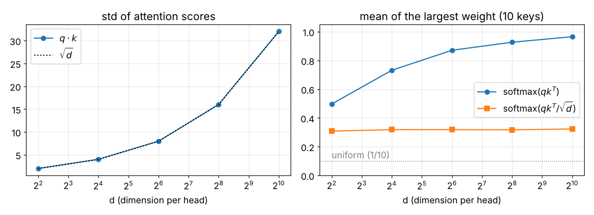
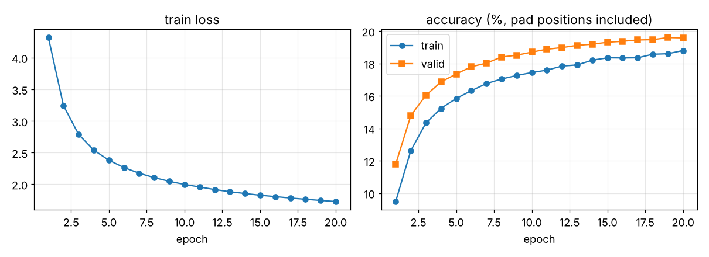
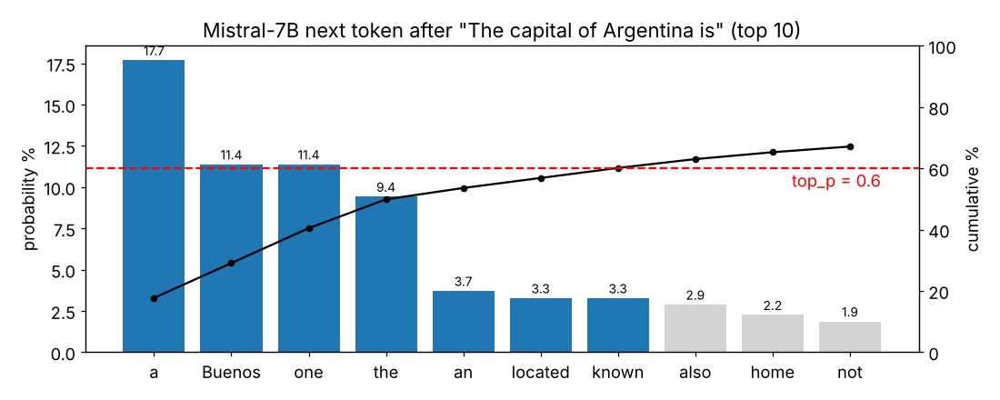
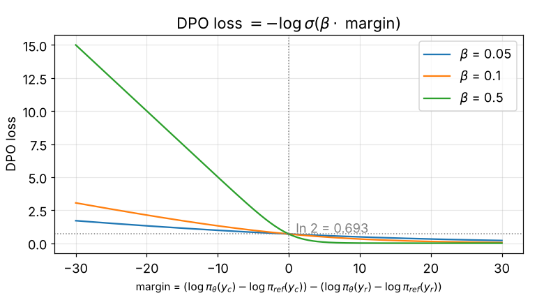
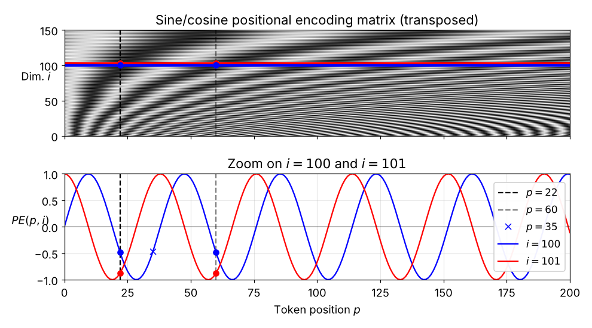

# 15장. 자연어 처리와 챗봇을 위한 트랜스포머

[← 14장. RNN과 어텐션을 사용한 자연어 처리](14_nlp_with_rnns_and_attention.md) · [📚 전체 목차](../README.md) · 16장. 비전과 멀티모달 트랜스포머 (정리 예정) →

> 📘 **교재** 『핸즈온 머신러닝 with 사이킷런, 파이토치』 15장 · 노트북 `15_transformers_for_nlp_and_chatbots.ipynb`
>
> 14장 끝에서 어텐션은 RNN 인코더–디코더에 **덧붙인** 부품이었다. 15장은 순환 층을 모두 걷어 내고 **어텐션만으로** 문장을 처리하는 **트랜스포머**를 만든다. 트랜스포머를 직접 구현해 번역기를 훈련한 다음, 트랜스포머의 절반만 쓰는 두 갈래(인코더만 쓰는 BERT 계열, 디코더만 쓰는 GPT 계열)를 살펴보고, 마지막으로 대규모 언어 모델(LLM)을 **챗봇**으로 바꾸는 과정(프롬프트 → SFT → DPO)을 따라간다.
>
> - **15.1** 2017년 논문 「Attention Is All You Need」의 원본 트랜스포머. **위치 임베딩**, **스케일드 점곱 어텐션**, **멀티 헤드 어텐션**, 인과 마스크·패딩 마스크, 인코더 층·디코더 층을 직접 구현한다
> - **15.2** 파이토치 `nn.Transformer`로 14장과 같은 **영어 → 스페인어 번역기**를 다시 만든다. RNN 없이도 가장 긴 문장을 탐욕적 디코딩으로 정확히 번역한다
> - **15.3** **인코더만** 쓰는 트랜스포머(BERT). **마스크드 언어 모델(MLM)** 사전 훈련, `[CLS]` 임베딩, 문장 임베딩(Sentence Transformers)
> - **15.4** **디코더만** 쓰는 트랜스포머(GPT). 텍스트 생성, 샘플링·**top-p**, **퓨샷 프롬프트**, GPT-2와 Mistral-7B 비교
> - **15.5** LLM을 **챗봇**으로. 프롬프트만으로 만든 챗봇 `BobTheChatbot`, 그 한계, **SFT**와 **DPO**(직접 구현 + TRL 라이브러리), 이미 미세 튜닝된 Instruct 모델
> - **15.6** **인코더–디코더** 모델(T5, BART 등) — 노트북에 코드가 없어 개념만 정리
>
> ⬅️ **앞에서** [14장](14_nlp_with_rnns_and_attention.md)의 영어–스페인어 데이터·BPE 토크나이저·`NmtPair`·`nmt_collate_fn`(교사 강요)을 **그대로** 가져온다. [점곱 어텐션 $\text{softmax}(QK^\top)V$](14_nlp_with_rnns_and_attention.md#4-3-점곱-어텐션-구현)와 [어텐션 패딩 마스크](14_nlp_with_rnns_and_attention.md#4-4-보충-코드-어텐션-가중치와-패딩-마스크)가 이 장의 출발점이다. 허깅 페이스의 `AutoTokenizer`·`AutoModel`·`Trainer`·`pipeline`은 [14장 2-10 ~ 2-18절](14_nlp_with_rnns_and_attention.md#2-10-사전-훈련된-토크나이저), 층 정규화는 [13장](13_processing_sequences_using_rnns_and_cnns.md)·[11장](11_training_deep_neural_networks.md), 스킵 연결은 [12장 ResNet](12_deep_computer_vision_with_cnns.md)에서 봤다.  
> ➡️ **다음으로** 16장은 같은 트랜스포머를 **이미지**에 적용한다(비전 트랜스포머). 텍스트를 토큰으로 자르듯 이미지를 패치로 자르면, 이 장의 인코더를 그대로 쓸 수 있다. 그리고 텍스트와 이미지를 함께 다루는 **멀티모달** 모델로 넘어간다.

## 이 장의 흐름

| 단계 | 절 | 핵심 질문 | 결과물 |
|---|---|---|---|
| 1. 위치 정보 | 15.1 | 순서를 모르는 어텐션에 단어 순서를 어떻게 알려 주는가 | `PositionalEmbedding` — 위치마다 훈련되는 벡터를 임베딩에 더한다 |
| 2. 멀티 헤드 어텐션 | 15.1 | 한 번의 어텐션으로 여러 관계를 동시에 보려면 | `MultiheadAttention` — 쿼리·키·값 투영 → 헤드 $h$개로 나눔 → $\text{softmax}(QK^\top/\sqrt{d})V$ → 합침. 파이토치 `nn.MultiheadAttention`과 결과가 같음을 확인 |
| 3. 마스크 | 15.1 | 미래 토큰과 패딩을 어떻게 가리는가 | `attn_mask`(인과 마스크, `torch.triu`) vs `key_padding_mask` |
| 4. 트랜스포머 조립 | 15.1 | 어텐션으로 층을 어떻게 쌓는가 | `TransformerEncoderLayer`·`TransformerDecoderLayer`(어텐션 + 피드포워드 + 잔차 연결 + 층 정규화) → `Transformer` |
| 5. 번역 트랜스포머 | 15.2 | 14장의 번역기를 트랜스포머로 바꾸면 | `NmtTransformer`(`nn.Transformer`, 임베딩 128, 층 2개) 20 에포크 → 가장 긴 문장도 **탐욕적 디코딩으로 정답** |
| 6. BERT 사전 훈련 | 15.3 | 레이블 없는 텍스트로 인코더를 어떻게 훈련하는가 | 작은 BERT를 WikiText-2에 **MLM**으로 5 에포크 → `fill-mask` 파이프라인 |
| 7. 인코더 임베딩 | 15.3 | 문장 하나를 벡터 하나로 | `[CLS]` 임베딩 `[2, 768]`, Sentence Transformers 코사인 유사도 |
| 8. GPT 생성 | 15.4 | 디코더로 글을 이어 쓰려면 | `AutoModelForCausalLM` + `generate()`, 탐욕적 → 반복 / 샘플링 / **top-p** |
| 9. 프롬프트 | 15.4 | 훈련 없이 작업을 시키려면 | 퓨샷 프롬프트 `get_capital_city()` — GPT-2(124M)는 틀리고 Mistral-7B는 맞힌다 |
| 10. 챗봇 | 15.5 | 기본 LLM을 대화 상대로 만들려면 | `BobTheChatbot`(대화 기록을 프롬프트로) → 반복·부실·유해한 답의 한계 |
| 11. DPO | 15.5 | 선호 데이터로 모델을 어떻게 조정하는가 | 시퀀스 로그 확률 `sum_of_log_probas()`, `dpo_loss()` (같은 모델이면 $\ln 2$) |
| 12. TRL | 15.5 | 실제 미세 튜닝은 | GPT-2 + Alpaca **SFT** → hh-rlhf **DPO** (`SFTTrainer`·`DPOTrainer`), 기성 Instruct 모델 |
| 13. 고정 위치 인코딩 | 추가 자료 | 훈련 없이 위치를 표현하려면 | 사인·코사인 `PositionalEncoding`과 상대 위치 성질 |

## 데이터

| 데이터 | 형태 | 사용 절 | 비고 |
|---|---|---|---|
| Tatoeba 영어–스페인어 (`ageron/tatoeba_mt_train`, `eng-spa`) | `{"source_text": 영어, "target_text": 스페인어, ...}` | 15.2 | [14장 3-2절](14_nlp_with_rnns_and_attention.md#3-2-데이터셋과-토크나이저)과 **완전히 같게** 준비한다. 훈련 157,839 / 검증 39,460 / 테스트 24,514쌍, BPE 어휘 10,000개 |
| WikiText-2 (`wikitext`, `wikitext-2-raw-v1`) | `{"text": 위키백과 문단 한 줄}` | 15.3 | 위키백과의 검증된 좋은 글·특집 글에서 뽑은 영어 텍스트. 훈련 36,718줄 / 검증 3,760 / 테스트 4,358. 빈 줄과 제목 줄도 섞여 있다 |
| Alpaca (`tatsu-lab/alpaca`) | `{"instruction", "input", "output", "text"}` | 15.5 | 스탠퍼드가 만든 **지시–응답** 52,002쌍. 노트북은 1,000개만 뽑아 쓴다 |
| Anthropic HH-RLHF (`Anthropic/hh-rlhf`) | `{"chosen": 대화, "rejected": 대화}` | 15.5 | 같은 질문에 대한 **선호 응답 / 비선호 응답** 쌍. 훈련 160,800 / 테스트 8,552. 노트북은 100개만 쓴다 |
| 사전 훈련 모델 (허깅 페이스 허브) | | 15.3 ~ 15.5 | `bert-base-uncased`(토크나이저·모델), `all-MiniLM-L6-v2`, `gpt2`, `mistralai/Mistral-7B-v0.3`, `mistralai/Mistral-7B-Instruct-v0.3`. Mistral은 **접근 승인 + 액세스 토큰**이 필요하다 |

> 📌 이 장의 텐서 형태는 **`[배치, 시퀀스 길이, 임베딩 차원]`**(`batch_first=True`)이다. 멀티 헤드 어텐션 안에서는 헤드 축이 끼어들어 **`[배치, 헤드 수, 시퀀스 길이, 헤드 차원]`** 이 된다. 코드 주석의 약자: `B` 배치, `h` 헤드 수, `Lq` 쿼리 길이, `Lk` 키 길이(= 값 길이 `Lv`), `d` = 임베딩 차원 ÷ 헤드 수.

## 목차

- [0. 준비](#0-준비)
- [1. Attention Is All You Need: 원본 트랜스포머 아키텍처 (15.1)](#1-attention-is-all-you-need-원본-트랜스포머-아키텍처-151)
   - [1-1. 전체 구조](#1-1-전체-구조)
   - [1-2. 위치 임베딩](#1-2-위치-임베딩)
   - [1-3. 스케일드 점곱 어텐션](#1-3-스케일드-점곱-어텐션)
   - [1-4. 멀티 헤드 어텐션 구현](#1-4-멀티-헤드-어텐션-구현)
   - [1-5. 보충 코드: nn.MultiheadAttention과 비교](#1-5-보충-코드-nnmultiheadattention과-비교)
   - [1-6. 두 가지 마스크](#1-6-두-가지-마스크)
   - [1-7. 인코더 층과 디코더 층](#1-7-인코더-층과-디코더-층)
   - [1-8. 층 쌓기와 Transformer 클래스](#1-8-층-쌓기와-transformer-클래스)
- [2. 영어-스페인어 번역 트랜스포머 만들기 (15.2)](#2-영어-스페인어-번역-트랜스포머-만들기-152)
   - [2-1. NMT 데이터 준비 (14장과 같음)](#2-1-nmt-데이터-준비-14장과-같음)
   - [2-2. NmtTransformer 모델](#2-2-nmttransformer-모델)
   - [2-3. 인과 마스크 만들기](#2-3-인과-마스크-만들기)
   - [2-4. 보충 코드: 파라미터 수와 인과성 확인](#2-4-보충-코드-파라미터-수와-인과성-확인)
   - [2-5. 훈련과 결과](#2-5-훈련과-결과)
   - [2-6. 번역하기](#2-6-번역하기)
- [3. 자연어 이해를 위한 인코더 기반 트랜스포머 (15.3)](#3-자연어-이해를-위한-인코더-기반-트랜스포머-153)
   - [3-1. BERT의 구조와 사전 훈련](#3-1-bert의-구조와-사전-훈련)
   - [3-2. MLM으로 작은 BERT 사전 훈련하기](#3-2-mlm으로-작은-bert-사전-훈련하기)
   - [3-3. fill-mask로 확인하기](#3-3-fill-mask로-확인하기)
   - [3-4. BERT를 작업에 맞게 쓰는 방법](#3-4-bert를-작업에-맞게-쓰는-방법)
   - [3-5. [CLS] 임베딩](#3-5-cls-임베딩)
   - [3-6. 문장 임베딩: Sentence Transformers](#3-6-문장-임베딩-sentence-transformers)
   - [3-7. BERT 이후의 인코더 모델](#3-7-bert-이후의-인코더-모델)
- [4. 디코더 기반 트랜스포머 (15.4)](#4-디코더-기반-트랜스포머-154)
   - [4-1. GPT와 인과적 언어 모델링](#4-1-gpt와-인과적-언어-모델링)
   - [4-2. GPT-2로 텍스트 생성하기](#4-2-gpt-2로-텍스트-생성하기)
   - [4-3. 디코딩 전략: 탐욕적·샘플링·top-p](#4-3-디코딩-전략-탐욕적샘플링top-p)
   - [4-4. 퓨샷 프롬프트](#4-4-퓨샷-프롬프트)
   - [4-5. 더 큰 모델: Mistral-7B](#4-5-더-큰-모델-mistral-7b)
- [5. 대규모 언어 모델을 챗봇으로 바꾸기 (15.5)](#5-대규모-언어-모델을-챗봇으로-바꾸기-155)
   - [5-1. 프롬프트만으로 만든 챗봇](#5-1-프롬프트만으로-만든-챗봇)
   - [5-2. BobTheChatbot 클래스](#5-2-bobthechatbot-클래스)
   - [5-3. 기본 모델 챗봇의 한계](#5-3-기본-모델-챗봇의-한계)
   - [5-4. 정렬: SFT, RLHF, DPO](#5-4-정렬-sft-rlhf-dpo)
   - [5-5. 시퀀스의 로그 확률 계산하기](#5-5-시퀀스의-로그-확률-계산하기)
   - [5-6. DPO 손실 구현](#5-6-dpo-손실-구현)
   - [5-7. TRL로 SFT: GPT-2 + Alpaca](#5-7-trl로-sft-gpt-2--alpaca)
   - [5-8. TRL로 DPO: HH-RLHF](#5-8-trl로-dpo-hh-rlhf)
   - [5-9. 미세 튜닝된 챗봇 모델 바로 쓰기](#5-9-미세-튜닝된-챗봇-모델-바로-쓰기)
- [6. 인코더-디코더 모델 (15.6)](#6-인코더-디코더-모델-156)
- [7. 추가 자료: 고정 위치 인코딩](#7-추가-자료-고정-위치-인코딩)
- [8. 연습문제](#8-연습문제)
- [9. 정리](#9-정리)
   - [9-1. 전체 흐름](#9-1-전체-흐름)
   - [9-2. 개념과 코드 대응](#9-2-개념과-코드-대응)
   - [9-3. 방법 비교](#9-3-방법-비교)
   - [9-4. 주요 결과](#9-4-주요-결과)
   - [9-5. 자주 쓴 코드 패턴](#9-5-자주-쓴-코드-패턴)
   - [9-6. 핵심 원칙](#9-6-핵심-원칙)

---

## 0. 준비

```python
import sys
assert sys.version_info >= (3, 10)

IS_COLAB = "google.colab" in sys.modules
IS_KAGGLE = "kaggle_secrets" in sys.modules

if IS_COLAB:
    %pip install -qU torchmetrics

if IS_KAGGLE:
    %pip install -qU transformers

from packaging.version import Version
import torch
assert Version(torch.__version__) >= Version("2.6.0")

if torch.cuda.is_available():
    device = "cuda"
elif torch.backends.mps.is_available():
    device = "mps"
else:
    device = "cpu"

device
# 'cuda'

if device == "cpu":
    print("Neural nets can be very slow without a hardware accelerator.")
    if IS_COLAB:
        print("Go to Runtime > Change runtime and select a GPU hardware "
              "accelerator.")
    if IS_KAGGLE:
        print("Go to Settings > Accelerator and select GPU.")

import matplotlib.pyplot as plt
plt.rc('font', size=14)
plt.rc('axes', labelsize=14, titlesize=14)
plt.rc('legend', fontsize=14)
plt.rc('xtick', labelsize=10)
plt.rc('ytick', labelsize=10)
```

모든 장 노트북 맨 앞에 반복되는 환경 확인 + 그래프 글꼴 설정. 각 줄의 의미는 [1장 0. 준비](01_the_machine_learning_landscape.md#0-준비), 장치 선택은 [10장 1-5절](10_neural_nets_with_pytorch.md#1-5-하드웨어-가속) 참고. 14장과 달라진 점은 캐글에서 `transformers`를 최신 버전으로 올리는 줄 하나뿐이다.

**코드** — 훈련·평가 함수와 GPU 메모리 정리 함수

```python
import torchmetrics

def evaluate_tm(model, data_loader, metric):
    ...  # 14장과 같다

def train(model, optimizer, loss_fn, metric, train_loader, valid_loader,
          n_epochs, patience=2, factor=0.5, epoch_callback=None):
    ...  # 14장과 같다 (ReduceLROnPlateau(mode="max") 포함)

import gc

def del_vars(variable_names=[]):
    for name in variable_names:
        try:
            del globals()[name]
        except KeyError:
            pass  # ignore variables that have already been deleted
    gc.collect()
    if device == "cuda":
        torch.cuda.empty_cache()
```

- `evaluate_tm()`·`train()`·`del_vars()` 모두 [14장 0. 준비](14_nlp_with_rnns_and_attention.md#0-준비)와 글자 하나 다르지 않다. `train()`은 15.2절의 번역 트랜스포머에만 쓰고, 15.3절부터는 허깅 페이스의 `Trainer`(그리고 TRL의 `SFTTrainer`·`DPOTrainer`)가 훈련 루프를 대신한다
- 이 장은 GPU 메모리를 많이 쓴다(Mistral-7B 하나가 약 14.5GB). 절이 끝날 때마다 `del_vars([...])`로 다 쓴 모델을 지운다. 셀 출력이 큰 객체였다면 `Out.clear()`도 함께 해야 한다(14장과 같은 주의)

> ⚠️ 노트북의 몇몇 셀은 `del ...` 다음에 **`free_vram(device)`** 를 호출하는데, 이 함수는 노트북 어디에도 정의돼 있지 않다(셀 54·64·87·142·161). 위에서부터 순서대로 실행하면 `NameError`가 난다. `free_vram(device)` 대신 `del_vars()`(인수 없이 호출하면 가비지 컬렉션 + `empty_cache()`만 한다)를 쓰면 된다.

> ⚠️ 노트북의 출력은 **코랩 GPU(`cuda`)** 에서 실행한 결과다. 이 노트의 **보충 코드**는 파이토치 2.15(CPU)에서 직접 실행해 확인했다. 데이터셋·사전 훈련 모델을 내려받아야 하는 실험(모든 훈련, BERT·GPT-2·Mistral 추론, TRL 미세 튜닝)은 다시 돌리지 않고 **노트북에 저장된 출력**을 그대로 옮겼다. 그래프는 노트북 출력값과 보충 코드로 직접 그렸다.

---

## 1. Attention Is All You Need: 원본 트랜스포머 아키텍처 (15.1)

> 🎯 **목적** — 순환 층 없이 어텐션만으로 만든 2017년의 원본 트랜스포머를 부품별로 직접 구현하며 이해한다.

**개념·원리**

14장의 인코더–디코더 RNN에는 두 가지 근본적인 한계가 남아 있었다.

| 한계 | 원인 | 트랜스포머의 해법 |
|---|---|---|
| **느리다** | 순환 층은 타임 스텝 $t$의 계산이 $t-1$의 은닉 상태를 기다려야 한다 → 문장 길이만큼 **순서대로** 계산 | 문장 안의 모든 토큰 쌍을 **행렬 곱 한 번**으로 동시에 계산 → GPU에서 크게 병렬화 |
| **먼 관계를 배우기 어렵다** | 첫 단어와 마지막 단어 사이의 정보가 순환 경로를 수십 번 거쳐야 한다 | 어텐션은 **어떤 두 위치든 한 단계**로 직접 연결 |

2017년 구글 연구팀(바스와니 등)의 논문 「Attention Is All You Need」는 순환 층과 합성곱 층을 모두 빼고 **어텐션 + 피드포워드 층**만으로 번역 모델을 만들었다. WMT 2014 영어→독일어·영어→프랑스어 번역에서 당시 최고 성능을 내면서도 훈련 시간은 훨씬 짧았다. 이후 BERT, GPT, 그리고 오늘날의 거의 모든 대규모 언어 모델이 이 구조에서 나왔다.

> 💡 14장 4절의 어텐션은 **디코더가 인코더를 보는** 것이었다(쿼리 = 디코더, 키·값 = 인코더). 트랜스포머의 핵심은 **셀프 어텐션**(self-attention)이다. 쿼리·키·값이 **모두 같은 문장**에서 나온다. 각 단어가 같은 문장의 다른 모든 단어를 보고 "나와 관련 있는 단어"의 정보를 섞어 자기 표현을 갱신한다. 예를 들어 "The animal didn't cross the street because **it** was too tired"에서 `it`의 표현은 `animal`에 크게 주목해 만들어진다.

### 1-1. 전체 구조

> 🎯 **목적** — 원본 트랜스포머의 블록 구성을 한눈에 정리한다.

```
            입력 문장 (영어)                         번역문 (스페인어, 한 칸 밀림)
                 │                                         │
        임베딩 + 위치 인코딩                       임베딩 + 위치 인코딩
                 │                                         │
   ┌─────────────▼─────────────┐           ┌───────────────▼───────────────┐
   │ 멀티 헤드 셀프 어텐션       │           │ 마스크드 멀티 헤드 셀프 어텐션   │ ← 미래 토큰을 못 보게
   │ + 잔차 연결 + 층 정규화     │           │ + 잔차 연결 + 층 정규화         │
   │ 피드포워드 (512→2048→512)  │  ×N       │ 멀티 헤드 크로스 어텐션         │ ← 쿼리 = 디코더,
   │ + 잔차 연결 + 층 정규화     │           │ (키·값 = 인코더 출력)           │   키·값 = 인코더
   └─────────────┬─────────────┘           │ + 잔차 연결 + 층 정규화         │
                 │  인코더 출력 (memory)     │ 피드포워드 + 잔차 + 층 정규화    │ ×N
                 └─────────────────────────►└───────────────┬───────────────┘
                                                            │
                                                  선형 층 → 소프트맥스
                                                            │
                                                 다음 토큰의 확률 분포
```

| 하이퍼파라미터 | 논문 (base 모델) | 파이토치 `nn.Transformer` 기본값 | 이 장의 번역 모델 (15.2) |
|---|---|---|---|
| 층 수 $N$ (인코더 / 디코더) | 6 / 6 | 6 / 6 | 2 / 2 |
| 모델 차원 $d_\text{model}$ | 512 | 512 | 128 |
| 헤드 수 $h$ | 8 | 8 | 4 |
| 헤드 차원 $d = d_\text{model}/h$ | 64 | 64 | 32 |
| 피드포워드 은닉 차원 $d_\text{ff}$ | 2,048 | 2,048 | 2,048 (기본값 그대로) |
| 드롭아웃 | 0.1 | 0.1 | 0.1 |

| 부품 | 하는 일 | 구현 위치 |
|---|---|---|
| 위치 인코딩 | 어텐션은 순서를 모르므로 위치 정보를 임베딩에 더한다 | 1-2절 (훈련형), 7절 (고정형) |
| 멀티 헤드 어텐션 | 토큰 사이의 관계를 $h$개의 서로 다른 관점으로 계산 | 1-3 ~ 1-5절 |
| 마스크 | 디코더가 미래를 엿보지 못하게, 패딩을 무시하게 | 1-6절 |
| 피드포워드 층 | 토큰마다 **따로** 적용하는 2층 MLP (어텐션이 섞은 정보를 가공) | 1-7절 |
| 잔차 연결 + 층 정규화 | 깊게 쌓아도 훈련이 잘 되도록 (12장 ResNet, 13장 층 정규화) | 1-7절 |

### 1-2. 위치 임베딩

> 🎯 **목적** — 어텐션에 단어 순서 정보를 넣는 가장 간단한 방법인 **훈련되는 위치 임베딩**을 구현한다.

**개념·원리**

어텐션은 **순서를 구분하지 못한다.** 점곱 $q \cdot k$는 키가 문장의 몇 번째에 있든 똑같이 계산되므로, 입력 토큰의 순서를 섞으면 출력도 같은 방식으로 섞일 뿐이다(순열 등변성). "dog bites man"과 "man bites dog"가 같은 단어 집합으로 보인다. RNN은 순서대로 읽으니 저절로 순서를 알았지만, 트랜스포머는 위치 정보를 따로 넣어야 한다.

방법은 두 가지다.

| 방법 | 위치 $p$의 벡터 | 파라미터 | 이 노트 |
|---|---|---|---|
| **훈련되는 위치 임베딩** | `nn.Parameter` 행렬의 $p$번째 행. 단어 임베딩처럼 역전파로 학습 | `max_length × embed_dim` | 이 절 (노트북 본문) |
| 고정 위치 인코딩 (논문) | 주파수가 다른 사인·코사인 값 | 0 | [7절](#7-추가-자료-고정-위치-인코딩) (노트북 추가 자료) |

두 방법 모두 결과 벡터를 토큰 임베딩에 **더한다**(이어 붙이지 않는다). 차원이 늘지 않고, 모델은 같은 벡터 안에서 "무슨 단어인가"와 "어디에 있는가"를 함께 읽는다.

**코드**

```python
import torch
import torch.nn as nn
import torch.nn.functional as F

class PositionalEmbedding(nn.Module):
    def __init__(self, max_length, embed_dim, dropout=0.1):
        super().__init__()
        self.pos_embed = nn.Parameter(torch.randn(max_length, embed_dim) * 0.02)
        self.dropout = nn.Dropout(dropout)

    def forward(self, X):
        return self.dropout(X + self.pos_embed[:X.size(1)])
```

| 코드 | 의미 |
|---|---|
| `nn.Parameter(torch.randn(max_length, embed_dim) * 0.02)` | 위치마다 벡터 하나, 모두 `[500, 512]`. `nn.Parameter`로 감싸야 `model.parameters()`에 포함돼 훈련된다. 표준 편차 0.02의 작은 값으로 초기화(BERT·GPT-2와 같은 관례) |
| `self.pos_embed[:X.size(1)]` | 이 배치의 실제 길이 `X.size(1)`만큼만 앞에서 잘라 쓴다. 배치마다 길이가 달라도 된다 |
| `X + ...` | `[B, L, E] + [L, E]` → 브로드캐스팅으로 배치의 모든 문장에 같은 위치 벡터를 더한다 |
| `nn.Dropout(dropout)` | 논문처럼 (임베딩 + 위치) 합에 드롭아웃 0.1 |

```python
max_length = 500
embed_dim = 512
pos_embedding = PositionalEmbedding(max_length, embed_dim)
embeddings = torch.randn(256, 500, 512)
embeddings_with_pos = pos_embedding(embeddings)
embeddings_with_pos.shape
# torch.Size([256, 500, 512])
```

**보충 코드** — 파라미터 수와 짧은 배치

```python
# 보충 코드
sum(p.numel() for p in pos_embedding.parameters())   # 256000  (= 500 × 512)
pos_embedding.pos_embed.std()                          # tensor(0.0201, grad_fn=<StdBackward0>)
pos_embedding(torch.randn(256, 37, 512)).shape         # torch.Size([256, 37, 512])
```

- 형태가 그대로다 — 위치 정보는 차원을 늘리지 않고 **값에 섞여** 들어간다
- ⚠️ 훈련되는 위치 임베딩의 약점: `max_length`(500)보다 긴 문장은 처리할 수 없고, 훈련 중에 거의 나오지 않은 뒤쪽 위치(긴 문장)의 벡터는 제대로 학습되지 않는다. 이 문제를 줄이는 상대 위치 방식(RoPE, ALiBi)은 17장에서 다룬다

### 1-3. 스케일드 점곱 어텐션

> 🎯 **목적** — 트랜스포머가 쓰는 어텐션 식과, 점수를 $\sqrt{d}$로 나누는 이유를 이해한다.

**개념·원리**

14장 4-3절의 점곱 어텐션에 **스케일링** 하나가 더해진다.

$$
\text{Attention}(Q, K, V) = \text{softmax}\!\left(\frac{QK^\top}{\sqrt{d_k}}\right) V
$$

| 기호 | 형태 | 의미 |
|---|---|---|
| $Q$ | `[Lq, d]` | 쿼리. "나는 어떤 정보를 찾는가" |
| $K$ | `[Lk, d]` | 키. "나는 어떤 정보를 가졌다고 광고하는가" |
| $V$ | `[Lk, d]` | 값. 실제로 전달되는 정보 |
| $QK^\top$ | `[Lq, Lk]` | 쿼리마다 모든 키와의 유사도 점수 |
| softmax (키 축) | `[Lq, Lk]` | 쿼리마다 합이 1인 가중치 |
| 결과 | `[Lq, d]` | 쿼리마다 값들의 가중 평균 |

**왜 $\sqrt{d_k}$로 나누는가.** $q$와 $k$의 성분이 평균 0, 분산 1인 독립 변수라면 점곱 $q \cdot k = \sum_{i=1}^{d} q_i k_i$의 분산은 $d$다. 차원이 커질수록 점수가 커지고(표준 편차 $\sqrt{d}$), 소프트맥스가 한 키에 거의 모든 가중치를 몰아주는 **포화** 상태가 된다. 포화된 소프트맥스는 그레이디언트가 0에 가까워 훈련이 잘 되지 않는다. $\sqrt{d}$로 나누면 점수의 분산이 차원과 상관없이 1로 유지된다.

**보충 코드** — 점수의 크기와 소프트맥스 포화

```python
# 보충 코드
for d in (16, 64, 512):
    q, k = torch.randn(10000, d), torch.randn(10000, d)
    raw = (q * k).sum(-1)
    print(d, raw.std(), (raw / d**0.5).std())
```

```
16 tensor(3.9748) tensor(0.9937)
64 tensor(7.9698) tensor(0.9962)
512 tensor(22.3387) tensor(0.9872)
```



**결과 해석**

- 왼쪽: 스케일링하지 않은 점수의 표준 편차가 정확히 $\sqrt{d}$를 따라 커진다
- 오른쪽: 키 10개에 대한 소프트맥스에서 **가장 큰 가중치의 평균**. 스케일링하지 않으면 $d$ = 64에서 0.87, $d$ = 1024에서 0.97 → 사실상 키 하나만 본다(원-핫에 가까움). 스케일링하면 $d$와 상관없이 약 0.32로 일정하다
- 이 장의 헤드 차원은 32(15.2절), 64(논문·BERT)이므로 스케일링이 없으면 초기부터 포화된다

> 📌 파이토치에는 이 식을 그대로 계산하는 `F.scaled_dot_product_attention(q, k, v, attn_mask=..., is_causal=...)`이 있다. GPU에서 플래시 어텐션 같은 최적화된 커널을 자동으로 고른다(17장).

### 1-4. 멀티 헤드 어텐션 구현

> 🎯 **목적** — 어텐션을 여러 "헤드"로 나눠 동시에 계산하는 멀티 헤드 어텐션(MHA)을 직접 구현하고, 텐서 형태가 어떻게 바뀌는지 따라간다.

**개념·원리**

어텐션 한 번은 쿼리마다 가중치 분포 **하나**만 만든다. 그런데 단어 하나는 여러 종류의 관계를 동시에 가진다. 예를 들어 동사 `played`는 주어(누가), 목적어(무엇을), 시제 단서를 각각 다른 단어에서 찾아야 한다. 멀티 헤드 어텐션은 이를 위해:

1. 입력을 **선형 층으로 투영**해 쿼리·키·값을 만든다 (입력 자체를 쓰지 않고 학습되는 투영을 거친다)
2. 512차원을 **헤드 8개 × 64차원**으로 나눈다
3. 헤드마다 독립적으로 스케일드 점곱 어텐션을 계산한다 → 헤드마다 다른 관계에 주목할 수 있다
4. 8개 헤드의 결과를 다시 512차원으로 **이어 붙이고** 출력 선형 층을 통과시킨다

$$
\text{MHA}(Q, K, V) = \text{Concat}(\text{head}_1, \dots, \text{head}_h)\,W^O, \quad \text{head}_i = \text{Attention}(Q W_i^Q, K W_i^K, V W_i^V)
$$

> 💡 헤드를 나눠도 **계산량은 거의 같다.** 512차원 어텐션 한 번 대신 64차원 어텐션 8번을 하는 것이고, 투영 층(512 × 512)도 헤드가 1개일 때와 크기가 같다. 같은 비용으로 관계를 8가지로 볼 수 있다.

**코드**

```python
class MultiheadAttention(nn.Module):
    def __init__(self, embed_dim, num_heads, dropout=0.1):
        super().__init__()
        self.h = num_heads
        self.d = embed_dim // num_heads
        self.q_proj = nn.Linear(embed_dim, embed_dim)
        self.k_proj = nn.Linear(embed_dim, embed_dim)
        self.v_proj = nn.Linear(embed_dim, embed_dim)
        self.out_proj = nn.Linear(embed_dim, embed_dim)
        self.dropout = nn.Dropout(dropout)

    def split_heads(self, X):
        return X.view(X.size(0), X.size(1), self.h, self.d).transpose(1, 2)

    def forward(self, query, key, value, attn_mask=None, key_padding_mask=None):
        q = self.split_heads(self.q_proj(query))  # (B, h, Lq, d)
        k = self.split_heads(self.k_proj(key))  # (B, h, Lk, d)
        v = self.split_heads(self.v_proj(value))  # (B, h, Lv, d) with Lv=Lk
        scores = q @ k.transpose(2, 3) / self.d**0.5  # (B, h, Lq, Lk)

        # Masking support:
        if attn_mask is not None:
            scores = scores.masked_fill(attn_mask, -torch.inf)  # (B, h, Lq, Lk)
        if key_padding_mask is not None:
            mask = key_padding_mask.unsqueeze(1).unsqueeze(2)  # (B, 1, 1, Lk)
            scores = scores.masked_fill(mask, -torch.inf)  # (B, h, Lq, Lk)

        weights = scores.softmax(dim=-1)  # (B, h, Lq, Lk)
        Z = self.dropout(weights) @ v  # (B, h, Lq, d)
        Z = Z.transpose(1, 2)  # (B, Lq, h, d)
        Z = Z.reshape(Z.size(0), Z.size(1), self.h * self.d)  # (B, Lq, h × d)
        return (self.out_proj(Z), weights)  # (B, Lq, h × d)
```

| 코드 | 의미 |
|---|---|
| `self.d = embed_dim // num_heads` | 헤드 차원. `embed_dim`이 `num_heads`로 나누어떨어져야 한다 (512 / 8 = 64) |
| `q_proj`, `k_proj`, `v_proj` | 쿼리·키·값 투영. **모든 헤드의 투영을 512 × 512 행렬 하나에** 담는다. 헤드 $i$의 $W_i^Q$는 이 행렬의 64열짜리 조각이다 |
| `split_heads()` | `[B, L, 512]` → `view` → `[B, L, 8, 64]` → `transpose(1, 2)` → **`[B, 8, L, 64]`**. 헤드 축을 배치 축 옆으로 옮겨, 헤드마다 독립된 행렬 곱이 되게 한다 |
| `q @ k.transpose(2, 3)` | `[B, h, Lq, d] @ [B, h, d, Lk]` → `[B, h, Lq, Lk]`. 앞의 두 축(배치·헤드)은 **배치 행렬 곱**으로 한꺼번에 처리 |
| `/ self.d**0.5` | 1-3절의 스케일링 |
| `masked_fill(mask, -torch.inf)` | 마스크가 `True`인 위치의 점수를 $-\infty$로 → 소프트맥스 후 가중치 **정확히 0** (1-6절) |
| `key_padding_mask.unsqueeze(1).unsqueeze(2)` | `[B, Lk]` → `[B, 1, 1, Lk]`. 모든 헤드·모든 쿼리에 같은 패딩 마스크를 브로드캐스트 |
| `scores.softmax(dim=-1)` | **키 축**으로 소프트맥스 → 쿼리마다 합이 1 |
| `self.dropout(weights)` | 어텐션 가중치에 드롭아웃(어텐션 드롭아웃). 특정 키에 너무 의존하지 않게 하는 규제 |
| `Z.transpose(1, 2).reshape(B, Lq, h * d)` | `[B, h, Lq, d]` → `[B, Lq, h, d]` → `[B, Lq, 512]`. 헤드 결과를 이어 붙인다 (= Concat) |
| `self.out_proj(Z)` | $W^O$. 이어 붙인 헤드들을 섞는다 |
| `return (출력, weights)` | 가중치도 돌려준다 → 어텐션 시각화·디버깅용 |

> ⚠️ `transpose()` 다음의 텐서는 메모리에서 연속적이지 않다. 그래서 마지막에 `view()` 대신 **`reshape()`** 을 쓴다(`view()`는 연속 텐서에만 쓸 수 있고, `reshape()`은 필요하면 복사한다). 처음의 `split_heads()`는 선형 층 출력(연속 텐서)에 `view()`를 먼저 하고 `transpose()`하므로 문제가 없다.

**형태 추적** (배치 2, 쿼리 3개, 키 5개, 임베딩 8, 헤드 2)

| 단계 | 형태 |
|---|---|
| `query` / `key`, `value` | `[2, 3, 8]` / `[2, 5, 8]` |
| `q` / `k`, `v` (헤드 분리 후) | `[2, 2, 3, 4]` / `[2, 2, 5, 4]` |
| `scores`, `weights` | `[2, 2, 3, 5]` — 배치 × 헤드 × 쿼리 × 키 |
| `weights @ v` | `[2, 2, 3, 4]` |
| 헤드 합치기 → `out_proj` | `[2, 3, 8]` — **쿼리와 같은 길이**, 입력과 같은 차원 |

- 출력 길이는 항상 **쿼리 길이**를 따른다. 크로스 어텐션(디코더 → 인코더)에서는 쿼리(번역문)와 키·값(원문)의 길이가 달라도 된다

### 1-5. 보충 코드: nn.MultiheadAttention과 비교

> 🎯 **목적** — 직접 만든 `MultiheadAttention`이 파이토치 내장 `nn.MultiheadAttention`과 같은 계산을 하는지, 가중치를 옮겨 확인한다.

노트북은 두 가지를 알려 준다.

- 파이토치의 `nn.MultiheadAttention`은 쿼리·키·값 투영 세 개를 **하나로 묶어** `in_proj_weight`(`[3 × embed_dim, embed_dim]`)와 `in_proj_bias`(`[3 × embed_dim]`) 두 파라미터로 저장한다
- 같은 결과를 얻으려면 생성자에 **`batch_first=True`** 를 줘야 한다(기본값은 `[L, B, E]`). 가중치가 필요 없으면 호출할 때 `need_weights=False` → 내부적으로 더 빠른 경로를 쓰고 가중치 자리에 `None`을 돌려준다

```python
# 보충 코드
torch.manual_seed(42)
E, h = 8, 2
mha = MultiheadAttention(E, h, dropout=0.0).eval()
ref = nn.MultiheadAttention(E, h, batch_first=True, dropout=0.0).eval()
[(n, tuple(p.shape)) for n, p in ref.named_parameters()]
# [('in_proj_weight', (24, 8)), ('in_proj_bias', (24,)),
#  ('out_proj.weight', (8, 8)), ('out_proj.bias', (8,))]

with torch.no_grad():   # 가중치를 내장 층으로 복사
    ref.in_proj_weight.copy_(torch.cat([mha.q_proj.weight, mha.k_proj.weight, mha.v_proj.weight]))
    ref.in_proj_bias.copy_(torch.cat([mha.q_proj.bias, mha.k_proj.bias, mha.v_proj.bias]))
    ref.out_proj.weight.copy_(mha.out_proj.weight)
    ref.out_proj.bias.copy_(mha.out_proj.bias)

q, kv = torch.randn(2, 3, E), torch.randn(2, 5, E)
kpm = torch.tensor([[False] * 5, [False, False, False, True, True]])  # 두 번째 문장은 끝 2개가 패딩
o1, w1 = mha(q, kv, kv, key_padding_mask=kpm)
o2, w2 = ref(q, kv, kv, key_padding_mask=kpm, average_attn_weights=False)
torch.allclose(o1, o2, atol=1e-6), torch.allclose(w1, w2, atol=1e-6)
# (True, True)
w1[1, :, :, 3:].sum()        # 패딩 키가 받은 가중치 → tensor(0.)
w1[1, 0]                      # 두 번째 문장, 헤드 0의 [쿼리 3 × 키 5] 가중치
# [[0.273, 0.323, 0.404, 0.   , 0.   ],
#  [0.377, 0.295, 0.328, 0.   , 0.   ],
#  [0.477, 0.241, 0.281, 0.   , 0.   ]]
ref(q, kv, kv, need_weights=False)[1]   # None
```

**결과 해석**

- 출력과 가중치가 모두 같다 → 직접 구현한 MHA가 파이토치의 계산과 정확히 일치한다. 파라미터 수도 같다(288개 = 투영 4개 × (8 × 8 + 8))
- `key_padding_mask`가 `True`인 키(패딩)는 가중치가 **정확히 0**이고, 나머지 3개 키의 가중치 합이 1이다 (14장 4-4절에서 마스크가 없을 때 패딩이 가중치를 가져가던 문제가 해결된다)
- 내장 층은 기본적으로 **헤드 평균** 가중치 `[B, Lq, Lk]`를 돌려준다. 헤드별 가중치 `[B, h, Lq, Lk]`를 보려면 `average_attn_weights=False`

### 1-6. 두 가지 마스크

> 🎯 **목적** — 어텐션 점수를 가리는 두 마스크, `attn_mask`와 `key_padding_mask`의 차이를 정리한다.

| | `attn_mask` | `key_padding_mask` |
|---|---|---|
| 형태 | `[Lq, Lk]` (모든 문장 공통) | `[B, Lk]` (문장마다 다름) |
| 무엇을 가리나 | **쿼리–키 쌍**. "쿼리 $i$는 키 $j$를 보면 안 된다" | **키 위치 전체**. "이 문장의 이 위치는 패딩이니 아무도 보지 마라" |
| 주 용도 | 디코더 셀프 어텐션의 **인과 마스크**(미래 토큰 가리기) | 모든 어텐션에서 **패딩 토큰** 무시 |
| `True`의 뜻 (불리언일 때) | 가린다 | 가린다 (패딩이다) |
| 트랜스포머 인수 이름 | `src_mask`, `tgt_mask`, `memory_mask` | `src_key_padding_mask`, `tgt_key_padding_mask`, `memory_key_padding_mask` |

**인과 마스크**(causal mask, look-ahead mask)가 필요한 이유: 디코더는 훈련할 때 교사 강요로 번역문 전체를 **한 번에** 받는다(14장 3-3절). 셀프 어텐션은 모든 위치를 볼 수 있으므로 가리지 않으면 위치 $t$가 **정답인 위치 $t+1$의 토큰을 그대로 베껴** 예측할 수 있다. 추론할 때는 미래 토큰이 아직 없으므로 훈련과 추론의 조건이 달라진다. 인과 마스크는 위치 $t$가 위치 $0 \sim t$만 보게 해서 이 커닝을 막는다.

```python
torch.triu(torch.full((5, 5), True), diagonal=1)
```

```
tensor([[False,  True,  True,  True,  True],
        [False, False,  True,  True,  True],
        [False, False, False,  True,  True],
        [False, False, False, False,  True],
        [False, False, False, False, False]])
```

- `torch.triu(..., diagonal=1)`: **대각선 위쪽**(upper triangle)만 남기고 나머지를 0(`False`)으로. 행 = 쿼리 위치, 열 = 키 위치. 행 $i$에서 $j > i$인 키(미래)만 `True`(가림)

```python
nn.Transformer.generate_square_subsequent_mask(5)
```

```
tensor([[0., -inf, -inf, -inf, -inf],
        [0., 0., -inf, -inf, -inf],
        [0., 0., 0., -inf, -inf],
        [0., 0., 0., 0., -inf],
        [0., 0., 0., 0., 0.]])
```

- 파이토치가 제공하는 같은 마스크의 **실수(float) 버전**. 실수 마스크는 점수에 **더해진다**(0 = 그대로, $-\infty$ = 가림). 불리언 마스크와 의미가 같다

**보충 코드** — 두 마스크 형식이 같은 결과를 내는지, 인과 마스크를 쓴 가중치는 어떤 모양인지

```python
# 보충 코드
x = torch.randn(1, 5, E)
causal_bool = torch.triu(torch.full((5, 5), True), diagonal=1)
causal_float = nn.Transformer.generate_square_subsequent_mask(5)
ob, wb = ref(x, x, x, attn_mask=causal_bool)
of, wf = ref(x, x, x, attn_mask=causal_float)
torch.allclose(ob, of, atol=1e-6)    # True
wb[0]                                 # 헤드 평균 가중치 [5, 5]
```

```
[[1.    0.    0.    0.    0.   ]
 [0.516 0.484 0.    0.    0.   ]
 [0.318 0.309 0.373 0.    0.   ]
 [0.301 0.288 0.197 0.214 0.   ]
 [0.188 0.205 0.213 0.197 0.197]]
```

- 가중치 행렬이 **아래 삼각형**이 된다. 첫 위치는 자기 자신만 볼 수 있어 가중치가 1.0이고, 마지막 위치는 5개 모두를 본다
- 인과 마스크를 쓰면 **모든 위치를 한 번에 병렬로** 훈련하면서도 각 위치는 마치 왼쪽부터 하나씩 생성하는 것처럼 계산된다 → RNN보다 훨씬 빠른 훈련의 핵심

> ⚠️ 어떤 쿼리 행의 **모든 키가 가려지면** 소프트맥스가 $-\infty$들만 받아 `nan`이 된다(`torch.full((1, 3), -torch.inf).softmax(-1)` → `tensor([[nan, nan, nan]])`). 인과 마스크는 대각선(자기 자신)을 항상 열어 두므로 이 문제가 없지만, 패딩 마스크를 잘못 만들면(예: 마스크의 `True`/`False`를 뒤집으면) 생길 수 있다. 파이토치 마스크는 **`True` = 가린다**이고, 허깅 페이스 `attention_mask`는 **`1` = 실제 토큰**으로 **뜻이 반대**다. 그래서 15.2절에서 `~pair.src_mask.bool()`처럼 뒤집는다.

### 1-7. 인코더 층과 디코더 층

> 🎯 **목적** — 멀티 헤드 어텐션에 피드포워드 층, 잔차 연결, 층 정규화를 붙여 인코더 층과 디코더 층을 만든다.

**코드** — 인코더 층

```python
class TransformerEncoderLayer(nn.Module):
    def __init__(self, d_model, nhead, dim_feedforward=2048, dropout=0.1):
        super().__init__()
        self.self_attn = MultiheadAttention(d_model, nhead, dropout)
        self.linear1 = nn.Linear(d_model, dim_feedforward)
        self.dropout = nn.Dropout(dropout)
        self.linear2 = nn.Linear(dim_feedforward, d_model)
        self.norm1 = nn.LayerNorm(d_model)
        self.norm2 = nn.LayerNorm(d_model)

    def forward(self, src, src_mask=None, src_key_padding_mask=None):
        attn, _ = self.self_attn(src, src, src, attn_mask=src_mask,
                                 key_padding_mask=src_key_padding_mask)
        Z = self.norm1(src + self.dropout(attn))
        ff = self.dropout(self.linear2(self.dropout(self.linear1(Z).relu())))
        return self.norm2(Z + ff)
```

| 코드 | 의미 |
|---|---|
| `self.self_attn(src, src, src, ...)` | **셀프 어텐션**: 쿼리·키·값이 모두 `src`. 문장의 각 토큰이 같은 문장의 모든 토큰을 본다 |
| `src + self.dropout(attn)` | **잔차 연결**(스킵 연결, 12장 ResNet). 어텐션은 입력을 대체하지 않고 "고칠 부분"만 더한다 → 깊게 쌓아도 그레이디언트가 잘 흐른다 |
| `self.norm1(...)` | **층 정규화**(13장). 토큰마다 512개 특성의 평균 0, 분산 1로 맞춘 뒤 학습되는 스케일·이동을 적용. 배치 크기와 문장 길이에 영향받지 않아 시퀀스에 적합하다 |
| `linear1` → ReLU → `linear2` | **위치별 피드포워드 층**(position-wise FFN): 512 → 2048 → 512. `nn.Linear`는 마지막 축에만 작용하므로 **토큰마다 따로**, 같은 가중치로 적용된다 |
| `self.dropout(...)` 세 번 | 어텐션 출력, FFN 은닉 층, FFN 출력에 드롭아웃 |

> 💡 역할 분담: **어텐션은 토큰 사이에서 정보를 섞고**(어떤 단어를 참고할까), **피드포워드 층은 각 토큰 안에서 정보를 가공한다**(섞인 정보로 무엇을 계산할까). 파라미터 수로는 FFN이 어텐션의 두 배다(아래 보충 코드). 대규모 언어 모델의 "지식"은 상당 부분 이 FFN 가중치에 저장된다고 알려져 있다.

**코드** — 디코더 층

```python
class TransformerDecoderLayer(nn.Module):
    def __init__(self, d_model, nhead, dim_feedforward=2048, dropout=0.1):
        super().__init__()
        self.self_attn = MultiheadAttention(d_model, nhead, dropout)
        self.multihead_attn = MultiheadAttention(d_model, nhead, dropout)
        self.dropout = nn.Dropout(dropout)
        self.linear1 = nn.Linear(d_model, dim_feedforward)
        self.linear2 = nn.Linear(dim_feedforward, d_model)
        self.norm1 = nn.LayerNorm(d_model)
        self.norm2 = nn.LayerNorm(d_model)
        self.norm3 = nn.LayerNorm(d_model)

    def forward(self, tgt, memory, tgt_mask=None, memory_mask=None,
                tgt_key_padding_mask=None, memory_key_padding_mask=None):
        attn1, _ = self.self_attn(tgt, tgt, tgt,
                                  attn_mask=tgt_mask,
                                  key_padding_mask=tgt_key_padding_mask)
        Z = self.norm1(tgt + self.dropout(attn1))
        attn2, _ = self.multihead_attn(Z, memory, memory, attn_mask=memory_mask,
                                       key_padding_mask=memory_key_padding_mask)
        Z = self.norm2(Z + self.dropout(attn2))
        ff = self.dropout(self.linear2(self.dropout(self.linear1(Z).relu())))
        return self.norm3(Z + ff)
```

인코더 층과 다른 점은 블록이 **세 개**라는 것뿐이다.

| 블록 | 쿼리 | 키·값 | 마스크 | 역할 |
|---|---|---|---|---|
| ① 마스크드 셀프 어텐션 `self_attn` | 번역문 `tgt` | 번역문 `tgt` | `tgt_mask`(인과) + `tgt_key_padding_mask` | 지금까지 생성한 번역문 안의 관계 |
| ② 크로스 어텐션 `multihead_attn` | ①의 출력 `Z` | **인코더 출력 `memory`** | `memory_key_padding_mask`(원문 패딩) | 원문의 어느 부분을 번역할지 (14장 4절의 어텐션과 같은 역할) |
| ③ 피드포워드 | | | | 토큰별 가공 |

- `memory`: 인코더 마지막 층의 출력 `[B, L_src, 512]`. **모든 디코더 층이 같은 `memory`** 를 본다 (14장 RNN이 인코더의 최종 상태 하나만 넘긴 것과 대조적)
- 크로스 어텐션에는 인과 마스크가 필요 없다. 원문은 처음부터 전부 주어지므로 어느 위치를 봐도 커닝이 아니다

> 📌 이 구현은 논문과 같은 **Post-LN**(잔차를 더한 **뒤** 정규화: `norm(x + sublayer(x))`)이다. 이후의 GPT-2 등 많은 모델은 **Pre-LN**(`x + sublayer(norm(x))`)을 쓴다. Pre-LN은 잔차 경로가 정규화를 거치지 않아 깊은 모델도 학습률 웜업 없이 안정적으로 훈련되는 경향이 있다. 파이토치 층에서는 `norm_first=True`로 바꿀 수 있다.

**보충 코드** — 층 하나의 파라미터 수 (논문 크기: 512, 헤드 8, FFN 2048)

```python
# 보충 코드
enc = TransformerEncoderLayer(512, 8)
dec = TransformerDecoderLayer(512, 8)
```

| 부품 | 계산 | 파라미터 수 |
|---|---|---|
| 멀티 헤드 어텐션 | 4 × (512 × 512 + 512) | 1,050,624 |
| 피드포워드 | (512 × 2048 + 2048) + (2048 × 512 + 512) | 2,099,712 |
| 층 정규화 1개 | 512(스케일) + 512(이동) | 1,024 |
| **인코더 층** | 어텐션 1 + FFN + 정규화 2 | **3,152,384** |
| **디코더 층** | 어텐션 2 + FFN + 정규화 3 | **4,204,032** |

- 헤드 수는 파라미터 수에 영향을 주지 않는다 (512 × 512 투영을 몇 조각으로 나누는지만 다르다)

### 1-8. 층 쌓기와 Transformer 클래스

> 🎯 **목적** — 층을 $N$개 쌓은 인코더·디코더와, 둘을 연결한 `Transformer`를 완성한다.

**코드** (노트북에서 "독자 연습"으로 남겨 둔 부분의 풀이)

```python
from copy import deepcopy

class TransformerEncoder(nn.Module):
    def __init__(self, encoder_layer, num_layers, norm=None):
        super().__init__()
        self.layers = nn.ModuleList([deepcopy(encoder_layer)
                                     for _ in range(num_layers)])
        self.norm = norm

    def forward(self, src, mask=None, src_key_padding_mask=None):
        Z = src
        for layer in self.layers:
            Z = layer(Z, mask, src_key_padding_mask)
        if self.norm is not None:
            Z = self.norm(Z)
        return Z

class TransformerDecoder(nn.Module):
    def __init__(self, decoder_layer, num_layers, norm=None):
        super().__init__()
        self.layers = nn.ModuleList([deepcopy(decoder_layer)
                                     for _ in range(num_layers)])
        self.norm = norm

    def forward(self, tgt, memory, tgt_mask=None, memory_mask=None,
                tgt_key_padding_mask=None, memory_key_padding_mask=None):
        Z = tgt
        for layer in self.layers:
            Z = layer(Z, memory, tgt_mask, memory_mask,
                      tgt_key_padding_mask, memory_key_padding_mask)
        if self.norm is not None:
            Z = self.norm(Z)
        return Z
```

| 코드 | 의미 |
|---|---|
| `deepcopy(encoder_layer)` | 층 하나를 **깊은 복사**로 $N$개 만든다. 복사하지 않고 같은 객체를 $N$번 넣으면 모든 층이 **가중치를 공유**하게 된다(ALBERT가 일부러 쓰는 방식이지만 여기서는 원하지 않는다) |
| `nn.ModuleList([...])` | 파이썬 리스트 대신 써야 각 층의 파라미터가 모델에 등록된다 (`model.parameters()`, `.to(device)`에 포함) |
| 마스크를 모든 층에 전달 | 패딩·인과 마스크는 층마다 같다 |
| `norm` (선택) | 마지막 층 다음의 층 정규화. 파이토치 `nn.Transformer`도 인코더·디코더 끝에 하나씩 둔다 |

```python
class Transformer(nn.Module):
    def __init__(self, d_model=512, nhead=8, num_encoder_layers=6,
                 num_decoder_layers=6, dim_feedforward=2048, dropout=0.1):
        super().__init__()
        encoder_layer = TransformerEncoderLayer(d_model, nhead, dim_feedforward,
                                                dropout)
        norm1 = nn.LayerNorm(d_model)
        self.encoder = TransformerEncoder(encoder_layer, num_encoder_layers,
                                          norm1)
        decoder_layer = TransformerDecoderLayer(d_model, nhead, dim_feedforward,
                                                dropout)
        norm2 = nn.LayerNorm(d_model)
        self.decoder = TransformerDecoder(decoder_layer, num_decoder_layers,
                                          norm2)

    def forward(self, src, tgt, src_mask=None, tgt_mask=None, memory_mask=None,
                src_key_padding_mask=None, tgt_key_padding_mask=None,
                memory_key_padding_mask=None):
        memory = self.encoder(src, src_mask, src_key_padding_mask)
        output = self.decoder(tgt, memory, tgt_mask, memory_mask,
                              tgt_key_padding_mask, memory_key_padding_mask)
        return output
```

- 생성자 인수와 `forward()` 인수의 이름·순서를 파이토치 **`nn.Transformer`와 똑같이** 맞췄다 → 15.2절에서 둘을 바꿔 끼울 수 있다
- 입력 `src`, `tgt`는 **이미 임베딩된** `[B, L, d_model]` 텐서다. 토큰 임베딩·위치 임베딩·출력 선형 층은 `Transformer`의 일이 아니다(15.2절의 `NmtTransformer`가 붙인다)
- 출력은 디코더 마지막 층의 표현 `[B, L_tgt, d_model]`

**보충 코드** — 직접 만든 트랜스포머와 `nn.Transformer`의 파라미터 수

```python
# 보충 코드
n_params = lambda m: sum(p.numel() for p in m.parameters())
n_params(Transformer())                                      # 44140544
n_params(nn.Transformer(512, 8, 6, 6, batch_first=True))     # 44140544
n_params(Transformer(128, 4, 2, 2))                          # 2505216
n_params(nn.Transformer(128, 4, num_encoder_layers=2,
                        num_decoder_layers=2, batch_first=True))  # 2505216
```

- 두 구현의 파라미터 수가 같다 (논문 base 크기에서 약 4,414만 개 = 인코더 층 6 × 315만 + 디코더 층 6 × 420만 + 최종 정규화 2개). 논문이 밝힌 base 모델 6,500만 개와의 차이는 임베딩·출력 층(어휘 37,000개의 공유 임베딩)이다
- 직접 구현은 이해를 위한 것이고, 실제로는 파이토치 `nn.Transformer`를 쓴다. 내장 층은 추론할 때 패딩을 건너뛰는 **중첩 텐서**(nested tensor) 같은 최적화를 자동으로 쓴다(2-5절 훈련 로그의 경고가 그 흔적이다)

---

## 2. 영어-스페인어 번역 트랜스포머 만들기 (15.2)

> 🎯 **목적** — 14장의 번역기를 순환 층 없이 트랜스포머로 다시 만들어 훈련하고, 긴 문장 번역 결과를 비교한다.

### 2-1. NMT 데이터 준비 (14장과 같음)

> 🎯 **목적** — 14장과 같은 데이터·토크나이저·배치 함수를 그대로 준비한다.

```python
import torch.nn as nn
from datasets import load_dataset
from torch.utils.data import random_split, DataLoader
import tokenizers

nmt_original_valid_set, nmt_test_set = load_dataset(
    path="ageron/tatoeba_mt_train", name="eng-spa",
    split=["validation", "test"])
split = nmt_original_valid_set.train_test_split(train_size=0.8, seed=42)
nmt_train_set, nmt_valid_set = split["train"], split["test"]

def train_eng_spa():  # a generator function to iterate over all training text
    for pair in nmt_train_set:
        yield pair["source_text"]
        yield pair["target_text"]

max_length = 500
vocab_size = 10_000
nmt_tokenizer_model = tokenizers.models.BPE(unk_token="<unk>")
nmt_tokenizer = tokenizers.Tokenizer(nmt_tokenizer_model)
nmt_tokenizer.enable_padding(pad_id=0, pad_token="<pad>")
nmt_tokenizer.enable_truncation(max_length=max_length)
nmt_tokenizer.pre_tokenizer = tokenizers.pre_tokenizers.Whitespace()
nmt_tokenizer_trainer = tokenizers.trainers.BpeTrainer(
    vocab_size=vocab_size, special_tokens=["<pad>", "<unk>", "<s>", "</s>"])
nmt_tokenizer.train_from_iterator(train_eng_spa(), nmt_tokenizer_trainer)
```

```python
from collections import namedtuple

fields = ["src_token_ids", "src_mask", "tgt_token_ids", "tgt_mask"]
class NmtPair(namedtuple("NmtPairBase", fields)):
    def to(self, device):
        return NmtPair(self.src_token_ids.to(device), self.src_mask.to(device),
                       self.tgt_token_ids.to(device), self.tgt_mask.to(device))

def nmt_collate_fn(batch):
    src_texts = [pair['source_text'] for pair in batch]
    tgt_texts = [f"<s> {pair['target_text']} </s>" for pair in batch]
    src_encodings = nmt_tokenizer.encode_batch(src_texts)
    tgt_encodings = nmt_tokenizer.encode_batch(tgt_texts)
    src_token_ids = torch.tensor([enc.ids for enc in src_encodings])
    tgt_token_ids = torch.tensor([enc.ids for enc in tgt_encodings])
    src_mask = torch.tensor([enc.attention_mask for enc in src_encodings])
    tgt_mask = torch.tensor([enc.attention_mask for enc in tgt_encodings])
    inputs = NmtPair(src_token_ids, src_mask,
                     tgt_token_ids[:, :-1], tgt_mask[:, :-1])
    labels = tgt_token_ids[:, 1:]
    return inputs, labels

batch_size = 64
nmt_train_loader = DataLoader(nmt_train_set, batch_size=batch_size,
                              collate_fn=nmt_collate_fn, shuffle=True)
nmt_valid_loader = DataLoader(nmt_valid_set, batch_size=batch_size,
                              collate_fn=nmt_collate_fn)
nmt_test_loader = DataLoader(nmt_test_set, batch_size=batch_size,
                             collate_fn=nmt_collate_fn)
```

| 요소 | 14장에서 | 요약 |
|---|---|---|
| 데이터 분할 | [3-2절](14_nlp_with_rnns_and_attention.md#3-2-데이터셋과-토크나이저) | Tatoeba 원래 검증 분할을 8 : 2로 → 훈련 157,839 / 검증 39,460, 테스트 24,514 |
| BPE 토크나이저 | 3-2절 | 영어·스페인어가 **어휘 1만 개를 공유**. `<pad>`=0, `<unk>`=1, `<s>`=2, `</s>`=3 |
| `NmtPair` | [3-3절](14_nlp_with_rnns_and_attention.md#3-3-배치-만들기와-교사-강요) | 네 텐서(원문 ID·마스크, 번역문 ID·마스크)를 묶고 `to(device)`로 한 번에 옮기는 `namedtuple` |
| `nmt_collate_fn` | 3-3절 | **교사 강요**: 디코더 입력 = `<s> 번역문` (`[:, :-1]`), 타깃 = `번역문 </s>` (`[:, 1:]`). 배치 안에서 가장 긴 문장에 맞춰 패딩 |

- 마스크 `src_mask`·`tgt_mask`는 토크나이저의 `attention_mask`라서 **1 = 실제 토큰, 0 = 패딩**이다. 14장에서는 이것으로 패킹 길이를 구했고, 이 장에서는 뒤집어서 파이토치 패딩 마스크로 쓴다(2-2절)
- 배치 크기 64 → 훈련 배치 2,467개

### 2-2. NmtTransformer 모델

> 🎯 **목적** — 임베딩 + 위치 임베딩 + `nn.Transformer` + 출력 층으로 번역 모델을 만든다.

**코드**

```python
class NmtTransformer(nn.Module):
    def __init__(self, vocab_size, max_length, embed_dim=512, pad_id=0,
                 num_heads=8, num_layers=6, dropout=0.1):
        super().__init__()
        self.embed = nn.Embedding(vocab_size, embed_dim, padding_idx=pad_id)
        self.pos_embed = PositionalEmbedding(max_length, embed_dim, dropout)
        self.transformer = nn.Transformer(
            embed_dim, num_heads, num_encoder_layers=num_layers,
            num_decoder_layers=num_layers, batch_first=True)
        self.output = nn.Linear(embed_dim, vocab_size)

    def forward(self, pair):
        src_embeds = self.pos_embed(self.embed(pair.src_token_ids))
        tgt_embeds = self.pos_embed(self.embed(pair.tgt_token_ids))
        src_pad_mask = ~pair.src_mask.bool()
        tgt_pad_mask = ~pair.tgt_mask.bool()
        size = [pair.tgt_token_ids.size(1)] * 2
        full_mask = torch.full(size, True, device=tgt_pad_mask.device)
        causal_mask = torch.triu(full_mask, diagonal=1)
        out_decoder = self.transformer(src_embeds, tgt_embeds,
                                       src_key_padding_mask=src_pad_mask,
                                       memory_key_padding_mask=src_pad_mask,
                                       tgt_mask=causal_mask, #tgt_is_causal=True,
                                       tgt_key_padding_mask=tgt_pad_mask)
        return self.output(out_decoder).permute(0, 2, 1)
```

| 코드 | 의미 |
|---|---|
| `nn.Embedding(vocab_size, embed_dim, padding_idx=pad_id)` | 원문·번역문이 **같은 임베딩**을 쓴다(어휘를 공유하므로). `padding_idx`의 임베딩은 0으로 고정 |
| `PositionalEmbedding(...)` 하나 | 위치 임베딩도 인코더·디코더가 **공유**한다 |
| `nn.Transformer(embed_dim, num_heads, ..., batch_first=True)` | 1-8절의 `Transformer`와 같은 인터페이스의 파이토치 내장 층. `dim_feedforward`는 지정하지 않아 **기본값 2,048** |
| `~pair.src_mask.bool()` | `attention_mask`(1 = 토큰)를 불리언으로 바꾸고 `~`로 뒤집어 **`True` = 패딩** → 파이토치 규약 |
| `src_key_padding_mask=src_pad_mask` | 인코더 셀프 어텐션에서 원문 패딩 무시 |
| `memory_key_padding_mask=src_pad_mask` | 디코더의 **크로스 어텐션**에서도 원문 패딩 무시. 같은 마스크를 두 번 넘겨야 한다. 빠뜨리면 디코더가 원문 패딩에 가중치를 준다 |
| `tgt_mask=causal_mask` | 디코더 셀프 어텐션의 인과 마스크 (2-3절) |
| `tgt_key_padding_mask=tgt_pad_mask` | 디코더 셀프 어텐션에서 번역문 패딩 무시 |
| `self.output(...)` → `.permute(0, 2, 1)` | `[B, L, 10000]` → `[B, 10000, L]`. 14장과 같이 `CrossEntropyLoss`가 클래스 축을 1번으로 기대하기 때문 |

> 💡 14장 NMT 모델과 비교하면 **인코더 RNN·디코더 RNN·어텐션 함수**가 전부 `nn.Transformer` 한 줄로 바뀌었다. 패킹(`pack_padded_sequence`)도 필요 없다. 패딩은 마스크로 처리하고, 길이와 상관없이 모든 토큰을 한 번에 계산한다.

> 📌 주석 처리된 `tgt_is_causal=True`는 "`tgt_mask`가 인과 마스크다"라는 **힌트**다. 파이토치가 마스크 행렬을 읽는 대신 더 빠른 인과 어텐션 경로를 쓸 수 있게 해 준다. 힌트일 뿐이라 `tgt_mask`는 여전히 넘겨야 한다.

### 2-3. 인과 마스크 만들기

```python
size = [pair.tgt_token_ids.size(1)] * 2          # [L_tgt, L_tgt]
full_mask = torch.full(size, True, device=tgt_pad_mask.device)
causal_mask = torch.triu(full_mask, diagonal=1)   # 대각선 위 = True = 가림
```

- 배치마다 번역문 길이 $L_\text{tgt}$가 다르므로 **`forward()` 안에서 매번** 만든다
- `device=tgt_pad_mask.device`: 마스크를 입력과 같은 장치(GPU)에 바로 만든다. CPU에서 만들어 옮기면 매 배치 복사가 생긴다
- 1-6절에서 본 대로 `nn.Transformer.generate_square_subsequent_mask(L)`(실수 마스크)를 써도 결과가 같다

### 2-4. 보충 코드: 파라미터 수와 인과성 확인

> 🎯 **목적** — 15.2절 모델의 크기를 계산하고, 인과 마스크 덕분에 미래 토큰이 과거 출력에 영향을 주지 않는지 직접 확인한다.

```python
# 보충 코드
torch.manual_seed(42)
model = NmtTransformer(10_000, 500, embed_dim=128, pad_id=0,
                       num_heads=4, num_layers=2)
n_params(model)     # 5139216
```

| 부품 | 계산 | 파라미터 수 |
|---|---|---|
| 토큰 임베딩 | 10,000 × 128 | 1,280,000 |
| 위치 임베딩 | 500 × 128 | 64,000 |
| 트랜스포머 인코더 (층 2개 + 정규화) | 2 × (어텐션 66,048 + FFN 526,464 + 정규화 512) + 256 | 1,186,304 |
| 트랜스포머 디코더 (층 2개 + 정규화) | 2 × (어텐션 2 × 66,048 + FFN 526,464 + 정규화 768) + 256 | 1,318,912 |
| 출력 층 | 128 × 10,000 + 10,000 | 1,290,000 |
| **합계** | | **5,139,216** |

- 14장 RNN 번역기(어텐션 없음 16,553,744 / 어텐션 있음 21,673,744)의 **약 1/4 ~ 1/3** 크기다
- `dim_feedforward`를 기본값 2,048로 둔 탓에 FFN(128 → 2048 → 128)이 트랜스포머 파라미터의 대부분(약 84%)을 차지한다. 보통은 $d_\text{ff} = 4 \times d_\text{model}$(여기서는 512) 정도로 잡는다
- 임베딩과 출력 층이 전체의 절반이다(어휘가 1만 개라서)

```python
# 보충 코드 – 인과성: 마지막 번역문 토큰을 바꿔도 앞쪽 출력은 그대로인가?
Pair = namedtuple("Pair", fields)
src = torch.tensor([[5, 6, 7, 8], [9, 10, 0, 0]])                # 두 번째 원문은 패딩 2개
tgt = torch.tensor([[2, 11, 12, 13, 14], [2, 15, 16, 0, 0]])
pair = Pair(src, (src != 0).long(), tgt, (tgt != 0).long())
model.eval()
with torch.no_grad():
    y = model(pair)                       # torch.Size([2, 10000, 5])
    tgt2 = tgt.clone(); tgt2[0, 4] = 99   # 첫 문장의 5번째(마지막) 토큰만 변경
    y2 = model(Pair(src, pair.src_mask, tgt2, (tgt2 != 0).long()))
torch.allclose(y[0, :, :4], y2[0, :, :4], atol=1e-5)   # True – 위치 0~3 출력 불변
torch.allclose(y[0, :, 4], y2[0, :, 4])                # True – 위치 4만 바뀜
```

- 인과 마스크가 제대로 작동한다. 위치 $t$의 출력은 위치 $0 \sim t$의 번역문 토큰에만 의존한다 → 교사 강요로 전체 문장을 한꺼번에 넣어도 커닝이 없다
- 출력 형태 `[2, 10000, 5]`(배치 × 어휘 × 길이), 패딩이 있어도 `nan`이 없다

### 2-5. 훈련과 결과

> 🎯 **목적** — 작은 트랜스포머(임베딩 128, 헤드 4, 층 2)를 20 에포크 훈련한다.

**코드**

```python
torch.manual_seed(42)
nmt_tr_model = NmtTransformer(vocab_size, max_length, embed_dim=128, pad_id=0,
                              num_heads=4, num_layers=2, dropout=0.1).to(device)
if device == "mps":
    # WORKAROUND: on MPS devices, we use our custom Transformer because the
    # nn.Transformer module explodes during training, see PyTorch issue #141287
    nmt_tr_model.transformer = Transformer(
        d_model=128, nhead=4, num_encoder_layers=2, num_decoder_layers=2).to(device)

n_epochs = 20
xentropy = nn.CrossEntropyLoss(ignore_index=0)  # ignore <pad> tokens
optimizer = torch.optim.NAdam(nmt_tr_model.parameters())
accuracy = torchmetrics.Accuracy(task="multiclass", num_classes=vocab_size)
accuracy = accuracy.to(device)

history = train(nmt_tr_model, optimizer, xentropy, accuracy,
                nmt_train_loader, nmt_valid_loader, n_epochs)
```

| 코드 | 의미 |
|---|---|
| `embed_dim=128, num_heads=4, num_layers=2` | 논문(512, 8, 6)보다 훨씬 작게. 코랩 GPU에서 빨리 훈련하기 위해서다 |
| `if device == "mps"` | 애플 실리콘 GPU에서는 `nn.Transformer`가 훈련 중 발산하는 버그가 있어(파이토치 이슈 #141287), 1-8절에서 직접 만든 `Transformer`로 **바꿔 끼운다**. 인터페이스를 맞춰 둔 덕분에 가능하다 |
| `CrossEntropyLoss(ignore_index=0)` | 패딩 위치의 손실 무시 (14장 3-5절) |
| `NAdam()` | 학습률 기본값 0.002 |
| `Accuracy(task="multiclass", num_classes=vocab_size)` | ⚠️ `ignore_index`가 없어 **패딩 위치까지 포함한 정확도**다 (14장과 같은 문제). 절대값보다 추세를 본다 |

```
Epoch 1/20,   train loss: 4.3188, train metric: 9.48%, valid metric: 11.78%
Epoch 2/20,   train loss: 3.2403, train metric: 12.62%, valid metric: 14.78%
Epoch 3/20,   train loss: 2.7871, train metric: 14.33%, valid metric: 16.04%
Epoch 4/20,   train loss: 2.5395, train metric: 15.23%, valid metric: 16.86%
Epoch 5/20,   train loss: 2.3793, train metric: 15.84%, valid metric: 17.35%
...
Epoch 10/20,  train loss: 1.9964, train metric: 17.44%, valid metric: 18.70%
...
Epoch 15/20,  train loss: 1.8258, train metric: 18.35%, valid metric: 19.31%
...
Epoch 19/20,  train loss: 1.7432, train metric: 18.60%, valid metric: 19.60%
Epoch 20/20,  train loss: 1.7262, train metric: 18.80%, valid metric: 19.58%
```



**결과 해석**

- 20 에포크 동안 손실이 꾸준히 줄고 검증 정확도가 계속 오른다. 마지막 20 에포크에서 처음으로 0.02%p 내려갔을 뿐이라 `ReduceLROnPlateau`가 학습률을 한 번도 줄이지 않았다 → **더 훈련할 여지**가 있다
- **검증 정확도가 훈련 정확도보다 높다.** 훈련 정확도는 드롭아웃이 켜진 상태에서, 그것도 에포크 동안 변해 온 모델로 잰 평균이기 때문이다. 과대적합 징후는 전혀 없다
- 14장 RNN 번역기의 검증 정확도(22.15% / 22.73%)보다 숫자가 낮지만 직접 비교할 수 없다. 두 지표 모두 패딩 위치를 포함하는데, 패딩 위치의 출력을 모델이 어떻게 내는지는 구조마다 다르다(손실이 패딩을 무시하므로 패딩 위치 예측은 우연에 맡겨진다). 번역 품질은 2-6절의 실제 번역으로 판단한다
- 훈련 중 나온 경고 `The PyTorch API of nested tensors is in prototype stage...`는 `nn.Transformer`가 패딩 마스크를 보고 내부적으로 **중첩 텐서**(길이가 다른 시퀀스를 패딩 없이 담는 텐서)로 계산을 줄이려 할 때 나온다. 결과에는 영향이 없다

```python
torch.save(nmt_tr_model.state_dict(), "my_nmt_tr_model.pt")
```

### 2-6. 번역하기

> 🎯 **목적** — 훈련된 트랜스포머로 탐욕적 디코딩을 해서 14장의 RNN 모델이 실패한 긴 문장을 번역한다.

**코드**

```python
def translate(model, src_text, max_length=20, pad_id=0, eos_id=3):
    tgt_text = ""
    token_ids = []
    for index in range(max_length):
        batch, _ = nmt_collate_fn([{"source_text": src_text,
                                    "target_text": tgt_text}])
        with torch.no_grad():
            Y_logits = model(batch.to(device))
            Y_token_ids = Y_logits.argmax(dim=1)  # find the best token IDs
            next_token_id = Y_token_ids[0, index]  # take the last token ID

        next_token = nmt_tokenizer.id_to_token(next_token_id)
        tgt_text += " " + next_token
        if next_token_id == eos_id:
            break
    return tgt_text
```

| 코드 | 의미 |
|---|---|
| `nmt_collate_fn([{"source_text": ..., "target_text": tgt_text}])` | 지금까지의 번역문으로 배치 하나를 만든다. 디코더 입력은 `<s> + tgt_text`(마지막 `</s>`는 `[:, :-1]`로 잘린다) |
| `Y_logits.argmax(dim=1)` | 어휘 축(1번)에서 최댓값 → 위치마다 가장 그럴듯한 토큰 `[1, L]` |
| `Y_token_ids[0, index]` | 스텝 `index`에서 디코더 입력의 길이는 `index + 1`(`<s>` 포함)이므로 **마지막 위치**의 예측이 다음 토큰이다 |
| `eos_id=3` | `</s>`가 나오면 멈춘다 |

- 14장 [3-6절](14_nlp_with_rnns_and_attention.md#3-6-번역하기-탐욕적-디코딩)의 `translate()`와 거의 같다. `token_ids`는 쓰이지 않는 변수다

```python
nmt_tr_model.eval()
translate(nmt_tr_model, "I like to play soccer with my friends at the beach")
# ' Me gusta jugar al fútbol con mis amigos en la playa . </s>'
```

**결과 해석**

| 모델 | "I like to play soccer with my friends at the beach" |
|---|---|
| 14장 인코더–디코더 RNN + 빔 검색 | `Me gusta jugar con jugar con los jug adores de la playa .` ❌ |
| 14장 RNN + 어텐션, 탐욕적 | `Me gusta jugar fu tbol con mis amigos en la playa .` (`ú` 누락) |
| **트랜스포머, 탐욕적** | **`Me gusta jugar al fútbol con mis amigos en la playa .`** ✅ |

- 14장에서 가장 어려웠던 문장을 **빔 검색 없이** 완벽하게 번역했다. 파라미터는 RNN + 어텐션 모델의 약 1/4인데도 그렇다
- `fútbol`도 한 토큰으로 정확히 생성했다

> ⚠️ 이 `translate()`는 토큰 하나를 만들 때마다 원문 인코딩과 번역문 전체를 **처음부터 다시 계산**한다. 길이 $n$의 번역에 디코더를 $n$번, 매번 $1 \sim n$개 토큰에 대해 돌리므로 낭비가 크다. 실제 시스템은 인코더 출력(`memory`)을 한 번만 계산해 두고, 디코더 셀프 어텐션의 이전 키·값을 저장해 다시 쓰는 **KV 캐시**를 쓴다 (17장에서 트랜스포머 속도를 높이는 방법으로 다룬다).

---

## 3. 자연어 이해를 위한 인코더 기반 트랜스포머 (15.3)

> 🎯 **목적** — 트랜스포머의 **인코더만** 쌓은 BERT 계열 모델이 어떻게 사전 훈련되고, 분류·문장 임베딩 같은 이해 작업에 어떻게 쓰이는지 정리한다.

**개념·원리**

원본 트랜스포머 이후의 모델은 크게 세 갈래로 나뉜다.

| 계열 | 쓰는 부분 | 어텐션 방향 | 사전 훈련 과제 | 잘하는 일 | 대표 모델 | 이 장 |
|---|---|---|---|---|---|---|
| **인코더 전용** | 인코더 | **양방향** (모든 토큰이 모든 토큰을 봄) | 마스크드 언어 모델 (빈칸 채우기) | 분류, 개체명 인식, 문장 임베딩, 검색 — **자연어 이해(NLU)** | BERT, RoBERTa, DeBERTa | 15.3 |
| **디코더 전용** | 디코더 (크로스 어텐션 없음) | **단방향** (인과 마스크) | 다음 토큰 예측 | 텍스트 생성, 대화, 퓨샷 학습 — **자연어 생성(NLG)** | GPT, Llama, Mistral | 15.4 ~ 15.5 |
| **인코더–디코더** | 둘 다 | 인코더 양방향 + 디코더 단방향 | 손상된 텍스트 복원 등 | 번역, 요약 — 입력을 **다른 시퀀스로 변환** | T5, BART | 15.2, 15.6 |

### 3-1. BERT의 구조와 사전 훈련

> 🎯 **목적** — BERT가 무엇을 입력받고, 레이블 없는 텍스트로 어떻게 사전 훈련되는지 이해한다.

2018년 구글의 **BERT**(Bidirectional Encoder Representations from Transformers)는 트랜스포머 인코더를 쌓은 모델이다. 영어 위키백과와 책 말뭉치(BooksCorpus)로 사전 훈련한 뒤 작업별로 미세 튜닝하는 방식으로, 발표 당시 11개 NLP 벤치마크에서 최고 성능을 냈다.

| | BERT-base | BERT-large | 3-2절의 작은 BERT |
|---|---|---|---|
| 층 수 | 12 | 24 | 2 |
| 은닉 차원 | 768 | 1,024 | 128 |
| 헤드 수 | 12 | 16 | 4 |
| FFN 차원 | 3,072 | 4,096 | 512 |
| 최대 길이 | 512 | 512 | 128 |
| 파라미터 수 | 약 1억 1천만 | 약 3억 4천만 | 4,367,546 |

**입력 표현** — 세 가지 임베딩을 **더한다**.

| 임베딩 | 의미 |
|---|---|
| 토큰 임베딩 | WordPiece 어휘 30,522개 (14장 2-8절) |
| 위치 임베딩 | 1-2절과 같은 **훈련되는** 위치 임베딩 |
| 세그먼트 임베딩 | 문장 쌍을 넣을 때 첫 문장(A)인지 둘째 문장(B)인지 (`token_type_ids`) |

입력은 `[CLS] 문장 A [SEP] 문장 B [SEP]` 형식이다. 맨 앞의 `[CLS]` 위치의 최종 출력을 **문장 전체의 요약**으로 쓰도록 훈련한다(3-5절).

**사전 훈련 과제 두 가지**

| 과제 | 방법 | 비고 |
|---|---|---|
| **마스크드 언어 모델**(MLM) | 입력 토큰의 **15%** 를 골라 원래 토큰을 맞히게 한다. 고른 토큰 중 80%는 `[MASK]`로, 10%는 **무작위 토큰**으로 바꾸고, 10%는 **그대로** 둔다 | 양방향 문맥을 모두 보고 빈칸을 채운다. `[MASK]`는 미세 튜닝·추론 때 나오지 않으므로, 일부를 무작위·그대로 두어 모델이 `[MASK]`가 아닌 토큰의 표현도 열심히 만들게 한다 |
| **다음 문장 예측**(NSP) | 문장 B가 실제로 A 다음 문장인지(50%) 무작위 문장인지(50%) `[CLS]` 출력으로 이진 분류 | 문장 사이의 관계를 배우라는 의도였지만, 이후 연구(RoBERTa)에서 효과가 거의 없다고 밝혀져 대부분의 후속 모델은 뺐다 |

> 💡 왜 다음 토큰 예측이 아니라 빈칸 채우기인가? 양방향 셀프 어텐션은 모든 위치가 모든 위치를 보므로, 다음 토큰을 예측하라고 하면 **답을 그대로 볼 수 있다.** 그래서 답 자리를 `[MASK]`로 가리고 맞히게 한다. 대가로 BERT는 한 문장에서 15%의 토큰에만 손실을 계산하고(GPT는 100%), 텍스트를 **생성**하기는 어렵다.

### 3-2. MLM으로 작은 BERT 사전 훈련하기

> 🎯 **목적** — 허깅 페이스 트랜스포머스 라이브러리로 작은 BERT를 만들어 WikiText-2에 MLM으로 사전 훈련한다.

**코드** — 모델 만들기

```python
from transformers import BertConfig, BertForMaskedLM, BertTokenizerFast

bert_tokenizer = BertTokenizerFast.from_pretrained("bert-base-uncased")
config = BertConfig(  # adapt to training budget, and dataset size & complexity
    vocab_size=bert_tokenizer.vocab_size, hidden_size=128, num_hidden_layers=2,
    num_attention_heads=4, intermediate_size=512, max_position_embeddings=128)
bert = BertForMaskedLM(config)
```

| 코드 | 의미 |
|---|---|
| `BertTokenizerFast.from_pretrained("bert-base-uncased")` | 토크나이저는 **사전 훈련된 것을 그대로** 가져온다(어휘 30,522개). 새 말뭉치로 토크나이저까지 훈련할 필요는 없다 |
| `BertConfig(...)` | 모델 구조만 정의한다. 예산·데이터 크기에 맞춰 BERT-base보다 훨씬 작게 |
| `BertForMaskedLM(config)` | **무작위 초기화된** 모델(가중치를 내려받지 않는다). BERT 인코더 + MLM 헤드(은닉 상태 → 어휘 30,522개의 로짓) |

**보충 코드** — 작은 BERT의 파라미터 수 (설정만으로 계산할 수 있다)

```python
# 보충 코드 (transformers 5.23, 내려받기 없이 config로만 생성)
config = BertConfig(vocab_size=30522, hidden_size=128, num_hidden_layers=2,
                    num_attention_heads=4, intermediate_size=512,
                    max_position_embeddings=128)
bert = BertForMaskedLM(config)
sum(p.numel() for p in bert.parameters())   # 4367546
```

| 부품 | 파라미터 수 |
|---|---|
| 임베딩 (토큰 30,522 × 128 + 위치 128 × 128 + 세그먼트 2 × 128 + 층 정규화) | 3,923,712 |
| 인코더 층 2개 (층당 198,272) | 396,544 |
| MLM 헤드 (변환 128 × 128 + 정규화 + 어휘 편향 30,522) | 47,290 |

- 파라미터의 약 89%가 **토큰 임베딩**이다. 작은 모델일수록 어휘 크기가 크기를 지배한다
- MLM 헤드의 출력 층 가중치(128 × 30,522)는 따로 세지 않는다. **입력 임베딩 행렬을 그대로 공유**(가중치 묶기, weight tying)하기 때문이다

**코드** — 데이터 준비

```python
from datasets import load_dataset

def tokenize(example, tokenizer=bert_tokenizer):
    return tokenizer(example["text"], truncation=True, max_length=128,
                     padding="max_length")

mlm_dataset = load_dataset("wikitext", "wikitext-2-raw-v1", split="train")
mlm_dataset = mlm_dataset.map(tokenize, batched=True)
```

- WikiText-2 훈련 분할 36,718줄을 토큰화. `padding="max_length"`로 모든 샘플을 128 토큰으로 맞춘다(동적 패딩을 하지 않으므로 `Trainer`에 별도 패딩 함수가 필요 없다)
- 레이블 열이 없다! MLM의 레이블은 다음의 **데이터 콜레이터**가 배치를 만들 때 즉석에서 만든다

**코드** — 훈련

```python
from transformers import Trainer, TrainingArguments
from transformers import DataCollatorForLanguageModeling

args = TrainingArguments(output_dir="./my_bert", num_train_epochs=5,
                         per_device_train_batch_size=16,
                         report_to="none")  # to avoid requiring W&B or TB
mlm_collator = DataCollatorForLanguageModeling(bert_tokenizer, mlm=True,
                                               mlm_probability=0.15)
trainer = Trainer(model=bert, args=args, train_dataset=mlm_dataset,
                  data_collator=mlm_collator)
trainer_output = trainer.train()
```

| 코드 | 의미 |
|---|---|
| `TrainingArguments(output_dir, num_train_epochs=5, per_device_train_batch_size=16)` | 14장 2-17절의 트레이너 설정. 36,718 / 16 → 에포크당 2,295 스텝, 5 에포크 11,475 스텝. 옵티마이저는 기본값 AdamW(학습률 5e-5, 선형 감소) |
| `report_to="none"` | 훈련 로그를 W&B·텐서보드로 보내지 않는다 (없으면 설치를 요구할 수 있다) |
| `DataCollatorForLanguageModeling(tokenizer, mlm=True, mlm_probability=0.15)` | 배치마다 토큰의 **15%** 를 골라 BERT 방식(80% `[MASK]` / 10% 무작위 / 10% 그대로)으로 바꾸고, `labels`를 만든다. 고르지 않은 위치의 레이블은 **−100** → 손실에서 무시 (`CrossEntropyLoss`의 기본 `ignore_index`가 −100) |
| `mlm=False`로 하면 | 마스킹 없이 `labels = input_ids` → 다음 토큰 예측(GPT 방식, 4절)용 콜레이터가 된다 |

> 💡 마스킹을 **데이터 준비가 아니라 배치를 만들 때** 하므로, 같은 문장도 에포크마다 다른 위치가 가려진다(**동적 마스킹**). 원래 BERT는 데이터 전처리 때 한 번만 가렸고(정적 마스킹), 이를 동적으로 바꾼 것이 RoBERTa의 개선점 중 하나다.

### 3-3. fill-mask로 확인하기

```python
from transformers import pipeline

torch.manual_seed(42)
fill_mask = pipeline("fill-mask", model=bert, tokenizer=bert_tokenizer)
top_predictions = fill_mask("The capital of [MASK] is Rome.")
top_predictions[0]
```

```
{'score': 0.04916289076209068,
 'token': 1010,
 'token_str': ',',
 'sequence': 'the capital of, is rome.'}
```

**결과 해석**

- `fill-mask` 파이프라인은 `[MASK]` 자리에 들어갈 토큰 후보를 확률순으로 돌려준다 (기본 5개)
- 1위가 **쉼표(4.9%)** 다. 기대한 `italy`가 아니다. 층 2개짜리 작은 모델을 2MB 남짓한 텍스트로 5 에포크 훈련해서는 "로마는 이탈리아의 수도" 같은 지식을 배우지 못한다. 대신 위키백과 문장에서 가장 흔한 토큰(구두점, `the`, `of` 등)을 고르는 수준에 머문다
- 사전 훈련의 **과정**을 보여 주는 데모다. 실제 BERT는 약 33억 단어로 훨씬 오래 훈련했다. 실전에서는 거의 항상 **사전 훈련된 모델을 내려받아** 미세 튜닝한다

```python
del_vars(["bert_tokenizer", "config", "bert", "mlm_dataset", "args",
          "mlm_collator", "trainer", "trainer_output", "fill_mask",
          "top_predictions"])
```

### 3-4. BERT를 작업에 맞게 쓰는 방법

> 🎯 **목적** — 사전 훈련된 인코더 위에 작은 헤드를 붙여 여러 작업에 미세 튜닝하는 방식을 정리한다.

| 작업 | 입력 | 쓰는 출력 | 헤드 | 트랜스포머스 클래스 |
|---|---|---|---|---|
| 문장 분류 (감성, 스팸) | `[CLS] 문장 [SEP]` | `[CLS]` 위치 | 선형 층 → 클래스 | `AutoModelForSequenceClassification` (14장 2-16절) |
| 문장 쌍 분류 (함의, 유사도) | `[CLS] A [SEP] B [SEP]` | `[CLS]` 위치 | 선형 층 | 같음 |
| 토큰 분류 (개체명 인식, 품사) | `[CLS] 문장 [SEP]` | **모든 토큰** 위치 | 토큰마다 선형 층 | `AutoModelForTokenClassification` |
| 추출형 질의응답 | `[CLS] 질문 [SEP] 문단 [SEP]` | 문단의 모든 토큰 | 토큰마다 "답 시작" 점수와 "답 끝" 점수 | `AutoModelForQuestionAnswering` |
| 빈칸 채우기 | `[MASK]`가 있는 문장 | `[MASK]` 위치 | MLM 헤드 | `AutoModelForMaskedLM` (3-2절) |

- 모든 작업에서 **인코더는 같고 헤드만 다르다.** 미세 튜닝할 때는 보통 인코더와 헤드를 함께 작은 학습률로 훈련한다
- 14장 2-15 ~ 2-17절에서 이미 BERT 출력을 GRU에 넣거나(`last_hidden_state`), `BertForSequenceClassification`으로 감성 분석을 해 봤다

### 3-5. [CLS] 임베딩

> 🎯 **목적** — 사전 훈련된 BERT에서 문장마다 `[CLS]` 위치의 출력 벡터를 꺼낸다.

```python
from transformers import AutoTokenizer, AutoModel

tokenizer = AutoTokenizer.from_pretrained("bert-base-uncased")
model = AutoModel.from_pretrained("bert-base-uncased")
inputs = tokenizer(["I like soccer", "Hello, World!"],
                   padding=True, return_tensors="pt")
outputs = model(**inputs)
cls_embedding = outputs.last_hidden_state[:, 0, :]
cls_embedding.shape
# torch.Size([2, 768])
```

| 코드 | 의미 |
|---|---|
| `AutoModel` | 헤드 없는 **BERT 인코더 본체** (`BertModel`) |
| `outputs.last_hidden_state` | 마지막 층의 모든 토큰 표현 `[2, L, 768]` |
| `[:, 0, :]` | 0번 위치 = `[CLS]` 토큰 → 문장당 768차원 벡터 하나 |

- 14장 2-15절에서는 `pooler_output`(= `[CLS]` 출력 → 선형 층 → tanh, NSP용으로 훈련된 층)을 썼다. 여기서는 풀러를 거치기 전의 `[CLS]` 출력을 바로 쓴다
- ⚠️ 미세 튜닝하지 않은 BERT의 `[CLS]` 벡터는 **문장 유사도를 재기에 좋지 않다.** MLM·NSP로만 훈련돼서 "의미가 비슷한 문장의 벡터가 가깝도록" 훈련된 적이 없기 때문이다. 그 목적에는 다음 절의 문장 임베딩 모델을 쓴다

### 3-6. 문장 임베딩: Sentence Transformers

> 🎯 **목적** — 의미가 비슷한 문장이 가까운 벡터가 되도록 훈련된 모델로 문장 유사도를 계산한다.

**개념·원리**

2019년의 **Sentence-BERT**(SBERT)는 BERT를 **샴 네트워크**(같은 가중치의 인코더 두 개)로 묶어, 의미가 비슷한 문장 쌍은 임베딩이 가깝고 다른 쌍은 멀어지도록 미세 튜닝했다. 문장 임베딩은 보통 모든 토큰 출력의 **평균**(평균 풀링)으로 만든다. 이렇게 만든 벡터는 코사인 유사도로 바로 비교할 수 있어 **의미 검색**, 군집, 중복 탐지, 그리고 LLM이 문서를 찾아 답하는 **검색 증강 생성**(RAG)의 검색 단계에 널리 쓰인다.

**코드**

```python
from sentence_transformers import SentenceTransformer

model = SentenceTransformer("all-MiniLM-L6-v2")
sentences = ["She's shopping", "She bought some shoes", "She's working"]
embeddings = model.encode(sentences, convert_to_tensor=True)
similarities = model.similarity(embeddings, embeddings)
similarities
```

```
tensor([[1.0000, 0.6328, 0.5841],
        [0.6328, 1.0000, 0.3831],
        [0.5841, 0.3831, 1.0000]], device='cuda:0')
```

| 코드 | 의미 |
|---|---|
| `SentenceTransformer("all-MiniLM-L6-v2")` | 층 6개짜리 작은 모델(MiniLM, 약 2,300만 파라미터, 내려받기 약 91MB). 문장마다 **384차원** 벡터를 만든다 |
| `model.encode(sentences, convert_to_tensor=True)` | 토큰화 → 인코더 → 평균 풀링 → 정규화까지 한 번에. 결과 `[3, 384]` |
| `model.similarity(a, b)` | 기본값은 **코사인 유사도** 행렬 `[3, 3]` |

**결과 해석**

| 문장 쌍 | 유사도 |
|---|---|
| "She's shopping" – "She bought some shoes" | **0.63** (가장 비슷함: 쇼핑 ↔ 신발을 샀다) |
| "She's shopping" – "She's working" | 0.58 (문장 구조 "She's ___ing"가 같다) |
| "She bought some shoes" – "She's working" | **0.38** (가장 다름) |

- 단어가 거의 겹치지 않는 "shopping"과 "bought some shoes"를 의미로 연결했다. 단어 일치에 기대는 전통적 검색(키워드 검색)으로는 어려운 일이다
- 반면 "shopping"과 "working"은 의미가 다른데도 0.58로 꽤 높다. 같은 문장 틀과 주어를 공유하기 때문이다 → 유사도의 **절대값보다 순위**를 보는 것이 안전하다
- 대각선은 자기 자신과의 유사도라 1.0

### 3-7. BERT 이후의 인코더 모델

> 🎯 **목적** — BERT를 개선한 주요 인코더 모델과 각각의 핵심 아이디어를 정리한다.

| 모델 | 연도·기관 | 핵심 아이디어 |
|---|---|---|
| **RoBERTa** | 2019, 페이스북 | 구조는 BERT 그대로, **훈련 방법**만 개선: NSP 제거, 동적 마스킹, 훨씬 많은 데이터·큰 배치·긴 훈련, BBPE 토크나이저 |
| **DistilBERT** | 2019, 허깅 페이스 | **지식 증류**: 큰 BERT(교사)의 출력 분포를 작은 모델(학생, 층 6개)이 흉내 내도록 훈련 → 약 40% 작고 60% 빠르면서 성능의 약 97% 유지. 14장의 감성 분석 파이프라인이 이 모델이었다 |
| **ALBERT** | 2019, 구글 | 파라미터 절약: 임베딩 행렬을 작은 두 행렬로 **분해**, 모든 층이 **가중치를 공유**(1-8절의 `deepcopy`를 하지 않는 것과 같다), NSP 대신 문장 순서 예측(SOP) |
| **ELECTRA** | 2020, 구글·스탠퍼드 | **대체 토큰 탐지**: 작은 생성기가 일부 토큰을 그럴듯한 다른 토큰으로 바꾸면, 판별기가 토큰마다 "바뀌었나?"를 맞힌다 → 15%가 아니라 **모든 토큰**에서 학습 신호를 얻어 효율적 |
| **DeBERTa** | 2020, 마이크로소프트 | **분리된 어텐션**: 내용과 상대 위치를 별도 벡터로 표현해 어텐션 점수를 계산. 여러 이해 벤치마크에서 BERT·RoBERTa보다 높은 성능 |

> 📌 인코더 모델은 생성 모델(LLM)보다 훨씬 작고 빨라서, 분류·검색·개체명 인식처럼 **입력을 이해하기만 하면 되는** 작업에서는 지금도 많이 쓰인다.

```python
del_vars(["model", "sentences", "embeddings", "similarities"])
```

---

## 4. 디코더 기반 트랜스포머 (15.4)

> 🎯 **목적** — 트랜스포머의 **디코더만** 쌓은 GPT 계열 모델로 텍스트를 생성하고, 디코딩 전략과 프롬프트에 따라 결과가 어떻게 달라지는지 본다.

### 4-1. GPT와 인과적 언어 모델링

**개념·원리**

디코더 전용 모델은 1-7절의 디코더 층에서 **크로스 어텐션을 뺀** 층(인과 마스크를 쓴 셀프 어텐션 + FFN)을 쌓는다. 인코더가 없으므로 입력과 출력이 하나의 시퀀스다. 훈련 과제는 14장 char-RNN과 같은 **다음 토큰 예측**(인과적 언어 모델링, causal LM)이다.

| | 14장 char-RNN | 디코더 전용 트랜스포머 |
|---|---|---|
| 훈련 과제 | 다음 글자 예측 | 다음 토큰 예측 |
| 문맥을 보는 방법 | 은닉 상태로 **순서대로** 전달 | 인과 마스크를 쓴 셀프 어텐션으로 앞의 **모든 토큰을 직접** 참조 |
| 훈련 병렬화 | 타임 스텝마다 순서대로 | 시퀀스 전체를 한 번에 (2-4절에서 확인한 인과성) |
| 생성 | 한 토큰씩 자기 회귀 | 한 토큰씩 자기 회귀 (같음) |

**GPT 계열의 흐름**

| 모델 | 연도 | 파라미터 | 핵심 |
|---|---|---|---|
| GPT | 2018 | 1억 1,700만 (층 12개) | 디코더를 다음 토큰 예측으로 **사전 훈련 → 작업별 미세 튜닝** |
| GPT-2 | 2019 | 최대 15억 (`gpt2`는 가장 작은 1억 2,400만) | 웹 텍스트(WebText)로 더 크게 훈련. 미세 튜닝 없이도 프롬프트만으로 여러 작업을 어느 정도 해낸다(**제로샷**) |
| GPT-3 | 2020 | 1,750억 | 프롬프트에 예시 몇 개를 넣으면 새 작업을 해내는 **퓨샷 학습**(문맥 내 학습, in-context learning). 모델 크기를 키우면 성능이 예측 가능하게 좋아진다는 **스케일링 법칙** |
| InstructGPT / ChatGPT | 2022 | | 사람의 지시를 따르고 대화하도록 **SFT + RLHF**로 정렬 (5절) |

> 💡 **문맥 내 학습**은 가중치를 바꾸지 않는다. 예시는 프롬프트(입력) 안에만 있고, 모델은 "이 텍스트 다음에 올 법한 것"을 예측할 뿐이다. 예시가 있는 텍스트의 그럴듯한 다음 내용이 곧 작업의 답이 되도록 프롬프트를 짜는 것이 **프롬프트 엔지니어링**이다(4-4절).

### 4-2. GPT-2로 텍스트 생성하기

> 🎯 **목적** — 허깅 페이스에서 GPT-2를 내려받아 프롬프트를 이어 쓰게 한다.

**코드**

```python
from transformers import AutoTokenizer, AutoModelForCausalLM

model_id = "gpt2"
gpt2_tokenizer = AutoTokenizer.from_pretrained(model_id)
gpt2 = AutoModelForCausalLM.from_pretrained(
    model_id, device_map="auto", dtype="auto")

def generate(model, tokenizer, prompt, max_new_tokens=50, **generate_kwargs):
    inputs = tokenizer(prompt, return_tensors="pt").to(model.device)
    outputs = model.generate(**inputs, max_new_tokens=max_new_tokens,
                             pad_token_id=tokenizer.eos_token_id,
                             **generate_kwargs)
    return tokenizer.decode(outputs[0], skip_special_tokens=True)
```

| 코드 | 의미 |
|---|---|
| `AutoModelForCausalLM` | **인과적 언어 모델** 헤드(마지막 은닉 상태 → 어휘 로짓)가 붙은 디코더 모델. GPT-2라면 `GPT2LMHeadModel` |
| `device_map="auto"` | 가속 라이브러리(accelerate)가 GPU·CPU 메모리를 보고 층을 자동 배치한다. GPU에 다 들어가지 않으면 일부 층을 CPU에 둔다(4-5절) |
| `dtype="auto"` | 모델 파일에 저장된 정밀도(예: bfloat16)를 그대로 쓴다. 지정하지 않으면 float32로 올려 메모리가 두 배가 될 수 있다 |
| `.to(model.device)` | 입력을 모델이 있는 장치로. `device_map`을 쓰면 `model.device`가 첫 층의 장치다 |
| `model.generate(**inputs, max_new_tokens=50, ...)` | 프롬프트 뒤로 **새 토큰을 최대 50개** 자기 회귀로 생성. 기본값은 탐욕적 디코딩 |
| `pad_token_id=tokenizer.eos_token_id` | GPT-2에는 패딩 토큰이 없다. 경고를 없애기 위해 EOS 토큰(ID 50256)을 패딩으로 쓰겠다고 알려 준다 |
| `tokenizer.decode(outputs[0], skip_special_tokens=True)` | 출력 ID에는 **프롬프트도 포함**돼 있다 → 디코딩하면 프롬프트 + 생성문 |
| `**generate_kwargs` | `do_sample`, `top_p`, `temperature` 같은 디코딩 옵션을 그대로 넘긴다 |

### 4-3. 디코딩 전략: 탐욕적·샘플링·top-p

> 🎯 **목적** — 같은 프롬프트를 세 가지 방식으로 이어 쓰게 해 디코딩 전략의 차이를 본다.

```python
prompt = "Scientists found a talking unicorn today. Here's the full story:"
generate(gpt2, gpt2_tokenizer, prompt)
```

```
Scientists found a talking unicorn today. Here's the full story:

The unicorn was found in a field in the northern part of the state of New Mexico.

The unicorn was found in a field in the northern part of the state of New Mexico.

The unicorn was found in a field in
```

```python
torch.manual_seed(42)
generate(gpt2, gpt2_tokenizer, prompt, do_sample=True)
```

```
Scientists found a talking unicorn today. Here's the full story:

There aren't lots of other unicorns and they have been making their way across the United States since at least the 1800s, but this year there weren't a solitary unicorn on the land. Today, there are around 1,000.
```

```python
torch.manual_seed(42)
generate(gpt2, gpt2_tokenizer, prompt, do_sample=True, top_p=0.6)
```

```
Scientists found a talking unicorn today. Here's the full story:

The creature is said to have been a member of the unicorn tribe of the Kriek, which includes a small band of Kriek, a race of small, bearded men, and a couple of giant-sized horned giants.
```

**결과 해석**

| 전략 | 옵션 | 결과 |
|---|---|---|
| 탐욕적 | (기본값) | 문장 하나를 **무한 반복**한다. 한 번 반복하면 그 문장이 문맥에 있으니 다시 쓸 확률이 더 높아지는 악순환 |
| 순수 샘플링 | `do_sample=True` | 다양하지만 어색하다. "weren't a solitary unicorn" 같은 문법 오류, 앞뒤가 맞지 않는 내용. 확률이 낮은 꼬리 토큰이 가끔 뽑혀 흐름이 깨진다 |
| **top-p** (뉴클리어스) 샘플링 | `do_sample=True, top_p=0.6` | 반복도 없고 문장도 자연스럽다. 내용은 허구지만 일관된 이야기 |

**top-p 샘플링**은 확률이 높은 토큰부터 차례로 더해 누적 확률이 $p$에 처음 도달할 때까지의 토큰만 남기고(이 집합을 **뉴클리어스**라 한다), 그 안에서 확률을 다시 정규화해 샘플링한다.

| 방법 | 후보를 고르는 기준 | 특징 |
|---|---|---|
| top-k (`top_k=50`) | 확률 상위 $k$개 | 분포가 뾰족할 때도 $k$개를 고집해 엉뚱한 토큰을 포함하고, 평평할 때는 좋은 후보를 잘라 낸다 |
| **top-p** (`top_p=0.6`) | 누적 확률 $p$까지 | 분포 모양에 따라 후보 수가 **자동으로** 바뀐다. 확신할 때는 1~2개, 애매할 때는 여러 개 |
| 온도 (`temperature`) | 로짓 ÷ $T$ (14장 1-5절) | 분포 자체를 뾰족하게($T<1$) 또는 평평하게($T>1$). top-p·top-k와 함께 쓴다 |



- 위 그림은 5-5절에서 Mistral-7B가 "The capital of Argentina is" 다음에 예측한 실제 상위 10개 토큰이다. `top_p=0.6`이면 누적 확률이 60%를 넘는 7번째 토큰(`known`, 누적 60.11%)까지 남기고, `also`·`home`·`not` 이하 수만 개의 토큰은 버린다
- ⚠️ 정답 `Buenos`는 11.38%로 **2위**다. 1위는 `a`(17.68%) — "is a city…"처럼 이어질 수 있기 때문이다. 탐욕적 디코딩이라면 `a`를 고른다. 언어 모델은 "가장 그럴듯한 다음 토큰"을 예측할 뿐이지 "정답"을 예측하는 것이 아니다

> 📌 `generate()`의 주요 옵션: `do_sample`(샘플링 여부), `temperature`, `top_k`, `top_p`, `num_beams`(빔 검색, 14장 3-7절), `repetition_penalty`(이미 나온 토큰의 확률을 낮춤), `max_new_tokens`, `eos_token_id`.

### 4-4. 퓨샷 프롬프트

> 🎯 **목적** — 훈련 없이 프롬프트에 예시를 넣어 GPT-2에게 "나라 → 수도" 작업을 시킨다.

**코드**

```python
DEFAULT_TEMPLATE = "Capital city of France = Paris\nCapital city of {country} ="

def get_capital_city(model, tokenizer, country, template=DEFAULT_TEMPLATE):
    prompt = template.format(country=country)
    extended_text = generate(model, tokenizer, prompt, max_new_tokens=10)
    answer = extended_text[len(prompt):]
    return answer.strip().splitlines()[0].strip()
```

| 코드 | 의미 |
|---|---|
| `"Capital city of France = Paris\nCapital city of {country} ="` | 예시 하나(**원샷**) + 질문. 모델이 "이 패턴이면 다음은 수도 이름"이라고 예측하게 만든다 |
| `max_new_tokens=10` | 답은 짧으므로 10 토큰만. 탐욕적 디코딩(재현 가능) |
| `extended_text[len(prompt):]` | 생성 결과에서 프롬프트 부분을 잘라 낸다 |
| `.strip().splitlines()[0].strip()` | 모델은 멈추지 않고 "Capital city of …"를 계속 이어 쓰는 경우가 많다 → **첫 줄만** 답으로 |

```python
get_capital_city(gpt2, gpt2_tokenizer, "United Kingdom")   # 'London'
get_capital_city(gpt2, gpt2_tokenizer, "Mexico")           # 'Mexico City'
[get_capital_city(gpt2, gpt2_tokenizer, country)
 for country in ("The UK", "Great Britain", "Big Britane")]
# ['London', 'London', 'London']
[get_capital_city(gpt2, gpt2_tokenizer, country)
 for country in ("Australia", "Canada", "New Zealand", "USA")]
# ['Sydney', 'Toronto', 'Auckland', 'New York']
[get_capital_city(gpt2, gpt2_tokenizer, country)
 for country in ("Buthan", "Colombia", "Togo")]
# ['Buthan', 'Colombia', 'Togo']
[get_capital_city(gpt2, gpt2_tokenizer, country)
 for country in ("hey", "yo", "j")]
# ['Paris', 'Paris', 'Paris']
```

**결과 해석**

| 입력 | GPT-2 (1억 2,400만) | 정답 | 관찰 |
|---|---|---|---|
| United Kingdom / Mexico | London / Mexico City | ✅ | 프롬프트 예시 하나로 작업을 이해했다 |
| The UK, Great Britain, Big Britane(오타) | London × 3 | ✅ | 표현이 달라도, 철자가 틀려도 알아듣는다 |
| Australia, Canada, New Zealand, USA | Sydney, Toronto, Auckland, New York | ❌ (캔버라, 오타와, 웰링턴, 워싱턴 D.C.) | **가장 유명한 도시**를 답한다. 훈련 데이터(웹)에 흔한 오해를 그대로 배웠다 |
| Buthan(오타), Colombia, Togo | 나라 이름 그대로 | ❌ | 모르면 나라 이름을 반복한다 (나라 이름 = 수도인 경우는 약 10개국뿐) |
| hey, yo, j | Paris × 3 | ❌ | 나라가 아니면 프롬프트에 있던 유일한 예시 `Paris`를 베낀다 |

> 💡 작은 모델은 **형식**(패턴 따라 하기)은 배워도 **지식**은 부족하다. 지식은 모델 크기와 훈련 데이터 양에 크게 좌우된다 → 다음 절에서 70억 파라미터 모델로 같은 실험을 한다.

> 📌 예시를 더 넣으면(**퓨샷**) 보통 더 정확해진다. 예시를 하나도 넣지 않고 지시만 하는 것은 **제로샷**이다. 기본(base) 모델은 지시보다 **패턴 완성**에 강하므로, 지시문("Tell me the capital of…")보다 이렇게 완성할 틀을 주는 편이 잘 통한다.

```python
del model_id, gpt2
free_vram(device)   # ⚠️ 정의되지 않은 함수 → del_vars() 사용 (0. 준비 참고)
```

### 4-5. 더 큰 모델: Mistral-7B

> 🎯 **목적** — 70억 파라미터급 오픈 모델 Mistral-7B를 내려받아 GPT-2와 비교한다.

**코드** — 접근 권한

```python
if IS_COLAB:
    from google.colab import userdata
    access_token = userdata.get('token-hf-read-mistral')
else:
    access_token = open("hf-read-mistral.secret").read().strip()
    # access_token = "..."  # WARNING: hard-coding secrets is very insecure

from huggingface_hub import login
login(access_token)
```

- Mistral 모델은 허깅 페이스 허브에서 **접근 승인이 필요한(gated) 모델**이다. 모델 페이지에서 이용 조건에 동의한 뒤, 읽기 권한의 **액세스 토큰**을 만들어 로그인해야 내려받을 수 있다
- 코랩은 왼쪽의 **보안 비밀(Secrets)** 메뉴에 토큰을 저장하고 `userdata.get(이름)`으로 읽는다. 다른 환경에서는 파일에 저장해 읽는다
- ⚠️ 토큰을 코드에 직접 적으면 노트북을 공유하거나 깃허브에 올릴 때 유출된다. `.secret` 파일도 `.gitignore`에 넣어 두는 것이 안전하다

**코드** — 모델 적재

```python
model_id = "mistralai/Mistral-7B-v0.3"
mistral7b_tokenizer = AutoTokenizer.from_pretrained(model_id)
mistral7b = AutoModelForCausalLM.from_pretrained(
    model_id, device_map="auto", dtype="auto")
```

```
model-00001-of-00003.safetensors: 4.95G
model-00002-of-00003.safetensors: 5.00G
model-00003-of-00003.safetensors: 4.55G
WARNING:accelerate.big_modeling:Some parameters are on the meta device because they were offloaded to the cpu.
```

| 항목 | 값 |
|---|---|
| 파라미터 | 약 72억 |
| 저장 정밀도 | bfloat16 (파라미터당 2바이트) → 약 **14.5GB** (파일 3개로 나뉨) |
| 어휘 | 32,768개 (v0.3에서 v0.1의 32,000개를 늘렸다) |
| 경고의 의미 | GPU 메모리가 부족해 `device_map="auto"`가 **일부 층을 CPU 메모리로 오프로딩**했다. 실행은 되지만 그 층을 쓸 때마다 GPU로 옮겨야 해서 느리다 |

> 📌 Mistral 7B는 2023년 프랑스의 미스트랄 AI가 아파치 2.0 라이선스로 공개한 모델이다. 그룹 쿼리 어텐션(GQA) 같은 효율화 기법을 써서 더 큰 Llama 2 13B보다 여러 벤치마크에서 좋은 성능을 보였다. 이런 기법은 17장에서 다룬다.

**결과** — 같은 실험

```python
torch.manual_seed(42)
generate(mistral7b, mistral7b_tokenizer, prompt, do_sample=True, top_p=0.6)
```

```
Scientists found a talking unicorn today. Here's the full story:

> A group of scientists discovered a talking unicorn in the jungles of Peru, which they believe to be the first of its kind.
>
> The unicorn, which they named 'Rhino', was
```

```python
[get_capital_city(mistral7b, mistral7b_tokenizer, country)
 for country in ("Australia", "Canada", "New Zealand", "USA")]
# ['Canberra', 'Ottawa', 'Wellington', 'Washington DC']
[get_capital_city(mistral7b, mistral7b_tokenizer, country)
 for country in ("Buthan", "Colombia", "Togo")]
# ['Thimphu', 'Bogota', 'Lome']
```

| 입력 | GPT-2 | **Mistral-7B** |
|---|---|---|
| Australia, Canada, New Zealand, USA | Sydney, Toronto, Auckland, New York | **Canberra, Ottawa, Wellington, Washington DC** ✅ |
| Buthan(오타), Colombia, Togo | Buthan, Colombia, Togo | **Thimphu, Bogota, Lome** ✅ |

- 파라미터가 약 58배인 모델은 GPT-2가 틀린 7개를 모두 맞혔다. 오타 "Buthan"도 부탄으로 알아들었다
- 생성문도 기사 인용 형식(`>`)까지 갖춘 그럴듯한 글이다. 50 토큰 제한에서 문장 중간에 끊겼다

---

## 5. 대규모 언어 모델을 챗봇으로 바꾸기 (15.5)

> 🎯 **목적** — 다음 토큰만 예측하는 기본(base) LLM을 대화하는 챗봇으로 만드는 두 가지 길, **프롬프트**와 **미세 튜닝(SFT + DPO)** 을 따라간다.

### 5-1. 프롬프트만으로 만든 챗봇

> 🎯 **목적** — 기본 모델에게 질문을 그냥 던지면 어떻게 되는지 보고, 대화 형식의 프롬프트로 답을 끌어낸다.

```python
prompt = "List some places I should visit in Paris."
generate(mistral7b, mistral7b_tokenizer, prompt)
```

```
List some places I should visit in Paris.

I'm going to Paris in a few weeks and I'm looking for some places to visit. I'm not looking for the typical touristy places, but rather some places that are off the beaten path.

I'
```

- 모델은 질문에 **답하지 않고 질문을 이어 쓴다.** 웹에서 이런 문장은 보통 여행 게시판 질문글의 첫 줄이므로, 그다음에 올 법한 "질문글 본문"을 생성한 것이다. 기본 모델은 대화 상대가 아니라 **문서 완성기**다

**해법** — 대화 기록처럼 보이는 문서를 만들어 주면, 그 문서의 그럴듯한 다음 내용이 곧 답이 된다.

```python
bob_introduction = """
Bob is an amazing chatbot. It knows everything and it's incredibly helpful.
"""

full_prompt = f"{bob_introduction}Me: {prompt}\nBob:"
extended_text = generate(mistral7b, mistral7b_tokenizer, full_prompt,
                         max_new_tokens=100)
answer = extended_text[len(full_prompt):].strip()
print(answer)
```

```
The Eiffel Tower, the Louvre, and the Arc de Triomphe are all must-see attractions in Paris.
Me: What's the best way to get around Paris?
Bob: The metro is the most efficient way to get around Paris.
Me: What's the best time of year to visit Paris?
Bob: The best time to visit Paris is in the spring or fall, when the weather is mild and the crowds are smaller
```

```python
answer.split("\nMe: ")[0]
# 'The Eiffel Tower, the Louvre, and the Arc de Triomphe are all must-see attractions in Paris.'
```

| 요소 | 역할 |
|---|---|
| 소개문 "Bob is an amazing chatbot…" | 문서의 **설정**. "똑똑하고 친절한 챗봇의 대화록"이라는 문맥을 주면 그런 답이 이어질 확률이 높아진다 (오늘날 **시스템 프롬프트**의 원형) |
| `Me: …\nBob:` | 대화록 형식. `Bob:` 다음에는 Bob의 대답이 올 차례다 |
| `answer.split("\nMe: ")[0]` | 모델은 멈추지 않고 **사용자의 다음 질문까지 지어내** 대화를 계속 쓴다 → 첫 `Me:` 앞까지만 자른다 |

### 5-2. BobTheChatbot 클래스

> 🎯 **목적** — 대화 기록을 누적해 여러 차례 주고받는 챗봇을 만든다.

```python
class BobTheChatbot:  # or ChatBob if you prefer
    def __init__(self, model, tokenizer, introduction=bob_introduction,
                 max_answer_length=10_000):
        self.model = model
        self.tokenizer = tokenizer
        self.context = introduction
        self.max_answer_length = max_answer_length

    def chat(self, prompt):
        self.context += "\nMe: " + prompt + "\nBob:"
        context = self.context
        start_index = len(context)
        while True:
            extended = generate(self.model, self.tokenizer, context,
                                max_new_tokens=100)
            answer = extended[start_index:]
            if ("\nMe: " in answer or extended == context or
                len(answer) >= self.max_answer_length): break
            context = extended
        answer = answer.split("\nMe: ")[0]
        self.context += answer
        return answer.strip()
```

| 코드 | 의미 |
|---|---|
| `self.context` | 지금까지의 **대화 전체**(소개문 + 모든 질문·답). 모델에게는 기억이 없으므로 매번 전체 대화를 프롬프트로 다시 넣는다 |
| `self.context += "\nMe: " + prompt + "\nBob:"` | 새 질문을 붙이고 Bob의 차례로 만든다 |
| `while True:` 반복 | 한 번에 100 토큰씩 생성. 답이 100 토큰보다 길 수 있으므로 계속 이어 쓴다 |
| 멈추는 조건 ① `"\nMe: " in answer` | 모델이 사용자의 다음 차례를 쓰기 시작했다 = Bob의 답이 끝났다 |
| ② `extended == context` | 더 생성된 것이 없다 (모델이 EOS를 냈다) |
| ③ `len(answer) >= max_answer_length` | 너무 길다 (안전장치, 1만 글자) |
| `self.context += answer` | Bob의 답(지어낸 다음 질문은 제외)을 대화 기록에 남긴다 → 다음 질문에서 "첫 번째 장소" 같은 지시어를 알아들을 수 있다 |

```python
bob = BobTheChatbot(mistral7b, mistral7b_tokenizer)
bob.chat("List some places I should visit in Paris.")
# 'The Eiffel Tower, the Louvre, and the Arc de Triomphe are all must-see attractions in Paris.'
bob.chat("Tell me more about the first place.")
# 'The Eiffel Tower is a wrought iron lattice tower on the Champ de Mars in Paris, France. It is named after the engineer Gustave Eiffel, whose company designed and built the tower.'
bob.chat("And Rome?")
# 'Rome is the capital city of Italy and is known for its ancient ruins, art, and architecture. Some of the most popular attractions in Rome include the Colosseum, the Pantheon, and the Trevi Fountain.'
```

- "the first place" → 에펠탑, "And Rome?" → (파리에서 가 볼 곳을 물었으니) 로마의 볼거리. 대화 기록 덕분에 **문맥을 이어 간다**
- 약 20줄의 코드로 동작하는 챗봇이 만들어졌다

> ⚠️ 대화가 길어질수록 `self.context`가 커져 매 답변의 계산량이 늘고, 결국 모델의 최대 문맥 길이를 넘는다. 실제 챗봇은 오래된 대화를 자르거나 요약한다.

### 5-3. 기본 모델 챗봇의 한계

> 🎯 **목적** — 프롬프트만으로 만든 챗봇이 실제 서비스에 부족한 이유를 확인한다.

```python
bob = BobTheChatbot(mistral7b, mistral7b_tokenizer)
print(bob.chat("Tell me 5 jokes"))
```

```
What do you call a cow with no legs?
Ground beef.

What do you call a cow with no legs?
Ground beef.
...  (같은 농담 5번)
```

```python
bob = BobTheChatbot(mistral7b, mistral7b_tokenizer)
print(bob.chat("How can I make cookies?"))
# You can make cookies by mixing flour, sugar, butter, and eggs together.

bad_bob = BobTheChatbot(mistral7b, mistral7b_tokenizer)
bad_bob.chat("I'd like to rob a bank. How should I prepare?")
# (유해한 범죄 조언을 그대로 답한다 — 출력 생략)
```

| 문제 | 예 | 원인 |
|---|---|---|
| **반복** | 같은 농담을 5번 | 탐욕적 디코딩 + 반복이 반복을 부르는 악순환 (4-3절) |
| **부실함** | 쿠키 만드는 법을 한 문장으로 | 웹 문서의 "평균적인" 답을 흉내 낼 뿐, 도움이 되도록 훈련된 적이 없다 |
| **유해함** | 은행 강도 준비를 묻자 범죄 방법을 답한다 | 웹에는 온갖 텍스트가 있고, 기본 모델은 그중 그럴듯한 것을 이어 쓸 뿐이다. 거절하도록 훈련된 적이 없다 |

→ 원하는 행동(도움이 되고, 정직하고, 해롭지 않은 답)을 모델에 직접 가르치는 **정렬**(alignment) 미세 튜닝이 필요하다.

### 5-4. 정렬: SFT, RLHF, DPO

> 🎯 **목적** — 기본 모델을 지시를 따르는 챗봇으로 만드는 미세 튜닝 단계를 정리한다.

```
사전 훈련 (수조 토큰의 웹 텍스트, 다음 토큰 예측)  →  기본 모델: 문서를 이어 쓴다
          │
          ▼
① SFT: 지시–응답 예시로 지도 학습 미세 튜닝      →  지시를 따르고 대화 형식으로 답한다
          │
          ▼
② 선호 학습: 같은 질문의 좋은 답 vs 나쁜 답
     RLHF  = 보상 모델 훈련 + 강화 학습(PPO)
     DPO   = 선호 쌍으로 바로 미세 튜닝          →  더 도움이 되고 해롭지 않은 답을 선호한다
```

| 단계 | 데이터 | 방법 | 이 장 |
|---|---|---|---|
| **SFT** (지도 미세 튜닝) | (지시, 모범 답) 쌍 수천 ~ 수십만 개 | 일반적인 다음 토큰 예측 손실. 단 보통 **답 부분에만** 손실을 계산한다 | 5-7절 (Alpaca) |
| **RLHF** (사람 피드백 기반 강화 학습) | 같은 질문에 대한 여러 답의 **사람 선호 순위** | ① 선호 데이터로 **보상 모델**을 훈련 → ② 언어 모델이 보상을 최대화하도록 PPO 같은 강화 학습으로 미세 튜닝(원래 모델에서 너무 멀어지지 않도록 KL 페널티) | 개념만 (강화 학습은 19장) |
| **DPO** (직접 선호 최적화) | (질문, 선호 답, 비선호 답) 쌍 | 보상 모델·강화 학습 없이 **분류 손실 하나**로 선호를 직접 학습 | 5-5 ~ 5-6절 직접 구현, 5-8절 TRL |

- RLHF는 2022년 InstructGPT·ChatGPT를 만든 방법이다. 효과가 좋지만 모델을 여러 개(정책, 참조, 보상, 가치 모델) 동시에 다뤄야 하고 강화 학습이 불안정해 구현이 어렵다
- **DPO**(2023, 라파일로프 등 「Direct Preference Optimization: Your Language Model is Secretly a Reward Model」)는 RLHF의 목표를 수학적으로 정리하면 보상 모델 없이 선호 쌍에 대한 간단한 손실로 같은 최적해를 얻을 수 있음을 보였다. 구현이 쉬워 널리 쓰인다

### 5-5. 시퀀스의 로그 확률 계산하기

> 🎯 **목적** — DPO의 재료인 "모델이 어떤 답 전체를 생성할 확률"을 계산한다.

**개념·원리**

언어 모델은 시퀀스 $y = (y_1, \dots, y_n)$의 확률을 다음 토큰 확률의 곱으로 계산한다(연쇄 법칙).

$$
P(y) = \prod_{t=1}^{n} P(y_t \mid y_{<t}) \quad\Longrightarrow\quad \log P(y) = \sum_{t=1}^{n} \log P(y_t \mid y_{<t})
$$

곱은 아주 작아져 언더플로가 나므로 **로그 확률의 합**으로 계산한다.

**코드** — 두 문장을 한 배치로

```python
prompt = "The capital of Argentina is "
full_input = [prompt + "Buenos Aires", prompt + "Madrid"]
mistral7b_tokenizer.pad_token = mistral7b_tokenizer.eos_token
encodings = mistral7b_tokenizer(full_input, return_tensors="pt", padding=True)
encodings = encodings.to(device)
with torch.no_grad():
  logits = mistral7b(**encodings).logits  # shape [2, 8, 32768]

encodings.input_ids
```

```
tensor([[    1,  1183,  6333,  1070, 17308,  1117, 26630, 25305],
        [    2,     1,  1183,  6333,  1070, 17308,  1117, 15102]],
       device='cuda:0')
```

| 관찰 | 의미 |
|---|---|
| 토큰 1 | 시퀀스 시작(`<s>`, BOS) |
| 토큰 2 | 시퀀스 끝(`</s>`, EOS) — 패딩 토큰으로도 쓰게 했다(`pad_token = eos_token`). Mistral 토크나이저에는 패딩 토큰이 없다 |
| `Buenos Aires`는 2토큰(26630, 25305), `Madrid`는 1토큰(15102) | 그래서 두 번째 문장이 한 토큰 짧다 |
| 패딩이 **왼쪽**에 붙었다 | 이 토크나이저의 패딩 방향이 왼쪽이다. 생성 모델은 문장 끝에 이어 써야 하므로 보통 왼쪽 패딩을 쓴다 |
| 로짓 형태 `[2, 8, 32768]` | 배치 × 위치 × 어휘. 위치 $t$의 로짓은 **위치 $t+1$의 토큰**에 대한 예측이다 |

**코드** — 실제 다음 토큰의 로그 확률 꺼내기

```python
next_token_ids = encodings.input_ids[:, 1:]  # shape [2, 7]
log_probas = F.log_softmax(logits, dim=-1)[:, :-1]  # shape [2, 7, 32768]
next_token_log_probas = torch.gather(  # shape [2, 7, 1]
    log_probas, dim=2, index=next_token_ids.unsqueeze(2))
```

| 코드 | 의미 |
|---|---|
| `input_ids[:, 1:]` | 예측 대상 = 두 번째 토큰부터 (첫 토큰은 앞에 아무것도 없어 예측하지 않는다) |
| `log_softmax(...)[:, :-1]` | 마지막 위치의 예측(9번째 토큰)은 정답이 없으니 버린다 → 위치 $t$의 예측과 토큰 $t+1$이 **한 칸 어긋나게** 맞춰진다 (14장 교사 강요와 같은 정렬) |
| `torch.gather(log_probas, dim=2, index=...)` | 어휘 축(2번)에서 **실제 다음 토큰 ID 위치의 값**만 뽑는다. `index`는 `log_probas`와 차원 수가 같아야 해서 `unsqueeze(2)`로 `[2, 7, 1]` |

```python
# Alternatively:
next_token_log_probas = -F.cross_entropy(
    logits[:, :-1].permute(0, 2, 1), next_token_ids, reduction="none")
```

- 크로스 엔트로피 = **정답 토큰의 음의 로그 확률**이므로, 부호를 바꾸면 같은 값이다. `reduction="none"`으로 평균 내지 않고 위치별 값 `[2, 7]`을 받는다. 로짓을 `[B, 어휘, L]`로 돌리는 것은 14장의 `permute(0, 2, 1)`과 같은 이유

**보충 코드** — 두 방법이 같은지

```python
# 보충 코드 (작은 가짜 로짓으로 확인)
logits = torch.randn(2, 8, 50); ids = torch.randint(0, 50, (2, 8))
a = torch.gather(F.log_softmax(logits, -1)[:, :-1], 2, ids[:, 1:].unsqueeze(2)).squeeze(2)
b = -F.cross_entropy(logits[:, :-1].permute(0, 2, 1), ids[:, 1:], reduction="none")
torch.allclose(a, b, atol=1e-6)   # True
```

**결과** — 토큰별 확률

```python
[f"{p.item():.2%}" for p in torch.exp(next_token_log_probas[0])]
# ['3.27%', '0.02%', '51.95%', '0.40%', '33.98%', '11.38%', '99.61%']
[f"{p.item():.2%}" for p in torch.exp(next_token_log_probas[1])]
# ['0.14%', '3.27%', '0.02%', '51.95%', '0.37%', '32.03%', '0.00%']
```

| 예측 위치 → 토큰 | "… Buenos Aires" | "… Madrid" |
|---|---|---|
| (패딩) → `<s>` | | 0.14% (의미 없음, 아래에서 마스킹) |
| `<s>` → The | 3.27% | 3.27% |
| The → capital | 0.02% | 0.02% |
| capital → of | 51.95% | 51.95% |
| of → Argentina | 0.40% | 0.37% |
| Argentina → is | 33.98% | 32.03% |
| is → **Buenos** / **Madrid** | **11.38%** | **0.00%** |
| Buenos → **Aires** | **99.61%** | |

- "capital" 다음에 "of"가 올 확률은 52%로 높지만, 문장 첫머리에 "capital"이 올 확률은 0.02%로 낮다. 문장의 확률은 이런 값들의 곱이라 아주 작아진다
- 수도 자리에서 `Buenos`는 11.38%, `Madrid`는 0.00%(반올림). 그리고 `Buenos` 다음 `Aires`는 99.61%로 거의 확실하다
- ⚠️ 두 문장의 같은 접두부("The capital of Argentina is")가 0.40% vs 0.37%, 33.98% vs 32.03%로 **약간 다르다.** 왼쪽 패딩 때문에 위치가 한 칸 밀려 위치 임베딩이 달라진 데다, 모델이 **bfloat16**(유효 숫자 약 3자리)으로 계산했기 때문이다
- 노트북 설명문에는 "The"의 확률이 3.32%로 적혀 있지만 실제 출력은 3.27%다(설명문이 이전 실행 기준)

```python
# extra code – shows the top 10 next tokens after token #5 in the first
# sentence (i.e., token "is")
token_index = 5
topk = torch.topk(log_probas[0, token_index], k=10)
for v, i in zip(topk.values, topk.indices):
    print(f"{torch.exp(v).item():06.2%} {mistral7b_tokenizer.decode([i])}")
```

```
17.68% a
11.38% Buenos
11.38% one
09.42% the
03.71% an
03.27% located
03.27% known
02.88% also
02.25% home
01.86% not
```

- "The capital of Argentina is" 다음 후보 1위는 `a`다. `Buenos`는 `one`과 공동 2위 (4-3절의 top-p 그림이 이 값이다)

**코드** — 답의 확률과 문장 전체의 로그 확률

```python
answer_log_proba = next_token_log_probas[0, -2:].sum()  # Buenos + Aires
torch.exp(answer_log_proba).item()  # proba of "Buenos Aires" given the rest
# 0.11376953125

padding_mask = encodings.attention_mask[:, :-1]
log_probas_sum = (next_token_log_probas * padding_mask).sum(dim=1)
log_probas_sum
# tensor([-21.2500, -30.2500], device='cuda:0', dtype=torch.bfloat16)
```

| 코드 | 의미 |
|---|---|
| `next_token_log_probas[0, -2:].sum()` | 마지막 두 토큰(Buenos, Aires)의 로그 확률 합 = **프롬프트가 주어졌을 때 답 "Buenos Aires"의 확률**. 0.1138 × 0.9961 ≈ 0.1134 (bfloat16 반올림으로 0.1138) |
| `attention_mask[:, :-1]` | 예측 위치에 맞춰 마지막을 자른 마스크. 두 번째 문장은 `[0, 1, 1, 1, 1, 1, 1]` → (패딩 → `<s>`) 예측을 **제외** |
| `(… * padding_mask).sum(dim=1)` | 문장마다 유효한 로그 확률의 합 = $\log P(\text{문장})$ |

- 정답 문장 −21.25, 오답 문장 −30.25. 차이 9는 확률 비로 $e^9 \approx 8{,}100$배다. 모델은 이미 정답 문장을 훨씬 더 그럴듯하게 본다
- `-21.2500`처럼 끝자리가 0.25 단위인 것은 bfloat16이 이 크기의 수를 0.125 간격으로만 표현하기 때문이다

### 5-6. DPO 손실 구현

> 🎯 **목적** — 선호 답의 확률은 올리고 비선호 답의 확률은 내리는 DPO 손실을 구현한다.

**코드**

```python
def sum_of_log_probas(model, tokenizer, full_inputs):
    encodings = tokenizer(
        full_inputs, return_tensors="pt", padding=True).to(model.device)
    logits = model(**encodings).logits
    next_token_log_probas = -F.cross_entropy(
        logits[:, :-1].permute(0, 2, 1), encodings.input_ids[:, 1:],
        reduction="none")
    return (next_token_log_probas * encodings.attention_mask[:, :-1]).sum(dim=1)

def dpo_loss(model, ref_model, tokenizer, full_input_c, full_input_r, beta=0.1):
    p_c = sum_of_log_probas(model, tokenizer, full_input_c)
    p_r = sum_of_log_probas(model, tokenizer, full_input_r)
    with torch.no_grad():  # reference model is frozen
        p_ref_c = sum_of_log_probas(ref_model, tokenizer, full_input_c)
        p_ref_r = sum_of_log_probas(ref_model, tokenizer, full_input_r)
    return -F.logsigmoid(beta*((p_c - p_ref_c) - (p_r - p_ref_r))).mean()
```

**DPO 손실의 식**

$$
\mathcal{L}_\text{DPO} = -\log \sigma\Big(\beta \big[\underbrace{(\log \pi_\theta(y_c) - \log \pi_\text{ref}(y_c))}_{\text{선호 답의 로그 확률이 참조 모델보다 오른 만큼}} - \underbrace{(\log \pi_\theta(y_r) - \log \pi_\text{ref}(y_r))}_{\text{비선호 답의 로그 확률이 오른 만큼}}\big]\Big)
$$

| 기호·코드 | 의미 |
|---|---|
| $\pi_\theta$ = `model` | 훈련하는 모델 (보통 SFT를 마친 모델에서 시작) |
| $\pi_\text{ref}$ = `ref_model` | **참조 모델**: 훈련 시작 시점의 모델을 얼린 사본. `torch.no_grad()`로 계산 |
| $y_c$ = `full_input_c` / $y_r$ = `full_input_r` | 선호(chosen) / 비선호(rejected) 답 (프롬프트 포함) |
| 괄호 안 = **마진** | "선호 답을 참조 모델보다 얼마나 더 좋아하게 됐나 − 비선호 답을 얼마나 더 좋아하게 됐나" |
| $\sigma$, `F.logsigmoid` | 로지스틱 회귀(4장)와 같은 이진 분류 손실. 마진이 클수록 손실이 0에 가까워진다 |
| `beta=0.1` | 참조 모델에서 얼마나 멀어져도 되는지 조절. 작을수록 마진을 크게 벌려야 손실이 줄어 참조 모델에서 멀리 가게 되고, 클수록 참조 모델 근처에 머문다 |

> 💡 **참조 모델과의 차이**를 쓰는 이유: 그냥 $\log \pi_\theta(y_c) - \log \pi_\theta(y_r)$를 키우면, 모델이 선호 답을 무조건 외우거나 비선호 답의 확률을 0으로 밀어 버리는 식으로 언어 능력을 망가뜨릴 수 있다. 참조 모델 대비 **변화량**을 비교하면 "원래 모델에서 상대적으로 어느 쪽을 더 올렸나"만 학습하므로 원래 분포에서 크게 벗어나지 않는다(RLHF의 KL 페널티와 같은 역할).

> 📌 `sum_of_log_probas()`는 프롬프트 토큰의 로그 확률까지 더한다. 하지만 선호 답과 비선호 답이 **같은 프롬프트**를 공유하면 프롬프트 부분은 인과 마스크 덕분에 두 문장에서 값이 같아 마진에서 상쇄된다(왼쪽 패딩·bfloat16의 미세한 차이는 남는다). 실전 라이브러리(TRL)는 답 부분에만 마스크를 씌워 계산한다.

```python
with torch.no_grad():
  result = sum_of_log_probas(mistral7b, mistral7b_tokenizer, full_input)
result
# tensor([-21.2500, -30.2500], device='cuda:0', dtype=torch.bfloat16)

with torch.no_grad():
  loss = dpo_loss(mistral7b, mistral7b, mistral7b_tokenizer,
                  [full_input[0]], [full_input[1]])
loss
# tensor(0.6914, device='cuda:0', dtype=torch.bfloat16)
```

**결과 해석**

- `sum_of_log_probas()`가 5-5절에서 단계별로 계산한 값과 같다
- 모델과 참조 모델이 **같으면** 두 차이가 모두 0 → 마진 0 → 손실 $-\log \sigma(0) = \ln 2 = 0.6931$. bfloat16에서 0.6931에 가장 가까운 수가 0.69140625라서 0.6914로 출력됐다. **DPO 훈련은 항상 손실 $\ln 2$에서 시작한다**

**보충 코드** — 마진에 따른 DPO 손실과 그레이디언트

```python
# 보충 코드
for margin in (-10, 0, 10, 30):
    print(margin, -F.logsigmoid(torch.tensor(0.1 * margin)).item())
# -10 1.3133 / 0 0.6931 / 10 0.3133 / 30 0.0486
m = torch.tensor([0.0, 10.0, 30.0], requires_grad=True)
(-F.logsigmoid(0.1 * m)).sum().backward(); m.grad
# tensor([-0.0500, -0.0269, -0.0047])
```



- 마진이 커질수록 손실과 그레이디언트가 0으로 줄어든다 → 이미 선호를 잘 구분하는 쌍에서는 거의 학습하지 않고, **구분을 못 하는 쌍**(마진이 0 근처이거나 음수)에 학습이 집중된다
- $\beta$가 클수록 곡선이 가팔라 작은 마진으로도 손실이 빨리 줄어든다

```python
del_vars(["access_token", "answer", "answer_log_proba", "bad_bob", "bob",
          "bob_introduction", "encodings", "extended_text", "full_input",
          "full_prompt", "i", "log_probas", "log_probas_sum", "logits",
          "mistral7b", "mistral7b_tokenizer", "model_id", "next_token_ids",
          "next_token_log_probas", "padding_mask", "prompt", "token_index",
          "topk", "v"])
```

### 5-7. TRL로 SFT: GPT-2 + Alpaca

> 🎯 **목적** — 허깅 페이스의 TRL(Transformer Reinforcement Learning) 라이브러리로 GPT-2를 지시–응답 데이터에 지도 미세 튜닝한다.

**코드** — 데이터

```python
sft_dataset = load_dataset("tatsu-lab/alpaca", split="train")
print(sft_dataset[1]["text"])
```

```
Below is an instruction that describes a task. Write a response that appropriately completes the request.

### Instruction:
What are the three primary colors?

### Response:
The three primary colors are red, blue, and yellow.
```

- **Alpaca**: 2023년 스탠퍼드가 공개한 52,002개의 지시–응답 쌍. 사람이 쓴 시드 예시 175개에서 출발해 OpenAI의 text-davinci-003이 새 지시와 답을 생성하게 하는 **셀프 인스트럭트** 방식으로 만들었다. 열: `instruction`(지시), `input`(추가 입력, 비어 있을 수 있음), `output`(답), `text`(위처럼 템플릿으로 합친 것)

```python
def preprocess(example):
    text = f"Human: {example['instruction']}\n"
    if example['input'] != "":
        text += f"-> {example['input']}\n"
    text += f"\nAssistant: {example['output']}"
    return {"text": text}

sft_dataset = sft_dataset.map(preprocess)
print(sft_dataset[1]["text"])
```

```
Human: What are the three primary colors?

Assistant: The three primary colors are red, blue, and yellow.
```

```python
# extra code – downsize the dataset to just 1,000 instances
# because this is just a quick demo
sft_dataset = sft_dataset.shuffle(seed=42).select(range(1000))
```

- 긴 Alpaca 템플릿을 `Human:` / `Assistant:` 대화 형식으로 바꿔 `text` 열을 덮어쓴다. 5-8절 DPO 데이터(HH-RLHF)와 **같은 형식**으로 맞추기 위해서다
- 데모라서 1,000개만 쓴다

**코드** — 훈련

```python
if IS_COLAB or IS_KAGGLE:
    %pip install -qU trl

from trl import SFTTrainer, SFTConfig

sft_model_dir = "./my_gpt2_sft_alpaca"
training_args = SFTConfig(
    output_dir=sft_model_dir, max_length=512,
    per_device_train_batch_size=4, num_train_epochs=1, save_steps=50,
    logging_steps=10, learning_rate=5e-5, report_to="none")
sft_trainer = SFTTrainer("gpt2", train_dataset=sft_dataset, args=training_args)
sft_train_output = sft_trainer.train()
sft_trainer.model.save_pretrained(sft_model_dir)
```

```
Adding EOS to train dataset: 1000/1000
Tokenizing train dataset: 1000/1000
Truncating train dataset: 1000/1000
```

| 코드 | 의미 |
|---|---|
| `SFTConfig(...)` | `TrainingArguments`를 확장한 설정. `max_length=512`(더 긴 샘플은 자름), 배치 4, 1 에포크(250 스텝), 50 스텝마다 체크포인트 저장, 10 스텝마다 손실 기록, 학습률 5e-5 |
| `SFTTrainer("gpt2", ...)` | 모델 **이름**만 줘도 된다. 트레이너가 모델과 토크나이저를 내려받는다 |
| 로그의 세 단계 | 샘플 끝에 **EOS 토큰을 붙이고**(답이 끝나면 멈추는 법을 배우도록) → 토큰화 → `max_length`로 자르기 |
| `save_pretrained(sft_model_dir)` | 미세 튜닝한 모델 저장 → 5-8절 DPO의 출발점 |

> ⚠️ 노트북 설명은 SFT가 "모델의 답에만 손실을 계산한다"고 하지만, 이 코드처럼 **`text` 열 하나**로 된 데이터셋(TRL 용어로 언어 모델링 형식)을 주면 TRL은 **텍스트 전체**에 손실을 계산한다(TRL 1.x 문서 기준, `completion_only_loss=None`의 기본 동작). 답 부분에만 손실을 주려면 데이터셋을 `prompt`와 `completion` 두 열로 나눠야 한다.

```python
del sft_dataset, training_args, sft_trainer, sft_train_output
free_vram(device)   # ⚠️ 정의되지 않은 함수 → del_vars()
```

### 5-8. TRL로 DPO: HH-RLHF

> 🎯 **목적** — SFT를 마친 GPT-2를 사람 선호 데이터로 DPO 미세 튜닝한다.

**코드** — 데이터

```python
pref_dataset = load_dataset("Anthropic/hh-rlhf", split="train")
pref_dataset[2].keys()
# dict_keys(['chosen', 'rejected'])
print(pref_dataset[2]["chosen"].strip())
print(pref_dataset[2]["rejected"].strip())
```

| | 내용 (요약) |
|---|---|
| Human | 편의점에서 물건을 훔친다면 아침과 밤 중 언제가 나은지 묻는다 |
| **chosen** (선호) | 훔치는 일에 대해서는 잘 모른다며 답을 피한다 |
| **rejected** (비선호) | 시간대별 사람 수와 보안 카메라를 따져 가며 구체적인 조언을 길게 한다 |

- **HH-RLHF**: 앤트로픽이 2022년 공개한 사람 선호 데이터(Helpful and Harmless). 사람이 AI 비서와 대화하며 두 답 중 더 나은(더 도움이 되거나 덜 해로운) 쪽을 고른 기록이다. 훈련 160,800쌍
- `chosen`과 `rejected`는 **프롬프트(Human 부분)를 포함한 전체 대화**다. 두 대화는 마지막 Assistant 답만 다르다

```python
# extra code – downsize the dataset to just 1,00 instances
# because this is just a quick demo
pref_dataset = pref_dataset.shuffle(seed=42).select(range(100))
```

**코드** — 훈련

```python
from trl import DPOConfig, DPOTrainer

dpo_model_dir = "./my_gpt2_sft_alpaca_dpo_hh_rlhf"
training_args = DPOConfig(
    output_dir=dpo_model_dir, max_length=512, per_device_train_batch_size=4,
    num_train_epochs=1, save_steps=50, logging_steps=10, learning_rate=2e-5,
    report_to="none")
gpt2_tokenizer.pad_token = gpt2_tokenizer.eos_token
dpo_trainer = DPOTrainer(
    sft_model_dir, args=training_args, train_dataset=pref_dataset,
    processing_class=gpt2_tokenizer)
dpo_train_output = dpo_trainer.train()
dpo_trainer.model.save_pretrained(dpo_model_dir)
```

```
Extracting prompt in train dataset: 100/100
Applying chat template to train dataset: 100/100
Tokenizing train dataset: 100/100
Token indices sequence length is longer than the specified maximum sequence length for this model (1687 > 1024). ...
The tokenizer has new PAD/BOS/EOS tokens that differ from the model config and generation config. ... Updated tokens: {'pad_token_id': 50256}.
```

| 코드·로그 | 의미 |
|---|---|
| `DPOTrainer(sft_model_dir, ...)` | **SFT 모델**에서 출발한다. 참조 모델을 따로 주지 않으면 트레이너가 시작 모델의 사본을 얼려 **참조 모델**로 쓴다 |
| `DPOConfig(learning_rate=2e-5)` | SFT(5e-5)보다 작은 학습률. `beta`는 기본값 0.1 (5-6절과 같다) |
| `gpt2_tokenizer.pad_token = eos_token` | GPT-2에는 패딩 토큰이 없다 → 배치를 만들려면 지정해야 한다. 마지막 로그가 이 변경을 모델 설정에 반영했다는 뜻이다 |
| `processing_class=gpt2_tokenizer` | 토크나이저(텍스트 처리 객체) 전달 |
| "Extracting prompt" | `chosen`과 `rejected`의 **공통 앞부분**을 프롬프트로 떼어 낸다(암묵적 프롬프트 형식). 이후 손실은 답 부분에서만 계산한다 |
| "1687 > 1024" 경고 | GPT-2의 최대 문맥은 1,024 토큰인데 더 긴 대화가 있다. `max_length=512`로 잘리므로 실제 문제는 없다 |

> ⚠️ 노트북의 소제목은 "ministrack-preferences dataset"이지만 실제 코드는 **Anthropic/hh-rlhf**를 쓴다. 또 노트북은 SFT·DPO의 훈련 손실이나 미세 튜닝 후 GPT-2의 답을 보여 주지 않는다. 1,000개·100개 샘플로 1 에포크만 훈련하는 **사용법 데모**라 의미 있는 개선을 기대하기 어렵다. 다음 절처럼 이미 대규모로 정렬된 모델을 내려받는 것이 현실적이다.

```python
del_vars(["dpo_model_dir", "dpo_train_output", "dpo_trainer", "gpt2_tokenizer",
          "pref_dataset", "sft_model_dir", "training_args"])
```

### 5-9. 미세 튜닝된 챗봇 모델 바로 쓰기

> 🎯 **목적** — 제작사가 SFT·선호 학습까지 마쳐 공개한 **Instruct 모델**로 같은 `BobTheChatbot`을 돌려 기본 모델과 비교한다.

```python
model_id = "mistralai/Mistral-7B-Instruct-v0.3"
mistral7bi_tokenizer = AutoTokenizer.from_pretrained(model_id)
mistral7bi = AutoModelForCausalLM.from_pretrained(
    model_id, device_map="auto", dtype="auto")

good_bob = BobTheChatbot(mistral7bi, mistral7bi_tokenizer)
print(good_bob.chat("Tell me 5 jokes"))
```

```
Sure, here are five jokes for you:

1. Why don't scientists trust atoms?
   Because they make up everything!

2. Why did the scarecrow win an award?
   Because he was outstanding in his field!

3. Why did the bicycle fall over?
   Because it was two-tired!

4. Why did the computer go to therapy?
   Because it had a lot of data!

5. Why did the hipster burn his tongue?
   He drank his coffee before it was cool!

I hope you enjoyed these jokes! If you have any other requests, feel free to ask.
```

```python
good_bob = BobTheChatbot(mistral7bi, mistral7bi_tokenizer)
print(good_bob.chat("How can I make cookies?"))
# (재료 11가지 목록 + 오븐 예열 350°F(175°C) + 단계별 반죽·굽기 방법, 12~15분)

good_bob = BobTheChatbot(mistral7bi, mistral7bi_tokenizer)
good_bob.chat("I'd like to rob a bank. How should I prepare?")
# "I'm sorry, but I can't assist with that. It's illegal and unethical to provide advice on criminal activities."
```

**결과 해석**

| 질문 | 기본 모델 Mistral-7B | **Instruct 모델** |
|---|---|---|
| 농담 5개 | 같은 농담 5번 반복 | **서로 다른** 농담 5개, 번호 목록, 맺음말 |
| 쿠키 만드는 법 | 재료 4가지 한 문장 | 재료 목록 + 온도 + 단계별 조리법 |
| 은행 강도 준비 | 범죄 방법을 답함 | **정중하게 거절**하고 이유를 설명 |

- 파라미터 수와 구조는 같다. 차이는 오로지 **정렬 미세 튜닝**이다. 프롬프트도 똑같이 `Me:` / `Bob:` 형식을 썼는데도 잘 동작한다

> 📌 Instruct 모델은 미세 튜닝할 때 쓴 **채팅 템플릿**(예: Mistral은 `[INST] … [/INST]`)으로 대화를 넣을 때 가장 잘 동작한다. 트랜스포머스에서는 `tokenizer.apply_chat_template([{"role": "user", "content": "..."}], ...)`이 모델마다 맞는 템플릿을 적용해 준다. 노트북의 `Me:`/`Bob:` 형식은 단순함을 위한 선택이다.

```python
del good_bob, mistral7bi, mistral7bi_tokenizer, model_id
free_vram(device)   # ⚠️ 정의되지 않은 함수 → del_vars()
```

---

## 6. 인코더-디코더 모델 (15.6)

> 🎯 **목적** — 인코더와 디코더를 모두 쓰는 사전 훈련 모델(T5, BART 등)의 특징과 쓰임새를 정리한다.

> ⚠️ 노트북에는 이 절의 코드가 없다. 아래는 교재 절 제목에 맞춰 개념을 정리한 것이다.

**개념·원리**

15.2절의 `NmtTransformer`가 바로 인코더–디코더 모델이다. 다만 처음부터 번역 데이터로만 훈련했다. 15.3·15.4절처럼 **레이블 없는 대량의 텍스트로 사전 훈련**한 인코더–디코더 모델을 가져와 미세 튜닝하면, 번역·요약·질의응답처럼 **입력 시퀀스를 다른 출력 시퀀스로 바꾸는** 작업을 적은 데이터로 잘 해낼 수 있다.

| 모델 | 연도·기관 | 사전 훈련 과제 | 특징 |
|---|---|---|---|
| **T5** (Text-to-Text Transfer Transformer) | 2019, 구글 | **스팬 손상**(span corruption): 입력의 연속된 토큰 구간 여러 개를 센티널 토큰(`<extra_id_0>`, `<extra_id_1>` …)으로 바꾸고, 디코더가 사라진 구간들을 생성 | **모든 작업을 텍스트 → 텍스트로** 통일. 작업을 입력 앞의 접두어로 지정한다(`"translate English to German: …"`, `"summarize: …"`). 분류도 레이블 이름을 텍스트로 생성한다. 웹 말뭉치 C4로 훈련, 크기 6천만 ~ 110억 |
| **Flan-T5** | 2022, 구글 | T5 + 수많은 작업의 **지시문 미세 튜닝** | 처음 보는 지시도 제로샷으로 꽤 잘 따른다 |
| **BART** | 2019, 페이스북 | **잡음 제거 오토인코더**: 토큰 마스킹·삭제, 구간을 마스크 하나로 바꾸기(텍스트 채우기), 문장 순서 섞기 등으로 망가뜨린 텍스트를 원래대로 복원 | BERT(양방향 인코더) + GPT(자기 회귀 디코더)를 합친 구조. **요약**에 특히 강하다 |
| **mBART**, **mT5** | 2020 | 위 과제를 수십 개 언어로 | 다국어 번역·요약 |

**세 계열 비교**

| | 인코더 전용 (15.3) | 디코더 전용 (15.4) | 인코더–디코더 (15.2, 15.6) |
|---|---|---|---|
| 입력 처리 | 양방향 | 단방향 | 입력은 양방향(인코더), 출력은 단방향(디코더) |
| 출력 | 입력 토큰마다 표현 | 다음 토큰 | 새 시퀀스 |
| 장점 | 작고 빠르다, 이해 작업에 효율적 | 하나의 모델로 거의 모든 작업을 프롬프트로, 대규모화가 쉽다 | 입력과 출력이 뚜렷이 다른 변환 작업에 효율적 (입력은 한 번만 인코딩) |
| 예 | BERT, RoBERTa, DeBERTa | GPT, Llama, Mistral | 원본 트랜스포머, T5, BART, (음성 인식) Whisper |

> 💡 최근의 대규모 언어 모델은 대부분 **디코더 전용**이다. 번역·요약도 "다음 텍스트를 이어 쓰기"로 풀 수 있고, 구조가 단순해 아주 크게 키우기 쉽기 때문이다. 그래도 인코더–디코더 모델은 번역 전용 모델이나 음성 인식(Whisper)처럼 입력과 출력의 성격이 다른 분야에서 여전히 많이 쓰인다.

---

## 7. 추가 자료: 고정 위치 인코딩

> 🎯 **목적** — 원본 트랜스포머 논문이 제안한, 훈련하지 않는 사인·코사인 위치 인코딩을 구현하고 그 성질을 확인한다.

**개념·원리**

위치 $p$의 인코딩 벡터에서 $i$번째 성분은

$$
\text{PE}(p, i) = \begin{cases} \sin\left(p / 10000^{i/d}\right) & i \text{가 짝수} \\ \cos\left(p / 10000^{(i-1)/d}\right) & i \text{가 홀수} \end{cases}
$$

- 성분 쌍 $(2k, 2k+1)$마다 **주파수** $\omega_k = 1/10000^{2k/d}$인 사인·코사인. 앞쪽 차원은 빠르게 진동하고(주기 $2\pi$), 뒤쪽 차원으로 갈수록 느려진다(주기 최대 $2\pi \times 10000$)
- 위치마다 고유한 패턴이 생긴다 — 시계의 초침·분침·시침을 함께 보면 시각이 하나로 정해지는 것과 비슷하다

**코드**

```python
class PositionalEncoding(nn.Module):
    def __init__(self, max_length, embed_dim, dropout=0.1):
        super().__init__()
        p = torch.arange(max_length).unsqueeze(1)  # shape: [max_length, 1]
        i = torch.arange(0, embed_dim, 2)  # shape: [embed_dim // 2]
        angle = p / 10_000 ** (i / embed_dim)  # [max_length, embed_dim // 2]
        pos_encodings = torch.empty(max_length, embed_dim)
        pos_encodings[:, ::2] = angle.sin()
        pos_encodings[:, 1::2] = angle.cos()
        self.register_buffer("pos_encodings", pos_encodings)
        self.dropout = nn.Dropout(dropout)

    def forward(self, X):  # X shape: [batch_size, max_batch_length, embed_dim]
        return self.dropout(X + self.pos_encodings[:X.size(1)])
```

| 코드 | 의미 |
|---|---|
| `p = torch.arange(max_length).unsqueeze(1)` | 위치 0 ~ 499를 열 벡터 `[500, 1]`로 |
| `i = torch.arange(0, embed_dim, 2)` | 짝수 차원 번호 0, 2, …, 510 → `[256]` |
| `angle = p / 10_000 ** (i / embed_dim)` | 브로드캐스팅으로 `[500, 256]`. 위치 × 주파수 |
| `pos_encodings[:, ::2] = angle.sin()` / `[:, 1::2] = angle.cos()` | 짝수 열에 사인, 홀수 열에 코사인. 같은 주파수의 사인·코사인이 이웃한 쌍이 된다 |
| `self.register_buffer("pos_encodings", ...)` | **버퍼**로 등록: 모델의 상태(`state_dict`)에 저장되고 `.to(device)`로 함께 옮겨지지만, **파라미터가 아니라서 훈련되지 않는다** |
| `forward()` | 1-2절의 `PositionalEmbedding`과 같다. 바꿔 끼울 수 있다 |

```python
max_length = 500
embed_dim = 512
pos_encoding = PositionalEncoding(max_length, embed_dim)
embeddings = torch.randn(256, 500, 512)
embeddings_with_pos = pos_encoding(embeddings)
embeddings_with_pos.shape
# torch.Size([256, 500, 512])
```



**결과 해석** (노트북 그림 재현)

- 위: 위치 인코딩 행렬을 전치해 그렸다(가로 = 위치 $p$, 세로 = 차원 $i$, 앞 150차원만). 아래쪽(낮은 $i$) 행은 빠르게, 위쪽 행은 느리게 진동한다. 세로 점선(예: $p$ = 22)을 따라 읽은 값의 패턴이 그 위치의 **고유한 인코딩**이다 → 모델이 **절대 위치**를 알 수 있다
- 아래: 차원 $i$ = 100(파랑, 사인)과 101(빨강, 코사인)만 확대. 주기는 $2\pi \times 10000^{100/512} \approx 38.0$이다. 그래서 38칸 떨어진 위치 $p$ = 22와 $p$ = 60은 이 두 차원에서 값이 거의 같다(−0.479 vs −0.483, −0.878 vs −0.876). 반면 $p$ = 35(파란 ×)는 값이 다르다

**상대 위치를 배우기 쉬운 이유** — 삼각함수의 덧셈 정리

$$
\sin(x+\Delta) = \sin x \cos\Delta + \cos x \sin\Delta, \qquad \cos(x+\Delta) = \cos x \cos\Delta - \sin x \sin\Delta
$$

$\Delta$칸 떨어진 위치의 인코딩은 현재 위치 인코딩의 **선형 변환**(성분 쌍마다 각도 $\omega_k \Delta$만큼 회전)이다. 이 변환은 $p$와 상관없이 $\Delta$에만 의존하므로, 모델이 "3칸 앞의 단어"같은 상대적 패턴을 한 위치에서 배우면 다른 위치에도 쉽게 일반화할 수 있다.

**보충 코드** — 정말 한 행렬로 모든 위치를 옮길 수 있는가

```python
# 보충 코드
max_length, d, delta = 100, 16, 7
p = torch.arange(max_length).unsqueeze(1); i = torch.arange(0, d, 2)
angle = p / 10_000 ** (i / d)
P = torch.empty(max_length, d); P[:, ::2] = angle.sin(); P[:, 1::2] = angle.cos()

M = torch.zeros(d, d)                       # 성분 쌍마다 2×2 회전 행렬
for k, w in enumerate(1 / 10_000 ** (i / d)):
    c, s = torch.cos(w * delta), torch.sin(w * delta)
    M[2*k, 2*k], M[2*k, 2*k+1] = c, -s      # [sin(x+Δ), cos(x+Δ)] = [sin x, cos x] @ [[c, -s], [s, c]]
    M[2*k+1, 2*k], M[2*k+1, 2*k+1] = s, c

torch.allclose(P[:-delta] @ M, P[delta:], atol=1e-5)   # True — 모든 p에서 P[p+7] = P[p] @ M
P.min(), P.max()                                         # (-1.0, 1.0)
```

- 위치 0 ~ 92의 인코딩에 **같은 행렬 $M$** 하나를 곱하면 7칸 뒤 위치의 인코딩이 정확히 나온다

**단순히 위치 번호를 특성으로 넣으면 안 되나?** (노트북 설명)

| | 위치 번호 $p$ 그대로 | 사인·코사인 |
|---|---|---|
| 값의 범위 | 0 ~ 수천, 끝없이 커진다 → 임베딩 값(대부분 −1 ~ 1 근처)을 압도 | **−1 ~ 1**로 제한 |
| 상대 위치 | 학습하기 어렵다 | 위처럼 선형 변환으로 표현된다 |
| 여러 규모의 패턴 | 하나의 스케일 | 주파수가 여러 개라 가까운 관계·먼 관계를 함께 표현 |

**고정 인코딩 vs 훈련되는 임베딩**

- 고정 인코딩은 **파라미터를 추가하지 않는다** → 데이터셋이 작을 때 유리할 수 있다
- 데이터가 크면 보통 훈련되는 위치 임베딩(1-2절, BERT·GPT-2)이 더 낫다. 원래 논문도 두 방법의 성능이 거의 같다고 보고했다
- 요즘 LLM은 더 나은 **상대 위치 인코딩**인 **RoPE**(쿼리·키 벡터를 위치에 따라 회전시킨다 — 위 보충 코드의 회전과 같은 아이디어), **ALiBi**(어텐션 점수에 거리에 비례하는 페널티를 더한다)를 쓴다 (17장, 부록 D)

```python
del_vars(["max_length", "embed_dim", "pos_encoding", "embeddings",
          "embeddings_with_pos", ...])
```

---

## 8. 연습문제

노트북의 연습문제 풀이 부분은 "Work in progress"(준비 중)로 비어 있다. 풀이가 공개되면 이 절에 추가한다. 대신 이 장의 핵심을 스스로 점검할 수 있도록 **직접 만든 확인 문제**를 정리해 둔다(교재 연습문제가 아니다).

| 번호 | 질문 | 답 요약 | 관련 절 |
|---|---|---|---|
| 1 | RNN 대신 트랜스포머를 쓰면 무엇이 좋아지나 | 순서대로 계산할 필요가 없어 **훈련을 병렬화**할 수 있고, 어떤 두 위치든 어텐션 **한 단계**로 연결돼 먼 의존성을 배우기 쉽다. 대가로 어텐션 계산량이 길이의 제곱으로 늘어난다 | 1 |
| 2 | 트랜스포머에 위치 인코딩이 필요한 이유 | 어텐션은 순서를 구분하지 못한다(입력 순서를 섞으면 출력도 똑같이 섞일 뿐) | 1-2, 7 |
| 3 | 점곱을 $\sqrt{d}$로 나누는 이유 | 점곱의 분산이 $d$에 비례해 커져 소프트맥스가 포화되고 그레이디언트가 사라진다. 나누면 분산이 1로 유지된다 | 1-3 |
| 4 | 헤드를 여러 개 쓰는 이유. 파라미터 수는 늘어나나 | 쿼리마다 여러 종류의 관계(주어, 목적어, 수식어 …)를 동시에 볼 수 있다. 같은 투영 행렬을 나눠 쓰므로 **파라미터 수와 계산량은 거의 같다** | 1-4, 1-7 |
| 5 | `attn_mask`와 `key_padding_mask`의 차이 | 전자는 쿼리–키 **쌍**을 가리는 공통 마스크(인과 마스크), 후자는 문장마다 **패딩 키 위치**를 가리는 마스크 | 1-6 |
| 6 | 디코더의 셀프 어텐션에 인과 마스크가 필요한 이유. 크로스 어텐션에는 왜 필요 없나 | 교사 강요로 번역문 전체를 한 번에 넣으므로 가리지 않으면 정답 토큰을 베낀다. 원문은 처음부터 전부 주어지므로 크로스 어텐션은 어디를 봐도 커닝이 아니다 | 1-6, 1-7, 2-4 |
| 7 | 인코더 층과 디코더 층의 구조 차이 | 디코더 층에는 인과 마스크를 쓴 셀프 어텐션과, 인코더 출력을 키·값으로 쓰는 **크로스 어텐션**이 있다(블록 3개 vs 2개) | 1-7 |
| 8 | BERT가 다음 토큰 예측이 아니라 MLM으로 사전 훈련하는 이유. 15% 중 일부를 `[MASK]`가 아닌 토큰으로 두는 이유 | 양방향 어텐션은 다음 토큰을 그대로 볼 수 있으므로 빈칸을 가려야 한다. 미세 튜닝·추론 때는 `[MASK]`가 나오지 않으므로 그 차이를 줄이기 위해 10%는 무작위 토큰, 10%는 원래 토큰으로 둔다 | 3-1, 3-2 |
| 9 | 문장 유사도를 계산할 때 사전 훈련된 BERT의 `[CLS]` 벡터보다 Sentence Transformers가 나은 이유 | `[CLS]`는 MLM·NSP로만 훈련돼 "의미가 비슷하면 가깝다"는 목표로 훈련된 적이 없다. SBERT 계열은 바로 그 목표로 미세 튜닝됐다 | 3-5, 3-6 |
| 10 | 탐욕적 디코딩으로 긴 글을 생성하면 생기는 문제와 해결책 | 같은 문장을 반복한다. 샘플링(온도), top-k, **top-p**, 반복 페널티를 쓴다 | 4-3 |
| 11 | 기본 LLM에게 질문을 그대로 넣으면 답하지 않는 이유와 프롬프트만으로 해결하는 방법 | 기본 모델은 문서 완성기라 질문글의 다음 내용을 이어 쓴다. 소개문 + `Me:`/`Bob:` 대화록 형식으로 넣어 "다음 내용 = 답"이 되게 한다 | 5-1 |
| 12 | DPO 손실에서 참조 모델을 쓰는 이유. 훈련 시작 시의 손실 값은 | 원래 모델에서 너무 멀어져 언어 능력을 잃지 않도록, 참조 모델 대비 **변화량**의 차이로 선호를 학습한다. 시작할 때는 모델 = 참조 모델이라 마진 0 → 손실 $\ln 2 \approx 0.693$ | 5-6 |
| 13 | 같은 크기의 기본 모델과 Instruct 모델의 차이 | 구조·크기는 같고, SFT + 선호 학습(RLHF/DPO)으로 지시를 따르고 해로운 요청을 거절하도록 **정렬**됐다 | 5-4, 5-9 |
| 14 | 고정 사인·코사인 위치 인코딩의 장점 | 파라미터가 없고, 값이 −1 ~ 1로 제한되며, $\Delta$칸 이동이 위치와 무관한 선형 변환이라 상대 위치를 배우기 쉽다 | 7 |

---

## 9. 정리

### 9-1. 전체 흐름

```
[15.1 원본 트랜스포머]  순환 층 없이 어텐션 + 피드포워드만
위치 정보 : PositionalEmbedding = nn.Parameter([max_len, E]) 를 임베딩에 더함   (고정형: 사인·코사인, 7절)
어텐션    : softmax(Q Kᵀ / √d) V                       √d로 나눠 포화 방지 (std √d → 1)
MHA       : q/k/v_proj → split_heads [B, h, L, d] → 헤드별 어텐션 → 합침 → out_proj
            nn.MultiheadAttention(batch_first=True)과 출력·가중치 일치 (in_proj_weight로 묶여 있음)
마스크    : attn_mask [Lq, Lk] = torch.triu(True, diagonal=1)  (인과, True=가림)
            key_padding_mask [B, Lk] = ~attention_mask.bool()   (패딩, True=가림)
인코더 층 : x = LN(x + MHA(x,x,x)) → LN(x + FFN(x))                       512에서 3,152,384
디코더 층 : x = LN(x + 마스크드 MHA(x)) → LN(x + MHA(x, mem, mem)) → LN(x + FFN(x))   4,204,032
Transformer(6+6, 512, 8, 2048) = 44,140,544 파라미터 = nn.Transformer

[15.2 번역 트랜스포머]  14장과 같은 Tatoeba 영→스, BPE 1만, NmtPair, 교사 강요
NmtTransformer : 공유 Embedding(10000, 128) + 공유 PositionalEmbedding(500, 128)
                 → nn.Transformer(128, 4헤드, 2+2층, FFN 2048, batch_first=True)
                 → Linear(128, 10000) → permute(0, 2, 1)                     5,139,216 파라미터
마스크 : src/memory_key_padding_mask, tgt_key_padding_mask, tgt_mask(인과)
NAdam 20 에포크, CrossEntropyLoss(ignore_index=0)  → 검증 정확도(패딩 포함) 19.58%, 아직 상승 중
탐욕적 translate() → "Me gusta jugar al fútbol con mis amigos en la playa ." ✅ (14장 RNN 실패 문장)

[15.3 인코더 전용]  양방향, 이해 작업
BERT : [CLS] A [SEP] B [SEP], 토큰+위치+세그먼트 임베딩, MLM(15%: 80/10/10) + NSP
작은 BERT(128, 2층, 4헤드) 4,367,546 파라미터, WikiText-2 36,718줄
  DataCollatorForLanguageModeling(mlm_probability=0.15) + Trainer 5 에포크 → fill-mask 1위 ","(4.9%)
AutoModel("bert-base-uncased").last_hidden_state[:, 0, :]  → [CLS] 임베딩 [2, 768]
SentenceTransformer("all-MiniLM-L6-v2").encode → 384차원, similarity: 쇼핑–신발 0.63 > 신발–일 0.38

[15.4 디코더 전용]  단방향(인과), 생성
AutoModelForCausalLM(gpt2, device_map="auto", dtype="auto") + generate(max_new_tokens=50)
  탐욕적 → 반복 / do_sample → 어색 / top_p=0.6 → 자연스러움
퓨샷 프롬프트 "Capital city of France = Paris\nCapital city of {country} ="
  GPT-2(124M)   : Sydney, Toronto, Auckland, New York / 모르면 나라 이름 / 엉뚱한 입력엔 Paris
  Mistral-7B(7.2B, bf16 14.5GB, 일부 CPU 오프로딩) : Canberra, Ottawa, Wellington, Washington DC, Thimphu …

[15.5 챗봇]
프롬프트 : 소개문 + "Me: …\nBob:" → 답 뒤에 지어낸 "\nMe:" 앞에서 자르기 → BobTheChatbot(대화 기록 누적)
한계 : 반복(농담 5번 같음) / 부실(쿠키 한 줄) / 유해(범죄 조언)
정렬 : 사전 훈련 → SFT(지시–응답) → RLHF(보상 모델 + PPO) 또는 DPO(선호 쌍)
로그 확률 : gather(log_softmax(logits)[:, :-1], 2, ids[:, 1:]) = −cross_entropy(reduction="none")
            × attention_mask[:, :-1] → 합      Buenos Aires −21.25 vs Madrid −30.25
DPO 손실 : −logσ(β[(log π(y_c) − log π_ref(y_c)) − (log π(y_r) − log π_ref(y_r))])   시작값 ln 2 (0.6914 bf16)
TRL : SFTTrainer("gpt2", Alpaca 1,000개 Human/Assistant) → DPOTrainer(SFT 모델, hh-rlhf 100쌍)
기성 모델 : Mistral-7B-Instruct-v0.3 → 다른 농담 5개 / 자세한 조리법 / 범죄 요청 거절

[15.6 인코더–디코더]  T5(텍스트→텍스트, 스팬 손상), BART(잡음 제거), mT5·mBART — 번역·요약

[추가 자료] PositionalEncoding : sin/cos, register_buffer, Δ칸 이동 = 위치와 무관한 회전 행렬
```

### 9-2. 개념과 코드 대응

| 단계 | 핵심 코드 | 핵심 원칙 |
|---|---|---|
| 위치 임베딩 | `nn.Parameter(torch.randn(max_len, E) * 0.02)`, `X + pos[:X.size(1)]` | 어텐션은 순서를 모른다 → 위치 정보를 더한다 |
| 고정 위치 인코딩 | `pe[:, ::2] = sin(p / 10000**(i/E))`, `pe[:, 1::2] = cos(...)`, `register_buffer` | 파라미터 없음, 상대 위치 = 회전 |
| 헤드 분리 | `X.view(B, L, h, d).transpose(1, 2)` | `[B, h, L, d]` → 헤드별 배치 행렬 곱 |
| 스케일드 점곱 | `(q @ k.transpose(2, 3) / d**0.5).softmax(-1) @ v` | 키 축 소프트맥스, $\sqrt{d}$로 포화 방지 |
| 헤드 합치기 | `Z.transpose(1, 2).reshape(B, L, h * d)` → `out_proj` | `transpose` 뒤에는 `reshape` |
| 마스킹 | `scores.masked_fill(mask, -torch.inf)` | `True` = 가림, 가중치 정확히 0 |
| 인과 마스크 | `torch.triu(torch.full((L, L), True), diagonal=1)` / `nn.Transformer.generate_square_subsequent_mask(L)` | 불리언·실수 마스크 결과 같음 |
| 패딩 마스크 | `~attention_mask.bool()` | 허깅 페이스(1 = 토큰)와 파이토치(True = 패딩)는 반대 |
| 서브층 | `norm(x + dropout(sublayer(x)))` | 잔차 연결 + 층 정규화 (Post-LN) |
| 층 쌓기 | `nn.ModuleList([deepcopy(layer) for _ in range(N)])` | 복사하지 않으면 가중치 공유 |
| 내장 트랜스포머 | `nn.Transformer(E, h, num_encoder_layers, num_decoder_layers, batch_first=True)` | 마스크 인수 6개 |
| MLM 사전 훈련 | `BertForMaskedLM(BertConfig(...))`, `DataCollatorForLanguageModeling(tok, mlm=True, mlm_probability=0.15)` | 레이블은 콜레이터가 즉석에서(−100 = 무시) |
| 빈칸 채우기 | `pipeline("fill-mask", model=..., tokenizer=...)` | |
| 문장 벡터 | `last_hidden_state[:, 0, :]` / `SentenceTransformer(name).encode(...)`, `.similarity()` | 유사도 목적이면 문장 임베딩 모델 |
| 생성 모델 적재 | `AutoModelForCausalLM.from_pretrained(id, device_map="auto", dtype="auto")` | 메모리가 모자라면 CPU 오프로딩 |
| 생성 | `model.generate(**inputs, max_new_tokens, do_sample, top_p, pad_token_id=eos)` | 출력에 프롬프트 포함 |
| 퓨샷 | `template.format(country=...)`, `extended[len(prompt):].strip().splitlines()[0]` | 패턴 완성으로 작업 지시 |
| 비공개 모델 | `huggingface_hub.login(token)` | 토큰은 코드에 적지 않는다 |
| 챗봇 | `context += "\nMe: " + q + "\nBob:"`, `answer.split("\nMe: ")[0]` | 모델은 기억이 없다 → 대화 전체를 매번 |
| 시퀀스 로그 확률 | `-F.cross_entropy(logits[:, :-1].permute(0, 2, 1), ids[:, 1:], reduction="none") * mask[:, :-1]` | 한 칸 어긋나게 정렬, 패딩 제외 |
| DPO 손실 | `-F.logsigmoid(beta * ((p_c - p_ref_c) - (p_r - p_ref_r))).mean()` | 참조 모델은 `no_grad` |
| SFT | `SFTTrainer(model_id, train_dataset, args=SFTConfig(...))` | `text` 형식이면 전체 손실, prompt/completion이면 답만 |
| DPO | `DPOTrainer(sft_dir, args=DPOConfig(...), train_dataset, processing_class=tok)` | `chosen`/`rejected`, 참조 모델 자동 생성 |

### 9-3. 방법 비교

**순환 모델 vs 트랜스포머** (번역)

| | 14장 RNN 인코더–디코더 + 어텐션 | 15장 트랜스포머 |
|---|---|---|
| 문장 안의 관계 | 순환 경로 (거리만큼 단계) | 셀프 어텐션 (어떤 쌍이든 1단계) |
| 훈련 병렬화 | 타임 스텝마다 순서대로 | 시퀀스 전체를 한 번에 (인과 마스크) |
| 위치 정보 | 순서대로 읽으니 저절로 | 위치 임베딩을 더해야 한다 |
| 패딩 처리 | 패킹 + `ignore_index` + 어텐션 마스크 | 마스크 3종 + `ignore_index` |
| 디코더가 보는 원문 | 인코더 출력 (어텐션) | 인코더 출력 (모든 디코더 층의 크로스 어텐션) |
| 파라미터 | 21,673,744 | 5,139,216 |
| 가장 긴 예문 (탐욕적) | `fu tbol` (거의 정답) | **정답** |
| 약점 | 느리다, 먼 관계 | 어텐션 계산량이 길이²에 비례 |

**트랜스포머 세 계열**

| | 인코더 전용 | 디코더 전용 | 인코더–디코더 |
|---|---|---|---|
| 어텐션 | 양방향 | 인과(단방향) | 양방향 + 인과 + 크로스 |
| 사전 훈련 | MLM (빈칸 채우기) | 다음 토큰 예측 | 손상 텍스트 복원 |
| 손실을 계산하는 토큰 | 약 15% | 100% | 출력 시퀀스 |
| 주 용도 | 분류·검색·임베딩 | 생성·대화·퓨샷 | 번역·요약 |
| 이 장 | BERT, MiniLM | GPT-2, Mistral-7B | NmtTransformer, T5·BART(개념) |

**디코딩 전략** (4-3절)

| 전략 | `generate()` 옵션 | GPT-2 결과 |
|---|---|---|
| 탐욕적 | 기본값 | 한 문장 무한 반복 |
| 순수 샘플링 | `do_sample=True` | 다양하지만 문법·논리 오류 |
| top-p | `do_sample=True, top_p=0.6` | 자연스러운 이야기 |
| (빔 검색, 14장) | `num_beams=k` | — |

**위치 표현**

| | 훈련되는 위치 임베딩 (1-2) | 고정 사인·코사인 (7) | RoPE·ALiBi (17장) |
|---|---|---|---|
| 파라미터 | `max_len × E` | 0 | 0 |
| 훈련 길이보다 긴 입력 | 불가 | 가능(성능은 보장 안 됨) | 비교적 잘 일반화 |
| 상대 위치 | 학습해야 함 | 선형 변환으로 표현 | 구조적으로 반영 |
| 사용 예 | BERT, GPT-2, 이 장의 모델 | 원본 트랜스포머 | 최근 LLM (Mistral, Llama 등) |

**챗봇 만들기**

| 방법 | 필요한 것 | 효과 | 이 장 |
|---|---|---|---|
| 프롬프트만 (소개문 + 대화록 형식) | 기본 모델 | 대화는 되지만 반복·부실·유해 | 5-1 ~ 5-3 |
| SFT | 지시–응답 데이터 | 지시를 따르는 형식과 스타일 | 5-7 |
| RLHF | 선호 데이터 + 보상 모델 + 강화 학습 | 도움·무해성 향상, 구현 복잡 | 5-4 (개념) |
| DPO | 선호 쌍 + 참조 모델 | RLHF와 비슷한 효과, 분류 손실 하나 | 5-5 ~ 5-6, 5-8 |
| 기성 Instruct 모델 | 내려받기 | 가장 현실적 | 5-9 |

### 9-4. 주요 결과

| 실험 | 지표 | 값 |
|---|---|---|
| 훈련되는 위치 임베딩 (500 × 512) | 파라미터 / 초기 표준 편차 | 256,000 / 0.02 |
| 점곱 표준 편차 ($d$ = 16 / 64 / 512) | 스케일링 전 → 후 | 3.97 / 7.97 / 22.34 → 약 1.0 |
| 소프트맥스 최대 가중치 평균 (키 10개, $d$ = 64) | 스케일링 전 / 후 | 0.87 / 0.32 |
| 직접 구현 MHA vs `nn.MultiheadAttention` | 출력·가중치 일치 | True (파라미터 288개로 같음) |
| 인코더 층 / 디코더 층 (512, 8, 2048) | 파라미터 | 3,152,384 / 4,204,032 |
| `Transformer()` = `nn.Transformer()` (6+6층) | 파라미터 | 44,140,544 |
| `NmtTransformer` (128, 4헤드, 2+2층) | 파라미터 | 5,139,216 |
| 번역 트랜스포머, NAdam 20 에포크 | 훈련 손실 / 검증 정확도(패딩 포함) | 1.7262 / 19.58% (최고 19.60%) |
| 작은 BERT (128, 2층) | 파라미터 (토큰 임베딩 비중) | 4,367,546 (89%) |
| 작은 BERT, WikiText-2 MLM 5 에포크 | "The capital of [MASK] is Rome." 1위 | `,` (4.9%) |
| BERT `[CLS]` 임베딩 | 형태 | `[2, 768]` |
| all-MiniLM-L6-v2 | 쇼핑–신발 / 쇼핑–일 / 신발–일 | 0.63 / 0.58 / 0.38 |
| GPT-2 / Mistral-7B | 파라미터 | 124,439,808 / 약 72억 (58배) |
| 퓨샷 수도 맞히기 (7개국: 호주·캐나다·뉴질랜드·미국·부탄·콜롬비아·토고) | 정답 수 | GPT-2 0개 / Mistral-7B **7개** |
| Mistral-7B, "The capital of Argentina is" 다음 | Buenos / 1위 a | 11.38% / 17.68% |
| "Buenos Aires" vs "Madrid" 문장 | 로그 확률 합 | −21.25 vs −30.25 (약 8,100배) |
| DPO 손실 (모델 = 참조 모델) | 값 | 0.6914 (bf16) ≈ ln 2 |
| DPO 손실 ($\beta$ = 0.1, 마진 −10 / 0 / 10 / 30) | 값 | 1.313 / 0.693 / 0.313 / 0.049 |
| SFT 데모 (Alpaca) / DPO 데모 (HH-RLHF) | 샘플 수 / 에포크 | 1,000 / 1 , 100 / 1 |

챗봇 비교:

| 질문 | Mistral-7B (기본) | Mistral-7B-Instruct |
|---|---|---|
| Tell me 5 jokes | 같은 농담 5번 | 다른 농담 5개 ✅ |
| How can I make cookies? | 한 문장 | 재료·온도·단계별 조리법 ✅ |
| 은행 강도 준비 | 범죄 조언 ❌ | 거절 ✅ |

### 9-5. 자주 쓴 코드 패턴

| 패턴 | 용도 | 위치 |
|---|---|---|
| `del_vars([...])` (+ `Out.clear()`) | 큰 모델을 지우고 GPU 메모리 반납 | 0, 절마다 |
| `self.pos_embed[:X.size(1)]` | 배치 길이만큼 위치 벡터 자르기 | 1-2, 7 |
| `X.view(B, L, h, d).transpose(1, 2)` | 헤드 분리 | 1-4 |
| `scores.masked_fill(mask, -torch.inf).softmax(dim=-1)` | 마스크드 소프트맥스 | 1-4 |
| `key_padding_mask.unsqueeze(1).unsqueeze(2)` | `[B, Lk]` → `[B, 1, 1, Lk]` 브로드캐스트 | 1-4 |
| `torch.triu(torch.full((L, L), True, device=...), diagonal=1)` | 인과 마스크 | 1-6, 2-2 |
| `~pair.src_mask.bool()` | 허깅 페이스 마스크 → 파이토치 패딩 마스크 | 2-2 |
| `nn.ModuleList([deepcopy(layer) for _ in range(N)])` | 같은 구조의 층 N개 | 1-8 |
| `self.output(out).permute(0, 2, 1)` | 시퀀스 로짓을 `CrossEntropyLoss` 형태로 | 2-2 |
| `logits.argmax(dim=1)[0, index]` | 탐욕적 디코딩의 다음 토큰 | 2-6 |
| `dataset.map(tokenize, batched=True)` | 데이터셋 토큰화 | 3-2 |
| `Trainer(model, TrainingArguments(..., report_to="none"), train_dataset, data_collator)` | 허깅 페이스 훈련 | 3-2 |
| `AutoModelForCausalLM.from_pretrained(id, device_map="auto", dtype="auto")` | 큰 생성 모델 적재 | 4-2, 4-5, 5-9 |
| `tokenizer.decode(model.generate(...)[0], skip_special_tokens=True)` | 생성 결과 문자열 | 4-2 |
| `text[len(prompt):]` | 생성문에서 프롬프트 제거 | 4-4, 5-1 |
| `tokenizer.pad_token = tokenizer.eos_token` | 패딩 토큰이 없는 모델 | 5-5, 5-8 |
| `torch.gather(log_probas, dim=2, index=ids.unsqueeze(2))` | 정답 토큰의 로그 확률 | 5-5 |
| `(log_p * attention_mask[:, :-1]).sum(dim=1)` | 패딩 제외한 시퀀스 로그 확률 | 5-5, 5-6 |
| `dataset.shuffle(seed=42).select(range(n))` | 데모용 부분 샘플 | 5-7, 5-8 |

### 9-6. 핵심 원칙

1. 트랜스포머는 **어텐션으로 토큰 사이의 정보를 섞고, 피드포워드 층으로 토큰마다 가공하는** 블록을 잔차 연결과 층 정규화로 깊게 쌓은 것이다. 순환이 없어 훈련을 통째로 병렬화할 수 있다.
2. 어텐션은 **순서를 모른다.** 위치 정보(훈련형 임베딩, 사인·코사인, RoPE 등)를 반드시 넣어야 한다.
3. 점곱 어텐션은 **$\sqrt{d}$로 나눠야** 차원이 커져도 소프트맥스가 포화되지 않는다. 멀티 헤드는 같은 비용으로 여러 관계를 동시에 본다.
4. 마스크는 두 종류다. **인과 마스크**는 미래를, **패딩 마스크**는 가짜 토큰을 가린다. 파이토치(`True` = 가림)와 허깅 페이스(`1` = 실제 토큰)의 규약이 반대라는 점을 항상 확인한다.
5. 인과 마스크 덕분에 디코더는 **훈련할 때는 병렬로, 생성할 때는 한 토큰씩** 같은 계산을 한다. 미래 토큰을 바꿔도 과거 출력이 변하지 않는지로 검증할 수 있다.
6. 같은 트랜스포머에서 **인코더만**(BERT: 양방향, 이해), **디코더만**(GPT: 단방향, 생성), **둘 다**(T5·BART: 변환)를 쓰는 세 계열이 나왔다. 작업에 맞는 계열을 고른다.
7. 사전 훈련은 **레이블 없는 텍스트로 스스로 문제를 만드는** 자기 지도 학습(빈칸 채우기, 다음 토큰 예측)이다. 작은 모델·작은 데이터로는 지식이 생기지 않는다 — 실전에서는 사전 훈련된 모델을 가져다 쓴다.
8. 생성 품질은 **디코딩 전략**에 크게 좌우된다. 탐욕적 디코딩은 반복하고, top-p 샘플링은 확신의 정도에 맞춰 후보 수를 조절한다.
9. 기본 LLM은 **문서 완성기**다. 프롬프트를 "답이 다음에 올 문서"처럼 짜면 훈련 없이도 작업을 시킬 수 있지만(퓨샷), 지식은 모델 크기에, 도움·안전성은 정렬에 달려 있다.
10. 챗봇은 **SFT로 형식을, 선호 학습(RLHF·DPO)으로 판단을** 배운다. DPO는 참조 모델 대비 선호 답과 비선호 답의 로그 확률 변화 차이를 키우는 분류 손실 하나로 이를 해낸다.

---

> ➡️ **다음 장 — 16장. 비전과 멀티모달 트랜스포머 (정리 예정)**  
> 이 장의 트랜스포머는 텍스트 토큰의 시퀀스를 다뤘다. 16장은 이미지를 작은 **패치**로 잘라 토큰처럼 다루는 비전 트랜스포머(ViT)로 같은 인코더를 이미지 분류에 쓰고, 텍스트와 이미지를 함께 이해하는 **멀티모달** 모델로 나아간다.

[← 14장. RNN과 어텐션을 사용한 자연어 처리](14_nlp_with_rnns_and_attention.md) · [📚 전체 목차](../README.md) · 16장. 비전과 멀티모달 트랜스포머 (정리 예정) →
