# 17장. 트랜스포머 속도 높이기

[← 16장. 비전 및 멀티모달 트랜스포머](16_vision_and_multimodal_transformers.md) · [📚 전체 목차](../README.md) · [📖 용어집](glossary.md) · [18장. 오토인코더, GAN 그리고 확산 모델 →](18_autoencoders_gans_and_diffusion_models.md)

> 📘 **교재** 『핸즈온 머신러닝 with 사이킷런, 파이토치』 17장 · 노트북 `17_speeding_up_transformers.ipynb`
>
> 15·16장의 트랜스포머는 성능은 좋지만 **느리고 무겁다.** 텍스트를 만들 때는 토큰 하나마다 모델 전체를 다시 돌리고, 어텐션은 시퀀스 길이의 **제곱**만큼 계산과 메모리를 먹고, 파라미터를 늘리면 계산량도 같이 늘고, 미세 튜닝 한 번에 모델 크기의 몇 배나 되는 GPU 메모리가 든다. 17장은 이 네 가지 병목을 하나씩 푸는 기법을 정리한다. 원리를 직접 구현해 확인하고(LSH, Performer, 플래시 어텐션, LoRA, 그레이디언트 누적), 허깅 페이스에서 한 줄로 쓰는 방법(KV 캐시, 추측 디코딩, BigBird, GQA, PEFT)을 익힌다.
>
> - **17.1** **추론 시 디코딩 속도 높이기**. 이미 계산한 키·값을 저장해 다시 쓰는 **키/값 캐싱**, 작은 모델이 초안을 쓰고 큰 모델이 한 번에 검증하는 **추측 디코딩**
> - **17.2** **멀티 헤드 어텐션 속도 높이기**. 일부 쌍만 계산하는 **희소 어텐션**(Sparse Transformer, Longformer, **BigBird**, Routing Transformer), 근사하는 **근사 어텐션**(**Reformer**의 LSH, Linformer, **Performer**의 랜덤 특성), 키·값 투영을 공유하는 **MQA·GQA·MLA**, 정확한 어텐션을 메모리 효율적으로 계산하는 **플래시 어텐션**
> - **17.3** **MoE로 스케일 키우기**. 토큰마다 전문가 몇 개만 골라 쓰는 **전문가 혼합**(라우터, top-k, 부하 균형)
> - **17.4** **훈련 속도 높이기**. 일부 파라미터만 훈련하는 **PEFT·LoRA**, **활성화 체크포인팅**, **시퀀스 패킹·버키팅**, **그레이디언트 누적**, 데이터·텐서·파이프라인 **병렬화**와 ZeRO·FSDP
>
> ⬅️ **앞에서** [15장](15_transformers_for_nlp_and_chatbots.md)의 [스케일드 점곱 어텐션](15_transformers_for_nlp_and_chatbots.md#1-3-스케일드-점곱-어텐션)·[멀티 헤드 어텐션](15_transformers_for_nlp_and_chatbots.md#1-4-멀티-헤드-어텐션-구현)·[인과 마스크](15_transformers_for_nlp_and_chatbots.md#1-6-두-가지-마스크)·[`generate()`](15_transformers_for_nlp_and_chatbots.md#4-2-gpt-2로-텍스트-생성하기)·[디코딩 전략](15_transformers_for_nlp_and_chatbots.md#4-3-디코딩-전략-탐욕적샘플링top-p)이 이 장의 출발점이다. 15장 [2-6절의 ⚠️](15_transformers_for_nlp_and_chatbots.md#2-6-번역하기)에서 "매번 처음부터 다시 계산한다"고 미뤄 둔 **KV 캐시**와 [4-5절](15_transformers_for_nlp_and_chatbots.md#4-5-더-큰-모델-mistral-7b)의 Mistral-7B가 쓴 **GQA**를 여기서 다룬다. 허깅 페이스 `Trainer`는 [14장 2-17절](14_nlp_with_rnns_and_attention.md#2-17-트레이너-api), 옵티마이저 상태(Adam)는 [11장 3-6절](11_training_deep_neural_networks.md#3-6-adam)에서 봤다.  
> ➡️ **다음으로** [18장](18_autoencoders_gans_and_diffusion_models.md)은 트랜스포머에서 잠시 벗어나 데이터를 **만들어 내는** 생성 모델(오토인코더, GAN, 확산 모델)을 다룬다. 이 장의 기법(플래시 어텐션, LoRA, 그레이디언트 누적)은 확산 모델의 트랜스포머(DiT)를 훈련하고 미세 튜닝할 때도 그대로 쓰인다.

## 🎓 강의를 시작하며

> 🎤 **이 장을 한 문장으로** — 트랜스포머가 느린 이유는 네 가지다. **같은 계산을 반복하고**(→ 캐시·추측 디코딩), **모든 쌍을 비교하고**(→ 희소·근사·플래시 어텐션), **모든 파라미터를 매번 쓰고**(→ MoE), **모든 파라미터를 훈련한다**(→ LoRA·체크포인팅·병렬화).

식당 주방에 비유해 보자. 주문(토큰)이 하나 들어올 때마다 지금까지의 모든 요리를 처음부터 다시 만들면 바보 같다 — 만들어 둔 재료를 **냉장고(캐시)** 에 보관하면 된다. 손님 100명이 서로 인사를 다 나누게 하면 4,950번이지만, **옆자리끼리만**(희소 어텐션) 인사해도 대부분의 대화는 이루어진다. 요리사를 100명 고용하되 주문마다 **전문 요리사 2명만** 부르면(MoE) 인건비는 2명분이다. 그리고 새 메뉴를 추가할 때 레시피 책 전체를 다시 쓰지 않고 **포스트잇 한 장**(LoRA)만 붙인다.

이 장의 흐름:

1. **디코딩** — 생성은 토큰 하나씩 순서대로 → 이전 키·값을 **캐시**하고, 작은 모델의 **초안을 한꺼번에 검증**한다
2. **어텐션** — $L \times L$ 점수 행렬이 병목 → 일부만 계산(희소), 근사(LSH·랜덤 특성), 키·값 헤드 공유(GQA), 메모리에 쓰지 않고 타일로 계산(플래시 어텐션)
3. **스케일** — 파라미터는 늘리되 토큰당 계산은 그대로 → **MoE**
4. **훈련** — 메모리와 시간을 아끼는 도구 상자 → LoRA, 체크포인팅, 패킹, 누적, 병렬화

> 🏁 **이 장이 끝나면** "KV 캐시가 왜 필요하고, GQA는 그 캐시를 어떻게 줄이며, 플래시 어텐션은 결과를 바꾸지 않고 어떻게 빨라지는가?"를 그림 없이 설명할 수 있어야 한다.

---

## 이 장의 흐름

| 단계 | 절 | 핵심 질문 | 결과물 |
|---|---|---|---|
| 1. KV 캐시 | 17.1 | 토큰마다 이전 토큰의 키·값을 다시 계산해야 하나 | `generate(..., use_cache=True/False)` — OPT-125m 500토큰 **4.62초 vs 10.7초**(코랩 GPU). 보충 실험(CPU)은 300스텝 18.6초 vs 103.4초, 생성 결과는 **완전히 같다** |
| 2. 추측 디코딩 | 17.1 | 큰 모델을 덜 호출하면서 같은 분포로 생성하려면 | `assistant_model=` OPT-125m(초안) + OPT-350m(목표). 보충 시뮬레이션: 수락·거부 규칙의 출력 분포가 목표 분포와 **0.0005 이내**로 같다 |
| 3. 희소 어텐션 | 17.2 | 모든 토큰 쌍을 꼭 비교해야 하나 | 6가지 마스크 패턴 그림(계산 비율 12 ~ 34%). BigBird `fill-mask` → "pain" 28.2%, 짧은 입력은 **전체 어텐션으로 자동 전환** |
| 4. Reformer LSH | 17.2 | 비슷한 쿼리·키끼리만 비교하려면 | `angular_lsh()` — 벡터 16개 → 버킷 0 ~ 3. 보충: 각도가 작을수록 같은 버킷 확률 ↑ |
| 5. Performer | 17.2 | 소프트맥스를 $L \times L$ 행렬 없이 계산하려면 | 랜덤 특성 $\phi$로 $\exp(QK^\top) \approx \phi(Q)\phi(K)^\top$ → RMSE 0.0171 → 직교화 0.0160 → `FavorAttention` 0.1599. 보충: 오차의 정체와 선형 비용 확인 |
| 6. MQA·GQA·MLA | 17.2 | KV 캐시를 줄이려면 | `F.scaled_dot_product_attention(..., enable_gqa=True)`, 그룹 1개(MQA)·2개(GQA). 보충: 32k 토큰 캐시 16 → 4 → 0.5GiB, MLA 흡수 트릭 확인 |
| 7. 플래시 어텐션 | 17.2 | 결과는 그대로 두고 메모리 이동을 줄이려면 | 블록 단위 + 온라인 소프트맥스 장난감 구현 → `F.scaled_dot_product_attention`과 MSE **8.1e-16** |
| 8. MoE | 17.3 | 파라미터를 늘려도 토큰당 계산을 그대로 두려면 | (노트북 코드 없음) 보충: top-2 MoE 층 구현, 부하 균형 손실이 없으면 전문가 **4/8개가 놀고** 검증 MSE 0.0068 vs 0.0041 |
| 9. LoRA | 17.4 | 큰 모델을 적은 메모리로 미세 튜닝하려면 | `peft` `LoraConfig(r=16, lora_alpha=32)` → GPT-Neo-125M 훈련 파라미터 **589,824 / 125,788,416 (0.47%)**. 보충: LoRA 층 직접 구현·병합 |
| 10. 체크포인팅·패킹 | 17.4 | 활성화 메모리와 패딩 낭비를 줄이려면 | 보충: 저장 활성화 **1,009 → 96MiB**(시간 ×1.29), 패딩 비율 71% → 6%(버키팅) → 0.6%(패킹) |
| 11. 그레이디언트 누적 | 17.4 | GPU에 안 들어가는 큰 배치로 훈련하려면 | 손실을 `accumulation_steps`로 나눠 `backward()`를 여러 번 → 큰 배치와 **같은 그레이디언트**(보충 확인) |
| 12. 병렬화 | 17.4 | GPU 여러 대로 큰 모델을 훈련하려면 | 데이터·텐서·파이프라인 병렬, ZeRO·FSDP. 보충: 7.5B 모델 GPU당 메모리 120 → 1.9GB |

## 데이터

| 데이터 | 형태 | 사용 절 | 비고 |
|---|---|---|---|
| 프롬프트 `"Once upon a time there lived"` | 토큰 7개(OPT 토크나이저, `</s>` 포함) | 17.1 | KV 캐시 속도 비교, 추측 디코딩 |
| 문장 `"She was feeling unwell so she took some [MASK] medicine."` | 토큰 14개 | 17.2 | BigBird `fill-mask` |
| 무작위 텐서 (`torch.randn`, `torch.rand`) | 절마다 다름 | 17.2, 17.4 | LSH·Performer·GQA·플래시 어텐션·그레이디언트 누적은 모두 난수로 **원리만** 확인한다 |
| 사전 훈련 모델 (허깅 페이스 허브) | | 17.1 ~ 17.4 | `facebook/opt-125m`(1억 2,524만), `facebook/opt-350m`(3억 3,120만), `google/bigbird-roberta-base`, `EleutherAI/gpt-neo-125M`(1억 2,520만) |

> 📌 이 장은 데이터셋을 쓰지 않는다. 기법의 목적이 "같은 결과를 더 빠르고 가볍게"이므로, 대부분의 셀은 **표준 방법과 결과가 같은지(또는 얼마나 가까운지)** 와 **얼마나 빨라지는지**를 확인한다. 어텐션 텐서의 형태는 15장과 같은 **`[배치, 헤드, 시퀀스 길이, 헤드 차원]`**(`[B, h, L, d]`)이다. 코드 주석의 약자: `B` 배치, `h` 헤드 수, `Lq`·`Lk` 쿼리·키 길이, `d` 헤드 차원, `m` 랜덤 특성 수.

## 목차

- [0. 준비](#0-준비)
- [1. 추론 시 디코딩 속도 높이기 (17.1)](#1-추론-시-디코딩-속도-높이기-171)
   - [1-1. 자기 회귀 디코딩은 왜 느린가](#1-1-자기-회귀-디코딩은-왜-느린가)
   - [1-2. 키/값 캐싱](#1-2-키값-캐싱)
   - [1-3. 보충 코드: 캐시를 직접 다뤄 보기](#1-3-보충-코드-캐시를-직접-다뤄-보기)
   - [1-4. 추측 디코딩](#1-4-추측-디코딩)
   - [1-5. 보충 코드: 수락·거부 규칙은 목표 분포를 지킨다](#1-5-보충-코드-수락거부-규칙은-목표-분포를-지킨다)
   - [1-6. 그 밖의 디코딩 가속 기법](#1-6-그-밖의-디코딩-가속-기법)
- [2. 멀티 헤드 어텐션 속도 높이기 (17.2)](#2-멀티-헤드-어텐션-속도-높이기-172)
   - [2-1. 어텐션의 비용](#2-1-어텐션의-비용)
   - [2-2. 희소 어텐션](#2-2-희소-어텐션)
   - [2-3. BigBird로 빈칸 채우기](#2-3-bigbird로-빈칸-채우기)
   - [2-4. 근사 어텐션: Reformer와 LSH](#2-4-근사-어텐션-reformer와-lsh)
   - [2-5. 근사 어텐션: Linformer](#2-5-근사-어텐션-linformer)
   - [2-6. 근사 어텐션: Performer의 랜덤 특성](#2-6-근사-어텐션-performer의-랜덤-특성)
   - [2-7. 직교 랜덤 특성과 FAVOR+ 어텐션](#2-7-직교-랜덤-특성과-favor-어텐션)
   - [2-8. 보충 코드: FAVOR+의 오차와 속도](#2-8-보충-코드-favor의-오차와-속도)
   - [2-9. 투영 공유: MQA와 GQA](#2-9-투영-공유-mqa와-gqa)
   - [2-10. MLA: 다중 헤드 잠재 어텐션](#2-10-mla-다중-헤드-잠재-어텐션)
   - [2-11. 플래시 어텐션의 원리](#2-11-플래시-어텐션의-원리)
   - [2-12. 플래시 어텐션 장난감 구현](#2-12-플래시-어텐션-장난감-구현)
   - [2-13. 실전에서 빠른 어텐션 쓰기](#2-13-실전에서-빠른-어텐션-쓰기)
- [3. MoE로 스케일 키우기 (17.3)](#3-moe로-스케일-키우기-173)
   - [3-1. 밀집 모델과 희소 모델](#3-1-밀집-모델과-희소-모델)
   - [3-2. 보충 코드: top-k 라우팅 MoE 층](#3-2-보충-코드-top-k-라우팅-moe-층)
   - [3-3. 부하 균형](#3-3-부하-균형)
   - [3-4. 대표적인 MoE 모델](#3-4-대표적인-moe-모델)
- [4. 훈련 속도 높이기 (17.4)](#4-훈련-속도-높이기-174)
   - [4-1. PEFT와 LoRA](#4-1-peft와-lora)
   - [4-2. PEFT 라이브러리로 LoRA 적용하기](#4-2-peft-라이브러리로-lora-적용하기)
   - [4-3. 보충 코드: LoRA 층 직접 구현](#4-3-보충-코드-lora-층-직접-구현)
   - [4-4. 활성화 체크포인팅](#4-4-활성화-체크포인팅)
   - [4-5. 시퀀스 패킹과 버키팅](#4-5-시퀀스-패킹과-버키팅)
   - [4-6. 그레이디언트 누적](#4-6-그레이디언트-누적)
   - [4-7. 병렬화 기법](#4-7-병렬화-기법)
   - [4-8. 어떤 기법을 언제 쓰나](#4-8-어떤-기법을-언제-쓰나)
- [5. 연습문제](#5-연습문제)
- [6. 정리](#6-정리)
   - [6-1. 전체 흐름](#6-1-전체-흐름)
   - [6-2. 개념과 코드 대응](#6-2-개념과-코드-대응)
   - [6-3. 방법 비교](#6-3-방법-비교)
   - [6-4. 주요 결과](#6-4-주요-결과)
   - [6-5. 자주 쓴 코드 패턴](#6-5-자주-쓴-코드-패턴)
   - [6-6. 핵심 원칙](#6-6-핵심-원칙)
   - [6-7. 5분 셀프 테스트](#6-7-5분-셀프-테스트)

---

## 0. 준비

```python
import sys
assert sys.version_info >= (3, 10)

IS_COLAB = "google.colab" in sys.modules
IS_KAGGLE = "kaggle_secrets" in sys.modules

from packaging.version import Version
import torch
assert Version(torch.__version__) >= Version("2.6.0")

if torch.cuda.is_available():
    device = "cuda"
elif torch.backends.mps.is_available():
    device = "mps"
else:
    device = "cpu"

device
# 'cuda'

if device == "cpu":
    print("Neural nets can be very slow without a hardware accelerator.")
    if IS_COLAB:
        print("Go to Runtime > Change runtime and select a GPU hardware "
              "accelerator.")
    if IS_KAGGLE:
        print("Go to Settings > Accelerator and select GPU.")

import matplotlib.pyplot as plt
plt.rc('font', size=14)
plt.rc('axes', labelsize=14, titlesize=14)
plt.rc('legend', fontsize=14)
plt.rc('xtick', labelsize=10)
plt.rc('ytick', labelsize=10)
```

모든 장 노트북 맨 앞에 반복되는 환경 확인 + 그래프 글꼴 설정. 각 줄의 의미는 [1장 0. 준비](01_the_machine_learning_landscape.md#0-준비), 장치 선택은 [10장 1-5절](10_neural_nets_with_pytorch.md#1-5-하드웨어-가속) 참고.

- 이 장 노트북은 그래프를 하나도 그리지 않는다(맷플롯립 설정만 있다). 노트의 그림은 모두 원리를 보여 주려고 직접 만든 **보충 그림**(`extra_…`)이다
- LoRA 절(4-2)은 `peft` 라이브러리가 필요하다. 설치돼 있지 않으면 `%pip install -q peft`
- 노트북 맨 위의 코랩·캐글 링크는 예전 파일 이름(`17_advanced_transformer_techniques.ipynb`)을 가리켜 열리지 않을 수 있다. 저장소에서 `17_speeding_up_transformers.ipynb`를 직접 연다

> ⚠️ 노트북의 출력은 **코랩 GPU(`cuda`)** 에서 실행한 결과다. 이 노트의 **보충 코드**는 파이토치 2.15(CPU) + 트랜스포머스 5.23 + PEFT 0.21에서 직접 실행해 확인했다. 난수만 쓰는 노트북 셀(LSH, Performer, GQA, 플래시 어텐션)은 CPU에서 다시 돌려 **같은 출력**이 나오는 것을 확인했다(플래시 어텐션의 MSE만 1.3e-15로 부동소수점 수준에서 조금 다르다). 사전 훈련 모델을 내려받아야 하는 셀은 **노트북에 저장된 출력**을 옮겼고, 파라미터 수·캐시 형태·속도 비교는 내려받기 없이 설정(config)만으로 만든 **같은 구조의 무작위 가중치 모델**로 확인했다.

> ⚠️ 시간 측정값(`%time`, 보충 실험의 ms)은 하드웨어·라이브러리 버전·다른 프로세스에 따라 크게 달라진다. **절대값보다 비율과 추세**를 본다.

---

## 1. 추론 시 디코딩 속도 높이기 (17.1)

> 🎯 **목적** — GPT 같은 디코더 모델이 텍스트를 만드는 과정의 낭비를 찾고, 결과를 바꾸지 않으면서 생성을 빠르게 하는 두 가지 방법(KV 캐시, 추측 디코딩)을 익힌다.

> 💬 **같은 계산을 반복하지 말고, 큰 모델은 덜 부르자**
>
> 디코더는 토큰을 **하나씩** 만든다. 100번째 토큰을 만들 때 앞의 99개 토큰에 대한 키·값을 다시 계산할 필요가 없다 — 인과 마스크 때문에 과거 토큰의 키·값은 **절대 바뀌지 않기** 때문이다. 그래서 저장해 두고 다시 쓴다(**KV 캐시**).
>
> - **KV 캐시**: 계산량을 줄인다. 대신 캐시가 **메모리**를 먹는다(길이 × 층 × 헤드에 비례)
> - **추측 디코딩**: 작은 모델이 토큰 $\gamma$개를 빠르게 **추측**하고, 큰 모델이 그 $\gamma$개를 **한 번의 순전파로 한꺼번에 검증**한다. 맞힌 만큼 큰 모델 호출이 줄어든다
> - **헷갈림 주의**: 두 방법 모두 **출력 분포를 바꾸지 않는다.** 근사가 아니라 순수한 속도 최적화다

### 1-1. 자기 회귀 디코딩은 왜 느린가

> 🎯 **목적** — 생성의 두 단계(프리필·디코드)와, 디코드 단계가 GPU를 제대로 쓰지 못하는 이유를 정리한다.

> ⚠️ 노트북에는 이 소절의 코드가 없다. 1-2절의 결과를 이해하기 위한 배경이다.

**개념·원리**

15장 [4-2절](15_transformers_for_nlp_and_chatbots.md#4-2-gpt-2로-텍스트-생성하기)의 `generate()`는 안에서 다음을 반복한다.

```
프롬프트 "Once upon a time there lived" (토큰 7개)
  ① 프리필(prefill): 7개 토큰을 한 번에 모델에 통과 → 마지막 위치의 로짓 → 8번째 토큰
  ② 디코드(decode):  8번째 토큰을 붙여 다시 통과 → 9번째 토큰
                     9번째 토큰을 붙여 다시 통과 → 10번째 토큰  ... (원하는 길이까지)
```

| 단계 | 한 번에 처리하는 토큰 | 병목 | 성격 |
|---|---|---|---|
| 프리필 | 프롬프트 전체(수백 ~ 수천 개) | 행렬 곱 계산 | **계산 바운드** — GPU 코어가 바쁘다 |
| 디코드 | **새 토큰 1개** | 가중치·캐시를 메모리에서 읽기 | **메모리 바운드** — 코어는 놀고 데이터를 기다린다 |

디코드 단계에서는 토큰 하나를 만들려고 모델의 **모든 가중치**(OPT-125m이면 float32로 약 500MB)를 GPU 메모리에서 읽어 와야 하는데, 정작 그 가중치로 하는 계산은 벡터 1개 분량이다. 읽어 온 데이터 1바이트당 계산량(**산술 강도**)이 아주 낮아서, GPU의 연산 능력이 아무리 좋아도 **메모리 대역폭**이 속도를 정한다.

> 💡 그래서 디코딩 가속은 크게 두 방향이다. ① **할 일 자체를 줄인다** — 이미 한 계산을 다시 하지 않는다(KV 캐시), 메모리에서 읽을 양을 줄인다(GQA·MLA, 양자화). ② **한 번 읽은 가중치로 더 많은 토큰을 처리한다** — 여러 토큰을 한꺼번에 검증한다(추측 디코딩), 여러 사용자의 요청을 한 배치로 묶는다(연속 배칭, 1-6절).

### 1-2. 키/값 캐싱

> 🎯 **목적** — 이전 토큰의 키·값을 저장해 다시 쓰는 KV 캐시의 원리를 이해하고, `use_cache` 옵션으로 속도 차이를 확인한다.

**개념·원리**

디코더 층의 셀프 어텐션에서 $t$번째 토큰의 출력은 다음과 같다(15장 [1-3절](15_transformers_for_nlp_and_chatbots.md#1-3-스케일드-점곱-어텐션)).

$$
\text{out}_t = \text{softmax}\!\left(\frac{q_t \, [k_1, \dots, k_t]^\top}{\sqrt{d}}\right) [v_1, \dots, v_t]
$$

- **인과 마스크** 때문에 $k_i, v_i$ ($i < t$)는 그 뒤에 어떤 토큰이 오든 **바뀌지 않는다.** $k_i = x_i W_K$인데 $x_i$(그 층의 $i$번째 입력)가 앞쪽 토큰에만 의존하기 때문이다
- 그러니 $t$번째 스텝에서는 **새 토큰의 $q_t, k_t, v_t$만** 계산하고, $k_1 \dots k_{t-1}$, $v_1 \dots v_{t-1}$은 저장해 둔 것을 꺼내 쓰면 된다
- 쿼리는 저장하지 않는다. 과거 쿼리는 과거 토큰의 출력을 만들 때만 필요했고 이제 쓸 일이 없다

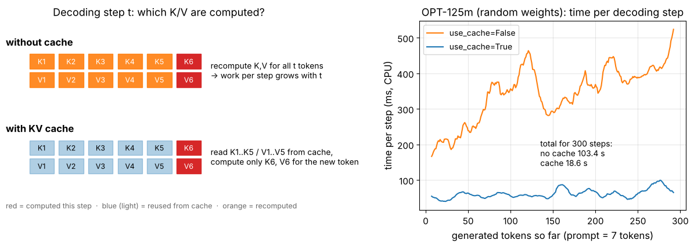

(왼쪽: 6번째 스텝에서 새로 계산하는 키·값(빨강). 캐시가 없으면 앞의 5개도 다시 계산(주황), 캐시가 있으면 저장해 둔 것을 읽기만 한다(연한 파랑). 오른쪽: 1-3절 보충 실험 — 가로축은 지금까지 생성한 토큰 수, 세로축은 스텝 하나에 걸린 시간(이동 평균). 캐시가 없으면 시퀀스가 길어질수록 스텝이 느려지고, 캐시가 있으면 거의 일정하다)

| | 캐시 없음 | KV 캐시 |
|---|---|---|
| $t$번째 스텝의 입력 | 토큰 $t$개 전체 | **새 토큰 1개** + 캐시 |
| 층마다 키·값 투영 | $t$개 | 1개 |
| 어텐션 점수 | $t \times t$ | $1 \times t$ |
| $n$개 생성 총 계산 | 대략 $n^2$에 비례 (점수까지 치면 $n^3$) | 대략 $n$에 비례 (점수는 $n^2$) |
| 추가 메모리 | 없음 | 층 × 2(키·값) × 길이 × 은닉 차원 |

**코드**

```python
from transformers import AutoModelForCausalLM, AutoTokenizer

model_id = "facebook/opt-125m"
model = AutoModelForCausalLM.from_pretrained(model_id, device_map="auto")
tokenizer = AutoTokenizer.from_pretrained(model_id)
prompt = "Once upon a time there lived"
inputs = tokenizer(prompt, return_tensors="pt").to(model.device)
for use_cache in (True, False):
    print(f"{use_cache=}")
    %time model.generate(**inputs, max_new_tokens=500, do_sample=False, use_cache=use_cache)
# use_cache=True
# CPU times: user 3.91 s, sys: 150 ms, total: 4.06 s
# Wall time: 4.62 s
# use_cache=False
# CPU times: user 10.6 s, sys: 13.9 ms, total: 10.6 s
# Wall time: 10.7 s
```

| 코드 | 의미 |
|---|---|
| `"facebook/opt-125m"` | 메타가 2022년에 공개한 GPT 계열 디코더 **OPT**(Open Pre-trained Transformer)의 가장 작은 모델. 12층, 은닉 768, 헤드 12개, 파라미터 125,239,296개 |
| `device_map="auto"` | 쓸 수 있는 장치(GPU)에 모델을 자동으로 올린다 (15장 [4-5절](15_transformers_for_nlp_and_chatbots.md#4-5-더-큰-모델-mistral-7b)) |
| `.to(model.device)` | 입력 텐서(`input_ids`, `attention_mask`)를 모델과 같은 장치로 |
| `max_new_tokens=500, do_sample=False` | 탐욕적 디코딩으로 500토큰. 샘플링을 끄면 두 실행의 결과가 같아야 하므로 순수하게 속도만 비교할 수 있다 |
| `use_cache=True` | KV 캐시 사용 (허깅 페이스의 **기본값**). `False`면 매 스텝 전체 시퀀스를 다시 통과시킨다 |
| `%time` | IPython 매직 명령. 한 줄의 CPU 시간과 **벽시계 시간**(wall time)을 출력한다 |
| `print(f"{use_cache=}")` | f-문자열의 `=` 지정자 — `use_cache=True`처럼 이름과 값을 함께 출력 |

**결과 해석**

- 캐시를 쓰면 4.62초, 안 쓰면 10.7초 → 약 **2.3배** 빠르다
- GPU에서는 캐시 없이도 시퀀스 전체를 **병렬로** 처리하므로 차이가 생각보다 작다. 시퀀스가 더 길거나(수천 토큰), 모델이 크거나, CPU라면 차이가 훨씬 커진다(1-3절 보충 실험에서 CPU는 약 5.6배)
- 허깅 페이스는 기본으로 캐시를 쓴다. `use_cache=False`는 메모리가 부족할 때나 디버깅할 때만 쓴다

> 📌 KV 캐시의 크기는 **층 수 × 2(키·값) × 은닉 차원 × 토큰 수 × 바이트 수**다. OPT-125m은 토큰 하나에 2 × 12 × 768 × 4바이트(float32) = **72KiB**, 2,048토큰이면 144MiB다. 70억 파라미터급 모델(32층, 은닉 4,096, float16)이라면 토큰 하나에 **512KiB**, 32k 토큰 대화 하나에 **16GiB**로 모델 가중치(약 14GB)보다 커진다. 이 캐시를 줄이는 방법이 2-9절의 GQA·MQA, 2-10절의 MLA다.

### 1-3. 보충 코드: 캐시를 직접 다뤄 보기

> 🎯 **목적** — `generate()` 안에서 캐시가 어떻게 오가는지 직접 루프를 돌려 확인하고, 캐시 유무에 따라 생성 결과가 정말 같은지 검증한다.

**보충 코드**

모델을 내려받지 않고 **OPT-125m과 같은 구조**를 설정만으로 만든다(가중치는 무작위라 생성 문장은 의미가 없지만, 속도와 캐시 동작은 같다).

```python
# 보충 코드
import time
import torch
from transformers import OPTConfig, OPTForCausalLM

torch.manual_seed(42)
config = OPTConfig(hidden_size=768, num_hidden_layers=12, ffn_dim=3072,
                   num_attention_heads=12, word_embed_proj_dim=768)
model = OPTForCausalLM(config).eval()
sum(p.numel() for p in model.parameters())     # 125239296  ← opt-125m과 같다

ids = torch.randint(4, 50000, (1, 7))          # 프롬프트 대신 토큰 7개
with torch.no_grad():
    out_cache = model.generate(ids, attention_mask=torch.ones_like(ids),
                               max_new_tokens=200, min_new_tokens=200,
                               do_sample=False, use_cache=True, pad_token_id=1)
    out_nocache = model.generate(ids, attention_mask=torch.ones_like(ids),
                                 max_new_tokens=200, min_new_tokens=200,
                                 do_sample=False, use_cache=False, pad_token_id=1)
torch.equal(out_cache, out_nocache)            # True  ← 토큰 207개가 모두 같다
# 걸린 시간(CPU): use_cache=True 7.4초, False 28.3초
```

`generate()`가 안에서 하는 일을 직접 쓰면 이렇다.

```python
# 보충 코드
def greedy_decode(model, ids, n_steps, use_cache=True):
    x, past = ids, None
    with torch.no_grad():
        for _ in range(n_steps):
            if use_cache:
                inp = x if past is None else x[:, -1:]   # 첫 스텝(프리필)만 전체, 이후는 새 토큰 1개
                out = model(inp, past_key_values=past, use_cache=True)
                past = out.past_key_values               # 갱신된 캐시를 다음 스텝으로
            else:
                out = model(x, use_cache=False)          # 매번 전체 시퀀스
            next_id = out.logits[:, -1].argmax(dim=-1, keepdim=True)
            x = torch.cat([x, next_id], dim=1)
    return x

with torch.no_grad():
    out = model(ids, use_cache=True)
cache = out.past_key_values
type(cache).__name__, len(cache)        # ('DynamicCache', 12)  ← 층마다 하나
cache.layers[0].keys.shape              # torch.Size([1, 12, 7, 64])  [B, h, L, d]
```

| 코드 | 의미 |
|---|---|
| `x[:, -1:]` | 캐시가 있으면 **마지막 토큰 하나만** 입력한다. 위치 정보는 캐시 길이로부터 모델이 알아서 계산한다 |
| `past_key_values=past` | 이전 스텝까지의 키·값. 모델이 새 키·값을 계산해 **뒤에 이어 붙인** 캐시를 `out.past_key_values`로 돌려준다 |
| `DynamicCache` | 트랜스포머스의 기본 캐시 클래스. 층마다 키·값 텐서를 갖고 스텝마다 길이가 1씩 늘어난다 |
| `cache.layers[0].keys.shape` | `[1, 12, 7, 64]` — 배치 1, 헤드 12, 토큰 7, 헤드 차원 64. 12 × 64 = 768 = 은닉 차원 |

**결과 해석**

- 캐시를 쓰든 안 쓰든 생성된 토큰이 **완전히 같다** → KV 캐시는 근사가 아니라 순수한 계산 재사용이다
- 300스텝을 직접 돌린 시간(CPU): 캐시 18.6초, 캐시 없음 103.4초(1-2절 그림 오른쪽). 캐시가 없으면 스텝 시간이 토큰 수에 비례해 늘어난다(약 150ms → 500ms 이상)
- 캐시가 있어도 스텝 시간이 아주 조금씩 늘어나는 것은, 새 쿼리 하나가 **늘어나는 캐시 전체**에 어텐션해야 하기 때문이다($1 \times t$ 점수)

> ⚠️ 트랜스포머스 4.x 초기에는 `past_key_values`가 `(키, 값)` 튜플의 튜플이었다. 지금은 `DynamicCache` 같은 **캐시 객체**이고, 층별 텐서는 `cache.layers[i].keys`·`.values`로 꺼낸다. 오래된 예제 코드의 `past[0][0]`은 버전에 따라 동작하지 않을 수 있다.

### 1-4. 추측 디코딩

> 🎯 **목적** — 작은 초안 모델과 큰 목표 모델을 함께 써서, 목표 모델의 출력 분포를 그대로 유지하면서 생성 속도를 높이는 추측 디코딩을 이해하고 사용한다.

**개념·원리**

1-1절에서 봤듯이 디코드 단계의 큰 모델은 토큰 1개를 처리하든 5개를 처리하든 **걸리는 시간이 거의 같다**(어차피 가중치를 읽는 시간이 대부분). 이 점을 이용한다.

```
목표 모델 Mₚ (크고 느림, 분포 p)        초안 모델 M_q (작고 빠름, 분포 q)

① M_q가 토큰 γ개를 차례로 추측:    "in"  "a"  "small"  "village"     (γ = 4)
② Mₚ가 원래 문맥 + 추측 4개를 한 번의 순전파로 통과
   → 다섯 위치의 p를 동시에 얻는다
③ 앞에서부터 하나씩 검증:
     "in"      ✓ 수락
     "a"       ✓ 수락
     "small"   ✗ 거부 → 이 자리에 Mₚ의 분포에서 새 토큰 "tiny"를 뽑고, 뒤("village")는 버린다
④ 이번 라운드 결과: "in a tiny" (Mₚ 한 번 호출로 3토큰)
   네 개를 모두 수락했다면 ②에서 얻은 다섯 번째 분포로 1토큰을 덤으로 → 5토큰
```

**수락·거부 규칙**(추측 샘플링). 초안 모델이 토큰 $x$를 뽑았을 때

1. 확률 $\min\!\left(1, \dfrac{p(x)}{q(x)}\right)$로 **수락**한다. 목표 모델도 그 토큰을 그 이상으로 좋아하면($p \geq q$) 항상 수락
2. 거부하면, **잔여 분포** $\dfrac{\max(0,\, p - q)}{\sum \max(0,\, p - q)}$에서 새 토큰을 뽑는다 — 초안 모델이 "덜 뽑은" 토큰들을 보충하는 분포

이 규칙을 따르면 최종 토큰의 분포가 **정확히 $p$** 다(1-5절에서 확인). 초안 모델이 엉터리면 거부가 잦아 느려질 뿐 결과가 틀리지는 않는다.

| 용어 | 뜻 |
|---|---|
| **수락률** $\alpha$ | $\sum_x \min(p(x), q(x))$. 두 분포가 비슷할수록 1에 가깝다 |
| **추측 길이** $\gamma$ | 한 라운드에 초안 모델이 추측하는 토큰 수 |
| 목표 모델 호출당 기대 토큰 수 | $\dfrac{1 - \alpha^{\gamma+1}}{1 - \alpha}$ (토큰마다 독립적으로 $\alpha$ 확률로 수락된다고 가정) |

**코드**

```python
from transformers import AutoModelForCausalLM, AutoTokenizer
from transformers import set_seed

set_seed(42)
target_model = AutoModelForCausalLM.from_pretrained("facebook/opt-350m",
                                                    device_map="auto")
draft_model = AutoModelForCausalLM.from_pretrained("facebook/opt-125m",
                                                   device_map="auto")
tokenizer = AutoTokenizer.from_pretrained("facebook/opt-350m")
prompt = "Once upon a time there lived"
inputs = tokenizer(prompt, return_tensors="pt").to(target_model.device)
outputs = target_model.generate(**inputs, max_new_tokens=100, do_sample=True,
                                temperature=1, assistant_model=draft_model)
result = tokenizer.decode(outputs[0], skip_special_tokens=True)
print(result)
# Once upon a time there lived in an aldermanic family the eldest daughter. Her father
# was a very rich man of considerable wealth.
#
# She was very wise and had developed a good marriage with her husband. He never slept
# on the floor while she slept, but on the table above the bed he never seemed to be awake.
#
# The eldest daughter knew what was important to her husband and her parents, and if he
# refused to do as she told him, she would not accept a roomful of guests for a
```

| 코드 | 의미 |
|---|---|
| `set_seed(42)` | 파이썬·넘파이·파이토치 난수를 한 번에 고정 (샘플링 결과 재현) |
| `"facebook/opt-350m"` | 목표 모델. 24층, 은닉 1,024, 파라미터 331,196,416개 (opt-125m의 약 2.6배) |
| `"facebook/opt-125m"` | 초안 모델. 두 모델이 **같은 토크나이저**(같은 어휘)를 써야 토큰 단위로 비교할 수 있다 |
| `assistant_model=draft_model` | 허깅 페이스의 **보조 생성**(assisted generation) = 추측 디코딩을 켠다. 목표 모델의 `generate()`에 초안 모델을 넘긴다 |
| `do_sample=True, temperature=1` | 샘플링 모드에서는 1-4절의 수락·거부 규칙(추측 샘플링)을 쓴다. 탐욕적 디코딩(`do_sample=False`)이면 "목표 모델의 argmax와 같으면 수락"으로 단순해진다 |
| `skip_special_tokens=True` | 맨 앞의 `</s>`(OPT의 시작 토큰) 같은 특수 토큰을 빼고 디코딩 |

**결과 해석**

- 출력은 opt-350m이 **혼자 샘플링한 것과 같은 분포**에서 나온 문장이다. 작은 모델답게 문법은 그럴듯하지만 내용은 엉뚱하다("침대 위의 탁자에서…")
- 노트북은 속도를 재지 않는다. 두 모델이 모두 작아(GPU에서 둘 다 빠르다) 이득이 거의 없기 때문이다. 추측 디코딩은 목표 모델이 **수십억 파라미터 이상**이고 초안 모델이 그보다 **10배 이상 작을 때** 2 ~ 3배 빨라진다

> 📌 한 라운드의 추측 길이는 `num_assistant_tokens`(γ)로, 그 조절 방식은 `num_assistant_tokens_schedule`로 정한다. `"heuristic"`은 초안이 모두 맞으면 다음 라운드에 2개 더, 하나라도 틀리면 1개 덜 추측하고, `"constant"`는 고정한다. `assistant_confidence_threshold`를 주면 초안 모델이 자신 없는 토큰에서 추측을 일찍 멈춘다. `assistant_model` 대신 `prompt_lookup_num_tokens=10`을 주면 초안 모델 없이 **프롬프트 안의 n-그램**을 초안으로 쓴다(요약·코드 수정처럼 출력이 입력을 많이 베끼는 작업에 효과적, 1-6절).

> ⚠️ 보충 실험(트랜스포머스 5.23)에서 무작위 가중치의 OPT-350m 구조(목표)와 OPT-125m 구조(초안)로 탐욕적 디코딩을 해 보면, 초안이 엉터리여도 `assistant_model`을 준 결과와 목표 모델 혼자의 결과가 **토큰 30개 모두 같았다**. "추측 디코딩은 결과를 바꾸지 않는다"를 그대로 확인할 수 있다.

### 1-5. 보충 코드: 수락·거부 규칙은 목표 분포를 지킨다

> 🎯 **목적** — 1-4절의 수락·거부 규칙을 직접 구현해, 초안 분포 $q$로 뽑아도 최종 분포가 목표 분포 $p$와 같아지는지 확인하고, 수락률과 추측 길이에 따른 속도 이득을 계산한다.

**보충 코드**

```python
# 보충 코드
torch.manual_seed(42)
V = 8                                                        # 어휘 8개짜리 장난감
p = torch.softmax(torch.randn(V) * 1.2, 0)                   # 목표 분포
q = torch.softmax(torch.log(p) + torch.randn(V) * 0.8, 0)    # 비슷하지만 다른 초안 분포
alpha = torch.minimum(p, q).sum()                            # 수락률 0.691

def speculative_sample(p, q, n):
    x = torch.multinomial(q, n, replacement=True)                # 초안이 n번 추측
    accept = torch.rand(n) < torch.clamp(p[x] / q[x], max=1.0)   # min(1, p/q) 확률로 수락
    residual = torch.clamp(p - q, min=0)
    residual /= residual.sum()                                   # 잔여 분포 max(0, p-q) 정규화
    y = torch.multinomial(residual, n, replacement=True)         # 거부되면 여기서 다시 뽑기
    return torch.where(accept, x, y), accept

out, acc = speculative_sample(p, q, 1_000_000)
emp = torch.bincount(out, minlength=V).float() / len(out)
acc.float().mean()           # 0.6907  ← 이론값 α = 0.6908과 같다
(emp - p).abs().max()        # 0.00054 ← 경험적 분포 ≈ p
(q - p).abs().max()          # 0.284   ← q는 p와 꽤 다른데도
```

| 코드 | 의미 |
|---|---|
| `torch.multinomial(q, n, replacement=True)` | 분포 `q`에서 토큰 `n`개를 복원 추출 (15장의 샘플링과 같은 함수) |
| `torch.clamp(p[x] / q[x], max=1.0)` | $\min(1, p(x)/q(x))$. 뽑힌 토큰마다 수락 확률 |
| `torch.clamp(p - q, min=0)` | $p$가 $q$보다 큰 토큰들(초안이 덜 뽑은 토큰)만 남긴다 |
| `torch.where(accept, x, y)` | 수락이면 초안 토큰, 거부면 잔여 분포에서 뽑은 토큰 |

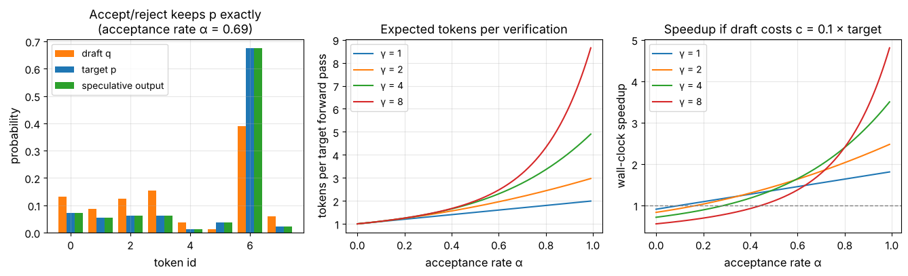

(왼쪽: 토큰 8개에 대한 초안 분포 $q$(주황), 목표 분포 $p$(파랑), 추측 샘플링 100만 번의 결과(초록). 초록이 파랑과 겹친다. 가운데: 수락률 $\alpha$와 추측 길이 $\gamma$에 따른 **목표 모델 1회 호출당 기대 토큰 수**. 오른쪽: 초안 모델 비용이 목표 모델의 $c = 0.1$배일 때의 **실제 속도 향상** $\frac{1-\alpha^{\gamma+1}}{(1-\alpha)(\gamma c + 1)}$. 회색 점선 1 아래면 오히려 느려진다)

**결과 해석**

- 초안 분포가 목표 분포와 최대 0.28이나 다른데도, 규칙을 거친 결과는 $p$와 0.0005 이내로 같다. **분포를 바꾸지 않는다**는 것이 추측 디코딩의 핵심 보장이다
- 수락률이 0.8이면 $\gamma = 4$일 때 목표 모델 호출 한 번에 평균 3.36토큰, 초안 비용까지 고려한 속도 향상은 약 2.4배
- 수락률이 낮을 때 $\gamma$를 크게 잡으면 초안 모델 비용만 늘어 **1배 아래로** 떨어진다(오른쪽 그림의 $\gamma = 8$). 그래서 $\gamma$는 수락률에 맞춰 조절한다(허깅 페이스의 동적 일정)

> 💡 왜 $p$가 보존되나? 토큰 $x$가 최종으로 나올 확률 = (초안이 $x$를 뽑고 수락) + (거부된 뒤 잔여 분포에서 $x$) = $\min(p(x), q(x)) + (1-\alpha)\cdot\frac{\max(0,\, p(x)-q(x))}{1-\alpha}$ = $\min(p, q) + \max(0, p-q) = p(x)$. ($\sum_x \max(0, p-q) = 1 - \alpha$를 썼다.)

### 1-6. 그 밖의 디코딩 가속 기법

> 🎯 **목적** — 실제 LLM 서빙에서 함께 쓰는 디코딩 가속 기법을 정리한다.

> ⚠️ 노트북에는 이 소절의 코드가 없다. 교재 17.1절의 맥락을 보충하는 개념 정리다.

| 기법 | 아이디어 | 비고 |
|---|---|---|
| **프롬프트 룩업 디코딩** | 초안 모델 대신, 지금까지의 마지막 n-그램을 **프롬프트에서 찾아** 그 뒤의 토큰들을 초안으로 쓴다 | 허깅 페이스 `generate(..., prompt_lookup_num_tokens=10)`. 요약·문서 질의응답·코드 편집에 효과적 |
| **Medusa·EAGLE** | 별도 초안 모델 없이, 목표 모델 위에 **여러 토큰을 앞서 예측하는 헤드**를 붙여 초안을 만든다 | 헤드만 추가로 훈련. 토큰 트리로 여러 후보를 한 번에 검증 |
| **연속 배칭** (continuous batching) | 여러 사용자의 요청을 한 배치로 묶되, 끝난 요청은 바로 빼고 새 요청을 바로 넣는다 | 1-1절의 "한 번 읽은 가중치로 더 많은 토큰" — 처리량이 크게 늘어난다 |
| **페이지드 어텐션** (PagedAttention) | KV 캐시를 운영체제의 가상 메모리처럼 작은 **페이지(블록)** 로 나눠 관리 → 단편화와 메모리 낭비를 줄인다 | vLLM 라이브러리의 핵심 기법 |
| **양자화** | 가중치·KV 캐시를 8비트·4비트로 저장 → 메모리에서 읽을 양이 줄어 디코드가 빨라진다 | 교재 **부록 B**(혼합 정밀도와 양자화) |
| **정적 캐시 + 컴파일** | 캐시 크기를 미리 고정(`cache_implementation="static"`)해 텐서 형태가 바뀌지 않게 하고 `torch.compile`로 컴파일 | 10장 [10-2절 `torch.compile`](10_neural_nets_with_pytorch.md#10-2-torchcompile) |

> 💡 실제 서비스에서는 이 기법들을 **겹쳐서** 쓴다. 예를 들어 vLLM·TGI·TensorRT-LLM 같은 서빙 엔진은 KV 캐시 + 페이지드 어텐션 + 연속 배칭 + 플래시 어텐션(2-11절) + 양자화 + 추측 디코딩을 한꺼번에 적용한다.

---

## 2. 멀티 헤드 어텐션 속도 높이기 (17.2)

> 🎯 **목적** — 셀프 어텐션의 제곱 비용을 줄이는 네 갈래(희소, 근사, 투영 공유, 입출력 최적화)를 구현과 그림으로 비교한다.

> 💬 **$L \times L$ 표를 어떻게 다룰 것인가**
>
> 어텐션은 쿼리 $L$개와 키 $L$개의 모든 쌍에 점수를 매기는 $L \times L$ 표를 만든다. 길이가 2배면 표는 4배다. 줄이는 방법은 네 가지다.
>
> - **희소 어텐션**: 표의 **일부 칸만** 계산한다 — 이웃끼리, 몇몇 전역 토큰과, 무작위 몇 칸(Longformer·BigBird)
> - **근사 어텐션**: 표를 **다른 방식으로 근사**한다 — 비슷한 벡터끼리만 비교(Reformer), 길이 축을 압축(Linformer), 소프트맥스를 랜덤 특성의 곱으로 바꿔 표 자체를 안 만든다(Performer)
> - **투영 공유**: 헤드들이 **키·값을 나눠 쓴다**(MQA·GQA) 또는 압축해 저장한다(MLA) → 계산보다 **KV 캐시 메모리**를 줄인다
> - **플래시 어텐션**: 계산은 정확히 똑같이 하되, 표를 **GPU 메모리에 쓰지 않고** 작은 타일로 나눠 빠른 온칩 메모리에서 끝낸다
> - **헷갈림 주의**: 희소·근사 어텐션은 결과가 **달라진다**(모델을 그 방식으로 훈련해야 한다). 투영 공유는 **구조가 달라진다**. 플래시 어텐션만 **결과가 그대로**다 — 그래서 지금 가장 널리 쓰인다

### 2-1. 어텐션의 비용

> 🎯 **목적** — 셀프 어텐션의 계산량과 메모리가 시퀀스 길이에 따라 어떻게 늘어나는지 정리한다.

> ⚠️ 노트북에는 이 소절의 코드가 없다.

**개념·원리**

헤드 하나, 길이 $L$, 헤드 차원 $d$일 때 스케일드 점곱 어텐션 $\text{softmax}(QK^\top/\sqrt{d})\,V$의 비용은 다음과 같다.

| 단계 | 계산량 | 메모리 |
|---|---|---|
| $S = QK^\top$ | $L^2 d$ | **$L^2$** (점수 행렬) |
| $P = \text{softmax}(S)$ | $L^2$ | **$L^2$** (가중치 행렬, 역전파용으로 저장) |
| $O = PV$ | $L^2 d$ | $Ld$ |
| 비교: $Q, K, V$ 투영 (선형 층) | $L d_{\text{model}}^2$ | $L d_{\text{model}}$ |

- 짧은 시퀀스($L < d_{\text{model}}$)에서는 선형 층(투영·피드포워드)이 계산의 대부분이다. **$L$이 수천을 넘으면** 어텐션의 $L^2$ 항이 지배한다
- 계산보다 더 먼저 문제가 되는 것은 **메모리**다. 길이 16,384, 헤드 32개, float16이면 점수 행렬만 16GiB다(2-11절 그림 오른쪽)
- 그래서 긴 문서(책 한 권, 코드 저장소, 긴 대화), 고해상도 이미지(16장 Swin 1-11절), 음성·유전체 같은 긴 시퀀스를 다루려면 이 비용을 줄여야 한다

### 2-2. 희소 어텐션

> 🎯 **목적** — 점수 행렬의 일부 칸만 계산하는 희소 어텐션 패턴(Sparse Transformer, Longformer, BigBird, Routing Transformer)을 그림으로 비교한다.

> ⚠️ 노트북에는 BigBird 사용 예(2-3절)만 있다. 패턴 그림은 직접 만든 보충 그림이다.

**개념·원리**

자연어에서 한 단어의 의미는 대부분 **가까운 단어**로 정해지고, 먼 단어와의 관계는 문장의 몇몇 핵심 토큰을 거쳐 전해진다. 그렇다면 모든 쌍을 계산하지 않고, 정해진 **패턴의 칸만** 계산해도 된다.

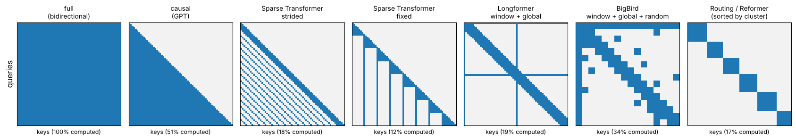

(길이 64인 시퀀스의 어텐션 마스크. 가로축 = 키, 세로축 = 쿼리, 파란 칸 = 실제로 계산하는 쌍. 아래 괄호는 전체 64 × 64 중 계산하는 비율. 시퀀스가 길어질수록 희소 패턴의 비율은 더 작아진다)

| 모델 | 연도 | 패턴 | 비용 |
|---|---|---|---|
| **Sparse Transformer** (OpenAI) | 2019 | **strided**: 바로 앞 $w$개 + $w$칸마다 하나씩 / **fixed**: 같은 블록 안 + 각 블록의 마지막 몇 칸("요약" 칸). 헤드나 층마다 두 패턴을 번갈아 쓰면 두 단계 안에 모든 위치가 연결된다 | $O(L\sqrt{L})$ |
| **Longformer** (AllenAI) | 2020 | **슬라이딩 윈도**(양쪽 $w$개) + **팽창 윈도**(몇 칸씩 건너뛰며, 13장 팽창 합성곱과 같은 발상) + 작업에 따라 고른 **전역 토큰**(`[CLS]`, 질문 토큰 등)은 모든 토큰과 양방향으로 어텐션 | $O(Lw)$ |
| **BigBird** (구글) | 2020 | **윈도** + **전역** + **무작위** 블록. 블록(64토큰) 단위로 계산해 GPU에서 효율적. 이 조합이 완전 어텐션처럼 모든 시퀀스 함수를 근사할 수 있음(만능 근사)을 이론적으로 보였다 | $O(L)$ |
| **Routing Transformer** (구글) | 2020 | 패턴을 미리 정하지 않고 **내용으로** 정한다. 쿼리·키를 온라인 **k-평균**(8장)으로 군집화하고 같은 군집끼리만 어텐션 | $O(L^{1.5})$ |

- 고정 패턴(Sparse Transformer, Longformer, BigBird)은 구현이 단순하고 빠르지만, 패턴 밖의 먼 관계는 **여러 층을 거쳐야** 전해진다
- 내용 기반 패턴(Routing Transformer, 2-4절의 Reformer)은 "관련 있는 쌍"을 고르지만 군집화·정렬 비용이 든다
- BigBird·Longformer는 최대 길이 4,096토큰(BERT의 8배)으로 긴 문서 분류·질의응답·요약에서 BERT·RoBERTa를 앞섰다

> 💡 그림의 Routing/Reformer 패턴은 군집 번호로 **정렬한 뒤** 그린 것이다. 정렬하면 같은 군집끼리 붙어 **블록 대각 행렬**이 되므로, 실제 구현은 정렬 → 블록(청크)마다 어텐션 → 원래 순서로 되돌리기 순서로 계산한다.

### 2-3. BigBird로 빈칸 채우기

> 🎯 **목적** — 사전 훈련된 BigBird를 허깅 페이스 파이프라인으로 써 보고, 짧은 입력에서 일어나는 자동 전환을 이해한다.

**코드**

```python
from transformers import pipeline

model_id = "google/bigbird-roberta-base"
pipeline = pipeline(task="fill-mask", model=model_id)
pipeline("She was feeling unwell so she took some [MASK] medicine.")
# Attention type 'block_sparse' is not possible if sequence_length: 14 <= num global tokens:
# 2 * config.block_size + min. num sliding tokens: 3 * config.block_size
# + config.num_random_blocks * config.block_size + additional buffer:
# config.num_random_blocks * config.block_size = 704 with config.block_size = 64,
# config.num_random_blocks = 3. Changing attention type to 'original_full'...
# [{'score': 0.2819, 'token': 2457,  'token_str': 'pain',    'sequence': 'She was feeling unwell so she took some pain medicine.'},
#  {'score': 0.2191, 'token': 4793,  'token_str': 'cold',    'sequence': '... cold medicine.'},
#  {'score': 0.1127, 'token': 36298, 'token_str': 'allergy', 'sequence': '... allergy medicine.'},
#  {'score': 0.0693, 'token': 22195, 'token_str': 'cough',   'sequence': '... cough medicine.'},
#  {'score': 0.0452, 'token': 35968, 'token_str': 'herbal',  'sequence': '... herbal medicine.'}]
```

| 코드 | 의미 |
|---|---|
| `"google/bigbird-roberta-base"` | RoBERTa-base(15장 [3-7절](15_transformers_for_nlp_and_chatbots.md#3-7-bert-이후의-인코더-모델)) 가중치에서 출발해 BigBird 어텐션으로 사전 훈련한 인코더. 최대 4,096토큰 |
| `pipeline(task="fill-mask", ...)` | 15장 [3-3절](15_transformers_for_nlp_and_chatbots.md#3-3-fill-mask로-확인하기)과 같은 빈칸 채우기 파이프라인. 확률 상위 5개 토큰을 돌려준다 |
| `pipeline = pipeline(...)` | ⚠️ 함수 이름 `pipeline`을 결과 객체로 **덮어쓴다.** 이 셀을 두 번 실행하면 `pipeline`이 함수가 아니라서 오류가 난다. `fill_mask = pipeline(...)`처럼 다른 이름을 쓰는 것이 안전하다 |
| `[MASK]` | BigBird 토크나이저의 마스크 토큰 |

**결과 해석**

- "몸이 안 좋아서 ___ 약을 먹었다" → pain(진통제) 28.2%, cold(감기약) 21.9%, allergy 11.3%, cough 6.9%, herbal 4.5%. 모두 문맥에 맞는 답이다
- **경고 메시지가 핵심이다.** 블록 희소 어텐션은 전역 블록 2개 + 슬라이딩 블록 3개 + 무작위 블록 3개 + 여유분 3개 = (2 + 3 + 3 + 3) × 64 = **704토큰**보다 길어야 의미가 있다. 14토큰짜리 문장은 그냥 **원래의 완전 어텐션**(`original_full`)으로 계산한다
- 즉 BigBird는 짧은 입력에서는 BERT와 똑같이 동작하고, **긴 입력에서만** 희소 어텐션의 이득을 본다. 보충 실험(무작위 가중치의 작은 BigBird)에서 1,024토큰 입력은 경고 없이 `block_sparse`로 계산됐다. 짧은 입력에서의 전환은 그 호출에만 적용되고 `config.attention_type`은 `"block_sparse"`로 남는다

> 📌 노트북 출력에는 `BigBirdForMaskedLM has generative capabilities ... From 👉v4.50👈 onwards ...`라는 경고도 세 번 나온다. 트랜스포머스 4.x의 내부 구조 변경 안내로, 노트북 말대로 **무시해도 된다.**

### 2-4. 근사 어텐션: Reformer와 LSH

> 🎯 **목적** — 소프트맥스 어텐션에서 큰 가중치는 쿼리와 비슷한 키에서만 나온다는 점을 이용해, 비슷한 벡터끼리 같은 버킷에 넣는 각도 LSH를 구현한다.

**개념·원리**

소프트맥스는 큰 점수에 가중치가 몰린다. 쿼리 $q$에 대해 실제로 중요한 키는 $q \cdot k$가 큰 소수뿐이다. 그렇다면 **$q$와 비슷한 방향의 키만** 찾아 어텐션하면 된다. Reformer(구글, 2020)는 이 "비슷한 벡터 찾기"를 **지역 민감 해싱**(LSH, locality-sensitive hashing)으로 한다.

| 단계 | 내용 |
|---|---|
| 1. 해싱 | 벡터를 무작위 방향들에 투영해 버킷 번호를 붙인다. **비슷한 벡터는 높은 확률로 같은 버킷** |
| 2. 정렬·청크 | 버킷 번호로 토큰을 정렬하고 일정 크기의 청크로 자른다 |
| 3. 어텐션 | 각 청크 안(과 바로 앞 청크)에서만 어텐션 → 비용 $O(L \log L)$ |
| 4. 여러 라운드 | 운 나쁘게 다른 버킷에 갈라진 이웃을 놓치지 않도록, 다른 무작위 투영으로 여러 번 해싱해 결과를 합친다 |

Reformer의 다른 장치: 같은 버킷에 쿼리와 키가 함께 모이도록 **쿼리와 키 투영을 공유**($Q = K$)하고, 역전파용 활성화를 저장하지 않고 다시 계산하는 **가역 잔차 층**(4-4절 체크포인팅과 같은 목적), 피드포워드 층을 청크로 나눠 계산하는 **청킹**으로 메모리를 줄였다.

**코드**

```python
import torch
import torch.nn as nn
import torch.nn.functional as F

def angular_lsh(vectors, k):
    R = torch.randn(vectors.size(-1), k // 2, device=vectors.device)
    normalized_vectors = F.normalize(vectors, p=2.0, dim=1)
    V_proj = normalized_vectors @ R
    V_concat = torch.cat([V_proj, -V_proj], dim=1)
    return torch.argmax(V_concat, dim=1)

torch.manual_seed(42)
vectors = torch.rand(16, 512)
angular_lsh(vectors, k=4)
# tensor([2, 2, 0, 3, 0, 2, 2, 2, 2, 1, 1, 3, 3, 1, 2, 1])
```

| 코드 | 의미 |
|---|---|
| `R = torch.randn(512, k // 2)` | 무작위 방향 $k/2$개 (여기서는 2개). Reformer 논문의 **무작위 회전** 행렬 역할 |
| `F.normalize(vectors, p=2.0, dim=1)` | 벡터마다 길이 1로 → 크기는 무시하고 **방향(각도)만** 본다. 그래서 "각도" LSH |
| `V_proj = normalized @ R` | `[16, 2]`. 각 무작위 방향으로의 투영값 |
| `torch.cat([V_proj, -V_proj], dim=1)` | `[16, 4]`. 방향 $r_1, r_2, -r_1, -r_2$ 네 개에 대한 투영 |
| `torch.argmax(..., dim=1)` | 네 방향 중 **가장 가까운 방향**의 번호 = 버킷 번호 0 ~ 3 |

**결과 해석**

- 벡터 16개가 버킷 0 ~ 3에 나뉘었다. 같은 버킷의 벡터끼리만 어텐션하면 된다
- `torch.rand`(0 ~ 1 균등 분포)로 만든 벡터는 모든 성분이 양수라 방향이 서로 비슷하다. 그래서 버킷 2에 7개가 몰렸다. 실제 모델의 쿼리·키는 더 다양한 방향을 가진다

**보충 그림** — 2차원 벡터로 버킷을 그리고, 두 벡터의 각도에 따라 같은 버킷에 들어갈 확률을 시뮬레이션했다.

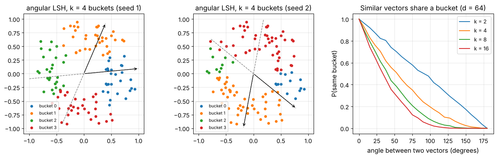

(왼쪽·가운데: 2차원 벡터 120개를 `angular_lsh(k=4)`로 해싱한 결과. 화살표 = 무작위 방향 $r_1, r_2$, 점선 = 그 반대 방향까지 이은 축. 점의 색 = 버킷. 각 점은 네 방향($\pm r_1, \pm r_2$) 중 가장 가까운 쪽 버킷에 들어가 원이 **부채꼴 4개**로 나뉜다. 무작위 방향이 바뀌면(시드 1 → 2) 경계도 바뀐다. 오른쪽: 64차원에서 두 벡터 사이 각도별로 같은 버킷에 들어갈 확률(4,000번 시뮬레이션). 버킷 수 $k$가 클수록 더 비슷해야 같은 버킷에 들어간다)

- $k = 2$(방향 1개)면 같은 버킷 확률이 정확히 $1 - \theta/\pi$다(90°에서 0.505)
- 각도 0°면 항상 같은 버킷, 180°(정반대)면 절대 같은 버킷이 아니다. **가까울수록 충돌**한다는 LSH의 성질이다
- 버킷을 늘리면($k$ = 16) 45°만 벌어져도 같은 버킷 확률이 0.36으로 떨어져 버킷이 더 "선별적"이 되지만, 진짜 이웃을 놓칠 확률도 커진다 → 해싱을 여러 라운드 한다

### 2-5. 근사 어텐션: Linformer

> 🎯 **목적** — 키·값을 시퀀스 길이 축으로 압축해 어텐션 비용을 선형으로 만드는 Linformer를 정리한다.

> ⚠️ 노트북에는 이 소절의 코드가 없다. 아래는 형태 확인용 보충 코드다.

**개념·원리**

Linformer(페이스북, 2020)는 훈련된 트랜스포머의 어텐션 가중치 행렬($L \times L$)이 대부분 **저랭크**(특잇값 몇 개가 거의 전부를 설명, 7장 SVD)라는 관찰에서 출발했다. 그렇다면 키·값을 **길이 $L$에서 $k$로** 줄여도 정보를 대부분 지킬 수 있다.

$$
\text{softmax}\!\left(\frac{Q\,(E K)^\top}{\sqrt{d}}\right)(F V), \qquad E, F \in \mathbb{R}^{k \times L}
$$

**보충 코드**

```python
# 보충 코드
torch.manual_seed(42)
B, L, d, k = 1, 4096, 64, 256
Q, K, V = (torch.randn(B, L, d) for _ in range(3))
E = torch.randn(k, L) / L ** 0.5      # 실제로는 학습되는 투영 (층·헤드끼리 공유 가능)
Fp = torch.randn(k, L) / L ** 0.5
K_proj, V_proj = E @ K, Fp @ V         # [1, 256, 64]  ← 4,096개를 256개로 압축
out = torch.softmax(Q @ K_proj.transpose(1, 2) / d ** 0.5, dim=-1) @ V_proj
out.shape                              # torch.Size([1, 4096, 64])  ← 출력 길이는 그대로
# 점수 행렬: 4096 × 4096 → 4096 × 256 (16분의 1)
```

- 점수 행렬이 $L \times k$가 되어 비용이 $O(Lk)$ — $k$를 고정하면 **길이에 선형**이다
- 한계: 투영 $E$가 **전체 길이를 섞으므로** 미래 토큰을 가릴 수 없다 → 인과 마스크가 필요한 디코더(GPT)에는 바로 쓰기 어렵다. 또 $E$의 크기가 $k \times L$이라 **최대 길이가 고정**된다

### 2-6. 근사 어텐션: Performer의 랜덤 특성

> 🎯 **목적** — 소프트맥스의 $\exp(q \cdot k)$를 두 벡터의 랜덤 특성 $\phi(q) \cdot \phi(k)$로 근사해, 점수 행렬을 만들지 않고 어텐션을 계산하는 Performer의 원리를 확인한다.

**개념·원리**

소프트맥스 어텐션을 행렬로 쓰면 $O = D^{-1} A V$, $A = \exp(QK^\top)$, $D = \text{diag}(A\mathbf{1})$이다(스케일 $1/\sqrt{d}$는 $Q, K$에 미리 곱했다고 하자). 만약 $\exp(q \cdot k) = \phi(q) \cdot \phi(k)$로 쓸 수 있다면

$$
A V = \phi(Q)\,\phi(K)^\top V = \phi(Q)\,\underbrace{\left(\phi(K)^\top V\right)}_{m \times d \text{ 행렬}}
$$

**곱하는 순서를 바꿔** $\phi(K)^\top V$를 먼저 계산하면 $L \times L$ 행렬이 생기지 않는다. 비용은 $O(L m d)$ — 길이에 **선형**이다(부록 C의 [커널 트릭](C_support_vector_machines.md#3-2-커널-트릭)과 반대 방향의 발상: 커널을 명시적인 특성의 내적으로 펼친다).

Performer(구글, 2020)는 다음 성질을 쓴다. $\mathbf{w}$가 표준 정규 분포에서 뽑은 벡터이면

$$
\mathbb{E}\big[\exp(\mathbf{w}\cdot\mathbf{x})\big] = \exp\!\left(\tfrac{1}{2}\|\mathbf{x}\|^2\right)
$$

(정규 분포의 적률 생성 함수). 여기서 $\exp(q \cdot k) = \exp(-\frac{\|q\|^2}{2})\exp(-\frac{\|k\|^2}{2})\exp(\frac{\|q+k\|^2}{2})$를 이용하면

$$
\phi(\mathbf{x}) = \frac{1}{\sqrt{m}}\exp\!\left(\mathbf{x}W - \tfrac{1}{2}\|\mathbf{x}\|^2\right), \quad W \in \mathbb{R}^{d \times m}, \quad \mathbb{E}\big[\phi(q)\cdot\phi(k)\big] = \exp(q \cdot k)
$$

$\phi$의 값이 항상 **양수**라서(그래서 "positive random features") 근사한 가중치도 음수가 되지 않는다.

**코드** — 먼저 기댓값 성질을 확인한다.

```python
torch.manual_seed(42)
d, m = 64, 1024
W = torch.randn(d, m)
X = torch.randn(5, d) / d ** 0.5
R = torch.exp(X @ W)
print(R.mean(axis=-1))
print(torch.exp(0.5 * (X.norm(dim=-1)**2)))
# tensor([1.5851, 1.6703, 1.6728, 1.9729, 1.7934])   ← 랜덤 특성 1,024개의 평균
# tensor([1.6516, 1.7578, 1.6594, 1.8050, 1.7751])   ← 이론값 exp(‖x‖²/2)
```

- 벡터 5개 모두 표본 평균이 이론값과 가깝다(오차 1 ~ 9%). 특성 수 $m$을 늘리면 더 가까워진다

다음으로 $\phi$를 구현한다.

```python
def phi(X, W, dim_subtract_max=(-2, -1)):
    squared_norms = X.square().sum(dim=-1, keepdim=True)
    X_proj = X @ W
    max_vals = X_proj.amax(dim=dim_subtract_max, keepdim=True)
    return torch.exp(X_proj - max_vals - squared_norms / 2) / W.size(-1) ** 0.5
```

| 코드 | 의미 |
|---|---|
| `squared_norms` | $\|\mathbf{x}\|^2$, 형태 `[..., L, 1]` |
| `X_proj = X @ W` | $\mathbf{x}W$, `[..., L, d] @ [h, d, m]` → `[..., L, m]` (헤드마다 다른 $W$) |
| `max_vals = X_proj.amax(...)` | 지수 함수가 넘치지 않도록 **최댓값을 빼는** 안정화 (소프트맥스의 로그합지수 트릭과 같다) |
| `dim_subtract_max=-1` | 쿼리용: **쿼리(행)마다** 최댓값을 뺀다. 행마다 상수 배가 곱해지지만 나중에 행 합으로 나누면 사라진다 |
| `dim_subtract_max=(-2, -1)` | 키용(기본값): 헤드마다 **모든 키에 같은** 최댓값을 뺀다. 키마다 다르게 빼면 키별 가중치가 달라져 결과가 틀리므로 공통 상수여야 한다 |
| `/ W.size(-1) ** 0.5` | $1/\sqrt{m}$ — $\phi(q)\cdot\phi(k)$가 특성 $m$개의 **평균**이 되도록 |

이제 $\phi(Q)\phi(K)^\top$로 만든 어텐션 가중치가 진짜 소프트맥스 가중치에 얼마나 가까운지 본다.

```python
torch.manual_seed(42)
batch_size = 32
d_model = 512
n_heads = 8
Lq = 200
Lk = 100
m = 256
d_head = d_model // n_heads
W = torch.randn(n_heads, d_head, m)
Q = torch.randn(batch_size, n_heads, Lq, d_head)
K = torch.randn(batch_size, n_heads, Lk, d_head)
scale = 1 / d_head ** 0.5
Qp = phi(Q * scale ** 0.5, W, dim_subtract_max=-1)
Kp = phi(K * scale ** 0.5, W)
A = Qp @ Kp.transpose(-2, -1)
D = A.sum(dim=-1, keepdim=True)
result = A / (D + 1e-6)
expected = torch.softmax(Q @ K.transpose(-2, -1) * scale, dim=-1)
rmse = F.mse_loss(result, expected) ** 0.5
rmse
# tensor(0.0171)
```

| 코드 | 의미 |
|---|---|
| `W` `[8, 64, 256]` | 헤드 8개 × 헤드 차원 64 × 랜덤 특성 256개 |
| `Q * scale ** 0.5` | $1/\sqrt{d}$를 쿼리와 키에 **반씩** 나눠 곱한다: $(q/d^{1/4})\cdot(k/d^{1/4}) = q\cdot k/\sqrt{d}$ |
| `Qp` `[32, 8, 200, 256]`, `Kp` `[32, 8, 100, 256]` | 쿼리·키마다 256차원 특성 벡터 |
| `A = Qp @ Kp.transpose(-2, -1)` | $\approx \exp(QK^\top/\sqrt{d})$, `[32, 8, 200, 100]`. 여기서는 확인을 위해 일부러 $L_q \times L_k$ 행렬을 만들었다 |
| `A / (D + 1e-6)` | 행 합으로 나눠 정규화 = 소프트맥스의 분모 |
| `F.mse_loss(...) ** 0.5` | RMSE (평균 제곱근 오차) |

**결과 해석**

- RMSE 0.0171. 노트북은 "꽤 좋은 근사"라고 하지만, **가중치의 크기**와 비교해야 한다. 키가 100개라 가중치의 평균은 0.01, 표준 편차는 0.0125다. 오차가 가중치 자체보다 크다
- 이 숫자가 실제로 무엇을 뜻하는지는 2-8절에서 따져 본다

### 2-7. 직교 랜덤 특성과 FAVOR+ 어텐션

> 🎯 **목적** — 랜덤 방향을 서로 직교하게 만들어 근사 분산을 줄이고, 점수 행렬 없이 선형 비용으로 어텐션 출력을 계산하는 FAVOR+ 층을 구현한다.

**개념·원리**

랜덤 방향 $\mathbf{w}_1, \dots, \mathbf{w}_m$이 서로 비슷하면 같은 정보를 중복해서 측정하는 셈이다. 서로 **직교**하게 만들면 같은 개수로 더 다양한 방향을 보므로 추정의 분산이 줄어든다. $d$차원에는 직교 벡터가 $d$개까지만 있으므로, $m$개를 $d$개씩 묶어 묶음마다 직교화한다. 이것이 **FAVOR+**(Fast Attention Via positive Orthogonal Random features)다.

**코드**

```python
def orthogonalize(W):
    d_head = W.size(-2)
    W_orth = torch.cat([torch.linalg.qr(W_chunk)[0]
                        for W_chunk in W.split(d_head, dim=-1)], dim=-1)
    return W_orth * d_head ** 0.5

W_orth = orthogonalize(W)

Qp2 = phi(Q * scale ** 0.5, W_orth, dim_subtract_max=-1)
Kp2 = phi(K * scale ** 0.5, W_orth)
A2 = Qp2 @ Kp2.transpose(-2, -1)
D2 = A2.sum(dim=-1, keepdim=True)
result2 = A2 / (D2 + 1e-6)
rmse2 = F.mse_loss(result2, expected) ** 0.5
rmse2
# tensor(0.0160)
```

| 코드 | 의미 |
|---|---|
| `W.split(d_head, dim=-1)` | 특성 256개를 64개씩 4묶음으로 → 각 `[8, 64, 64]` |
| `torch.linalg.qr(W_chunk)[0]` | **QR 분해**의 $Q$ — 열들이 서로 직교하고 길이가 1인 행렬. 배치 차원(헤드 8개)마다 따로 분해한다 |
| `* d_head ** 0.5` | 길이 1 → $\sqrt{64} = 8$. 표준 정규 벡터의 평균적인 길이($\approx\sqrt{d}$)에 맞춘다 (보충 확인: 열의 길이가 모두 8.0, 묶음 안에서 $W^\top W = 64I$) |

- RMSE가 0.0171 → **0.0160**으로 조금 줄었다. 노트북 말대로 특성 수 $m$을 늘리면 오차가 더 줄지만 계산과 메모리가 는다

이제 진짜 FAVOR+ 어텐션 층을 만든다. 이번에는 **곱셈 순서를 바꿔** $L_q \times L_k$ 행렬을 만들지 않는다.

```python
class FavorAttention(nn.Module):
    def __init__(self, d_model, n_heads, n_features):
        super().__init__()
        self.d_head = d_model // n_heads
        W = torch.randn(n_heads, self.d_head, n_features)  # h, d, m
        W = orthogonalize(W)
        self.register_buffer("W", W)

    def forward(self, Q, K, V):
        scale = self.d_head ** -0.25
        Qp = phi(Q * scale, self.W, dim_subtract_max=-1)
        Kp = phi(K * scale, self.W)
        D = Qp @ Kp.sum(dim=-2).unsqueeze(-1)  # B, h, Lq, 1
        Kp_T_V = Kp.transpose(-2, -1) @ V  # B, h, m, d
        return (Qp @ Kp_T_V) / (D + 1e-6)

torch.manual_seed(42)
Q = torch.randn(batch_size, n_heads, Lq, d_head)
K = torch.randn(batch_size, n_heads, Lk, d_head)
V = torch.randn(batch_size, n_heads, Lk, d_head)
favor_attn = FavorAttention(d_model, n_heads, 256)
approx_attn = favor_attn(Q, K, V)

attn = F.scaled_dot_product_attention(Q, K, V)
attn_rmse = F.mse_loss(approx_attn, attn) ** 0.5
attn_rmse
# tensor(0.1599)
```

| 코드 | 의미 |
|---|---|
| `self.register_buffer("W", W)` | 랜덤 행렬은 **학습하지 않지만** 모델과 함께 장치 이동·저장되도록 버퍼로 등록 (15장 [7절](15_transformers_for_nlp_and_chatbots.md#7-추가-자료-고정-위치-인코딩)의 고정 위치 인코딩과 같은 방식) |
| `scale = self.d_head ** -0.25` | $d^{-1/4}$ — 2-6절의 `scale ** 0.5`와 같다 |
| `Kp.sum(dim=-2)` | `[B, h, m]` — 모든 키의 특성 합 $\sum_j \phi(k_j)$ |
| `D = Qp @ Kp.sum(-2).unsqueeze(-1)` | `[B, h, Lq, 1]` — $\phi(q_i)\cdot\sum_j\phi(k_j) = \sum_j \phi(q_i)\cdot\phi(k_j)$ = 소프트맥스 **분모** |
| `Kp.transpose(-2, -1) @ V` | `[B, h, m, d]` — $\phi(K)^\top V$를 **먼저** 계산. 크기가 길이와 무관하다 ($m \times d$) |
| `Qp @ Kp_T_V` | `[B, h, Lq, d]` — 분자. 어디에도 $L_q \times L_k$ 행렬이 없다 |
| `F.scaled_dot_product_attention(Q, K, V)` | 정확한 소프트맥스 어텐션 (15장 1-3절의 📌) |

**결과 해석**

- 출력의 RMSE가 0.1599. 그런데 정확한 어텐션 출력의 표준 편차가 **0.1601**이다(보충 확인). 즉 오차가 출력 자체만큼 크다
- 이 실험의 Q·K는 **훈련되지 않은 표준 정규 난수**라는 점을 기억해야 한다. 다음 절에서 원인을 확인한다

### 2-8. 보충 코드: FAVOR+의 오차와 속도

> 🎯 **목적** — 2-6 ~ 2-7절의 오차가 왜 큰지, 어떤 조건에서 근사가 좋아지는지, 그리고 길이에 대한 선형 비용이 실제로 나타나는지 확인한다.

**보충 코드** — 랜덤 특성 수 $m$과 쿼리·키의 크기(표준 편차 $s$)를 바꿔 가며 가중치의 RMSE를 잰다(직교 특성 사용).

```python
# 보충 코드 (phi, orthogonalize는 위와 같다)
B, h, Lq, Lk, dh = 32, 8, 200, 100, 64
scale = dh ** -0.5
for s in (1.0, 0.5, 0.25):                         # 쿼리·키의 표준 편차
    torch.manual_seed(42)
    Q = torch.randn(B, h, Lq, dh) * s
    K = torch.randn(B, h, Lk, dh) * s
    expected = torch.softmax(Q @ K.transpose(-2, -1) * scale, dim=-1)
    for m in (16, 64, 256, 1024, 4096):
        torch.manual_seed(0)
        W = orthogonalize(torch.randn(h, dh, m))
        Qp = phi(Q * scale ** 0.5, W, -1); Kp = phi(K * scale ** 0.5, W)
        A = Qp @ Kp.transpose(-2, -1)
        rmse = F.mse_loss(A / (A.sum(-1, keepdim=True) + 1e-6), expected) ** 0.5
        print(s, m, (rmse / expected.std()).item())   # 가중치 표준 편차 대비 상대 오차
```

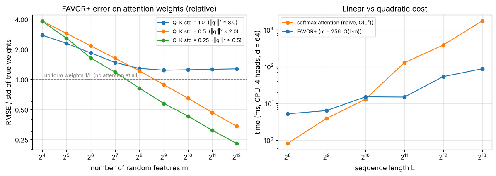

(왼쪽: 가로축 = 랜덤 특성 수 $m$(로그), 세로축 = 가중치 RMSE ÷ 진짜 가중치의 표준 편차(로그). 회색 점선 1.0 = 모든 가중치를 $1/L$로 두는 "어텐션을 아예 안 하는" 기준선. 색 = 쿼리·키의 크기. $\|q'\|^2$은 스케일 $d^{-1/4}$를 곱한 뒤의 제곱 노름. 오른쪽: 헤드 4개, $d$ = 64일 때 CPU 시간. 주황 = 점수 행렬을 만드는 보통 어텐션, 파랑 = FAVOR+($m$ = 256))

**결과 해석**

| 쿼리·키 표준 편차 | $\|q'\|^2$ | $m$ = 256 | $m$ = 4,096 | 해석 |
|---|---|---|---|---|
| 1.0 (노트북 설정) | 약 8 | 1.28 | 1.27 | **$m$을 늘려도 줄지 않는다.** 기준선(1.0)보다 나쁘다 |
| 0.5 | 약 2 | 1.21 | 0.34 | $m$이 커지면 꾸준히 준다 |
| 0.25 | 약 0.5 | 0.82 | 0.23 | 대략 $1/\sqrt{m}$로 준다 |

- 원인은 **추정량의 분산**이다. $\phi(q)\cdot\phi(k)$의 상대 분산은 대략 $\exp(\|q + k\|^2)$에 비례한다. 노트북 설정에서는 $\|q'+k'\|^2 \approx 16$이라 $e^{16} \approx$ 900만 — 특성 4,096개로는 턱없이 부족하다. 크기를 절반으로 줄이면 분산이 $e^4 \approx 55$ 수준으로 떨어져 근사가 수렴한다
- 실제 Performer는 이 근사를 **넣은 채로 훈련**한다. 그러면 모델이 근사가 잘 되는 범위의 쿼리·키를 쓰도록 적응하고, 정규화된 쿼리·키를 쓰는 변형도 있다. 무작위 Q·K에 대한 오차만 보고 쓸모를 판단하면 안 된다 — 반대로 **사전 훈련된 소프트맥스 모델의 어텐션을 FAVOR+로 그대로 바꿔 끼우면 성능이 크게 떨어질 수 있다**는 뜻이기도 하다
- 오른쪽 그림: 보통 어텐션은 길이가 2배가 될 때마다 시간이 약 4배($L^2$)로, FAVOR+는 약 2배($L$)로 는다. 길이 1,000 근처에서 역전되고, 8,192에서는 FAVOR+가 십수 배 빠르다. 짧은 시퀀스에서는 특성 계산 비용 때문에 오히려 느리다

> 💡 이 결과가 근사 어텐션(Performer, Linformer, Reformer)이 연구에서 큰 관심을 받았지만 **오늘날 LLM에서는 거의 쓰이지 않는** 이유를 보여 준다. 근사 품질이 입력 분포에 민감하고, 인과 마스크·KV 캐시와 맞추기 까다롭고, 무엇보다 2-11절의 **플래시 어텐션**이 정확한 어텐션을 충분히 빠르게 만들었다. 다만 "곱셈 순서를 바꿔 $L \times L$을 피한다"는 선형 어텐션의 발상은 RNN처럼 상태를 갱신하는 최신 구조(교재 부록 E의 상태 공간 모델과 그 친척들)로 이어진다.

### 2-9. 투영 공유: MQA와 GQA

> 🎯 **목적** — 여러 쿼리 헤드가 키·값 헤드를 나눠 쓰는 MQA·GQA로 KV 캐시를 줄이는 방법을 이해하고, 파이토치의 `enable_gqa`로 계산한다.

**개념·원리**

1-2절의 📌에서 봤듯이 긴 문맥의 디코딩에서는 **KV 캐시**가 메모리와 속도를 정한다. 멀티 헤드 어텐션(MHA)은 헤드마다 자기 키·값을 가지므로 캐시가 헤드 수에 비례한다. 그런데 헤드들의 키·값은 꽤 중복된다.

| 방식 | 쿼리 헤드 | 키·값 헤드 | 제안 |
|---|---|---|---|
| **MHA** (멀티 헤드 어텐션) | $h$ | $h$ | 원본 트랜스포머 (2017) |
| **MQA** (멀티 쿼리 어텐션) | $h$ | **1** (모든 헤드가 공유) | 셔지어, 「One Write-Head is All You Need」(2019). PaLM, Falcon |
| **GQA** (그룹 쿼리 어텐션) | $h$ | **$g$** ($1 < g < h$, 그룹마다 공유) | 에인슬리 등 (구글, 2023). Llama 2 70B, Llama 3, **Mistral 7B**(쿼리 32 / 키·값 8) |

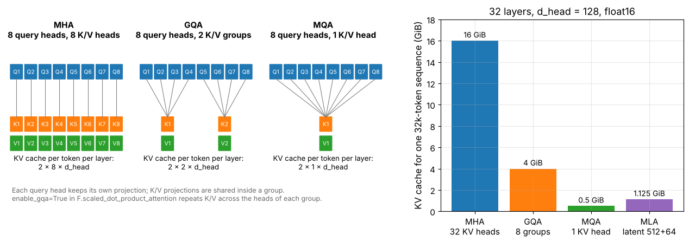

(왼쪽: 쿼리 헤드 8개(파랑)가 어떤 키(주황)·값(초록) 헤드를 쓰는지. GQA는 쿼리 4개가 한 그룹. 오른쪽: 32층, 헤드 차원 128, float16 모델에서 32k 토큰 시퀀스 하나의 KV 캐시 크기. MLA는 2-10절)

- MQA는 캐시가 $1/h$로 줄지만 품질이 조금 떨어지고 훈련이 불안정해질 수 있다. **GQA는 그 중간**으로, MHA에 가까운 품질을 유지하면서 캐시를 크게 줄인다
- GQA 논문은 이미 MHA로 훈련된 모델을 **그룹 안의 키·값 헤드를 평균**해 GQA로 바꾸고, 원래 사전 훈련 계산의 약 5%만 더 훈련(업트레이닝)해도 품질이 회복됨을 보였다
- 키·값 투영 행렬도 작아져 파라미터가 조금 줄지만, 핵심 이득은 **디코딩 때 메모리에서 읽을 캐시가 줄어드는 것**이다(1-1절: 디코드는 메모리 바운드)

**코드** — MQA (키·값 그룹 1개)

```python
batch_size, Lq, Lk, d_head = 32, 100, 90, 64
n_heads = 8
n_groups = 1
query = torch.randn(batch_size, n_heads, Lq, d_head)
key = torch.randn(batch_size, n_groups, Lk, d_head)
value = torch.randn(batch_size, n_groups, Lk, d_head)
attn = F.scaled_dot_product_attention(query, key, value, enable_gqa=True)
```

**코드** — GQA (키·값 그룹 2개)

```python
batch_size, Lq, Lk, d_head = 32, 100, 90, 64
n_heads = 8
n_groups = 2
query = torch.randn(batch_size, n_heads, Lq, d_head)
key = torch.randn(batch_size, n_groups, Lk, d_head)
value = torch.randn(batch_size, n_groups, Lk, d_head)
attn = F.scaled_dot_product_attention(query, key, value, enable_gqa=True)
```

| 코드 | 의미 |
|---|---|
| `query` `[32, 8, 100, 64]` | 쿼리 헤드 8개 |
| `key`, `value` `[32, n_groups, 90, 64]` | 키·값 헤드는 1개(MQA) 또는 2개(GQA). 쿼리와 키의 길이가 달라도 된다(100 vs 90, 크로스 어텐션처럼) |
| `enable_gqa=True` | 파이토치 2.5부터. 키·값 헤드 수가 쿼리 헤드 수의 약수이면 **그룹마다 키·값을 공유**해 계산한다. 쿼리 헤드 0 ~ 3이 키·값 그룹 0을, 4 ~ 7이 그룹 1을 쓴다 |
| `attn` | `[32, 8, 100, 64]` — 출력은 쿼리 헤드 수만큼 |

**보충 코드** — `enable_gqa=True`는 키·값을 그룹 크기만큼 **복제**한 MHA와 같다.

```python
# 보충 코드
rep = n_heads // n_groups                                  # 그룹당 쿼리 헤드 수 = 4
attn_rep = F.scaled_dot_product_attention(
    query, key.repeat_interleave(rep, dim=1), value.repeat_interleave(rep, dim=1))
torch.allclose(attn, attn_rep, atol=1e-6)                  # True (MQA, GQA 모두)
```

- `repeat_interleave(4, dim=1)`: `[K0, K1]` → `[K0, K0, K0, K0, K1, K1, K1, K1]`. 허깅 페이스의 예전 GQA 구현이 이 방식이었다(`repeat_kv`). `enable_gqa=True`는 실제로 복제하지 않고 같은 메모리를 읽으므로 더 효율적이다
- 캐시에는 복제 전의 **그룹 수만큼만** 저장된다 → 이것이 메모리 절약의 정체다

### 2-10. MLA: 다중 헤드 잠재 어텐션

> 🎯 **목적** — 키·값을 작은 잠재 벡터로 압축해 캐시하는 DeepSeek의 MLA를 정리하고, 압축된 잠재 벡터에 직접 어텐션해도 결과가 같다는 "흡수" 트릭을 확인한다.

> ⚠️ 노트북에는 이 소절의 코드가 없다. 아래는 개념 확인용 보충 코드다.

**개념·원리**

MLA(multi-head latent attention)는 DeepSeek-V2(2024)가 제안했다. GQA가 헤드를 **공유**해서 캐시를 줄인다면, MLA는 키·값을 **저랭크로 압축**해서 줄인다.

```
토큰 x (d_model) ──W_DKV──▶ 잠재 벡터 c (d_c, 예: 512)   ← 캐시에는 이것만 저장
                               ├──W_UK──▶ 헤드별 키 K (h × d_head)
                               └──W_UV──▶ 헤드별 값 V (h × d_head)
```

- 캐시는 토큰당 $d_c$개(+ 위치 정보용 작은 벡터)뿐이다. DeepSeek-V2는 이렇게 KV 캐시를 이전 모델(DeepSeek 67B) 대비 **93.3%** 줄이면서 MHA보다 좋은 성능을 보고했다
- **흡수**(absorption): $q \cdot k = q \cdot (c W_{UK}) = (q W_{UK}^\top) \cdot c$이므로, 추론 때는 $W_{UK}$를 쿼리 쪽에 미리 곱해 두고 **잠재 벡터 $c$에 바로 어텐션**할 수 있다. 값 쪽 $W_{UV}$도 출력 투영에 합칠 수 있다 → 키·값을 실제로 복원하지 않는다
- 회전 위치 인코딩(RoPE, 교재 부록 D)은 위치마다 다른 회전을 곱하므로 이 흡수를 깨뜨린다. 그래서 MLA는 위치 정보를 담는 작은 키를 **따로 떼어**(decoupled RoPE) 캐시에 함께 저장한다

**보충 코드** — 흡수 트릭 확인 (위치 인코딩은 생략)

```python
# 보충 코드
torch.manual_seed(42)
d_model, n_heads, d_head, d_c, L = 512, 8, 64, 128, 10
X = torch.randn(1, L, d_model)
W_q = torch.randn(d_model, n_heads * d_head) / d_model ** .5
W_dkv = torch.randn(d_model, d_c) / d_model ** .5          # 압축 (헤드 공통)
W_uk = torch.randn(d_c, n_heads * d_head) / d_c ** .5      # 키 복원
W_uv = torch.randn(d_c, n_heads * d_head) / d_c ** .5      # 값 복원
C_kv = X @ W_dkv                                            # [1, 10, 128] ← 캐시

def heads(T):                                               # [1, L, h*d] → [1, h, L, d]
    return T.view(1, -1, n_heads, d_head).transpose(1, 2)
Q, K, V = heads(X @ W_q), heads(C_kv @ W_uk), heads(C_kv @ W_uv)
out1 = F.scaled_dot_product_attention(Q, K, V, is_causal=True)   # 키·값을 복원해서 계산

# 흡수: 키·값을 만들지 않고 잠재 벡터에 바로 어텐션
W_uk_h = W_uk.view(d_c, n_heads, d_head).permute(1, 0, 2)  # [h, d_c, d]
W_uv_h = W_uv.view(d_c, n_heads, d_head).permute(1, 0, 2)
Q_lat = Q @ W_uk_h.transpose(1, 2)                          # [1, h, L, d_c]
scores = Q_lat @ C_kv.unsqueeze(1).transpose(-2, -1) / d_head ** .5
mask = torch.triu(torch.ones(L, L, dtype=torch.bool), diagonal=1)
scores = scores.masked_fill(mask, float("-inf"))
out2 = (scores.softmax(-1) @ C_kv.unsqueeze(1)) @ W_uv_h   # [1, h, L, d]
torch.allclose(out1, out2, atol=1e-5)                       # True (최대 차이 1.7e-06)
# 토큰당·층당 캐시: MHA 2 × 8 × 64 = 1,024개 → MLA 128개
```

**결과 해석**

- 두 계산이 같다. 캐시에 128차원 잠재 벡터만 두고도 헤드 8개의 어텐션을 정확히 계산할 수 있다
- 2-9절 그림 오른쪽: 32층, 헤드 차원 128 기준으로 MLA(잠재 512 + 위치 64)의 32k 토큰 캐시는 1.125GiB — MHA(16GiB)의 7%, GQA-8(4GiB)보다도 작다. MQA(0.5GiB)보다는 크지만 표현력이 훨씬 좋다

### 2-11. 플래시 어텐션의 원리

> 🎯 **목적** — 결과를 바꾸지 않고 어텐션을 빠르게 만드는 플래시 어텐션의 두 열쇠(타일링, 온라인 소프트맥스)를 이해한다.

**개념·원리**

GPU에는 크고 느린 메모리와 작고 빠른 메모리가 있다.

| 메모리 | 크기 (A100 기준) | 대역폭 |
|---|---|---|
| **HBM** (GPU의 주 메모리) | 40 ~ 80GB | 약 1.5 ~ 2TB/s |
| **SRAM** (연산 유닛 옆의 온칩 메모리) | 유닛당 약 192KB (전체 약 20MB) | 약 19TB/s |

보통의 어텐션 구현은 $S = QK^\top$을 계산해 **HBM에 쓰고**, 다시 읽어 소프트맥스를 해서 $P$를 **HBM에 쓰고**, 다시 읽어 $PV$를 계산한다. $L \times L$ 행렬이 HBM을 몇 번이나 오간다. 계산은 빠른데 **데이터를 옮기느라** 시간이 간다. 플래시 어텐션(다오 등, 2022)은 이 왕복을 없앤다.

1. **타일링**: $Q$를 행 블록으로, $K, V$를 블록으로 나눈다. $Q$ 블록 하나를 SRAM에 올려 두고, $K, V$ 블록을 하나씩 올려 그 블록의 점수 $S_{ij}$와 출력 기여분을 계산한다. **$L \times L$ 행렬은 어디에도 저장되지 않는다**
2. **온라인 소프트맥스**: 소프트맥스는 행 전체의 최댓값과 합이 있어야 계산할 수 있는데, 블록을 하나씩 보면 전체를 모른다. 그래서 행마다 **지금까지의 최댓값 $m$, 합 $\ell$, 출력 $O$** 를 들고 다니다가, 더 큰 값이 나오면 이전 값들에 $e^{m_{\text{old}} - m_{\text{new}}}$를 곱해 **보정**한다
3. **역전파 때 재계산**: 역전파에 필요한 $P$를 저장하지 않고, 저장해 둔 행별 통계($m, \ell$)로 블록마다 **다시 계산**한다. 계산은 늘지만 메모리 왕복이 줄어 오히려 빠르다(4-4절 체크포인팅과 같은 발상)

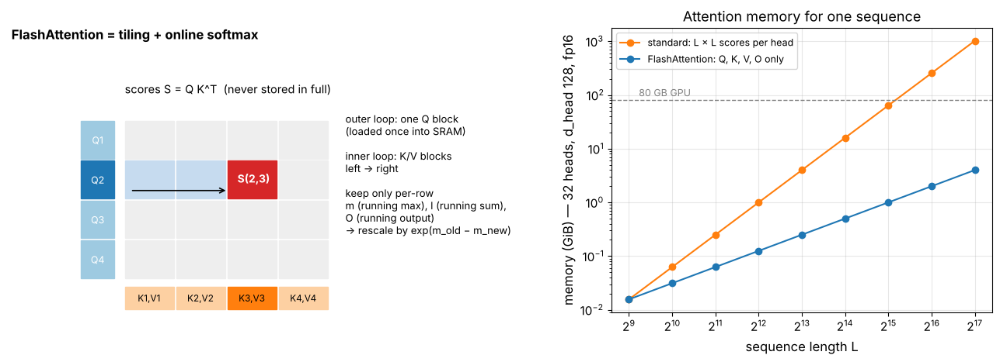

(왼쪽: 쿼리 블록 Q2(진한 파랑)를 SRAM에 두고 키·값 블록을 왼쪽에서 오른쪽으로 하나씩 처리한다. 빨간 칸 = 지금 계산 중인 점수 블록, 연한 파랑 = 이미 처리하고 버린 블록. 오른쪽: 헤드 32개, 헤드 차원 128, float16에서 시퀀스 하나의 어텐션 메모리. 주황 = 점수 행렬을 만드는 보통 방식($L^2$), 파랑 = 플래시 어텐션이 다루는 $Q, K, V, O$($L$). 회색 점선 = 80GB GPU)

**보충 코드** — 온라인 소프트맥스를 1차원 벡터로 먼저 확인한다(점수 12개를 4개씩 3블록으로).

```python
# 보충 코드
torch.manual_seed(42)
x = torch.randn(12) * 3          # 한 쿼리의 점수 12개
v = torch.randn(12, 2)           # 값 벡터 12개 (2차원)
m, l, o = torch.tensor(-float("inf")), torch.tensor(0.), torch.zeros(2)
for chunk_x, chunk_v in zip(x.split(4), v.split(4)):
    m_new = torch.maximum(m, chunk_x.max())
    corr = torch.exp(m - m_new)          # 이전 합들을 새 최댓값 기준으로 보정
    p = torch.exp(chunk_x - m_new)
    l = l * corr + p.sum()
    o = o * corr + p @ chunk_v
    m = m_new
# 블록 1: m = 1.010, l = 2.9987, corr = 0       (처음이라 이전 값 없음)
# 블록 2: m = 6.625, l = 1.0119, corr = 0.0036  (최댓값이 바뀌어 이전 합을 0.0036배로)
# 블록 3: m = 6.625, l = 1.0418, corr = 1.0     (최댓값 그대로)
torch.allclose(o / l, torch.softmax(x, 0) @ v, atol=1e-6)   # True
```

- 블록을 하나씩 봐도, 마지막에 $O/\ell$로 나누면 전체 소프트맥스 결과와 같다. 블록 2에서 최댓값이 1.0 → 6.6으로 커지자 앞 블록의 합을 $e^{1.0-6.6} = 0.0036$배로 줄였다

> 📌 플래시 어텐션은 **정확한** 어텐션이다(근사가 아니다). 계산량($L^2 d$)도 그대로다. 줄어드는 것은 **HBM 읽기·쓰기량**과 **메모리 사용량**($L^2 \to L$)이다. 후속 버전 FlashAttention-2(2023)는 작업 분할을 개선해 약 2배, FlashAttention-3(2024)은 H100 GPU의 비동기 실행과 FP8을 활용해 더 빨라졌다.

### 2-12. 플래시 어텐션 장난감 구현

> 🎯 **목적** — 타일링과 온라인 소프트맥스를 2차원(쿼리 여러 개)으로 확장한 파이썬 구현으로, 결과가 표준 어텐션과 같은지 확인한다.

**코드**

```python
def flash_attention(Q, K, V, block_size_q, block_size_k):
    Lq, d = Q.shape
    Lk, _ = K.shape
    O = torch.zeros_like(Q)
    scale = d ** -0.5

    for i_start in range(0, Lq, block_size_q):  # iterate over query blocks
        i_end = min(i_start + block_size_q, Lq)
        Q_block = Q[i_start:i_end]

        O_block = torch.zeros(block_size_q, d, device=Q.device)
        l_block = torch.zeros(block_size_q, 1, device=Q.device)
        m_block = -torch.inf * torch.ones(block_size_q, 1, device=Q.device)

        for j_start in range(0, Lk, block_size_k):  # iterate over K/V blocks
            j_end = min(j_start + block_size_k, Lk)
            K_block = K[j_start:j_end]
            V_block = V[j_start:j_end]

            # Core attention calculation for the block
            S_ij = Q_block @ K_block.T * scale  # (block_size_q, block_size_k)

            # Find the new maximum score for the combined blocks so far
            m_ij_new, _ = torch.max(S_ij, dim=1, keepdim=True)
            m_block_new = torch.maximum(m_block, m_ij_new)

            # Rescale previous accumulator values based on the new max
            P_ij = torch.exp(S_ij - m_block_new)
            correction_factor = torch.exp(m_block - m_block_new)

            # Update the denominator (l) and output (O) accumulators
            l_block_new = ((l_block * correction_factor)
                           + torch.sum(P_ij, dim=1, keepdim=True))
            O_block = (O_block * correction_factor) + (P_ij @ V_block)

            # Update the state for the next inner loop iteration
            l_block = l_block_new
            m_block = m_block_new

        # Rescale the output block and write it to the final output matrix
        O[i_start:i_end] = O_block / l_block

    return O
```

| 코드 | 의미 |
|---|---|
| 바깥 루프 `i_start` | 쿼리 블록(64개씩). 실제 GPU 커널에서는 이 블록들이 **서로 다른 연산 유닛에서 병렬로** 돈다 |
| `O_block`, `l_block`, `m_block` | 블록 안 쿼리마다의 누적 출력 $O$, 누적 합 $\ell$, 지금까지의 최댓값 $m$ (2-11절 보충 코드의 `o`, `l`, `m`을 행렬로) |
| 안쪽 루프 `j_start` | 키·값 블록을 차례로. 이 루프 안의 텐서는 모두 블록 크기라 SRAM에 들어간다 |
| `S_ij = Q_block @ K_block.T * scale` | 64 × 64 점수 블록 |
| `correction_factor = exp(m_old − m_new)` | 최댓값이 커졌으면 이전 누적값을 줄이는 보정 계수 |
| `O_block * correction_factor + P_ij @ V_block` | 보정한 누적 출력에 이번 블록의 기여를 더한다 |
| `O[i_start:i_end] = O_block / l_block` | 모든 키 블록을 본 뒤 한 번만 정규화 |

```python
torch.manual_seed(42)
block_size_q, block_size_k = 64, 64
Lq, Lk, d = 1280, 1152, 512
Q = torch.randn(Lq, d)
K = torch.randn(Lk, d)
V = torch.randn(Lk, d)

R1 = flash_attention(Q, K, V, block_size_q, block_size_k)
R2 = F.scaled_dot_product_attention(Q, K, V)
mse = F.mse_loss(R1, R2)
mse
# tensor(8.0755e-16)
```

**결과 해석**

- MSE 8.1e-16 — float32의 반올림 오차 수준이다. **블록으로 나눠도 결과가 같다**(보충 실행 CPU: 1.3e-15, 최대 차이 4.5e-7)
- 이 파이썬 구현은 원리를 보여 줄 뿐 **빠르지 않다**(파이썬 루프, 블록마다 텐서 생성). 진짜 플래시 어텐션은 CUDA·Triton으로 작성한 하나의 **융합 커널**이라 SRAM 안에서 모든 것을 끝낸다
- 노트북 말대로 이 구현은 $L_q$, $L_k$가 블록 크기의 **배수일 때만** 동작한다. `O_block`을 항상 `block_size_q` 행으로 만들기 때문에, 예를 들어 $L_q$ = 100이면 마지막 블록(36행)에서 `RuntimeError: The size of tensor a (64) must match the size of tensor b (36)`가 난다(보충 확인). `torch.zeros(i_end - i_start, d)`로 바꾸면 해결된다

### 2-13. 실전에서 빠른 어텐션 쓰기

> 🎯 **목적** — 파이토치와 허깅 페이스에서 플래시 어텐션 같은 효율적인 커널을 고르는 방법을 정리한다.

> ⚠️ 노트북에는 이 소절의 코드가 없다. 보충 정리다.

`F.scaled_dot_product_attention`(SDPA)은 입력과 하드웨어에 맞춰 내부 구현(백엔드)을 자동으로 고른다.

| 백엔드 (`SDPBackend.`) | 내용 |
|---|---|
| `FLASH_ATTENTION` | 플래시 어텐션 2. 최신 NVIDIA GPU, float16·bfloat16 |
| `EFFICIENT_ATTENTION` | 메모리 효율적 어텐션(xFormers 계열). 더 다양한 GPU·마스크 지원 |
| `CUDNN_ATTENTION` | NVIDIA cuDNN의 융합 어텐션 |
| `MATH` | 수식 그대로의 구현(점수 행렬을 만든다). 어디서나 동작하는 대체 경로 |

```python
# 보충 코드: 특정 백엔드만 쓰도록 강제 (조건이 안 맞으면 오류)
from torch.nn.attention import sdpa_kernel, SDPBackend

with sdpa_kernel(SDPBackend.FLASH_ATTENTION):
    out = F.scaled_dot_product_attention(q, k, v, is_causal=True)
```

허깅 페이스 모델은 `attn_implementation` 인수로 고른다.

| 값 | 내용 |
|---|---|
| `"sdpa"` | 파이토치 SDPA (트랜스포머스 5.x 대부분 모델의 **기본값**) |
| `"flash_attention_2"` | 별도 `flash-attn` 패키지의 커널. float16·bfloat16 필요 |
| `"eager"` | 점수 행렬을 직접 계산하는 파이썬 구현. **어텐션 가중치를 돌려받을 때** 필요하다(16장 [1-13절](16_vision_and_multimodal_transformers.md#1-13-dino-어텐션-맵으로-비지도-분할하기)의 DINO) |

```python
model = AutoModelForCausalLM.from_pretrained(model_id, dtype=torch.bfloat16,
                                             attn_implementation="sdpa")
```

> 💡 16장에서 `output_attentions=True`가 빈 튜플을 돌려준 이유가 여기서 풀린다. 플래시 어텐션 계열 커널은 **점수 행렬을 아예 만들지 않으므로** 돌려줄 어텐션 가중치가 없다. 가중치를 보고 싶으면 느리더라도 `"eager"`를 써야 한다.

---

## 3. MoE로 스케일 키우기 (17.3)

> 🎯 **목적** — 파라미터 수는 크게 늘리되 토큰 하나를 처리하는 계산량은 거의 그대로 두는 전문가 혼합(MoE)의 구조와, 그 핵심 난제인 부하 균형을 이해한다.

> 💬 **요리사는 100명, 주문마다 부르는 건 2명**
>
> 트랜스포머 블록의 **피드포워드 층**(15장 1-7절)을 여러 개(**전문가**, expert) 두고, 작은 **라우터**가 토큰마다 어느 전문가 몇 개에게 보낼지 고른다. 전문가가 8개라도 토큰 하나는 2개만 거치므로 계산은 2개분이다.
>
> - **장점**: 같은 계산 예산으로 훨씬 많은 파라미터(= 지식)를 담는다. 같은 품질이면 훈련·추론이 빠르다
> - **단점**: 모든 전문가가 **메모리에는** 올라가 있어야 한다. 라우터가 몇몇 전문가만 편애하면 나머지는 놀고 몇몇은 과로한다(**부하 불균형**)
> - **헷갈림 주의**: "Mixtral **8×7B**"는 560억 파라미터가 아니다. 어텐션 등 공유 부분이 있어 전체 467억, 토큰당 실제로 쓰는 것은 약 129억이다

> ⚠️ 노트북의 이 절 제목 아래에는 MoE 코드가 없고, **LoRA 코드**(4-2절에서 다룬다)와 내용 없는 `import` 셀만 있다. 이 절은 교재 17.3절의 개념을 정리하고, 직접 만든 보충 코드로 MoE 층과 부하 균형을 확인한다.

### 3-1. 밀집 모델과 희소 모델

> 🎯 **목적** — MoE 층이 밀집 피드포워드 층을 어떻게 대체하는지 정리한다.

**개념·원리**

| | 밀집(dense) 모델 | 희소(sparse) MoE 모델 |
|---|---|---|
| 피드포워드 층 | 1개, 모든 토큰이 통과 | $E$개(전문가), 토큰마다 **top-$k$개만** 통과 |
| 파라미터 | $P$ | 약 $P_{\text{공유}} + E \times P_{\text{FFN}}$ |
| 토큰당 계산 | 모든 파라미터 | 공유 부분 + $k$개 전문가 |
| 추가 부품 | — | **라우터**(게이트): $\text{softmax}(x W_r)$, 작은 선형 층 하나 |

MoE 층의 출력은 선택된 전문가 출력의 **가중 합**이다.

$$
y = \sum_{i \in \text{top-}k} g_i(x)\, \text{FFN}_i(x), \qquad g(x) = \text{softmax}(x W_r) \text{ 중 상위 } k \text{개를 다시 정규화}
$$

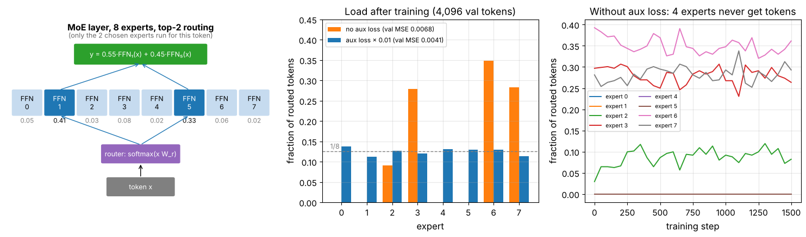

(왼쪽: 전문가 8개, top-2 라우팅. 라우터가 이 토큰에 준 확률 중 상위 2개(0.41, 0.33)를 다시 정규화해 0.55·FFN₁ + 0.45·FFN₅로 합친다. 나머지 6개 전문가는 이 토큰에 대해 계산하지 않는다. 가운데·오른쪽: 3-3절의 보충 실험)

- 전문가는 보통 트랜스포머 블록의 **피드포워드 층**을 대체한다. 어텐션 층은 공유한다. 피드포워드 층이 파라미터의 약 2/3를 차지하기 때문이다
- 전문가가 "수학 전문", "영어 전문"처럼 사람이 이해할 수 있는 주제로 나뉘는 것은 아니다. 분석해 보면 주로 **토큰 종류·문법 패턴** 같은 낮은 수준의 특징으로 나뉜다
- 역사: 셔지어 등(2017)이 LSTM 사이에 수천 개의 전문가를 넣은 "엄청나게 큰 신경망"을 제안했고, GShard(2020)가 트랜스포머에 적용, **Switch Transformer**(2021)가 top-1 라우팅으로 단순화해 1.6조 파라미터까지 키웠다

### 3-2. 보충 코드: top-k 라우팅 MoE 층

> 🎯 **목적** — 라우터, top-k 선택, 전문가별 계산, 가중 합을 파이토치로 직접 구현하고 파라미터 수를 센다.

**보충 코드**

```python
# 보충 코드
import torch
import torch.nn as nn
import torch.nn.functional as F

class MoE(nn.Module):
    def __init__(self, d_model, d_ff, n_experts=8, top_k=2):
        super().__init__()
        self.n_experts, self.top_k = n_experts, top_k
        self.router = nn.Linear(d_model, n_experts, bias=False)
        self.experts = nn.ModuleList([
            nn.Sequential(nn.Linear(d_model, d_ff), nn.GELU(), nn.Linear(d_ff, d_model))
            for _ in range(n_experts)])

    def forward(self, X):                                   # X: [N, d_model] (토큰을 펼친 것)
        probs = self.router(X).softmax(dim=-1)              # [N, E]
        top_p, top_i = probs.topk(self.top_k, dim=-1)       # [N, k] 확률과 전문가 번호
        top_p = top_p / top_p.sum(dim=-1, keepdim=True)     # 고른 k개끼리 다시 정규화
        out = torch.zeros_like(X)
        for e, expert in enumerate(self.experts):
            token_idx, slot = (top_i == e).nonzero(as_tuple=True)   # 전문가 e를 고른 토큰들
            if len(token_idx) > 0:
                out[token_idx] += top_p[token_idx, slot, None] * expert(X[token_idx])
        # 부하 균형 보조 손실 (3-3절)
        f = F.one_hot(top_i, self.n_experts).float().sum(1).mean(0) / self.top_k
        P = probs.mean(0)
        aux_loss = self.n_experts * (f * P).sum()
        return out, aux_loss, f

torch.manual_seed(42)
moe = MoE(64, 256, n_experts=8, top_k=2)
sum(p.numel() for p in moe.parameters())            # 265216 (전체)
sum(p.numel() for p in moe.experts[0].parameters()) # 33088  (전문가 하나)
# 토큰당 실제로 쓰는 파라미터: 라우터 512 + 전문가 2 × 33,088 = 66,688 (전체의 25%)
```

| 코드 | 의미 |
|---|---|
| `nn.Linear(d_model, n_experts, bias=False)` | 라우터. 토큰마다 전문가 8개에 대한 점수 |
| `probs.topk(self.top_k, dim=-1)` | 확률이 가장 큰 전문가 2개의 확률·번호 |
| `top_p / top_p.sum(...)` | 고른 두 확률의 합이 1이 되도록 (Mixtral 방식. Switch Transformer(top-1)는 정규화하지 않은 확률을 그대로 곱한다) |
| `(top_i == e).nonzero(as_tuple=True)` | 전문가 `e`를 1순위 또는 2순위로 고른 토큰의 번호와 그 순위(`slot`) |
| `expert(X[token_idx])` | **고른 토큰만 모아서** 전문가에 통과 → 계산 절약의 정체 |
| `out[token_idx] += 가중치 * 출력` | 토큰마다 두 전문가의 출력을 가중 합 |

> 📌 이 구현은 원리용이다. 실제 구현은 전문가마다 처리할 토큰 수가 들쭉날쭉한 것을 효율적으로 다루기 위해 토큰을 전문가별로 **정렬해 묶고**(grouped GEMM), 여러 GPU에 전문가를 나눠 두는 **전문가 병렬화**(4-7절)에서는 토큰을 해당 GPU로 보내고 받는 **all-to-all 통신**을 쓴다. 허깅 페이스의 Mixtral·Qwen-MoE 모델 코드도 구조는 이와 같다.

### 3-3. 부하 균형

> 🎯 **목적** — 라우터가 일부 전문가만 쓰는 부하 불균형 문제와 보조 손실·용량 제한으로 해결하는 방법을 확인한다.

**개념·원리**

훈련 초기에 어떤 전문가가 우연히 조금 더 좋으면 라우터가 그쪽으로 더 보내고, 그 전문가만 더 훈련되어 더 좋아지는 **부익부 빈익빈**이 생긴다. 결국 몇 개만 일하고 나머지는 파라미터만 차지한다. 여러 GPU에 전문가를 나눠 둔 경우에는 바쁜 GPU 하나가 전체 속도를 정한다.

| 해결책 | 내용 |
|---|---|
| **보조 손실** (Switch Transformer) | $\mathcal{L}_{\text{aux}} = \alpha \cdot E \sum_{i=1}^{E} f_i P_i$. $f_i$ = 전문가 $i$에 배정된 토큰 비율, $P_i$ = 라우터가 전문가 $i$에 준 평균 확률. 균등할 때($f_i = P_i = 1/E$) 최솟값 1. $\alpha$ ≈ 0.01 |
| **용량 계수** (capacity factor) | 전문가 하나가 받을 수 있는 토큰 수를 (토큰 수 / 전문가 수) × 용량 계수(예: 1.25)로 제한. 넘친 토큰은 그 층을 **건너뛴다**(잔차 연결로만 전달, token dropping) |
| **보조 손실 없는 균형** (DeepSeek-V3) | 전문가마다 **편향**을 라우터 점수에 더해 선택에만 쓰고, 많이 뽑힌 전문가의 편향은 낮추고 적게 뽑힌 전문가는 높인다. 손실 함수를 건드리지 않는다 |
| **라우터 z-손실** (ST-MoE) | 라우터 로짓이 너무 커지지 않게 벌점 → 훈련 안정화 |

**보충 실험** — 16개 군집에서 나온 토큰마다 군집별로 다른 비선형 함수를 맞히는 장난감 회귀 문제. 모든 토큰에 **공통 성분**을 더해, 처음에는 라우터에게 토큰들이 비슷해 보이게 했다(실제 언어 모델에서도 토큰 표현은 공통 방향을 많이 공유한다). 3-2절의 `MoE(64, 128, n_experts=8, top_k=2)`를 Adam으로 1,500스텝(배치 256) 훈련한다.

```python
# 보충 코드 (핵심 부분)
for coef in (0.0, 0.01):                     # 보조 손실 계수: 없음 / 0.01
    model = MoE(64, 128, n_experts=8, top_k=2)
    optimizer = torch.optim.Adam(model.parameters(), lr=3e-3)
    for step in range(1500):
        X, y = make_data(256)
        out, aux_loss, load = model(X)
        loss = F.mse_loss(out, y) + coef * aux_loss
        optimizer.zero_grad(); loss.backward(); optimizer.step()
# coef=0.0 : 검증 MSE 0.0068, aux 2.147, 부하 [0.0, 0.0, 0.09, 0.279, 0.0, 0.0, 0.348, 0.283]
# coef=0.01: 검증 MSE 0.0041, aux 1.005, 부하 [0.138, 0.113, 0.126, 0.121, 0.131, 0.13, 0.129, 0.114]
```

(위 그림 가운데: 훈련 후 검증 토큰 4,096개가 각 전문가로 간 비율. 회색 점선 = 균등(1/8). 오른쪽: 보조 손실이 없을 때 훈련 중 전문가별 부하. 0, 1, 4, 5번 전문가는 처음부터 끝까지 토큰을 하나도 받지 못한다)

**결과 해석**

- 보조 손실이 없으면 전문가 8개 중 **4개가 한 번도 쓰이지 않는다.** 처음에 라우터가 공통 성분 때문에 몇몇 전문가로만 보냈고, 쓰이지 않는 전문가는 그레이디언트를 받지 못해 영영 기회를 얻지 못했다. 사실상 4개짜리 모델이 됐고 검증 MSE가 0.0068
- 보조 손실(× 0.01)을 더하면 모든 전문가가 11 ~ 14%씩 고르게 쓰이고(aux ≈ 1.0 = 최솟값), 검증 MSE가 **0.0041**로 더 좋다 — 같은 파라미터를 다 쓰기 때문이다
- 보조 손실의 크기는 작아야 한다. 너무 크면 라우터가 "토큰에 맞는 전문가"보다 "균등 분배"를 우선해 품질이 떨어진다

### 3-4. 대표적인 MoE 모델

> 🎯 **목적** — 주요 MoE 모델의 규모와 설계를 정리한다.

> ⚠️ 노트북에는 이 소절의 코드가 없다. 수치는 각 모델의 논문·공식 발표 기준이다.

| 모델 | 연도 | 전문가 / 선택 | 전체 / 토큰당 활성 파라미터 | 특징 |
|---|---|---|---|---|
| Switch Transformer (구글) | 2021 | 최대 2,048 / **top-1** | 최대 1.6조 | 라우팅 단순화, 용량 계수, 보조 손실 |
| GLaM (구글) | 2021 | 64 / top-2 | 1.2조 / 약 970억 | GPT-3보다 적은 에너지로 더 좋은 퓨샷 성능 |
| **Mixtral 8×7B** (미스트랄) | 2023 | 8 / top-2 | **467억 / 129억** | 공개 가중치. 같은 추론 비용의 Llama 2 13B보다 훨씬 강하고 Llama 2 70B와 비슷 |
| DeepSeekMoE / DeepSeek-V3 | 2024 | (V3) 라우팅 256 + **공유 1** / top-8 | (V3) 6,710억 / 370억 | 잘게 나눈 전문가 + 항상 쓰는 **공유 전문가**, 보조 손실 없는 균형, MLA(2-10절) |
| Qwen3-235B-A22B (알리바바) 등 | 2025 | 128 / top-8 | 2,350억 / 220억 | 이름의 "A22B" = 활성 220억 |

- 최근 대형 공개 모델의 상당수가 MoE다. "전체 파라미터"는 **메모리 요구량**을, "활성 파라미터"는 **토큰당 계산·속도**를 결정한다
- 같은 품질을 내는 밀집 모델보다 훈련 계산이 적게 들지만, 미세 튜닝이 불안정하거나 과대적합되기 쉬운 경향이 보고되어 왔다. 서빙할 때는 전체 파라미터를 메모리에 올려야 하므로 GPU가 많이 필요하다

---

## 4. 훈련 속도 높이기 (17.4)

> 🎯 **목적** — 큰 트랜스포머를 제한된 GPU 메모리와 시간 안에 훈련·미세 튜닝하기 위한 다섯 가지 도구(PEFT·LoRA, 활성화 체크포인팅, 패킹·버키팅, 그레이디언트 누적, 병렬화)를 익힌다.

> 💬 **GPU 메모리는 어디에 쓰이나**
>
> 훈련 중 GPU 메모리는 **① 파라미터, ② 그레이디언트, ③ 옵티마이저 상태**(Adam은 파라미터마다 2개, 11장 3-6절), **④ 활성화**(역전파용으로 저장한 중간값)에 쓰인다. 각 도구가 겨냥하는 곳이 다르다.
>
> - **LoRA**: 훈련할 파라미터를 1% 미만으로 → ②③이 거의 사라진다
> - **활성화 체크포인팅**: 활성화를 버렸다가 다시 계산 → ④를 크게 줄인다 (시간 +20 ~ 30%)
> - **패킹·버키팅**: 패딩 토큰 계산을 없앤다 → 시간을 줄인다
> - **그레이디언트 누적**: 작은 배치 여러 번 = 큰 배치 한 번 → ④를 배치 크기와 분리한다
> - **병렬화**: ①②③④를 GPU 여러 대에 나눈다

### 4-1. PEFT와 LoRA

> 🎯 **목적** — 사전 훈련 모델의 가중치는 동결하고 작은 저랭크 행렬만 훈련하는 LoRA의 원리를 이해한다.

**개념·원리**

70억 파라미터 모델을 Adam으로 전체 미세 튜닝하면, 혼합 정밀도 기준으로 파라미터 하나에 약 16바이트(가중치 2 + 그레이디언트 2 + float32 사본·Adam 상태 12)가 들어 **112GB** 이상이 필요하다(활성화 제외). 작업마다 70억 개짜리 사본을 저장하는 것도 부담이다. **PEFT**(parameter-efficient fine-tuning, 파라미터 효율적 미세 튜닝)는 원래 가중치를 **동결**하고 아주 적은 파라미터만 추가로 훈련한다.

**LoRA**(Low-Rank Adaptation, 마이크로소프트, 2021)의 가정: 미세 튜닝으로 생기는 가중치 변화 $\Delta W$는 **저랭크**다(7장의 차원 축소처럼, 몇 개 방향만 바뀐다).

$$
W' = W + \Delta W = W + \frac{\alpha}{r}\, B A, \qquad B \in \mathbb{R}^{d_{\text{out}} \times r}, \; A \in \mathbb{R}^{r \times d_{\text{in}}}, \; r \ll d
$$

| 요소 | 내용 |
|---|---|
| $W$ | 사전 훈련된 가중치. **동결** (그레이디언트·옵티마이저 상태 없음) |
| $A$ | 작은 무작위 값으로 초기화 |
| $B$ | **0으로 초기화** → 훈련 시작 때 $\Delta W = 0$, 모델이 원래와 똑같이 동작한다 (16장 Flamingo의 tanh(0) 게이트와 같은 발상) |
| $r$ (랭크) | 보통 4 ~ 64. 768 × 768 행렬(589,824개)에 $r$ = 16이면 훈련 파라미터는 $A$ + $B$ = 24,576개 (4%) |
| $\alpha / r$ (스케일) | $r$을 바꿔도 학습률을 다시 튜닝하지 않도록 맞춰 주는 계수 |
| 병합 | 훈련 후 $W + \frac{\alpha}{r}BA$를 계산해 **하나의 행렬로 합치면** 추론 속도가 원래 모델과 같다 |

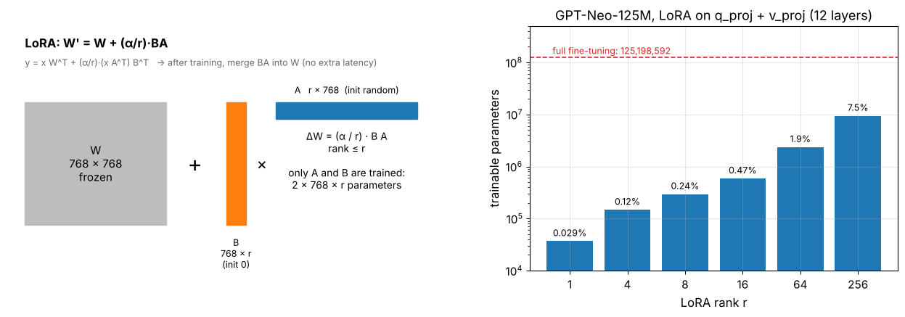

(왼쪽: 동결된 $W$(회색) 옆에 작은 $B$(세로로 긴 주황, $768 \times r$)와 $A$(가로로 긴 파랑, $r \times 768$)를 둔다. 오른쪽: GPT-Neo-125M의 12개 층에서 `q_proj`·`v_proj`에 LoRA를 붙였을 때 랭크별 훈련 파라미터 수(로그 축)와 전체 모델 대비 비율. 빨간 점선 = 전체 미세 튜닝)

| PEFT 방법 | 아이디어 |
|---|---|
| **어댑터** (2019) | 층 사이에 작은 병목 MLP를 끼워 넣는다. 추론 때 층이 늘어 조금 느려진다 |
| **프리픽스 튜닝·프롬프트 튜닝** | 입력 앞에 학습되는 "가상 토큰" 벡터를 붙인다 |
| **LoRA** | 가중치 변화를 저랭크로. 병합하면 추론 비용 0 → **가장 널리 쓰인다** |
| **QLoRA** (2023) | 동결된 $W$를 **4비트로 양자화**해 메모리를 1/4로 + LoRA. 650억 파라미터 모델을 48GB GPU 한 대로 미세 튜닝 (양자화는 교재 부록 B) |
| DoRA 등 변형 | 가중치를 크기·방향으로 나눠 방향만 LoRA로 조정하는 등 |

### 4-2. PEFT 라이브러리로 LoRA 적용하기

> 🎯 **목적** — 허깅 페이스 `peft` 라이브러리로 사전 훈련 모델에 LoRA 어댑터를 붙이고 훈련 파라미터 수를 확인한다.

**코드**

```python
from peft import LoraConfig, get_peft_model

model_id = "EleutherAI/gpt-neo-125M"
model = AutoModelForCausalLM.from_pretrained(model_id, device_map="auto",
                                             dtype=torch.float16)
tokenizer = AutoTokenizer.from_pretrained(model_id)
tokenizer.pad_token = tokenizer.eos_token
lora_config = LoraConfig(
    r=16,
    lora_alpha=32,
    target_modules=["q_proj", "v_proj"],
    lora_dropout=0.05,
    bias="none",
    task_type="CAUSAL_LM"
)
peft_model = get_peft_model(model, lora_config)
peft_model.print_trainable_parameters()
# trainable params: 589,824 || all params: 125,788,416 || trainable%: 0.4689
```

| 코드 | 의미 |
|---|---|
| `"EleutherAI/gpt-neo-125M"` | 엘레우서AI가 공개한 GPT-3 구조의 작은 재현 모델. 12층, 은닉 768. 층마다 전역 어텐션과 **지역(윈도 256) 어텐션**을 번갈아 쓴다(2-2절의 슬라이딩 윈도) |
| `dtype=torch.float16` | 반정밀도로 적재 → 메모리 절반 (15장 4-5절) |
| `tokenizer.pad_token = tokenizer.eos_token` | GPT 계열은 패딩 토큰이 없어 문장 끝 토큰을 대신 쓴다 (배치 훈련용) |
| `r=16` | LoRA 랭크 |
| `lora_alpha=32` | 스케일 $\alpha$. 실제 곱해지는 값은 $\alpha / r = 2$ |
| `target_modules=["q_proj", "v_proj"]` | LoRA를 붙일 층 **이름**. 어텐션의 쿼리·값 투영(LoRA 논문의 기본 설정). 이름은 모델마다 다르다(GPT-2는 `c_attn`, Llama는 `q_proj`·`k_proj`·`v_proj`·`o_proj`·`gate_proj`…) |
| `lora_dropout=0.05` | LoRA 경로의 입력에만 적용하는 드롭아웃 |
| `bias="none"` | 편향은 훈련하지 않는다 |
| `task_type="CAUSAL_LM"` | 인과적 언어 모델용 래퍼(`PeftModelForCausalLM`)를 쓴다 |
| `get_peft_model(model, lora_config)` | 대상 층을 LoRA 층으로 **감싸고**, 원래 파라미터는 모두 `requires_grad=False`로 동결 |
| `print_trainable_parameters()` | 훈련 파라미터 / 전체 파라미터 / 비율 |

**결과 해석**

- 훈련 파라미터 589,824개 = 층 12개 × 모듈 2개 × ($A$: 16 × 768 + $B$: 768 × 16) = 12 × 2 × 24,576 ✓
- 전체 125,788,416 = 원래 모델 125,198,592 + LoRA 589,824. 비율 0.4689%는 LoRA를 **포함한** 전체 대비다(원래 모델 대비 0.471%)
- 이제 `peft_model`을 15장 [5-7절](15_transformers_for_nlp_and_chatbots.md#5-7-trl로-sft-gpt-2--alpaca)처럼 `Trainer`나 TRL의 `SFTTrainer`에 넘기면 LoRA 파라미터만 훈련된다. 옵티마이저 상태도 이 59만 개에 대해서만 생긴다

**보충 코드** — 내려받기 없이 같은 구조로 위 숫자를 확인하고, 감싼 층을 들여다본다.

```python
# 보충 코드
from transformers import GPTNeoConfig, GPTNeoForCausalLM

config = GPTNeoConfig(vocab_size=50257, hidden_size=768, num_layers=12, num_heads=12,
                      max_position_embeddings=2048,
                      attention_types=[[["global", "local"], 6]], window_size=256)
model = GPTNeoForCausalLM(config)
sum(p.numel() for p in model.parameters())     # 125198592
peft_model = get_peft_model(model, lora_config)
peft_model.print_trainable_parameters()
# trainable params: 589,824 || all params: 125,788,416 || trainable%: 0.4689  ← 노트북과 같다
peft_model.base_model.model.transformer.h[0].attn.attention.q_proj
# lora.Linear(
#   (base_layer): Linear(in_features=768, out_features=768, bias=False)
#   (lora_dropout): ModuleDict((default): Dropout(p=0.05, inplace=False))
#   (lora_A): ModuleDict((default): Linear(in_features=768, out_features=16, bias=False))
#   (lora_B): ModuleDict((default): Linear(in_features=16, out_features=768, bias=False))
#   ...)
```

- 원래 `q_proj`가 `base_layer`로 들어가고 옆에 `lora_A`(768 → 16), `lora_B`(16 → 768)가 붙었다. `ModuleDict`인 이유는 한 모델에 **여러 어댑터**(작업별)를 붙이고 바꿔 끼울 수 있기 때문이다(`"default"`는 첫 어댑터 이름)
- 훈련 후에는 `peft_model.save_pretrained("dir")`로 **어댑터만**(파라미터 59만 개, 수 MB) 저장하고, `peft_model.merge_and_unload()`로 $W$에 병합한 일반 모델을 얻는다

> ⚠️ 노트북의 LoRA 셀 다음 셀은 `datasets`·`Trainer`·`DataCollatorForLanguageModeling`을 **불러오기만** 하고 끝난다(훈련 코드가 아직 없다). 실제 훈련은 15장 5-7절의 `SFTTrainer` 예제에 `peft_config=lora_config`를 넘기거나, 위의 `peft_model`을 `Trainer`에 넘기면 된다.

### 4-3. 보충 코드: LoRA 층 직접 구현

> 🎯 **목적** — LoRA를 `nn.Linear`를 감싸는 층으로 직접 구현해, 초기 출력이 원래 층과 같고, 훈련 후 병합해도 결과가 같은지 확인한다.

**보충 코드**

```python
# 보충 코드
class LoRALinear(nn.Module):
    def __init__(self, base: nn.Linear, r=16, alpha=32):
        super().__init__()
        self.base = base
        self.base.requires_grad_(False)                        # W, b 동결
        self.A = nn.Parameter(torch.randn(r, base.in_features) / r ** 0.5 * 0.1)
        self.B = nn.Parameter(torch.zeros(base.out_features, r))   # 0 → 처음엔 ΔW = 0
        self.scaling = alpha / r

    def forward(self, X):
        return self.base(X) + (X @ self.A.T @ self.B.T) * self.scaling

    def merge(self):
        merged = nn.Linear(self.base.in_features, self.base.out_features)
        merged.weight.data = self.base.weight + self.scaling * self.B @ self.A
        merged.bias.data = self.base.bias.clone()
        return merged

torch.manual_seed(42)
base = nn.Linear(768, 768)
lora = LoRALinear(base, r=16, alpha=32)
X = torch.randn(4, 768)
torch.allclose(lora(X), base(X))          # True  ← B = 0이라 처음엔 원래 층과 같다
# 훈련 파라미터 24,576 (A 16×768 + B 768×16), 동결 590,592 (W 768×768 + b 768)

target = torch.randn(4, 768)
optimizer = torch.optim.Adam([p for p in lora.parameters() if p.requires_grad], lr=1e-2)
w_before = base.weight.clone()
for _ in range(50):
    loss = ((lora(X) - target) ** 2).mean()
    optimizer.zero_grad(); loss.backward(); optimizer.step()
loss.item()                                # 0.0015
torch.equal(w_before, base.weight)         # True  ← W는 전혀 바뀌지 않았다
merged = lora.merge()
torch.allclose(merged(X), lora(X), atol=1e-5)    # True (최대 차이 8.3e-07)
torch.linalg.matrix_rank(lora.B @ lora.A)        # 16 ← ΔW의 랭크
```

| 코드 | 의미 |
|---|---|
| `self.base.requires_grad_(False)` | 원래 층의 모든 파라미터를 동결 |
| `X @ self.A.T @ self.B.T` | $x A^\top B^\top$. 왼쪽부터 계산하면 `[4, 768] → [4, 16] → [4, 768]`로, $768 \times 768$ 행렬 $BA$를 **만들지 않는다** |
| `self.scaling = alpha / r` | 2.0 |
| `merge()` | $W + \frac{\alpha}{r}BA$를 실제로 계산해 보통 `nn.Linear` 하나로 |

**결과 해석**

- 처음에는 원래 층과 출력이 같고(B = 0), 훈련 중에 원래 가중치 $W$는 **한 비트도 바뀌지 않았다**
- 병합한 층이 LoRA 층과 같은 출력을 낸다 → 추론 때는 추가 비용 없이 원래 크기의 모델로 쓸 수 있다
- $\Delta W = \frac{\alpha}{r}BA$의 랭크는 정확히 $r$ = 16 이하다. 768차원 공간에서 16개 방향만 바꿀 수 있다는 제약이 곧 **규제** 역할도 한다

### 4-4. 활성화 체크포인팅

> 🎯 **목적** — 역전파용 중간 활성화를 저장하지 않고 필요할 때 다시 계산해 메모리를 줄이는 활성화 체크포인팅(그레이디언트 체크포인팅)을 측정한다.

**개념·원리**

역전파에는 순전파의 중간값(층 정규화 결과, 선형 층 입력, GELU 입력 등)이 필요하다(9장 역전파). 그래서 순전파 동안 이것들을 모두 저장하는데, 깊은 모델·긴 시퀀스·큰 배치에서는 이 **활성화 메모리**가 파라미터보다 커진다.

**활성화 체크포인팅**은 몇몇 지점(보통 트랜스포머 블록의 입력)만 저장하고 나머지는 버린다. 역전파가 그 블록에 도달하면 저장해 둔 입력으로 블록의 **순전파를 한 번 더** 실행해 중간값을 되살린다.

| | 일반 역전파 | 블록마다 체크포인팅 |
|---|---|---|
| 저장하는 활성화 | 모든 블록의 모든 중간값 | 블록 입력만 (+ 재계산 중인 블록 하나분) |
| 계산 | 순전파 1 + 역전파(약 2) | 순전파 **2** + 역전파 → 약 **+33%** (이론) |
| 고전적 결과 | | $n$개 층을 $\sqrt{n}$개씩 묶어 체크포인트하면 메모리 $O(\sqrt{n})$ (첸 등, 2016) |

**보충 코드**

```python
# 보충 코드
from torch.utils.checkpoint import checkpoint

class Block(nn.Module):                    # 층 정규화 + 피드포워드 + 잔차
    def __init__(self, d):
        super().__init__()
        self.norm = nn.LayerNorm(d)
        self.ff = nn.Sequential(nn.Linear(d, 4 * d), nn.GELU(), nn.Linear(4 * d, d))
    def forward(self, X):
        return X + self.ff(self.norm(X))

class Net(nn.Module):
    def __init__(self, d, n_layers, use_ckpt=False):
        super().__init__()
        self.blocks = nn.ModuleList([Block(d) for _ in range(n_layers)])
        self.use_ckpt = use_ckpt
    def forward(self, X):
        for block in self.blocks:
            if self.use_ckpt and self.training:
                X = checkpoint(block, X, use_reentrant=False)
            else:
                X = block(X)
        return X

def saved_bytes(model, X):                 # 역전파용으로 저장되는 텐서의 바이트 수
    seen = {}
    def pack(t):
        seen[t.untyped_storage().data_ptr()] = t.untyped_storage().nbytes()
        return t
    with torch.autograd.graph.saved_tensors_hooks(pack, lambda t: t):
        model(X)
    return sum(seen.values())

X = torch.randn(16, 256, 256, requires_grad=True)   # 배치 16 × 토큰 256 × 차원 256
# 블록 24개: 일반 1,008.8MiB → 체크포인팅 96.0MiB
# 그레이디언트: 두 모델 완전히 같다 (최대 차이 0.0)
# 한 스텝 시간(블록 12개, CPU): 854ms → 1,100ms (×1.29)
```

| 코드 | 의미 |
|---|---|
| `checkpoint(block, X, use_reentrant=False)` | `block(X)`를 실행하되 내부 활성화는 버리고 입력 `X`만 기억한다. 역전파 때 `block(X)`를 다시 실행 |
| `use_reentrant=False` | 파이토치가 권장하는 새 구현. 예전 방식(`True`)은 입력 중 하나가 `requires_grad=True`여야 하는 등 제약이 있다. 인수를 생략하면 경고가 난다 |
| `if self.training` | 추론 때는 역전파가 없으니 체크포인팅도 필요 없다 |
| `saved_tensors_hooks(pack, unpack)` | 오토그래드가 역전파용으로 텐서를 저장할 때마다 `pack`이 호출된다. 같은 저장소를 두 번 세지 않도록 `data_ptr()`로 구분 |

> ⚠️ 측정용 `saved_bytes()`는 `use_reentrant=True` 방식으로 셌다. 새 방식(`False`)은 체크포인트 내부에서 자체 훅을 쓰기 때문에 바깥 훅으로는 셀 수 없다. 두 방식이 저장하는 것(블록 입력)은 같다.

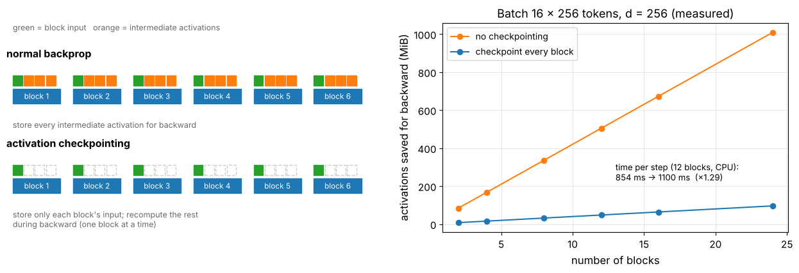

(왼쪽: 블록마다 저장하는 텐서. 초록 = 블록 입력, 주황 = 중간 활성화, 점선 = 저장하지 않고 역전파 때 다시 계산. 오른쪽: 블록 수에 따른 역전파용 저장 메모리(측정값). 주황 = 일반, 파랑 = 블록마다 체크포인팅)

**결과 해석**

- 블록 하나가 저장하는 활성화가 약 42MiB(입력 4MiB + 층 정규화·4배로 넓어진 중간층 등)에서 **입력 4MiB**로 줄어 약 10분의 1이 됐다. 역전파 중에는 재계산 중인 블록 하나분(42MiB)이 잠깐 더 필요하다
- 시간은 1.29배. 순전파를 한 번 더 하는 비용이다. 메모리가 남으면 쓰지 말고, **메모리 부족으로 배치를 못 키울 때** 쓴다
- 허깅 페이스 모델은 `model.gradient_checkpointing_enable()` 또는 `TrainingArguments(gradient_checkpointing=True)` 한 줄로 켠다. LoRA·QLoRA와 거의 항상 함께 쓴다

### 4-5. 시퀀스 패킹과 버키팅

> 🎯 **목적** — 길이가 제각각인 시퀀스를 배치로 묶을 때 생기는 패딩 낭비를 측정하고, 버키팅과 패킹으로 줄인다.

**개념·원리**

배치는 텐서여야 하므로 짧은 시퀀스를 가장 긴 시퀀스 길이까지 **패딩**한다(14장 [2-6절](14_nlp_with_rnns_and_attention.md#2-6-배치-처리-패딩잘라내기어텐션-마스크)). 패딩 토큰도 똑같이 계산되므로 길이 분포가 넓으면 GPU 시간의 대부분이 패딩에 낭비된다.

| 방법 | 내용 | 주의 |
|---|---|---|
| **버키팅** | 길이가 **비슷한 시퀀스끼리** 같은 배치로 묶는다 | 배치 안의 길이가 비슷해 순서가 덜 무작위해진다. 허깅 페이스는 무작위로 섞은 뒤 큰 묶음(메가 배치) 안에서만 정렬해 무작위성을 유지한다 |
| **패킹** | 시퀀스들을 (구분 토큰을 끼워) **이어 붙인 뒤** 고정 길이로 자른다 → 패딩이 거의 없다 | 한 행에 여러 문서가 섞여 **문서끼리 어텐션**할 수 있다. 문서마다 위치를 0부터 다시 세고 문서 경계에서 어텐션을 막는 마스크(또는 플래시 어텐션의 가변 길이 커널)를 쓰면 막을 수 있다 |

**보충 실험** — 로그 정규 분포에서 길이 10,000개를 뽑았다(평균 188, 중앙값 147, 최대 1,024 토큰. 실제 문서 길이처럼 오른쪽 꼬리가 길다). 배치 크기 32.

```python
# 보충 코드 (핵심 부분)
rng = np.random.default_rng(42)
lengths = np.clip(rng.lognormal(mean=5.0, sigma=0.7, size=10_000).astype(int), 8, 1024)
def slots(batches):                          # 계산되는 토큰 칸 수 = Σ (배치 크기 × 배치 최대 길이)
    return sum(len(b) * max(b) for b in batches)
perm = rng.permutation(len(lengths))
random_batches = [lengths[perm[i:i + 32]] for i in range(0, len(lengths), 32)]
# 버키팅: 섞은 뒤 32 × 50개씩 끊어 그 안에서 정렬 (허깅 페이스 방식)
# 패킹: 모두 이어 붙여(+ 구분 토큰) 1,024토큰 행으로 자르기
# random    6,503,168칸  패딩 71.2%
# bucketing 1,996,160칸  패딩  6.0%
# packing   1,886,208칸  패딩  0.6%
```

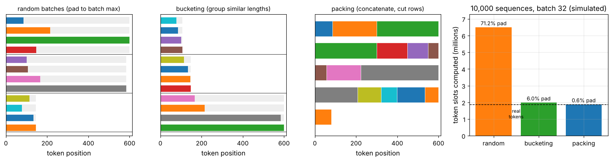

(왼쪽 세 개: 시퀀스 12개(색)를 배치 4개씩 묶은 예. 회색 = 패딩, 검은 선 = 배치 경계. 패킹은 시퀀스를 이어 붙여 같은 너비의 행으로 자르므로 한 시퀀스가 두 행에 걸치기도 한다(같은 색이 다음 행에 이어짐). 오른쪽: 시퀀스 10,000개 전체에서 계산되는 토큰 칸 수(백만). 검은 점선 = 실제 토큰 수)

**결과 해석**

- 무작위 배치는 계산의 **71%가 패딩**이다. 배치마다 긴 시퀀스 하나만 있어도 나머지 31개가 그 길이까지 늘어난다
- 버키팅만으로 패딩이 6%로 줄어 계산량이 **3.3분의 1**이 됐다. 패킹은 0.6%(마지막 행의 빈칸뿐)
- 사전 훈련은 보통 **패킹**(문서가 매우 많고 길다), 미세 튜닝은 버키팅이나 문서 경계를 지키는 패킹을 쓴다

> 📌 허깅 페이스에서는 트랜스포머스 4.x의 `TrainingArguments(group_by_length=True)`가 5.x에서 **`train_sampling_strategy="group_by_length"`** 로 바뀌었다(보충 확인). 패킹은 TRL의 `SFTConfig(packing=True)`, 또는 패딩 없이 이어 붙이고 문서별 위치 정보를 넘기는 `DataCollatorWithFlattening`으로 할 수 있다.

### 4-6. 그레이디언트 누적

> 🎯 **목적** — 작은 미니배치 여러 개의 그레이디언트를 더해 큰 배치 하나와 같은 업데이트를 하는 그레이디언트 누적을 구현하고, 흔한 실수를 확인한다.

**개념·원리**

큰 배치(수백 ~ 수천 시퀀스)는 훈련을 안정시키지만 GPU 메모리에 한꺼번에 들어가지 않는다. `loss.backward()`는 그레이디언트를 **덮어쓰지 않고 더한다**(그래서 매 스텝 `zero_grad()`를 했다, 10장 [4-2절](10_neural_nets_with_pytorch.md#4-2-미니배치-훈련-루프)). 이 성질을 이용해 미니배치 $n$개의 그레이디언트를 더한 뒤 **한 번만** 업데이트한다.

**코드**

```python
model = torch.nn.Linear(10, 1).to(device)
optimizer = torch.optim.SGD(model.parameters(), lr=0.01)
criterion = nn.MSELoss()
data_loader = [(torch.randn(8, 10), torch.randn(8, 1)) for _ in range(100)]
model.train()

accumulation_steps = 4
optimizer.zero_grad()  # reset gradients before starting
for batch_index, (X_batch, y_batch) in enumerate(data_loader):
    X_batch, y_batch = X_batch.to(device), y_batch.to(device)
    y_pred = model(X_batch)
    loss = criterion(y_pred, y_batch)
    loss = loss / accumulation_steps
    loss.backward()
    if (batch_index + 1) % accumulation_steps == 0:
        optimizer.step()
        optimizer.zero_grad()
```

| 코드 | 의미 |
|---|---|
| `data_loader = [...]` | 실습용 가짜 데이터: 크기 8짜리 미니배치 100개 |
| `optimizer.zero_grad()` (루프 앞) | 시작 전에 한 번 초기화 |
| `loss / accumulation_steps` | 미니배치 4개의 **평균** 손실이 되도록. 이걸 빼먹으면 그레이디언트가 4배가 된다 = 학습률을 4배 올린 것과 같다 |
| `loss.backward()` | 그레이디언트를 `.grad`에 **누적** |
| `(batch_index + 1) % 4 == 0` | 4번째 미니배치마다 업데이트하고 초기화 → **유효 배치 크기 8 × 4 = 32** |

**보충 코드** — 정말 큰 배치와 같을까?

```python
# 보충 코드
torch.manual_seed(42)
model = nn.Linear(10, 1)
X, y = torch.randn(32, 10), torch.randn(32, 1)

model.zero_grad(); criterion(model(X), y).backward()           # (1) 배치 32 한 번
g_big = model.weight.grad.clone()
model.zero_grad()
for Xb, yb in zip(X.split(8), y.split(8)):                     # (2) 8 × 4번 누적
    (criterion(model(Xb), yb) / 4).backward()
torch.allclose(g_big, model.weight.grad, atol=1e-7)            # True
# /4를 빼먹으면: 그레이디언트가 정확히 4.0배
```

토큰 단위 손실에서는 한 가지가 더 필요하다. 미니배치마다 **실제 토큰 수**(패딩 제외)가 다르면, 미니배치별 평균 손실을 다시 평균한 것은 전체 토큰 평균과 다르다.

```python
# 보충 코드: 미니배치 4개의 실제 토큰 수가 3, 30, 5, 40개일 때
torch.manual_seed(0)
emb = nn.Embedding(50, 50)                       # 아주 작은 "언어 모델"
lens = [3, 30, 5, 40]
data = [(torch.randint(0, 50, (n,)), torch.randint(0, 50, (n,))) for n in lens]
n_total = sum(lens)                              # 78

emb.zero_grad()                                  # (a) 정답: 78개 토큰 전체의 평균 손실
all_x = torch.cat([x for x, _ in data]); all_y = torch.cat([y for _, y in data])
F.cross_entropy(emb(all_x), all_y).backward()
g_true = emb.weight.grad.clone()

emb.zero_grad()                                  # (b) 미니배치별 평균 손실 / 4 를 누적
for x, y in data:
    (F.cross_entropy(emb(x), y) / len(data)).backward()
((emb.weight.grad - g_true).norm() / g_true.norm()).item()   # 1.40 ← 상대 오차, 전혀 다르다

emb.zero_grad()                                  # (c) 미니배치별 합계 손실 / 전체 토큰 수
for x, y in data:
    (F.cross_entropy(emb(x), y, reduction="sum") / n_total).backward()
torch.allclose(emb.weight.grad, g_true, atol=1e-7)          # True
```

**결과 해석**

- 손실을 누적 횟수로 나누면 큰 배치와 **같은 그레이디언트**가 나온다. 메모리는 미니배치 하나분만 쓴다. 대신 업데이트 횟수가 줄어 같은 에포크에 시간은 조금 더 걸린다
- 토큰 수가 다른 미니배치를 그냥 평균하면 토큰 3개짜리 미니배치가 40개짜리와 같은 무게를 갖게 되어 그레이디언트가 크게 틀어진다. **합계 손실 ÷ 전체 토큰 수**로 맞춘다. 허깅 페이스 `Trainer`도 2024년에 이 문제를 고쳐, 이제 `gradient_accumulation_steps`를 쓰면 전체 토큰 수로 정규화한다
- 배치 정규화(11장)는 미니배치 단위로 통계를 내므로 누적해도 큰 배치와 같아지지 않는다. 트랜스포머는 층 정규화를 쓰므로 문제없다

> 📌 허깅 페이스에서는 `TrainingArguments(per_device_train_batch_size=8, gradient_accumulation_steps=4)`로 같은 효과를 낸다. 유효 배치 크기 = 장치당 배치 × 누적 횟수 × GPU 수.

### 4-7. 병렬화 기법

> 🎯 **목적** — GPU 여러 대에 일을 나누는 방법(데이터·텐서·파이프라인 병렬화, ZeRO·FSDP)을 비교한다.

> ⚠️ 노트북에는 이 소절의 코드가 없다. 아래 보충 코드는 GPU 한 대(CPU)에서 원리만 확인한 것이다.

**개념·원리**

| 방법 | 무엇을 나누나 | 통신 | 한계 |
|---|---|---|---|
| **데이터 병렬화** (DDP) | **배치**를 나눈다. GPU마다 모델 전체 복사본 | 역전파 후 그레이디언트를 **all-reduce**(모두 더해 모두에게) | 모델 전체(+ 옵티마이저 상태)가 GPU 한 대에 들어가야 한다 |
| **ZeRO / FSDP** | 데이터 병렬 + 옵티마이저 상태(1단계)·그레이디언트(2단계)·**파라미터**(3단계)를 GPU들에 **쪼개 저장** | 층을 계산할 때마다 필요한 파라미터를 모아 오고(all-gather) 버린다 | 통신량 증가. 파이토치 `FullyShardedDataParallel`(FSDP), 마이크로소프트 DeepSpeed |
| **텐서 병렬화** | **층 하나의 행렬**을 나눈다 (메가트론-LM) | 층마다 all-reduce → GPU끼리 **아주 빠른 연결**(한 서버 안의 NVLink) 필요 | 한 서버 안(보통 8대)에서만 효율적 |
| **파이프라인 병렬화** | **층들을** 구간으로 나눈다 (GPU 0: 1 ~ 6층, GPU 1: 7 ~ 12층…) | 구간 경계에서 활성화만 전달 → 통신이 적다 | 앞 구간이 끝나야 뒤 구간이 시작 → **버블**(노는 시간). 미니배치를 **마이크로배치**로 쪼개 줄인다 |
| 시퀀스·문맥 병렬화 | **시퀀스 길이**를 나눈다 | 링 어텐션 등으로 키·값 블록을 돌려 가며 계산 (2-11절 타일링의 분산 버전) | 아주 긴 문맥 훈련용 |
| 전문가 병렬화 | MoE의 **전문가**를 GPU별로 (3-2절) | 토큰을 전문가가 있는 GPU로 all-to-all | 부하 균형이 곧 속도 |

큰 모델은 이것들을 겹쳐 쓴다(**3D 병렬화**: 서버 안에서는 텐서 병렬, 서버들 사이에서는 파이프라인 병렬, 그 전체를 데이터 병렬로 복제).

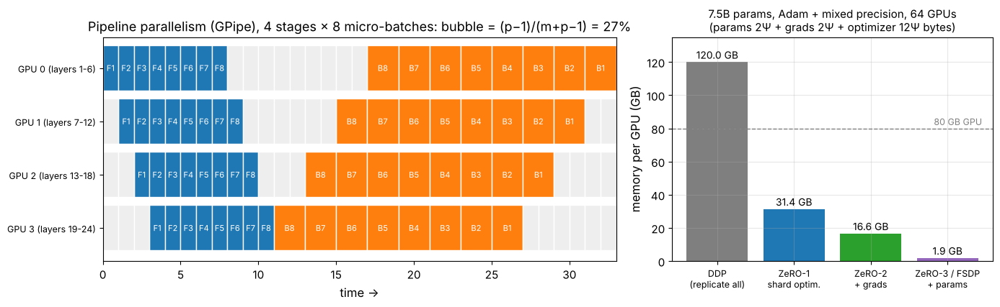

(왼쪽: GPipe 방식 파이프라인 — GPU 4대(행)가 24층을 6층씩 맡고, 미니배치를 마이크로배치 8개로 나눠 순전파(F, 파랑)를 모두 흘린 뒤 역전파(B, 주황, 순전파의 약 2배 시간)를 거꾸로 흘린다. 회색 = 노는 시간(버블). 오른쪽: 75억 파라미터 모델, Adam + 혼합 정밀도(파라미터당 16바이트), GPU 64대일 때 GPU당 메모리(ZeRO 논문의 계산 방식, 활성화 제외). 회색 점선 = 80GB GPU)

**보충 코드** — 텐서 병렬화: MLP의 첫 행렬은 **열**로, 둘째 행렬은 **행**으로 나누면 GPU끼리 중간 결과를 주고받지 않고 마지막에 더하기만 하면 된다.

```python
# 보충 코드
torch.manual_seed(42)
X = torch.randn(4, 512)
W1 = torch.randn(512, 2048) / 512 ** .5
W2 = torch.randn(2048, 512) / 2048 ** .5
Y = F.gelu(X @ W1) @ W2                       # GPU 한 대

W1a, W1b = W1.chunk(2, dim=1)                 # 열로 나눔: 각 [512, 1024]
W2a, W2b = W2.chunk(2, dim=0)                 # 행으로 나눔: 각 [1024, 512]
Ya = F.gelu(X @ W1a) @ W2a                    # "GPU 0"
Yb = F.gelu(X @ W1b) @ W2b                    # "GPU 1"
torch.allclose(Y, Ya + Yb, atol=1e-5)         # True ← all-reduce(합) 한 번이면 끝
```

- GELU는 원소별 함수라 열로 나눈 결과에 따로 적용해도 같다. 그래서 첫 행렬은 열, 둘째는 행으로 나누는 것이 핵심이다(메가트론-LM의 설계)

| 계산 | 값 |
|---|---|
| 파이프라인 버블 비율 $\frac{p-1}{m+p-1}$ ($p$ = 단계 수, $m$ = 마이크로배치 수) | $p$ = 4일 때 $m$ = 4 → 43%, 8 → **27%**, 16 → 16%, 32 → 9% |
| GPU당 메모리, 75억 파라미터, GPU 64대 | DDP **120GB** → ZeRO-1 31.4GB → ZeRO-2 16.6GB → ZeRO-3 **1.9GB** |

**결과 해석**

- 텐서 병렬화는 결과가 정확히 같다. 대신 층마다 통신이 필요해 빠른 연결이 필수다
- 파이프라인 버블은 마이크로배치를 늘릴수록 줄어든다. 1F1B 같은 개선된 일정은 순전파·역전파를 번갈아 끼워 넣어 활성화 메모리도 줄인다
- 데이터 병렬(DDP)로는 75억 모델이 80GB GPU에 **들어가지 않는다**(120GB). 옵티마이저 상태만 쪼개도(ZeRO-1) 들어가고, 파라미터까지 쪼개면(ZeRO-3·FSDP) GPU당 2GB가 안 된다 — 대신 계산 때마다 파라미터를 모아 오는 통신이 늘어난다

> 📌 실제로는 파이토치 `torchrun`으로 프로세스를 여러 개 띄우고 `DistributedDataParallel`이나 FSDP(`torch.distributed.fsdp.fully_shard`)로 모델을 감싼다. 허깅 페이스 `Trainer`와 Accelerate 라이브러리는 같은 코드로 `accelerate launch`·`TrainingArguments(fsdp=...)`·`deepspeed=...` 설정만 바꿔 DDP·FSDP·DeepSpeed를 쓸 수 있게 해 준다.

### 4-8. 어떤 기법을 언제 쓰나

> 🎯 **목적** — 이 장의 기법들을 상황별로 고르는 기준을 정리한다.

| 상황 | 먼저 쓸 것 | 다음 |
|---|---|---|
| 텍스트 생성이 느리다 | KV 캐시(기본으로 켜져 있음), `attn_implementation="sdpa"`, 반정밀도 | 추측 디코딩(같은 토크나이저의 작은 모델), 양자화, vLLM 같은 서빙 엔진 |
| 긴 문맥에서 메모리가 터진다 | 플래시 어텐션(SDPA) | GQA·MLA 모델 고르기, KV 캐시 양자화, (사전 훈련부터라면) 슬라이딩 윈도·희소 어텐션 |
| 미세 튜닝할 GPU 메모리가 부족하다 | LoRA + 활성화 체크포인팅 | QLoRA(4비트), 배치를 줄이고 그레이디언트 누적 |
| 배치가 작아 훈련이 불안정하다 | 그레이디언트 누적 | GPU 여러 대 데이터 병렬 |
| 훈련 시간 대부분이 패딩이다 | 버키팅(`train_sampling_strategy="group_by_length"`) | 패킹(문서 경계 마스크와 함께) |
| 모델이 GPU 한 대에 안 들어간다 | FSDP / ZeRO-3 | 텐서·파이프라인 병렬화(수백억 이상) |
| 같은 계산으로 더 큰 모델을 원한다 | MoE (사전 훈련 단계의 설계 결정) | 공개 MoE 모델(Mixtral, Qwen-MoE 등) 미세 튜닝 |

> 💡 이 장의 기법은 서로 배타적이지 않고 **층층이 쌓인다.** 오늘날 LLM 하나를 훈련·서빙하는 시스템에는 GQA(또는 MLA) + RoPE + 플래시 어텐션 + MoE + FSDP·텐서·파이프라인 병렬 + 활성화 체크포인팅 + 패킹 + 그레이디언트 누적 + KV 캐시 + 추측 디코딩이 한꺼번에 들어가 있다.

---

## 5. 연습문제

노트북의 연습문제 풀이 부분은 "Work in progress"(준비 중)로 비어 있다. 풀이가 공개되면 이 절에 추가한다. 대신 이 장의 핵심을 스스로 점검할 수 있도록 **직접 만든 확인 문제**를 정리해 둔다(교재 연습문제가 아니다).

| 번호 | 질문 | 답 요약 | 관련 절 |
|---|---|---|---|
| 1 | 디코드 단계가 "메모리 바운드"라는 말의 뜻과, 그것이 추측 디코딩을 가능하게 하는 이유 | 토큰 하나를 만들려고 모든 가중치를 메모리에서 읽지만 계산은 아주 적다. 그래서 토큰 1개를 처리하든 여러 개를 처리하든 시간이 비슷하고, 초안 토큰 $\gamma$개를 한 번에 검증해도 비용이 거의 늘지 않는다 | 1-1, 1-4 |
| 2 | KV 캐시에 쿼리는 저장하지 않는 이유. 과거 토큰의 키·값이 바뀌지 않는 이유 | 과거 쿼리는 과거 토큰의 출력을 만들 때만 쓰였다. 인과 마스크 때문에 각 층의 $i$번째 입력은 앞쪽 토큰에만 의존하므로 $k_i, v_i$도 바뀌지 않는다 | 1-2 |
| 3 | 32층, 은닉 4,096, float16 모델의 KV 캐시는 토큰당 몇 바이트인가. GQA(키·값 헤드 8개, 쿼리 헤드 32개)면 | 2 × 32 × 4,096 × 2 = 524,288바이트(512KiB). GQA는 키·값 헤드가 1/4이라 128KiB | 1-2, 2-9 |
| 4 | 추측 샘플링에서 초안 토큰 $x$의 수락 확률과 거부 시 다시 뽑는 분포 | $\min(1, p(x)/q(x))$. 거부되면 $\max(0, p - q)$를 정규화한 분포. 이렇게 하면 최종 분포가 정확히 $p$ | 1-4, 1-5 |
| 5 | 수락률 0.8, $\gamma$ = 4일 때 목표 모델 1회 호출당 기대 토큰 수 | $(1 - 0.8^5)/(1 - 0.8) = 3.36$ | 1-5 |
| 6 | BigBird가 14토큰 문장에서 `original_full`로 바꾼 이유 | 블록 희소 어텐션은 전역·슬라이딩·무작위 블록에 여유분까지 (2 + 3 + 3 + 3) × 64 = 704토큰보다 길어야 의미가 있다. 짧으면 완전 어텐션이 더 싸다 | 2-3 |
| 7 | Longformer와 BigBird의 패턴 차이 | 둘 다 슬라이딩 윈도 + 전역 토큰. Longformer는 팽창 윈도를, BigBird는 무작위 블록을 더한다 | 2-2 |
| 8 | 각도 LSH에서 벡터를 정규화하는 이유와 $k$ = 4일 때 버킷을 정하는 방법 | 크기가 아니라 방향(각도)만 비교하려고. 무작위 방향 2개에 투영한 값과 그 음수 4개 중 최댓값의 번호 | 2-4 |
| 9 | Performer가 $L \times L$ 행렬 없이 어텐션을 계산하는 방법 | $\exp(QK^\top) \approx \phi(Q)\phi(K)^\top$으로 바꾸고 $\phi(K)^\top V$($m \times d$)를 먼저 계산 → 비용 $O(Lmd)$ | 2-6, 2-7 |
| 10 | 노트북의 FAVOR+ 출력 RMSE 0.1599가 큰 이유 | 무작위 Q·K의 노름이 커서($\|q'\|^2 \approx 8$) 랜덤 특성 추정량의 분산이 $e^{16}$ 수준. Q·K를 작게 하면 $1/\sqrt{m}$로 줄어든다. 실제 Performer는 이 근사로 훈련한다 | 2-8 |
| 11 | MQA·GQA·MLA가 줄이는 것은 계산인가 메모리인가 | 주로 **KV 캐시 메모리**(와 디코딩 때 읽을 양). MQA·GQA는 헤드 공유, MLA는 저랭크 잠재 벡터 압축 | 2-9, 2-10 |
| 12 | `F.scaled_dot_product_attention`에 키·값 헤드 2개, 쿼리 헤드 8개를 넘기려면 | `enable_gqa=True`. 결과는 키·값을 `repeat_interleave(4, dim=1)`로 복제한 MHA와 같다 | 2-9 |
| 13 | 플래시 어텐션이 계산량을 줄이지 않는데도 빠른 이유 | $L \times L$ 행렬을 HBM에 쓰고 읽는 왕복을 없애고, 블록을 빠른 SRAM 안에서 처리한다(IO 인식). 메모리도 $L^2 \to L$ | 2-11 |
| 14 | 온라인 소프트맥스에서 보정 계수 $e^{m_{\text{old}} - m_{\text{new}}}$가 필요한 이유 | 지금까지의 합과 출력은 이전 최댓값 기준으로 계산됐다. 더 큰 값이 나오면 새 기준으로 맞춰야 마지막에 한 번 나눴을 때 정확한 소프트맥스가 된다 | 2-11, 2-12 |
| 15 | 허깅 페이스에서 어텐션 가중치를 돌려받으려면 어떤 구현을 써야 하나, 그 이유는 | `attn_implementation="eager"`. SDPA·플래시 어텐션은 점수 행렬을 만들지 않는다 | 2-13 |
| 16 | 전문가 8개, top-2 MoE에서 토큰당 계산은 몇 개분이고 메모리에는 몇 개분이 필요한가 | 계산은 전문가 2개분(+ 라우터), 메모리에는 8개 모두 | 3-1, 3-2 |
| 17 | 부하 균형 보조 손실이 없을 때 생기는 문제와 보조 손실의 형태 | 몇몇 전문가만 쓰이고 나머지는 그레이디언트를 못 받아 죽는다. $\alpha E\sum_i f_i P_i$ (균등일 때 최소) | 3-3 |
| 18 | LoRA에서 $B$를 0으로 초기화하는 이유와, 병합 후 추론 비용 | 시작할 때 $\Delta W = 0$이라 모델이 원래와 같다. 병합하면 $W' = W + \frac{\alpha}{r}BA$ 행렬 하나라 추가 비용이 없다 | 4-1, 4-3 |
| 19 | GPT-Neo-125M에 `r=16`, `target_modules=["q_proj", "v_proj"]`로 LoRA를 붙이면 훈련 파라미터는 | 12층 × 2모듈 × (16 × 768 + 768 × 16) = 589,824 | 4-2 |
| 20 | 활성화 체크포인팅이 메모리를 줄이는 대가 | 역전파 때 순전파를 다시 해야 해서 계산이 약 20 ~ 33% 늘어난다(보충 실험 1.29배) | 4-4 |
| 21 | 패킹의 장점과 주의할 점 | 패딩이 거의 없다. 한 행에 여러 문서가 섞이므로 문서 경계에서 어텐션을 막고 위치를 다시 세야 한다 | 4-5 |
| 22 | 그레이디언트 누적에서 손실을 `accumulation_steps`로 나누지 않으면, 토큰 수가 다른 미니배치를 평균하면 | 그레이디언트가 누적 횟수배(4배)가 된다. 토큰 수가 다르면 전체 토큰 평균과 달라지므로 합계 손실 ÷ 전체 토큰 수로 맞춘다 | 4-6 |
| 23 | 데이터 병렬, ZeRO-3(FSDP), 텐서 병렬, 파이프라인 병렬이 각각 나누는 것 | 배치 / 파라미터·그레이디언트·옵티마이저 상태 / 층 안의 행렬 / 층 묶음 | 4-7 |
| 24 | 파이프라인 병렬에서 단계 4개, 마이크로배치 8개일 때 버블 비율 | $(4-1)/(8+4-1) = 3/11 \approx 27\%$ | 4-7 |

---

## 6. 정리

### 6-1. 전체 흐름

```
[17.1 추론 시 디코딩 속도 높이기]  같은 계산을 반복하지 않고, 큰 모델을 덜 부른다
배경    : 프리필(계산 바운드) → 디코드(토큰 1개씩, 메모리 바운드)
KV 캐시 : 과거 토큰의 키·값은 불변(인과 마스크) → 저장해 재사용, 새 토큰만 계산
          opt-125m 500토큰: use_cache=True 4.62초 vs False 10.7초 (코랩 GPU)
          보충(CPU, 무작위 가중치): 7.4 vs 28.3초, 생성 토큰 완전히 같음
          DynamicCache, 층마다 keys/values [B, h, L, d] = [1, 12, 7, 64]
          캐시 크기 = 층 × 2 × 은닉 × 토큰 × 바이트 → 7B급 32k 토큰 16GiB
추측 디코딩 : 초안 M_q가 γ개 추측 → 목표 M_p가 한 번에 검증
          수락 min(1, p/q), 거부 시 max(0, p−q) 정규화 분포 → 최종 분포 = p (보충: 차이 0.0005)
          기대 토큰 (1−α^(γ+1))/(1−α), generate(..., assistant_model=draft_model)
          opt-350m(목표) + opt-125m(초안), 같은 토크나이저
기타    : 프롬프트 룩업, Medusa·EAGLE, 연속 배칭, 페이지드 어텐션, 양자화, 정적 캐시

[17.2 멀티 헤드 어텐션 속도 높이기]  L × L 표를 어떻게 다룰 것인가
비용     : 계산 L²d, 메모리 L² (L이 수천을 넘으면 지배)
희소     : Sparse Transformer(strided·fixed, L√L), Longformer(윈도·팽창·전역),
           BigBird(윈도·전역·무작위 블록, L), Routing Transformer(k-평균)
           bigbird-roberta-base fill-mask → pain 28.2%, 704토큰 미만은 original_full
근사     : Reformer — angular_lsh(정규화 → 무작위 투영 → [P, −P] argmax) → 버킷
           Linformer — K, V를 길이 축으로 k개로 투영, O(Lk), 인과 마스크 곤란
           Performer — E[exp(w·x)] = exp(‖x‖²/2), φ(x) = exp(xW − ‖x‖²/2)/√m
                       RMSE 0.0171 → 직교화(QR) 0.0160 → FavorAttention 출력 0.1599
                       φ(K)ᵀV를 먼저 → O(Lmd). 보충: 오차는 ‖q‖가 클 때의 분산 문제
투영 공유 : MQA(키·값 1개) · GQA(g개) — enable_gqa=True = repeat_interleave 복제
           MLA — 잠재 c(d_c)만 캐시, 흡수 트릭으로 c에 바로 어텐션 (보충 allclose True)
           32k 캐시: MHA 16 / GQA-8 4 / MQA 0.5 / MLA 1.125 GiB
플래시   : HBM ↔ SRAM 왕복 제거, 타일링 + 온라인 소프트맥스(m, ℓ, O 보정) + 역전파 재계산
           장난감 구현 vs SDPA: MSE 8.1e-16 (정확한 어텐션)
실전     : SDPA 백엔드(FLASH·EFFICIENT·CUDNN·MATH), attn_implementation="sdpa"/"flash_attention_2"/"eager"

[17.3 MoE로 스케일 키우기]  파라미터는 많이, 토큰당 계산은 조금
구조     : FFN → 전문가 E개 + 라우터 softmax(xW_r), top-k 재정규화 가중 합
보충     : MoE(64, 256, 8, top-2) 전체 265,216 / 토큰당 66,688 (25%)
부하 균형 : 보조 손실 αE Σ f_i P_i, 용량 계수, 보조 손실 없는 편향(DeepSeek-V3), z-손실
           보충: 보조 손실 없으면 4/8 전문가 사망, MSE 0.0068 → 있으면 균등, 0.0041
모델     : Switch(top-1, 1.6조), GLaM, Mixtral 8×7B(467억/129억), DeepSeek-V3(6,710억/370억)

[17.4 훈련 속도 높이기]  메모리 = 파라미터 + 그레이디언트 + 옵티마이저 상태 + 활성화
LoRA     : W 동결 + (α/r)·BA, B = 0 초기화, 병합 시 추론 비용 0
           gpt-neo-125M, r=16, α=32, q_proj·v_proj → 589,824 / 125,788,416 (0.4689%)
           보충: LoRALinear — 초기 출력 같음, W 불변, merge 후 같음, rank 16
체크포인팅 : 블록 입력만 저장, 역전파 때 재계산 — 1,009 → 96MiB, 시간 ×1.29, 그레이디언트 같음
패킹·버키팅 : 패딩 71.2%(무작위) → 6.0%(버키팅) → 0.6%(패킹)
           5.x: train_sampling_strategy="group_by_length", TRL packing=True
그레이디언트 누적 : loss / steps → backward 누적 → n번마다 step (유효 배치 8 × 4 = 32)
           보충: 큰 배치와 같은 그레이디언트, /4 빼먹으면 4배, 토큰 수 다르면 합계 ÷ 전체 토큰
병렬화   : DDP(배치) · ZeRO/FSDP(상태·그레이디언트·파라미터 샤딩) · 텐서(행렬, 열/행 분할)
           · 파이프라인(층, 버블 (p−1)/(m+p−1)) · 시퀀스 · 전문가 → 3D 병렬
           7.5B, 64 GPU: 120 → 31.4 → 16.6 → 1.9 GB/GPU
```

### 6-2. 개념과 코드 대응

| 단계 | 핵심 코드 | 핵심 원칙 |
|---|---|---|
| KV 캐시 | `model.generate(..., use_cache=True)` (기본값) | 불변인 과거 키·값은 다시 계산하지 않는다 |
| 캐시 직접 다루기 | `out = model(x[:, -1:], past_key_values=past, use_cache=True)`, `past = out.past_key_values` | 첫 스텝만 전체, 이후 새 토큰 1개 |
| 캐시 들여다보기 | `cache.layers[i].keys`, `.values` → `[B, h, L, d]` | 예전 튜플 인덱싱은 버전에 따라 다르다 |
| 추측 디코딩 | `target_model.generate(**inputs, assistant_model=draft_model, do_sample=True)` | 같은 토크나이저, 출력 분포 불변 |
| 프롬프트 룩업 | `generate(..., prompt_lookup_num_tokens=10)` | 초안 모델 없이 입력에서 베끼기 |
| 수락·거부 | `torch.clamp(p[x] / q[x], max=1)`, `torch.clamp(p - q, min=0)` 정규화 | 결과 분포 = 목표 분포 |
| 희소 어텐션 모델 | `pipeline("fill-mask", model="google/bigbird-roberta-base")` | 짧은 입력은 자동으로 완전 어텐션 |
| 각도 LSH | `F.normalize(v, dim=1) @ R` → `torch.cat([P, -P], 1).argmax(1)` | 방향이 비슷하면 같은 버킷 |
| 랜덤 특성 | `phi(X, W) = exp(X @ W − max − ‖X‖²/2) / √m` | $\mathbb{E}[\phi(q)\cdot\phi(k)] = e^{q\cdot k}$ |
| 직교화 | `torch.linalg.qr(W_chunk)[0] * d ** 0.5` (d개씩) | 분산 감소 |
| 선형 어텐션 | `(Qp @ (Kp.transpose(-2, -1) @ V)) / (Qp @ Kp.sum(-2).unsqueeze(-1))` | 곱셈 순서를 바꿔 $L \times L$을 피한다 |
| GQA·MQA | `F.scaled_dot_product_attention(q, k, v, enable_gqa=True)` (키·값 헤드 수 = 그룹 수) | 캐시는 그룹 수만큼 |
| 플래시 어텐션 | 블록 루프 + `m_new = max(m, S.max())`, `corr = exp(m − m_new)`, `O = O·corr + P @ V` | 마지막에 한 번 `O / ℓ` |
| SDPA 백엔드 | `with sdpa_kernel(SDPBackend.FLASH_ATTENTION): ...` | 자동 선택이 기본 |
| 어텐션 구현 선택 | `from_pretrained(id, attn_implementation="sdpa")` | 가중치가 필요하면 `"eager"` |
| MoE 라우팅 | `probs.topk(k)` → 재정규화 → `(top_i == e).nonzero(as_tuple=True)` | 고른 토큰만 전문가에 |
| 부하 균형 | `aux = E * (f * P).sum()`, `loss = task_loss + 0.01 * aux` | 균등할 때 1 |
| LoRA 설정 | `LoraConfig(r=16, lora_alpha=32, target_modules=[...], task_type="CAUSAL_LM")` | 대상 층 이름은 모델마다 다르다 |
| LoRA 적용 | `peft_model = get_peft_model(model, config)`, `.print_trainable_parameters()` | 나머지는 자동 동결 |
| LoRA 저장·병합 | `peft_model.save_pretrained(dir)`, `peft_model.merge_and_unload()` | 어댑터만 저장 / 병합해 배포 |
| 체크포인팅 | `checkpoint(block, X, use_reentrant=False)`, `model.gradient_checkpointing_enable()` | 메모리 ↔ 계산 교환 |
| 길이 그룹화 | `TrainingArguments(train_sampling_strategy="group_by_length")` (4.x: `group_by_length=True`) | 비슷한 길이끼리 |
| 그레이디언트 누적 | `(loss / n).backward()`, `if (i + 1) % n == 0: step(); zero_grad()` / `gradient_accumulation_steps=n` | 토큰 수가 다르면 전체 토큰으로 정규화 |
| 텐서 병렬 | `W1.chunk(2, dim=1)`, `W2.chunk(2, dim=0)` → 부분 결과의 합 | 원소별 활성화라 가능 |

### 6-3. 방법 비교

**어텐션 가속 방법**

| 방법 | 대표 모델 | 결과 | 줄이는 것 | 비용 vs 길이 | 비고 |
|---|---|---|---|---|---|
| 완전 어텐션 | BERT, GPT | 정확 | — | $L^2$ | 기준 |
| 희소 (고정 패턴) | Sparse Transformer, Longformer, BigBird | 달라짐 | 계산·메모리 | $L\sqrt{L}$ ~ $L$ | 패턴 밖 관계는 여러 층을 거쳐야 |
| 희소 (내용 기반) | Reformer(LSH), Routing Transformer(k-평균) | 달라짐 | 계산·메모리 | $L\log L$ ~ $L^{1.5}$ | 해싱·군집화 비용 |
| 저랭크 | Linformer | 달라짐 | 계산·메모리 | $L$ | 인과 마스크 곤란, 길이 고정 |
| 커널 (랜덤 특성) | Performer | 달라짐 | 계산·메모리 | $L$ | 근사 품질이 입력 크기에 민감 |
| 투영 공유 | MQA, GQA, MLA | 구조가 다름 | **KV 캐시** | $L^2$ (그대로) | 현대 LLM의 표준 |
| IO 최적화 | FlashAttention | **정확** | 메모리·메모리 왕복 | 계산 $L^2$, 메모리 $L$ | 현대 LLM의 표준 |

**KV 캐시 크기** (32층, 헤드 차원 128, float16, 32k 토큰 1개)

| | MHA (32) | GQA (8) | MQA (1) | MLA (512 + 64) |
|---|---|---|---|---|
| 토큰당 | 512KiB | 128KiB | 16KiB | 36KiB |
| 32k 토큰 | 16GiB | 4GiB | 0.5GiB | 1.125GiB |
| 품질 | 기준 | MHA에 가깝다 | 조금 떨어질 수 있다 | MHA 이상(DeepSeek-V2 보고) |

**밀집 vs MoE**

| | 밀집 | MoE (E개 중 top-k) |
|---|---|---|
| 토큰당 계산 | 전체 파라미터 | 공유 + $k$개 전문가 |
| 메모리 | 전체 | 전체 (전문가 모두) |
| 추가로 신경 쓸 것 | — | 부하 균형, 용량, 전문가 병렬 통신 |
| 예 | Llama 3 70B | Mixtral 8×7B, DeepSeek-V3 |

**훈련 메모리 절약 도구**

| 도구 | 줄이는 메모리 | 대가 | 결과 |
|---|---|---|---|
| LoRA | 그레이디언트·옵티마이저 상태 (훈련 파라미터 0.5%) | 표현력 제약(랭크 $r$) | 전체 미세 튜닝과 비슷한 경우가 많다 |
| QLoRA | + 동결 가중치 (4비트) | 양자화 오차, 약간 느림 | LoRA와 비슷 |
| 활성화 체크포인팅 | 활성화 (약 1/10) | 계산 +20 ~ 33% | 같음 |
| 그레이디언트 누적 | 활성화 (배치 크기와 분리) | 업데이트 횟수 감소 | 같음 (정규화 주의) |
| ZeRO-3 / FSDP | 모든 상태를 GPU 수로 나눔 | 통신 증가 | 같음 |
| 패킹·버키팅 | (메모리보다 시간) 패딩 계산 | 패킹은 문서 경계 처리 필요 | 같음 (경계를 지키면) |

**병렬화 방법**

| | 데이터 (DDP) | ZeRO-3 / FSDP | 텐서 | 파이프라인 |
|---|---|---|---|---|
| 나누는 것 | 배치 | 배치 + 모든 상태 | 층 안의 행렬 | 층 묶음 |
| GPU당 모델 | 전체 | $1/N$ (계산 때 모아 옴) | $1/N$ | $1/N$ |
| 통신 | 스텝마다 그레이디언트 all-reduce | 층마다 all-gather + reduce-scatter | 층마다 all-reduce (아주 잦음) | 단계 경계의 활성화 (적음) |
| 적합한 곳 | 모델이 GPU 하나에 들어갈 때 | 수십억 ~ 수백억 | 한 서버 안(NVLink) | 서버 사이 |
| 단점 | 메모리 중복 | 통신량 | 빠른 연결 필수 | 버블 |

### 6-4. 주요 결과

| 실험 | 지표 | 값 |
|---|---|---|
| OPT-125m 500토큰 (코랩 GPU) | `use_cache` True / False | 4.62초 / 10.7초 (×2.3) |
| 같은 구조 무작위 모델 200토큰 (CPU, 보충) | True / False | 7.4초 / 28.3초, 생성 토큰 같음 |
| 300스텝 직접 루프 (CPU, 보충) | 캐시 / 캐시 없음 | 18.6초 / 103.4초 |
| OPT-125m / OPT-350m | 파라미터 | 125,239,296 / 331,196,416 |
| OPT-125m KV 캐시 | 토큰당 (float32) / 캐시 형태 | 72KiB / 층 12개 × `[1, 12, L, 64]` |
| 추측 샘플링 시뮬레이션 (어휘 8) | 수락률 / 출력과 p의 최대 차이 | 0.691 / 0.00054 (q와 p의 차이 0.284) |
| 기대 토큰 수 ($\alpha$ = 0.8) | $\gamma$ = 1 / 2 / 4 / 8 | 1.8 / 2.44 / 3.36 / 4.33 |
| 초안 비용 0.1일 때 속도 향상 ($\alpha$ = 0.8) | $\gamma$ = 1 / 2 / 4 / 8 | 1.64 / 2.03 / 2.40 / 2.40 |
| 희소 패턴 (L = 64) 계산 비율 | strided / fixed / Longformer / BigBird / 군집 | 18% / 12% / 19% / 34% / 17% |
| BigBird fill-mask | pain / cold / allergy / cough / herbal | 28.2% / 21.9% / 11.3% / 6.9% / 4.5% |
| BigBird 블록 희소 최소 길이 | (2 + 3 + 3 + 3) × 64 | 704토큰 |
| 각도 LSH (벡터 16개, k = 4) | 버킷 | `[2, 2, 0, 3, 0, 2, 2, 2, 2, 1, 1, 3, 3, 1, 2, 1]` |
| LSH 충돌 확률 (d = 64, 90°) | k = 2 / 4 / 8 / 16 | 0.505 / 0.242 / 0.125 / 0.058 |
| 랜덤 특성 기댓값 (m = 1,024) | 표본 평균 vs 이론값 | 1.585 vs 1.652 등 (오차 1 ~ 9%) |
| Performer 가중치 근사 | iid / 직교 RMSE | 0.0171 / 0.0160 (가중치 표준 편차 0.0125) |
| FAVOR+ 출력 | RMSE / 정확한 출력의 표준 편차 | 0.1599 / 0.1601 |
| FAVOR+ 상대 오차 (m = 4,096) | Q·K 표준 편차 1 / 0.5 / 0.25 | 1.27 / 0.34 / 0.23 |
| Linformer (L = 4,096, k = 256) | 점수 행렬 | 4,096 × 4,096 → 4,096 × 256 |
| GQA·MQA vs 복제 MHA | `allclose` | True / True |
| MLA 흡수 트릭 (d_c = 128) | 최대 차이 / 토큰당 캐시 | 1.7e-06 / 1,024 → 128 |
| 온라인 소프트맥스 (블록 3개) | 전체 소프트맥스와 | 같음 (보정 계수 0.0036) |
| 플래시 어텐션 장난감 (1,280 × 1,152 × 512) | MSE (노트북 / CPU) | 8.1e-16 / 1.3e-15 |
| 어텐션 메모리 (32헤드, 128, fp16) | L = 16,384 점수 행렬 / Q·K·V·O | 16GiB / 0.5GiB |
| MoE(64, 256, 8, top-2) | 전체 / 토큰당 파라미터 | 265,216 / 66,688 |
| MoE 부하 균형 실험 | 보조 손실 없음 / 0.01 — 검증 MSE | 0.0068 / 0.0041 |
| | 쓰이지 않은 전문가 | 4개 / 0개 |
| GPT-Neo-125M + LoRA (r = 16, q·v) | 훈련 / 전체 파라미터 | 589,824 / 125,788,416 (0.4689%) |
| LoRALinear (768, r = 16) | 훈련 / 동결 | 24,576 / 590,592, 병합 후 차이 8.3e-07 |
| 활성화 체크포인팅 (24블록) | 저장 활성화 | 1,008.8MiB → 96.0MiB |
| | 시간 (12블록, CPU) | 854ms → 1,100ms (×1.29) |
| 패딩 비율 (10,000개, 배치 32) | 무작위 / 버키팅 / 패킹 | 71.2% / 6.0% / 0.6% |
| 그레이디언트 누적 | 큰 배치와 / `/4` 생략 시 | 같음 / 4.0배 |
| 토큰 수가 다른 미니배치 (3, 30, 5, 40) | 평균의 평균 / 합 ÷ 전체 토큰 | 상대 오차 1.40 / 같음 |
| 텐서 병렬 (2분할 MLP) | 합한 결과 | 같음 (최대 차이 9.1e-07) |
| 파이프라인 버블 (p = 4) | m = 4 / 8 / 16 / 32 | 43% / 27% / 16% / 9% |
| 7.5B, 64 GPU, GPU당 메모리 | DDP / ZeRO-1 / -2 / -3 | 120 / 31.4 / 16.6 / 1.9GB |

### 6-5. 자주 쓴 코드 패턴

| 패턴 | 용도 | 위치 |
|---|---|---|
| `%time 문장` | IPython에서 한 줄 실행 시간 | 1-2 |
| `XxxConfig(...)` → `XxxForCausalLM(config)` | 내려받기 없이 같은 구조의 모델 (파라미터·속도·캐시 확인) | 1-3, 4-2 |
| `x if past is None else x[:, -1:]` | 캐시가 있으면 새 토큰만 | 1-3 |
| `torch.multinomial(probs, n, replacement=True)` | 분포에서 샘플링 | 1-5 |
| `torch.where(cond, a, b)` | 조건에 따라 원소 선택 | 1-5 |
| `F.normalize(x, p=2.0, dim=1)` | 길이 1로 | 2-4 |
| `X.amax(dim=..., keepdim=True)` 빼기 | 지수 함수 안정화 | 2-6 |
| `torch.linalg.qr(W)[0]` | 직교 행렬 | 2-7 |
| `self.register_buffer("W", W)` | 학습하지 않는 고정 텐서 | 2-7 |
| `F.mse_loss(a, b) ** 0.5` | RMSE | 2-6 ~ 2-8 |
| `F.scaled_dot_product_attention(q, k, v, is_causal=..., enable_gqa=...)` | 정확하고 빠른 어텐션 | 2-7, 2-9, 2-10, 2-12 |
| `t.repeat_interleave(r, dim=1)` | 헤드 복제 | 2-9 |
| `t.view(B, L, h, d).transpose(1, 2)` | 헤드 나누기 | 2-10 |
| `torch.triu(torch.ones(L, L, dtype=torch.bool), 1)` + `masked_fill(-inf)` | 인과 마스크 | 2-10 |
| `torch.allclose(a, b, atol=...)` | 두 계산이 같은지 | 거의 모든 절 |
| `probs.topk(k, dim=-1)` | top-k 선택 | 3-2 |
| `(idx == e).nonzero(as_tuple=True)` | 조건을 만족하는 위치 | 3-2 |
| `F.one_hot(idx, E).float().sum(1).mean(0)` | 전문가별 배정 비율 | 3-2, 3-3 |
| `module.requires_grad_(False)` | 동결 | 4-3 |
| `torch.linalg.matrix_rank(M)` | 랭크 | 4-3 |
| `torch.autograd.graph.saved_tensors_hooks(pack, unpack)` | 역전파용 저장 텐서 관찰 | 4-4 |
| `checkpoint(fn, x, use_reentrant=False)` | 활성화 체크포인팅 | 4-4 |
| `(loss / n).backward()` + `(i + 1) % n == 0` | 그레이디언트 누적 | 4-6 |
| `F.cross_entropy(..., reduction="sum") / n_tokens` | 토큰 수 기준 정규화 | 4-6 |
| `W.chunk(2, dim=...)` | 텐서 병렬 분할 | 4-7 |

### 6-6. 핵심 원칙

1. 속도를 높이기 전에 **병목이 무엇인지** 먼저 본다. 디코드는 메모리 대역폭, 긴 시퀀스는 $L^2$ 메모리, 큰 모델 훈련은 옵티마이저 상태·활성화 메모리가 병목이다. 기법마다 겨냥하는 병목이 다르다.
2. 가장 좋은 최적화는 **결과를 바꾸지 않는** 최적화다. KV 캐시, 추측 디코딩, 플래시 어텐션, 체크포인팅, 그레이디언트 누적, 텐서 병렬은 모두 원래와 같은 결과(또는 분포)를 낸다 — 이 장의 보충 코드가 하나같이 `allclose`로 확인한 이유다.
3. 계산과 메모리는 **교환**할 수 있다. 저장하면 계산이 줄고(KV 캐시), 버리고 다시 계산하면 메모리가 준다(체크포인팅, 플래시 어텐션의 역전파). 어느 쪽이 부족한지에 따라 고른다.
4. GPU에서는 계산 횟수보다 **데이터 이동**이 비쌀 때가 많다. 플래시 어텐션은 계산량을 그대로 두고 메모리 왕복만 줄여 몇 배 빨라졌다. 큰 중간 행렬을 만들지 않는 곱셈 순서(LoRA의 $xA^\top B^\top$, Performer의 $\phi(K)^\top V$)도 같은 원리다.
5. 근사 어텐션은 **그 근사로 훈련해야** 의미가 있다. 무작위 입력이나 이미 소프트맥스로 훈련된 모델에 갖다 붙이면 오차가 클 수 있다(FAVOR+ 출력 RMSE ≈ 출력 표준 편차).
6. 긴 문맥 추론의 메모리는 모델 가중치보다 **KV 캐시**가 더 클 수 있다. 키·값 헤드를 공유하거나(GQA) 압축하는(MLA) 구조 선택이 서빙 비용을 좌우한다.
7. MoE는 "용량"과 "계산"을 분리한다. 대신 **라우팅이 고르게** 되도록(보조 손실, 용량 제한, 편향 조정) 관리해야 하고, 전체 파라미터는 여전히 메모리에 있어야 한다.
8. 미세 튜닝은 대부분 **LoRA로 충분하다.** 원래 가중치를 동결하고 저랭크 변화만 배우며, $B = 0$ 초기화로 원래 모델에서 출발하고, 병합하면 추론 비용이 0이다.
9. 배치 관련 기법(누적, 패킹, 버키팅)은 **무엇을 평균하는지**를 지켜야 큰 배치와 같아진다. 손실은 누적 횟수가 아니라 실제 토큰 수로 정규화하고, 패킹하면 문서 경계를 지킨다.
10. GPU 여러 대로 늘릴 때는 **무엇을 나누고 무엇을 통신하는지**를 본다. 데이터 → 상태 샤딩(FSDP) → 텐서 → 파이프라인 순으로 통신 요구가 달라지고, 큰 모델은 이를 조합한다.

### 6-7. 5분 셀프 테스트

> 🧠 답을 보기 전에 **소리 내어** 먼저 답해 보자. 막히면 그 개념이 나온 절로 돌아가서 다시 읽고 오면 된다. 정답은 ▶를 눌러 펼친다.

**Q1. KV 캐시는 무엇을 저장하고, 왜 결과가 바뀌지 않나?**

<details><summary>정답 보기</summary>

층마다 지금까지 토큰들의 **키와 값**을 저장한다. 인과 마스크 때문에 과거 토큰의 키·값은 뒤에 무엇이 오든 바뀌지 않으므로, 다시 계산한 것과 똑같다. 새 토큰의 쿼리·키·값만 계산하면 된다.

</details>

**Q2. 추측 디코딩에서 초안 모델이 엉터리면 어떻게 되나?**

<details><summary>정답 보기</summary>

거부가 잦아져 **느려질 뿐**, 출력 분포는 여전히 목표 모델의 분포다. 수락 확률 $\min(1, p/q)$와 잔여 분포 $\max(0, p-q)$ 재샘플링이 이를 보장한다. 수락률이 너무 낮으면 초안 비용 때문에 오히려 느려질 수 있다.

</details>

**Q3. 플래시 어텐션은 근사인가? 무엇을 줄여서 빨라지나?**

<details><summary>정답 보기</summary>

근사가 아니다(정확한 어텐션). 계산량도 같다. $L \times L$ 점수 행렬을 GPU의 느린 메모리(HBM)에 쓰고 읽는 **데이터 이동**을 없앤다 — 블록 단위로 빠른 SRAM에서 계산하고, 온라인 소프트맥스로 행 통계를 보정하며, 역전파 때는 다시 계산한다. 메모리도 $L^2$에서 $L$로 준다.

</details>

**Q4. GQA는 MHA와 무엇이 다르고, 무엇을 줄이나?**

<details><summary>정답 보기</summary>

쿼리 헤드는 그대로 두고, 여러 쿼리 헤드가 **키·값 헤드 하나를 공유**한다(그룹마다). 그래서 **KV 캐시**가 (키·값 헤드 수 / 쿼리 헤드 수)배로 준다. MQA는 그룹이 1개인 극단적인 경우다.

</details>

**Q5. MoE에서 "전체 파라미터"와 "활성 파라미터"는 각각 무엇을 결정하나? 부하 균형이 왜 필요한가?**

<details><summary>정답 보기</summary>

전체 파라미터는 **메모리** 요구량, 활성 파라미터(토큰당 쓰는 공유 부분 + top-k 전문가)는 **계산량·속도**를 정한다. 라우터가 몇몇 전문가만 고르면 나머지는 훈련되지 않아 파라미터가 낭비되고, 분산 환경에서는 바쁜 전문가가 병목이 된다 → 보조 손실·용량 제한으로 고르게 나눈다.

</details>

**Q6. LoRA에서 $B$를 0으로 초기화하는 이유와, 훈련 후 추론이 느려지지 않는 이유는?**

<details><summary>정답 보기</summary>

시작 시 $\Delta W = \frac{\alpha}{r}BA = 0$이라 모델이 사전 훈련 모델과 똑같이 동작한다(갑자기 망가지지 않는다). 훈련 후에는 $W + \frac{\alpha}{r}BA$를 하나의 행렬로 **병합**하면 원래와 같은 크기·속도의 모델이 된다.

</details>

**Q7. 그레이디언트 누적 시 손실을 `accumulation_steps`로 나누지 않으면? 활성화 체크포인팅의 대가는?**

<details><summary>정답 보기</summary>

그레이디언트가 누적 횟수배로 커져 학습률을 그만큼 올린 것과 같아진다. 체크포인팅은 역전파 때 순전파를 한 번 더 하므로 계산이 약 20 ~ 33% 늘어난다(보충 실험 1.29배) — 대신 활성화 메모리가 크게 준다.

</details>

---

> ➡️ **다음 장 — [18장. 오토인코더, GAN 그리고 확산 모델](18_autoencoders_gans_and_diffusion_models.md)**  
> 지금까지는 입력을 **이해하고 분류하거나 이어 쓰는** 모델이었다. 18장은 데이터의 분포를 배워 새 샘플을 **만들어 내는** 생성 모델(오토인코더·변이형 오토인코더, GAN, 확산 모델)을 다룬다. 확산 모델의 잡음 제거 신경망에도 이 장의 어텐션 가속·LoRA·그레이디언트 누적이 그대로 쓰인다.

[← 16장. 비전 및 멀티모달 트랜스포머](16_vision_and_multimodal_transformers.md) · [📚 전체 목차](../README.md) · [📖 용어집](glossary.md) · [18장. 오토인코더, GAN 그리고 확산 모델 →](18_autoencoders_gans_and_diffusion_models.md)
