# 18장. 오토인코더, GAN 그리고 확산 모델

[← 17장. 트랜스포머 속도 높이기](17_speeding_up_transformers.md) · [📚 전체 목차](../README.md) · [📖 용어집](glossary.md) · [19장. 강화 학습 →](19_reinforcement_learning.md)

> 📘 **교재** 『핸즈온 머신러닝 with 사이킷런, 파이토치』 18장 · 노트북 `18_autoencoders_gans_and_diffusion_models.ipynb`
>
> 지금까지의 모델은 입력을 받아 **판단**했다(분류·회귀·다음 토큰 예측). 이 장의 모델은 데이터가 **어떻게 생겼는지**를 배워서, 압축하고(오토인코더), 망가진 것을 고치고(잡음 제거), 세상에 없던 새 샘플을 **만들어 낸다**(VAE, GAN, 확산 모델). 모두 레이블 없이 훈련한다. 패션 MNIST 하나로 오토인코더 7종, GAN 2종, 확산 모델과 플로 매칭을 직접 구현하고, 마지막에 사전 훈련된 텍스트–이미지 모델(SD-Turbo)로 그림을 그린다.
>
> - **18.1** **효율적인 데이터 표현**. 패턴을 찾으면 적게 기억해도 된다 → 인코더·코딩·디코더, 재구성 손실, 과소완전
> - **18.2** **과소완전 선형 오토인코더로 PCA 수행하기**. 선형 활성화 + MSE = PCA와 같은 부분 공간
> - **18.3** **적층 오토인코더**. 구현, 재구성 시각화, **이상치 탐지**(재구성 오차), t-SNE 시각화, **가중치 묶기**, 비지도 사전 훈련
> - **18.4** **합성곱 오토인코더**. 합성곱·풀링 인코더 + 전치 합성곱 디코더 (보충: 순환 오토인코더)
> - **18.5** **잡음 제거 오토인코더**. 입력에 드롭아웃·가우스 잡음을 넣고 깨끗한 원본을 복원
> - **18.6** **희소 오토인코더**. 코딩 층의 평균 활성화를 목표 희소도로 끌어내리는 **KL 발산** 손실
> - **18.7** **변분 오토인코더**. 평균·분산을 출력하는 확률적 인코더, **재매개변수화 트릭**, 잠재 손실, 이미지 생성·**시맨틱 보간**, Gumbel-softmax를 쓰는 **이산 VAE**
> - **18.8** **생성적 적대 신경망**. 생성자 vs 판별자, 두 단계 훈련, **모드 붕괴**와 불안정, **DCGAN**, ProGAN·StyleGAN
> - **18.9** **확산 모델**. 잡음을 조금씩 더하는 순방향 과정과 잡음을 예측해 빼는 역방향 과정, 코사인 분산 스케줄, U-Net, **DDPM**·**DDIM** 샘플링, 스테이블 디퓨전(SD-Turbo) (보충: **플로 매칭**)
>
> ⬅️ **앞에서** [7장](07_dimensionality_reduction.md)의 [PCA](07_dimensionality_reduction.md#3-주성분-분석-73)·[t-SNE](07_dimensionality_reduction.md#6-다른-차원-축소-기법-76)와 [8장](08_unsupervised_learning.md)의 [재구성 오차로 이상치 찾기](08_unsupervised_learning.md#3-5-13번--pca-재구성-오차로-이상치-탐지)를 신경망으로 확장한다. 모델은 [10장](10_neural_nets_with_pytorch.md)의 `nn.Module`·`train()` 함수, [11장](11_training_deep_neural_networks.md)의 드롭아웃·배치 정규화·NAdam, [12장](12_deep_computer_vision_with_cnns.md)의 합성곱·풀링·[전치 합성곱](12_deep_computer_vision_with_cnns.md#12-1-시맨틱-분할과-업샘플링)·[분리 합성곱](12_deep_computer_vision_with_cnns.md#5-9-xception)으로 만든다. 확산 모델의 시간 인코딩은 [15장의 사인/코사인 위치 인코딩](15_transformers_for_nlp_and_chatbots.md#1-2-위치-임베딩)과 같고, 이산 VAE는 [16장 DALL·E](16_vision_and_multimodal_transformers.md#2-7-dalle-텍스트로-이미지-생성하기)의 이미지 토크나이저(dVAE)다.  
> ➡️ **다음으로** [19장](19_reinforcement_learning.md)은 정답 데이터 대신 **보상**으로 배우는 강화 학습을 다룬다. 생성 모델이 "데이터 분포를 흉내 내는" 법을 배웠다면, 강화 학습은 "환경 속에서 행동하는" 법을 배운다.

## 🎓 강의를 시작하며

> 🎤 **이 장을 한 문장으로** — 데이터를 **좁은 통로로 압축했다가 되살리게** 하면(오토인코더) 데이터의 핵심 구조를 배우고, 그 통로를 **정규분포로 고정**하면(VAE) 새 샘플을 뽑을 수 있으며, **위조범과 감별사를 경쟁**시키거나(GAN) **잡음을 조금씩 걷어 내는 법**을 가르치면(확산 모델) 진짜 같은 데이터를 만들 수 있다.

미술 학원에 비유해 보자. **오토인코더**는 그림을 보고 메모 몇 줄(코딩)만 남긴 뒤, 메모만 보고 그림을 다시 그리는 연습이다. 메모 칸이 좁을수록 "무엇이 중요한가"를 배워야 한다. **VAE**는 메모를 쓸 때 일부러 손을 조금 떨게 하고(샘플링), 모든 메모가 한 공책 안에 고르게 퍼지도록 강제한다 — 그러면 공책 아무 데나 펜을 찍어도 그럴듯한 그림이 나온다. **GAN**은 위조 화가(생성자)와 감정사(판별자)를 붙여 놓고 서로 이기려고 실력을 키우게 한다. **확산 모델**은 그림에 먹물을 한 방울씩 떨어뜨려 완전히 시커멓게 만드는 과정을 보여 준 뒤, 거꾸로 "이 단계에서 떨어뜨린 먹물이 어디 있었나"를 맞히게 훈련한다 — 다 배우면 새까만 종이에서 시작해 먹물을 한 방울씩 걷어 내며 새 그림을 그린다.

이 장의 흐름:

1. **압축** — 코딩 층이 입력보다 작으면 중요한 특성만 남는다 (선형이면 PCA, 깊으면 비선형 매니폴드)
2. **변형** — 합성곱(이미지 구조), 잡음 제거(입력 손상), 희소(코딩 대부분 0)로 더 쓸모 있는 표현을 강제한다
3. **생성 ①** — VAE: 코딩을 확률 분포로 만들고 $\mathcal{N}(0, I)$에 가깝게 → 아무 점이나 디코딩하면 새 이미지
4. **생성 ②** — GAN: 생성자와 판별자의 게임 → 선명하지만 훈련이 불안정하다
5. **생성 ③** — 확산 모델: 잡음 예측 하나만 잘 배우면 된다 → 안정적이고 품질도 다양성도 좋지만 생성이 느리다 (→ DDIM, 잠재 확산, 플로 매칭으로 가속)

> 🏁 **이 장이 끝나면** "오토인코더·VAE·GAN·확산 모델은 각각 무엇을 입력받아 무엇을 출력하도록 훈련되고, 새 이미지를 만들 때는 어디서 출발하는가?"를 그림 없이 설명할 수 있어야 한다.

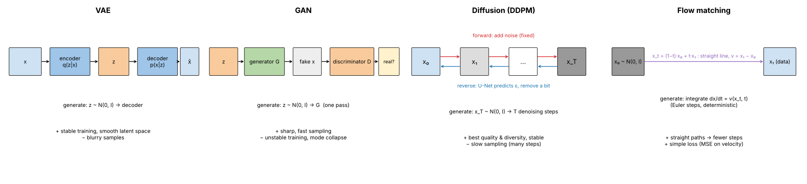

(이 장에서 다루는 생성 모델 4종. 왼쪽부터 VAE(인코더 → 잠재 벡터 z → 디코더, 생성은 $z \sim \mathcal{N}(0, I)$를 디코더에 통과), GAN(생성자가 만든 가짜를 판별자가 진짜와 구별, 생성은 생성자 한 번 통과), 확산 모델(빨강: 잡음을 더하는 고정된 순방향 과정, 파랑: U-Net이 잡음을 예측해 조금씩 빼는 역방향 과정), 플로 매칭(잡음과 데이터를 잇는 직선 위의 속도를 학습). 아래 줄은 생성 방법과 장단점)

---

## 이 장의 흐름

| 단계 | 절 | 핵심 질문 | 결과물 |
|---|---|---|---|
| 1. 효율적인 표현 | 18.1 | 왜 "압축했다 되살리기"가 학습이 되나 | 인코더·코딩·디코더, 재구성 손실, 과소완전·과대완전 |
| 2. 선형 오토인코더 | 18.2 | 오토인코더와 PCA는 무슨 관계인가 | `nn.Linear(3, 2)` + `nn.Linear(2, 3)`, 3D → 2D 코딩 그림. 보충: 충분히 훈련하면 재구성 MSE가 PCA와 **소수점 8자리까지 같고** 부분 공간 사이 각도 0° |
| 3. 적층 오토인코더 | 18.3 | 깊게 쌓으면 무엇을 얻나 | 784 → 128 → **32** → 128 → 784, 검증 RMSE **0.120**. MNIST 숫자는 재구성 오차가 커서 **이상치**로 걸러진다. t-SNE로 32차원 코딩을 2D 지도로 |
| 4. 가중치 묶기 | 18.3 | 디코더 가중치를 따로 둘 필요가 있나 | 디코더 = 인코더 가중치의 전치 → 파라미터 209,968 → **105,520**, 검증 RMSE 0.112 |
| 5. 합성곱 오토인코더 | 18.4 | 이미지에는 어떤 구조가 맞나 | 합성곱·풀링 인코더 + `ConvTranspose2d` 디코더, 파라미터 **55,921**개로 검증 RMSE **0.107**. 보충: 순환 오토인코더 0.109 |
| 6. 잡음 제거 | 18.5 | 쉬운 정답(항등 함수)을 막으려면 | 입력에 `Dropout(0.5)` / `GaussianNoise(0.5)` → 손상된 입력에서 깨끗한 옷 복원. 보충: 잡음 낀 입력의 복원 RMSE 비교 |
| 7. 희소 오토인코더 | 18.6 | 코딩 유닛 대부분을 0으로 만들려면 | 코딩 256개(시그모이드) + KL 희소성 손실(목표 0.1) → 평균 활성화 **0.1016**, 검증 RMSE **0.0911**. 6번 유닛이 강하면 모두 **신발** |
| 8. VAE | 18.7 | 오토인코더로 새 이미지를 **생성**하려면 | 평균·로그 분산 출력, 재매개변수화 트릭, 잠재 손실 → 무작위 코딩 21개를 디코딩해 옷 이미지, 두 코딩 사이 **시맨틱 보간**. 보충: 2D 잠재 공간에서 AE vs VAE 비교 |
| 9. 이산 VAE | 18.7 | 코딩을 범주(토큰)로 만들려면 | 길이 32 × 코드 16개, Gumbel-softmax(`hard=True`) + 온도 어닐링 → 무작위 코드로 이미지 생성 |
| 10. GAN | 18.8 | 판별자를 속이도록 생성자를 훈련하면 | MLP 생성자·판별자, `train_gan()` 두 단계 훈련 → 20에포크 후 얼룩진 옷 이미지. 보충: 2D 장난감에서 **모드 붕괴** 재현 |
| 11. DCGAN | 18.8 | 합성곱으로 GAN을 안정시키려면 | 전치 합성곱 생성자 + 배치 정규화, 합성곱 판별자 + 드롭아웃 → 더 매끄러운 옷 이미지 |
| 12. 확산 모델 | 18.9 | 잡음을 예측하는 모델 하나로 이미지를 만들려면 | 코사인 스케줄($T$ = 4,000), 순방향 지름길 공식, 시간 인코딩 + U-Net(**279,329**개 파라미터), 잡음 예측 검증 RMSE **0.286** → DDPM 4,000스텝 생성, DDIM 500스텝 생성 |
| 13. 스테이블 디퓨전 | 18.9 | 사전 훈련된 텍스트–이미지 모델을 쓰려면 | `diffusers`의 `AutoPipelineForText2Image`, `stabilityai/sd-turbo`로 **1스텝** 생성("책 읽는 오랑우탄") |
| 14. 플로 매칭 | 보충 | 잡음 → 데이터를 직선으로 이으면 | 같은 U-Net으로 속도 $x_1 - x_0$을 학습, 오일러 100스텝 생성. 보충: 2D 장난감에서 DDPM·DDIM·플로 매칭 궤적 비교 |

## 데이터

| 데이터 | 형태 | 사용 절 | 비고 |
|---|---|---|---|
| 3D 타원 데이터 (`generate_data()`) | 훈련 60 × 3, 검증 500 × 3 | 18.2 | [7장](07_dimensionality_reduction.md)의 PCA 예제와 같은 데이터. 기울어진 타원 + 잡음 |
| 패션 MNIST (`torchvision.datasets.FashionMNIST`) | 훈련 55,000 / 검증 5,000 / 테스트 10,000, `[1, 28, 28]`, 0 ~ 1 | 18.3 ~ 18.9 | 10장에서 쓴 옷·신발·가방 흑백 이미지. 오토인코더는 **입력 = 타깃**, 확산 모델은 −1 ~ 1로 바꿔 쓴다 |
| MNIST (`torchvision.datasets.MNIST`) | 훈련 세트 앞 5,000장 | 18.3 | 손글씨 숫자. 패션 MNIST로 훈련한 오토인코더 입장에서 **이상치** |
| 사전 훈련 모델 (허깅 페이스 허브) | | 18.9 | `stabilityai/sd-turbo` (float16 변형). 텍스트 프롬프트 → 512 × 512 이미지 |

> 📌 이 장의 모델은 모두 **레이블을 쓰지 않는다**(패션 MNIST의 레이블은 t-SNE 그림의 색칠에만 쓴다). 오토인코더는 이미지 자체가 타깃이고, GAN은 "진짜/가짜" 레이블을 스스로 만들고, 확산 모델은 스스로 더한 잡음이 타깃이다. 텐서 형태 표기: `[B, C, H, W]` = [배치, 채널, 높이, 너비].

## 목차

- [0. 준비](#0-준비)
- [1. 효율적인 데이터 표현 (18.1)](#1-효율적인-데이터-표현-181)
   - [1-1. 패턴을 찾으면 기억하기 쉽다](#1-1-패턴을-찾으면-기억하기-쉽다)
   - [1-2. 오토인코더의 구조](#1-2-오토인코더의-구조)
- [2. 과소완전 선형 오토인코더로 PCA 수행하기 (18.2)](#2-과소완전-선형-오토인코더로-pca-수행하기-182)
   - [2-1. 선형 오토인코더 만들기와 훈련](#2-1-선형-오토인코더-만들기와-훈련)
   - [2-2. 코딩 시각화](#2-2-코딩-시각화)
   - [2-3. 보충 코드: 선형 오토인코더와 PCA는 같은 부분 공간을 찾는다](#2-3-보충-코드-선형-오토인코더와-pca는-같은-부분-공간을-찾는다)
- [3. 적층 오토인코더 (18.3)](#3-적층-오토인코더-183)
   - [3-1. 파이토치로 적층 오토인코더 구현하기](#3-1-파이토치로-적층-오토인코더-구현하기)
   - [3-2. 패션 MNIST와 AutoencoderDataset](#3-2-패션-mnist와-autoencoderdataset)
   - [3-3. 훈련](#3-3-훈련)
   - [3-4. 재구성 시각화](#3-4-재구성-시각화)
   - [3-5. 오토인코더로 이상치 탐지하기](#3-5-오토인코더로-이상치-탐지하기)
   - [3-6. 패션 MNIST 데이터셋 시각화](#3-6-패션-mnist-데이터셋-시각화)
   - [3-7. 가중치 묶기](#3-7-가중치-묶기)
   - [3-8. 오토인코더를 사용한 비지도 사전 훈련](#3-8-오토인코더를-사용한-비지도-사전-훈련)
- [4. 합성곱 오토인코더 (18.4)](#4-합성곱-오토인코더-184)
   - [4-1. 합성곱 인코더와 전치 합성곱 디코더](#4-1-합성곱-인코더와-전치-합성곱-디코더)
   - [4-2. 훈련과 재구성](#4-2-훈련과-재구성)
   - [4-3. 보충 자료: 순환 오토인코더](#4-3-보충-자료-순환-오토인코더)
- [5. 잡음 제거 오토인코더 (18.5)](#5-잡음-제거-오토인코더-185)
   - [5-1. 드롭아웃으로 입력 손상시키기](#5-1-드롭아웃으로-입력-손상시키기)
   - [5-2. 가우스 잡음으로 입력 손상시키기](#5-2-가우스-잡음으로-입력-손상시키기)
   - [5-3. 보충 코드: 잡음 낀 입력을 정말 복원하나](#5-3-보충-코드-잡음-낀-입력을-정말-복원하나)
- [6. 희소 오토인코더 (18.6)](#6-희소-오토인코더-186)
   - [6-1. 희소성 손실: KL 발산](#6-1-희소성-손실-kl-발산)
   - [6-2. 희소 오토인코더 훈련](#6-2-희소-오토인코더-훈련)
   - [6-3. 코딩 분포와 해석 가능한 유닛](#6-3-코딩-분포와-해석-가능한-유닛)
- [7. 변분 오토인코더 (18.7)](#7-변분-오토인코더-187)
   - [7-1. VAE의 원리](#7-1-vae의-원리)
   - [7-2. VAE 구현](#7-2-vae-구현)
   - [7-3. VAE 손실 함수](#7-3-vae-손실-함수)
   - [7-4. 보충 코드: KL 공식과 재매개변수화 트릭 확인](#7-4-보충-코드-kl-공식과-재매개변수화-트릭-확인)
   - [7-5. 패션 이미지 생성하기](#7-5-패션-이미지-생성하기)
   - [7-6. 시맨틱 보간](#7-6-시맨틱-보간)
   - [7-7. 보충 코드: 오토인코더와 VAE의 잠재 공간 비교](#7-7-보충-코드-오토인코더와-vae의-잠재-공간-비교)
   - [7-8. 이산 VAE와 Gumbel-softmax](#7-8-이산-vae와-gumbel-softmax)
   - [7-9. 이산 VAE 훈련과 생성](#7-9-이산-vae-훈련과-생성)
- [8. 생성적 적대 신경망 (18.8)](#8-생성적-적대-신경망-188)
   - [8-1. GAN의 구조와 두 단계 훈련](#8-1-gan의-구조와-두-단계-훈련)
   - [8-2. 간단한 GAN 구현](#8-2-간단한-gan-구현)
   - [8-3. GAN 훈련 루프](#8-3-gan-훈련-루프)
   - [8-4. GAN 훈련의 어려움](#8-4-gan-훈련의-어려움)
   - [8-5. 보충 코드: 2D 장난감으로 본 모드 붕괴](#8-5-보충-코드-2d-장난감으로-본-모드-붕괴)
   - [8-6. 심층 합성곱 GAN](#8-6-심층-합성곱-gan)
   - [8-7. ProGAN과 StyleGAN](#8-7-progan과-stylegan)
- [9. 확산 모델 (18.9)](#9-확산-모델-189)
   - [9-1. 확산 모델의 아이디어](#9-1-확산-모델의-아이디어)
   - [9-2. 분산 스케줄](#9-2-분산-스케줄)
   - [9-3. 순방향 확산의 지름길](#9-3-순방향-확산의-지름길)
   - [9-4. 확산 데이터셋 만들기](#9-4-확산-데이터셋-만들기)
   - [9-5. 시간 인코딩](#9-5-시간-인코딩)
   - [9-6. U-Net 잡음 예측 모델](#9-6-u-net-잡음-예측-모델)
   - [9-7. 확산 모델 훈련](#9-7-확산-모델-훈련)
   - [9-8. DDPM으로 이미지 생성하기](#9-8-ddpm으로-이미지-생성하기)
   - [9-9. DDIM으로 더 빠르게 생성하기](#9-9-ddim으로-더-빠르게-생성하기)
   - [9-10. 잠재 확산과 스테이블 디퓨전](#9-10-잠재-확산과-스테이블-디퓨전)
   - [9-11. 보충 자료: 플로 매칭](#9-11-보충-자료-플로-매칭)
   - [9-12. 보충 코드: 2D 장난감으로 본 DDPM·DDIM·플로 매칭](#9-12-보충-코드-2d-장난감으로-본-ddpmddim플로-매칭)
- [10. 연습문제](#10-연습문제)
- [11. 정리](#11-정리)
   - [11-1. 전체 흐름](#11-1-전체-흐름)
   - [11-2. 개념과 코드 대응](#11-2-개념과-코드-대응)
   - [11-3. 방법 비교](#11-3-방법-비교)
   - [11-4. 주요 결과](#11-4-주요-결과)
   - [11-5. 자주 쓴 코드 패턴](#11-5-자주-쓴-코드-패턴)
   - [11-6. 핵심 원칙](#11-6-핵심-원칙)
   - [11-7. 5분 셀프 테스트](#11-7-5분-셀프-테스트)

---

## 0. 준비

```python
import sys
assert sys.version_info >= (3, 10)

IS_COLAB = "google.colab" in sys.modules
IS_KAGGLE = "kaggle_secrets" in sys.modules

if IS_COLAB:
    %pip install -q torchmetrics

from packaging.version import Version
import torch
assert Version(torch.__version__) >= Version("2.6.0")

if torch.cuda.is_available():
    device = "cuda"
elif torch.backends.mps.is_available():
    device = "mps"
else:
    device = "cpu"

device
# 'cuda'

if device == "cpu":
    print("Neural nets can be very slow without a hardware accelerator.")
    if IS_COLAB:
        print("Go to Runtime > Change runtime and select a GPU hardware "
              "accelerator.")
    if IS_KAGGLE:
        print("Go to Settings > Accelerator and select GPU.")

import matplotlib.pyplot as plt
plt.rc('font', size=14)
plt.rc('axes', labelsize=14, titlesize=14)
plt.rc('legend', fontsize=14)
plt.rc('xtick', labelsize=10)
plt.rc('ytick', labelsize=10)
```

모든 장 노트북 맨 앞에 반복되는 환경 확인 + 그래프 글꼴 설정. 각 줄의 의미는 [1장 0. 준비](01_the_machine_learning_landscape.md#0-준비), 장치 선택은 [10장 1-5절](10_neural_nets_with_pytorch.md#1-5-하드웨어-가속) 참고. 코랩에는 `torchmetrics`가 없어서 설치한다.

**훈련 함수** — 14장의 `train()`·`evaluate_tm()`([14장 0. 준비](14_nlp_with_rnns_and_attention.md#0-준비))을 두 군데만 고쳐 이 장 내내 쓴다.

```python
import torchmetrics

def evaluate_tm(model, data_loader, metric):
    model.eval()
    metric.reset()
    with torch.no_grad():
        for X_batch, y_batch in data_loader:
            X_batch, y_batch = X_batch.to(device), y_batch.to(device)
            y_pred = model(X_batch)
            if isinstance(y_pred, tuple):
                y_pred = y_pred.output                 # ← 수정 ①
            metric.update(y_pred, y_batch)
    return metric.compute()

def train(model, optimizer, loss_fn, metric, train_loader, valid_loader,
          n_epochs, patience=2, factor=0.5, epoch_callback=None):
    scheduler = torch.optim.lr_scheduler.ReduceLROnPlateau(
        optimizer, mode="max", patience=patience, factor=factor)
    history = {"train_losses": [], "train_metrics": [], "valid_metrics": []}
    for epoch in range(n_epochs):
        total_loss = 0.0
        metric.reset()
        model.train()
        if epoch_callback is not None:
            epoch_callback(model, epoch)
        for index, (X_batch, y_batch) in enumerate(train_loader):
            X_batch, y_batch = X_batch.to(device), y_batch.to(device)
            y_pred = model(X_batch)
            loss = loss_fn(y_pred, y_batch)            # 손실 함수에는 튜플을 통째로 넘긴다
            total_loss += loss.item()
            loss.backward()
            torch.nn.utils.clip_grad_norm_(model.parameters(), max_norm=1.0)  # ← 수정 ②
            optimizer.step()
            optimizer.zero_grad()
            if isinstance(y_pred, tuple):
                y_pred = y_pred.output                 # ← 수정 ①
            metric.update(y_pred, y_batch)
            train_metric = metric.compute().item()
            print(f"\rBatch {index + 1}/{len(train_loader)}", end="")
            print(f", loss={total_loss/(index+1):.4f}", end="")
            print(f", {train_metric=:.3f}", end="")
        history["train_losses"].append(total_loss / len(train_loader))
        history["train_metrics"].append(train_metric)
        val_metric = evaluate_tm(model, valid_loader, metric).item()
        history["valid_metrics"].append(val_metric)
        scheduler.step(val_metric)
        print(f"\rEpoch {epoch + 1}/{n_epochs},                      "
              f"train loss: {history['train_losses'][-1]:.4f}, "
              f"train metric: {history['train_metrics'][-1]:.3}, "
              f"valid metric: {history['valid_metrics'][-1]:.3}")
    return history
```

| 코드 | 의미 |
|---|---|
| 수정 ① `y_pred.output` | 희소 오토인코더·VAE는 재구성 이미지 말고도 코딩(또는 평균·분산)을 함께 돌려줘야 손실을 계산할 수 있다. 그래서 `output` 필드가 있는 **네임드튜플**을 반환한다. 손실 함수에는 튜플 전체를, 지표(RMSE)에는 재구성 이미지(`.output`)만 넘긴다 |
| 수정 ② `clip_grad_norm_(..., max_norm=1.0)` | 그레이디언트 전체의 노름이 1을 넘으면 줄인다([11장 그레이디언트 클리핑](11_training_deep_neural_networks.md#1-9-그레이디언트-클리핑)). GAN·확산 모델처럼 손실이 출렁이는 모델을 안정시킨다 |
| `epoch_callback=None` | 에포크마다 호출할 함수. 이산 VAE에서 **온도를 낮추는** 데 쓴다(7-9절) |
| `ReduceLROnPlateau(mode="max")` | 검증 지표가 `patience`(2)에포크 동안 좋아지지 않으면 학습률을 `factor`(0.5)배로. ⚠️ 이 장의 지표는 RMSE라 **낮을수록 좋은데** `mode="max"`로 되어 있다(14장 정확도용 설정을 그대로 가져옴). 그래서 RMSE가 **좋아지는 동안** 학습률이 반씩 줄어든다 — 노트북 결과에서 4 → 5에포크처럼 손실이 계단식으로 뚝 떨어지는 이유다 |

> ⚠️ 노트북의 출력은 **코랩 GPU(`cuda`)** 에서 실행한 결과다. 이 노트의 **보충 코드**는 파이토치 2.15(CPU) + 사이킷런 1.9에서 직접 실행해 확인했다. 노트북 셀의 숫자(훈련 로그, 생성 이미지)는 노트북에 저장된 출력을 옮겼고, 보충 실험의 숫자는 CPU에서 얻은 값이라 난수·버전에 따라 조금 다를 수 있다. 훈련 로그는 에포크 줄만 남겼다(`Batch …` 진행 표시는 생략).

---

## 1. 효율적인 데이터 표현 (18.1)

> 🎯 **목적** — 오토인코더가 무엇을 배우는지, 왜 "입력을 그대로 출력하기"가 쓸모 있는 학습이 되는지 이해한다.

> 💬 **베끼기 숙제를 어렵게 만들면 공부가 된다**
>
> 입력을 출력으로 그대로 베끼는 건 쉽다. 하지만 중간 통로를 **좁히거나**(과소완전), 입력을 **망가뜨리거나**(잡음 제거), 통로 대부분을 **꺼 두게 하면**(희소) 그대로 베낄 수 없다. 그러면 네트워크는 데이터의 **패턴**을 찾아내야만 복원할 수 있다.
>
> - **인코더**: 입력 → 코딩(잠재 표현). **디코더**: 코딩 → 재구성
> - **재구성 손실**: 입력과 재구성의 차이(MSE). 레이블이 필요 없다 → **자기 지도 학습**
> - **헷갈림 주의**: 오토인코더의 목적은 재구성 그 자체가 아니라 **코딩**(좋은 표현)이다. 완벽하게 재구성하는 오토인코더가 항등 함수만 배웠다면 쓸모없다

### 1-1. 패턴을 찾으면 기억하기 쉽다

> 🎯 **목적** — 교재의 두 가지 예로 "효율적인 표현"의 의미를 잡는다.

> ⚠️ 노트북에는 이 소절의 코드가 없다. 아래는 교재 절 내용을 정리한 것이다.

**개념·원리**

다음 두 수열 중 어느 것이 외우기 쉬울까?

```
① 40, 27, 25, 36, 81, 57, 10, 73, 19, 68
② 50, 48, 46, 44, 42, 40, 38, 36, 34, 32, 30, 28, 26, 24, 22, 20, 18, 16, 14
```

②가 훨씬 길지만 외우기 쉽다. "50부터 14까지 짝수를 내림차순으로"라는 **패턴**만 기억하면 되기 때문이다. 패턴을 찾으면 데이터를 짧게 **압축**해서 기억할 수 있다.

1970년대 체스 기억 실험(체이스와 사이먼)도 같은 이야기다. 체스 고수는 실제 대국의 판을 5초만 보고도 말의 위치를 거의 다 기억했지만, 말을 **무작위로** 놓은 판은 초보자보다 나을 게 없었다. 고수는 위치 하나하나가 아니라 익숙한 **패턴**(전형적인 진형)으로 기억했기 때문이다.

| 사람 | 오토인코더 |
|---|---|
| 판을 보고 패턴으로 기억한다 | 인코더가 입력을 **코딩**(짧은 벡터)으로 바꾼다 |
| 기억한 패턴으로 판을 다시 놓는다 | 디코더가 코딩으로 입력을 **재구성**한다 |
| 무작위 판은 패턴이 없어 기억하지 못한다 | 훈련 데이터와 다른 입력은 재구성이 나쁘다 → **이상치 탐지**(3-5절) |

### 1-2. 오토인코더의 구조

> 🎯 **목적** — 인코더·코딩·디코더의 역할과, 코딩 층의 크기에 따른 과소완전·과대완전의 차이를 정리한다.

**개념·원리**

```
입력 x (784) ──[인코더 = 인식 네트워크]──> 코딩 z (32) ──[디코더 = 생성 네트워크]──> 재구성 x̂ (784)

손실 = 재구성 손실 = MSE(x̂, x)        ← 타깃이 입력 자신
```

- 출력 층의 뉴런 수 = 입력 크기. 출력을 **재구성**(reconstruction)이라고 부른다
- 코딩 층이 입력보다 작으면 **과소완전**(undercomplete): 정보를 버려야 하므로 중요한 특성을 골라 배운다
- 코딩 층이 입력보다 크거나 같으면 **과대완전**(overcomplete): 그대로 복사해 버릴 수 있다. 그래서 잡음(5절)이나 희소성(6절) 같은 **다른 제약**을 걸어야 한다

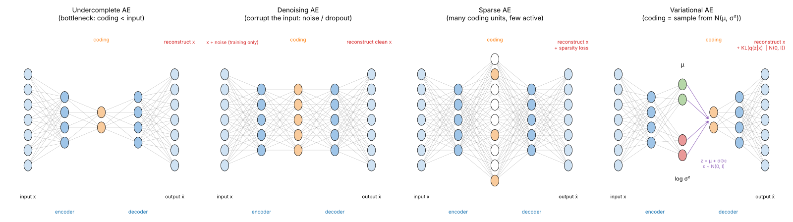

(왼쪽부터 이 장의 오토인코더 4종. 원 하나가 뉴런 하나, 주황 원이 **코딩 층**. 과소완전 AE는 가운데가 좁은 모래시계, 잡음 제거 AE는 훈련 때 입력에 잡음을 넣고 깨끗한 원본을 복원, 희소 AE는 코딩 층이 넓지만 대부분 꺼져 있고(흰 원) 희소성 손실을 더하며, VAE는 인코더가 평균 μ(초록)와 로그 분산 log σ²(빨강)을 내고 그 분포에서 **샘플링한** z(주황)를 디코딩한다. 빨간 글씨는 손실)

| 오토인코더 | 표현을 배우게 만드는 제약 | 절 |
|---|---|---|
| 과소완전 (선형) | 코딩 차원 < 입력 차원, 활성화 함수 없음 → PCA | 2 |
| 적층 (심층) | 좁은 코딩 + 비선형 층 여러 개 → 비선형 매니폴드 | 3 |
| 합성곱 | 이미지의 공간 구조(지역성·가중치 공유) | 4 |
| 잡음 제거 | 입력을 손상시킨다 | 5 |
| 희소 | 코딩 대부분이 0에 가깝도록 손실을 더한다 | 6 |
| 변분 (VAE) | 코딩이 $\mathcal{N}(0, I)$를 따르도록 손실을 더한다 → **생성** 가능 | 7 |

> 💡 오토인코더의 쓰임새: **차원 축소·시각화**(3-6절), **이상치 탐지**(3-5절), **비지도 사전 훈련**(3-8절), **잡음 제거**(5절), **생성**(7절). 15장의 BERT(마스크 토큰 복원)와 16장의 MAE(가린 패치 복원)도 넓게 보면 "망가뜨린 입력을 복원하는" 잡음 제거 오토인코더다.

---

## 2. 과소완전 선형 오토인코더로 PCA 수행하기 (18.2)

> 🎯 **목적** — 활성화 함수 없는 오토인코더가 PCA와 같은 일을 한다는 것을 3D 데이터로 확인한다.

> 💬 **활성화 함수를 빼면 오토인코더는 PCA가 된다**
>
> 인코더·디코더가 모두 선형이고 손실이 MSE면, 오토인코더는 "재구성 오차를 최소로 하는 저차원 **평면**"을 찾는다. 이것이 바로 [7장의 PCA](07_dimensionality_reduction.md#3-주성분-분석-73)가 푸는 문제다.
>
> - 3D → 2D: 데이터를 가장 잘 담는 평면에 투영한다
> - **헷갈림 주의**: 같은 **평면**(부분 공간)을 찾을 뿐, 코딩 좌표 자체는 주성분 좌표와 다르다(회전·늘이기가 섞여 있다). PCA처럼 축이 직교하고 분산 순으로 정렬된다는 보장이 없다

### 2-1. 선형 오토인코더 만들기와 훈련

> 🎯 **목적** — `nn.Linear` 두 개로 3D → 2D → 3D 오토인코더를 만들고, 7장의 3D 데이터로 훈련한다.

**코드**

```python
import torch
import torch.nn as nn

torch.manual_seed(42)
encoder = nn.Linear(3, 2)
decoder = nn.Linear(2, 3)
autoencoder = nn.Sequential(encoder, decoder).to(device)
```

```python
# extra code – builds the same 3D dataset as in Chapter 7
import numpy as np
from scipy.spatial.transform import Rotation

def generate_data(m, seed=42):
    X = np.zeros((m, 3))  # initialize 3D dataset
    rng = np.random.default_rng(seed)
    angles = (rng.random(m) ** 3 + 0.5) * 2 * np.pi  # uneven distribution
    X[:, 0], X[:, 1] = np.cos(angles), np.sin(angles) * 0.5  # oval
    X += 0.28 * rng.standard_normal((m, 3))  # add more noise
    X = Rotation.from_rotvec([np.pi / 29, -np.pi / 20, np.pi / 4]).apply(X)
    X += [0.2, 0, 0.2]  # shift a bit
    return torch.from_numpy(X.astype(np.float32))
```

```python
from torch.utils.data import DataLoader, TensorDataset

X_train = generate_data(60, seed=42)
train_set = TensorDataset(X_train, X_train)          # 입력 = 타깃
train_loader = DataLoader(train_set, batch_size=32, shuffle=True)

X_valid = generate_data(500, seed=43)
valid_set = TensorDataset(X_valid, X_valid)
valid_loader = DataLoader(valid_set, batch_size=32)

import torchmetrics

torch.manual_seed(42)
optimizer = torch.optim.NAdam(autoencoder.parameters(), lr=0.2)
mse = nn.MSELoss()
rmse = torchmetrics.MeanSquaredError(squared=False).to(device)
history = train(autoencoder, optimizer, mse, rmse, train_loader, valid_loader,
                n_epochs=20)
# Epoch 1/20,   train loss: 0.1621, train metric: 0.406, valid metric: 0.309
# Epoch 2/20,   train loss: 0.0697, train metric: 0.264, valid metric: 0.297
# Epoch 3/20,   train loss: 0.0644, train metric: 0.253, valid metric: 0.324
# Epoch 4/20,   train loss: 0.0935, train metric: 0.303, valid metric: 0.45
# Epoch 5/20,   train loss: 0.1088, train metric: 0.336, valid metric: 0.245
# ...
# Epoch 10/20,  train loss: 0.0300, train metric: 0.174, valid metric: 0.209
# ...
# Epoch 20/20,  train loss: 0.0283, train metric: 0.169, valid metric: 0.202
```

| 코드 | 의미 |
|---|---|
| `nn.Linear(3, 2)` / `nn.Linear(2, 3)` | 인코더(3D → 2D 코딩)와 디코더(2D → 3D 재구성). **활성화 함수가 없다** → 전체가 선형 변환 |
| `nn.Sequential(encoder, decoder)` | 두 층을 이어 붙인 오토인코더. `encoder`를 따로 변수로 둬서 나중에 코딩만 뽑아 쓸 수 있다 |
| `generate_data()` | 7장의 3D 데이터: 각도가 고르지 않은 타원(`** 3`) + 3축 잡음 0.28 → 회전 → 이동 |
| `TensorDataset(X_train, X_train)` | 입력과 타깃이 같은 데이터셋. 오토인코더 훈련의 핵심 |
| `NAdam(lr=0.2)` | 네스테로프 모멘텀을 더한 Adam([11장](11_training_deep_neural_networks.md#3-6-adam)). 샘플이 60개뿐이라 큰 학습률을 쓴다 |
| `MeanSquaredError(squared=False)` | `torchmetrics`의 **RMSE** 지표. 손실은 MSE, 지표는 RMSE로 같은 것을 다른 단위로 본다 |

**결과 해석**

- 배치가 2개(60 / 32)뿐이고 학습률이 커서 초반 5에포크는 들쭉날쭉하다(검증 RMSE 0.309 → 0.45 → 0.245)
- 이후 `ReduceLROnPlateau`가 학습률을 몇 번 반으로 줄이면서(7에포크 무렵부터) 안정되고, 20에포크에 훈련 RMSE 0.169, 검증 RMSE 0.202
- 훈련 MSE 0.0283은 PCA의 최솟값 0.0212(2-3절 보충)보다 아직 크다 → **덜 수렴했다.** 그래도 코딩 그림(2-2절)의 모양은 PCA와 비슷하다

### 2-2. 코딩 시각화

> 🎯 **목적** — 인코더만 통과시켜 얻은 2D 코딩을 그려 보고, 3D 데이터가 어떻게 투영됐는지 본다.

**코드**

```python
codings = encoder(X_train.to(device))

fig = plt.figure(figsize=(4,3))
codings_np = codings.cpu().detach().numpy()
plt.plot(codings_np[:,0], codings_np[:, 1], "b.")
plt.xlabel("$z_1$", fontsize=18)
plt.ylabel("$z_2$", fontsize=18, rotation=0)
plt.grid(True)
plt.show()
```

| 코드 | 의미 |
|---|---|
| `encoder(X_train.to(device))` | 오토인코더 전체가 아니라 **인코더만** 통과 → `[60, 2]` 코딩 |
| `.cpu().detach().numpy()` | GPU → CPU, 계산 그래프에서 떼어 냄(`requires_grad` 텐서는 바로 넘파이로 못 바꾼다), 넘파이 배열로 |

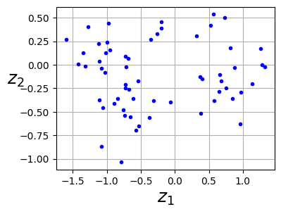

(가로축 $z_1$, 세로축 $z_2$ = 인코더가 만든 2D 코딩. 점 하나가 3D 샘플 하나. 7장 PCA 그림처럼 **타원 모양**이 드러난다. 왼쪽에 점이 몰려 있는 것은 원래 데이터의 각도가 고르지 않기 때문)

**결과 해석**

- 3D 타원 구름이 2D에서 타원으로 보인다 → 오토인코더가 데이터의 분산을 가장 많이 담는 **평면**을 찾아 투영했다
- 이것은 PCA가 하는 일과 같다. 다만 축의 방향·크기는 PCA와 다를 수 있다(다음 절)

### 2-3. 보충 코드: 선형 오토인코더와 PCA는 같은 부분 공간을 찾는다

> 🎯 **목적** — 선형 오토인코더를 끝까지 수렴시켜 PCA와 재구성 오차가 같은지, 같은 평면을 찾는지, 코딩 좌표는 어떻게 다른지 수치로 확인한다.

**보충 코드**

```python
# 보충 코드
from sklearn.decomposition import PCA

X = generate_data(60, 42); Xv = generate_data(500, 43)
torch.manual_seed(42)
enc, dec = nn.Linear(3, 2), nn.Linear(2, 3)
ae = nn.Sequential(enc, dec)
opt = torch.optim.Adam(ae.parameters(), lr=0.01)
for i in range(5000):                                # 전체 배치로 충분히 오래 훈련
    loss = nn.functional.mse_loss(ae(X), X)
    opt.zero_grad(); loss.backward(); opt.step()

pca = PCA(2).fit(X.numpy())
rec_pca = pca.inverse_transform(pca.transform(X.numpy()))
loss.item(), ((rec_pca - X.numpy()) ** 2).mean()    # (0.0211910, 0.0211910) ← 훈련 MSE 같다
# 검증 MSE: AE 0.0261233, PCA 0.0261233

Q, _ = np.linalg.qr(dec.weight.detach().numpy())     # 디코더 열 공간의 직교 기저 (3 × 2)
s = np.linalg.svd(Q.T @ pca.components_.T, compute_uv=False)
np.degrees(np.arccos(np.clip(s, -1, 1)))             # [0. 0.]  ← 두 평면 사이 각도
pca.explained_variance_ratio_                        # [0.823, 0.108] → 합 0.931
```

| 코드 | 의미 |
|---|---|
| 전체 배치 5,000스텝 | 노트북(미니배치 2개 × 20에포크)과 달리 **최솟값까지** 수렴시킨다 |
| `pca.inverse_transform(pca.transform(X))` | PCA로 2D 투영 후 3D로 되돌린 재구성 ([7장 압축](07_dimensionality_reduction.md#3-6-압축을-위한-pca)) |
| `np.linalg.qr(dec.weight)` | 디코더 가중치(3 × 2)의 두 열이 만드는 평면의 직교 기저 |
| `svd(Q.T @ P)` | 두 평면 사이의 **주각**(principal angle). 특잇값이 1이면 각도 0° = 같은 평면 |

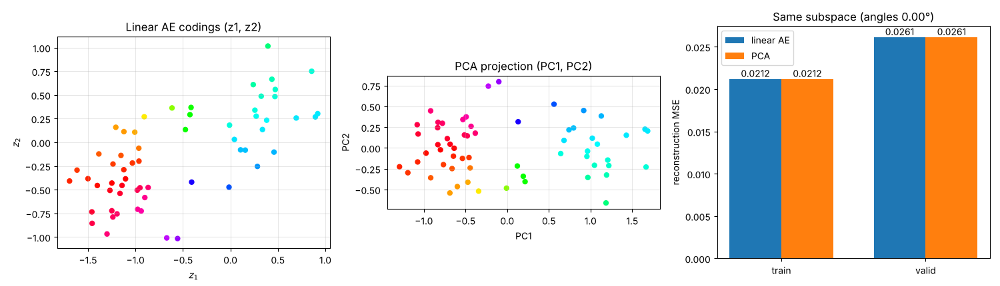

(왼쪽: 충분히 훈련한 선형 오토인코더의 2D 코딩. 가운데: 같은 데이터의 PCA 투영(PC1, PC2). 색은 PCA 평면에서의 각도로, 두 그림에서 같은 점은 같은 색이다. 오른쪽: 훈련·검증 재구성 MSE — 두 막대가 같다. 왼쪽은 가운데를 **비스듬히 늘이고 뒤집은** 모양이다)

**결과 해석**

- 재구성 MSE가 훈련·검증 모두 PCA와 같고(0.0212, 0.0261), 디코더가 펼치는 평면과 PCA 평면의 각도가 **0°** → 같은 부분 공간을 찾았다
- 하지만 코딩 좌표는 PCA 좌표의 **임의 선형 변환**이다(최소 제곱으로 맞춘 변환 행렬이 직교 행렬이 아니다). 오토인코더는 "평면 안에서 어떤 좌표계를 쓸지"에 관심이 없기 때문이다 — 인코더에 $A$를, 디코더에 $A^{-1}$을 곱해도 재구성은 같다
- 노트북의 20에포크 결과(훈련 MSE 0.0283)는 이 최솟값보다 크다. 작은 데이터 + 큰 학습률 + 2배치에서는 수렴이 거칠다

> 📌 PCA는 닫힌 해(SVD)로 한 번에 구하고, 성분이 직교하며 분산 순으로 정렬된다. 선형 오토인코더는 경사 하강법으로 같은 부분 공간을 **근사적으로** 찾는다. 선형이면 PCA를 쓰는 게 낫다. 오토인코더의 진짜 힘은 **비선형 층을 쌓을 때**(다음 절) 나온다.

---

## 3. 적층 오토인코더 (18.3)

> 🎯 **목적** — 은닉 층을 여러 개 쌓은 오토인코더로 패션 MNIST를 32차원으로 압축하고, 재구성·이상치 탐지·시각화·가중치 묶기·사전 훈련에 활용한다.

> 💬 **모래시계 모양으로 쌓는다**
>
> 적층(심층) 오토인코더는 784 → 128 → **32** → 128 → 784처럼 가운데 코딩 층을 중심으로 **좌우 대칭**인 모래시계다. 층이 깊고 비선형(ReLU)이라 PCA가 못 잡는 휘어진 구조(매니폴드)를 배운다.
>
> - 784픽셀 → 32개 숫자로 **24.5배 압축**. 재구성이 흐릿한 건 당연하다
> - 재구성 오차는 "이 입력이 훈련 데이터와 얼마나 다른가"의 척도 → 이상치 탐지
> - **헷갈림 주의**: 너무 강력한 오토인코더(층이 많고 뉴런이 많음)는 각 입력을 숫자 하나에 외워 버릴 수도 있다. 재구성은 완벽해도 코딩은 쓸모없다 → 너무 깊게 만들지 않는다

### 3-1. 파이토치로 적층 오토인코더 구현하기

> 🎯 **목적** — 인코더와 디코더를 `nn.Sequential` 두 개로 만들고 이어 붙인다.

**코드**

```python
torch.manual_seed(42)  # extra code – ensures reproducibility

stacked_encoder = nn.Sequential(
    nn.Flatten(),
    nn.Linear(1 * 28 * 28, 128), nn.ReLU(),
    nn.Linear(128, 32), nn.ReLU(),
)
stacked_decoder = nn.Sequential(
    nn.Linear(32, 128), nn.ReLU(),
    nn.Linear(128, 1 * 28 * 28), nn.Sigmoid(),
    nn.Unflatten(dim=1, unflattened_size=(1, 28, 28))
)
stacked_ae = nn.Sequential(stacked_encoder, stacked_decoder).to(device)
```

| 코드 | 의미 |
|---|---|
| `nn.Flatten()` | `[B, 1, 28, 28]` → `[B, 784]` |
| `nn.Linear(784, 128)` → `nn.Linear(128, 32)` | 인코더: 784 → 128 → **32**(코딩). 코딩 층에도 ReLU를 써서 코딩은 0 이상 |
| `nn.Linear(32, 128)` → `nn.Linear(128, 784)` | 디코더: 인코더를 거꾸로 |
| `nn.Sigmoid()` | 픽셀 값이 0 ~ 1이므로 출력도 0 ~ 1로 |
| `nn.Unflatten(dim=1, unflattened_size=(1, 28, 28))` | `[B, 784]` → `[B, 1, 28, 28]`. 입력과 같은 형태로 돌려놔야 MSE를 바로 계산할 수 있다 |

| 부분 | 파라미터 수 (보충 계산) |
|---|---|
| 인코더 | 784 × 128 + 128 + 128 × 32 + 32 = **104,608** |
| 디코더 | 32 × 128 + 128 + 128 × 784 + 784 = **105,360** |
| 합계 | **209,968** |

### 3-2. 패션 MNIST와 AutoencoderDataset

> 🎯 **목적** — 패션 MNIST를 훈련·검증·테스트로 나누고, (이미지, 레이블) 대신 (이미지, 이미지)를 돌려주는 데이터셋 래퍼를 만든다.

**코드**

```python
import torchvision
import torchvision.transforms.v2 as T

toTensor = T.Compose([T.ToImage(), T.ToDtype(torch.float32, scale=True)])

train_and_valid_data = torchvision.datasets.FashionMNIST(
    root="datasets", train=True, download=True, transform=toTensor)
test_data = torchvision.datasets.FashionMNIST(
    root="datasets", train=False, download=True, transform=toTensor)

torch.manual_seed(42)
train_data, valid_data = torch.utils.data.random_split(
    train_and_valid_data, [55_000, 5_000])
```

```python
from torch.utils.data import Dataset

class AutoencoderDataset(Dataset):
    def __init__(self, base_dataset):
        self.base_dataset = base_dataset

    def __len__(self):
        return len(self.base_dataset)

    def __getitem__(self, idx):
        x, _ = self.base_dataset[idx]     # 레이블은 버린다
        return x, x                        # 입력 = 타깃

train_loader = DataLoader(AutoencoderDataset(train_data), batch_size=32,
                          shuffle=True)
valid_loader = DataLoader(AutoencoderDataset(valid_data), batch_size=32)
test_loader = DataLoader(AutoencoderDataset(test_data), batch_size=32)
```

| 코드 | 의미 |
|---|---|
| `T.ToImage()` + `T.ToDtype(torch.float32, scale=True)` | PIL 이미지 → `[1, 28, 28]` 텐서, 0 ~ 255 → 0 ~ 1 ([12장](12_deep_computer_vision_with_cnns.md)과 같은 변환) |
| `random_split(..., [55_000, 5_000])` | 훈련 세트 6만 장을 훈련 55,000 / 검증 5,000으로 무작위 분할 ([10장](10_neural_nets_with_pytorch.md)과 같다) |
| `AutoencoderDataset` | 어떤 이미지 데이터셋이든 감싸서 `(x, x)`를 돌려준다. 기존 `train()` 함수를 그대로 쓸 수 있다 |

### 3-3. 훈련

> 🎯 **목적** — 적층 오토인코더를 10에포크 훈련한다.

**코드**

```python
optimizer = torch.optim.NAdam(stacked_ae.parameters(), lr=0.01)
mse = nn.MSELoss()
rmse = torchmetrics.MeanSquaredError(squared=False).to(device)
history = train(stacked_ae, optimizer, mse, rmse, train_loader, valid_loader,
                n_epochs=10)
# Epoch 1/10,   train loss: 0.0188, train metric: 0.137, valid metric: 0.136
# Epoch 2/10,   train loss: 0.0180, train metric: 0.134, valid metric: 0.135
# Epoch 3/10,   train loss: 0.0175, train metric: 0.132, valid metric: 0.132
# Epoch 4/10,   train loss: 0.0174, train metric: 0.132, valid metric: 0.131
# Epoch 5/10,   train loss: 0.0151, train metric: 0.123, valid metric: 0.124
# Epoch 6/10,   train loss: 0.0150, train metric: 0.122, valid metric: 0.124
# Epoch 7/10,   train loss: 0.0149, train metric: 0.122, valid metric: 0.123
# Epoch 8/10,   train loss: 0.0141, train metric: 0.119, valid metric: 0.12
# Epoch 9/10,   train loss: 0.0141, train metric: 0.119, valid metric: 0.12
# Epoch 10/10,  train loss: 0.0140, train metric: 0.118, valid metric: 0.12
```

**결과 해석**

- 검증 RMSE 0.136 → **0.120**. 픽셀 값(0 ~ 1)이 평균 0.12 정도 틀린다
- 5에포크와 8에포크에서 손실이 계단처럼 떨어진다 → `ReduceLROnPlateau`가 학습률을 반으로 줄인 시점(0. 준비의 ⚠️)
- 훈련·검증 RMSE가 거의 같다 → 과대적합 없음

### 3-4. 재구성 시각화

> 🎯 **목적** — 검증 이미지와 재구성을 나란히 그려 압축의 품질을 눈으로 확인한다.

**코드**

```python
def plot_image(image):
    plt.imshow(image.permute(1, 2, 0).cpu(), cmap="binary")
    plt.axis("off")

def plot_reconstructions(model, images, n_images=5):
    images = images[:n_images]
    with torch.no_grad():
        y_pred = model(images.to(device))
    if isinstance(y_pred, tuple):
        y_pred = y_pred.output
    fig = plt.figure(figsize=(len(images) * 1.5, 3))
    for idx in range(len(images)):
        plt.subplot(2, len(images), 1 + idx)                  # 윗줄: 원본
        plot_image(images[idx])
        plt.subplot(2, len(images), 1 + len(images) + idx)    # 아랫줄: 재구성
        plot_image(y_pred[idx])

X_valid = torch.stack([x for x, _ in valid_data])
plot_reconstructions(stacked_ae, X_valid)
plt.show()
```

| 코드 | 의미 |
|---|---|
| `image.permute(1, 2, 0)` | `[C, H, W]` → `[H, W, C]` (맷플롯립이 원하는 순서) |
| `cmap="binary"` | 0 = 흰색, 1 = 검정 (패션 MNIST는 배경이 0) |
| `torch.stack([x for x, _ in valid_data])` | 검증 이미지 5,000장을 `[5000, 1, 28, 28]` 텐서 하나로 |
| `isinstance(y_pred, tuple)` | 뒤에 나올 네임드튜플 출력 모델도 같은 함수로 그리기 위해 |

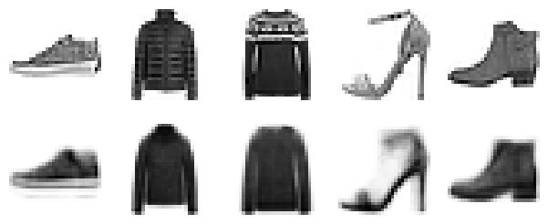

(윗줄: 검증 이미지 5장(운동화, 패딩 점퍼, 스웨터, 샌들, 앵클 부츠). 아랫줄: 32차원 코딩에서 복원한 재구성)

**결과 해석**

- 전체 모양(신발, 상의)은 잘 복원했지만 흐릿하다. 스웨터의 **무늬**, 샌들의 가는 끈 같은 세부는 사라졌다
- 784개 숫자를 32개로 줄였으니 당연하다. 오토인코더는 MSE를 줄이려고 **평균적인** 이미지를 내는 경향이 있어 흐릿해진다(MSE의 특성 — VAE도 마찬가지, GAN·확산 모델은 선명하다)

### 3-5. 오토인코더로 이상치 탐지하기

> 🎯 **목적** — 훈련 데이터와 다른 종류의 입력(MNIST 숫자)은 재구성 오차가 크다는 점을 이용해 이상치를 찾는다.

**개념·원리**

[8장](08_unsupervised_learning.md#3-5-13번--pca-재구성-오차로-이상치-탐지)에서 PCA·가우스 혼합으로 했던 것과 같은 아이디어다. 오토인코더는 훈련 데이터의 패턴만 배웠으므로, 처음 보는 종류의 입력은 **패턴에 맞춰 억지로** 재구성한다 → 오차가 크다.

**코드**

```python
torch.manual_seed(42)
mnist_data = torchvision.datasets.MNIST(
    root="datasets", train=True, download=True, transform=toTensor)
mnist_images = torch.stack([mnist_data[i][0] for i in range(X_valid.size(0))])
plot_reconstructions(stacked_ae, images=mnist_images)
plt.show()
```

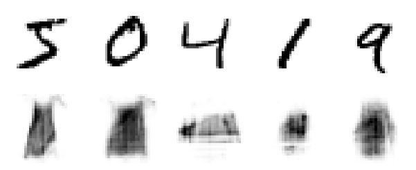

(윗줄: MNIST 숫자 5, 0, 4, 1, 9. 아랫줄: 패션 MNIST로 훈련한 오토인코더의 재구성 — 숫자가 아니라 **옷 비슷한 얼룩**이 나온다)

```python
import torch.nn.functional as F

def compute_reconstruction_losses(X, device):
    X = X.to(device)
    with torch.no_grad():
        y_pred = stacked_ae(X)
        return F.mse_loss(y_pred, X, reduction="none").view(X.size(0), -1).mean(dim=1).cpu()

recon_losses_mnist = compute_reconstruction_losses(mnist_images, device)
recon_losses_fashion_mnist = compute_reconstruction_losses(X_valid, device)

plt.hist(recon_losses_mnist, bins=85, alpha=0.8, label="MNIST images")
plt.hist(recon_losses_fashion_mnist, bins=85, alpha=0.8, label="Fashion MNIST images")
plt.xlabel("Reconstruction loss (MSE)")
plt.ylabel("Count", rotation=0)
plt.legend()
plt.grid()
plt.show()
```

| 코드 | 의미 |
|---|---|
| `range(X_valid.size(0))` | MNIST 훈련 세트 앞 5,000장 (패션 MNIST 검증 세트와 같은 수) |
| `F.mse_loss(..., reduction="none")` | 평균 내지 않고 **픽셀마다** 제곱 오차 → `[5000, 1, 28, 28]` |
| `.view(X.size(0), -1).mean(dim=1)` | 이미지마다 784픽셀 평균 → **이미지당 재구성 오차** `[5000]` |
| `plt.hist(..., alpha=0.8)` | 두 히스토그램을 반투명으로 겹쳐 그린다 |

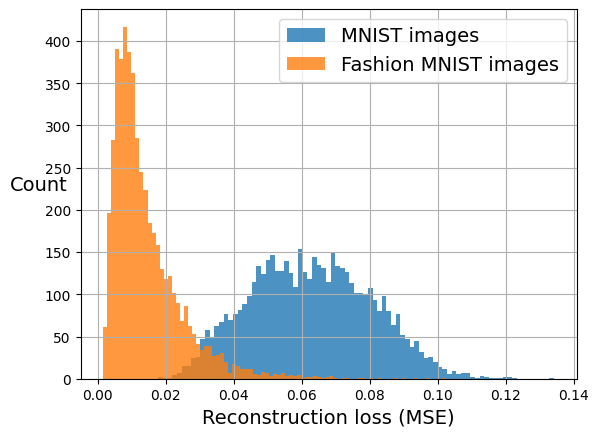

(가로축: 이미지 한 장의 재구성 MSE. 세로축: 이미지 수. 주황 = 패션 MNIST 검증 이미지, 파랑 = MNIST 숫자)

**결과 해석**

- 패션 MNIST는 대부분 MSE 0.03 아래(봉우리 약 0.01)에 몰려 있고, MNIST는 0.03 ~ 0.12에 넓게 퍼져 있다(봉우리 약 0.06)
- 예를 들어 임곗값을 0.03 ~ 0.04 근처로 잡으면 MNIST 숫자 대부분을 **이상치**로 걸러낼 수 있다. 겹치는 구간이 있으므로 임곗값은 정밀도·재현율의 절충이다([3장](03_classification.md))
- 이 방법은 이상치 레이블 없이 **정상 데이터만으로** 훈련한다는 점이 장점이다

> ⚠️ 노트북에는 `recon_loss`(MNIST 5,000장 전체의 평균 MSE)를 계산하는 셀이 있지만 출력이 저장돼 있지 않다. 히스토그램에서 MNIST 평균은 약 0.06, 패션 MNIST는 약 0.014(검증 RMSE 0.12의 제곱)다.

### 3-6. 패션 MNIST 데이터셋 시각화

> 🎯 **목적** — 오토인코더로 784 → 32차원으로 줄인 뒤 t-SNE로 2D까지 줄여 데이터셋 전체의 지도를 그린다.

**개념·원리**

오토인코더 혼자 2D까지 줄이면 품질이 나쁘다(7-7절 보충의 2D AE 참고). 대신 **오토인코더로 적당히(32차원) 줄이고, t-SNE로 마무리**한다. t-SNE는 784차원보다 32차원에서 훨씬 빠르고, 오토인코더가 잡음을 걸러 준 코딩에서 군집이 더 잘 드러난다.

**코드**

```python
from sklearn.manifold import TSNE

with torch.no_grad():
    X_valid_compressed = stacked_encoder(X_valid.to(device))   # [5000, 32]

tsne = TSNE(init="pca", learning_rate="auto", random_state=42)
X_valid_2D = tsne.fit_transform(X_valid_compressed.cpu())       # [5000, 2]

y_valid = torch.tensor([y for _, y in valid_data])
plt.scatter(X_valid_2D[:, 0], X_valid_2D[:, 1], c=y_valid, s=10, cmap="tab10")
plt.show()
```

| 코드 | 의미 |
|---|---|
| `stacked_encoder(...)` | 학습한 **인코더만** 써서 32차원 코딩을 얻는다 |
| `TSNE(init="pca", learning_rate="auto")` | [7장 t-SNE](07_dimensionality_reduction.md#6-다른-차원-축소-기법-76). PCA로 초기화하면 결과가 안정적이고, 학습률은 데이터 크기에 맞춰 자동 |
| `c=y_valid, cmap="tab10"` | 레이블은 **색칠에만** 쓴다(훈련에는 안 썼다) |

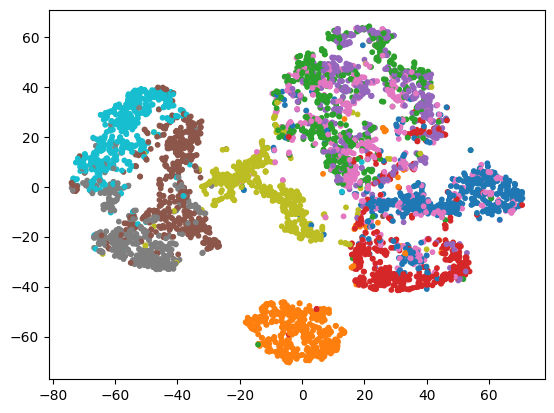

(점 하나 = 검증 이미지 하나의 32차원 코딩을 t-SNE로 2D에 놓은 것. 색 = 클래스: 파랑 티셔츠, 주황 바지, 초록 풀오버, 빨강 드레스, 보라 코트, 갈색 샌들, 분홍 셔츠, 회색 운동화, 올리브 가방, 하늘색 앵클 부츠)

노트북은 이 그림에 실제 이미지를 얹어 더 읽기 쉽게 만든다(사이킷런 예제를 응용).

```python
# extra code – beautifies the previous diagram for the book
import matplotlib as mpl

plt.figure(figsize=(10, 8))
cmap = plt.cm.tab10
Z = X_valid_2D
Z = (Z - Z.min()) / (Z.max() - Z.min())  # normalize to the 0-1 range
plt.scatter(Z[:, 0], Z[:, 1], c=y_valid, s=10, cmap=cmap)
image_positions = np.array([[1., 1.]])
for index, position in enumerate(Z):
    dist = ((position - image_positions) ** 2).sum(axis=1)
    if dist.min() > 0.02: # if far enough from other images
        image_positions = np.r_[image_positions, [position]]
        imagebox = mpl.offsetbox.AnnotationBbox(
            mpl.offsetbox.OffsetImage(X_valid[index].squeeze(dim=0),
                                      cmap="binary"),
            position, bboxprops={"edgecolor": cmap(y_valid[index]), "lw": 2})
        plt.gca().add_artist(imagebox)
plt.axis("off")
plt.show()
```

| 코드 | 의미 |
|---|---|
| `(Z - Z.min()) / (Z.max() - Z.min())` | 좌표를 0 ~ 1로 정규화 (거리 임곗값 0.02를 쓰기 위해) |
| `dist.min() > 0.02` | 이미 얹은 이미지들과 충분히 떨어진 점에만 이미지를 얹는다(겹침 방지) |
| `AnnotationBbox(OffsetImage(...), position, bboxprops=...)` | 지정한 위치에 작은 이미지를 테두리 색(클래스 색)과 함께 그린다 |

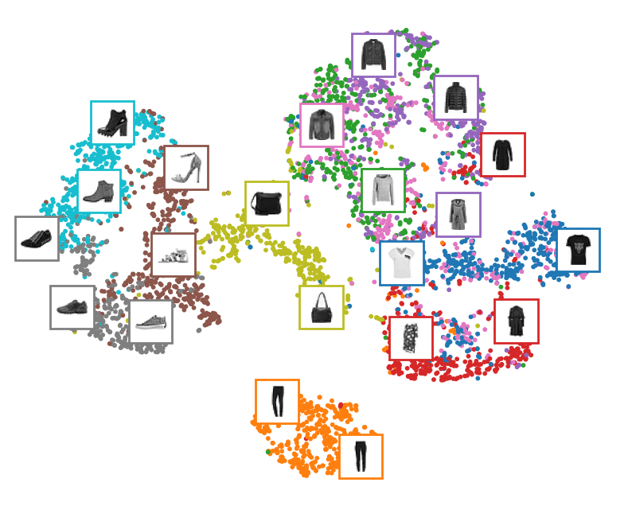

(위 산점도에 대표 이미지를 얹은 것. 테두리 색 = 클래스 색)

**결과 해석**

- **바지**(주황)는 아래쪽에 따로 떨어진 섬이다 — 다른 옷과 모양이 완전히 다르다
- 왼쪽에 **신발류**(샌들·운동화·앵클 부츠)가 모여 있고, 그 사이에 **가방**(올리브)이 다리처럼 놓여 있다
- 오른쪽 위의 **상의**(티셔츠·풀오버·코트·셔츠·드레스)는 서로 많이 겹친다 → 이 클래스들은 분류기도 자주 헷갈린다([10장](10_neural_nets_with_pytorch.md)의 패션 MNIST 오류와 같은 패턴)
- 레이블 없이 훈련한 오토인코더의 코딩만으로 클래스 구조가 상당 부분 드러난다 → 코딩이 **의미 있는 표현**이다

### 3-7. 가중치 묶기

> 🎯 **목적** — 디코더 가중치를 인코더 가중치의 전치로 **공유**해 파라미터를 절반으로 줄인다.

**개념·원리**

대칭 오토인코더에서 디코더의 $i$번째 층 가중치를 인코더의 대응하는 층 가중치의 **전치**로 둔다.

$$
W_{\text{dec}, L-i+1} = W_{\text{enc}, i}^\top \qquad (\text{편향은 따로 둔다})
$$

- 파라미터가 거의 절반 → 훈련이 빠르고 과대적합 위험이 줄어든다
- 디코더가 인코더의 "거꾸로"가 되도록 구조적으로 강제하는 일종의 **규제**

**코드**

```python
import torch.nn.functional as F

class TiedAutoencoder(nn.Module):
    def __init__(self):
        super().__init__()
        self.enc1 = nn.Linear(1 * 28 * 28, 128)
        self.enc2 = nn.Linear(128, 32)
        self.dec1_bias = nn.Parameter(torch.zeros(128))
        self.dec2_bias = nn.Parameter(torch.zeros(1 * 28 * 28))

    def encode(self, X):
        Z = X.view(-1, 1 * 28 * 28)  # flatten
        Z = F.relu(self.enc1(Z))
        return F.relu(self.enc2(Z))

    def decode(self, X):
        Z = F.relu(F.linear(X, self.enc2.weight.t(), self.dec1_bias))
        Z = F.sigmoid(F.linear(Z, self.enc1.weight.t(), self.dec2_bias))
        return Z.view(-1, 1, 28, 28)  # unflatten

    def forward(self, X):
        return self.decode(self.encode(X))

tied_ae = TiedAutoencoder().to(device)
optimizer = torch.optim.NAdam(tied_ae.parameters(), lr=0.01)
history = train(tied_ae, optimizer, mse, rmse, train_loader, valid_loader, n_epochs=10)
# Epoch 1/10,   train loss: 0.0229, train metric: 0.151, valid metric: 0.137
# Epoch 2/10,   train loss: 0.0174, train metric: 0.132, valid metric: 0.132
# ...
# Epoch 5/10,   train loss: 0.0140, train metric: 0.119, valid metric: 0.121
# ...
# Epoch 10/10,  train loss: 0.0124, train metric: 0.112, valid metric: 0.112

plot_reconstructions(tied_ae, X_valid)   # extra code
plt.show()
```

| 코드 | 의미 |
|---|---|
| `self.enc1 = nn.Linear(784, 128)` | 인코더 층만 `nn.Linear`로 만든다. 가중치 `enc1.weight`의 형태는 `[128, 784]`(출력 × 입력) |
| `nn.Parameter(torch.zeros(128))` | 디코더는 **편향만** 따로 학습한다. `nn.Parameter`로 감싸야 `parameters()`에 포함되어 옵티마이저가 업데이트한다 |
| `F.linear(X, W, b)` | $XW^\top + b$. `nn.Linear` 없이 가중치를 직접 넘기는 함수형 버전 |
| `self.enc2.weight.t()` | `[32, 128]` → `[128, 32]`. `F.linear`가 다시 전치하므로 결국 $X \cdot W_{\text{enc2}}$ — 32 → 128로 되돌린다 |
| `X.view(-1, 784)` / `Z.view(-1, 1, 28, 28)` | `Flatten`·`Unflatten` 대신 직접 형태를 바꾼다 |
| `encode()`·`decode()` 메서드 | 코딩만 뽑거나 코딩에서 이미지를 만들 때 따로 부를 수 있다 |

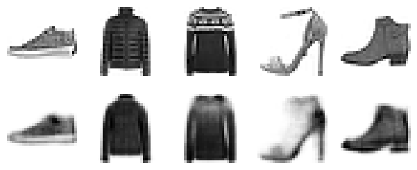

(윗줄: 원본, 아랫줄: 가중치를 묶은 오토인코더의 재구성. 3-4절보다 스웨터 무늬가 조금 더 살아 있다)

**결과 해석**

| | 적층 오토인코더 | 가중치 묶기 |
|---|---|---|
| 파라미터 | 209,968 | **105,520** (보충 계산: 인코더 104,608 + 디코더 편향 912) |
| 검증 RMSE (10에포크) | 0.120 | **0.112** |

- 파라미터가 절반인데 오히려 더 좋다. 묶인 가중치는 인코더·디코더 양쪽에서 그레이디언트를 받아 더 잘 훈련되고, 규제 효과도 있다

> ⚠️ 가중치를 묶을 때 `nn.Linear` 디코더 층을 만들고 `decoder.weight = encoder.weight` 같은 식으로 대입하면 **형태가 맞지 않는다**(`[128, 784]` vs `[784, 128]`). 위처럼 `F.linear`에 `.t()`를 넘기는 방식이 간단하다.

### 3-8. 오토인코더를 사용한 비지도 사전 훈련

> 🎯 **목적** — 레이블이 적을 때 오토인코더로 표현을 먼저 배우고 분류기에 재사용하는 방법을 정리한다.

> ⚠️ 노트북에는 이 소절의 코드가 없다. 아래는 교재 절 내용을 정리한 것이다.

**개념·원리**

[11장의 비지도 사전 훈련](11_training_deep_neural_networks.md#2-6-비지도-사전-훈련과-보조-작업-사전-훈련)을 오토인코더로 하는 구체적인 방법이다.

```
① 레이블 없는 데이터 전체(예: 6만 장)로 적층 오토인코더를 훈련
② 인코더(784 → 128 → 32)를 떼어 낸다
③ 인코더 위에 분류 층(32 → 10)을 붙인다
④ 레이블 있는 소량의 데이터(예: 500장)로 훈련
   - 처음에는 인코더를 동결(requires_grad_(False))하고 분류 층만
   - 그다음 전체를 작은 학습률로 미세 튜닝
```

- 인코더는 이미 "옷의 모양"을 압축하는 법을 배웠으므로, 적은 레이블로도 분류를 잘 배운다
- 예전(2006 ~ 2010년)에는 깊은 네트워크를 한 번에 훈련하기 어려워, 얕은 오토인코더를 **한 층씩** 훈련해 쌓는 방식(탐욕적 층별 훈련)을 썼다. 지금은 ReLU·좋은 초기화·배치 정규화 덕분에 전체를 한 번에 훈련한다
- 오늘날 같은 아이디어의 대규모 버전이 [15장 BERT](15_transformers_for_nlp_and_chatbots.md)(텍스트)와 [16장 MAE](16_vision_and_multimodal_transformers.md)(이미지)의 자기 지도 사전 훈련이다

---

## 4. 합성곱 오토인코더 (18.4)

> 🎯 **목적** — 이미지에 맞는 합성곱 층으로 오토인코더를 만들어 더 적은 파라미터로 더 좋은 재구성을 얻는다.

> 💬 **줄였다가 다시 늘린다: 풀링으로 줄이고, 전치 합성곱으로 늘린다**
>
> 인코더는 [12장 CNN](12_deep_computer_vision_with_cnns.md)처럼 합성곱으로 특성을 뽑고 풀링으로 공간 크기를 줄인다(28 → 14 → 7 → 3 → 1). 디코더는 반대로 **전치 합성곱**(`ConvTranspose2d`)으로 공간 크기를 키운다(3 → 7 → 14 → 28).
>
> - 공간 크기는 줄고 채널(특성 맵) 수는 늘었다가, 마지막에 32차원 코딩으로 모인다
> - **헷갈림 주의**: 전치 합성곱은 합성곱의 "역연산"이 아니다. 출력이 커지는 합성곱(입력 사이에 0을 끼워 넣고 합성곱)일 뿐이고, 가중치는 따로 학습한다

### 4-1. 합성곱 인코더와 전치 합성곱 디코더

> 🎯 **목적** — 합성곱 오토인코더의 층 구성과 각 층의 출력 형태를 따라간다.

**코드**

```python
torch.manual_seed(42)  # extra code – ensures reproducibility

conv_encoder = nn.Sequential(
    nn.Conv2d(1, 16, kernel_size=3, padding="same"), nn.ReLU(),
    nn.MaxPool2d(kernel_size=2),  # output: 16 × 14 × 14
    nn.Conv2d(16, 32, kernel_size=3, padding="same"), nn.ReLU(),
    nn.MaxPool2d(kernel_size=2),  # output: 32 × 7 × 7
    nn.Conv2d(32, 64, kernel_size=3, padding="same"), nn.ReLU(),
    nn.MaxPool2d(kernel_size=2),  # output: 64 × 3 × 3
    nn.Conv2d(64, 32, kernel_size=3, padding="same"), nn.ReLU(),
    nn.AdaptiveAvgPool2d((1, 1)), nn.Flatten())  # output: 32

conv_decoder = nn.Sequential(
    nn.Linear(32, 16 * 3 * 3),
    nn.Unflatten(dim=1, unflattened_size=(16, 3, 3)),
    nn.ConvTranspose2d(16, 32, kernel_size=3, stride=2), nn.ReLU(),
    nn.ConvTranspose2d(32, 16, kernel_size=3, stride=2, padding=1,
                       output_padding=1), nn.ReLU(),
    nn.ConvTranspose2d(16, 1, kernel_size=3, stride=2, padding=1,
                       output_padding=1), nn.Sigmoid())

conv_ae = nn.Sequential(conv_encoder, conv_decoder).to(device)
```

보충으로 층마다 출력 형태를 찍어 보면 다음과 같다(배치 크기 생략).

```
인코더                                         디코더
Conv2d(1→16, same)     [16, 28, 28]           Linear(32→144)                 [144]
MaxPool2d(2)           [16, 14, 14]           Unflatten                      [16, 3, 3]
Conv2d(16→32, same)    [32, 14, 14]           ConvTranspose2d(s=2)           [32, 7, 7]
MaxPool2d(2)           [32, 7, 7]             ConvTranspose2d(s=2, p=1, op=1) [16, 14, 14]
Conv2d(32→64, same)    [64, 7, 7]             ConvTranspose2d(s=2, p=1, op=1) [1, 28, 28]
MaxPool2d(2)           [64, 3, 3]   ← 7 // 2 = 3
Conv2d(64→32, same)    [32, 3, 3]
AdaptiveAvgPool2d(1)   [32, 1, 1]
Flatten                [32]          ← 코딩
```

| 코드 | 의미 |
|---|---|
| `padding="same"` | 출력 크기 = 입력 크기 (스트라이드 1일 때) |
| `nn.MaxPool2d(kernel_size=2)` | 크기를 절반으로. 홀수면 내림(7 → 3) |
| `nn.AdaptiveAvgPool2d((1, 1))` | 크기에 상관없이 채널마다 평균 하나 → **전역 평균 풀링**([12장](12_deep_computer_vision_with_cnns.md)) |
| `nn.Linear(32, 16 * 3 * 3)` + `Unflatten` | 코딩 32개를 작은 특성 맵 `[16, 3, 3]`으로 펼친다 |
| `nn.ConvTranspose2d(16, 32, 3, stride=2)` | 출력 크기 $= (H_{\text{in}} - 1) \times s - 2p + k + \text{op} = (3-1) \times 2 + 3 = 7$ |
| `padding=1, output_padding=1` | $(7-1) \times 2 - 2 + 3 + 1 = 14$, $(14-1) \times 2 - 2 + 3 + 1 = 28$. `output_padding`은 스트라이드 때문에 생기는 크기 모호함(13이냐 14냐)을 정해 준다 |

| 부분 | 파라미터 (보충 계산) |
|---|---|
| 인코더 | 41,760 |
| 디코더 | 14,161 |
| 합계 | **55,921** (적층 오토인코더 209,968의 약 1/4) |

### 4-2. 훈련과 재구성

> 🎯 **목적** — 합성곱 오토인코더를 훈련하고 적층 오토인코더와 비교한다.

**코드**

```python
optimizer = torch.optim.NAdam(conv_ae.parameters(), lr=0.005)
history = train(conv_ae, optimizer, mse, rmse, train_loader, valid_loader,
                n_epochs=10)
# Epoch 1/10,   train loss: 0.0291, train metric: 0.171, valid metric: 0.137
# Epoch 2/10,   train loss: 0.0173, train metric: 0.132, valid metric: 0.127
# Epoch 3/10,   train loss: 0.0150, train metric: 0.123, valid metric: 0.12
# ...
# Epoch 10/10,  train loss: 0.0113, train metric: 0.106, valid metric: 0.107

plot_reconstructions(conv_ae, X_valid)   # extra code – shows the reconstructions
plt.show()
```

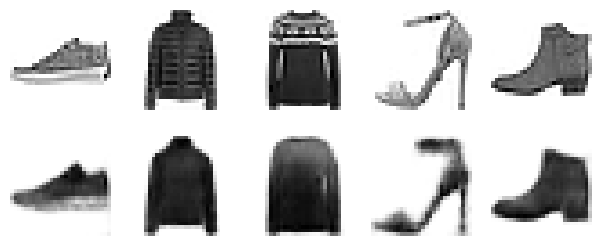

(윗줄: 원본, 아랫줄: 합성곱 오토인코더의 재구성. 샌들의 굽과 끈, 운동화의 밑창 경계가 더 또렷하다)

**결과 해석**

- 파라미터는 1/4인데 검증 RMSE는 **0.107**로 적층(0.120)·가중치 묶기(0.112)보다 좋다
- 합성곱은 가까운 픽셀끼리의 관계(지역성)와 위치에 상관없는 패턴(가중치 공유)을 구조에 담고 있어, 같은 파라미터로 이미지를 더 잘 다룬다

### 4-3. 보충 자료: 순환 오토인코더

> 🎯 **목적** — 노트북의 보충 자료(Extra Material)인 LSTM 오토인코더로, 시퀀스용 오토인코더의 구조를 익힌다.

**개념·원리**

이미지의 각 **행**(28픽셀)을 타임 스텝 하나로 보면, 28 × 28 이미지는 길이 28의 시퀀스(각 원소 28차원)다. 인코더 RNN이 시퀀스 전체를 읽어 마지막 은닉 상태를 코딩으로 쓰고, 디코더 RNN이 그 코딩을 매 타임 스텝 입력으로 받아 행을 하나씩 출력한다 — [14장](14_nlp_with_rnns_and_attention.md)의 인코더–디코더와 같은 구조다.

**코드**

```python
class RecurrentAutoencoder(nn.Module):
    def __init__(self):
        super().__init__()
        self.encoder_lstm = nn.LSTM(input_size=28, hidden_size=128,
                                    num_layers=2, batch_first=True)
        self.encoder_proj = nn.Linear(128, 32)  # Compress to latent vector
        self.decoder_lstm = nn.LSTM(input_size=32, hidden_size=128,
                                    batch_first=True)
        self.decoder_proj = nn.Linear(128, 28)

    def encode(self, X):  # X shape: [B, 1, 28, 28]
        Z = X.squeeze(dim=1)  # Z shape: [B, 28, 28]
        _, (h_n, _) = self.encoder_lstm(Z)  # h_n shape: [2, B, 100]
        Z = h_n[-1]  # get the hidden state of the last layer: [B, 100]
        return self.encoder_proj(Z)  # [B, 30]

    def decode(self, X):
        Z = X.unsqueeze(dim=1).repeat(1, 28, 1)  # [B, 28, 32]
        Z, _ = self.decoder_lstm(Z)  # [B, 28, 100]
        return F.sigmoid(self.decoder_proj(Z).unsqueeze(dim=1)) # [B, 1, 28, 28]

    def forward(self, X):
        return self.decode(self.encode(X))

torch.manual_seed(42)
recurrent_ae = RecurrentAutoencoder().to(device)
optimizer = torch.optim.NAdam(recurrent_ae.parameters(), lr=1e-3)
history = train(recurrent_ae, optimizer, mse, rmse, train_loader, valid_loader,
                n_epochs=10)
# Epoch 1/10,   train loss: 0.0526, train metric: 0.229, valid metric: 0.181
# ...
# Epoch 10/10,  train loss: 0.0118, train metric: 0.109, valid metric: 0.109
```

| 코드 | 의미 |
|---|---|
| `X.squeeze(dim=1)` | `[B, 1, 28, 28]` → `[B, 28, 28]` = (배치, 타임 스텝 28개, 특성 28개) |
| `nn.LSTM(28, 128, num_layers=2, batch_first=True)` | 2층 LSTM([13장](13_processing_sequences_using_rnns_and_cnns.md)). `h_n`의 형태는 `[층 수 2, B, 128]` |
| `h_n[-1]` | 마지막 층의 마지막 은닉 상태 `[B, 128]` → `Linear(128, 32)`로 코딩 |
| `X.unsqueeze(dim=1).repeat(1, 28, 1)` | 코딩 `[B, 32]`를 28번 복사해 `[B, 28, 32]` → 디코더가 **매 스텝 같은 코딩**을 입력받는다 |
| `self.decoder_proj(Z)` | 스텝마다 `[128]` → `[28]` = 이미지의 한 행. `unsqueeze(1)`로 `[B, 1, 28, 28]` |

> ⚠️ 노트북의 주석 `[B, 100]`, `[B, 30]`은 예전 설정의 흔적이다. 실제로는 은닉 크기 **128**, 코딩 **32**다. 파라미터는 보충 계산으로 303,676개.

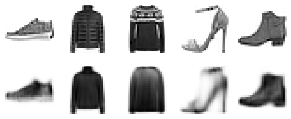

(윗줄: 원본, 아랫줄: LSTM 오토인코더의 재구성. 위아래 방향으로 번진 듯한 줄무늬가 보인다 — 행 단위로 순서대로 만들기 때문)

**결과 해석**

- 검증 RMSE **0.109**로 합성곱(0.107)과 비슷하지만 파라미터는 5배 이상(303,676)이고 훈련이 느리다
- 이미지는 합성곱이 자연스럽다. 순환 오토인코더는 **진짜 시퀀스**(시계열, 문장)를 고정 크기 벡터로 압축할 때 쓴다

---

## 5. 잡음 제거 오토인코더 (18.5)

> 🎯 **목적** — 입력을 일부러 망가뜨리고 깨끗한 원본을 복원하게 해서, 코딩 층이 크더라도 쓸모 있는 특성을 배우게 한다.

> 💬 **지우개로 일부를 지운 그림을 보고 원래 그림을 그리게 한다**
>
> 입력에 잡음을 넣으면 "그대로 베끼기"가 불가능하다. 지워진 부분을 채우려면 **옷이 원래 어떻게 생겼는지** 알아야 한다.
>
> - 손상 방법: **드롭아웃**(픽셀 일부를 0으로) 또는 **가우스 잡음**(모든 픽셀에 정규분포 잡음)
> - 손상은 **훈련 때만** 한다. 추론 때는 깨끗한 입력을 그대로 넣는다(드롭아웃과 같다)
> - **헷갈림 주의**: 타깃은 손상된 입력이 아니라 **원래 깨끗한 입력**이다. 코드에서는 손상 층을 인코더 안에 넣었으므로 `AutoencoderDataset`의 타깃(원본)은 그대로 두면 된다

### 5-1. 드롭아웃으로 입력 손상시키기

> 🎯 **목적** — 인코더 맨 앞에 `nn.Dropout(0.5)`를 넣어 입력 픽셀의 절반을 지운다.

**코드**

```python
torch.manual_seed(42)  # extra code – ensures reproducibility

dropout_encoder = nn.Sequential(
    nn.Flatten(),
    nn.Dropout(0.5),                          # 입력 손상 (훈련 때만)
    nn.Linear(1 * 28 * 28, 128), nn.ReLU(),
    nn.Linear(128, 128), nn.ReLU(),
)
dropout_decoder = nn.Sequential(
    nn.Linear(128, 128), nn.ReLU(),
    nn.Linear(128, 1 * 28 * 28), nn.Sigmoid(),
    nn.Unflatten(dim=1, unflattened_size=(1, 28, 28))
)
dropout_ae = nn.Sequential(dropout_encoder, dropout_decoder).to(device)

optimizer = torch.optim.NAdam(dropout_ae.parameters(), lr=0.01)
history = train(dropout_ae, optimizer, mse, rmse, train_loader, valid_loader,
                n_epochs=10)
# Epoch 1/10,   train loss: 0.0279, train metric: 0.167, valid metric: 0.148
# ...
# Epoch 10/10,  train loss: 0.0186, train metric: 0.136, valid metric: 0.131
```

```python
# extra code – this cell generates Figure 18–9
torch.manual_seed(42)
dropout = nn.Dropout(0.5)
plot_reconstructions(dropout_ae, dropout(X_valid))
plt.show()
```

| 코드 | 의미 |
|---|---|
| `nn.Dropout(0.5)` (인코더 안) | 훈련 모드에서 입력 픽셀의 50%를 0으로 만들고, 나머지는 2배(= 1 / (1 − 0.5))로 키운다 ([11장 드롭아웃](11_training_deep_neural_networks.md#5-2-드롭아웃)) |
| 코딩 128 | 이번에는 코딩 층이 128로 크다(784보다는 작다). 잡음이 있어 128로도 그대로 베낄 수 없다 |
| `dropout(X_valid)` | 그림을 위해 따로 만든 드롭아웃 층으로 검증 이미지를 손상시킨다. 새로 만든 층은 **훈련 모드**라 실제로 지워진다. 모델은 훈련이 끝난 뒤 `evaluate_tm()`이 `eval()`로 바꿔 놓았으므로 모델 안의 드롭아웃은 꺼져 있다 |

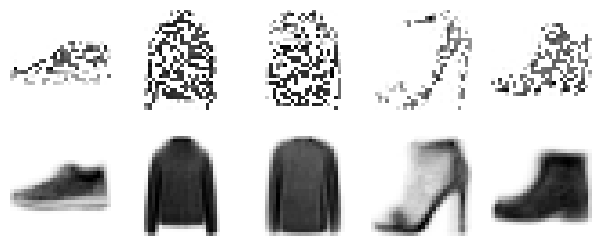

(윗줄: 픽셀 절반을 지우고 나머지를 2배로 키운 입력 — 그래서 남은 픽셀이 더 진하다. 아랫줄: 잡음 제거 오토인코더의 출력. 구멍이 메워진 깨끗한 옷이 나온다)

**결과 해석**

- 반이 지워진 입력에서도 운동화·점퍼·스웨터·샌들·부츠의 형태를 복원했다. 다만 세부 무늬는 없다
- 검증 RMSE 0.131은 **깨끗한 입력**을 넣었을 때의 값이다(검증 땐 드롭아웃이 꺼진다). 3-3절(0.120)보다 조금 나쁜데, 훈련 내내 망가진 입력만 봤기 때문이다

### 5-2. 가우스 잡음으로 입력 손상시키기

> 🎯 **목적** — 드롭아웃 대신 표준 편차 0.5의 가우스 잡음을 더하는 사용자 정의 층을 만든다.

**코드**

```python
class GaussianNoise(nn.Module):
    def __init__(self, std):
        super().__init__()
        self.std = std

    def forward(self, X):
        if self.training:  # only add noise during training
            noise = torch.randn_like(X) * self.std
            return X + noise
        return X
```

```python
torch.manual_seed(42)  # extra code – ensures reproducibility

noise_encoder = nn.Sequential(
    nn.Flatten(),
    GaussianNoise(0.5),
    nn.Linear(1 * 28 * 28, 128), nn.ReLU(),
    nn.Linear(128, 128), nn.ReLU(),
)
noise_decoder = nn.Sequential(
    nn.Linear(128, 128), nn.ReLU(),
    nn.Linear(128, 1 * 28 * 28), nn.Sigmoid(),
    nn.Unflatten(dim=1, unflattened_size=(1, 28, 28))
)
noise_ae = nn.Sequential(noise_encoder, noise_decoder).to(device)

optimizer = torch.optim.NAdam(noise_ae.parameters(), lr=0.01)
history = train(noise_ae, optimizer, mse, rmse, train_loader, valid_loader,
                n_epochs=10)
# Epoch 1/10,   train loss: 0.0290, train metric: 0.17, valid metric: 0.15
# ...
# Epoch 10/10,  train loss: 0.0194, train metric: 0.139, valid metric: 0.132

# extra code
torch.manual_seed(42)
noise = GaussianNoise(0.5)
plot_reconstructions(noise_ae, noise(X_valid))
plt.show()
```

| 코드 | 의미 |
|---|---|
| `self.training` | `nn.Module`의 플래그. `model.train()`이면 `True`, `model.eval()`이면 `False`. 이 값으로 훈련 때만 잡음을 더한다 |
| `torch.randn_like(X) * self.std` | `X`와 같은 형태·장치·자료형의 표준 정규 잡음 × 0.5 |
| `GaussianNoise(0.5)` (인코더 안) | 픽셀 값(0 ~ 1)에 비해 아주 강한 잡음(표준 편차 0.5) |

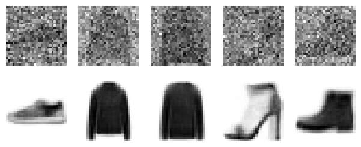

(윗줄: 표준 편차 0.5의 잡음을 더한 입력 — 사람 눈으로도 무엇인지 알아보기 어렵다. 아랫줄: 출력. 운동화·점퍼·스웨터·샌들·부츠가 깨끗하게 복원됐다)

**결과 해석**

- 사람도 알아보기 힘든 입력에서 옷의 모양을 되살렸다. 모델이 "패션 MNIST 이미지가 사는 곳(매니폴드)"을 배웠기 때문이다 — 잡음 낀 입력을 그 매니폴드 위의 가장 가까운 점으로 끌어당긴다
- 이 "잡음을 걷어 내는" 능력을 극단까지 밀고 간 것이 9절의 **확산 모델**이다

### 5-3. 보충 코드: 잡음 낀 입력을 정말 복원하나

> 🎯 **목적** — 손상 층이 없는 보통 오토인코더와 가우스 잡음 제거 오토인코더에 똑같이 잡음 낀 검증 이미지를 넣고, **깨끗한 원본**과의 RMSE를 비교한다.

**보충 코드**

```python
# 보충 코드: 5-2절과 같은 구조(코딩 128)를 GaussianNoise 있이/없이 CPU에서 10에포크씩 훈련
torch.manual_seed(0)
noisy = X_valid + 0.5 * torch.randn_like(X_valid)       # 검증 이미지에 잡음
for name, model in [("plain", plain_ae), ("denoising", noise_ae)]:
    model.eval()
    with torch.no_grad():
        clean_rmse = F.mse_loss(model(X_valid), X_valid).item() ** 0.5   # 깨끗한 입력 → 원본
        noisy_rmse = F.mse_loss(model(noisy), X_valid).item() ** 0.5     # 잡음 입력 → 원본
# plain     : 깨끗한 입력 0.133, 잡음 입력 0.198
# denoising : 깨끗한 입력 0.150, 잡음 입력 0.157
# (참고) 잡음 입력 자체와 원본의 RMSE: 0.500
```

**결과 해석**

| 모델 | 깨끗한 입력 → 원본 RMSE | 잡음 입력(σ = 0.5) → 원본 RMSE |
|---|---|---|
| 보통 오토인코더 | 0.133 | 0.198 |
| 잡음 제거 오토인코더 | 0.150 | **0.157** |

- 깨끗한 입력에서는 보통 오토인코더가 조금 낫다(잡음 없이 훈련했으니까)
- 잡음 입력에서는 잡음 제거 오토인코더가 훨씬 낫다. 보통 오토인코더는 잡음도 "입력의 일부"로 보고 재구성하려 한다
- 잡음 제거 오토인코더의 잡음 입력 결과(0.157)가 깨끗한 입력 결과(0.150)와 거의 같다 → 잡음을 대부분 무시하는 법을 배웠다. 잡음 입력 자체는 원본과 RMSE 0.500만큼 다르니, 잡음의 약 70%를 걷어 낸 셈이다(0.500 → 0.157)

> ⚠️ 보충 훈련은 CPU에서 학습률 스케줄러 없이(`NAdam(lr=0.01)` 고정) 10에포크 돌렸다. 그래서 잡음 제거 오토인코더의 깨끗한 입력 RMSE가 노트북(0.132)보다 조금 높다. 비교의 요점(잡음 입력에서의 차이)은 그대로다.

---

## 6. 희소 오토인코더 (18.6)

> 🎯 **목적** — 코딩 층의 유닛 대부분이 꺼져 있도록 손실을 더해, 각 유닛이 뚜렷한 특성 하나를 담당하게 한다.

> 💬 **전문가 256명 중 열 명 남짓만 손을 들게 한다**
>
> 코딩 층을 크게(256) 두되, 이미지 하나에 대해 **약 10%의 유닛만** 활성화되도록 강제한다. 그러면 각 유닛은 "신발 앞코", "긴 소매"처럼 **특정한 특성**을 담당하는 전문가가 된다.
>
> - 방법 ①: 코딩 활성화에 ℓ1 규제 (활성화의 절댓값 합)
> - 방법 ②(이 노트북): 유닛별 **평균 활성화**와 목표 희소도 $p$의 **KL 발산**을 손실에 더한다
> - **헷갈림 주의**: "희소"는 가중치가 아니라 **코딩(활성화)** 이 희소하다는 뜻이다. 또 개별 이미지가 아니라 배치 전체의 **평균 활성화**를 목표에 맞춘다

### 6-1. 희소성 손실: KL 발산

> 🎯 **목적** — 목표 희소도와 실제 희소도의 차이를 KL 발산으로 재는 이유를 이해한다.

**개념·원리**

시그모이드 코딩 유닛 $j$의 배치 평균 활성화 $q_j$를 "켜질 확률"로 보고, 목표 희소도 $p$(예: 0.1)와 비교한다. 두 베르누이 분포 사이의 KL 발산은

$$
D_{\text{KL}}(p \,\|\, q_j) = p \log\frac{p}{q_j} + (1-p)\log\frac{1-p}{1-q_j}
$$

전체 손실 = 재구성 MSE + $\lambda \sum_j D_{\text{KL}}(p \,\|\, q_j)$ (λ = `kl_weight`)

**코드**

```python
from collections import namedtuple

AEOutput = namedtuple("AEOutput", ["output", "codings"])

class SparseAutoencoder(nn.Module):
    def __init__(self):
        super().__init__()
        self.encoder = nn.Sequential(
            nn.Flatten(),
            nn.Linear(1 * 28 * 28, 128), nn.ReLU(),
            nn.Linear(128, 256), nn.Sigmoid())          # 코딩 256개, 0 ~ 1
        self.decoder = nn.Sequential(
            nn.Linear(256, 128), nn.ReLU(),
            nn.Linear(128, 1 * 28 * 28), nn.Sigmoid(),
            nn.Unflatten(dim=1, unflattened_size=(1, 28, 28)))

    def forward(self, X):
        codings = self.encoder(X)
        output = self.decoder(codings)
        return AEOutput(output, codings)               # 재구성 + 코딩

def mse_plus_sparsity_loss(y_pred, y_target, target_sparsity=0.1,
                           kl_weight=1e-3, eps=1e-8):
    p = torch.tensor(target_sparsity, device=y_pred.codings.device)
    q = torch.clamp(y_pred.codings.mean(dim=0), eps, 1 - eps)  # actual sparsity
    kl_div = p * torch.log(p / q) + (1 - p) * torch.log((1 - p) / (1 - q))
    return mse(y_pred.output, y_target) + kl_weight * kl_div.sum()
```

| 코드 | 의미 |
|---|---|
| `namedtuple("AEOutput", ["output", "codings"])` | 이름으로 접근하는 튜플. `y_pred.output`, `y_pred.codings`. 0. 준비의 `train()`이 `.output`을 꺼내 지표에 쓴다 |
| `nn.Sigmoid()` (코딩 층) | 활성화를 0 ~ 1로 → "켜질 확률"로 해석 가능. 0이 될 수 없지만 0에 가깝게는 된다 |
| `codings.mean(dim=0)` | 배치 방향 평균 → 유닛 256개 각각의 **평균 활성화** $q_j$ |
| `torch.clamp(q, eps, 1 - eps)` | $\log 0$을 막는다 |
| `kl_div.sum()` | 유닛 256개의 KL을 더한다 |
| `kl_weight=1e-3` | 희소성 손실의 무게. 크면 희소해지지만 재구성이 나빠진다 |

```python
# extra code – this cell generates Figure 18–10
plt.figure(figsize=(6, 3.5))
p = 0.1
q = np.linspace(0.001, 0.999, 500)
kl_div = p * np.log(p / q) + (1 - p) * np.log((1 - p) / (1 - q))
mse_ = (p - q) ** 2
mae = np.abs(p - q)
plt.plot([p, p], [0, 0.3], "k:")
plt.text(0.05, 0.32, "Target\nsparsity $p$", fontsize=14)
plt.plot(q, kl_div, "b-", label="KL divergence")
plt.plot(q, mae, "g--", label=r"MAE ($\ell_1$)")
plt.plot(q, mse_, "r--", linewidth=1, label=r"MSE ($\ell_2$)")
plt.legend(loc="upper left", fontsize=14)
plt.xlabel("Actual sparsity $q$")
plt.ylabel("Cost", rotation=0)
plt.axis([0, 1, 0, 0.95])
plt.grid(True)
```

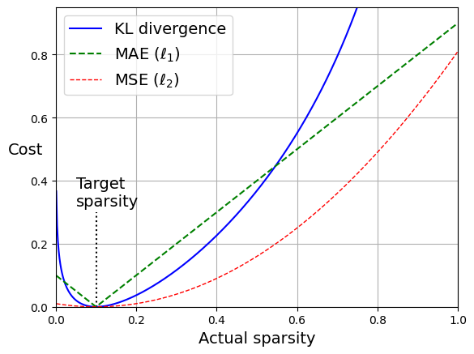

(가로축: 실제 평균 활성화 $q$, 세로축: 비용. 목표 $p$ = 0.1(점선)에서 세 손실 모두 0. 파랑 = KL 발산, 초록 = 절댓값 차이(MAE), 빨강 = 제곱 차이(MSE))

**결과 해석**

- MSE는 목표 근처에서 너무 평평해 $q$가 0.2, 0.3이어도 손실이 작다 → 희소도를 강하게 끌어내리지 못한다
- KL 발산은 $q$가 목표에서 멀어질수록(특히 1 쪽으로) **가파르게** 커지고, $q \to 0$ 쪽에서도 급격히 커진다 → 유닛이 완전히 죽는 것(항상 0)도 막는다
- 그래서 희소 오토인코더는 보통 KL 발산을 쓴다

### 6-2. 희소 오토인코더 훈련

> 🎯 **목적** — 목표 희소도 10%로 훈련하고 재구성을 본다.

**코드**

```python
torch.manual_seed(42)
sparse_ae = SparseAutoencoder().to(device)
optimizer = torch.optim.NAdam(sparse_ae.parameters(), lr=0.002)
history = train(sparse_ae, optimizer, mse_plus_sparsity_loss, rmse,
                train_loader, valid_loader, n_epochs=10)
# Epoch 1/10,   train loss: 0.0288, train metric: 0.166, valid metric: 0.134
# Epoch 2/10,   train loss: 0.0164, train metric: 0.125, valid metric: 0.119
# ...
# Epoch 5/10,   train loss: 0.0103, train metric: 0.0997, valid metric: 0.0991
# ...
# Epoch 10/10,  train loss: 0.0085, train metric: 0.0906, valid metric: 0.0911

plot_reconstructions(sparse_ae, X_valid)   # extra code – shows the reconstructions
plt.show()
```

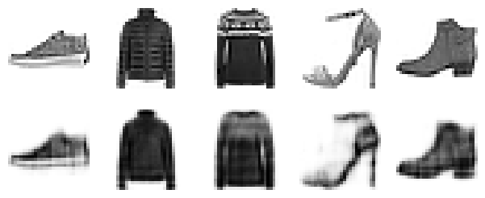

(윗줄: 원본, 아랫줄: 희소 오토인코더의 재구성. 스웨터 무늬와 샌들 끈 같은 세부가 이 장의 오토인코더 중 가장 잘 살아 있다)

**결과 해석**

- 검증 RMSE **0.0911**로 이 장의 오토인코더 중 가장 좋다. 코딩이 256개로 커서(적층의 8배) 담을 수 있는 정보가 많기 때문이다 — 코딩 크기가 다르니 공정한 비교는 아니다
- 훈련 손실(0.0085)에는 희소성 손실이 포함되어 있다. 지표(RMSE)는 재구성만 잰다

### 6-3. 코딩 분포와 해석 가능한 유닛

> 🎯 **목적** — 코딩 활성화가 정말 희소한지 확인하고, 유닛 하나가 무엇을 담당하는지 본다.

**코드**

```python
with torch.no_grad():
    y_pred = sparse_ae(X_valid.to(device))

encs = y_pred.codings.flatten().detach().cpu()
plt.hist(encs, log=True)
plt.xlabel("Activation")
plt.ylabel("Count")
plt.show()

y_pred.codings.mean()
# tensor(0.1016, device='cuda:0')
```

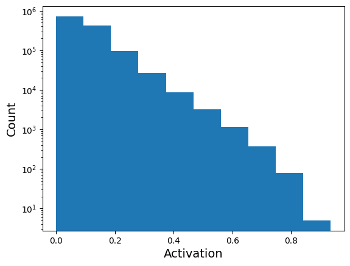

(검증 이미지 5,000장 × 코딩 256개 = 128만 개 활성화의 히스토그램. 세로축은 **로그 스케일**. 대부분이 0 ~ 0.1 구간에 있고, 값이 커질수록 개수가 10배씩 줄어든다)

```python
def plot_multiple_images(images, n_cols=None):
    n_cols = n_cols or len(images)
    n_rows = (len(images) - 1) // n_cols + 1
    plt.figure(figsize=(n_cols, n_rows))
    for index, image in enumerate(images):
        plt.subplot(n_rows, n_cols, index + 1)
        plot_image(image)

dim = 6
codings = y_pred.codings[:, dim].cpu()
threshold = np.percentile(codings, 90)
selected_images = X_valid[codings > threshold]
plot_multiple_images(selected_images[:35], 7)
plt.show()
```

| 코드 | 의미 |
|---|---|
| `plt.hist(encs, log=True)` | 세로축 로그 스케일. 대부분 0 근처라 선형 스케일이면 나머지가 안 보인다 |
| `y_pred.codings.mean()` | 전체 평균 활성화 **0.1016** ≈ 목표 0.1 |
| `plot_multiple_images(images, n_cols)` | 이미지 여러 장을 격자로 (이 장 내내 생성 결과를 그릴 때 쓴다) |
| `np.percentile(codings, 90)` | 6번 유닛 활성화의 상위 10% 경계 |
| `X_valid[codings > threshold]` | 6번 유닛이 **강하게 켜진** 이미지 500장 |

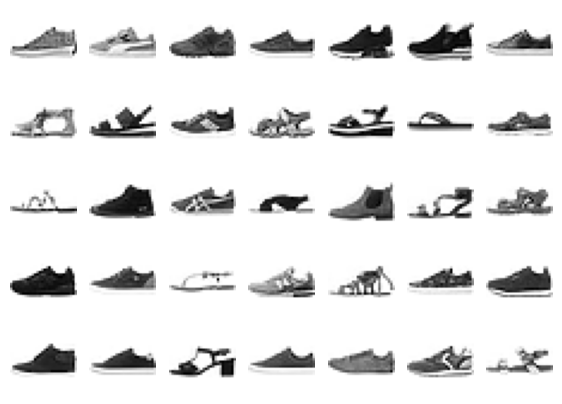

(6번 유닛 활성화가 상위 10%인 검증 이미지 35장. 모두 **신발**(운동화·샌들, 부츠 하나))

**결과 해석**

- 평균 활성화가 목표 희소도(0.1)에 거의 정확히 맞았다
- 6번 유닛은 "신발" 감지기 역할을 한다. 희소 오토인코더의 코딩은 이렇게 **사람이 해석할 수 있는** 경우가 많다
- 노트북 설명대로 단순한 MLP에서는 항상 이렇게 깔끔하지는 않고, 합성곱 모델에서 더 잘 된다

> 💡 최근에는 희소 오토인코더가 **대규모 언어 모델의 내부를 해석**하는 도구로 쓰인다. LLM의 은닉 상태를 수만 개 유닛의 희소 코딩으로 펼치면, 유닛 하나하나가 "특정 개념"에 대응하는 경우가 많아 모델이 무엇을 표현하는지 들여다볼 수 있다.

---

## 7. 변분 오토인코더 (18.7)

> 🎯 **목적** — 코딩을 확률 분포로 만들어, 디코더만으로 새 이미지를 **생성**할 수 있는 오토인코더를 만든다.

> 💬 **좌표 대신 "구름"을 출력하고, 구름들이 한 공책 안에 고르게 퍼지게 한다**
>
> 보통 오토인코더의 코딩은 아무 데나 흩어져 있어서, 무작위 점을 디코딩하면 엉뚱한 이미지가 나온다(7-7절 보충). VAE의 인코더는 코딩 하나가 아니라 **평균 μ와 표준 편차 σ**(정규분포 구름)를 출력하고, 그 구름에서 **샘플링한** 코딩을 디코딩한다. 그리고 모든 구름이 $\mathcal{N}(0, I)$ 근처에 모이도록 **잠재 손실**을 더한다.
>
> - 결과: 잠재 공간이 빈틈없이 매끄러워져 $\mathcal{N}(0, I)$에서 뽑은 **아무 점이나** 그럴듯한 이미지가 된다 → **생성 모델**
> - 샘플링은 미분할 수 없다 → $z = \mu + \sigma \odot \varepsilon$ (**재매개변수화 트릭**)으로 우회
> - **헷갈림 주의**: VAE는 "변분(variational)"이라는 이름처럼 **변분 추론**(복잡한 분포를 단순한 분포로 근사하는 방법)에서 왔다. 확률적(샘플링)이면서 생성적(새 샘플)인 오토인코더다

### 7-1. VAE의 원리

> 🎯 **목적** — VAE의 인코더 출력, 샘플링, 두 가지 손실을 수식으로 정리한다.

**개념·원리**

킹마와 웰링(2013)이 제안했다.

```
x ──인코더──> μ (32), γ = log σ² (32)
                │
                ▼  z = μ + exp(γ/2) ⊙ ε,  ε ~ N(0, I)    ← 재매개변수화 트릭
               z (32) ──디코더──> x̂
```

**손실 = 재구성 손실 + 잠재 손실**

| 손실 | 식 | 역할 |
|---|---|---|
| 재구성 손실 | $\lVert x - \hat{x} \rVert^2$ | 코딩에서 입력을 되살리게 한다 |
| 잠재 손실 | $D_{\text{KL}}\big(\mathcal{N}(\mu, \sigma^2) \parallel \mathcal{N}(0, I)\big) = -\frac{1}{2}\sum_{i=1}^{n}\left(1 + \gamma_i - e^{\gamma_i} - \mu_i^2\right)$ | 코딩 분포를 표준 정규분포 쪽으로 끌어당긴다 |

- 인코더가 σ 대신 **γ = log σ²** 를 출력하는 이유: σ는 양수여야 하지만 γ는 아무 실수나 될 수 있어 출력 층에 활성화 함수가 필요 없고, 수치적으로 안정적이다
- **재매개변수화 트릭**: "$\mathcal{N}(\mu, \sigma^2)$에서 샘플링"은 μ, σ에 대해 미분할 수 없다. 대신 무작위성은 입력처럼 취급하는 $\varepsilon$에 몰아넣고 $z = \mu + \sigma \odot \varepsilon$로 계산하면, $z$는 μ, σ의 미분 가능한 함수다 → 역전파 가능
- 두 손실의 줄다리기: 재구성 손실은 구름을 **작고 서로 떨어지게**(정확히 복원), 잠재 손실은 구름을 **크고 원점 근처에 겹치게**(σ → 1, μ → 0) 만들려 한다. 그 균형에서 "빈틈 없고 의미 있게 정리된" 잠재 공간이 생긴다

> 📌 이론적으로 VAE는 데이터의 로그 가능도의 하한인 **ELBO**(evidence lower bound)를 최대화한다. 재구성 손실 = 디코더가 $x$를 만들 로그 확률(가우스 가정이면 MSE), 잠재 손실 = 사후 분포 근사 $q(z|x)$와 사전 분포 $p(z) = \mathcal{N}(0, I)$의 KL 발산이다.

### 7-2. VAE 구현

> 🎯 **목적** — 인코더 출력을 평균·로그 분산 두 덩어리로 나누고, 재매개변수화 샘플링을 넣은 VAE 모듈을 만든다.

**코드**

```python
VAEOutput = namedtuple("VAEOutput",
                       ["output", "codings_mean", "codings_logvar"])

class VAE(nn.Module):
    def __init__(self, codings_dim=32):
        super(VAE, self).__init__()
        self.codings_dim = codings_dim
        self.encoder = nn.Sequential(
            nn.Flatten(),
            nn.Linear(1 * 28 * 28, 128), nn.ReLU(),
            nn.Linear(128, 2 * codings_dim))  # output both the mean and logvar
        self.decoder = nn.Sequential(
            nn.Linear(codings_dim, 128), nn.ReLU(),
            nn.Linear(128, 1 * 28 * 28), nn.Sigmoid(),
            nn.Unflatten(dim=1, unflattened_size=(1, 28, 28)))

    def encode(self, X):
        return self.encoder(X).chunk(2, dim=-1)  # returns (mean, logvar)

    def sample_codings(self, codings_mean, codings_logvar):
        codings_std = torch.exp(0.5 * codings_logvar)
        noise = torch.randn_like(codings_std)
        return codings_mean + noise * codings_std

    def decode(self, Z):
        return self.decoder(Z)

    def forward(self, X):
        codings_mean, codings_logvar = self.encode(X)
        codings = self.sample_codings(codings_mean, codings_logvar)
        output = self.decode(codings)
        return VAEOutput(output, codings_mean, codings_logvar)
```

| 코드 | 의미 |
|---|---|
| `nn.Linear(128, 2 * codings_dim)` | 출력 64개 = 평균 32개 + 로그 분산 32개. 활성화 없음(둘 다 아무 실수) |
| `.chunk(2, dim=-1)` | 마지막 축을 반으로 나눠 `(mean, logvar)` 튜플 |
| `torch.exp(0.5 * codings_logvar)` | $\sigma = e^{\gamma/2}$ (γ = log σ²) |
| `codings_mean + noise * codings_std` | 재매개변수화 트릭 $z = \mu + \sigma \odot \varepsilon$ |
| `VAEOutput(output, mean, logvar)` | 손실 함수가 평균·로그 분산을 쓸 수 있도록 함께 돌려준다 |
| `super(VAE, self).__init__()` | `super().__init__()`의 옛 표기. 뜻은 같다 |

### 7-3. VAE 손실 함수

> 🎯 **목적** — 재구성 MSE와 잠재 손실(KL)을 올바른 비율로 더한다.

**코드**

```python
def vae_loss(y_pred, y_target, kl_weight=1.0):
    output, mean, logvar = y_pred
    kl_div = -0.5 * torch.sum(1 + logvar - logvar.exp() - mean.square(), dim=-1)
    return F.mse_loss(output, y_target) + kl_weight * kl_div.mean() / 784

torch.manual_seed(42)
vae = VAE().to(device)
optimizer = torch.optim.NAdam(vae.parameters(), lr=1e-3)
history = train(vae, optimizer, vae_loss, rmse, train_loader, valid_loader,
                n_epochs=20)
# Epoch 1/20,   train loss: 0.0491, train metric: 0.204, valid metric: 0.174
# Epoch 2/20,   train loss: 0.0355, train metric: 0.166, valid metric: 0.164
# ...
# Epoch 10/20,  train loss: 0.0311, train metric: 0.15, valid metric: 0.151
# ...
# Epoch 20/20,  train loss: 0.0307, train metric: 0.148, valid metric: 0.15

plot_reconstructions(vae, X_valid)
plt.show()
```

| 코드 | 의미 |
|---|---|
| `output, mean, logvar = y_pred` | 네임드튜플도 보통 튜플처럼 풀 수 있다 |
| `torch.sum(..., dim=-1)` | 코딩 32차원의 KL을 더한다 → 이미지마다 KL `[B]` |
| `kl_div.mean() / 784` | 배치 평균 후 **784로 나눈다**. `F.mse_loss`가 픽셀 784개의 **평균**이므로, 이미지당 "제곱 오차 합 + KL"을 784로 나눈 것과 같아진다 → 두 손실의 비율이 원래 ELBO와 맞는다 |
| `kl_weight` | KL의 무게(β). 크면 잠재 공간이 더 정돈되지만 재구성이 흐려진다(β-VAE) |

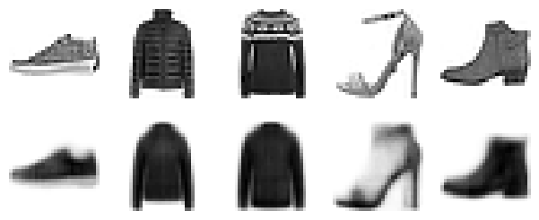

(윗줄: 원본, 아랫줄: VAE의 재구성. 적층 오토인코더(3-4절)보다 더 흐릿하고 무늬가 없다)

**결과 해석**

- 검증 RMSE **0.15**로 일반 오토인코더(0.11 ~ 0.12)보다 나쁘다. 잠재 손실이 코딩을 원점 쪽으로 당겨 정보를 덜 담게 하고, 코딩에 **잡음**(샘플링)이 섞이기 때문이다
- 노트북의 `evaluate_tm()`은 VAE를 `eval()` 모드로 바꿔도 `sample_codings()`가 **여전히 샘플링한다**(드롭아웃처럼 모드에 따라 꺼지는 장치가 없다). 그래서 검증 RMSE에도 샘플링 잡음이 들어 있다
- 재구성 품질을 조금 내주고 얻는 것이 **생성 능력**이다(다음 절)

### 7-4. 보충 코드: KL 공식과 재매개변수화 트릭 확인

> 🎯 **목적** — 잠재 손실의 닫힌 형태 공식이 몬테카를로 추정과 같은지, 재매개변수화 트릭으로 얻은 그레이디언트가 이론값과 같은지 확인한다.

**보충 코드**

```python
# 보충 코드
import numpy as np
torch.manual_seed(42)
mean = torch.tensor([0.5, -1.0, 2.0]); logvar = torch.tensor([-1.0, 0.5, 0.0])
kl_closed = -0.5 * (1 + logvar - logvar.exp() - mean.square())   # 차원별 닫힌 형태
std = (0.5 * logvar).exp()
z = mean + std * torch.randn(1_000_000, 3)                       # q에서 100만 번 샘플링
logq = -0.5 * ((z - mean) / std) ** 2 - torch.log(std) - 0.5 * np.log(2 * np.pi)
logp = -0.5 * z ** 2 - 0.5 * np.log(2 * np.pi)
kl_closed            # tensor([0.3089, 0.5744, 2.0000])
(logq - logp).mean(0)  # tensor([0.3085, 0.5740, 1.9983])  ← E_q[log q − log p] 와 같다

# 재매개변수화 트릭: d/dμ E[z²] = 2μ, d/d(log σ) E[z²] = 2σ²
mu = torch.tensor(0.7, requires_grad=True); log_sigma = torch.tensor(-0.3, requires_grad=True)
zz = mu + torch.exp(log_sigma) * torch.randn(1_000_000)
(zz ** 2).mean().backward()
mu.grad, log_sigma.grad   # (1.3971, 1.0970)  ← 이론값 2 × 0.7 = 1.4, 2e^(−0.6) = 1.0976
```

| 코드 | 의미 |
|---|---|
| `kl_closed` | 7-1절 공식을 차원별로. 세 번째 차원(μ = 2, σ = 1)은 $\frac{1}{2}\mu^2 = 2$ — 평균이 원점에서 멀수록 벌점 |
| `(logq - logp).mean(0)` | KL의 정의 $\mathbb{E}_{z \sim q}[\log q(z) - \log p(z)]$를 샘플 평균으로 추정 |
| `mu + exp(log_sigma) * randn` | 재매개변수화. 무작위성은 `randn`에만 있고 `mu`·`log_sigma`까지 그레이디언트가 흐른다 |

**결과 해석**

- 닫힌 형태 KL이 100만 샘플 몬테카를로 추정과 소수점 셋째 자리까지 같다 → `vae_loss`의 식이 맞다
- 샘플링이 들어간 계산인데도 `backward()`가 μ와 σ의 그레이디언트를 정확히 준다 → 재매개변수화 트릭 덕분에 VAE를 보통의 역전파로 훈련할 수 있다

### 7-5. 패션 이미지 생성하기

> 🎯 **목적** — 인코더 없이 $\mathcal{N}(0, I)$에서 코딩을 뽑아 디코더만으로 새 이미지를 만든다.

**코드**

```python
torch.manual_seed(42)  # extra code – ensures reproducibility

vae.eval()
codings = torch.randn(3 * 7, vae.codings_dim, device=device)   # [21, 32]
with torch.no_grad():
    images = vae.decode(codings)

# extra code – this cells generates Figure 18-12
plot_multiple_images(images, 7)
plt.show()
```

| 코드 | 의미 |
|---|---|
| `torch.randn(21, 32)` | 사전 분포 $\mathcal{N}(0, I)$에서 코딩 21개. 훈련 때 잠재 손실이 코딩을 이 분포 근처로 모아 뒀기 때문에 가능하다 |
| `vae.decode(codings)` | **디코더만** 쓴다. 인코더는 생성에 필요 없다 |

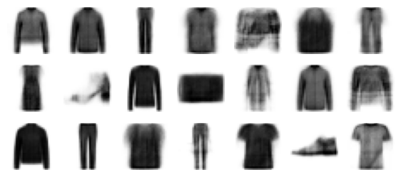

(무작위 코딩 21개를 디코딩한 이미지. 재킷·바지·풀오버·드레스·하이힐·티셔츠·운동화 등이 보인다. 흐릿하고 일부는 클래스 사이의 애매한 모양이다)

**결과 해석**

- 대부분 알아볼 수 있는 옷·신발이 나온다. 훈련 세트에 없는 **새** 이미지다
- 흐릿한 것은 VAE의 대표적인 약점이다(MSE 재구성 손실 + 잠재 공간의 잡음). 이것을 해결하려고 GAN(8절)과 확산 모델(9절)이 나왔다

### 7-6. 시맨틱 보간

> 🎯 **목적** — 잠재 공간의 두 점 사이를 직선으로 이동하며 디코딩해, 이미지가 의미 있게 서서히 바뀌는지 본다.

**코드**

```python
codings.shape
# torch.Size([21, 32])

torch.manual_seed(111)  # extra code – ensure reproducibility

codings = torch.randn(2, vae.codings_dim)  # start and end codings
n_images = 7
weights = torch.linspace(0, 1, n_images).view(n_images, 1)
codings = torch.lerp(codings[0], codings[1], weights)  # linear interpolation
with torch.no_grad():
    images = vae.decode(codings.to(device))

plot_multiple_images(images)
plt.show()
```

| 코드 | 의미 |
|---|---|
| `torch.linspace(0, 1, 7).view(7, 1)` | 보간 비율 0, 1/6, …, 1. `[7, 1]`로 바꿔 브로드캐스팅 |
| `torch.lerp(a, b, w)` | $a + w(b - a)$. `[32]`와 `[7, 1]`이 브로드캐스팅되어 `[7, 32]` — 시작 코딩에서 끝 코딩까지 7단계 |

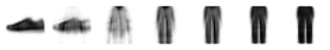

(왼쪽 끝 = 시작 코딩(운동화), 오른쪽 끝 = 끝 코딩(바지). 가운데 이미지들이 운동화 → 흐릿한 중간 모양 → 바지로 서서히 바뀐다)

**결과 해석**

- 픽셀 공간에서 두 이미지를 섞으면 두 이미지가 **겹쳐 보일 뿐**이지만, 잠재 공간에서 보간하면 중간 단계도 그 나름의 옷 모양이 된다 → **시맨틱**(의미) 보간
- 잠재 공간이 매끄럽고 빈틈이 적기 때문에 가능한 일이다

### 7-7. 보충 코드: 오토인코더와 VAE의 잠재 공간 비교

> 🎯 **목적** — 같은 구조의 보통 오토인코더와 VAE를 **2D 코딩**으로 훈련해, 잠재 공간이 어떻게 다른지 직접 본다.

**보충 코드**

```python
# 보충 코드 (CPU, 8에포크씩, 배치 128, Adam 1e-3)
def mlp_enc(out):
    return nn.Sequential(nn.Flatten(), nn.Linear(784, 256), nn.ReLU(),
                         nn.Linear(256, 128), nn.ReLU(), nn.Linear(128, out))
def mlp_dec():
    return nn.Sequential(nn.Linear(2, 128), nn.ReLU(), nn.Linear(128, 256), nn.ReLU(),
                         nn.Linear(256, 784), nn.Sigmoid(), nn.Unflatten(1, (1, 28, 28)))
ae_enc, ae_dec = mlp_enc(2), mlp_dec()        # 보통 오토인코더: 코딩 2개
vae_enc, vae_dec = mlp_enc(4), mlp_dec()      # VAE: 평균 2개 + 로그 분산 2개
# AE 손실: MSE / VAE 손실: MSE + KL.mean() / 784 (vae_loss와 같다)
# 검증 재구성 MSE(8에포크): AE 0.0281, VAE(평균으로 디코딩) 0.0287

with torch.no_grad():
    Za = ae_enc(X_valid); Zv, logvar = vae_enc(X_valid).chunk(2, -1)
Za.mean(0), Za.std(0)   # (1.73, −7.75), (4.88, 5.51)   ← AE 코딩: 아무 데나, 크기도 제멋대로
Zv.mean(0), Zv.std(0)   # (0.06, −0.04), (1.06, 1.09)   ← VAE 평균: 원점 중심, 표준 편차 ≈ 1
(0.5 * logvar).exp().mean(0)   # (0.103, 0.110)        ← 이미지 하나의 구름 크기 σ
```

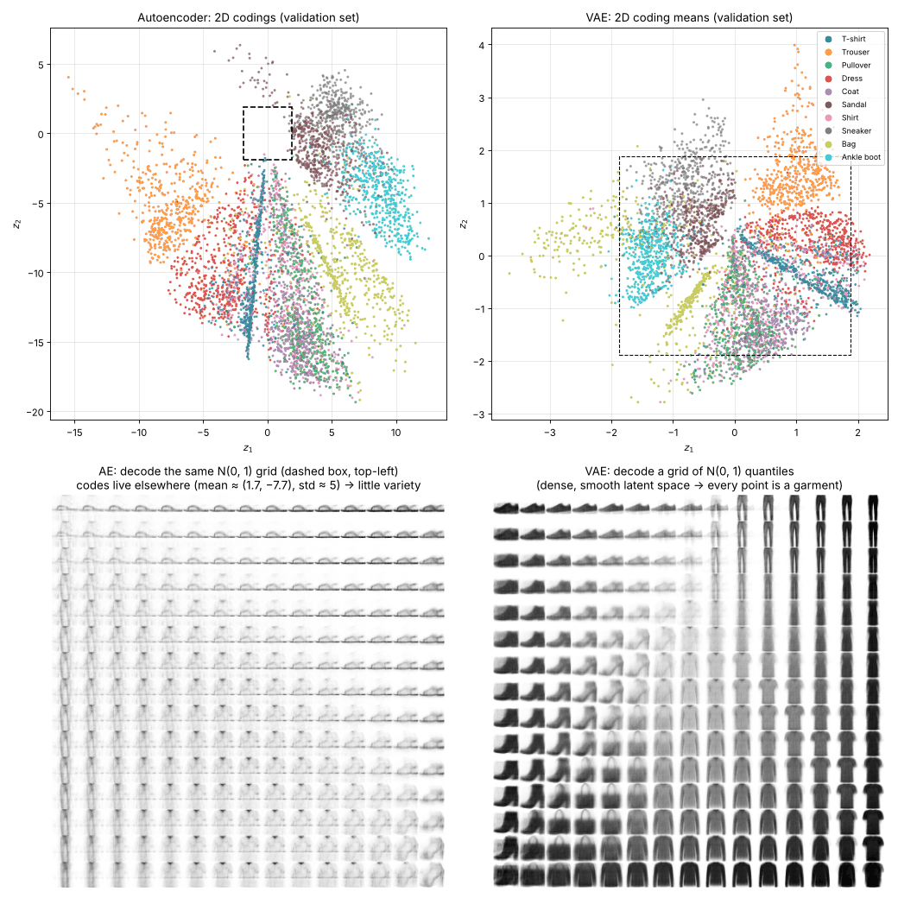

(위: 검증 이미지 5,000장의 2D 코딩, 색 = 클래스. 왼쪽 오토인코더, 오른쪽 VAE(평균 μ). 점선 상자 = $\mathcal{N}(0, 1)$의 3% ~ 97% 분위수 범위. 아래: 그 상자 안의 15 × 15 격자 점을 각 디코더로 디코딩한 이미지. 오토인코더 격자는 코딩이 거의 없는 곳이라 비슷한 흐릿한 이미지만 반복되고, VAE 격자는 신발 → 가방 → 상의 → 바지가 매끄럽게 이어진다)

**결과 해석**

- 오토인코더의 코딩은 평균 (1.7, −7.7), 표준 편차 약 5인 엉뚱한 영역에 퍼져 있다. "어디서 샘플링해야 하는지" 알 수 없고, $\mathcal{N}(0, I)$에서 뽑으면 코딩이 거의 없는 구석만 찍는다
- VAE의 평균은 원점 중심, 표준 편차 약 1로 정리되어 있고, 클래스들이 빈틈 없이 붙어 있다 → $\mathcal{N}(0, I)$에서 아무 점이나 뽑아도 옷이 나온다. 격자를 따라가면 시맨틱 보간처럼 모양이 서서히 바뀐다
- 재구성 MSE는 둘이 비슷하다(0.0281 vs 0.0287). VAE가 내준 것은 아주 조금의 재구성 품질이고, 얻은 것은 **샘플링 가능한 잠재 공간**이다

### 7-8. 이산 VAE와 Gumbel-softmax

> 🎯 **목적** — 코딩을 연속 벡터 대신 **범주(코드 번호)들의 나열**로 만드는 이산 VAE와, 범주 샘플링을 미분 가능하게 만드는 Gumbel-softmax를 이해한다.

**개념·원리**

이산 VAE(dVAE)의 코딩은 길이 $L$ = 32인 **코드 번호 시퀀스**다. 각 위치는 $k$ = 16개 코드 중 하나를 고른다(정보량 32 × log₂16 = 128비트). [16장 DALL·E](16_vision_and_multimodal_transformers.md#2-7-dalle-텍스트로-이미지-생성하기)는 이런 dVAE로 이미지를 토큰 1,024개로 바꾸고, 트랜스포머로 토큰을 생성했다.

문제: "로짓에서 범주 하나를 샘플링"은 미분할 수 없다. 해결책이 **Gumbel-softmax**(재매개변수화 트릭의 범주 버전)다.

| 단계 | 식 | 의미 |
|---|---|---|
| Gumbel-max 트릭 | $\arg\max_i (\ell_i + g_i)$, $g_i = -\log(-\log u_i)$, $u_i \sim U(0, 1)$ | 로짓 $\ell$에 Gumbel 잡음을 더해 argmax하면 **정확히** softmax 분포에서 샘플링한 것과 같다 |
| Gumbel-softmax | $y_i = \text{softmax}\big((\ell + g)/\tau\big)_i$ | argmax를 온도 τ인 softmax로 부드럽게 → 미분 가능. τ → 0이면 원-핫에 가까워진다 |
| 스트레이트 스루 (`hard=True`) | 순전파: 원-핫, 역전파: 부드러운 $y$의 그레이디언트 | 디코더는 진짜 이산 코드를 보고, 그레이디언트는 근사로 흐른다 |

**잠재 손실**: 각 위치의 코드 분포 $q$와 균등 분포($1/k$)의 KL

$$
D_{\text{KL}}(q \,\|\, U) = \sum_i q_i \log\frac{q_i}{1/k} = \sum_i q_i\left(\log q_i + \log k\right)
$$

**코드**

```python
def gumbel_softmax(logits, tau=1, hard=False, dim=-1):
    if device != "mps":
        return F.gumbel_softmax(logits, tau, hard, dim)
    ...  # MPS 버그 우회용 구현 (Gumbel 잡음을 [-30, 30]으로 자르는 줄만 추가)

DiscreteVAEOutput = namedtuple("DiscreteVAEOutput",
                               ["output", "logits", "codings_prob"])

class DiscreteVAE(nn.Module):
    def __init__(self, coding_length=32, n_codes=16, temperature=1.0):
        super().__init__()
        self.coding_length = coding_length
        self.n_codes = n_codes
        self.temperature = temperature
        self.encoder = nn.Sequential(
            nn.Flatten(),
            nn.Linear(1 * 28 * 28, 256), nn.ReLU(),
            nn.Linear(256, 128), nn.ReLU(),
            nn.Linear(128, coding_length * n_codes),
            nn.Unflatten(dim=1, unflattened_size=(coding_length, n_codes)))
        self.decoder = nn.Sequential(
            nn.Flatten(),
            nn.Linear(coding_length * n_codes, 128), nn.ReLU(),
            nn.Linear(128, 256), nn.ReLU(),
            nn.Linear(256, 1 * 28 * 28), nn.Sigmoid(),
            nn.Unflatten(dim=1, unflattened_size=(1, 28, 28)))

    def forward(self, X):
        logits = self.encoder(X)                                     # [B, 32, 16]
        codings_prob = gumbel_softmax(logits, tau=self.temperature, hard=True)
        output = self.decoder(codings_prob)
        return DiscreteVAEOutput(output, logits, codings_prob)

def d_vae_loss(y_pred, y_target, kl_weight=1.0):
    output, logits, _ = y_pred
    codings_prob = F.softmax(logits, -1)
    k = logits.new_tensor(logits.size(-1))  # same device and dtype as logits
    kl_div = (codings_prob * (codings_prob.log() + k.log())).sum(dim=(1, 2))
    return F.mse_loss(output, y_target) + kl_weight * kl_div.mean() / 784
```

| 코드 | 의미 |
|---|---|
| `gumbel_softmax()` 래퍼 | 애플 MPS 장치의 `F.gumbel_softmax` 버그(PyTorch 이슈 #159103)를 피하려고 직접 구현한 버전. 다른 장치에서는 `F.gumbel_softmax`를 그대로 부른다 |
| `nn.Linear(128, 32 * 16)` + `Unflatten` | 위치 32개 × 코드 16개의 **로짓** `[B, 32, 16]` |
| `F.gumbel_softmax(logits, tau, hard=True)` | 위치마다 원-핫 `[B, 32, 16]` (순전파), 역전파는 부드러운 버전으로 |
| `nn.Flatten()` (디코더 맨 앞) | 원-핫 `[B, 32, 16]` → `[B, 512]` |
| `logits.new_tensor(16)` | `logits`와 같은 장치·자료형의 스칼라 텐서 (`log` 계산용) |
| `.sum(dim=(1, 2))` | 위치 32개 × 코드 16개의 KL을 이미지마다 더한다 |

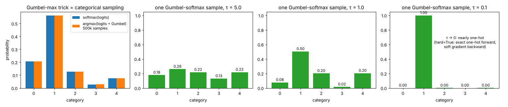

(보충 그림. 왼쪽: 로짓 5개의 softmax 확률(파랑)과 "로짓 + Gumbel 잡음의 argmax"를 50만 번 뽑은 빈도(주황) — 최대 차이 0.0008로 같다. 나머지: 같은 Gumbel 잡음으로 만든 Gumbel-softmax 샘플 하나를 온도 τ = 5, 1, 0.1로. 온도가 높으면 거의 균등, 낮으면 거의 원-핫)

> 📌 보충 확인: `F.gumbel_softmax(logits, tau=0.5, hard=True)`의 출력은 `[0., 1., 0., 0., 0.]`처럼 정확한 원-핫인데도 `backward()` 후 `logits.grad`가 0이 아닌 값으로 채워진다(스트레이트 스루). `d_vae_loss`의 `log q + log k` 형태는 균등 분포와의 KL 정의 $\sum q \log(q / (1/k))$와 `allclose`로 같고, 위치 하나의 KL은 최대 $\log 16 \approx 2.77$(한 코드에 확률이 몰릴 때)이다.

### 7-9. 이산 VAE 훈련과 생성

> 🎯 **목적** — 온도를 점점 낮추며(어닐링) 이산 VAE를 훈련하고, 무작위 코드로 이미지를 생성한다.

**코드**

```python
n_epochs = 20
def annealing(model, epoch):
    model.temperature = 1 - 0.9 * epoch / n_epochs

torch.manual_seed(42)
d_vae = DiscreteVAE().to(device)
optimizer = torch.optim.NAdam(d_vae.parameters(), lr=0.001)
history = train(d_vae, optimizer, d_vae_loss, rmse, train_loader, valid_loader,
                n_epochs=n_epochs, epoch_callback=annealing)
# UserWarning: `eps` parameter is deprecated and has no effect.
# Epoch 1/20,   train loss: 0.0580, train metric: 0.228, valid metric: 0.209
# Epoch 2/20,   train loss: 0.0479, train metric: 0.201, valid metric: 0.196
# ...
# Epoch 10/20,  train loss: 0.0374, train metric: 0.172, valid metric: 0.173
# ...
# Epoch 20/20,  train loss: 0.0361, train metric: 0.167, valid metric: 0.168
```

```python
torch.manual_seed(42)  # extra code – ensures reproducibility
n_images = 3 * 7
codings = torch.randint(0, d_vae.n_codes,  # from 0 to k – 1
                        (n_images, d_vae.coding_length), device=device)
codings_prob = F.one_hot(codings, num_classes=d_vae.n_codes).float()
with torch.no_grad():
    images = d_vae.decoder(codings_prob)

plot_multiple_images(images, 7)
plt.show()
```

| 코드 | 의미 |
|---|---|
| `annealing(model, epoch)` | `train()`의 `epoch_callback`. 온도를 1.0(0에포크) → 0.145(19에포크)로 선형 감소. 처음엔 부드럽게 탐색, 나중엔 거의 이산적으로 |
| `UserWarning: eps ...` | `F.gumbel_softmax`의 옛 인자 `eps`가 더는 쓰이지 않는다는 경고. 결과에는 영향이 없다 |
| `torch.randint(0, 16, (21, 32))` | 사전 분포(균등)에서 위치 32개의 코드 번호를 무작위로 |
| `F.one_hot(codings, num_classes=16).float()` | `[21, 32]` → `[21, 32, 16]` 원-핫 |
| `d_vae.decoder(codings_prob)` | 디코더만으로 생성 |

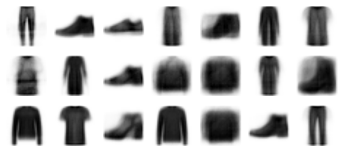

(균등 분포에서 뽑은 무작위 코드 21개를 디코딩한 이미지. 바지·부츠·운동화·드레스·풀오버·티셔츠 등. 연속 VAE(7-5절)보다 더 흐릿하다)

**결과 해석**

- 검증 RMSE 0.168로 연속 VAE(0.15)보다 재구성이 나쁘다. 코딩이 128비트로 제한되고, 매번 샘플링하기 때문이다
- 무작위 코드에서도 옷 모양이 나온다 → 코드 공간 전체가 의미 있게 쓰이고 있다
- dVAE의 진짜 쓰임새는 단독 생성보다 **이미지 토크나이저**다. 이미지를 코드 번호 시퀀스로 바꾸면, 언어 모델처럼 트랜스포머가 코드 시퀀스를 생성하게 할 수 있다(DALL·E). 비슷한 목적으로 코드북에서 가장 가까운 벡터를 고르는 **VQ-VAE**도 많이 쓴다

---

## 8. 생성적 적대 신경망 (18.8)

> 🎯 **목적** — 생성자와 판별자를 경쟁시켜 진짜 같은 이미지를 만드는 GAN을 구현하고, 훈련이 왜 어려운지 이해한다.

> 💬 **위조 지폐범과 경찰의 경쟁**
>
> **생성자**(위조범)는 무작위 잡음을 받아 이미지를 만들고, **판별자**(경찰)는 진짜 이미지와 가짜를 구별한다. 판별자가 똑똑해질수록 생성자는 더 정교한 가짜를 만들어야 하고, 결국 판별자가 구별할 수 없을 만큼 진짜 같은 이미지가 나온다(굿펠로 등, 2014).
>
> - 생성자는 **진짜 이미지를 한 번도 보지 않는다.** 판별자를 통해 흘러오는 그레이디언트로만 배운다
> - 두 네트워크는 서로 반대 목표를 가진다 → 최적화가 아니라 **게임**. 평형(내시 균형)을 찾기 어렵다
> - **헷갈림 주의**: 생성자의 입력 잡음(코딩)은 VAE의 코딩과 비슷한 역할(잠재 공간)을 하지만, GAN에는 인코더가 없다 — 이미지에서 코딩을 구하는 방법이 따로 없다

### 8-1. GAN의 구조와 두 단계 훈련

> 🎯 **목적** — GAN 훈련의 한 반복이 두 단계로 나뉘는 이유와 각 단계의 레이블을 정리한다.

**개념·원리**

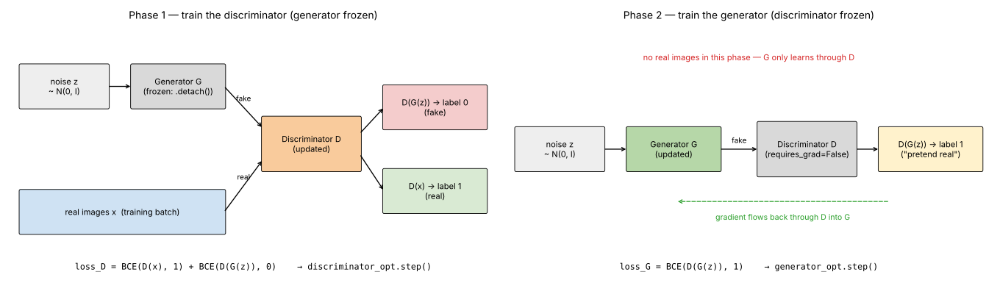

(왼쪽 = 1단계: 생성자를 고정(`.detach()`)하고, 판별자가 진짜 이미지에 1, 가짜 이미지에 0을 출력하도록 훈련. 오른쪽 = 2단계: 판별자를 고정(`requires_grad=False`)하고, 생성자가 만든 가짜를 판별자가 **1(진짜)** 로 판단하도록 생성자를 훈련. 초록 점선 = 그레이디언트가 판별자를 거쳐 생성자로 흐른다)

| 단계 | 훈련하는 쪽 | 입력 | 타깃 레이블 | 손실 |
|---|---|---|---|---|
| 1. 판별자 | 판별자 $D$ | 진짜 배치 + 가짜 배치 | 진짜 1, 가짜 0 | $\text{BCE}(D(x), 1) + \text{BCE}(D(G(z)), 0)$ |
| 2. 생성자 | 생성자 $G$ | 가짜 배치만 | **1** (판별자를 속이려고) | $\text{BCE}(D(G(z)), 1)$ |

- 2단계에서 레이블을 1로 주는 것이 핵심이다. "판별자가 진짜라고 하도록" 생성자를 바꾼다
- 2단계에서 판별자 가중치는 바뀌면 안 된다. 바뀌면 판별자가 "가짜를 진짜라고 하도록" 망가진다

### 8-2. 간단한 GAN 구현

> 🎯 **목적** — MLP로 생성자와 판별자를 만든다.

**코드**

```python
torch.manual_seed(42)  # extra code – ensures reproducibility

codings_dim = 32
generator = nn.Sequential(
    nn.Linear(codings_dim, 128), nn.ReLU(),
    nn.Linear(128, 256), nn.ReLU(),
    nn.Linear(256, 1 * 28 * 28), nn.Sigmoid(),
    nn.Unflatten(dim=1, unflattened_size=(1, 28, 28))).to(device)
discriminator = nn.Sequential(
    nn.Flatten(),
    nn.Linear(1 * 28 * 28, 256), nn.ReLU(),
    nn.Linear(256, 128), nn.ReLU(),
    nn.Linear(128, 1), nn.Sigmoid()).to(device)
```

| 코드 | 의미 |
|---|---|
| `generator` | 잡음 32 → 128 → 256 → 784 → `[1, 28, 28]`. 오토인코더의 **디코더**와 같은 모양 (파라미터 238,736) |
| `discriminator` | 이미지 784 → 256 → 128 → 1. 시그모이드로 "진짜일 확률" (파라미터 233,985) — 보통의 **이진 분류기** |
| `nn.Sigmoid()` (생성자 출력) | 픽셀 0 ~ 1. 진짜 이미지와 같은 범위여야 판별자가 범위만 보고 구별하지 못한다 |

### 8-3. GAN 훈련 루프

> 🎯 **목적** — `train()` 대신 두 단계를 번갈아 수행하는 전용 훈련 루프를 쓴다.

**코드**

```python
def train_gan(generator, discriminator, train_loader, codings_dim, n_epochs=20,
              g_lr=1e-3, d_lr=5e-4):
    criterion = nn.BCELoss()
    generator_opt = torch.optim.NAdam(generator.parameters(), lr=g_lr)
    discriminator_opt = torch.optim.NAdam(discriminator.parameters(), lr=d_lr)
    for epoch in range(n_epochs):
        print(f"Epoch {epoch + 1}/{n_epochs}", end="")
        for real_images, _ in train_loader:
            # ── 1단계: 판별자 훈련 ──
            real_images = real_images.to(device)
            pred_real = discriminator(real_images)
            batch_size = real_images.size(0)
            ones = torch.ones(batch_size, 1, device=device)
            real_loss = criterion(pred_real, ones)
            codings = torch.randn(batch_size, codings_dim, device=device)
            fake_images = generator(codings).detach()
            pred_fake = discriminator(fake_images)
            zeros = torch.zeros(batch_size, 1, device=device)
            fake_loss = criterion(pred_fake, zeros)
            discriminator_loss = real_loss + fake_loss
            discriminator_opt.zero_grad()
            discriminator_loss.backward()
            discriminator_opt.step()

            # ── 2단계: 생성자 훈련 ──
            codings = torch.randn(batch_size, codings_dim, device=device)
            fake_images = generator(codings)
            for p in discriminator.parameters():
                p.requires_grad = False
            pred_fake = discriminator(fake_images)
            generator_loss = criterion(pred_fake, ones)
            generator_opt.zero_grad()
            generator_loss.backward()
            generator_opt.step()
            for p in discriminator.parameters():
                p.requires_grad = True
        print(f" | discriminator loss: {discriminator_loss.item():.4f}", end="")
        print(f" | generator loss: {generator_loss.item():.4f}")
        if epoch % 10 == 0 or epoch == n_epochs - 1:
            plot_multiple_images(fake_images.detach(), 8)
            plt.show()

torch.manual_seed(41)  # trying another seed often fixes the issue 😅
train_gan(generator, discriminator, train_loader, codings_dim)
# Epoch 1/20 | discriminator loss: 0.9104 | generator loss: 7.2512
# Epoch 2/20 | discriminator loss: 0.4806 | generator loss: 1.6024
# Epoch 3/20 | discriminator loss: 0.6780 | generator loss: 2.8019
# Epoch 4/20 | discriminator loss: 0.7361 | generator loss: 2.1550
# Epoch 5/20 | discriminator loss: 0.7290 | generator loss: 4.0420
# ...
# Epoch 11/20 | discriminator loss: 1.4950 | generator loss: 2.4509
# ...
# Epoch 20/20 | discriminator loss: 0.8947 | generator loss: 1.6881
```

| 코드 | 의미 |
|---|---|
| `nn.BCELoss()` | 이진 교차 엔트로피. 판별자 출력이 이미 시그모이드를 거친 확률이라 `BCEWithLogitsLoss`가 아니라 `BCELoss` |
| `NAdam(lr=1e-3)` / `NAdam(lr=5e-4)` | 생성자와 판별자의 옵티마이저를 **따로** 둔다. 판별자 학습률을 낮게 해서 판별자가 너무 빨리 이기지 않게 한다 |
| `for real_images, _ in train_loader` | `train_loader`는 `AutoencoderDataset`이라 `(x, x)`를 주지만 두 번째는 버린다 |
| `generator(codings).detach()` | 1단계에서는 생성자로 그레이디언트가 흐르지 않게 끊는다(계산 절약 + 생성자 고정) |
| `real_loss + fake_loss` | 진짜는 1, 가짜는 0으로 맞히는 손실의 합 |
| `p.requires_grad = False` | 2단계에서 판별자 파라미터의 그레이디언트 계산을 끈다. 그레이디언트는 판별자를 **통과해** 생성자까지 흐르지만 판별자 자체에는 쌓이지 않는다 |
| `criterion(pred_fake, ones)` | 가짜에 **1**을 타깃으로 → "판별자를 속여라" |
| `epoch % 10 == 0 or epoch == n_epochs - 1` | 1, 11, 20에포크 후에 마지막 배치의 가짜 이미지 24장을 그린다 |
| `torch.manual_seed(41)` | 노트북 주석대로 GAN은 시드에 따라 실패하기도 해서, 잘 되는 시드를 골랐다 |

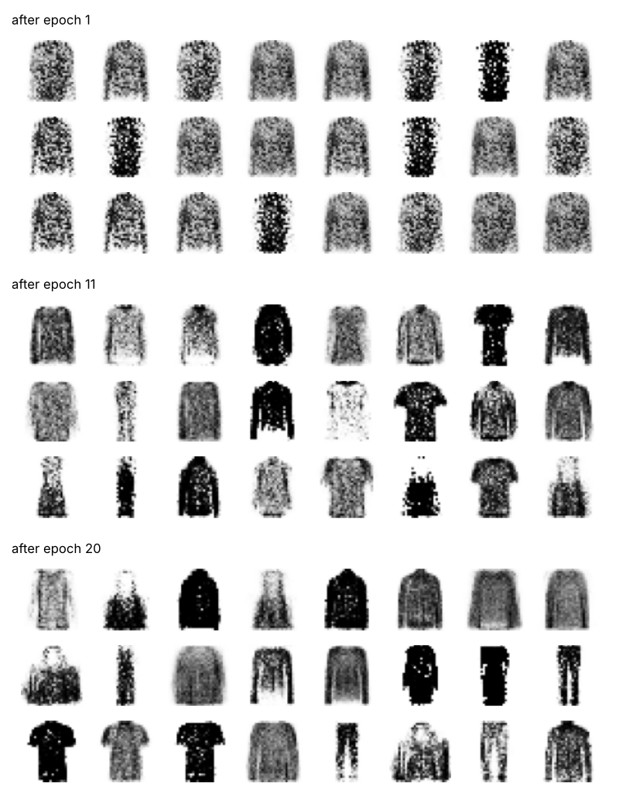

(위에서부터 1, 11, 20에포크 후 생성자가 만든 이미지 24장. 1에포크엔 모두 비슷한 점박이 얼룩, 11에포크부터 티셔츠·바지·드레스·풀오버 모양이 생긴다)

```python
torch.manual_seed(42)  # extra code – ensures reproducibility
n_images = 3 * 7
generator.eval()
codings = torch.randn(n_images, codings_dim, device=device)
with torch.no_grad():
    generated_images = generator(codings)

# extra code – this cell generates Figure 18–15
plot_multiple_images(generated_images, 7)
plt.show()
```

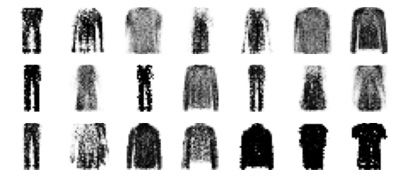

(훈련된 생성자로 만든 이미지 21장. 바지·풀오버·티셔츠·드레스 모양이지만 점박이 잡음이 많다)

**결과 해석**

- 1에포크의 생성자 손실 7.25 → 판별자가 가짜를 너무 쉽게 구별해 생성자가 고전했다. 이후 두 손실이 0.5 ~ 4 사이를 **오르내린다** — GAN의 손실은 내려가기만 하지 않는다. 한쪽이 나아지면 다른 쪽 손실이 오르는 게임이기 때문이다
- 결과 이미지는 VAE보다 **덜 흐릿**하지만(대비가 강하다) 점박이 잡음이 많고, 신발·가방이 거의 없이 상의·바지 위주다 → 다양성이 떨어지는 **부분적인 모드 붕괴** 징후
- GAN 손실 값만으로는 품질을 판단하기 어렵다. 그래서 생성 이미지를 직접 보거나, FID 같은 별도의 지표를 쓴다

### 8-4. GAN 훈련의 어려움

> 🎯 **목적** — GAN이 왜 불안정한지, 대표적인 실패 유형과 해결책을 정리한다.

> ⚠️ 노트북에는 이 소절의 코드가 없다. 아래는 교재 절 내용을 정리한 것이다(8-5절에 보충 실험).

**개념·원리**

이론적으로 GAN 게임은 생성자가 데이터 분포를 **완벽히** 흉내 내고 판별자가 언제나 50% 확률로 찍는 **내시 균형**에 도달할 수 있다. 하지만 경사 하강법으로 이 균형을 찾는다는 보장은 없다.

| 문제 | 증상 | 원인 |
|---|---|---|
| **모드 붕괴** | 생성자가 한두 종류(예: 신발만)만 만든다. 판별자가 그 종류를 간파하면 다른 종류로 **옮겨 가서** 또 한 종류만 만든다 | 생성자는 "판별자를 가장 잘 속이는 한 가지"로 몰리기 쉽다. 다양성에 대한 보상이 없다 |
| **진동·발산** | 손실과 이미지 품질이 출렁이다가 갑자기 망가진다 | 두 네트워크가 서로의 목표를 계속 바꾼다(움직이는 표적) |
| **그레이디언트 소실** | 판별자가 너무 강하면 $D(G(z)) \approx 0$ → 생성자 그레이디언트가 사라진다 | 시그모이드 + BCE의 포화 |
| **하이퍼파라미터 민감도** | 학습률·시드·구조를 조금만 바꿔도 실패 | 위 문제들의 합작 (노트북도 시드 41을 골랐다) |

대표적인 해결책:

| 기법 | 아이디어 |
|---|---|
| **경험 재생** | 과거 생성 이미지를 버퍼에 모아 두고 판별자 훈련에 섞는다 → 생성자가 판별자의 **현재** 약점만 파고드는 것을 막는다 |
| **미니배치 판별** | 판별자가 배치 안 이미지들이 **얼마나 비슷한지**를 보게 한다 → 다양성이 없는 가짜 배치를 쉽게 잡아낸다 |
| 손실 함수 바꾸기 | WGAN(바서슈타인 거리), 힌지 손실, LSGAN 등 그레이디언트가 덜 포화되는 손실 |
| 판별자 규제 | 스펙트럼 정규화, 그레이디언트 페널티 → 판별자가 너무 가파르게 변하지 않게 |
| 구조 가이드라인 | DCGAN의 규칙(8-6절), 학습률 조정, Adam의 $\beta_1$을 0.5로 낮추기 |

### 8-5. 보충 코드: 2D 장난감으로 본 모드 붕괴

> 🎯 **목적** — 정답 분포가 원 위의 가우스 8개인 2D 데이터에서 GAN을 훈련해, 정상적인 훈련과 모드 붕괴를 직접 비교한다.

**보충 코드**

```python
# 보충 코드
import numpy as np
centers = torch.tensor([[np.cos(a), np.sin(a)]
                        for a in np.linspace(0, 2 * np.pi, 9)[:-1]], dtype=torch.float32) * 2
def real(n):                                       # 반지름 2인 원 위의 가우스 8개
    return centers[torch.randint(0, 8, (n,))] + 0.05 * torch.randn(n, 2)

def run(seed, steps=3000, g_lr=1e-3, d_lr=1e-3, betas=(0.5, 0.999)):
    torch.manual_seed(seed)
    G = nn.Sequential(nn.Linear(2, 64), nn.ReLU(), nn.Linear(64, 64), nn.ReLU(), nn.Linear(64, 2))
    D = nn.Sequential(nn.Linear(2, 64), nn.ReLU(), nn.Linear(64, 64), nn.ReLU(),
                      nn.Linear(64, 1), nn.Sigmoid())
    bce = nn.BCELoss()
    og = torch.optim.Adam(G.parameters(), lr=g_lr, betas=betas)
    od = torch.optim.Adam(D.parameters(), lr=d_lr, betas=betas)
    for s in range(steps + 1):
        xr, xf = real(256), G(torch.randn(256, 2)).detach()          # 1단계: 판별자
        ld = bce(D(xr), torch.ones(256, 1)) + bce(D(xf), torch.zeros(256, 1))
        od.zero_grad(); ld.backward(); od.step()
        lg = bce(D(G(torch.randn(256, 2))), torch.ones(256, 1))      # 2단계: 생성자
        og.zero_grad(); lg.backward(); og.step()                      # (D 그레이디언트는 다음 zero_grad가 지운다)
    return G

good = run(0, g_lr=1e-3, d_lr=1e-3, betas=(0.5, 0.999))
bad  = run(1, g_lr=2e-3, d_lr=2e-4, betas=(0.9, 0.999))   # 생성자가 판별자보다 10배 빠르게 배움
# 덮은 모드 수(가우스 중심 0.25 이내에 생성 샘플의 2% 이상): good 8/8, bad 0 ~ 1/8
```

| 코드 | 의미 |
|---|---|
| `centers` | 반지름 2인 원 위에 45° 간격으로 놓인 점 8개 = 정답 분포의 **모드** 8개 |
| `betas=(0.5, 0.999)` | DCGAN 논문이 권한 Adam 설정. 모멘텀을 줄여 출렁임을 덜한다 |
| `g_lr=2e-3, d_lr=2e-4` | 생성자 학습률을 판별자의 10배로 → 생성자가 판별자의 약점 하나로 계속 몰려간다 |

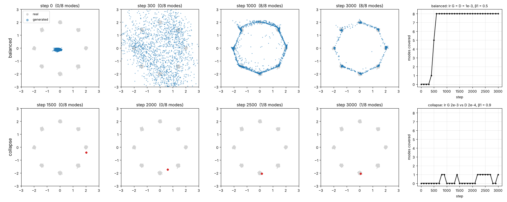

(회색 = 진짜 데이터(가우스 8개), 색 점 = 생성 샘플 2,000개. 위: 균형 잡힌 설정 — 0스텝(원점 근처 한 덩어리) → 300스텝(넓게 퍼짐) → 1,000스텝(원을 따라 띠) → 3,000스텝(8개 모드 모두). 아래: 생성자가 너무 빠른 설정 — 생성 샘플 2,000개가 **한 점**으로 뭉쳐(빨간 점) 1,500 ~ 3,000스텝 동안 모드 사이를 떠돈다. 오른쪽 끝: 100스텝마다 센 "덮은 모드 수")

**결과 해석**

- 균형 잡힌 설정은 600스텝 만에 8개 모드를 모두 덮고 끝까지 유지한다
- 생성자가 너무 빠르면 모든 잡음 입력을 **같은 점**으로 보낸다. 판별자가 그 점을 가짜로 찍으면 생성자는 다른 점으로 통째로 이동한다 — 교재가 말한 "한 모드에서 다른 모드로 옮겨 다니는" 모드 붕괴 그대로다
- 같은 구조, 같은 데이터인데 학습률 비율과 $\beta_1$만 바꿨을 뿐이다 → GAN의 하이퍼파라미터 민감도
- 6개 시드로 균형 설정을 반복하면 3,000스텝 후 덮은 모드가 6 ~ 8개로, 성공해도 일부 모드를 놓치는 경우가 있다

### 8-6. 심층 합성곱 GAN

> 🎯 **목적** — 합성곱 층과 배치 정규화로 GAN을 안정시킨 DCGAN을 구현한다.

**개념·원리**

DCGAN(래드퍼드 등, 2015)은 큰 이미지를 안정적으로 생성하는 합성곱 GAN의 가이드라인을 제시했다.

| 가이드라인 | 이 노트북의 구현 |
|---|---|
| 풀링 대신 **스트라이드 합성곱**(판별자), **전치 합성곱**(생성자) | 판별자 `Conv2d(stride=2)`, 생성자 `ConvTranspose2d(stride=2)` |
| 생성자·판별자 모두 **배치 정규화** (생성자 출력 층, 판별자 입력 층 제외) | 생성자에 `BatchNorm2d` 2개 (판별자는 대신 드롭아웃) |
| 깊은 구조에서 완전 연결 은닉 층 제거 | 생성자 첫 `Linear`(잡음 → 특성 맵)와 판별자 마지막 `Linear`(→ 확률)만 |
| 생성자: 출력 층만 tanh, 나머지 ReLU | ReLU + 출력 **시그모이드**(픽셀이 0 ~ 1이라서) |
| 판별자: 모든 층에 LeakyReLU | **ReLU** (노트북은 단순화) |

**코드**

```python
torch.manual_seed(1)  # extra code – ensures reproducibility

dc_codings_dim = 100

dc_generator = nn.Sequential(
    nn.Linear(dc_codings_dim, 128 * 7 * 7),
    nn.Unflatten(dim=1, unflattened_size=(128, 7, 7)),
    nn.BatchNorm2d(128),
    nn.ConvTranspose2d(128, 64, kernel_size=3, stride=2, padding=1,
                       output_padding=1), nn.ReLU(),
    nn.BatchNorm2d(64),
    nn.ConvTranspose2d(64, 1, kernel_size=3, stride=2, padding=1,
                   output_padding=1), nn.Sigmoid()).to(device)
dc_discriminator = nn.Sequential(
    nn.Conv2d(1, 32, kernel_size=5, stride=2, padding=2), nn.ReLU(),  # 32 x 14 x 14
    nn.Dropout(0.4),
    nn.Conv2d(32, 64, kernel_size=5, stride=2, padding=2), nn.ReLU(),  # 64 x 7 x 7
    nn.Dropout(0.4),
    nn.Flatten(),
    nn.Linear(64 * 7 * 7, 1), nn.Sigmoid()).to(device)

torch.manual_seed(42)
train_gan(dc_generator, dc_discriminator, train_loader, dc_codings_dim)
# Epoch 1/20 | discriminator loss: 1.2309 | generator loss: 1.0396
# Epoch 2/20 | discriminator loss: 1.1194 | generator loss: 1.0109
# ...
# Epoch 10/20 | discriminator loss: 0.6845 | generator loss: 1.2603
# Epoch 11/20 | discriminator loss: 0.8508 | generator loss: 1.4768
# ...
# Epoch 20/20 | discriminator loss: 1.0319 | generator loss: 1.8848
```

| 층 | 출력 형태 (보충 확인) |
|---|---|
| `Linear(100, 6272)` + `Unflatten` | `[128, 7, 7]` |
| `BatchNorm2d(128)` → `ConvTranspose2d(128, 64, 3, s=2, p=1, op=1)` + ReLU | `[64, 14, 14]` |
| `BatchNorm2d(64)` → `ConvTranspose2d(64, 1, 3, s=2, p=1, op=1)` + 시그모이드 | `[1, 28, 28]` |
| 판별자 `Conv2d(1, 32, 5, s=2, p=2)` + ReLU + 드롭아웃 | `[32, 14, 14]` |
| `Conv2d(32, 64, 5, s=2, p=2)` + ReLU + 드롭아웃 → `Flatten` → `Linear(3136, 1)` | `[64, 7, 7]` → `[1]` |

| 코드 | 의미 |
|---|---|
| `dc_codings_dim = 100` | 잡음 벡터 100차원 (DCGAN 논문의 관례) |
| `nn.Linear(100, 128 * 7 * 7)` | 잡음을 작은 특성 맵 128 × 7 × 7로 펼친다 |
| `nn.Dropout(0.4)` (판별자) | 판별자가 너무 빨리 강해지는 것을 막는 규제 |
| 파라미터 (보충 계산) | 생성자 708,225 (대부분 첫 `Linear`의 633,472) / 판별자 55,233 |

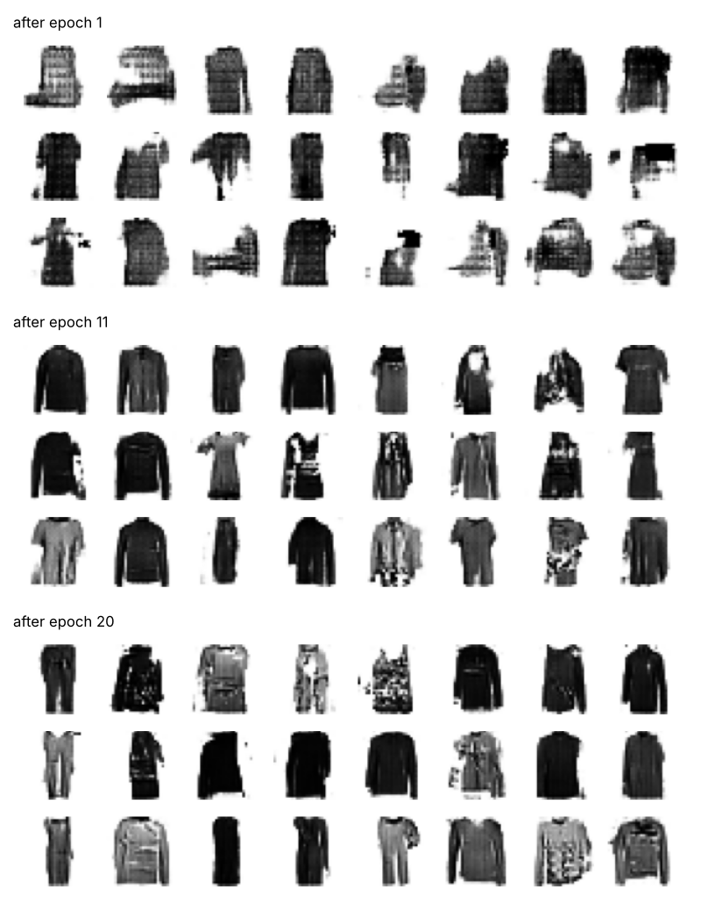

(위에서부터 1, 11, 20에포크 후 생성 이미지 24장. 1에포크엔 격자무늬 얼룩, 11에포크엔 풀오버·티셔츠·드레스가 꽤 그럴듯하다)

```python
# extra code – this cell generates Figure 18–16
torch.manual_seed(42)
with torch.no_grad():
    codings = torch.randn(8, dc_codings_dim, device=device)
    generated_images = dc_generator(codings)
plot_multiple_images(generated_images, 8)
```

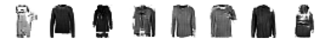

(훈련된 DCGAN 생성자의 이미지 8장. 셔츠·풀오버·코트 등. MLP GAN(8-3절)보다 점박이 잡음이 훨씬 적고 표면이 매끄럽다)

**결과 해석**

- 합성곱 구조 덕분에 이웃 픽셀이 일관된 이미지가 나온다. 다만 여전히 상의 위주라 다양성은 부족하다
- 생성자 쪽 `generator.eval()`을 하지 않고 생성했으므로 배치 정규화가 **훈련 모드**(현재 배치 8장의 통계)로 동작했다. 배치가 작으면 결과가 조금 달라질 수 있다
- DCGAN은 잠재 공간에서 **벡터 산술**이 된다는 것으로도 유명하다(예: "안경 쓴 남자" − "남자" + "여자" ≈ "안경 쓴 여자")

### 8-7. ProGAN과 StyleGAN

> 🎯 **목적** — 고해상도 GAN을 가능하게 한 두 엔비디아 모델의 핵심 아이디어를 정리한다.

> ⚠️ 노트북에는 이 소절의 코드가 없다. 아래는 교재 절 내용을 정리한 것이다.

**개념·원리**

**ProGAN**(Progressive Growing of GANs, 카라스 등, 2018)

```
4×4 이미지부터 생성자·판별자를 훈련
  → 층을 추가해 8×8 → 16×16 → … → 1024×1024로 점점 키운다
  → 새 층은 페이드인(기존 업샘플 출력과 새 층 출력을 α로 섞으며 α를 0 → 1)
```

| 기법 | 역할 |
|---|---|
| 점진적 성장 | 쉬운 문제(저해상도 전체 구조)부터 배우고 세부는 나중에 → 안정적이고 빠르다 |
| 미니배치 표준 편차 층 | 판별자 끝에서 배치 안 특성의 표준 편차를 특성 맵으로 추가 → 다양성이 없는 가짜 배치를 판별자가 잡아낸다(모드 붕괴 억제) |
| 동일 학습률 | 가중치를 He 초기화 상수로 **실행 중에** 스케일 → 모든 파라미터가 같은 속도로 학습 |
| 픽셀별 정규화 | 생성자의 각 합성곱 뒤에 픽셀마다 특성 벡터 크기를 정규화 → 신호 폭주 방지 |

**StyleGAN**(카라스 등, 2018 ~ 2019) — 고해상도 얼굴 생성으로 유명하다(thispersondoesnotexist류 사이트).

```
잡음 z ──매핑 네트워크(MLP 8층)──> 스타일 벡터 w
                                       │ (아핀 변환, 층마다)
학습된 상수 4×4 ──[합성곱 + AdaIN(스타일) + 잡음 더하기]──> 업샘플 ──> … ──> 이미지
```

| 구성 | 역할 |
|---|---|
| **매핑 네트워크** | z를 w로 바꿔, 잠재 공간을 데이터의 특성에 맞게 **풀어 준다**(얽힘 감소) |
| **합성 네트워크** | 입력이 잡음이 아니라 **학습된 상수**. 스타일은 각 층에 AdaIN으로 주입 |
| **AdaIN** | 특성 맵을 채널별로 표준화한 뒤 스타일이 정한 평균·분산으로 다시 스케일 → 저해상도 층은 자세·얼굴형, 고해상도 층은 색·질감을 조절 |
| **잡음 입력** | 층마다 픽셀 잡음을 더해 머리카락·주근깨 같은 **확률적 세부**를 담당 |
| **스타일 혼합** | 일부 층은 w₁, 나머지는 w₂로 → 인접 층의 스타일이 상관되지 않게 하는 규제 (혼합 규제) |

> 📌 StyleGAN2(2020)는 물방울 모양의 인공물을 없앴고, StyleGAN3(2021)는 텍스처가 픽셀 좌표에 "붙어 있는" 문제를 고쳤다. 그 뒤 고품질 이미지 생성의 주역은 확산 모델로 넘어갔지만, GAN은 **한 번의 순전파**로 생성하는 속도 덕분에 실시간 응용과 확산 모델의 증류(9-10절의 SD-Turbo)에 여전히 쓰인다.

---

## 9. 확산 모델 (18.9)

> 🎯 **목적** — 이미지에 잡음을 조금씩 더하는 과정을 거꾸로 되돌리도록 학습해, 순수한 잡음에서 새 이미지를 만드는 확산 모델(DDPM)을 구현하고, 빠른 샘플링(DDIM)과 사전 훈련 모델(스테이블 디퓨전)까지 다룬다.

> 💬 **잉크 방울이 퍼지는 영상을 거꾸로 돌린다**
>
> 물에 잉크를 떨어뜨리면 퍼져서 결국 고르게 섞인다(확산). 이 과정은 쉽다. 확산 모델은 **거꾸로**를 배운다: "지금 이 상태에서 직전 상태로 가려면 무엇을 빼야 하나?"
>
> - **순방향 과정**(고정, 학습 없음): 이미지에 가우스 잡음을 $T$번 조금씩 더해 순수한 잡음으로 만든다
> - **역방향 과정**(학습): 신경망이 잡음 낀 이미지 $x_t$와 시점 $t$를 보고 **더해진 잡음** $\varepsilon$을 예측한다 → 조금씩 빼서 $x_{t-1}$로
> - 손실은 그냥 **잡음 예측의 MSE**(이 노트북은 Huber) → GAN처럼 게임이 아니라 평범한 회귀라 훈련이 안정적이다
> - **헷갈림 주의**: 모델이 예측하는 것은 깨끗한 이미지가 아니라 **잡음**이다. 그리고 생성할 때는 한 번이 아니라 수백 ~ 수천 번 모델을 호출한다 → 느리다

### 9-1. 확산 모델의 아이디어

> 🎯 **목적** — 순방향·역방향 과정과 훈련·생성 절차를 수식으로 정리한다.

**개념·원리**

확산 모델은 졸-딕스타인 등(2015)이 처음 제안했고, 호 등(2020)의 **DDPM**(denoising diffusion probabilistic model)이 GAN과 겨룰 만한 품질을 보이며 주목받았다. 2021년 OpenAI 논문("Diffusion Models Beat GANs")에서 GAN을 넘어섰고, 지금의 텍스트–이미지 모델(DALL·E 2·3, 스테이블 디퓨전, Imagen)과 비디오 생성 모델 대부분이 확산 계열이다.

**순방향 과정** — 시점마다 분산 $\beta_t$의 잡음을 더한다($\alpha_t = 1 - \beta_t$).

$$
q(x_t \mid x_{t-1}) = \mathcal{N}\!\left(\sqrt{\alpha_t}\, x_{t-1},\; \beta_t I\right)
\quad\Rightarrow\quad
x_t = \sqrt{\alpha_t}\, x_{t-1} + \sqrt{\beta_t}\, \varepsilon
$$

$\sqrt{\alpha_t}$로 살짝 줄이는 이유: 잡음을 더하기만 하면 분산이 계속 커진다. 줄이면서 더하면 분산이 1 근처로 유지되고, 끝에는 정확히 $\mathcal{N}(0, I)$가 된다.

**역방향 과정** — 신경망 $\varepsilon_\theta(x_t, t)$가 잡음을 예측하고, 그 잡음을 이용해 한 스텝 되돌린다(DDPM 논문 알고리즘 2).

$$
x_{t-1} = \frac{1}{\sqrt{\alpha_t}}\left(x_t - \frac{\beta_t}{\sqrt{1-\bar\alpha_t}}\,\varepsilon_\theta(x_t, t)\right) + \sqrt{\beta_t}\, z, \qquad z \sim \mathcal{N}(0, I)
$$

| | 훈련 | 생성 |
|---|---|---|
| 시작 | 훈련 이미지 $x_0$, 무작위 시점 $t$, 무작위 잡음 $\varepsilon$ | 순수한 잡음 $x_T \sim \mathcal{N}(0, I)$ |
| 과정 | $x_t$를 **한 번에** 만든다(9-3절) → 모델이 $\varepsilon$ 예측 → 손실 | $t = T, T-1, \dots, 1$ 마다 모델 호출 → $x_{t-1}$ |
| 비용 | 이미지당 모델 1회 | 이미지당 모델 $T$회 (이 노트북은 4,000회) |

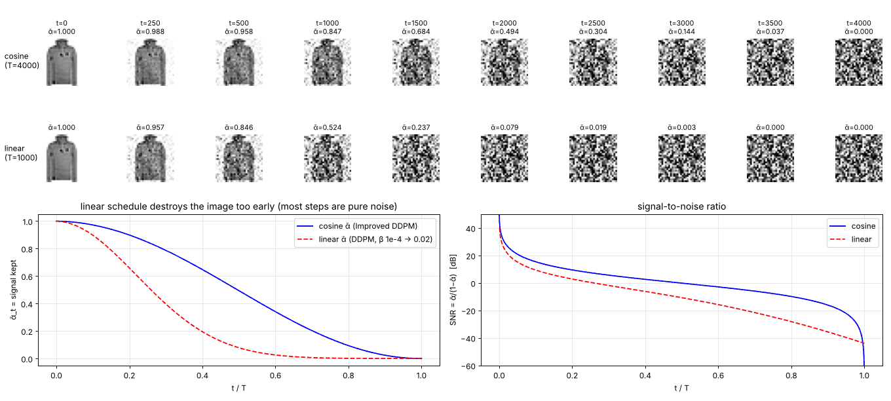

(보충 그림. 위 두 줄: 같은 패션 MNIST 이미지(코트)에 같은 잡음 $\varepsilon$을 시점별로 섞은 $x_t$. 첫 줄은 이 노트북의 코사인 스케줄($T$ = 4,000), 둘째 줄은 DDPM 원 논문의 선형 스케줄($T$ = 1,000, 같은 $t/T$ 위치). 아래 왼쪽: $t/T$에 따른 $\bar\alpha_t$(원본 신호가 남은 비율). 아래 오른쪽: 신호 대 잡음비 $\bar\alpha_t / (1-\bar\alpha_t)$(dB))

### 9-2. 분산 스케줄

> 🎯 **목적** — 개선된 DDPM의 코사인 스케줄로 $\alpha_t, \beta_t, \bar\alpha_t$를 미리 계산한다.

**개념·원리**

$\bar\alpha_t = \prod_{i=1}^{t}\alpha_i$는 $t$ 시점에 **원본 신호가 남은 비율**이다. DDPM은 $\beta_t$를 0.0001 → 0.02로 **선형**으로 늘렸는데, 그러면 $\bar\alpha_t$가 너무 빨리 0이 되어 후반 스텝들이 거의 순수한 잡음만 다룬다(위 그림 둘째 줄: 절반 지점에서 이미 $\bar\alpha$ = 0.079). 개선된 DDPM(니콜과 다리왈, 2021)은 $\bar\alpha_t$ 자체를 코사인 모양으로 정해 1 → 0으로 **고르게** 줄인다.

$$
\bar\alpha_t = \frac{f(t)}{f(0)}, \quad f(t) = \cos^2\!\left(\frac{t/T + s}{1 + s}\cdot\frac{\pi}{2}\right), \quad
\beta_t = 1 - \frac{\bar\alpha_t}{\bar\alpha_{t-1}}
$$

**코드**

```python
def variance_schedule(T, s=0.008, max_beta=0.999):
    t = torch.linspace(0, T, T + 1)
    f = torch.cos((t / T + s) / (1 + s) * torch.pi / 2) ** 2
    alpha_bars = f / f[0]
    betas = (1 - (f[1:] / f[:-1])).clamp(max=max_beta)
    betas = torch.cat([torch.zeros(1), betas])  # for easier indexing
    alphas = 1 - betas
    return alphas, betas, alpha_bars

torch.manual_seed(42)  # extra code – for reproducibility
T = 4000
alphas, betas, alpha_bars = variance_schedule(T)

# extra code – this cell generates Figure 18–21
plt.figure(figsize=(6, 3))
plt.plot(betas, "r--", label=r"$\beta_t$")
plt.plot(alpha_bars, "b", label=r"$\bar{\alpha}_t$")
plt.axis([0, T, 0, 1.01])
plt.grid(True)
plt.xlabel("$t$")
plt.ylabel(r"Value")
plt.legend()
plt.show()
```

| 코드 | 의미 |
|---|---|
| `torch.linspace(0, T, T + 1)` | $t$ = 0, 1, …, 4000 (4,001개) |
| `s=0.008` | $t$ = 0 근처에서 $\beta_t$가 너무 작아지지 않게 하는 작은 오프셋 |
| `f[1:] / f[:-1]` | $\bar\alpha_t / \bar\alpha_{t-1} = \alpha_t$ → $\beta_t = 1 - \alpha_t$ |
| `.clamp(max=0.999)` | $t \to T$에서 $\bar\alpha_t \to 0$이라 $\beta_t \to 1$로 폭주하는 것을 막는다 (보충 확인: 마지막 $\beta_{4000}$ 하나만 0.999로 잘린다) |
| `torch.cat([torch.zeros(1), betas])` | 맨 앞에 $\beta_0 = 0$을 붙여 `betas[t]`가 그대로 $\beta_t$가 되게 |
| `T = 4000` | DDPM은 1,000, 개선된 DDPM은 4,000 |

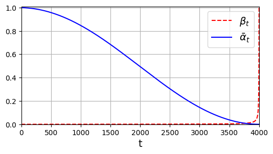

(가로축 $t$(0 ~ 4,000). 파랑 실선 = $\bar\alpha_t$(1 → 0으로 S자 감소), 빨강 점선 = $\beta_t$(거의 0이다가 맨 끝에서 1 가까이 치솟는다))

**결과 해석** (보충으로 찍어 본 값)

| $t$ | 9 | 388 | 1,000 | 2,000 | 3,000 | 3,720 | 4,000 |
|---|---|---|---|---|---|---|---|
| $\bar\alpha_t$ | 0.9999 | 0.974 | 0.847 | 0.494 | 0.144 | 0.012 | 0.0 |

- $\beta_t$는 $t$ = 1에서 약 0.00001, $t$ = 2,000에서 약 0.0008로 아주 작다. 스텝 하나가 더하는 잡음은 미미하지만 4,000번 쌓이면 이미지가 완전히 사라진다
- 중간 지점($t$ = 2,000)에 신호가 절반($\bar\alpha \approx 0.49$) 남는다 → 스텝들이 "쉬운 단계 ~ 어려운 단계"에 고르게 배분된다

### 9-3. 순방향 확산의 지름길

> 🎯 **목적** — $x_0$에서 $x_t$를 $t$번 반복하지 않고 **한 번에** 만드는 공식을 쓴다.

**개념·원리**

가우스 잡음을 여러 번 더한 결과도 가우스이므로, 순방향 과정을 $t$번 반복한 결과를 닫힌 형태로 쓸 수 있다(DDPM 논문 식 4).

$$
x_t = \sqrt{\bar\alpha_t}\; x_0 + \sqrt{1 - \bar\alpha_t}\; \varepsilon, \qquad \varepsilon \sim \mathcal{N}(0, I)
$$

훈련 때 무작위 $t$의 $x_t$를 바로 만들 수 있어서, 이미지 하나당 모델 호출 **1회**로 훈련할 수 있다.

**코드**

```python
def forward_diffusion(x0, t):
    eps = torch.randn_like(x0)  # this unscaled noise will be the target
    xt = alpha_bars[t].sqrt() * x0 + (1 - alpha_bars[t]).sqrt() * eps
    return xt, eps
```

| 코드 | 의미 |
|---|---|
| `eps = torch.randn_like(x0)` | 표준 정규 잡음. **이것이 타깃**이다(스케일하지 않은 잡음) |
| `alpha_bars[t].sqrt() * x0` | 원본을 $\sqrt{\bar\alpha_t}$배로 줄이고 |
| `(1 - alpha_bars[t]).sqrt() * eps` | 잡음을 $\sqrt{1-\bar\alpha_t}$배로 섞는다. 두 계수의 제곱합 = 1 → 분산 유지 |

> ✅ 보충 확인: $x_0 = 0.6$인 값 20만 개에 한 스텝 공식 $x_t = \sqrt{\alpha_t}x_{t-1} + \sqrt{\beta_t}\varepsilon$를 1,000번 반복한 결과는 평균 0.5517, 표준 편차 0.3918. 지름길 공식의 이론값은 $\sqrt{\bar\alpha_{1000}} \times 0.6 = 0.5522$, $\sqrt{1 - \bar\alpha_{1000}} = 0.3911$로 같다.

### 9-4. 확산 데이터셋 만들기

> 🎯 **목적** — 이미지마다 무작위 시점을 골라 잡음 낀 이미지와 타깃 잡음을 돌려주는 데이터셋을 만든다.

**코드**

```python
class DiffusionSample(namedtuple("DiffusionSampleBase", ["xt", "t"])):
    def to(self, device):
        return DiffusionSample(self.xt.to(device), self.t.to(device))

class DiffusionDataset:
    def __init__(self, dataset):
        self.dataset = dataset

    def __getitem__(self, i):
        x0, _ = self.dataset[i]
        x0 = (x0 * 2) - 1  # scale from –1 to +1
        t = torch.randint(1, T + 1, size=[1])
        xt, eps = forward_diffusion(x0, t)
        return DiffusionSample(xt, t), eps

    def __len__(self):
        return len(self.dataset)

train_set = DiffusionDataset(train_data)  # wrap Fashion MNIST
train_loader = DataLoader(train_set, batch_size=32, shuffle=True)
valid_set = DiffusionDataset(valid_data)
valid_loader = DataLoader(valid_set, batch_size=32)
```

| 코드 | 의미 |
|---|---|
| `DiffusionSample(namedtuple(...))` | 입력이 두 개(잡음 낀 이미지, 시점)라서 하나로 묶은 네임드튜플. `.to(device)` 메서드를 추가해 `train()`의 `X_batch.to(device)`가 그대로 동작한다 |
| `x0 * 2 - 1` | 픽셀 0 ~ 1 → **−1 ~ 1**. 잡음(평균 0)과 같은 척도로 맞춘다 |
| `torch.randint(1, T + 1, size=[1])` | 1 ~ 4,000 중 무작위 시점. `__getitem__`이 불릴 때마다 **새로** 뽑으므로 같은 이미지도 에포크마다 다른 $t$·잡음을 받는다(일종의 데이터 증강) |
| `return DiffusionSample(xt, t), eps` | (입력, 타깃) = ((잡음 이미지, 시점), 잡음) |
| `DataLoader` 묶음 | 기본 `collate_fn`이 네임드튜플을 필드별로 쌓아 `DiffusionSample(xt=[32, 1, 28, 28], t=[32, 1])`로 만든다 |

```python
# extra code – just a quick sanity check
def original_image(sample, noise):
    alpha_bars_t = torch.gather(alpha_bars, dim=0, index=sample.t.squeeze(1))
    alpha_bars_t = alpha_bars_t.view(-1, 1, 1, 1)
    x0 = (sample.xt - (1 - alpha_bars_t).sqrt() * noise) / alpha_bars_t.sqrt()
    return torch.clamp((x0 + 1) / 2, 0, 1)

torch.manual_seed(42)
sample, eps = next(iter(train_loader))  # get the first batch
x0 = original_image(sample, eps).to(device)
print("Original images")
plot_multiple_images(x0[:8]); plt.show()
print("Time steps:", sample.t[:8].view(-1).tolist())
print("Noisy images")
plot_multiple_images(sample.xt[:8]); plt.show()
print("Noise to predict")
plot_multiple_images(eps[:8]); plt.show()
# Time steps: [2027, 1463, 3720, 9, 611, 2202, 2118, 388]
```

| 코드 | 의미 |
|---|---|
| `torch.gather(alpha_bars, 0, index=t)` | 배치의 각 샘플 시점에 해당하는 $\bar\alpha_t$를 한 번에 꺼낸다 |
| `(xt - sqrt(1 - ᾱ) * noise) / sqrt(ᾱ)` | 지름길 공식을 $x_0$에 대해 푼 것. 잡음을 **정확히** 알면 원본을 복원할 수 있다 → 모델이 잡음만 잘 예측하면 된다는 뜻 |

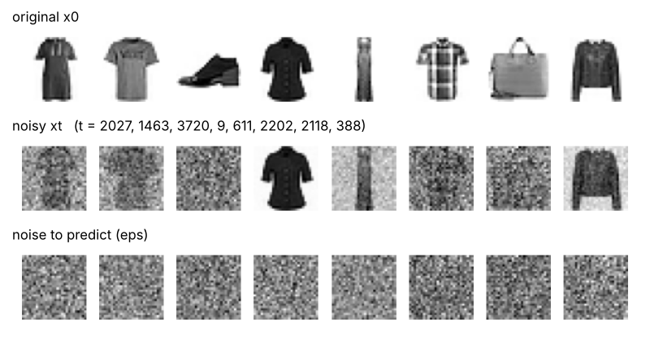

(위: 잡음 이미지와 정답 잡음으로 거꾸로 복원한 원본 $x_0$. 가운데: 잡음 이미지 $x_t$와 시점. $t$ = 9인 4번째(셔츠)는 거의 깨끗하고, $t$ = 388인 마지막(재킷)·611인 5번째(드레스)는 알아볼 수 있고, $t$ = 3,720인 3번째는 완전한 잡음. 아래: 모델이 맞혀야 할 잡음 $\varepsilon$)

### 9-5. 시간 인코딩

> 🎯 **목적** — 모델이 "지금이 몇 번째 스텝인지" 알 수 있도록 시점 $t$를 사인/코사인 벡터로 바꾼다.

**개념·원리**

같은 잡음 이미지라도 $t$에 따라 빼야 할 잡음의 양이 다르다. $t$ = 9면 거의 깨끗한 이미지에서 미세한 잡음을, $t$ = 3,700이면 거의 잡음뿐인 입력에서 희미한 윤곽을 찾아야 한다. 그래서 $t$를 입력으로 준다. 정수 하나를 그대로 넣는 대신 [15장의 사인/코사인 위치 인코딩](15_transformers_for_nlp_and_chatbots.md#1-2-위치-임베딩)과 똑같은 방식으로 64차원 벡터로 바꾼다(DDPM 논문의 제안).

**코드**

```python
# extra code – implements a custom time encoding layer
embed_dim = 64

class TimeEncoding(nn.Module):
    def __init__(self, T, embed_dim):
        super().__init__()
        assert embed_dim % 2 == 0, "embed_dim must be even"
        p = torch.arange(T + 1).unsqueeze(1)
        angle = p / 10_000 ** (torch.arange(0, embed_dim, 2) / embed_dim)
        te = torch.empty(T + 1, embed_dim)
        te[:, 0::2] = torch.sin(angle)
        te[:, 1::2] = torch.cos(angle)
        self.register_buffer("time_encodings", te)

    def forward(self, t):
        return self.time_encodings[t]
```

| 코드 | 의미 |
|---|---|
| `p / 10_000 ** (2i / d)` | 15장과 같은 각도: 앞쪽 차원은 빠르게, 뒤쪽 차원은 느리게 회전 |
| `te[:, 0::2] = sin`, `te[:, 1::2] = cos` | 짝수 칸 사인, 홀수 칸 코사인 → `[4001, 64]` 표 |
| `register_buffer` | 학습하지 않지만 모델과 함께 장치 이동·저장되는 텐서 ([15장](15_transformers_for_nlp_and_chatbots.md)) |
| `self.time_encodings[t]` | 정수 시점 배치 `[B]` → `[B, 64]` 조회 |

> 📌 보충 확인: 인접 시점 $t$ = 100과 101의 인코딩은 코사인 유사도 0.966으로 비슷하고, $t$ = 100과 3,000은 −0.04로 거의 직교한다 → 가까운 시점은 비슷한 벡터, 먼 시점은 다른 벡터.

### 9-6. U-Net 잡음 예측 모델

> 🎯 **목적** — 잡음 이미지와 시간 인코딩을 받아 잡음을 출력하는 작은 U-Net을 만든다.

**개념·원리**

개선된 DDPM은 **U-Net**을 쓴다. U-Net은 [12장 시맨틱 분할](12_deep_computer_vision_with_cnns.md#12-1-시맨틱-분할과-업샘플링)에서 본 것처럼 해상도를 줄였다가(다운샘플링) 다시 키우며(업샘플링), 같은 해상도의 다운샘플링 출력을 업샘플링 쪽에 **연결**(교차 스킵)해 세부 정보를 되살린다. 입력과 출력 크기가 같아서 "픽셀마다 잡음 예측"에 알맞다.

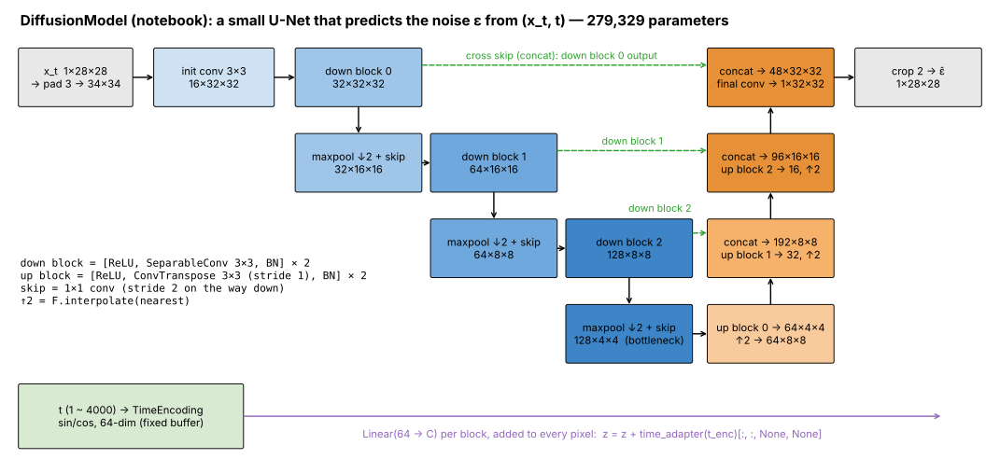

(보충 그림. 왼쪽 위에서 출발해 아래로 내려가며 해상도를 32 → 16 → 8 → 4로 줄이고 채널을 16 → 32 → 64 → 128로 늘린 뒤, 오른쪽으로 올라오며 다시 키운다. 초록 점선 = 교차 스킵(다운 블록 출력을 업 쪽에 이어 붙임 → 채널이 3배). 보라 = 시간 인코딩을 블록마다 `Linear`로 채널 수에 맞춰 **모든 픽셀에 더한다**. 형태는 보충 코드로 훅을 걸어 확인한 값)

**코드**

```python
class SeparableConv2d(nn.Module):
    def __init__(self, in_channels, out_channels, kernel_size, padding):
        super().__init__()
        self.depthwise = nn.Conv2d(in_channels, in_channels, kernel_size,
                                   padding=padding, groups=in_channels)
        self.pointwise = nn.Conv2d(in_channels, out_channels, kernel_size=1)

    def forward(self, X):
        return self.pointwise(self.depthwise(X))

class DiffusionModel(nn.Module):
    def __init__(self, T=T, embed_dim=64):
        super().__init__()
        self.time_encoding = TimeEncoding(T, embed_dim)

        # Init
        dim = 16
        self.pad = nn.ConstantPad2d((3, 3, 3, 3), 0)
        self.init_conv = nn.Conv2d(1, dim, kernel_size=3)
        self.init_bn = nn.BatchNorm2d(dim)
        self.time_adapter_init = nn.Linear(embed_dim, dim)

        # Down path
        self.down_blocks = nn.ModuleList()
        self.skip_convs = nn.ModuleList()
        self.time_adapters_down = nn.ModuleList()
        in_dim = dim
        for dim in (32, 64, 128):
            block = nn.Sequential(
                nn.ReLU(),
                SeparableConv2d(in_dim, dim, kernel_size=3, padding=1),
                nn.BatchNorm2d(dim),
                nn.ReLU(),
                SeparableConv2d(dim, dim, kernel_size=3, padding=1),
                nn.BatchNorm2d(dim)
            )
            skip_conv = nn.Conv2d(in_dim, dim, kernel_size=1, stride=2)
            self.down_blocks.append(block)
            self.skip_convs.append(skip_conv)
            self.time_adapters_down.append(nn.Linear(embed_dim, dim))
            in_dim = dim

        # Up path
        self.up_blocks = nn.ModuleList()
        self.skip_up_convs = nn.ModuleList()
        self.time_adapters_up = nn.ModuleList()
        for dim in (64, 32, 16):
            block = nn.Sequential(
                nn.ReLU(),
                nn.ConvTranspose2d(in_dim, dim, 3, padding=1),
                nn.BatchNorm2d(dim),
                nn.ReLU(),
                nn.ConvTranspose2d(dim, dim, 3, padding=1),
                nn.BatchNorm2d(dim)
            )
            skip_conv = nn.Conv2d(in_dim, dim, kernel_size=1)
            self.up_blocks.append(block)
            self.skip_up_convs.append(skip_conv)
            self.time_adapters_up.append(nn.Linear(embed_dim, dim))
            in_dim = dim * 3  # because of concatenation with cross skip

        self.final_conv = nn.Conv2d(in_dim, 1, 3, padding=1)

    def forward(self, sample):
        if not isinstance(sample, DiffusionSample):
            print(repr(sample))
        time_enc = self.time_encoding(sample.t.squeeze(1))  # [batch, embed_dim]
        z = self.pad(sample.xt)
        z = F.relu(self.init_bn(self.init_conv(z)))
        z = z + self.time_adapter_init(time_enc)[:, :, None, None]
        skip = z
        cross_skips = []

        # Downsampling path
        for block, skip_conv, time_adapter in zip(
                self.down_blocks, self.skip_convs, self.time_adapters_down):
            z = block(z)
            cross_skips.append(z)
            z = F.max_pool2d(z, 3, stride=2, padding=1)
            skip_link = skip_conv(skip)
            z = z + skip_link
            z = z + time_adapter(time_enc)[:, :, None, None]
            skip = z

        # Upsampling path
        for block, skip_up_conv, time_adapter in zip(
                self.up_blocks, self.skip_up_convs, self.time_adapters_up):
            z = block(z)
            z = F.interpolate(z, scale_factor=2, mode="nearest")
            skip_link = F.interpolate(skip, scale_factor=2, mode="nearest")
            skip_link = skip_up_conv(skip_link)
            z = z + skip_link
            z = z + time_adapter(time_enc)[:, :, None, None]
            cross_skip = cross_skips.pop()
            z = torch.cat([z, cross_skip], dim=1)
            skip = z

        out = self.final_conv(z)
        out = out[:, :, 2:-2, 2:-2]  # cropping
        return out.contiguous()
```

| 코드 | 의미 |
|---|---|
| `SeparableConv2d` | 깊이별 합성곱(`groups=in_channels`, 채널마다 따로 3 × 3) + 점별 합성곱(1 × 1) = [12장 Xception](12_deep_computer_vision_with_cnns.md#5-9-xception)의 분리 합성곱. 보충 계산: 64 → 128 채널에서 8,960개 vs 일반 3 × 3 합성곱 73,856개 |
| `nn.ConstantPad2d((3, 3, 3, 3), 0)` | 28 × 28 → 34 × 34. 패딩 없는 3 × 3 합성곱 뒤 32 × 32가 되어, 2로 세 번 나눠떨어진다(32 → 16 → 8 → 4) |
| `nn.ModuleList()` | 층 리스트를 `nn.Module`에 등록(파이썬 리스트면 파라미터가 등록되지 않는다) |
| `time_adapter(time_enc)[:, :, None, None]` | `[B, 64]` → `Linear` → `[B, C]` → `[B, C, 1, 1]`. 브로드캐스팅으로 **모든 픽셀에 같은 값**을 더한다 → 블록마다 "지금 시점"을 알려 준다 |
| `F.max_pool2d(z, 3, stride=2, padding=1)` | 해상도 절반 (블록 안이 아니라 블록 뒤에서) |
| `skip_conv(skip)` (`1×1`, `stride=2`) | 블록에 들어가기 전 입력을 해상도·채널만 맞춰 더한다 = [12장 ResNet](12_deep_computer_vision_with_cnns.md)의 잔차 연결 |
| `cross_skips.append(z)` / `.pop()` | 다운 블록 출력을 스택에 쌓았다가 업 쪽에서 **역순**으로 꺼내 `torch.cat`(채널 방향 연결). 그래서 다음 업 블록 입력 채널이 `dim * 3` |
| `F.interpolate(scale_factor=2, mode="nearest")` | 해상도 2배(최근접 이웃 복사). 노트북 설명의 `Upsample` 층과 같은 일 |
| `out[:, :, 2:-2, 2:-2]` | 32 × 32 → 28 × 28로 잘라 입력 크기에 맞춘다 |
| `print(repr(sample))` | 입력이 `DiffusionSample`이 아니면 출력해 보는 디버깅용 줄 |

> 📌 보충 확인: 파라미터 **279,329**개, 시간 인코딩 버퍼 `[4001, 64]`. 형태 흐름(배치 2): 입력 `[2, 1, 28, 28]` → 패딩 `[2, 1, 34, 34]` → `init_conv` `[2, 16, 32, 32]` → 다운 블록 `[2, 32, 32, 32]`·`[2, 64, 16, 16]`·`[2, 128, 8, 8]`(각 블록 뒤 풀링으로 절반) → 업 블록 `[2, 64, 4, 4]`·`[2, 32, 8, 8]`·`[2, 16, 16, 16]`(각 블록 뒤 업샘플로 2배) → `final_conv` `[2, 1, 32, 32]` → 출력 `[2, 1, 28, 28]`.

> ⚠️ 노트북 설명대로 공식 DDPM 구현에 있는 **어텐션 층**은 뺐다(패션 MNIST에는 과하다). 큰 이미지용 U-Net은 저해상도 블록에 셀프 어텐션을 넣고, 최신 모델은 U-Net 대신 트랜스포머(DiT)를 쓰기도 한다.

### 9-7. 확산 모델 훈련

> 🎯 **목적** — 잡음 예측 모델을 Huber 손실로 훈련한다.

**코드**

```python
torch.manual_seed(42)
diffusion_model = DiffusionModel().to(device)
huber = nn.HuberLoss()
optimizer = torch.optim.NAdam(diffusion_model.parameters(), lr=3e-3)
rmse = torchmetrics.MeanSquaredError(squared=False).to(device)
history = train(diffusion_model, optimizer, huber, rmse, train_loader,
                valid_loader, n_epochs=20)
# Epoch 1/20,   train loss: 0.0649, train metric: 0.373, valid metric: 0.332
# Epoch 2/20,   train loss: 0.0930, train metric: 0.756, valid metric: 0.319
# Epoch 3/20,   train loss: 0.0452, train metric: 0.311, valid metric: 0.308
# ...
# Epoch 10/20,  train loss: 0.0404, train metric: 0.294, valid metric: 0.29
# ...
# Epoch 15/20,  train loss: 0.0392, train metric: 0.289, valid metric: 0.285
# ...
# Epoch 20/20,  train loss: 0.0391, train metric: 0.289, valid metric: 0.286
```

| 코드 | 의미 |
|---|---|
| `nn.HuberLoss()` | 오차가 작으면 MSE, 크면 MAE처럼 동작([13장](13_processing_sequences_using_rnns_and_cnns.md)). 가끔 나오는 큰 오차에 덜 휘둘린다. DDPM 원 논문은 MSE |
| `train(..., huber, rmse, ...)` | 0. 준비의 `train()`을 그대로 쓴다. 입력이 `DiffusionSample`, 타깃이 잡음 |
| 지표 RMSE | **잡음 예측**의 RMSE. 잡음의 표준 편차가 1이므로, 아무것도 모르고 0을 예측하면 RMSE 1 |

**결과 해석**

- 검증 RMSE 0.332 → **0.286**. 2에포크에 훈련 RMSE가 0.756으로 튀었다가(일시적 불안정) 곧 회복했다 — 그레이디언트 클리핑 덕분에 발산하지 않았다
- RMSE 0.286은 평균이다. $t$가 작으면(잡음이 거의 없으면) 잡음을 맞히기가 **어렵고**, $t$가 크면 $x_t \approx \varepsilon$이라 **쉽다**(보충 확인 아래)

> 📌 보충 확인: CPU에서 같은 모델을 3에포크(학습률 스케줄러 없이) 훈련한 뒤, 검증 이미지 512장에 **시점을 고정**해 잡음 예측 RMSE를 쟀다. 이 짧은 훈련에서도 3에포크 손실이 0.048 → 0.123으로 한 번 튀었다(노트북 2에포크와 같은 현상).

| 시점 $t$ | 10 | 100 | 500 | 1,000 | 2,000 | 3,000 | 3,900 |
|---|---|---|---|---|---|---|---|
| $\bar\alpha_t$ | 0.9999 | 0.998 | 0.958 | 0.847 | 0.494 | 0.144 | 0.0015 |
| 잡음 예측 RMSE | 0.884 | 0.659 | 0.456 | 0.356 | 0.237 | 0.145 | 0.050 |

- 잡음이 거의 없는 $t$ = 10에서는 RMSE 0.88로 거의 못 맞힌다. 이미지에 섞인 잡음이 $\sqrt{1-\bar\alpha_t} \approx 0.01$배라 거의 보이지 않기 때문이다. 다행히 이때는 잡음을 틀려도 이미지가 거의 바뀌지 않는다
- 잡음뿐인 $t$ = 3,900에서는 $x_t \approx \varepsilon$이라 RMSE 0.05로 쉽다. 어려운 것은 그 사이 — 윤곽을 잡아야 하는 구간이다

### 9-8. DDPM으로 이미지 생성하기

> 🎯 **목적** — 순수한 잡음에서 출발해 4,000번 잡음을 빼며 새 이미지를 만든다.

**코드**

```python
def generate_ddpm(model, batch_size=32):
    model.eval()
    with torch.no_grad():
        xt = torch.randn([batch_size, 1, 28, 28], device=device)
        for t in range(T, 0, -1):
            print(f"\rt = {t}", end=" ")  # extra code — show progress
            alpha_t = alphas[t]
            beta_t = betas[t]
            alpha_bar_t = alpha_bars[t]
            noise = (torch.randn(xt.shape, device=device)
                     if t > 1 else torch.zeros(xt.shape, device=device))
            t_batch = torch.full((batch_size, 1), t, device=device)
            sample = DiffusionSample(xt, t_batch)
            eps_pred = model(sample)
            xt = (1 / alpha_t.sqrt()
                  * (xt - beta_t / (1 - alpha_bar_t).sqrt() * eps_pred)
                  + (1 - alpha_t).sqrt() * noise)
        return torch.clamp((xt + 1) / 2, 0, 1)

torch.manual_seed(42)  # extra code – ensures reproducibility
X_gen = generate_ddpm(diffusion_model)  # generated images
# t = 1

plot_multiple_images(X_gen, 8)
plt.show()
```

| 코드 | 의미 |
|---|---|
| `torch.randn([32, 1, 28, 28])` | $x_T \sim \mathcal{N}(0, I)$에서 출발 |
| `for t in range(T, 0, -1)` | $t$ = 4,000, 3,999, …, 1 — 모델을 **4,000번** 호출 |
| `xt - beta_t / sqrt(1 - ᾱ_t) * eps_pred` → `/ sqrt(α_t)` | 9-1절 역방향 식의 평균 부분: 예측한 잡음의 일부를 빼고 스케일을 되돌린다 |
| `+ (1 - alpha_t).sqrt() * noise` | 새 잡음 $\sqrt{\beta_t}\,z$를 조금 더한다(확률적 샘플링). 마지막 스텝($t$ = 1)에는 더하지 않는다 |
| `torch.full((32, 1), t)` | 배치 전체에 같은 시점 |
| `torch.clamp((xt + 1) / 2, 0, 1)` | −1 ~ 1 → 0 ~ 1 |

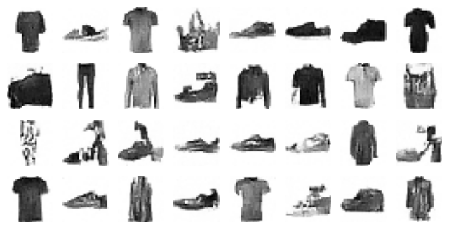

(4,000스텝 DDPM으로 생성한 32장. 티셔츠·샌들·가방·운동화·바지·셔츠·하이힐·부츠·드레스 등 **거의 모든 클래스**가 섞여 있고, 상당수는 진짜와 구별하기 어렵다)

**결과 해석**

- GAN(8절)과 비교하면 **다양성**이 확연히 좋다(GAN은 상의 위주였다). 품질도 VAE·GAN보다 선명하고 자연스럽다
- 노트북 설명대로 확산 모델은 GAN보다 다양하고 품질이 좋으며 훈련이 훨씬 안정적이지만, 생성이 **훨씬 느리다** — 32장을 만드는 데 모델을 4,000번 불렀다(GAN은 1번)

> 📌 보충 측정 (CPU, 배치 32, 같은 U-Net): DDPM 4,000스텝 **171.8초**, DDIM 500스텝 24.0초, DDIM 50스텝 2.2초. 스텝당 약 43 ~ 48ms로 일정해서, 생성 시간은 **모델 호출 횟수에 정비례**한다. 같은 이미지 32장을 GAN 생성자는 한 번의 순전파로 만든다.

### 9-9. DDIM으로 더 빠르게 생성하기

> 🎯 **목적** — 같은 모델을 다시 훈련하지 않고, 스텝을 건너뛰는 DDIM 샘플러로 생성 속도를 높인다.

**개념·원리**

**DDIM**(denoising diffusion implicit models, 송 등, 2020)은 DDPM으로 훈련한 모델을 **그대로** 쓰면서, 생성 과정을 "잡음을 예측 → 깨끗한 이미지 $\hat{x}_0$을 추정 → 다음 시점으로 다시 섞기"로 바꾼다. 다음 시점이 바로 앞($t-1$)일 필요가 없어 **스텝을 건너뛸** 수 있다.

$$
\hat{x}_0 = \frac{x_t - \sqrt{1 - \bar\alpha_t}\,\hat\varepsilon}{\sqrt{\bar\alpha_t}}, \qquad
x_{t'} = \sqrt{\bar\alpha_{t'}}\,\hat{x}_0 + \sqrt{1 - \bar\alpha_{t'} - \sigma_t^2}\;\hat\varepsilon + \sigma_t z \qquad (t' < t)
$$

- 첫 항: 추정한 원본을 시점 $t'$ 수준으로 / 둘째 항: 예측한 잡음 방향으로 / 셋째 항: 새 무작위 잡음
- $\eta$로 무작위성을 조절한다. $\eta = 0$이면 $\sigma_t = 0$ → 완전히 **결정적**(같은 시작 잡음 → 같은 이미지), $\eta = 1$이면 DDPM과 비슷한 확률적 샘플링

**코드**

```python
def generate_ddim(model, batch_size=32, num_steps=50, eta=0.85):
    model.eval()
    with torch.no_grad():
        xt = torch.randn([batch_size, 1, 28, 28], device=device)
        times = torch.linspace(T - 1, 0, steps=num_steps + 1).long().tolist()
        for t, t_prev in zip(times[:-1], times[1:]):
            print(f"\rt = {t}", end=" ")
            t_batch = torch.full((batch_size, 1), t, device=device)
            sample = DiffusionSample(xt, t_batch)
            eps_pred = model(sample)
            x0 = ((xt - (1 - alpha_bars[t]).sqrt() * eps_pred)
                  / (alpha_bars[t].sqrt()))
            abar_t_prev = alpha_bars[t_prev]
            variance = eta * (1 - abar_t_prev) / (1 - alpha_bars[t]) * betas[t]
            sigma_t = variance.sqrt()
            pred_dir = (1 - abar_t_prev - sigma_t**2).sqrt() * eps_pred
            noise = torch.randn_like(xt)
            xt = abar_t_prev.sqrt() * x0 + pred_dir + sigma_t * noise

        return torch.clamp((xt + 1) / 2, 0, 1)  # from [–1, 1] range to [0, 1]

torch.manual_seed(42)  # extra code – ensures reproducibility
X_gen_ddim = generate_ddim(diffusion_model, num_steps=500)
# t = 7

plot_multiple_images(X_gen_ddim, 8)
plt.show()
```

| 코드 | 의미 |
|---|---|
| `torch.linspace(T - 1, 0, steps=num_steps + 1).long()` | 3,999에서 0까지 균등 간격 시점 501개 → 500스텝. $T$ = 4,000은 $\bar\alpha = 0$이라 $\hat{x}_0$을 계산할 때 0으로 나누게 되므로 3,999부터 시작한다 |
| `zip(times[:-1], times[1:])` | (현재 시점, 다음 시점) 쌍. 한 번에 약 8스텝씩 건너뛴다 |
| `x0 = (xt - sqrt(1 - ᾱ_t) * eps) / sqrt(ᾱ_t)` | 9-4절 `original_image()`와 같은 식으로 원본 추정 |
| `variance = eta * ... * betas[t]` | 무작위 잡음의 분산 $\sigma_t^2$ |
| `pred_dir` | 예측 잡음 방향 $\sqrt{1 - \bar\alpha_{t'} - \sigma_t^2}\,\hat\varepsilon$ |
| `num_steps=500` | DDPM 4,000스텝의 1/8 → 약 8배 빠르다 |
| 출력 `t = 7` | 마지막 루프의 현재 시점(다음 시점이 0) |

> ⚠️ DDIM 논문의 분산은 $\sigma_t^2 = \eta^2 \frac{1 - \bar\alpha_{t'}}{1 - \bar\alpha_t}\left(1 - \frac{\bar\alpha_t}{\bar\alpha_{t'}}\right)$다. 노트북은 $\eta$를 제곱하지 않고, 마지막 괄호 대신 한 스텝짜리 $\beta_t$를 쓴다. 스텝을 건너뛸 때 $\beta_t$는 $1 - \bar\alpha_t/\bar\alpha_{t'}$보다 훨씬 작으므로, 노트북 샘플러는 논문의 $\eta$ = 0.85보다 **잡음을 덜 넣는**(결정적인 DDIM 쪽에 가까운) 샘플러다. 보충 계산으로 500스텝 중 $t$ = 3,199 → 3,191 스텝의 σ는 노트북 0.045, 논문 식 0.117이다. 여전히 올바르게 동작하는 샘플러이고, 9-12절 보충의 η = 0 DDIM과 비슷하다.

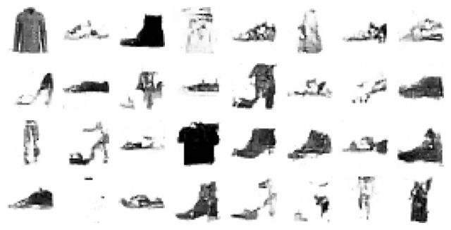

(500스텝 DDIM으로 생성한 32장. 하이힐·샌들·운동화·부츠가 많고, 옷도 섞여 있다. DDPM보다 흰 배경이 많고 일부 이미지는 덜 완성됐다)

**결과 해석**

- 스텝 수를 1/8로 줄여도 그럴듯한 이미지가 나온다. 품질은 DDPM 4,000스텝보다 조금 떨어지고(일부는 형태가 덜 잡혔다), 신발이 많이 나오는 등 분포가 약간 다르다
- DDIM은 **재훈련 없이** 샘플러만 바꾸는 기법이라, 이미 훈련한 확산 모델 어디에나 쓸 수 있다. 실제로는 20 ~ 50스텝을 흔히 쓴다

### 9-10. 잠재 확산과 스테이블 디퓨전

> 🎯 **목적** — 큰 이미지를 다루는 잠재 확산 모델의 구조를 이해하고, 허깅 페이스 `diffusers`로 사전 훈련된 텍스트–이미지 모델을 사용한다.

**개념·원리**

512 × 512 × 3 이미지에서 픽셀 공간 확산을 하면 U-Net이 너무 크고 느리다. **잠재 확산**(롬바흐 등, 2022, 스테이블 디퓨전의 기반)은 확산을 **오토인코더의 잠재 공간**에서 한다.

```
훈련:  이미지 512×512×3 ──VAE 인코더──> 잠재 64×64×4 (48배 작다)
                                           └─ 여기서 확산 모델(U-Net) 훈련
                    텍스트 프롬프트 ──CLIP 텍스트 인코더──> 임베딩 ──(크로스 어텐션)──> U-Net

생성:  잠재 잡음 64×64×4 ──U-Net이 텍스트를 보며 잡음 제거 × N스텝──> 잠재
                         ──VAE 디코더──> 512×512 이미지
```

| 구성 요소 | 이 장(또는 앞 장)에서 본 것 |
|---|---|
| VAE (이미지 ↔ 잠재) | 7절의 VAE. 잠재 공간이 작고 매끄러워 확산하기 좋다 |
| U-Net 잡음 예측기 | 9-6절의 U-Net + 어텐션 층 |
| 텍스트 조건 | [16장 CLIP](16_vision_and_multimodal_transformers.md)의 텍스트 인코더 출력을 [15장](15_transformers_for_nlp_and_chatbots.md)의 **크로스 어텐션**으로 U-Net에 주입 |
| 분류기 없는 가이던스 (CFG) | 텍스트가 있을 때와 없을 때의 잡음 예측 차이를 `guidance_scale`배로 키워 프롬프트를 더 강하게 따르게 한다 |

**코드**

```python
from diffusers import AutoPipelineForText2Image

pipe = AutoPipelineForText2Image.from_pretrained(
    "stabilityai/sd-turbo", variant="fp16", dtype=torch.float16)
pipe.to(device)
prompt = "A closeup photo of an orangutan reading a book"

torch.manual_seed(42)
image = pipe(prompt=prompt, num_inference_steps=1, guidance_scale=0.0).images[0]
image.save("my_orangutan_reading.png")
plt.imshow(image)
plt.axis("off")
plt.show()
```

| 코드 | 의미 |
|---|---|
| `diffusers` | 허깅 페이스의 확산 모델 라이브러리. `transformers`처럼 허브에서 모델을 내려받아 파이프라인으로 쓴다 |
| `AutoPipelineForText2Image` | 모델 종류를 보고 알맞은 텍스트 → 이미지 파이프라인(텍스트 인코더 + U-Net + VAE + 스케줄러)을 자동으로 구성 |
| `"stabilityai/sd-turbo"` | 스테이블 디퓨전 2.1을 **적대적 확산 증류**(ADD)로 1 ~ 4스텝 생성이 가능하게 만든 모델. 확산 모델을 학생으로, 판별자(GAN)와 원래 확산 모델(교사)을 함께 써서 증류했다 |
| `variant="fp16", dtype=torch.float16` | 반정밀도 가중치 파일을 받아 반정밀도로 올린다 → 메모리·다운로드 절반 |
| `num_inference_steps=1` | 잡음 제거 **1스텝**만 (일반 스테이블 디퓨전은 20 ~ 50스텝) |
| `guidance_scale=0.0` | CFG를 끈다. SD-Turbo는 가이던스 없이 쓰도록 훈련됐다(CFG를 쓰면 조건 없는 예측까지 2번 호출해야 해서 느리다) |
| `.images[0]` | PIL 이미지 리스트의 첫 장 → `image.save()`로 파일 저장 |


(프롬프트 "A closeup photo of an orangutan reading a book"로 1스텝 생성한 이미지. 오랑우탄의 얼굴 털·주름은 사진처럼 사실적이고, 손에 든 책도 보인다. 책의 글자는 알아볼 수 없는 무늬다)

**결과 해석**

- 잡음 제거 1스텝만으로 사실적인 이미지가 나왔다. 증류 덕분에 확산 모델의 "느리다"는 약점을 상당 부분 극복했다
- 책의 글자처럼 **세밀한 구조**(텍스트, 손가락 개수)는 여전히 생성 모델이 약한 부분이다

> ⚠️ `pipe.to("cuda")` 기준 GPU 메모리가 몇 GB 필요하다. CPU에서도 돌아가지만 float16 연산이 느리거나 지원되지 않을 수 있어 `dtype=torch.float32`로 바꿔야 할 수 있다. 처음 실행하면 모델 파일(몇 GB)을 내려받는다.

### 9-11. 보충 자료: 플로 매칭

> 🎯 **목적** — 노트북의 보충 자료(Extra Material)인 플로 매칭을, 확산 모델 코드를 거의 그대로 재사용해 구현한다.

**개념·원리**

플로 매칭(립먼 등, 2022, 메타 AI·바이츠만 연구소)은 확산 모델의 대안으로 빠르게 퍼지고 있다. 노트북 설명대로 더 빠르고, 비슷하거나 더 좋은 품질에 계산이 적게 들며, **결정적**이다.

| | 확산 (DDPM) | 플로 매칭 |
|---|---|---|
| 잡음 ↔ 데이터 경로 | 가우스 잡음을 조금씩 섞는 확률 과정 (곡선) | **직선** $x_t = (1-t)\,x_0 + t\,x_1$ ($x_0$ 잡음, $x_1$ 데이터) |
| 모델이 예측하는 것 | 잡음 $\varepsilon$ | **속도** $v = x_1 - x_0$ (직선의 방향) |
| 생성 | 역방향 확률 과정 (DDPM) | 미분 방정식 $\frac{dx}{dt} = v(x_t, t)$를 $t$ = 0 → 1로 적분 (오일러 방법) |
| 시간 방향 | $t$ = $T$(잡음) → 0(데이터) | $t$ = 0(잡음) → 1(데이터) |

경로가 직선이라 큰 보폭으로 적분해도 덜 벗어난다 → 적은 스텝으로 생성할 수 있다. 스테이블 디퓨전 3 같은 최신 모델이 이 방식(정류 흐름, rectified flow)을 쓴다.

**코드**

```python
FlowMatchingSample = DiffusionSample  # we can simply reuse this class!

class FlowDataset:
    def __init__(self, dataset):
        self.dataset = dataset

    def __getitem__(self, i):
        x1, _ = self.dataset[i]
        x1 = (x1 * 2) - 1  # scale from –1 to 1
        x0 = torch.randn_like(x1)  # Gaussian noise
        t = torch.randint(1, T + 1, size=[1])
        t_cont = t / T  # t_cont ranges from 0 to 1
        xt = (1 - t_cont) * x0 + t_cont * x1  # linear interpolation
        velocity = x1 - x0
        return FlowMatchingSample(xt, t), velocity

    def __len__(self):
        return len(self.dataset)

train_set = FlowDataset(train_data)
train_loader = DataLoader(train_set, batch_size=32, shuffle=True)
valid_set = FlowDataset(valid_data)
valid_loader = DataLoader(valid_set, batch_size=32)

FlowMatchingModel = DiffusionModel  # we can also reuse this class!

torch.manual_seed(42)
flow_model = FlowMatchingModel().to(device)
optimizer = torch.optim.NAdam(flow_model.parameters(), lr=4e-3)
history = train(flow_model, optimizer, huber, rmse, train_loader,
                valid_loader, n_epochs=10)
# Epoch 1/10,   train loss: 0.1715, train metric: 0.617, valid metric: 0.587
# Epoch 2/10,   train loss: 0.1430, train metric: 0.561, valid metric: 0.553
# ...
# Epoch 10/10,  train loss: 0.1244, train metric: 0.523, valid metric: 0.519
```

| 코드 | 의미 |
|---|---|
| `FlowMatchingSample = DiffusionSample` | 입력은 똑같이 (중간 이미지, 시점) → 클래스 재사용 |
| `t / T` | 정수 시점 1 ~ 4,000을 연속 시간 0 ~ 1로. 모델에는 **정수** `t`를 넘겨 `TimeEncoding` 표를 그대로 쓴다 |
| `(1 - t_cont) * x0 + t_cont * x1` | 잡음과 이미지를 직선으로 섞는다. 확산의 지름길 공식과 달리 계수가 선형이다 |
| `velocity = x1 - x0` | 타깃 = 속도. 이미지와 같은 형태 → 확산 모델의 출력(잡음)과 형태가 같아 **모델도 그대로 재사용** |
| 검증 RMSE 0.519 | 속도 $x_1 - x_0$의 표준 편차가 1보다 커서(잡음 + 이미지) 잡음 예측 RMSE(0.286)와 직접 비교할 수 없다 |

```python
def sample_flow(model, n_samples=32, n_steps=100, device=device):
    model.eval()
    x = torch.randn(n_samples, 1, 28, 28, device=device)
    for i in range(n_steps):
        with torch.no_grad():
            t_int = torch.full((n_samples, 1), int(i / n_steps * T),
                               dtype=torch.long, device=device)
            velocity = model(FlowMatchingSample(x, t_int))
            x = x + velocity / n_steps
    return x.clamp(-1, 1)

torch.manual_seed(42)
X_gen_flow = sample_flow(flow_model)
plot_multiple_images(X_gen_flow, 8)
plt.show()
```

| 코드 | 의미 |
|---|---|
| `x = torch.randn(...)` | $t$ = 0의 잡음에서 출발 |
| `int(i / n_steps * T)` | 스텝 $i$의 연속 시간 $i/100$을 정수 시점(0, 40, 80, …, 3,960)으로 |
| `x = x + velocity / n_steps` | **오일러 방법**: 위치 += 속도 × 보폭($dt$ = 1/100) |
| `x.clamp(-1, 1)` | −1 ~ 1로 자른다. `plot_image()`의 `imshow`가 이미지마다 값 범위를 자동으로 맞추므로 0 ~ 1로 바꾸지 않아도 그림은 같다 |

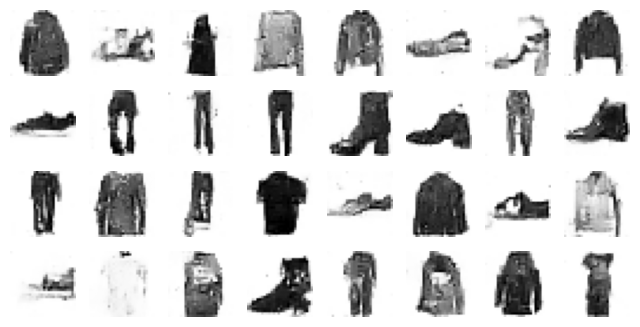

(오일러 100스텝으로 생성한 32장. 재킷·운동화·바지·부츠·셔츠 등 여러 클래스가 나온다. 확산 모델(4,000스텝, 20에포크)보다 거칠지만 훈련 10에포크, 생성 100스텝이다)

**결과 해석**

- 확산 모델과 **같은 U-Net**, 절반의 훈련(10에포크), 1/40의 생성 스텝(100)으로 여러 클래스의 그럴듯한 이미지를 만들었다
- 생성은 무작위성 없이 **결정적**이다: 시작 잡음이 같으면 결과도 같다(DDIM η = 0과 비슷)

### 9-12. 보충 코드: 2D 장난감으로 본 DDPM·DDIM·플로 매칭

> 🎯 **목적** — 2D "두 개의 반달" 데이터에서 잡음 예측 모델(DDPM)과 속도 모델(플로 매칭)을 훈련하고, 샘플러별 결과와 **궤적**을 그려 차이를 눈으로 본다.

**보충 코드**

```python
# 보충 코드 (요약) — 2D 점에 대해 MLP(2 + 시간 특성 16 → 128 × 3 → 2), 각각 8,000스텝 훈련
from sklearn.datasets import make_moons
T = 1000; alphas, betas, abar = variance_schedule(T)          # 9-2절 함수 그대로

# DDPM 훈련: 잡음 예측          # 플로 매칭 훈련: 속도 예측
t = torch.randint(1, T + 1, (512, 1))                          # t = torch.rand(512, 1)
xt = abar[t].sqrt() * x1 + (1 - abar[t]).sqrt() * eps          # xt = (1 - t) * x0 + t * x1
loss = ((net(xt, t / T) - eps) ** 2).mean()                    # loss = ((net(xt, t) - (x1 - x0)) ** 2).mean()

# 샘플러: generate_ddpm (1,000스텝), generate_ddim (η = 0, 50·10스텝, x̂0을 [−2.5, 2.5]로 자름),
#         sample_flow (오일러 100·10스텝) — 같은 시작 잡음 2,000개
# 품질 지표: 진짜 2,000점과의 MMD (가우스 커널, 작을수록 비슷. 진짜끼리 비교하면 0.0002)
```

| 샘플러 | 모델 호출 수 | MMD |
|---|---|---|
| DDPM | 1,000 | **0.0004** |
| DDIM (η = 0) | 50 | 0.0026 |
| DDIM (η = 0) | 10 | 0.0147 |
| 플로 매칭 (오일러) | 100 | 0.0008 |
| 플로 매칭 (오일러) | 10 | **0.0028** |

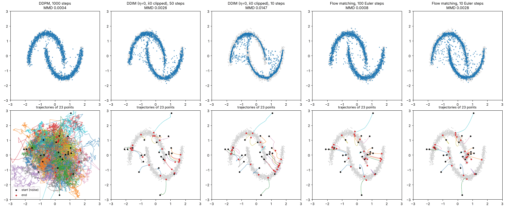

(위: 회색 = 진짜 데이터(두 개의 반달), 파랑 = 생성한 2,000점. 아래: 같은 시작 잡음 23개(검정)가 생성 과정에서 이동한 경로와 도착점(빨강). DDPM은 매 스텝 새 잡음을 더해 경로가 **지그재그 무작위 보행**이고, DDIM(η = 0)과 플로 매칭은 **매끄러운 곡선**이며, 플로 매칭의 경로가 가장 곧다. 10스텝 DDIM은 반달 사이에 점이 흩어진다)

**결과 해석**

- DDPM은 1,000스텝을 쓰면 가장 정확하지만 경로가 무작위라 스텝을 줄일 수 없다
- DDIM은 같은 DDPM 모델로 결정적인 경로를 따라가 스텝을 50개로 줄여도 쓸 만하다. 10스텝까지 줄이면 품질이 크게 떨어진다
- 플로 매칭은 경로가 거의 **직선**이라, 10스텝에서도 MMD 0.0028로 DDIM 50스텝(0.0026)과 비슷하다 → "직선 경로 = 적은 스텝"
- ⚠️ 보충 실험에서 DDIM은 처음 몇 스텝($\bar\alpha_t \approx 0$)에서 $\hat{x}_0 = (x_t - \sqrt{1-\bar\alpha_t}\hat\varepsilon)/\sqrt{\bar\alpha_t}$의 분모가 0에 가까워 값이 폭주했다. 그래서 $\hat{x}_0$을 데이터 범위로 **잘라 냈다**(실전 구현의 `clip_sample` 옵션과 같은 처리). 노트북 이미지 생성은 마지막에만 `clamp`한다

---

## 10. 연습문제

노트북의 연습문제 풀이 부분은 "Work in progress"(준비 중)로 비어 있다. 풀이가 공개되면 이 절에 추가한다. 대신 이 장의 핵심을 스스로 점검할 수 있도록 **직접 만든 확인 문제**를 정리해 둔다(교재 연습문제가 아니다).

| 번호 | 질문 | 답 요약 | 관련 절 |
|---|---|---|---|
| 1 | 오토인코더의 주요 쓰임새는 | 차원 축소·시각화, 특성 추출과 비지도 사전 훈련, 이상치 탐지, 잡음 제거, (VAE 등) 새 데이터 생성 | 1-2 |
| 2 | 과소완전과 과대완전 오토인코더의 차이, 과대완전의 위험과 대책 | 코딩 차원이 입력보다 작은가/크거나 같은가. 과대완전은 입력을 그대로 복사(항등 함수)할 수 있다 → 잡음 제거·희소성 같은 제약을 건다 | 1-2, 5, 6 |
| 3 | 재구성이 완벽한 오토인코더는 좋은 오토인코더인가. 성능을 어떻게 평가하나 | 아니다. 항등 함수를 배웠다면 코딩이 쓸모없다. 재구성 오차와 함께 **코딩을 쓰는 하위 작업**(분류 정확도, 이상치 탐지 성능)으로 평가한다 | 1-1, 3-8 |
| 4 | 활성화 함수 없는 오토인코더 + MSE가 PCA와 "같다"는 말의 정확한 뜻 | 디코더가 펼치는 부분 공간이 PCA 주성분 공간과 같고 재구성 오차도 같다(보충: 각도 0°, MSE 0.0212). 코딩 좌표는 주성분 좌표의 임의 선형 변환 | 2-3 |
| 5 | 784 → 128 → 32 → 128 → 784 오토인코더의 파라미터 수와, 가중치를 묶으면 | 209,968 → 105,520 (디코더는 편향 128 + 784 = 912개만) | 3-1, 3-7 |
| 6 | 오토인코더로 이상치를 찾는 원리와 노트북 결과 | 정상 데이터로만 훈련하면 처음 보는 종류는 재구성 오차가 크다. 패션 MNIST AE에서 MNIST 숫자는 MSE 약 0.06, 옷은 약 0.01 | 3-5 |
| 7 | 32차원 코딩에 t-SNE를 쓴 이유 | 오토인코더가 잡음을 거른 저차원 표현에서 t-SNE가 빠르고 군집이 잘 드러난다. 오토인코더만으로 2D까지 줄이면 품질이 나쁘다 | 3-6 |
| 8 | `ConvTranspose2d(16, 32, 3, stride=2)`에 3 × 3을 넣으면 출력 크기는. `padding=1, output_padding=1`이면 7 → | $(3-1) \times 2 + 3 = 7$. $(7-1) \times 2 - 2 + 3 + 1 = 14$ | 4-1 |
| 9 | 잡음 제거 오토인코더에서 손상 층이 인코더 **안**에 있는 이유와, 검증 때 어떻게 되나 | 타깃(깨끗한 원본)은 그대로 두고 입력만 망가뜨리려고. `Dropout`·`GaussianNoise`는 `eval()` 모드에서 꺼져 깨끗한 입력을 그대로 쓴다 | 5-1, 5-2 |
| 10 | 희소 오토인코더에서 KL 발산이 MSE보다 나은 이유 | 목표 희소도에서 멀어지면 더 가파르게 커지고, $q \to 0$(유닛이 죽음)도 강하게 막는다. MSE는 목표 근처에서 너무 평평하다 | 6-1 |
| 11 | 희소성 손실은 코딩의 무엇을 목표에 맞추나 | 유닛별 **배치 평균 활성화** $q_j$를 목표 $p$(0.1)에. 노트북 결과 전체 평균 0.1016 | 6-1, 6-3 |
| 12 | VAE 인코더가 σ 대신 log σ²를 출력하는 이유 | σ는 양수여야 하지만 log σ²는 아무 실수 → 활성화 함수가 필요 없고 수치적으로 안정적 | 7-1 |
| 13 | 재매개변수화 트릭이 필요한 이유와 식 | 샘플링은 μ, σ에 대해 미분할 수 없다. $z = \mu + \sigma \odot \varepsilon$로 무작위성을 ε에 몰아 μ, σ로 그레이디언트가 흐르게 한다 | 7-1, 7-4 |
| 14 | `vae_loss`에서 KL을 784로 나누는 이유 | `F.mse_loss`가 픽셀 784개 평균이라, 이미지당 "제곱 오차 합 + KL"과 같은 비율로 맞추려고 | 7-3 |
| 15 | 보통 오토인코더로는 새 이미지를 잘 생성할 수 없는 이유 | 코딩이 어디에 얼마나 퍼질지 정해져 있지 않아(보충: 평균 (1.7, −7.7), 표준 편차 5) 어디서 샘플링할지 모르고 빈틈이 많다. VAE는 잠재 손실로 $\mathcal{N}(0, I)$ 근처에 빈틈 없이 모은다 | 7-7 |
| 16 | Gumbel-softmax에서 온도를 낮추면, `hard=True`의 의미는 | τ → 0이면 원-핫에 가까워진다(이산적), 높으면 균등에 가깝다. `hard=True`는 순전파 원-핫, 역전파 부드러운 그레이디언트(스트레이트 스루) | 7-8 |
| 17 | GAN 훈련 2단계에서 가짜 이미지의 레이블을 1로 주는 이유와, 판별자 가중치를 고정하는 이유 | 판별자가 가짜를 진짜라고 하도록 생성자를 바꾸려고. 고정하지 않으면 판별자가 "가짜를 진짜로" 배우며 망가진다 | 8-1, 8-3 |
| 18 | 모드 붕괴란, 대책은 | 생성자가 다양성을 잃고 몇 가지만(극단적으로 한 점) 만들며 모드 사이를 옮겨 다니는 현상. 경험 재생, 미니배치 판별(ProGAN의 미니배치 표준 편차), 손실·규제 변경, 학습률 조정 | 8-4, 8-5 |
| 19 | DCGAN의 핵심 가이드라인 | 스트라이드 합성곱·전치 합성곱(풀링 X), 배치 정규화, 완전 연결 은닉 층 제거, 생성자 ReLU + 출력 tanh, 판별자 LeakyReLU | 8-6 |
| 20 | StyleGAN의 매핑 네트워크와 잡음 입력의 역할 | 매핑 네트워크(z → w)는 잠재 공간의 얽힘을 풀고 층마다 AdaIN으로 스타일을 준다. 잡음 입력은 머리카락 같은 확률적 세부를 담당 | 8-7 |
| 21 | 확산 모델이 예측하는 것과 손실 | 잡음 낀 이미지 $x_t$와 시점 $t$를 받아 더해진 잡음 $\varepsilon$을 예측. 손실은 잡음 예측의 MSE(노트북은 Huber) | 9-1, 9-7 |
| 22 | 순방향 지름길 공식과, 그것이 훈련을 빠르게 하는 이유 | $x_t = \sqrt{\bar\alpha_t}x_0 + \sqrt{1-\bar\alpha_t}\varepsilon$. 무작위 $t$의 $x_t$를 한 번에 만들어 이미지당 모델 1회로 훈련 | 9-3 |
| 23 | 코사인 스케줄이 선형 스케줄보다 나은 점 | 선형은 $\bar\alpha_t$가 너무 빨리 0이 되어 후반 스텝이 순수 잡음만 다룬다(절반 지점 0.079). 코사인은 1 → 0으로 고르게(절반 지점 0.49) | 9-2 |
| 24 | 시간 인코딩을 U-Net에 어떻게 넣나 | 사인/코사인 64차원 → 블록마다 `Linear`로 채널 수에 맞춤 → `[:, :, None, None]`으로 모든 픽셀에 더한다 | 9-5, 9-6 |
| 25 | DDPM과 DDIM의 차이. DDIM은 재훈련이 필요한가 | DDPM은 매 스텝 새 잡음을 더하며 $T$스텝 전부 밟는다. DDIM은 $\hat{x}_0$을 추정해 건너뛰며 η = 0이면 결정적. 같은 모델을 **재훈련 없이** 쓴다 | 9-8, 9-9 |
| 26 | 확산 모델의 장단점(GAN 대비) | 장점: 훈련이 안정적(회귀 문제), 품질·다양성 우수. 단점: 생성이 느리다(모델 호출 수백 ~ 수천 번) → DDIM, 잠재 확산, 증류(SD-Turbo), 플로 매칭 | 9-8, 9-10, 9-11 |
| 27 | 잠재 확산이 픽셀 공간 확산보다 빠른 이유 | 오토인코더(VAE) 잠재 공간(512 × 512 × 3 → 64 × 64 × 4, 48배 작다)에서 확산한다 | 9-10 |
| 28 | 플로 매칭의 훈련 타깃과 생성 방법, 적은 스텝으로 되는 이유 | 직선 경로 $x_t = (1-t)x_0 + tx_1$ 위의 속도 $x_1 - x_0$을 예측. 생성은 오일러 적분. 경로가 곧아 큰 보폭에도 덜 벗어난다(보충: 10스텝 MMD 0.0028) | 9-11, 9-12 |

> 💡 직접 해 볼 만한 실습: ① 합성곱 오토인코더의 인코더를 동결하고 분류 층을 붙여, 레이블 500장으로 패션 MNIST 분류기를 훈련해 처음부터 훈련한 것과 비교(3-8절). ② VAE의 `kl_weight`를 0.1, 1, 10으로 바꿔 재구성과 생성 이미지가 어떻게 달라지는지 보기(7-3절). ③ DCGAN의 판별자를 LeakyReLU로, 생성자 출력을 tanh(이미지를 −1 ~ 1로 스케일)로 바꿔 가이드라인대로 훈련해 보기(8-6절). ④ `generate_ddim()`의 `num_steps`를 10, 50, 500으로 바꿔 품질과 시간 비교(9-9절).

---

## 11. 정리

### 11-1. 전체 흐름

```
[18.1 효율적인 데이터 표현]  패턴을 찾으면 짧게 기억한다
구조     : 입력 ─인코더─> 코딩 ─디코더─> 재구성, 손실 = 재구성 MSE (레이블 불필요)
제약     : 과소완전(좁은 코딩) / 과대완전이면 잡음·희소성 등 다른 제약 필요

[18.2 선형 오토인코더 = PCA]
nn.Linear(3, 2) + nn.Linear(2, 3), MSE, NAdam(lr=0.2), 20에포크 → 검증 RMSE 0.202
보충: 충분히 훈련하면 재구성 MSE = PCA (0.0212 / 0.0261), 부분 공간 각도 0°, 좌표는 임의 선형 변환

[18.3 적층 오토인코더]  784 → 128 → 32 → 128 → 784 (209,968 파라미터)
훈련     : AutoencoderDataset (x, x), NAdam(0.01), 10에포크 → 검증 RMSE 0.120
재구성   : 모양은 살고 무늬는 사라짐 (24.5배 압축)
이상치   : MNIST 재구성 MSE ~0.06 vs 패션 ~0.01 → 임곗값으로 분리
시각화   : 인코더(32차원) → TSNE(init="pca") → 바지·신발·가방은 분리, 상의끼리 겹침
가중치 묶기 : F.linear(X, enc.weight.t(), bias) → 105,520 파라미터, 검증 RMSE 0.112
사전 훈련 : 인코더 재사용 + 분류 층, 적은 레이블로 미세 튜닝 (BERT·MAE의 원조)

[18.4 합성곱 오토인코더]  Conv+MaxPool (28→14→7→3→1) / ConvTranspose (3→7→14→28)
55,921 파라미터, 검증 RMSE 0.107 (가장 효율적)
보충: 순환(LSTM) 오토인코더 303,676 파라미터, 0.109

[18.5 잡음 제거 오토인코더]  인코더 맨 앞에 Dropout(0.5) / GaussianNoise(0.5) (훈련 때만)
검증 RMSE 0.131 / 0.132 (깨끗한 입력 기준)
보충: 잡음 입력 → 원본 RMSE  보통 AE 0.198 vs 잡음 제거 AE 0.157 (잡음 자체 0.500)

[18.6 희소 오토인코더]  코딩 256(시그모이드) + KL(p=0.1 ‖ 배치 평균 q) × 1e-3
검증 RMSE 0.0911, 평균 활성화 0.1016, 6번 유닛 = 신발 감지기

[18.7 변분 오토인코더]  인코더 → (μ, log σ²) → z = μ + σ⊙ε → 디코더
손실     : MSE + KL.mean()/784,  KL = −½Σ(1 + log σ² − σ² − μ²)
결과     : 검증 RMSE 0.15 (재구성은 나빠짐), randn(21, 32) → decode → 새 옷 이미지
시맨틱 보간 : torch.lerp(z_a, z_b, w) → 운동화 → 바지로 서서히
보충     : KL 닫힌 형태 = 몬테카를로, 재매개변수화 그레이디언트 = 이론값
           2D 잠재 공간: AE 코딩은 제멋대로, VAE는 N(0, I)에 빈틈없이 → 격자 디코딩이 매끄럽다
이산 VAE : 로짓 [B, 32, 16] → F.gumbel_softmax(hard=True) → 원-핫 → 디코더
           KL(q ‖ 균등) = Σ q(log q + log k), 온도 1 → 0.145 어닐링, 검증 RMSE 0.168

[18.8 GAN]  생성자(잡음 → 이미지) vs 판별자(이미지 → 진짜 확률)
훈련     : ① D: BCE(D(x), 1) + BCE(D(G(z).detach()), 0)  ② G: BCE(D(G(z)), 1), D requires_grad=False
MLP GAN  : G 238,736 / D 233,985, 20에포크 → 점박이 상의·바지 (다양성 부족)
어려움   : 내시 균형 찾기 어려움, 모드 붕괴, 진동, 하이퍼파라미터 민감 (시드 41)
           대책: 경험 재생, 미니배치 판별, WGAN·스펙트럼 정규화, DCGAN 규칙
보충     : 2D 가우스 8개 — 균형(lr 1e-3/1e-3, β1=0.5) 8/8 모드, G 10배 빠르면 한 점으로 붕괴
DCGAN    : Linear → [128,7,7] → BN → ConvT → [64,14,14] → BN → ConvT → [1,28,28]
           판별자 Conv(s=2)+Dropout(0.4) → 매끄러운 이미지
ProGAN   : 4×4부터 점진적 성장, 미니배치 표준 편차, 동일 학습률, 픽셀별 정규화
StyleGAN : 매핑 네트워크 z → w, AdaIN 스타일 주입, 잡음 입력, 스타일 혼합

[18.9 확산 모델]  잡음을 더하는 건 쉽다 → 빼는 법(잡음 예측)을 배운다
스케줄   : 코사인 ᾱ_t, T = 4000, β = 1 − ᾱ_t/ᾱ_{t−1} (clamp 0.999)
지름길   : x_t = √ᾱ_t x₀ + √(1−ᾱ_t) ε → DiffusionDataset이 무작위 t와 ε 타깃 생성
모델     : TimeEncoding(사인/코사인 64) + U-Net(분리 합성곱, 교차 스킵, 시간 더하기), 279,329 파라미터
훈련     : HuberLoss, NAdam(3e-3), 20에포크 → 잡음 예측 검증 RMSE 0.286
DDPM     : x_T ~ N(0, I)에서 4,000스텝 역방향 → 다양하고 선명, 그러나 느림
DDIM     : x̂₀ 추정 후 건너뛰기, 500스텝 (재훈련 없음), η = 0이면 결정적
잠재 확산 : VAE 잠재 공간에서 확산 + CLIP 텍스트 크로스 어텐션 + CFG = 스테이블 디퓨전
           sd-turbo(적대적 확산 증류): num_inference_steps=1, guidance_scale=0.0
플로 매칭 : x_t = (1−t)x₀ + t x₁, 타깃 속도 x₁ − x₀, 같은 U-Net, 오일러 100스텝
보충 2D  : DDPM 1,000스텝 MMD 0.0004 / DDIM 50스텝 0.0026 / 플로 10스텝 0.0028
```

### 11-2. 개념과 코드 대응

| 단계 | 핵심 코드 | 핵심 원칙 |
|---|---|---|
| 오토인코더 데이터 | `TensorDataset(X, X)`, `AutoencoderDataset` → `(x, x)` | 입력 = 타깃 |
| 인코더·디코더 | `nn.Sequential(encoder, decoder)` | 인코더를 따로 두면 코딩만 뽑아 쓸 수 있다 |
| 이미지 형태 되돌리기 | `nn.Unflatten(dim=1, unflattened_size=(1, 28, 28))` | 출력을 입력과 같은 형태로 |
| 이미지당 재구성 오차 | `F.mse_loss(y, X, reduction="none").view(len(X), -1).mean(1)` | 이상치 점수 |
| 가중치 묶기 | `F.linear(Z, self.enc.weight.t(), self.dec_bias)` | 디코더 편향만 따로 |
| 전치 합성곱 | `nn.ConvTranspose2d(in, out, 3, stride=2, padding=1, output_padding=1)` | 크기 2배 |
| 훈련 때만 잡음 | `if self.training: X + torch.randn_like(X) * std` | 추론 때는 그대로 |
| 여러 출력 | `namedtuple("AEOutput", ["output", "codings"])` | `train()`은 `.output`만 지표에 |
| 희소성 손실 | `q = codings.mean(0)`, `p*log(p/q) + (1-p)*log((1-p)/(1-q))` | 배치 평균 활성화 기준 |
| VAE 인코더 출력 | `self.encoder(X).chunk(2, dim=-1)` → `(mean, logvar)` | log σ² 출력 |
| 재매개변수화 | `mean + torch.randn_like(std) * torch.exp(0.5 * logvar)` | 무작위성은 ε에 |
| VAE 잠재 손실 | `-0.5 * torch.sum(1 + logvar - logvar.exp() - mean.square(), dim=-1)` | 평균 후 `/ 784` |
| 생성 | `vae.decode(torch.randn(n, codings_dim))` | 디코더만 |
| 시맨틱 보간 | `torch.lerp(z0, z1, torch.linspace(0, 1, n).view(n, 1))` | 잠재 공간에서 섞기 |
| Gumbel-softmax | `F.gumbel_softmax(logits, tau, hard=True)` | 온도 어닐링(`epoch_callback`) |
| 이산 코드 생성 | `F.one_hot(torch.randint(0, k, (n, L)), k).float()` | 균등 사전 분포 |
| 판별자 단계 | `G(z).detach()`, `BCE(D(real), 1) + BCE(D(fake), 0)` | 생성자 고정 |
| 생성자 단계 | `p.requires_grad = False` (D), `BCE(D(G(z)), 1)` | 판별자 고정, 타깃 1 |
| 분산 스케줄 | `alpha_bars = cos(...)**2 / f[0]`, `betas = (1 - f[1:]/f[:-1]).clamp(max=0.999)` | 코사인, 인덱스 0 = 패딩 |
| 순방향 지름길 | `alpha_bars[t].sqrt() * x0 + (1 - alpha_bars[t]).sqrt() * eps` | 타깃은 `eps` |
| 시간 인코딩 주입 | `z + time_adapter(time_enc)[:, :, None, None]` | 모든 픽셀에 더하기 |
| 교차 스킵 | `cross_skips.append(z)` … `torch.cat([z, cross_skips.pop()], dim=1)` | U-Net |
| DDPM 한 스텝 | `1/sqrt(α_t) * (x_t − β_t/sqrt(1−ᾱ_t) * ε̂) + sqrt(β_t) * z` | 마지막 스텝엔 잡음 없음 |
| DDIM 한 스텝 | `x0 = (x_t − sqrt(1−ᾱ_t) ε̂)/sqrt(ᾱ_t)`, `sqrt(ᾱ_t') x0 + sqrt(1−ᾱ_t'−σ²) ε̂ + σ z` | 건너뛰기 가능 |
| 사전 훈련 확산 | `AutoPipelineForText2Image.from_pretrained("stabilityai/sd-turbo", variant="fp16", dtype=torch.float16)` | 1스텝, `guidance_scale=0.0` |
| 플로 매칭 | `xt = (1 - t) * x0 + t * x1`, 타깃 `x1 - x0`, `x = x + v / n_steps` | 직선 경로, 오일러 |

### 11-3. 방법 비교

**오토인코더 (패션 MNIST, 노트북 결과)**

| 모델 | 코딩 크기 | 파라미터 | 에포크 | 검증 RMSE | 특징 |
|---|---|---|---|---|---|
| 적층 | 32 | 209,968 | 10 | 0.120 | 기준 |
| 가중치 묶기 | 32 | 105,520 | 10 | 0.112 | 파라미터 절반, 더 좋음 |
| 합성곱 | 32 | 55,921 | 10 | **0.107** | 가장 효율적 |
| 순환 (LSTM, 보충 자료) | 32 | 303,676 | 10 | 0.109 | 시퀀스용 |
| 잡음 제거 (드롭아웃) | 128 | 234,640 | 10 | 0.131 | 잡음 입력 복원 |
| 잡음 제거 (가우스) | 128 | 234,640 | 10 | 0.132 | 잡음 입력 복원 |
| 희소 | 256 (평균 0.10 활성) | 267,536 | 10 | **0.0911** | 해석 가능한 유닛 |
| VAE | 32 (μ, log σ²) | 214,096 | 20 | 0.150 | 생성 가능, 흐릿함 |
| 이산 VAE | 32 × 16 코드 | 600,080 | 20 | 0.168 | 이미지 토크나이저 |

(파라미터는 보충 계산. 코딩 크기가 달라 RMSE를 그대로 비교하면 안 된다)

**생성 모델**

| | VAE | GAN | 확산 (DDPM) | 플로 매칭 |
|---|---|---|---|---|
| 훈련 목표 | 재구성 + KL (ELBO) | 판별자와의 게임 | 잡음 예측 회귀 | 속도 예측 회귀 |
| 훈련 안정성 | 안정 | **불안정** (모드 붕괴·진동) | 안정 | 안정 |
| 샘플 품질 | 흐릿함 | 선명 | **최고** | 확산과 비슷 |
| 다양성 | 좋음 | 모드 붕괴 위험 | **좋음** | 좋음 |
| 생성 속도 | 디코더 1회 | 생성자 1회 | $T$회 (수백 ~ 수천) | 수십 ~ 수백 회 (직선) |
| 잠재 공간 / 인코더 | 있음 (매끄러움) | 잠재 공간만 (인코더 없음) | 없음 (잡음 = 이미지 크기) | 없음 |
| 이 노트북의 생성 | 21장, 흐릿한 옷 | 점박이 상의 위주 / DCGAN 매끄러움 | 32장, 다양하고 선명 | 32장, 여러 클래스 |

**샘플러 (확산 계열)**

| 샘플러 | 무작위성 | 스텝 | 재훈련 | 비고 |
|---|---|---|---|---|
| DDPM | 매 스텝 새 잡음 | $T$ (4,000) | — | 원래 방법 |
| DDIM | η로 조절 (0이면 결정적) | 임의로 줄임 (500, 50, …) | 불필요 | 같은 모델 그대로 |
| 증류 모델 (SD-Turbo 등) | — | 1 ~ 4 | 필요 (증류) | GAN 판별자 활용 |
| 플로 매칭 + 오일러 | 결정적 | 수십 ~ 100 | 다른 목표로 훈련 | 직선 경로 |

### 11-4. 주요 결과

| 실험 | 지표 | 값 |
|---|---|---|
| 선형 AE (3D → 2D, 20에포크) | 훈련 / 검증 RMSE | 0.169 / 0.202 |
| 선형 AE 수렴 vs PCA (보충) | 훈련 MSE / 검증 MSE / 부분 공간 각도 | 0.0212 = 0.0212 / 0.0261 = 0.0261 / 0° |
| PCA (같은 데이터) | 설명된 분산 비율 | 0.823 + 0.108 = 0.931 |
| 적층 AE | 검증 RMSE (1 → 10에포크) | 0.136 → 0.120 |
| 이상치 탐지 | 이미지당 재구성 MSE 봉우리 | 패션 MNIST ~0.01, MNIST ~0.06 |
| 가중치 묶기 | 파라미터 / 검증 RMSE | 105,520 / 0.112 |
| 합성곱 AE | 파라미터 / 검증 RMSE | 55,921 / 0.107 |
| 순환 AE | 파라미터 / 검증 RMSE | 303,676 / 0.109 |
| 잡음 제거 AE (드롭아웃 / 가우스) | 검증 RMSE | 0.131 / 0.132 |
| 잡음 입력 복원 (보충, σ = 0.5) | 보통 AE / 잡음 제거 AE / 잡음 자체 | 0.198 / 0.157 / 0.500 |
| 희소 AE | 검증 RMSE / 평균 활성화 | 0.0911 / 0.1016 |
| VAE | 검증 RMSE (20에포크) | 0.150 |
| KL 닫힌 형태 vs 몬테카를로 (보충) | 차원 3개 | 0.3089 / 0.5744 / 2.0000 vs 0.3085 / 0.5740 / 1.9983 |
| 재매개변수화 그레이디언트 (보충) | ∂/∂μ, ∂/∂log σ | 1.397, 1.097 (이론 1.4, 1.098) |
| 2D AE vs VAE (보충) | 코딩 평균 / 표준 편차 | AE (1.7, −7.7) / (4.9, 5.5), VAE (0.06, −0.04) / (1.06, 1.09) |
| | 검증 재구성 MSE | AE 0.0281, VAE 0.0287 |
| Gumbel-max (보충, 50만 번) | softmax와 빈도 최대 차이 | 0.0008 |
| 이산 VAE | 검증 RMSE (20에포크) | 0.168 |
| MLP GAN | 1에포크 / 20에포크 손실 (D, G) | (0.91, 7.25) / (0.89, 1.69) |
| DCGAN | 1에포크 / 20에포크 손실 (D, G) | (1.23, 1.04) / (1.03, 1.88) |
| | 파라미터 (G / D) | 708,225 / 55,233 |
| 2D GAN (보충, 3,000스텝) | 덮은 모드: 균형 / 붕괴 설정 | 8/8 / 0 ~ 1/8 |
| 코사인 스케줄 ($T$ = 4,000) | $\bar\alpha$ at 1,000 / 2,000 / 3,000 | 0.847 / 0.494 / 0.144 |
| 선형 스케줄 ($T$ = 1,000) | $\bar\alpha$ at 절반 | 0.079 |
| 순방향 지름길 검증 (보충, 1,000스텝) | 평균 / 표준 편차 | 0.5517 / 0.3918 (이론 0.5522 / 0.3911) |
| U-Net 확산 모델 | 파라미터 | 279,329 |
| | 잡음 예측 검증 RMSE (20에포크) | 0.286 |
| 분리 합성곱 (64 → 128, 3 × 3) | 파라미터 vs 일반 합성곱 | 8,960 vs 73,856 |
| 생성 시간 (보충, CPU, 32장) | DDPM 4,000 / DDIM 500 / DDIM 50스텝 | 171.8초 / 24.0초 / 2.2초 |
| 잡음 예측 RMSE by 시점 (보충, 3에포크) | $t$ = 10 / 1,000 / 3,900 | 0.884 / 0.356 / 0.050 |
| 플로 매칭 | 속도 예측 검증 RMSE (10에포크) | 0.519 |
| 2D 장난감 (보충) MMD | DDPM 1,000 / DDIM 50 / DDIM 10 / 플로 100 / 플로 10 | 0.0004 / 0.0026 / 0.0147 / 0.0008 / 0.0028 |

### 11-5. 자주 쓴 코드 패턴

| 패턴 | 용도 | 위치 |
|---|---|---|
| `TensorDataset(X, X)` / `return x, x` | 입력 = 타깃 데이터셋 | 2-1, 3-2 |
| `nn.Flatten()` … `nn.Unflatten(1, (1, 28, 28))` | 이미지 ↔ 벡터 | 3-1 |
| `torch.stack([x for x, _ in dataset])` | 데이터셋 → 텐서 하나 | 3-4 |
| `.cpu().detach().numpy()` | 그래프에서 떼어 넘파이로 | 2-2 |
| `F.mse_loss(..., reduction="none")` | 원소별 손실 | 3-5 |
| `F.linear(X, W.t(), b)` | 가중치를 직접 넘기는 선형 층 | 3-7 |
| `nn.Parameter(torch.zeros(n))` | 학습되는 텐서 등록 | 3-7 |
| `nn.AdaptiveAvgPool2d((1, 1))` | 전역 평균 풀링 | 4-1 |
| `self.training` | 훈련/추론 모드 분기 | 5-2 |
| `namedtuple(...)` + `isinstance(y, tuple)` | 여러 출력 모델 | 0, 6-1, 7-2 |
| `torch.clamp(q, eps, 1 - eps)` | log 0 방지 | 6-1 |
| `np.percentile(x, 90)` | 상위 10% 경계 | 6-3 |
| `tensor.chunk(2, dim=-1)` | 반으로 나누기 | 7-2 |
| `torch.randn_like(x)` | 같은 형태 잡음 | 5-2, 7-2, 9-3 |
| `torch.lerp(a, b, w)` | 선형 보간 | 7-6 |
| `x.new_tensor(v)` | 같은 장치·자료형 텐서 | 7-8 |
| `F.gumbel_softmax(logits, tau, hard=True)` | 미분 가능한 범주 샘플링 | 7-8 |
| `F.one_hot(idx, num_classes).float()` | 원-핫 | 7-9 |
| `epoch_callback=fn` | 에포크마다 하이퍼파라미터 조정 | 7-9 |
| `.detach()` / `p.requires_grad = False` | 한쪽 네트워크 고정 | 8-3 |
| `torch.ones(B, 1)` / `torch.zeros(B, 1)` | 진짜·가짜 레이블 | 8-3 |
| `torch.gather(a, 0, index=t)` | 배치별 값 조회 | 9-4 |
| `class X(namedtuple(...)): def to(...)` | 장치 이동 가능한 입력 묶음 | 9-4 |
| `self.register_buffer(name, tensor)` | 고정 텐서 등록 | 9-5 |
| `nn.ModuleList()` | 층 리스트 등록 | 9-6 |
| `t[:, :, None, None]` | 채널 벡터를 픽셀마다 브로드캐스팅 | 9-6 |
| `F.interpolate(z, scale_factor=2, mode="nearest")` | 업샘플링 | 9-6 |
| `torch.full((B, 1), t)` | 같은 값으로 채운 텐서 | 9-8 |
| `torch.linspace(T - 1, 0, n + 1).long().tolist()` | 건너뛸 시점 목록 | 9-9 |

### 11-6. 핵심 원칙

1. 오토인코더의 가치는 재구성이 아니라 **코딩**이다. 그대로 베낄 수 없도록 좁히거나(과소완전), 망가뜨리거나(잡음), 꺼 두게 해야(희소) 쓸모 있는 표현을 배운다.
2. 선형 오토인코더는 PCA와 **같은 부분 공간**을 찾는다. 오토인코더의 장점은 비선형 층을 쌓아 휘어진 매니폴드를 배울 때 나온다. 선형이면 PCA가 더 빠르고 정확하다.
3. 이미지에는 **합성곱**이 맞다. 같은 정확도를 1/4의 파라미터로 얻는다(구조에 담긴 귀납적 편향). 대칭 구조에서는 가중치 묶기도 공짜에 가까운 규제다.
4. 재구성 오차는 레이블 없이 쓸 수 있는 **이상치 점수**다. 정상 데이터만으로 훈련하고, 임곗값은 정밀도·재현율 절충으로 정한다.
5. 생성하려면 **어디서 샘플링할지** 알아야 한다. VAE는 잠재 손실로 코딩을 $\mathcal{N}(0, I)$에 모으고, 재매개변수화 트릭으로 샘플링을 미분 가능하게 만든다. 대가는 흐릿한 재구성이다.
6. 이산 변수도 **Gumbel-softmax + 스트레이트 스루**로 역전파할 수 있다. 온도를 점점 낮추면 부드러운 탐색에서 이산적인 선택으로 옮겨 간다.
7. GAN은 최적화가 아니라 **게임**이다. 손실이 내려가지 않고 출렁이며, 모드 붕괴·하이퍼파라미터 민감도가 기본값이다. 두 네트워크의 균형(학습률, 구조, 규제)을 맞추는 것이 핵심이다.
8. 확산 모델은 어려운 생성 문제를 **쉬운 회귀 문제 수천 개**(잡음 예측)로 쪼갠다. 그래서 훈련이 안정적이고 품질·다양성이 좋지만, 생성 때 그만큼 모델을 많이 불러야 한다.
9. 확산 모델의 느림은 **샘플러**(DDIM), **공간**(잠재 확산), **증류**(SD-Turbo), **경로**(플로 매칭의 직선)로 줄인다. 앞의 둘은 같은 모델을 재사용할 수 있다.
10. 생성 모델의 평가는 손실 값만으로 안 된다. 이미지를 직접 보고, 다양성(모드를 모두 덮는가)과 품질을 따로 본다(FID, 보충 실험의 MMD·모드 수).

### 11-7. 5분 셀프 테스트

> 🧠 답을 보기 전에 **소리 내어** 먼저 답해 보자. 막히면 그 개념이 나온 절로 돌아가서 다시 읽고 오면 된다. 정답은 ▶를 눌러 펼친다.

**Q1. 오토인코더가 항등 함수를 배우지 못하게 하는 방법 세 가지는?**

<details><summary>정답 보기</summary>

① 코딩 층을 입력보다 작게(**과소완전**), ② 입력을 손상시키고 깨끗한 원본을 복원하게(**잡음 제거**: 드롭아웃·가우스 잡음), ③ 코딩 대부분이 꺼지도록 손실을 더하기(**희소**: KL 발산 또는 ℓ1). VAE의 잠재 손실도 코딩이 담을 수 있는 정보를 제한한다.

</details>

**Q2. 오토인코더로 이상치를 찾는 방법과, 이 장에서 MNIST 숫자가 걸러진 이유는?**

<details><summary>정답 보기</summary>

정상 데이터로만 오토인코더를 훈련하고, 재구성 오차가 임곗값보다 큰 입력을 이상치로 본다. 패션 MNIST로 훈련한 오토인코더는 숫자를 "옷 모양"으로 억지로 재구성해서, 숫자의 재구성 MSE(약 0.06)가 옷(약 0.01)보다 훨씬 크다.

</details>

**Q3. VAE의 인코더는 무엇을 출력하고, 재매개변수화 트릭은 왜 필요한가?**

<details><summary>정답 보기</summary>

코딩의 **평균 μ와 로그 분산 log σ²**를 출력한다. 코딩은 $\mathcal{N}(\mu, \sigma^2)$에서 샘플링하는데, 샘플링 연산은 μ, σ에 대해 미분할 수 없다. $z = \mu + \sigma \odot \varepsilon$ ($\varepsilon \sim \mathcal{N}(0, I)$)로 쓰면 무작위성은 ε에만 있고 z는 μ, σ의 미분 가능한 함수가 되어 역전파가 가능하다.

</details>

**Q4. 보통 오토인코더와 달리 VAE로는 새 이미지를 만들 수 있는 이유는?**

<details><summary>정답 보기</summary>

잠재 손실(KL)이 모든 코딩 분포를 $\mathcal{N}(0, I)$ 근처로 모으고, 샘플링 잡음 때문에 각 이미지가 점이 아니라 "구름"을 차지해 잠재 공간에 빈틈이 적다. 그래서 $\mathcal{N}(0, I)$에서 아무 점이나 뽑아 디코딩해도 그럴듯한 이미지가 나온다. 보통 오토인코더의 코딩은 어디에 얼마나 퍼질지 정해져 있지 않다.

</details>

**Q5. GAN의 한 훈련 반복을 두 단계로 설명하라. 모드 붕괴란?**

<details><summary>정답 보기</summary>

① 판별자 단계: 생성자를 고정하고 진짜 배치에 1, 가짜 배치에 0을 맞히도록 판별자를 훈련. ② 생성자 단계: 판별자를 고정하고, 가짜 배치에 대해 판별자가 **1**을 출력하도록 생성자를 훈련(그레이디언트는 판별자를 거쳐 생성자로). 모드 붕괴는 생성자가 다양성을 잃고 몇 가지(극단적으로 한 점)만 만들며, 판별자가 간파하면 다른 모드로 통째로 옮겨 가는 현상이다.

</details>

**Q6. 확산 모델은 훈련할 때 무엇을 예측하고, 생성할 때는 어떻게 하나? 왜 느린가?**

<details><summary>정답 보기</summary>

훈련: 이미지 $x_0$에 무작위 시점 $t$의 잡음을 지름길 공식 $x_t = \sqrt{\bar\alpha_t}x_0 + \sqrt{1-\bar\alpha_t}\varepsilon$으로 한 번에 섞고, 모델이 $(x_t, t)$를 보고 **잡음 ε**을 예측하도록 회귀. 생성: 순수한 잡음 $x_T$에서 시작해 $t = T, \dots, 1$마다 예측한 잡음을 조금씩 빼며(DDPM은 새 잡음을 조금 더하며) $x_0$까지. 스텝마다 모델을 호출하므로 $T$(이 노트북은 4,000)번 불러야 해서 느리다.

</details>

**Q7. DDIM, 잠재 확산, 플로 매칭은 각각 무엇을 바꿔 확산 모델을 빠르게 하나?**

<details><summary>정답 보기</summary>

DDIM: **샘플러**만 바꾼다 — $\hat{x}_0$을 추정해 시점을 건너뛰고(η = 0이면 결정적), 같은 모델을 재훈련 없이 쓴다. 잠재 확산: 확산하는 **공간**을 VAE 잠재 공간(48배 작다)으로 바꾼다. 플로 매칭: 잡음과 데이터를 **직선**으로 잇는 속도를 배워, 곧은 경로라 적은 오일러 스텝으로도 정확하다. (덧붙여 SD-Turbo 같은 증류 모델은 1 ~ 4스텝으로 줄인다.)

</details>

---

> ➡️ **다음 장 — [19장. 강화 학습](19_reinforcement_learning.md)**  
> 지금까지는 정답(레이블)이나 데이터 자체(재구성·잡음)를 보고 배웠다. 19장은 정답 없이 **보상**만 보고 행동을 배우는 강화 학습(정책 그레이디언트, 마르코프 결정 과정, Q-러닝, DQN)을 다룬다. 이 장의 "두 네트워크가 서로를 타깃으로 쓰는" GAN 훈련처럼, DQN도 움직이는 타깃 때문에 생기는 불안정을 다루는 요령이 핵심이다.

[← 17장. 트랜스포머 속도 높이기](17_speeding_up_transformers.md) · [📚 전체 목차](../README.md) · [📖 용어집](glossary.md) · [19장. 강화 학습 →](19_reinforcement_learning.md)
