# 19장. 강화 학습

[← 18장. 오토인코더, GAN 그리고 확산 모델](18_autoencoders_gans_and_diffusion_models.md) · [📚 전체 목차](../README.md) · [📖 용어집](glossary.md) · 🏁 본문 마지막 장

> 📘 **교재** 『핸즈온 머신러닝 with 사이킷런, 파이토치』 19장 · 노트북 `19_reinforcement_learning.ipynb`
>
> 지금까지의 모델은 정답(레이블)이나 데이터 자체를 보고 배웠다. 강화 학습의 **에이전트**는 정답을 받지 못한다. 환경 속에서 직접 **행동**하고, 그 결과로 가끔 들어오는 **보상**만 보고 "어떻게 행동해야 보상을 가장 많이 받는가"(**정책**)를 스스로 찾아낸다. 막대 세우기(CartPole) 하나로 정책 그레이디언트·DQN·액터-크리틱을 직접 구현하고, 마지막에 Stable-Baselines3의 PPO로 아타리 브레이크아웃을 플레이하는 에이전트를 돌려 본다.
>
> - **19.1** **강화 학습이란?** 에이전트·환경·관측·행동·보상, 정책과 **정책 탐색**
> - **19.2** **정책 그레이디언트**. Gymnasium 소개, 하드코딩 정책, **신경망 정책**, **신용 할당 문제**(감가율·반환값), **REINFORCE** 구현
> - **19.3** **가치 기반 방법**. 마르코프 연쇄, **마르코프 결정 과정**과 벨만 방정식, **Q-가치 반복**, 시간차 학습, **Q-러닝**, 탐험 정책, **DQN**(재생 버퍼) 구현, DQN 변형(고정 Q-가치 타깃·더블 DQN·우선 순위 재생·듀얼링 DQN)
> - **19.4** **액터-크리틱 알고리즘**. 정책(액터)과 가치(크리틱)를 한 네트워크로, TD 오차로 행동 평가
> - **19.5** **Stable-Baselines3 PPO로 아타리 브레이크아웃 마스터하기**. 아타리 전처리, 프레임 쌓기, **PPO**(클리핑), 텐서보드, 체크포인트, 사전 훈련 에이전트 평가
> - **19.6** **다른 강화 학습 알고리즘**. AlphaGo·AlphaZero·MuZero, SAC·TD3, 호기심 기반 탐험, 오프라인 강화 학습, 모방 학습, RLHF
>
> ⬅️ **앞에서** [1장](01_the_machine_learning_landscape.md#4-1-훈련-지도-방식)에서 이름만 소개한 강화 학습을 드디어 다룬다. 정책과 Q-가치는 [10장](10_neural_nets_with_pytorch.md)의 작은 `nn.Sequential` MLP로 만들고, [11장의 NAdam](11_training_deep_neural_networks.md#3-7-adamax-nadam-adamw)으로 훈련한다. 브레이크아웃 정책은 [12장](12_deep_computer_vision_with_cnns.md)의 합성곱 신경망이다. [15장의 RLHF](15_transformers_for_nlp_and_chatbots.md#5-4-정렬-sft-rlhf-dpo)가 말한 "PPO 같은 강화 학습으로 미세 튜닝"의 PPO가 바로 이 장의 19.5절이다. [18장 GAN](18_autoencoders_gans_and_diffusion_models.md#8-4-gan-훈련의-어려움)에서 본 "움직이는 타깃 때문에 생기는 불안정"은 DQN에서 다시 나온다.  
> ➡️ **이 장이 본문의 마지막 장**이다. 여기서 배운 정책 그레이디언트와 PPO는 오늘날 대규모 언어 모델의 정렬·추론 훈련에도 그대로 쓰인다(6-5절).

## 🎓 강의를 시작하며

> 🎤 **이 장을 한 문장으로** — 정답 없이 **보상만** 주어질 때, 에이전트는 ① 좋은 결과로 이어진 행동의 확률을 직접 높이거나(**정책 그레이디언트**), ② 각 행동이 앞으로 얼마의 보상을 가져올지(**Q-가치**)를 추정해서 가장 큰 쪽을 고르거나(**가치 기반**), ③ 둘을 합쳐(**액터-크리틱**, PPO) 행동을 배운다.

강아지 훈련에 비유해 보자. 강아지에게 "앉아"의 정답 동작을 보여 줄 수는 없다. 강아지는 이것저것 해 보다가(**탐험**) 간식(**보상**)을 받은 행동을 더 자주 한다(**정책 개선**). 문제는 간식이 늦게 올 때다. 산책 30분 끝에 간식을 받았다면 30분 동안의 행동 중 무엇이 잘한 것이었을까? 이것이 **신용 할당 문제**이고, 이 장의 모든 알고리즘은 이 문제를 서로 다른 방식으로 푼다.

- **REINFORCE**는 에피소드를 끝까지 해 본 뒤 "보상을 많이 받은 판의 행동"을 통째로 칭찬한다 — 단순하지만 결과가 들쭉날쭉하다.
- **Q-러닝 / DQN**은 "이 상황에서 이 행동을 하면 앞으로 받을 보상의 합"(Q-가치)을 한 걸음씩 예측하며 배운다 — 지난 경험을 재사용할 수 있지만, 자기 예측을 타깃으로 쓰다 보니 불안정하다.
- **액터-크리틱 / PPO**는 행동을 고르는 선수(액터) 옆에 상황을 평가하는 코치(크리틱)를 붙인다 — 코치의 즉각적인 평가로 신용 할당이 빨라진다.

이 장의 흐름:

1. **문제 정의** — 에이전트·환경·보상, 목표는 "할인된 보상의 합"의 최대화
2. **정책을 직접 배우기** — 신경망이 행동 확률을 내고, 반환값이 큰 행동의 로그 확률을 키운다 (REINFORCE)
3. **가치를 배우기** — MDP와 벨만 방정식 → Q-가치 반복(모델을 알 때) → Q-러닝(모델을 모를 때) → DQN(상태가 연속일 때)
4. **둘을 합치기** — 액터-크리틱 → PPO (실전 표준)
5. **실전** — Stable-Baselines3로 아타리 브레이크아웃, 그리고 그 밖의 알고리즘 지도

> 🏁 **이 장이 끝나면** "REINFORCE, DQN, 액터-크리틱은 각각 **무엇을 출력하는 신경망**을 **어떤 타깃(또는 점수)** 으로 훈련하는가?"를 그림 없이 설명할 수 있어야 한다.

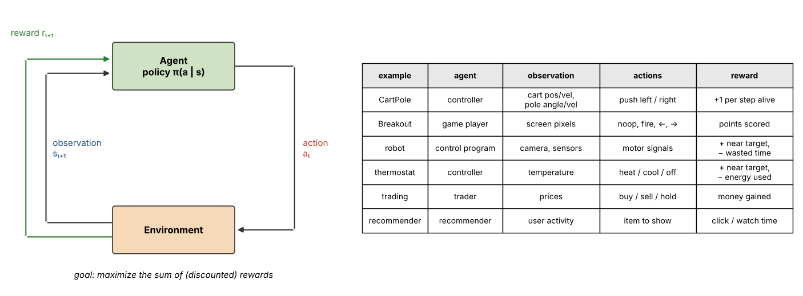

(왼쪽: 강화 학습의 기본 루프. 에이전트가 정책 π에 따라 **행동** $a_t$를 하면, 환경이 다음 **관측** $s_{t+1}$과 **보상** $r_{t+1}$을 돌려준다. 이것을 에피소드가 끝날 때까지 반복한다. 오른쪽: 같은 틀에 들어가는 여러 사례. 이 장에서는 위의 두 줄(CartPole, 브레이크아웃)을 직접 푼다)

---

## 이 장의 흐름

| 단계 | 절 | 핵심 질문 | 결과물 |
|---|---|---|---|
| 1. 문제 정의 | 19.1 | 정답이 없는데 무엇을 배우나 | 에이전트·환경·관측·행동·보상, 정책, 정책 탐색. 보충: 파라미터 1개 정책의 보상 지형 — 각도만 보면 42점, 각속도를 조금 섞으면 **500점 만점** |
| 2. Gymnasium | 19.2 | 환경과 어떻게 주고받나 | `gym.make("CartPole-v1")`, `reset()` → 관측, `step(action)` → `(obs, reward, done, truncated, info)` |
| 3. 하드코딩 정책 | 19.2 | 규칙 하나로 막대를 세울 수 있나 | "기울어진 쪽으로 민다" → 500 에피소드 평균 **41.7**스텝, 최대 63 |
| 4. 신경망 정책 | 19.2 | 신경망이 행동을 어떻게 고르나 | `Linear(4, 5)` → `ReLU` → `Linear(5, 1)`(파라미터 31개)이 로짓 → `Bernoulli`에서 행동 샘플링 + 로그 확률 |
| 5. 신용 할당 | 19.2 | 늦게 온 보상을 어느 행동에 나눠 주나 | 감가율 γ, 반환값 `compute_returns([10, 0, -50], 0.8)` = **[−22, −40, −50]**, 정규화 = 행동 이득 |
| 6. REINFORCE | 19.2 | 좋은 행동의 확률을 어떻게 높이나 | 손실 $-\log\pi(a_t \mid s_t) \cdot \hat{A}_t$, 200번째 에피소드에서 **1,000스텝**(최대) |
| 7. MDP | 19.3 | 미래 보상을 계산하는 틀은 | 마르코프 연쇄(흡수까지 기대 16스텝), 상태 3·행동 3 MDP, 벨만 최적 방정식 |
| 8. Q-가치 반복 | 19.3 | 모델을 알면 최적 정책은 | 50번 반복 → Q*(s0, a0) = **18.92**, 최적 행동 [a0, a0, a1]. γ = 0.95면 s1의 최적 행동이 a2로 바뀐다(보충: 경계 γ ≈ **0.948**) |
| 9. Q-러닝 | 19.3 | 모델을 모르면 | 무작위로 돌아다니며 TD 업데이트 1만 번 → Q-가치 반복과 같은 값으로 수렴. 보충: CliffWalking에서 SARSA(안전한 길) vs Q-러닝(최단 길) |
| 10. DQN | 19.3 | 상태가 연속이면 | `Linear(4, 32)` … `Linear(32, 2)`가 두 행동의 Q-가치를 출력, 재생 버퍼 + ε-그리디, 800 에피소드 → 1,000스텝. 학습 중 **치명적 망각**으로 한동안 무너짐 |
| 11. DQN 변형 | 19.3 | DQN을 안정시키려면 | 목표 네트워크, 더블 DQN, 우선 순위 재생, 듀얼링. 보충: 목표 네트워크가 없으면 Q-가치가 상한 20을 넘어 **44,892**까지 폭주 |
| 12. 액터-크리틱 | 19.4 | 정책과 가치를 함께 배우면 | 공유 몸통 + 액터 헤드(로짓) + 크리틱 헤드(V(s)), TD 오차로 매 스텝 업데이트, 400 에피소드 → 1,000스텝 |
| 13. PPO 브레이크아웃 | 19.5 | 실전 라이브러리로 아타리를 풀려면 | `make_atari_env` + `VecFrameStack(4)` + `PPO("CnnPolicy")`(파라미터 **1,686,693**개), 저자가 3천만 스텝 훈련한 모델 → 보충: 목숨 5개 게임 점수 **428 / 380 / 356** |
| 14. 그 밖의 알고리즘 | 19.6 | 이 장 너머에는 무엇이 있나 | 모델 기반(AlphaZero·MuZero), 연속 행동(SAC·TD3), 호기심, 오프라인 RL, 모방 학습, RLHF |

## 데이터

강화 학습에는 정해진 데이터셋이 없다. 에이전트가 **환경**과 상호작용하며 데이터를 스스로 만든다.

| 환경 | 관측 | 행동 | 보상 | 사용 절 | 비고 |
|---|---|---|---|---|---|
| CartPole-v1 (Gymnasium) | 4개 실수: 카트 위치·속도, 막대 각도·각속도 | 2개: 0 = 왼쪽, 1 = 오른쪽으로 밀기 | 버틴 스텝마다 +1 | 19.2 ~ 19.4 | 막대가 12°를 넘게 기울거나 카트가 화면 밖(±2.4)으로 나가면 종료. 노트북은 `max_episode_steps=1000`으로 기본값 500을 늘렸다 → **최대 점수 1,000** |
| 마르코프 연쇄 (직접 정의) | 상태 4개 (s3 = 종료) | 없음 | 없음 | 19.3 | 교재 그림 19-7 |
| 작은 MDP (직접 정의) | 상태 3개 | 상태별 1 ~ 3개 | +10, −50, +40 | 19.3 | 교재 그림 19-8. 전이 확률·보상을 리스트로 정의 |
| BreakoutNoFrameskip-v4 (ALE) | 210 × 160 RGB → 전처리 후 84 × 84 흑백 × 4프레임 | 4개: NOOP, FIRE, RIGHT, LEFT | 벽돌 점수 (훈련 때는 부호만: +1) | 19.5 | `ale_py`(아케이드 학습 환경) |
| CliffWalking (Gymnasium, 보충) | 4 × 12 격자의 칸 번호 | 4개: 상하좌우 | 스텝마다 −1, 절벽 −100 | 보충 | 온-폴리시 vs 오프-폴리시 비교용 |

> 📌 표기: $s$ = 상태(관측), $a$ = 행동, $r$ = 보상, $s'$ = 다음 상태, γ = 감가율, $\pi(a \mid s)$ = 정책(상태 $s$에서 행동 $a$를 할 확률), $V(s)$ = 상태 가치, $Q(s, a)$ = 상태-행동 가치(Q-가치), $T(s, a, s')$ = 전이 확률, $R(s, a, s')$ = 보상. **스텝**은 행동 한 번, **에피소드**는 처음부터 종료(또는 시간 초과)까지 한 판이다.

## 목차

- [0. 준비](#0-준비)
- [1. 강화 학습이란? (19.1)](#1-강화-학습이란-191)
   - [1-1. 보상을 최대화하도록 배우기](#1-1-보상을-최대화하도록-배우기)
   - [1-2. 정책과 정책 탐색](#1-2-정책과-정책-탐색)
   - [1-3. 보충 코드: 정책 탐색으로 본 보상 지형](#1-3-보충-코드-정책-탐색으로-본-보상-지형)
- [2. 정책 그레이디언트 (19.2)](#2-정책-그레이디언트-192)
   - [2-1. Gymnasium 소개](#2-1-gymnasium-소개)
   - [2-2. 간단한 하드코딩 정책](#2-2-간단한-하드코딩-정책)
   - [2-3. 신경망 정책](#2-3-신경망-정책)
   - [2-4. 행동 평가: 신용 할당 문제](#2-4-행동-평가-신용-할당-문제)
   - [2-5. REINFORCE 알고리즘](#2-5-reinforce-알고리즘)
   - [2-6. REINFORCE 구현과 훈련](#2-6-reinforce-구현과-훈련)
   - [2-7. 보충 코드: 정책 그레이디언트 한 스텝 확인](#2-7-보충-코드-정책-그레이디언트-한-스텝-확인)
- [3. 가치 기반 방법 (19.3)](#3-가치-기반-방법-193)
   - [3-1. 마르코프 연쇄](#3-1-마르코프-연쇄)
   - [3-2. 마르코프 결정 과정과 벨만 방정식](#3-2-마르코프-결정-과정과-벨만-방정식)
   - [3-3. Q-가치 반복](#3-3-q-가치-반복)
   - [3-4. 감가율이 최적 정책을 바꾼다](#3-4-감가율이-최적-정책을-바꾼다)
   - [3-5. 시간차 학습](#3-5-시간차-학습)
   - [3-6. Q-러닝](#3-6-q-러닝)
   - [3-7. 탐험 정책](#3-7-탐험-정책)
   - [3-8. 보충 코드: SARSA vs Q-러닝 (온-폴리시 vs 오프-폴리시)](#3-8-보충-코드-sarsa-vs-q-러닝-온-폴리시-vs-오프-폴리시)
   - [3-9. 근사 Q-러닝과 심층 Q-러닝](#3-9-근사-q-러닝과-심층-q-러닝)
   - [3-10. DQN 구현: 네트워크와 재생 버퍼](#3-10-dqn-구현-네트워크와-재생-버퍼)
   - [3-11. DQN 훈련](#3-11-dqn-훈련)
   - [3-12. DQN 변형](#3-12-dqn-변형)
   - [3-13. 보충 코드: 목표 네트워크와 더블 DQN의 효과](#3-13-보충-코드-목표-네트워크와-더블-dqn의-효과)
- [4. 액터-크리틱 알고리즘 (19.4)](#4-액터-크리틱-알고리즘-194)
   - [4-1. 액터와 크리틱](#4-1-액터와-크리틱)
   - [4-2. 액터-크리틱 구현](#4-2-액터-크리틱-구현)
   - [4-3. 훈련과 결과](#4-3-훈련과-결과)
   - [4-4. A2C, A3C 그리고 그 너머](#4-4-a2c-a3c-그리고-그-너머)
- [5. Stable-Baselines3 PPO 구현을 사용하여 아타리 브레이크아웃 마스터하기 (19.5)](#5-stable-baselines3-ppo-구현을-사용하여-아타리-브레이크아웃-마스터하기-195)
   - [5-1. PPO 알고리즘](#5-1-ppo-알고리즘)
   - [5-2. 아타리 환경 준비와 전처리](#5-2-아타리-환경-준비와-전처리)
   - [5-3. 프레임 쌓기](#5-3-프레임-쌓기)
   - [5-4. PPO 모델 만들기](#5-4-ppo-모델-만들기)
   - [5-5. 정책 네트워크 구조](#5-5-정책-네트워크-구조)
   - [5-6. 텐서보드와 체크포인트로 훈련하기](#5-6-텐서보드와-체크포인트로-훈련하기)
   - [5-7. 사전 훈련된 에이전트 평가](#5-7-사전-훈련된-에이전트-평가)
   - [5-8. 보충 코드: 같은 API로 CartPole, 그리고 알고리즘 비교](#5-8-보충-코드-같은-api로-cartpole-그리고-알고리즘-비교)
- [6. 다른 강화 학습 알고리즘 (19.6)](#6-다른-강화-학습-알고리즘-196)
   - [6-1. 알고리즘 지도](#6-1-알고리즘-지도)
   - [6-2. 모델 기반 강화 학습: AlphaGo에서 MuZero까지](#6-2-모델-기반-강화-학습-alphago에서-muzero까지)
   - [6-3. 연속 행동 공간: DDPG, TD3, SAC](#6-3-연속-행동-공간-ddpg-td3-sac)
   - [6-4. 탐험을 돕는 방법: 호기심과 개방형 학습](#6-4-탐험을-돕는-방법-호기심과-개방형-학습)
   - [6-5. 데이터에서 배우기: 모방 학습, 오프라인 RL, RLHF](#6-5-데이터에서-배우기-모방-학습-오프라인-rl-rlhf)
   - [6-6. 실전에서 강화 학습이 어려운 이유](#6-6-실전에서-강화-학습이-어려운-이유)
- [7. 연습문제](#7-연습문제)
- [8. 정리](#8-정리)
   - [8-1. 전체 흐름](#8-1-전체-흐름)
   - [8-2. 개념과 코드 대응](#8-2-개념과-코드-대응)
   - [8-3. 방법 비교](#8-3-방법-비교)
   - [8-4. 주요 결과](#8-4-주요-결과)
   - [8-5. 자주 쓴 코드 패턴](#8-5-자주-쓴-코드-패턴)
   - [8-6. 핵심 원칙](#8-6-핵심-원칙)
   - [8-7. 5분 셀프 테스트](#8-7-5분-셀프-테스트)

---

## 0. 준비

```python
import sys
assert sys.version_info >= (3, 10)

IS_COLAB = "google.colab" in sys.modules
IS_KAGGLE = "kaggle_secrets" in sys.modules

if IS_COLAB:
    %pip uninstall -qy gym
    %pip install -qU Box2D stable_baselines3

if IS_KAGGLE:
    %pip uninstall -qy gym
    %pip install -qU gymnasium
    %pip install -qU Box2D stable_baselines3

from packaging.version import Version
import torch
assert Version(torch.__version__) >= Version("2.6.0")

if torch.cuda.is_available():
    device = "cuda"
elif torch.backends.mps.is_available():
    device = "mps"
else:
    device = "cpu"

device
# 'cuda'

if device == "cpu":
    print("Neural nets can be very slow without a hardware accelerator.")
    if IS_COLAB:
        print("Go to Runtime > Change runtime and select a GPU hardware "
              "accelerator.")
    if IS_KAGGLE:
        print("Go to Settings > Accelerator and select GPU.")

import matplotlib.animation
import matplotlib.pyplot as plt

plt.rc('font', size=14)
plt.rc('axes', labelsize=14, titlesize=14)
plt.rc('legend', fontsize=14)
plt.rc('xtick', labelsize=10)
plt.rc('ytick', labelsize=10)
plt.rc('animation', html='jshtml')

%load_ext tensorboard
```

모든 장 노트북 맨 앞에 반복되는 환경 확인 + 그래프 글꼴 설정. 각 줄의 의미는 [1장 0. 준비](01_the_machine_learning_landscape.md#0-준비), 장치 선택은 [10장 1-5절](10_neural_nets_with_pytorch.md#1-5-하드웨어-가속) 참고. 이 장에서 새로 나온 줄만 정리하면:

| 코드 | 의미 |
|---|---|
| `%pip uninstall -qy gym` | 옛 라이브러리 `gym`(OpenAI Gym)을 지운다. 지금은 후속 프로젝트인 **Gymnasium**(`import gymnasium as gym`)을 쓴다. 둘이 같이 있으면 헷갈리기 쉽다 |
| `%pip install -qU Box2D stable_baselines3` | `Box2D`: 2D 물리 엔진(LunarLander·BipedalWalker 환경용, 연습문제). `stable_baselines3`: 검증된 강화 학습 알고리즘 모음(PPO·DQN·SAC 등, 19.5절). 캐글은 기본 설치된 버전이 낡아서 `-U`(업그레이드)로 다시 설치한다 |
| `import matplotlib.animation` / `plt.rc('animation', html='jshtml')` | 에피소드를 **애니메이션**으로 보여 주려고. `jshtml`은 노트북 안에 재생 버튼이 있는 자바스크립트 플레이어로 그린다 |
| `%load_ext tensorboard` | 노트북 안에서 **텐서보드**(훈련 곡선 대시보드)를 띄우는 확장. 19.5절 PPO 훈련을 지켜볼 때 쓴다 |

> ⚠️ 노트북의 출력은 저자의 실행 결과(CartPole·MDP는 맥, 일부 출력은 `cuda`)다. 이 노트의 **보충 코드**는 파이토치 2.15(CPU) + Gymnasium 1.4 + Stable-Baselines3 2.9 + ale-py 0.12에서 직접 실행해 확인했다. 강화 학습은 같은 코드·같은 시드라도 **플랫폼과 버전에 따라 결과가 크게 달라진다**(5-8절에서 직접 확인한다). 노트북 셀의 숫자는 노트북에 저장된 출력을 옮겼고, 보충 실험의 숫자는 CPU에서 얻은 값이다. 노트북의 애니메이션 셀은 저장된 출력이 없어서, 같은 코드를 CPU에서 다시 실행해 **몇 프레임을 뽑은 그림**으로 대신했다.

---

## 1. 강화 학습이란? (19.1)

> 🎯 **목적** — 강화 학습이 지도·비지도 학습과 무엇이 다른지, 에이전트가 무엇을 배우는지 잡는다.

> 💬 **정답 대신 점수판만 있는 학습**
>
> 지도 학습은 문제마다 정답을 알려 주는 선생님이 있다. 강화 학습에는 **점수판**만 있다. 에이전트가 행동하면 점수가 오르거나 내리는데, 어떤 행동이 점수를 만들었는지는 알려 주지 않는다.
>
> - **에이전트**가 **환경**을 **관측**하고 **행동**하면, 환경은 **보상**을 준다
> - 목표: 시간에 따라 받는 보상의 (할인된) 합, 즉 **반환값**을 최대화하는 **정책**을 찾는 것
> - **헷갈림 주의**: "보상을 최대화"는 **이번 스텝의 보상**이 아니라 **앞으로 받을 보상 전체**를 최대화한다는 뜻이다. 지금 손해(−50)를 보더라도 나중에 더 큰 보상(+40을 여러 번)을 받을 수 있으면 그쪽이 낫다(3-4절)

### 1-1. 보상을 최대화하도록 배우기

> 🎯 **목적** — 강화 학습의 구성 요소와 지도 학습과의 차이를 정리한다.

> ⚠️ 노트북에는 이 소절의 코드가 없다. 아래는 교재 절 내용을 정리한 것이다.

**개념·원리**

강화 학습(reinforcement learning, RL)에서 소프트웨어 **에이전트**(agent)는 **환경**(environment) 안에서 **관측**(observation)을 하고 **행동**(action)을 한다. 그 대가로 환경으로부터 **보상**(reward)을 받는다. 보상은 양수(칭찬)일 수도, 음수(벌칙)일 수도 있다. 에이전트의 목표는 **장기적으로 받는 보상의 합을 최대화**하도록 행동하는 법을 배우는 것이다.

| 구성 요소 | CartPole 예 | 브레이크아웃 예 |
|---|---|---|
| 에이전트 | 카트를 미는 제어 프로그램 | 게임을 하는 프로그램 |
| 환경 | 물리 시뮬레이션(카트 + 막대) | 아타리 에뮬레이터 |
| 관측 | 카트 위치·속도, 막대 각도·각속도 | 화면 픽셀 |
| 행동 | 왼쪽 / 오른쪽으로 밀기 | 가만히, 발사, 오른쪽, 왼쪽 |
| 보상 | 버틴 스텝마다 +1 | 벽돌을 깬 점수 |

강화 학습은 2013년 딥마인드가 원시 픽셀만 보고 아타리 게임 수십 개를 사람 수준 이상으로 플레이하는 시스템(DQN, 3-9절)을 선보이며 주목받았다. 2016년에는 바둑 세계 챔피언을 이긴 **AlphaGo**(6-2절)가 나왔다. 로봇 제어, 추천 시스템, 데이터 센터 냉각, 칩 배치 같은 분야에도 쓰이고, 최근에는 대규모 언어 모델을 사람의 선호와 정답 검증으로 미세 튜닝하는 데도 핵심 도구다(6-5절).

**지도·비지도 학습과의 차이**

| | 지도 학습 | 비지도 학습 | 강화 학습 |
|---|---|---|---|
| 신호 | 샘플마다 정답 | 없음 | **보상** (지연될 수 있음, 정답이 아님) |
| 데이터 | 주어진 훈련 세트 | 주어진 훈련 세트 | 에이전트가 **행동하며 직접 수집** |
| 샘플 간 관계 | 독립(섞어서 사용) | 독립 | **연속된 관측은 강하게 상관**됨 |
| 추가 고민 | — | — | **탐험 vs 활용**: 새 방법을 시도할까, 아는 방법을 쓸까 |
| 결과물 | 예측 모델 | 구조(군집·저차원 표현) | **정책** (상태 → 행동) |

> 💡 강화 학습은 "데이터가 모델의 행동에 따라 달라진다"는 점이 가장 큰 차이다. 정책이 바뀌면 보게 되는 상태도 바뀐다. 그래서 훈련 데이터의 분포가 계속 움직이고, 이것이 강화 학습이 불안정한 근본 원인이다(3-11절, 5-8절).

### 1-2. 정책과 정책 탐색

> 🎯 **목적** — 정책이 무엇이고, 좋은 정책을 찾는 세 가지 방법(무작위 탐색·유전 알고리즘·정책 그레이디언트)을 정리한다.

> ⚠️ 노트북에는 이 소절의 코드가 없다. 아래는 교재 절 내용을 정리한 것이다.

**개념·원리**

에이전트가 행동을 고르는 데 쓰는 알고리즘을 **정책**(policy)이라고 한다. 정책은 관측을 입력받아 행동을 출력하는 신경망일 수도 있고, 몇 줄짜리 규칙일 수도 있다.

- **결정적 정책**: 같은 관측이면 항상 같은 행동 ("기울어진 쪽으로 민다", 2-2절)
- **확률적 정책**(stochastic policy): 행동마다 확률을 주고 그 분포에서 **샘플링** ("오른쪽 70%, 왼쪽 30%", 2-3절). 무작위성 덕분에 자연스럽게 **탐험**한다

교재는 로봇 청소기 예를 든다. 매 초 확률 $p$로 앞으로 가고, 확률 $1-p$로 $-r$ ~ $+r$ 사이의 무작위 각도만큼 회전하는 정책이라면, 이 정책은 **파라미터** $p$와 $r$ 두 개로 정해진다. 30분 동안 주운 먼지 양을 보상으로 두면, "가장 많은 먼지를 줍는 $(p, r)$"을 찾는 문제가 된다. 이렇게 파라미터 공간에서 좋은 정책을 찾는 것을 **정책 탐색**(policy search)이라고 한다.

| 정책 탐색 방법 | 아이디어 | 한계 |
|---|---|---|
| 무작위 탐색 / 격자 탐색 | 파라미터 값을 많이 시도해 가장 좋은 것을 고른다 | 파라미터가 많아지면 공간이 폭발적으로 커진다 (건초 더미에서 바늘 찾기) |
| **유전 알고리즘** | 정책 100개를 만들어 평가 → 하위 80개 제거 → 상위 20개가 각자 자식 4개를 만든다(파라미터 복사 + 무작위 변이). 세대를 반복 | 평가가 비싸고 그레이디언트 정보를 쓰지 않는다 |
| **정책 그레이디언트**(policy gradient, PG) | 보상의 **그레이디언트**를 추정해 파라미터를 그 방향으로 조금씩 움직인다 (경사 상승법) | 그레이디언트 추정의 분산이 크다 → 이 장의 주인공(19.2절) |

> 💡 유전 알고리즘에서 부모 하나가 자식을 만드는 방식은 [6장](06_ensemble_learning_and_random_forests.md)의 앙상블처럼 "여러 후보를 평가해 좋은 것만 남기는" 아이디어와 닮았다. 진화 전략(evolution strategies) 계열은 지금도 병렬화가 쉽다는 장점으로 쓰인다. 하지만 신경망처럼 파라미터가 수천 ~ 수백만 개면 그레이디언트를 쓰는 방법이 훨씬 효율적이다.

### 1-3. 보충 코드: 정책 탐색으로 본 보상 지형

> 🎯 **목적** — 파라미터가 1개뿐인 CartPole 정책의 보상을 전부 계산해 보고, 정책 탐색이 실제로 어떤 문제인지 눈으로 본다.

**보충 코드**

```python
# 보충 코드 — 정책: cosθ·각도 + sinθ·각속도 > 0 이면 오른쪽(1), 아니면 왼쪽(0)
import numpy as np
import gymnasium as gym

env = gym.make("CartPole-v1", max_episode_steps=500)

def evaluate(w_angle, w_angvel, n=3):
    total = 0
    for ep in range(n):
        obs, _ = env.reset(seed=ep)
        while True:
            action = 1 if w_angle * obs[2] + w_angvel * obs[3] > 0 else 0
            obs, reward, done, truncated, _ = env.step(action)
            total += reward
            if done or truncated:
                break
    return total / n

thetas = np.linspace(-np.pi, np.pi, 181)              # 2°간격 격자 탐색
scores = [evaluate(np.cos(t), np.sin(t)) for t in thetas]
rand_th = np.random.default_rng(42).uniform(-np.pi, np.pi, 30)   # 무작위 탐색 30번
```

두 가중치의 **비율**만 결정에 영향을 주므로(둘에 같은 양수를 곱해도 행동이 같다) 방향 θ 하나로 파라미터화했다. θ = 0이면 각도만 보는 정책, 즉 2-2절의 하드코딩 정책이다.

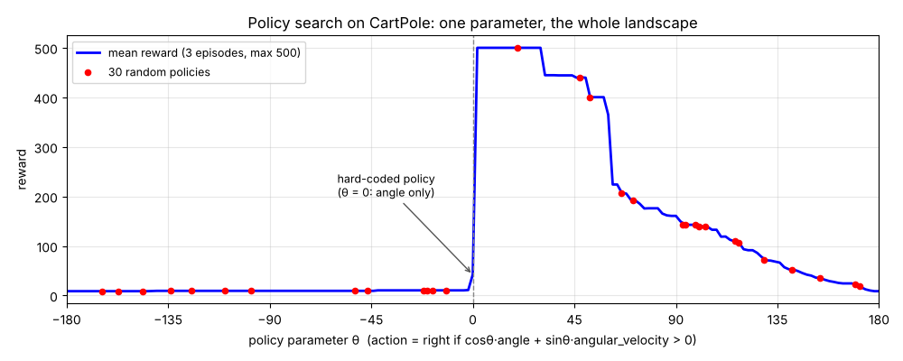

(가로축: 정책 파라미터 θ(도). 세로축: 에피소드 3개의 평균 보상(최대 500). 파란 선 = 격자 탐색 181점, 빨간 점 = 무작위로 뽑은 정책 30개. θ = 0(점선, 하드코딩 정책)에서는 42점이지만, θ가 0보다 **조금만** 커지면(= 각속도를 조금이라도 고려하면) 500점 만점으로 뛴다. 음수 쪽(각속도 반대 방향)은 전부 10점 안팎)

| 탐색 | 결과 |
|---|---|
| θ = 0 (각도만, 하드코딩 정책) | 42.3 |
| 격자 탐색 최고 | **500** (θ = 2°, 2° ~ 30° 구간이 모두 만점) |
| 보상 400 이상인 θ의 비율 | 16% |
| 무작위 탐색 1 / 5 / 10 / 30번 후 최고 | 143 / 192 / 192 / **500** |

**결과 해석**

- 정책 공간이 1차원이면 전부 훑어볼 수 있다. 무작위 30번이면 만점 정책을 하나쯤 건진다
- 하지만 지형이 **절벽**처럼 생겼다(θ = 0 근처에서 42 → 500). 그레이디언트로 오르기 어려운 모양이다 — 그래서 정책 그레이디언트는 행동을 **확률적으로** 만들어 보상의 기댓값을 매끄럽게 만든다(2-3절)
- 신경망 정책은 파라미터가 31개(2-3절) ~ 168만 개(5-5절)다. 격자 탐색은 불가능하고 무작위 탐색도 운에 맡기는 셈이 된다 → 그레이디언트가 필요하다

---

## 2. 정책 그레이디언트 (19.2)

> 🎯 **목적** — Gymnasium으로 환경을 다루는 법을 익히고, 신경망 정책을 REINFORCE 알고리즘으로 훈련해 CartPole을 푼다.

> 💬 **잘된 판의 행동은 더 자주, 망친 판의 행동은 덜 자주**
>
> 정책 그레이디언트는 "행동 → 결과"를 기록해 두었다가, 결과가 좋았던 행동의 확률은 올리고 나빴던 행동의 확률은 내린다. 미분 가능한 신경망 정책이면 이 "올리고 내리기"를 경사 하강법 한 줄로 할 수 있다.
>
> - 신경망은 **행동 확률**을 출력하고, 에이전트는 그 분포에서 **샘플링**한다
> - 에피소드가 끝나면 행동마다 **반환값**(그 뒤로 받은 할인된 보상의 합)을 계산해 점수를 매긴다
> - 손실 = $-\log \pi(a \mid s) \times$ 점수. 점수가 양수면 그 행동의 확률이 올라가고, 음수면 내려간다
> - **헷갈림 주의**: 여기에는 "정답 행동"이 없다. 신경망이 **자기가 고른 행동**을 타깃처럼 쓰되, 그 행동이 좋았는지 나빴는지로 부호와 크기를 정한다

### 2-1. Gymnasium 소개

> 🎯 **목적** — 강화 학습 환경 라이브러리 Gymnasium으로 환경을 만들고, 관측·행동·보상을 주고받는 기본 API를 익힌다.

**개념·원리**

강화 학습의 어려움 중 하나는 **환경**이 필요하다는 것이다. 실제 로봇으로 훈련하면 느리고 비싸고 위험하다. 그래서 보통 **시뮬레이션 환경**에서 훈련한다. **Gymnasium**은 OpenAI Gym을 이어받은 오픈 소스 툴킷으로, 고전 제어(CartPole 등), 아타리 게임, 2D·3D 물리 시뮬레이션 등 다양한 환경을 같은 API로 제공한다.

**코드**

```python
import gymnasium as gym

env = gym.make("CartPole-v1", render_mode="rgb_array", max_episode_steps=1000)
```

| 인자 | 의미 |
|---|---|
| `"CartPole-v1"` | 환경 ID. 이름 + 버전 |
| `render_mode="rgb_array"` | `render()`가 화면을 **넘파이 이미지 배열**로 돌려준다(창을 띄우지 않음). `"human"`이면 창에 그린다 |
| `max_episode_steps=1000` | 1,000스텝이 되면 에피소드를 **잘라 낸다**(truncated). CartPole-v1의 기본값은 500이다 |

```python
# extra code – shows the first few environments
envs = gym.envs.registry
sorted(envs.keys())[:5] + ["..."]
# ['Acrobot-v1', 'Ant-v2', 'Ant-v3', 'Ant-v4', 'Ant-v5', '...']

envs["CartPole-v1"]
# EnvSpec(id='CartPole-v1', entry_point='gymnasium.envs.classic_control.cartpole:CartPoleEnv',
#         reward_threshold=475.0, nondeterministic=False, max_episode_steps=500, ...)

gym.pprint_registry()
# ===== classic_control =====
# Acrobot-v1             CartPole-v0            CartPole-v1
# MountainCar-v0         MountainCarContinuous-v0 Pendulum-v1
# ===== box2d =====
# BipedalWalker-v3       BipedalWalkerHardcore-v3 CarRacing-v3
# LunarLander-v3         LunarLanderContinuous-v3
# ===== toy_text =====
# Blackjack-v1           CliffWalking-v0        FrozenLake-v1
# FrozenLake8x8-v1       Taxi-v3
# ===== mujoco =====
# Ant-v2 ... Humanoid-v5 ... Walker2d-v5
# ...
```

`gym.envs.registry`는 등록된 환경 사양(`EnvSpec`)의 딕셔너리다. CartPole-v1의 `reward_threshold=475.0`은 "평균 475점 이상이면 풀었다고 본다"는 기준, `max_episode_steps=500`은 기본 시간 제한이다. 환경 묶음: `classic_control`(고전 제어), `box2d`(2D 물리, `Box2D` 필요), `toy_text`(격자 세계 같은 작은 환경), `mujoco`(3D 로봇 물리).

```python
obs, info = env.reset(seed=42)
obs
# array([ 0.0273956 , -0.00611216,  0.03585979,  0.0197368 ], dtype=float32)
info
# {}
```

`reset()`은 환경을 초기화하고 첫 **관측**과 `info`(추가 정보 딕셔너리)를 돌려준다. `seed`를 주면 초기 상태가 재현된다. CartPole의 관측은 실수 4개:

| 인덱스 | 의미 | 값 (위) |
|---|---|---|
| `obs[0]` | 카트의 수평 위치 (0 = 가운데, ±2.4를 넘으면 종료) | 0.027 |
| `obs[1]` | 카트 속도 (양수 = 오른쪽) | −0.006 |
| `obs[2]` | 막대 각도 (라디안, 0 = 수직, 양수 = 오른쪽으로 기움, ±0.21(12°)을 넘으면 종료) | 0.036 |
| `obs[3]` | 막대 각속도 (양수 = 오른쪽으로 넘어가는 중) | 0.020 |

```python
img = env.render()
img.shape  # height, width, channels (3 = Red, Green, Blue)
# (400, 600, 3)

# extra code – creates a little function to render and plot an environment
def plot_environment(env, figsize=(5, 4)):
    plt.figure(figsize=figsize)
    img = env.render()
    plt.imshow(img)
    plt.axis("off")
    return img

plot_environment(env)
plt.show()
```

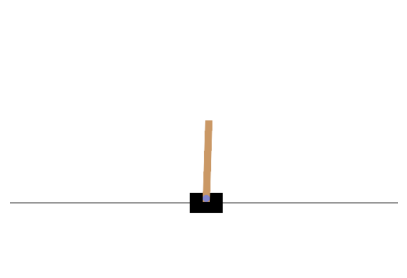

(CartPole 환경의 첫 화면. 검은 사각형이 **카트**, 주황색 막대가 카트 위 경첩에 달린 **막대**, 가로선이 트랙이다. 막대가 오른쪽으로 아주 조금(0.036 rad ≈ 2°) 기울어 있다)

```python
env.action_space
# Discrete(2)

action = 1  # accelerate right
obs, reward, done, truncated, info = env.step(action)
obs
# array([ 0.02727336,  0.18847767,  0.03625453, -0.26141977], dtype=float32)

reward, done, truncated, info
# (1.0, False, False, {})

if done or truncated:
    obs, info = env.reset()
```

`action_space`가 `Discrete(2)`이므로 행동은 정수 0(왼쪽) 또는 1(오른쪽)이다. `step(action)`은 행동을 실행하고 다섯 값을 돌려준다.

| 반환값 | 의미 | 위 결과 |
|---|---|---|
| `obs` | 새 관측 | 오른쪽으로 밀었더니 카트 속도 −0.006 → **+0.188**, 막대 각속도 0.020 → **−0.261**(카트가 밀려 나가 막대는 상대적으로 왼쪽으로 돌기 시작) |
| `reward` | 이번 스텝의 보상 | CartPole은 무엇을 하든 매 스텝 1.0 → 오래 버틸수록 총보상이 크다 |
| `done` | 에피소드가 **끝났는가**(실패·성공 같은 종료 상태, terminated) | 막대가 너무 기울거나 카트가 화면 밖으로 나가면 `True` |
| `truncated` | **시간 제한** 등으로 중간에 잘렸는가 | 1,000스텝에 도달하면 `True` |
| `info` | 디버깅·추가 정보 | 빈 딕셔너리 |

> ⚠️ `done`과 `truncated`의 구분이 중요하다. `done`은 "더 이상 미래가 없다"(미래 보상 = 0)는 뜻이고, `truncated`는 "관측을 멈췄을 뿐 미래는 있다"는 뜻이다. 엄밀하게는 잘린 에피소드의 마지막 상태는 미래 가치를 계속 써야 한다. 이 장의 노트북 코드(DQN·액터-크리틱)는 단순하게 **둘 다 종료로** 취급한다(3-10절).

### 2-2. 간단한 하드코딩 정책

> 🎯 **목적** — 학습 없이 규칙 하나로 막대를 세워 보고, 그 성능을 기준선으로 삼는다.

**코드**

```python
def basic_policy(obs):
    angle = obs[2]
    return 0 if angle < 0 else 1  # go left if leaning left, otherwise go right

totals = []
for episode in range(500):
    total_rewards = 0
    obs, info = env.reset(seed=episode)
    while True:  # no risk of infinite loop: will be truncated after 1000 steps
        action = basic_policy(obs)
        obs, reward, done, truncated, info = env.step(action)
        total_rewards += reward
        if done or truncated:
            break

    totals.append(total_rewards)

import numpy as np

np.mean(totals), np.std(totals), min(totals), max(totals)
# (41.698, 8.389445512070509, 24.0, 63.0)
```

"막대가 왼쪽으로 기울면 왼쪽으로, 오른쪽으로 기울면 오른쪽으로 민다." 손바닥 위에 막대를 세울 때 하는 행동이다. 500 에피소드(시드 0 ~ 499)를 돌려 총보상(= 버틴 스텝 수)을 모았다.

**결과 해석**

- 평균 41.7스텝, 최고 63스텝. 1,000스텝은커녕 100스텝도 못 버틴다
- 각도만 보고 **각속도**(막대가 어느 쪽으로 넘어가는 중인지)를 무시해서, 매번 한 박자 늦게 반응하며 흔들림이 점점 커진다. 1-3절에서 본 것처럼 각속도를 조금만 섞어도 결과가 완전히 달라진다

```python
# extra code – this cell displays an animation of one episode
def update_scene(num, frames, patch):
    patch.set_data(frames[num])
    return patch,

def plot_animation(frames, repeat=False, interval=40):
    fig = plt.figure()
    patch = plt.imshow(frames[0])
    plt.axis('off')
    anim = matplotlib.animation.FuncAnimation(
        fig, update_scene, fargs=(frames, patch),
        frames=len(frames), repeat=repeat, interval=interval)
    plt.close()
    return anim

def show_one_episode(policy, seed=42):
    frames = []
    env = gym.make("CartPole-v1", render_mode="rgb_array",
                   max_episode_steps=1000)
    obs, info = env.reset(seed=seed)
    while True:
        frames.append(env.render())
        action = policy(obs)
        obs, reward, done, truncated, info = env.step(action)
        if done or truncated:
            break
    env.close()
    return plot_animation(frames)

show_one_episode(basic_policy)
```

| 코드 | 의미 |
|---|---|
| `FuncAnimation(fig, update_scene, frames=len(frames), interval=40)` | 40ms(초당 25프레임)마다 `update_scene(i, ...)`을 불러 이미지 내용만 바꿔 치기 |
| `patch.set_data(frames[num])` | 이미 그려 둔 `imshow` 객체의 픽셀만 교체 (새로 그리지 않아 빠르다) |
| `plt.close()` | 정적인 그림이 한 번 더 출력되지 않게 닫는다. 애니메이션 객체는 남는다 |
| `show_one_episode(policy, seed=42)` | 정책 함수 하나를 받아 한 에피소드를 녹화해 애니메이션으로 돌려준다. 이 장 내내 정책을 바꿔 가며 재사용한다 |

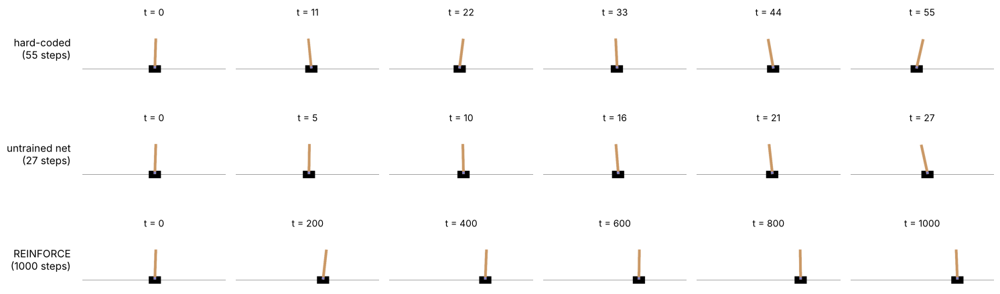

(`show_one_episode()` 애니메이션을 CPU에서 다시 실행해 에피소드마다 6프레임을 고르게 뽑았다. 위: 하드코딩 정책(시드 42에서 55스텝 후 실패), 가운데: 훈련 전 신경망 정책(27스텝), 아래: REINFORCE로 훈련한 신경망 정책(1,000스텝 끝까지 버팀). 훈련된 정책은 막대를 세운 채 카트가 오른쪽으로 천천히 이동한다)

> 💡 노트북 설명: "몇 번 흔들리다가 막대가 너무 기울어 게임 오버. 더 똑똑해져야 한다!" 이제 신경망이 직접 정책을 배우게 하자.

### 2-3. 신경망 정책

> 🎯 **목적** — 관측을 받아 행동 확률을 출력하는 신경망 정책을 만들고, 그 확률에서 행동을 샘플링하는 법을 익힌다.

**개념·원리**

신경망 정책은 관측을 입력받아 **행동별 확률**을 출력한다. 행동이 두 개(왼쪽·오른쪽)면 출력 하나로 충분하다: "오른쪽(1)일 확률" $p$를 내면 왼쪽은 $1-p$다. 이진 분류([4장 로지스틱 회귀](04_training_linear_models.md#6-1-확률-추정))와 같은 구조다.

```
관측 (4) ─ Linear(4, 5) ─ ReLU ─ Linear(5, 1) ─> 로짓 z ─ 시그모이드 ─> p = P(행동 = 1)
                                                    └─> Bernoulli(p)에서 행동 샘플링
```

왜 확률이 가장 높은 행동을 고르지 않고 **샘플링**할까?

- **탐험**: 확률 0.8이면 대부분 그 행동을 하되 가끔 다른 행동을 시도한다. 늘 가장 좋아 보이는 행동만 하면 더 좋은 방법을 영영 발견하지 못한다
- **매끄러운 최적화**: 결정적 정책의 보상은 파라미터에 대해 계단처럼 변한다(1-3절의 절벽). 확률적 정책에서는 **기대** 보상이 파라미터에 대해 매끄럽게 변해 그레이디언트를 쓸 수 있다

또한 CartPole에서는 **관측이 곧 환경의 전체 상태**다(위치·속도·각도·각속도를 다 안다). 그래서 지난 관측을 기억할 필요 없이 현재 관측만 보면 된다. 관측에 잡음이 있거나 일부만 보인다면(예: 속도 없이 위치만) 과거 관측도 함께 넣어야 한다 — 브레이크아웃에서 프레임 4개를 쌓는 이유다(5-3절).

**코드**

```python
import torch
import torch.nn as nn

class PolicyNetwork(nn.Module):
    def __init__(self):
        super().__init__()
        self.net = nn.Sequential(nn.Linear(4, 5), nn.ReLU(), nn.Linear(5, 1))

    def forward(self, state):
        return self.net(state)
```

입력 4개(관측) → 은닉 뉴런 5개 → 출력 1개(로짓). 파라미터는 $4 \times 5 + 5 + 5 \times 1 + 1 = 31$개뿐이다. 관측이 단순해서 이 정도면 충분하다. 출력에 시그모이드를 붙이지 않고 **로짓**을 그대로 내보낸다(수치 안정성, [10장 `CrossEntropyLoss`](10_neural_nets_with_pytorch.md#7-2-분류기-만들기)와 같은 이유).

```python
def choose_action(model, obs):
    state = torch.as_tensor(obs)
    logit = model(state)
    dist = torch.distributions.Bernoulli(logits=logit)
    action = dist.sample()
    log_prob = dist.log_prob(action)
    return int(action.item()), log_prob
```

| 코드 | 의미 |
|---|---|
| `torch.as_tensor(obs)` | 넘파이 배열을 (가능하면 복사 없이) 텐서로. `obs`가 `float32`라 그대로 모델에 넣을 수 있다 |
| `torch.distributions.Bernoulli(logits=logit)` | 베르누이 분포 객체. `logits`를 주면 내부에서 $p = \sigma(z)$로 바꾼다 |
| `dist.sample()` | 확률 $p$로 1, $1-p$로 0을 뽑는다 (`tensor([1.])` 형태) |
| `dist.log_prob(action)` | 뽑힌 행동의 **로그 확률**: 행동 1이면 $\log p$, 행동 0이면 $\log(1-p)$. 그레이디언트가 흐르는 텐서다 → 2-5절 손실에 쓴다 |
| `int(action.item())` | 환경에는 파이썬 정수 0/1을 넘긴다 |

> 📌 보충 확인: 로짓 0.8이면 $p = \sigma(0.8) = 0.690$, `log_prob(1)` = −0.3711 = $\log 0.690$, `log_prob(0)` = −1.1711 = $\log 0.310$. 행동이 여러 개라면 `Bernoulli` 대신 `torch.distributions.Categorical(logits=...)`을 쓴다(브레이크아웃의 행동 4개, 5-5절).

```python
# extra code – a function that creates an animation for a given policy model
torch.manual_seed(42)
model = PolicyNetwork()
model.eval()

def neural_net_policy(obs):
    with torch.no_grad():
        action, _ = choose_action(model, obs)
        return action

show_one_episode(neural_net_policy)
```

훈련하지 않은(무작위 가중치) 정책으로 한 에피소드를 보면 거의 무작위로 밀다가 금방 쓰러진다(위 프레임 그림 가운데 줄, 27스텝). `neural_net_policy`는 전역 변수 `model`을 쓰므로, 훈련 후 같은 함수로 다시 애니메이션을 볼 수 있다.

### 2-4. 행동 평가: 신용 할당 문제

> 🎯 **목적** — 보상이 늦게 올 때 각 행동에 점수를 매기는 방법(감가율·반환값·행동 이득)을 이해하고 `compute_returns()`를 구현한다.

**개념·원리**

각 스텝의 정답 행동을 안다면 그냥 분류 문제처럼 훈련하면 된다. 하지만 강화 학습에서 에이전트가 받는 신호는 **보상**뿐이고, 보상은 대개 **늦게, 드문드문** 온다. 100스텝 동안 막대를 세우다 쓰러졌다면 100개의 행동 중 무엇이 나빴을까? 이것이 **신용 할당 문제**(credit assignment problem)다.

해결책: 행동의 점수를 "그 행동 **이후에** 받은 모든 보상의 합"으로 매기되, 먼 미래의 보상일수록 **감가율**(discount factor) γ를 곱해 덜 반영한다. 이 값을 **반환값**(return)이라고 한다.

$$G_t = r_{t+1} + \gamma r_{t+2} + \gamma^2 r_{t+3} + \cdots = r_{t+1} + \gamma G_{t+1}$$

- γ = 0이면 바로 다음 보상만 본다(근시안), γ → 1이면 먼 미래까지 거의 같은 무게로 본다
- 보통 0.9 ~ 0.99를 쓴다. γ = 0.95면 13스텝 뒤 보상의 무게가 약 절반($0.95^{13} = 0.51$), γ = 0.99면 69스텝 뒤가 절반($0.99^{69} = 0.50$)이다. 대략 $1/(1-\gamma)$스텝(0.95면 20스텝)을 "내다보는 범위"로 생각하면 된다(3-4절 그림 오른쪽)
- 교재 예: 행동 3개 뒤에 보상이 각각 +10, 0, −50이고 γ = 0.8이면
  - 3번째 행동: −50
  - 2번째 행동: $0 + 0.8 \times (-50) = -40$
  - 1번째 행동: $10 + 0.8 \times (-40) = -22$ (첫 보상 +10을 받았지만 결국 나쁜 결과로 이어졌다)

좋은 행동 뒤에 나쁜 행동이 이어져 결과가 나쁘면, 좋은 행동도 낮은 점수를 받는다. 하지만 게임을 **여러 번** 하면 좋은 행동은 평균적으로 나쁜 행동보다 높은 점수를 받는다. 그래서 "행동이 평균보다 얼마나 좋았는가"를 봐야 하고, 이를 **행동 이득**(action advantage)이라고 한다. 노트북은 한 에피소드의 반환값들을 **표준화**(평균 0, 표준 편차 1)해서 이득의 근사로 쓴다 → 평균보다 나은 행동은 양수(장려), 못한 행동은 음수(억제).

**코드**

```python
def compute_returns(rewards, discount_factor):
    returns = rewards[:]  # copy the rewards
    for step in range(len(returns) - 1, 0, -1):
        returns[step - 1] += returns[step] * discount_factor

    return torch.tensor(returns)

compute_returns([10, 0, -50], discount_factor=0.8)
# tensor([-22., -40., -50.])
```

뒤에서부터 $G_t = r_{t+1} + \gamma G_{t+1}$을 누적한다. 앞에서부터 매번 합을 다시 계산하면 $O(n^2)$이지만, 뒤에서부터 한 번 훑으면 $O(n)$이다. `rewards[:]`로 복사하는 이유는 호출한 쪽의 보상 리스트를 바꾸지 않으려는 것이다.

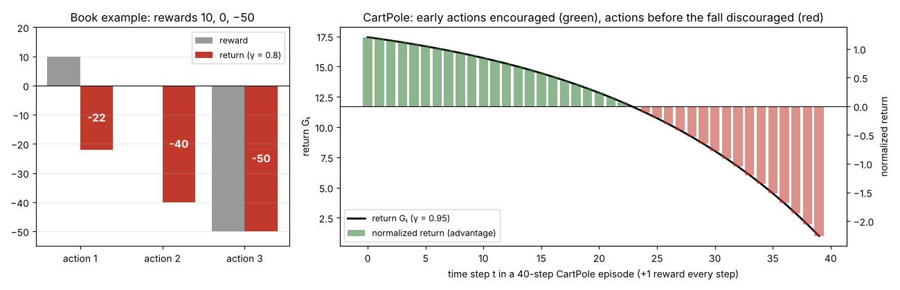

(왼쪽: 교재 예. 회색 = 각 행동 직후의 보상, 빨강 = γ = 0.8의 반환값(−22, −40, −50). 오른쪽: CartPole에서 40스텝 만에 쓰러진 에피소드. 매 스텝 보상이 +1이라 반환값(검은 선)은 처음 17.4에서 마지막 1.0까지 줄어든다. 표준화한 값(막대)은 처음 23스텝이 양수(초록, 장려), 쓰러지기 직전 17스텝이 음수(빨강, 억제)다)

**결과 해석**

- CartPole은 보상이 모두 +1이라 반환값이 "앞으로 몇 스텝 더 버텼나"에 비례한다. 쓰러지기 직전의 행동은 반환값이 작다
- 표준화하면 한 에피소드 **안에서** 상대 평가가 된다: 초반 행동은 칭찬, 실패 직전 행동은 꾸중. 에피소드가 길든 짧든 점수의 크기가 비슷해져 학습이 안정된다
- ⚠️ 1,000스텝을 다 채운 에피소드에서도 마지막 행동들은 음수 점수를 받는다(시간 제한을 실패처럼 취급). 이 정도 부작용은 감수한다

### 2-5. REINFORCE 알고리즘

> 🎯 **목적** — 행동 이득으로 정책의 그레이디언트를 만드는 REINFORCE의 원리를 정리한다.

> ⚠️ 노트북에는 이 소절의 코드가 없다(구현은 2-6절). 아래는 교재 절 내용과 원리를 정리한 것이다.

**개념·원리**

1992년 로널드 윌리엄스(Ronald Williams)가 제안한 **REINFORCE** 알고리즘(몬테카를로 정책 그레이디언트)의 절차:

1. 신경망 정책으로 게임을 **여러 번** 플레이한다. 스텝마다 "선택한 행동의 확률을 높이는 그레이디언트"를 계산해 둔다(아직 적용하지 않는다)
2. 에피소드가 끝나면 각 행동의 **이득**(반환값 → 정규화)을 계산한다
3. 이득이 양수면 그 행동이 좋았던 것이니 그레이디언트를 **그대로** 적용해 확률을 높이고, 음수면 **반대로** 적용해 확률을 낮춘다. 즉 그레이디언트에 이득을 곱한다
4. 곱한 그레이디언트들의 평균(합)으로 경사 하강법 한 스텝

수식으로는 **정책 그레이디언트 정리**(policy gradient theorem)의 추정치다.

$$\nabla_\theta J(\theta) \approx \sum_t \nabla_\theta \log \pi_\theta(a_t \mid s_t) \, \hat{A}_t$$

$J(\theta)$는 기대 반환값(최대화하려는 값)이다. 파이토치 옵티마이저는 손실을 **최소화**하므로 부호를 뒤집어 손실을 만든다.

$$\mathcal{L}(\theta) = -\sum_t \log \pi_\theta(a_t \mid s_t) \, \hat{A}_t$$

| 기호 | 의미 | 코드 |
|---|---|---|
| $\log \pi_\theta(a_t \mid s_t)$ | 그때 고른 행동의 로그 확률 (그레이디언트가 흐름) | `log_prob` |
| $\hat{A}_t$ | 그 행동의 이득 추정 (상수 취급) | 표준화한 `returns` |
| 합 $\sum_t$ | 한 에피소드의 모든 스텝 | `torch.cat(losses).sum()` |

> 💡 **왜 로그 확률인가**: $\nabla \log \pi = \nabla \pi / \pi$다. 확률이 낮은 행동이 좋은 결과를 냈다면 크게 키우고, 이미 확률이 높은 행동은 조금만 키운다. 또 이득을 곱한 "가중 로그 우도"라서, 이득이 모두 1이면 [4장의 로지스틱 회귀](04_training_linear_models.md#6-2-훈련과-비용-함수)에서 "자기가 고른 행동"을 정답으로 둔 교차 엔트로피와 같다. 강화 학습 = **스스로 만든 레이블에 이득으로 가중치를 준 분류**라고 볼 수 있다.

> ⚠️ REINFORCE의 약점은 **분산**이다. 반환값은 에피소드 전체의 운에 좌우되어(몬테카를로 추정), 같은 행동도 판마다 점수가 크게 다르다. 그래서 많은 에피소드가 필요하고 결과가 시드에 따라 들쭉날쭉하다(5-8절). 이득을 **크리틱**으로 추정해 분산을 줄인 것이 액터-크리틱이다(19.4절).

### 2-6. REINFORCE 구현과 훈련

> 🎯 **목적** — 에피소드를 실행하며 로그 확률과 보상을 모으고, REINFORCE 손실로 정책을 훈련해 CartPole을 푼다.

**코드**

```python
def run_episode(model, env, seed=None):
    log_probs, rewards = [], []
    obs, info = env.reset(seed=seed)
    while True:  # the environment will truncate the episode if it is too long
        action, log_prob = choose_action(model, obs)
        obs, reward, done, truncated, _info = env.step(action)
        log_probs.append(log_prob)
        rewards.append(reward)
        if done or truncated:
            return log_probs, rewards
```

에피소드 하나를 끝까지 실행하며 스텝마다 **로그 확률**(그레이디언트 연결된 텐서)과 **보상**을 모은다. `torch.no_grad()`가 없으므로 계산 그래프가 에피소드 전체에 걸쳐 쌓인다 — 손실을 한꺼번에 역전파하기 위해서다.

```python
def train_reinforce(model, optimizer, env, n_episodes, discount_factor):
    for episode in range(n_episodes):
        seed = torch.randint(0, 2**32, size=()).item()
        log_probs, rewards = run_episode(model, env, seed=seed)
        returns = compute_returns(rewards, discount_factor)
        std_returns = (returns - returns.mean()) / (returns.std() + 1e-7)
        losses = [-logp * rt for logp, rt in zip(log_probs, std_returns)]
        loss = torch.cat(losses).sum()
        optimizer.zero_grad()
        loss.backward()
        optimizer.step()
        print(f"\rEpisode {episode + 1}, Reward: {sum(rewards):.2f}", end=" ")
```

| 코드 | 의미 |
|---|---|
| `seed = torch.randint(0, 2**32, size=()).item()` | 에피소드마다 다른 초기 상태. 파이토치 난수에서 뽑으므로 `torch.manual_seed(42)` 하나로 전체 훈련이 재현된다 |
| `(returns - returns.mean()) / (returns.std() + 1e-7)` | 반환값 표준화 = 행동 이득 근사. `1e-7`은 0으로 나누기 방지 (에피소드가 1스텝이면 표준 편차가 0) |
| `-logp * rt` | 스텝별 REINFORCE 손실. `rt`는 그레이디언트가 없는 상수 |
| `torch.cat(losses).sum()` | 각 원소가 `[1]` 형태라 이어 붙여 합 → 스칼라 손실 |
| 에피소드 1개 = 업데이트 1번 | 교재 설명은 "여러 에피소드를 모아 한 번 업데이트"지만, 노트북은 단순하게 매 에피소드 업데이트한다 |

```python
torch.manual_seed(42)
model = PolicyNetwork()
optimizer = torch.optim.NAdam(model.parameters(), lr=0.06)
train_reinforce(model, optimizer, env, n_episodes=200, discount_factor=0.95)
# Episode 200, Reward: 1000.00

show_one_episode(neural_net_policy)
```

학습률 0.06은 꽤 크다. 네트워크가 작고(31개) 에피소드 수가 적어서 크게 움직이게 했다.

**결과 해석**

- 200 에피소드 만에 마지막 에피소드가 1,000스텝(최대)을 채웠다. 훈련된 정책의 애니메이션에서는 막대가 거의 흔들리지 않는다(2-2절 프레임 그림 아래 줄)
- ✅ CPU 재실행(시드 42): 200 에피소드 21.7초, **124번째** 에피소드에서 처음 1,000스텝을 채웠고 200번째도 1,000. 훈련된 정책을 새 시드 20개로 평가하면 20번 모두 1,000스텝
- 하드코딩 정책(평균 41.7)보다 24배 이상 오래 버틴다. 신경망은 각도뿐 아니라 각속도·카트 속도까지 조합해 쓰는 법을 배웠다
- ⚠️ 하지만 이 결과는 운이 좋은 편이다. 시드를 바꾸거나 더 오래 훈련하면 무너지기도 한다(5-8절 보충 실험: 시드 0·1은 400 에피소드 동안 풀지 못했고, 시드 42도 340번째 에피소드 무렵 성능이 갑자기 떨어졌다)

### 2-7. 보충 코드: 정책 그레이디언트 한 스텝 확인

> 🎯 **목적** — 이득의 부호에 따라 선택한 행동의 확률이 정말 오르내리는지 한 스텝으로 확인한다.

**보충 코드**

```python
# 보충 코드 — 같은 초기 가중치에서, 행동 1(오른쪽)을 골랐다고 하고 이득 +1 / −1로 한 번 업데이트
s = torch.tensor([0.02, 0.1, 0.03, -0.2])
for adv in [+1.0, -1.0]:
    torch.manual_seed(0)
    net = nn.Sequential(nn.Linear(4, 5), nn.ReLU(), nn.Linear(5, 1))
    opt = torch.optim.SGD(net.parameters(), lr=0.5)
    dist = torch.distributions.Bernoulli(logits=net(s))
    p_before = dist.probs.item()
    loss = -dist.log_prob(torch.tensor([1.])) * adv
    opt.zero_grad(); loss.backward(); opt.step()
    print(adv, p_before, torch.sigmoid(net(s)).item())
# +1.0  0.4719 → 0.5750   (좋았던 행동: 확률 증가)
# -1.0  0.4719 → 0.3733   (나빴던 행동: 확률 감소)
```

**결과 해석**

- 손실 $-\log\pi(a \mid s) \cdot \hat{A}$에서 $\hat{A} > 0$이면 로그 확률을 키우는 방향, $\hat{A} < 0$이면 줄이는 방향으로 파라미터가 움직인다
- 이득의 **크기**가 업데이트 크기를 정한다. 그래서 이득 추정의 잡음(분산)이 크면 정책이 엉뚱한 방향으로 크게 흔들린다 → 이득을 정규화하고(2-4절), 크리틱으로 추정하고(19.4절), 한 번에 너무 많이 바뀌지 않게 막는다(PPO의 클리핑, 5-1절)

---

## 3. 가치 기반 방법 (19.3)

> 🎯 **목적** — 정책을 직접 배우는 대신, 상태·행동의 **가치**(앞으로 받을 보상의 기댓값)를 배워서 가장 가치가 큰 행동을 고르는 방법을 MDP → Q-가치 반복 → Q-러닝 → DQN 순서로 익힌다.

> 💬 **"지금 이걸 하면 앞으로 얼마를 벌까?"를 표로, 그다음 신경망으로**
>
> 상태 $s$에서 행동 $a$를 했을 때 그 뒤로 (최적으로 행동한다면) 받을 할인된 보상의 기댓값을 **Q-가치** $Q(s, a)$라고 한다. Q-가치를 알면 정책은 간단하다: 매 상태에서 Q-가치가 가장 큰 행동을 고르면 된다.
>
> - 환경의 규칙(전이 확률·보상)을 알면 → **Q-가치 반복**으로 계산
> - 모르면 → 직접 돌아다니며 한 스텝씩 추정을 고친다(**Q-러닝**)
> - 상태가 너무 많거나 연속이면 → 표 대신 **신경망**이 Q-가치를 예측한다(**DQN**)
> - **헷갈림 주의**: Q-가치는 "이번 보상"이 아니라 **이번 보상 + 할인된 미래 보상 전체**의 기댓값이다. 그래서 다음 상태의 Q-가치를 이용해 현재 Q-가치를 정의하는 **재귀** 구조가 된다(벨만 방정식)

### 3-1. 마르코프 연쇄

> 🎯 **목적** — 행동도 보상도 없는 가장 단순한 확률 과정(마르코프 연쇄)으로, 다음 상태가 현재 상태에만 의존한다는 성질을 확인한다.

**개념·원리**

20세기 초 수학자 안드레이 마르코프가 연구한 **마르코프 연쇄**(Markov chain)는 상태가 정해진 개수만큼 있고, 매 스텝 고정된 확률로 다음 상태로 옮겨 가는 과정이다. 다음 상태로 갈 확률은 **현재 상태에만** 의존하고 과거 이력과는 무관하다(**마르코프 성질**, 메모리 없음). 한 번 들어가면 나올 수 없는 상태를 **종료 상태**(terminal state)라고 한다.

**코드**

```python
np.random.seed(42)

transition_probabilities = [ # shape=[s, s']
        [0.7, 0.2, 0.0, 0.1],  # from s0 to s0, s1, s2, s3
        [0.0, 0.0, 0.9, 0.1],  # from s1 to s0, s1, s2, s3
        [0.0, 1.0, 0.0, 0.0],  # from s2 to s0, s1, s2, s3
        [0.0, 0.0, 0.0, 1.0]]  # from s3 to s0, s1, s2, s3

n_max_steps = 1000  # to avoid blocking in case of an infinite loop
terminal_states = [3]

def run_chain(start_state):
    current_state = start_state
    for step in range(n_max_steps):
        print(current_state, end=" ")
        if current_state in terminal_states:
            break
        current_state = np.random.choice(
            range(len(transition_probabilities)),
            p=transition_probabilities[current_state]
        )
    else:
        print("...", end="")

    print()

for idx in range(10):
    print(f"Run #{idx + 1}: ", end="")
    run_chain(start_state=0)
# Run #1: 0 0 3
# Run #2: 0 1 2 1 2 1 2 1 2 1 3
# Run #3: 0 1 2 1 2 1 2 1 2 1 2 1 2 1 2 1 2 1 2 1 2 1 3
# Run #4: 0 3
# Run #5: 0 1 2 1 2 1 2 1 2 1 2 1 2 1 2 1 3
# Run #6: 0 1 3
# Run #7: 0 1 2 1 2 1 2 ... (s1 ↔ s2를 25번 왕복) ... 2 1 3
# Run #8: 0 0 0 1 2 1 2 1 3
# Run #9: 0 1 2 1 2 1 2 1 2 1 2 1 2 1 2 1 2 1 2 1 2 1 3
# Run #10: 0 0 0 1 2 1 3
```

| 코드 | 의미 |
|---|---|
| `transition_probabilities[s][s']` | 상태 s에서 s'로 갈 확률. 각 행의 합은 1 |
| `np.random.choice(range(4), p=...)` | 확률 분포에 따라 다음 상태 하나를 뽑는다 |
| `for ... else` | `for`가 `break` 없이 끝까지 돌면(1,000스텝 동안 종료 상태에 못 가면) `else`가 실행되어 `...`을 찍는다 |

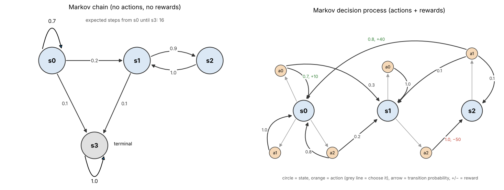

(왼쪽: 위 코드의 마르코프 연쇄(교재 그림 19-7). 원 = 상태, 화살표 숫자 = 전이 확률. s0은 70% 확률로 제자리에 머물고, s1 ↔ s2는 서로 오가다가 s1에서 10% 확률로 종료 상태 s3로 빠진다. 오른쪽: 3-2절의 MDP(교재 그림 19-8). 상태(파란 원)에서 행동(주황 원)을 고르면 확률적으로 다음 상태로 가며, 일부 전이에는 보상(+10, −50, +40)이 붙어 있다)

**결과 해석**

- s1 ↔ s2를 몇 번 오갈지는 운이다. s1에서 s3로 빠질 확률이 10%뿐이라 수십 번 오가기도 한다(Run #7)
- 📌 보충 계산: 흡수 마르코프 연쇄의 기본 행렬 $N = (I - Q)^{-1}$($Q$는 종료 상태를 뺀 전이 행렬)로 구하면, s0에서 출발해 s3에 도달할 때까지 **기대 스텝 수는 정확히 16**(s0에 3.3번, s1에 6.7번, s2에 6.0번 머문다). 시뮬레이션 2만 번의 평균은 16.24
- 마르코프 연쇄에는 아직 **행동**도 **보상**도 없다. 이 둘을 더하면 MDP가 된다

### 3-2. 마르코프 결정 과정과 벨만 방정식

> 🎯 **목적** — 마르코프 연쇄에 행동과 보상을 더한 MDP를 정의하고, 최적 상태 가치를 재귀적으로 정의하는 벨만 최적 방정식을 이해한다.

**개념·원리**

**마르코프 결정 과정**(Markov decision process, MDP)은 1950년대 리처드 벨만(Richard Bellman)이 정리했다. 마르코프 연쇄와 비슷하지만 매 스텝 에이전트가 **행동**을 고르고, 전이 확률이 그 행동에 따라 달라지며, 일부 전이는 **보상**(양수 또는 음수)을 준다. 에이전트의 목표는 시간에 따른 (할인된) 보상의 합을 최대화하는 정책을 찾는 것이다.

위 그림 오른쪽의 MDP를 말로 풀면:

- **s0**: 행동 a0이 무난하다(70% 확률로 +10을 받으며 s0에 머문다). 계속 a0을 하면 +10을 계속 모을 수 있지만, 30% 확률로 s1로 넘어간다
- **s1**: a0(제자리, 보상 없음)이나 a2(s2로, 그러나 **−50** 벌칙) 중 하나
- **s2**: a1밖에 없는데, 80% 확률로 **+40**을 받고 s0으로 돌아간다

s1에서 −50을 감수하고 s2로 가서 +40을 노릴까, 아니면 s1에 머물까? 직관만으로는 답하기 어렵다. 이 질문에 답하는 것이 벨만 방정식이다.

**최적 상태 가치**(optimal state value) $V^*(s)$는 상태 $s$에서 시작해 에이전트가 **최적으로** 행동한다고 가정할 때 받을 할인된 미래 보상의 기댓값이다. 벨만은 이것이 다음 재귀 식을 만족함을 보였다(**벨만 최적 방정식**, Bellman optimality equation).

$$V^*(s) = \max_a \sum_{s'} T(s, a, s') \left[ R(s, a, s') + \gamma \, V^*(s') \right] \quad \text{(모든 } s\text{에 대해)}$$

| 기호 | 의미 |
|---|---|
| $T(s, a, s')$ | 상태 $s$에서 행동 $a$를 했을 때 $s'$로 갈 전이 확률 |
| $R(s, a, s')$ | 그 전이에서 받는 보상 |
| $\gamma$ | 감가율 |
| $\sum_{s'}$ | 다음 상태가 확률적이므로 **기댓값** |
| $\max_a$ | 최적으로 행동하므로 가장 좋은 행동을 고른다 |

"지금 상태의 가치 = 최선의 행동을 했을 때 (즉시 보상 + 할인된 다음 상태 가치)의 기댓값." 이 식을 이용해 모든 $V^*(s)$를 0으로 초기화하고 반복해서 갱신하면 최적 가치로 수렴한다(**가치 반복**, value iteration).

$$V_{k+1}(s) \leftarrow \max_a \sum_{s'} T(s, a, s') \left[ R(s, a, s') + \gamma \, V_k(s') \right]$$

이것은 **동적 계획법**(dynamic programming)의 한 예다. 복잡한 문제를 재귀적으로 풀 수 있는 작은 문제로 쪼갠다.

**코드**

```python
transition_probabilities = [  # shape=[s, a, s']
    [[0.7, 0.3, 0.0], [1.0, 0.0, 0.0], [0.8, 0.2, 0.0]],
    [[0.0, 1.0, 0.0], None, [0.0, 0.0, 1.0]],
    [None, [0.8, 0.1, 0.1], None]
]
rewards = [  # shape=[s, a, s']
    [[+10, 0, 0], [0, 0, 0], [0, 0, 0]],
    [[0, 0, 0], [0, 0, 0], [0, 0, -50]],
    [[0, 0, 0], [+40, 0, 0], [0, 0, 0]]
]
possible_actions = [[0, 1, 2], [0, 2], [1]]
```

| 변수 | 형태 | 의미 |
|---|---|---|
| `transition_probabilities[s][a][s']` | 3 × 3 × 3 | $T(s, a, s')$. 불가능한 행동은 `None` (예: s1에서 a1) |
| `rewards[s][a][s']` | 3 × 3 × 3 | $R(s, a, s')$. 예: s0에서 a0으로 s0에 가면 +10 |
| `possible_actions[s]` | 상태별 리스트 | s0: a0·a1·a2, s1: a0·a2, s2: a1 |

예를 들어 s0에서 a0을 하면 확률 0.7로 s0(+10), 0.3으로 s1(0), 0으로 s2 → `[0.7, 0.3, 0.0]`과 `[+10, 0, 0]`이다.

### 3-3. Q-가치 반복

> 🎯 **목적** — 상태 가치 대신 상태-행동 가치(Q-가치)를 반복 계산해 최적 정책을 바로 읽어 낸다.

**개념·원리**

최적 상태 가치 $V^*(s)$를 알아도 "어떤 행동을 해야 하는지"는 다시 계산해야 한다. 벨만은 상태-행동 쌍의 가치를 직접 구하는 비슷한 알고리즘도 제시했다. **Q-가치**(quality value) $Q^*(s, a)$는 상태 $s$에서 행동 $a$를 하고 (그 결과를 본 뒤) 이후 최적으로 행동할 때 받을 할인된 미래 보상의 기댓값이다.

$$Q_{k+1}(s, a) \leftarrow \sum_{s'} T(s, a, s') \left[ R(s, a, s') + \gamma \max_{a'} Q_k(s', a') \right] \quad \text{(Q-가치 반복)}$$

최적 Q-가치를 구하면 **최적 정책** $\pi^*(s) = \arg\max_a Q^*(s, a)$는 바로 나온다. 또 $V^*(s) = \max_a Q^*(s, a)$다.

**코드**

```python
Q_values = np.full((3, 3), -np.inf)  # -np.inf for impossible actions
for state, actions in enumerate(possible_actions):
    Q_values[state, actions] = 0.0  # for all possible actions

gamma = 0.90  # the discount factor

history1 = []  # extra code – needed for the figure below
for iteration in range(50):
    Q_prev = Q_values.copy()
    history1.append(Q_prev) # extra code
    for s in range(3):
        for a in possible_actions[s]:
            Q_values[s, a] = np.sum([
                    transition_probabilities[s][a][sp]
                    * (rewards[s][a][sp] + gamma * Q_prev[sp].max())
                for sp in range(3)])

history1 = np.array(history1)  # extra code
```

| 코드 | 의미 |
|---|---|
| `np.full((3, 3), -np.inf)` | 불가능한 행동은 −∞로 두어 `max()`·`argmax()`에서 절대 선택되지 않게 한다 |
| `Q_values[state, actions] = 0.0` | 가능한 행동만 0으로 초기화 (팬시 인덱싱) |
| `Q_prev = Q_values.copy()` | 이번 반복의 계산은 **이전 반복의 값**만 쓴다 (동기식 업데이트) |
| `Q_prev[sp].max()` | 다음 상태 s'에서 최선의 행동을 했을 때의 가치 $\max_{a'} Q_k(s', a')$ |
| `np.sum([T * (R + γ·max Q) for sp])` | 다음 상태에 대한 기댓값 |

```python
Q_values
# array([[18.91891892, 17.02702702, 13.62162162],
#        [ 0.        ,        -inf, -4.87971488],
#        [       -inf, 50.13365013,        -inf]])

Q_values.argmax(axis=1)  # optimal action for each state
# array([0, 0, 1])
```

**결과 해석**

- 최적 정책(γ = 0.90): **s0 → a0, s1 → a0, s2 → a1**(유일한 행동). s1에서는 −50을 감수할 가치가 없어 제자리(a0)에 머문다
- Q(s1, a0) = **0**: s1에서 a0만 계속하면 보상 없이 영원히 s1에 머문다. 사실상 "s1에 들어가면 끝"이라는 뜻이고, 그래서 Q(s0, a0) = 18.9도 30% 확률로 s1에 빠지는 위험이 반영된 값이다
- Q(s2, a1) = 50.1: s2는 +40을 받으며 s0으로 돌아가는 좋은 상태다
- ✅ 보충 확인: Q(s0, a0)는 **17번** 반복 만에 최종값과의 차이가 0.01 미만이 되었다(아래 3-6절 그림 왼쪽)

### 3-4. 감가율이 최적 정책을 바꾼다

> 🎯 **목적** — 감가율 γ를 바꾸면 최적 정책이 어떻게 바뀌는지, 그 경계가 어디인지 확인한다.

**개념·원리**

노트북 설명: γ = 0.95로 다시 계산하면 s1의 최적 행동이 **a2**로 바뀐다. 감가율이 클수록 에이전트가 미래를 더 중요하게 여기므로, 나중에 더 많은 보상을 얻으려고 지금의 벌칙(−50)을 기꺼이 감수한다.

**보충 코드**

```python
# 보충 코드 — γ를 바꿔 가며 Q-가치 반복을 수렴할 때까지(2,000~3,000번) 실행
def q_value_iteration(gamma, n_iter):
    ...  # 3-3절 코드와 같다

Q95 = q_value_iteration(0.95, n_iter=500)
# [[21.90, 20.80, 16.87],
#  [ 1.12,  -inf,  1.18],
#  [ -inf, 53.87,  -inf]]   → argmax: [0, 2, 1]

# 이분법으로 Q(s1, a2) > Q(s1, a0)이 되는 경계 γ 찾기
# γ* ≈ 0.9476
```

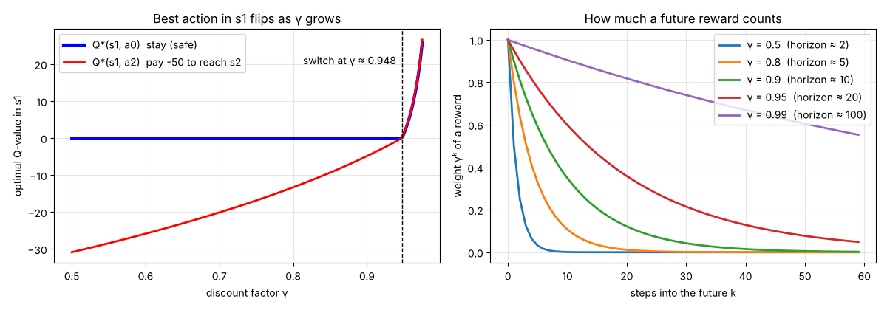

(왼쪽: γ에 따른 s1의 최적 Q-가치. 파랑 = 제자리(a0), 빨강 = −50을 내고 s2로(a2). γ < 0.948이면 a2의 가치가 음수라 머무는 게 낫고(Q = 0), 그보다 크면 a2가 양수로 올라서며 최적 행동이 바뀐다(이후 a0의 가치는 "한 스텝 쉬고 a2"라 빨강 바로 아래에 붙는다). 오른쪽: k스텝 뒤 보상의 무게 $\gamma^k$. 괄호는 대략적인 "내다보는 범위" $1/(1-\gamma)$)

**결과 해석**

- γ = 0.95에서 Q(s1, a2) = 1.18 > Q(s1, a0) = 1.12로, 아주 근소하게 a2가 이긴다. 경계는 **γ ≈ 0.948**
- γ = 0.9면 내다보는 범위가 약 10스텝, 0.95면 약 20스텝이다. −50을 회수하려면 +40을 여러 번 받아야 하므로 충분히 멀리 내다봐야 한다
- 감가율은 단순한 기술적 상수가 아니라 **문제의 정의**를 바꾼다. "얼마나 먼 미래까지 신경 쓸 것인가"를 정하는 하이퍼파라미터다 (연습문제 3번)

### 3-5. 시간차 학습

> 🎯 **목적** — 전이 확률과 보상을 모를 때, 실제로 겪은 한 스텝의 경험으로 가치를 추정하는 시간차(TD) 학습을 이해한다.

> ⚠️ 노트북에는 이 소절의 코드가 없다(Q-러닝 구현은 3-6절). 아래는 교재 절 내용을 정리한 것이다.

**개념·원리**

현실의 강화 학습 문제는 대부분 처음에 전이 확률 $T$와 보상 $R$을 모른다. 그래서 에이전트는 각 상태와 전이를 **직접 겪어 봐야** 보상을 알고, 여러 번 겪어 봐야 전이 확률을 어림할 수 있다.

**시간차 학습**(temporal difference learning, TD 학습)은 가치 반복과 비슷하지만, MDP를 일부만 안다는 점을 고려한다. 에이전트는 **탐험 정책**(예: 무작위)으로 돌아다니며, 실제로 관측한 전이(상태 $s$ → 보상 $r$ → 다음 상태 $s'$) 하나하나로 상태 가치 추정을 조금씩 고친다.

$$V_{k+1}(s) \leftarrow (1 - \alpha) V_k(s) + \alpha \left( r + \gamma V_k(s') \right)$$

또는 같은 식을

$$V_{k+1}(s) \leftarrow V_k(s) + \alpha \, \delta_k(s, r, s'), \qquad \delta_k = r + \gamma V_k(s') - V_k(s)$$

| 기호 | 이름 | 의미 |
|---|---|---|
| $\alpha$ | 학습률 | 새 정보를 얼마나 반영할지 (예: 0.01) |
| $r + \gamma V_k(s')$ | **TD 타깃** | 한 스텝 실제 보상 + 다음 상태의 (현재) 추정 가치 |
| $\delta_k$ | **TD 오차** | TD 타깃과 현재 추정의 차이. "예상보다 얼마나 좋았나/나빴나" |

TD 타깃은 실제 반환값의 **추정치**다. 다음 상태의 가치를 지금의 추정으로 채워 넣는 것을 **부트스트래핑**(bootstrapping)이라고 한다(자기 추정으로 자기를 고친다).

> 💡 TD 학습은 [4장의 확률적 경사 하강법](04_training_linear_models.md#2-4-확률적-경사-하강법)과 닮았다. 특히 샘플(경험)을 하나씩 처리한다. 또 SGD처럼 학습률을 점점 줄여야 진짜로 수렴한다(그렇지 않으면 최적값 주변에서 계속 튄다). 식 $(1-\alpha)V + \alpha \cdot \text{타깃}$은 [11장 모멘텀](11_training_deep_neural_networks.md#3-2-모멘텀-최적화)이나 [16장 DINO의 EMA 교사](16_vision_and_multimodal_transformers.md#1-12-dino-자기-지도-시각-표현-학습)처럼 **지수 이동 평균**이다: 각 상태에 대해, 그 상태를 떠날 때 받은 즉시 보상과 나중에 받을 것으로 기대되는 보상의 이동 평균을 추적한다.

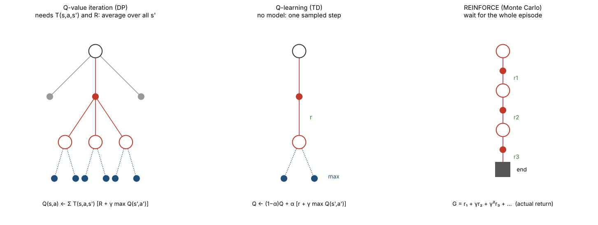

(가치를 한 번 갱신할 때 "어디까지 내다보는가"를 그린 백업 다이어그램. 흰 원 = 상태, 점 = 행동. 왼쪽: Q-가치 반복은 모델($T$, $R$)을 알기 때문에 가능한 **모든** 다음 상태의 기댓값을 계산한다. 가운데: Q-러닝(TD)은 실제로 겪은 **한 스텝**만 보고 나머지는 다음 상태의 추정값(max Q)으로 채운다. 오른쪽: REINFORCE(몬테카를로)는 에피소드가 끝날 때까지 기다려 **실제 반환값**을 쓴다)

| | 동적 계획법 (가치 반복) | TD 학습 (Q-러닝) | 몬테카를로 (REINFORCE) |
|---|---|---|---|
| 모델 ($T$, $R$) 필요 | 예 | 아니요 | 아니요 |
| 타깃 | 기댓값 (정확) | 한 스텝 + 추정 (부트스트래핑) | 실제 반환값 |
| 갱신 시점 | 언제든 (전체 계산) | 매 스텝 | 에피소드 끝 |
| 편향 / 분산 | — | 편향 있음(추정이 틀리면) / **분산 작음** | 편향 없음 / **분산 큼** |

### 3-6. Q-러닝

> 🎯 **목적** — TD 학습을 Q-가치에 적용한 Q-러닝을 구현하고, 모델 없이 Q-가치 반복과 같은 답에 도달하는지 확인한다.

**개념·원리**

**Q-러닝**(Q-learning, 1989년 크리스 왓킨스)은 전이 확률과 보상을 모를 때 Q-가치 반복을 흉내 낸다. 에이전트가 (예: 무작위로) 행동하는 것을 지켜보며 Q-가치 추정을 점점 개선한다. 추정이 충분히 정확해지면 최적 정책은 Q-가치가 가장 큰 행동을 고르는 것(**그리디 정책**)이다.

$$Q(s, a) \leftarrow (1 - \alpha) Q(s, a) + \alpha \left( r + \gamma \max_{a'} Q(s', a') \right)$$

각 상태-행동 쌍 $(s, a)$에 대해, 그 행동으로 받은 보상 $r$과 그 뒤 받을 것으로 기대되는 할인된 미래 보상의 이동 평균을 추적한다. 미래 보상은 "다음 상태 $s'$에서 최적으로 행동한다"고 보고 $\max_{a'} Q(s', a')$로 추정한다.

**코드**

```python
def step(state, action):
    probas = transition_probabilities[state][action]
    next_state = np.random.choice([0, 1, 2], p=probas)
    reward = rewards[state][action][next_state]
    return next_state, reward

def exploration_policy(state):
    return np.random.choice(possible_actions[state])
```

`step()`은 **환경 시뮬레이터**다. 에이전트(Q-러닝 알고리즘)는 전이 확률을 직접 보지 않고, 이 함수가 돌려주는 다음 상태와 보상만 본다. 탐험 정책은 상태 공간이 아주 작으니 **무작위 정책**을 쓴다. 모든 상태를 여러 번 방문하기만 하면 어떤 정책이든 된다.

```python
# extra code – initializes the Q-Values, just like earlier
np.random.seed(42)
Q_values = np.full((3, 3), -np.inf)
for state, actions in enumerate(possible_actions):
    Q_values[state][actions] = 0

alpha0 = 0.05  # initial learning rate
decay = 0.005  # learning rate decay
gamma = 0.90  # discount factor
state = 0  # initial state
history2 = []  # extra code – needed for the figure below

for iteration in range(10_000):
    history2.append(Q_values.copy())  # extra code
    action = exploration_policy(state)
    next_state, reward = step(state, action)
    next_value = Q_values[next_state].max()  # greedy policy at the next step
    alpha = alpha0 / (1 + iteration * decay)
    Q_values[state, action] *= 1 - alpha
    Q_values[state, action] += alpha * (reward + gamma * next_value)
    state = next_state

history2 = np.array(history2)  # extra code
```

| 코드 | 의미 |
|---|---|
| `next_value = Q_values[next_state].max()` | 다음 상태에서 **그리디하게** 행동한다고 가정한 가치 $\max_{a'} Q(s', a')$. 실제 다음 행동(무작위)과 무관하다 → **오프-폴리시** |
| `alpha = alpha0 / (1 + iteration * decay)` | 학습률 감소(**거듭제곱 기반 스케줄**, [11장](11_training_deep_neural_networks.md#4-1-학습률-스케줄이란)). 0.05에서 시작해 마지막엔 약 0.001 |
| `*= 1 - alpha` 후 `+= alpha * (...)` | $(1-\alpha)Q + \alpha \cdot \text{TD 타깃}$ |
| `state = next_state` | 에피소드가 끝나지 않는 MDP라 계속 이어서 돌아다닌다 |

```python
# extra code – this cell generates Figure 19–9
true_Q_value = history1[-1, 0, 0]

fig, axes = plt.subplots(1, 2, figsize=(10, 4), sharey=True)
axes[0].set_ylabel("Q-value$(s_0, a_0)$", fontsize=14)
axes[0].set_title("Q-value iteration", fontsize=14)
axes[1].set_title("Q-learning", fontsize=14)
for ax, width, history in zip(axes, (50, 10000), (history1, history2)):
    ax.plot([0, width], [true_Q_value, true_Q_value], "k--")
    ax.plot(np.arange(width), history[:, 0, 0], "b-", linewidth=2)
    ax.set_xlabel("Iterations", fontsize=14)
    ax.axis([0, width, 0, 24])
    ax.grid(True)

plt.show()
```

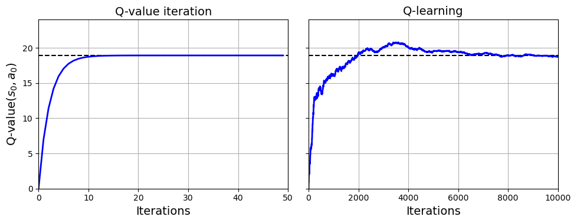

(교재 그림 19-9. 세로축: Q(s0, a0)의 추정값, 점선: 진짜 값 18.92. 왼쪽: Q-가치 반복은 20번 안쪽에서 매끄럽게 수렴. 오른쪽: Q-러닝은 **1만 번**의 무작위 경험이 필요하고, 들쭉날쭉 진동하다가(한때 20.7까지 과대 추정) 학습률이 줄면서 진짜 값에 다가간다)

**결과 해석**

- Q-가치 반복은 모델($T$, $R$)을 알아서 50번이면 충분하지만, Q-러닝은 모델 없이 경험만으로 배우느라 **수천 배** 많은 반복이 필요하다
- ✅ CPU 재실행 결과 Q(s0, a0) = 18.78, Q(s1, a2) = −8.00, Q(s2, a1) = 49.40 → 최적 정책 [a0, a0, a1]이 Q-가치 반복과 같다. 자주 방문하지 않는 쌍(s1, a2)의 추정이 가장 덜 정확하다
- **오프-폴리시**(off-policy): 실제로 따른 정책(무작위 탐험)과 학습하는 정책(그리디 = 최적)이 다르다. 무작위로 돌아다니는 에이전트를 보기만 하고도 최적 정책을 배웠다. 반대로 REINFORCE는 실제로 실행한 정책을 개선하는 **온-폴리시**(on-policy) 알고리즘이다

### 3-7. 탐험 정책

> 🎯 **목적** — 탐험과 활용의 균형을 맞추는 ε-그리디 정책과 탐험 함수를 정리한다.

> ⚠️ 노트북에는 이 소절의 별도 코드가 없다(ε-그리디는 3-10절 DQN 코드에 나온다). 아래는 교재 절 내용을 정리한 것이다.

**개념·원리**

Q-러닝은 탐험 정책이 MDP를 **충분히 골고루** 돌아다녀야 작동한다. 완전 무작위 정책은 언젠가는 모든 상태·전이를 여러 번 겪겠지만 시간이 너무 오래 걸린다. 더 나은 방법은 **ε-그리디 정책**(ε-greedy policy)이다.

- 확률 ε로 **무작위** 행동(탐험, exploration)
- 확률 1 − ε로 지금까지 가장 좋아 보이는 행동, 즉 Q-가치가 가장 큰 행동(활용, exploitation)

무작위 정책과 달리, Q-가치 추정이 좋아질수록 환경의 **흥미로운 부분**(좋은 보상이 있는 곳)에서 점점 더 많은 시간을 보내면서도 미지의 영역을 가끔 방문한다. 보통 ε을 1.0에서 시작해 0.05 정도까지 서서히 줄인다(이 장의 DQN은 500 에피소드 동안 1 → 0.01).

또 다른 방법은 이미 시도해 본 행동보다 **덜 해 본 행동을 시도하도록 장려**하는 것이다. Q-가치 추정에 보너스를 더하는 **탐험 함수**(exploration function)를 쓴다.

$$Q(s, a) \leftarrow (1-\alpha) Q(s, a) + \alpha \left( r + \gamma \max_{a'} f\big(Q(s', a'), N(s', a')\big) \right), \qquad f(Q, N) = Q + \frac{\kappa}{1 + N}$$

$N(s', a')$은 상태 $s'$에서 행동 $a'$을 고른 횟수, κ는 호기심 정도(탐험을 얼마나 좋아하는지)를 정하는 하이퍼파라미터다. 덜 해 본 행동일수록 보너스가 크다. 이 "새로운 것에 보너스" 아이디어는 6-4절의 **호기심 기반 탐험**으로 이어진다.

> 💡 탐험 vs 활용은 강화 학습의 고유한 고민이다. 맛집 탐방에 비유하면, 아는 맛집만 가면(활용) 더 맛있는 집을 놓치고, 매번 새 집만 가면(탐험) 실패가 잦다. 처음엔 많이 탐험하고 점점 활용 비중을 늘리는 것이 ε 감소 스케줄이다.

### 3-8. 보충 코드: SARSA vs Q-러닝 (온-폴리시 vs 오프-폴리시)

> 🎯 **목적** — "탐험하는 동안의 행동까지 고려하는가"에 따라 학습되는 정책이 어떻게 달라지는지, 고전적인 절벽 걷기(CliffWalking) 문제로 확인한다.

**개념·원리**

Q-러닝의 TD 타깃은 $r + \gamma \max_{a'} Q(s', a')$로, 다음 상태에서 **최선의 행동**을 한다고 가정한다(오프-폴리시). 반면 **SARSA**(State-Action-Reward-State-Action)는 다음 상태에서 **실제로 고른 행동** $a'$(ε-그리디로 뽑힌)을 그대로 쓴다(온-폴리시).

$$\text{Q-러닝: } r + \gamma \max_{a'} Q(s', a') \qquad \text{SARSA: } r + \gamma \, Q(s', a'_{\text{실제}})$$

**보충 코드**

```python
# 보충 코드 (요약) — Gymnasium의 CliffWalking: 4×12 격자, 스텝마다 −1, 절벽에 빠지면 −100 + 출발점으로
env = gym.make("CliffWalking-v1")       # 노트북 목록에는 CliffWalking-v0
# 두 방법 모두 ε = 0.1의 ε-그리디로 행동하며 α = 0.5, γ = 1, 500 에피소드, 시드 20개
a2 = eps_greedy(Q, s2, eps)                              # 다음 행동을 먼저 뽑아 둔다
target = r + (0 if done else (Q[s2, a2]                  # SARSA: 실제로 할 행동
                              if method == "sarsa" else Q[s2].max()))  # Q-러닝: 최선의 행동
Q[s, a] += alpha * (target - Q[s, a])
```

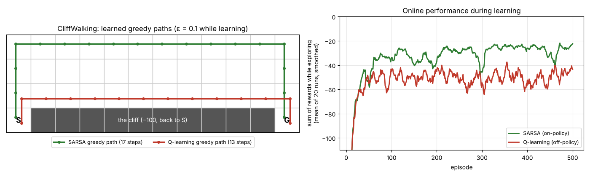

(왼쪽: 학습한 Q-가치로 그리디하게 갈 때의 경로. S = 출발, G = 도착, 회색 = 절벽. Q-러닝(빨강)은 절벽 바로 위를 따라가는 **최단 경로**(13스텝), SARSA(초록)는 절벽에서 멀리 돌아가는 **안전한 경로**(17스텝)를 배웠다. 오른쪽: 학습하는 동안(ε = 0.1로 탐험하며) 에피소드마다 받은 총보상. 20번 실행 평균을 10 에피소드씩 이동 평균)

| | Q-러닝 (오프-폴리시) | SARSA (온-폴리시) |
|---|---|---|
| 그리디 경로 | 13스텝 (최단, 절벽 옆) — 20번 중 20번 | 17스텝 (안전) — 20번 중 17번 (2번은 그리디 경로가 맴돌았다) |
| 학습 중 평균 보상 (마지막 100 에피소드) | **−49.7** | **−27.2** |

**결과 해석**

- Q-러닝은 "탐험을 멈춘다면 최선은?"을 배운다. 그래서 진짜 최적 경로(절벽 옆)를 찾지만, 학습 중에는 ε = 0.1의 무작위 행동 때문에 절벽에 자주 빠져 점수가 나쁘다
- SARSA는 "지금처럼 가끔 실수하며 움직인다면 최선은?"을 배운다. 실수할 여지를 감안해 절벽에서 떨어진 길로 간다 → 학습 중 점수가 더 좋다
- 실제 로봇처럼 **학습하는 동안의 실수가 비싼** 경우는 온-폴리시가 안전하고, 시뮬레이터에서 최종 성능만 중요하면 오프-폴리시가 유리하다. 오프-폴리시의 또 다른 장점은 **다른 정책이 만든 과거 경험을 재사용**할 수 있다는 것이다 → DQN의 재생 버퍼(3-10절)가 가능한 이유 (연습문제 7번)

### 3-9. 근사 Q-러닝과 심층 Q-러닝

> 🎯 **목적** — 상태가 많거나 연속일 때 Q-가치 표 대신 신경망으로 Q-가치를 근사하는 DQN의 아이디어와 훈련 타깃을 정리한다.

**개념·원리**

Q-러닝의 문제는 규모다. 상태가 3개면 표 하나로 충분하지만, 교재의 예처럼 미스 팩맨 화면에서 먹을 수 있는 알갱이만 150개라면 가능한 상태는 $2^{150} \approx 10^{45}$개를 넘는다. 게다가 CartPole의 관측은 **연속값**이라 표로 만들 수조차 없다. 모든 Q-가치를 표로 추적하는 것은 불가능하다.

해결책은 파라미터 θ로 Q-가치를 **근사**하는 함수 $Q_\theta(s, a)$를 찾는 것이다(**근사 Q-러닝**, approximate Q-learning). 예전에는 사람이 고른 특성의 선형 조합을 썼지만, 2013년 딥마인드는 **심층 신경망**이 훨씬 잘 작동함을 보였다. Q-가치를 추정하는 심층 신경망을 **심층 Q-네트워크**(deep Q-network, DQN), DQN으로 근사 Q-러닝을 하는 것을 **심층 Q-러닝**이라고 한다.

DQN을 어떻게 훈련할까? 상태-행동 쌍 $(s, a)$에 대해 근사 Q-가치는 **실제로 관측한 보상** $r$에, 이후 최적으로 행동했을 때의 할인된 가치를 더한 값에 가까워야 한다. 미래 가치는 다음 상태 $s'$에서 DQN 자신이 추정한 Q-가치의 최댓값으로 근사한다.

$$y(s, a) = r + \gamma \max_{a'} Q_\theta(s', a') \qquad \text{(목표 Q-가치)}$$

이 목표 Q-가치 $y$와 추정 $Q_\theta(s, a)$의 제곱 오차(MSE)를 최소화하도록 경사 하강법으로 훈련한다. Q-러닝의 TD 업데이트를 **회귀 문제**로 바꾼 것이다.

> ⚠️ 목표 $y$ 안에 $Q_\theta$가 다시 들어 있다. 파라미터를 고치면 **타깃도 같이 움직인다**. 자기 꼬리를 쫓는 개처럼 불안정해질 수 있고, 이것이 3-12절의 목표 네트워크가 나온 이유다. 그래서 $y$를 계산할 때는 그레이디언트를 흘리지 않는다(`torch.inference_mode()`, 3-10절).

### 3-10. DQN 구현: 네트워크와 재생 버퍼

> 🎯 **목적** — 상태를 받아 행동별 Q-가치를 출력하는 DQN, ε-그리디 행동 선택, 경험을 저장·샘플링하는 재생 버퍼를 구현한다.

**코드**

```python
class DQN(nn.Module):
    def __init__(self):
        super().__init__()
        self.net = nn.Sequential(nn.Linear(4, 32), nn.ReLU(),
                                 nn.Linear(32, 32), nn.ReLU(),
                                 nn.Linear(32, 2))

    def forward(self, state):
        return self.net(state)
```

노트북 설명: 상태가 주어지면, 가능한 행동마다 "그 행동을 한 뒤(결과를 보기 전) 기대할 수 있는 할인된 미래 보상의 합"을 추정한다. 입력은 관측 4개, 출력은 **행동 수(2)만큼의 Q-가치**다. $(s, a)$를 입력으로 받아 Q-가치 하나를 내는 대신 이렇게 하면, 한 번의 순전파로 모든 행동의 Q-가치를 얻는다. 파라미터는 $4 \times 32 + 32 + 32 \times 32 + 32 + 32 \times 2 + 2 = 1,282$개.

```python
def choose_dqn_action(model, obs, epsilon=0.0):
        if torch.rand(()) < epsilon:  # epsilon greedy policy
            return torch.randint(2, size=()).item()
        else:
            state = torch.as_tensor(obs)
            Q_values = model(state)
            return Q_values.argmax().item()  # optimal according to the DQN
```

**ε-그리디 정책**(3-7절): 확률 ε로 무작위 행동, 아니면 DQN이 예측한 Q-가치가 가장 큰 행동. `epsilon=0.0`(기본값)이면 순수 그리디 → 평가·애니메이션용.

노트북 설명: **재생 버퍼**(replay buffer, 재생 메모리)가 필요하다. 에이전트의 경험을 담는데, 경험 하나는 `(state, action, reward, next_state, done, truncated)` 여섯 원소의 튜플이다.

```python
def sample_experiences(replay_buffer, batch_size):
    indices = torch.randint(len(replay_buffer), size=[batch_size])
    batch = [replay_buffer[index] for index in indices.tolist()]
    return [to_tensor([exp[index] for exp in batch]) for index in range(6)]

def to_tensor(data):
    array = np.stack(data)
    dtype = torch.float32 if array.dtype == np.float64 else None
    return torch.as_tensor(array, dtype=dtype)
```

| 코드 | 의미 |
|---|---|
| `torch.randint(len(replay_buffer), size=[batch_size])` | 버퍼에서 **무작위로** `batch_size`개 인덱스 (중복 허용) |
| `[exp[index] for exp in batch]` | 경험 32개에서 같은 필드(예: 상태)만 모은다 → **튜플의 리스트 → 필드별 텐서 6개** |
| `np.stack(data)` | 상태 32개 `[4]` → `[32, 4]`, 행동 32개 → `[32]` (int), `done` → `[32]` (bool) |
| `float64` → `float32` | 보상(`1.0`)은 파이썬 float라 `float64` 배열이 된다. 모델 출력(`float32`)과 맞춘다. 행동(int64)·`done`(bool)은 그대로 |

**왜 재생 버퍼인가**: 에이전트는 한동안 환경의 같은 영역에 머물기 때문에 연속된 경험은 서로 **매우 비슷하다**(강한 상관). 최근 경험만으로 훈련하면 그 영역에 과적합되고 다른 곳에서는 엉망이 된다. 버퍼에 오래된 경험과 최근 경험을 함께 쌓아 두고 **무작위로** 뽑으면 훈련 배치가 덜 상관되고(지도 학습의 "데이터 섞기"와 같은 효과), 한 경험을 여러 번 재사용해 효율도 좋아진다. 이것이 가능한 것은 Q-러닝이 **오프-폴리시**라서 예전 정책이 만든 경험으로도 배울 수 있기 때문이다(연습문제 6·7번).

노트북 메모: 아주 큰 재생 버퍼(10만 개 이상)라면 `deque` 대신 **원형 버퍼**를 쓰는 게 좋다. `deque`는 양 끝 접근은 빠르지만 중간 원소의 무작위 접근이 $O(N)$이라, 원형 버퍼(리스트, $O(1)$)가 낫다. 또는 딥마인드의 Reverb 라이브러리를 쓴다.

```python
# extra code – A basic circular buffer implementation
class ReplayBuffer:
    def __init__(self, max_length):
        self.data = [None] * max_length
        self.max_length = max_length
        self.index = 0
        self.length = 0

    def append(self, obj):
        self.data[self.index] = obj
        self.length = min(self.length + 1, self.max_length)
        self.index = (self.index + 1) % self.max_length

    def __getitem__(self, index):
        if index < 0 or index >= self.length:
            raise IndexError(f"replay buffer index out of range: {index}")
        return self.data[index]

    def __len__(self):
        return self.length

buff = ReplayBuffer(max_length=4)
for i in range(8):
    buff.append(i)
    print(f"Length: {len(buff)}, data: {buff.data}")
# Length: 1, data: [0, None, None, None]
# Length: 2, data: [0, 1, None, None]
# Length: 3, data: [0, 1, 2, None]
# Length: 4, data: [0, 1, 2, 3]
# Length: 4, data: [4, 1, 2, 3]     ← 가득 차면 가장 오래된 것(0)부터 덮어쓴다
# Length: 4, data: [4, 5, 2, 3]
# Length: 4, data: [4, 5, 6, 3]
# Length: 4, data: [4, 5, 6, 7]
```

`index`가 끝에 닿으면 `% max_length`로 0으로 돌아간다. `__getitem__`·`__len__`을 정의했으므로 `sample_experiences()`에 `deque` 대신 그대로 넣을 수 있다(덕 타이핑).

```python
def play_and_record_episode(model, env, replay_buffer, epsilon, seed=None):
    obs, _info = env.reset(seed=seed)
    total_rewards = 0
    model.eval()
    with torch.no_grad():
        while True:
            action = choose_dqn_action(model, obs, epsilon)
            next_obs, reward, done, truncated, _info = env.step(action)
            experience = (obs, action, reward, next_obs, done, truncated)
            replay_buffer.append(experience)
            total_rewards += reward
            if done or truncated:
                return total_rewards
            obs = next_obs
```

ε-그리디로 에피소드 하나를 플레이하며 모든 전이를 버퍼에 넣는다. 행동 선택에는 그레이디언트가 필요 없으므로 `torch.no_grad()`.

### 3-11. DQN 훈련

> 🎯 **목적** — 버퍼에서 뽑은 배치로 목표 Q-가치를 계산해 DQN을 한 스텝 훈련하고, 800 에피소드 학습 곡선을 해석한다.

**코드**

```python
def dqn_training_step(model, optimizer, criterion, replay_buffer, batch_size,
                      discount_factor):
    experiences = sample_experiences(replay_buffer, batch_size)
    state, action, reward, next_state, done, truncated = experiences
    with torch.inference_mode():
        next_Q_value = model(next_state)

    max_next_Q_value, _ = next_Q_value.max(dim=1)
    running = (~(done | truncated)).float()  # 0 if s' is over, 1 if running
    target_Q_value = reward + running * discount_factor * max_next_Q_value
    all_Q_values = model(state)
    Q_value = all_Q_values.gather(dim=1, index=action.unsqueeze(1))
    loss = criterion(Q_value, target_Q_value.unsqueeze(1))
    optimizer.zero_grad()
    loss.backward()
    optimizer.step()
```

| 코드 | 형태 | 의미 |
|---|---|---|
| `with torch.inference_mode(): model(next_state)` | `[32, 2]` | 다음 상태의 Q-가치. **타깃이므로 그레이디언트를 흘리지 않는다** (`no_grad()`보다 조금 더 빠른 추론 전용 모드) |
| `.max(dim=1)` | `[32]` | 행동 축의 최댓값 $\max_{a'} Q(s', a')$ (값, 인덱스 튜플 중 값만) |
| `running = (~(done \| truncated)).float()` | `[32]` | 에피소드가 끝났으면 0 → 미래 가치를 더하지 않는다. `~`는 bool 텐서의 논리 NOT |
| `target_Q_value` | `[32]` | $y = r + \gamma \max_{a'} Q(s', a')$ (끝났으면 $y = r$) |
| `model(state)` | `[32, 2]` | 이번엔 그레이디언트가 흐른다 |
| `.gather(dim=1, index=action.unsqueeze(1))` | `[32, 1]` | 각 행에서 **실제로 한 행동**의 Q-가치만 고른다. 예: Q = `[[1, 5], [3, 2], [0, 4]]`, 행동 `[1, 0, 1]` → `[5, 3, 4]` |
| `criterion(Q_value, target.unsqueeze(1))` | 스칼라 | MSE. 형태를 `[32, 1]`로 맞춘다 (브로드캐스팅 실수 방지) |

> 💡 하지 않은 행동의 Q-가치는 손실에 들어가지 않는다. 그 행동의 결과(보상)를 모르기 때문이다. `gather`는 [18장 확산 모델](18_autoencoders_gans_and_diffusion_models.md#9-4-확산-데이터셋-만들기)에서 시점별 값을 고를 때도 썼다.

```python
from collections import deque

def train_dqn(model, env, replay_buffer, optimizer, criterion, n_episodes=800,
              warmup=30, batch_size=32, discount_factor=0.95):
    totals = []
    for episode in range(n_episodes):
        epsilon = max(1 - episode / 500, 0.01)
        seed = torch.randint(0, 2**32, size=()).item()
        total_rewards = play_and_record_episode(model, env, replay_buffer,
                                                epsilon, seed=seed)
        print(f"\rEpisode: {episode + 1}, Rewards: {total_rewards}", end=" ")
        totals.append(total_rewards)
        if episode >= warmup:
            dqn_training_step(model, optimizer, criterion, replay_buffer,
                              batch_size, discount_factor)
    return totals

torch.manual_seed(42)
dqn = DQN()
optimizer = torch.optim.NAdam(dqn.parameters(), lr=0.03)
mse = nn.MSELoss()
replay_buffer = deque(maxlen=100_000)
totals = train_dqn(dqn, env, replay_buffer, optimizer, mse)
# Episode: 800, Rewards: 1000.0
```

| 설정 | 값 | 의미 |
|---|---|---|
| `epsilon = max(1 - episode / 500, 0.01)` | 1.0 → 0.01 (500 에피소드 동안 선형 감소) | 처음엔 완전 무작위 탐험, 점점 DQN을 믿는다 |
| `warmup=30` | 30 에피소드 | 버퍼가 어느 정도 찰 때까지 훈련하지 않는다 |
| 훈련 빈도 | **에피소드당 한 스텝** | 노트북은 단순하게 에피소드 하나에 그레이디언트 스텝 하나 → 800 에피소드에 770번뿐. 실전 DQN은 보통 환경 스텝마다(또는 4스텝마다) 훈련한다 |
| `deque(maxlen=100_000)` | 최근 10만 개 | 가득 차면 오래된 경험이 자동으로 빠진다 |
| `lr=0.03` | NAdam | 업데이트 횟수가 적어서 큰 학습률 |

```python
# extra code – this cell generates Figure 19–10
plt.figure(figsize=(8, 4))
plt.plot(totals)
plt.xlabel("Episode", fontsize=14)
plt.ylabel("Sum of rewards", fontsize=14)
plt.grid(True)

plt.show()
```

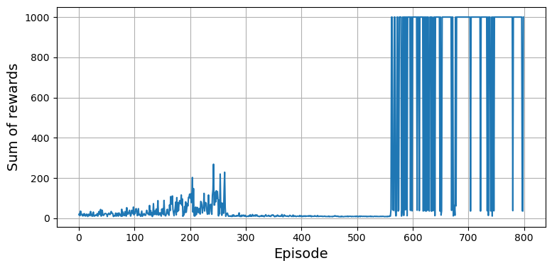

(교재 그림 19-10. 가로축: 에피소드, 세로축: 에피소드의 총보상(= 버틴 스텝, 최대 1,000). 200 에피소드 무렵까지 조금씩 오르다(최고 268), **270 에피소드 무렵 갑자기 10점 안팎으로 무너져** 300 에피소드 가까이 회복하지 못한다. 560 에피소드 무렵부터 1,000점 에피소드가 나오기 시작하고, 끝 무렵에는 대부분 1,000점이지만 여전히 가끔 수십 점으로 떨어진다)

```python
# extra code – shows an animation of the trained DQN playing one episode
torch.manual_seed(42)
dqn.eval()

def dqn_policy(obs):
    with torch.no_grad():
        return choose_dqn_action(dqn, obs)

show_one_episode(dqn_policy)
```

노트북 설명: "아주 안정적인 CartPole이다! 😀" (ε = 0인 그리디 정책)

**결과 해석**

- 처음 ~250 에피소드는 ε이 커서 대부분 무작위로 움직이므로 점수가 낮은 게 정상이다
- 중간의 긴 붕괴는 **치명적 망각**(catastrophic forgetting)이다. 에이전트가 환경의 한 부분에서 배운 것이 다른 부분에서 배운 것을 망가뜨린다. 경험이 꽤 상관되어 있고 학습 환경이 계속 바뀌기 때문에(정책이 바뀌면 보게 되는 상태도 바뀐다) 경사 하강법이 쉽게 망가진다. 버퍼를 키우거나 학습률을 낮추면 줄일 수 있다
- 교재가 강조하듯 강화 학습은 어렵다. 훈련이 불안정하고, 하이퍼파라미터와 랜덤 시드에 아주 민감하다. 그래서 학습 곡선을 반드시 그려 보고, **가장 좋았던 모델을 저장해 두는** 습관이 중요하다(5-6절의 체크포인트)
- ✅ CPU 재실행(시드 42, 약 12초): 마지막 100 에피소드 평균 913. 하지만 시드 11개로 돌리면 결과가 10점부터 913점까지 흩어진다(3-13절)

### 3-12. DQN 변형

> 🎯 **목적** — 기본 DQN의 불안정을 줄이고 성능을 높이는 대표 변형 네 가지(고정 Q-가치 타깃, 더블 DQN, 우선 순위 경험 재생, 듀얼링 DQN)를 정리한다.

> ⚠️ 노트북에는 이 소절의 코드가 없다. 아래는 교재 절 내용을 정리한 것이다. 고정 Q-가치 타깃과 더블 DQN은 3-13절 보충 코드로 직접 실험한다.

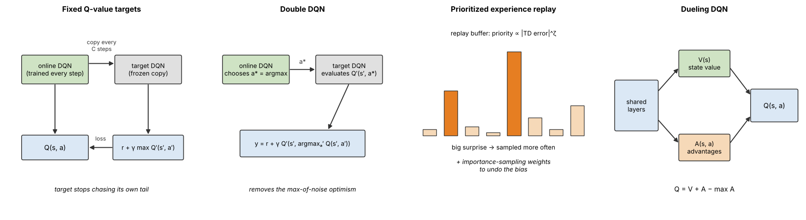

(왼쪽부터 ① 고정 Q-가치 타깃: 훈련하는 **온라인 DQN**과 타깃만 계산하는 **목표 DQN**(얼어 있는 복사본)을 따로 두고 C스텝마다 복사. ② 더블 DQN: 다음 행동은 온라인 DQN이 **고르고**, 그 가치는 목표 DQN이 **평가**. ③ 우선 순위 경험 재생: TD 오차가 큰(놀라운) 경험일수록 자주 뽑는다. ④ 듀얼링 DQN: 상태 가치 V(s)와 행동 이득 A(s, a)를 따로 추정해 합친다)

**① 고정 Q-가치 타깃**(fixed Q-value targets)

기본 DQN은 같은 모델이 예측도 하고 자기 타깃도 만든다. 그래서 피드백 루프가 생겨 네트워크가 불안정해진다(발산, 진동, 동결). 2013년 딥마인드의 아타리 논문은 DQN을 두 개 썼다.

- **온라인 모델**: 매 스텝 학습하고 에이전트를 움직인다
- **목표 모델**: 타깃 $y = r + \gamma \max_{a'} Q_{\text{target}}(s', a')$를 계산할 때만 쓴다. 온라인 모델의 **복사본**이며, 일정 간격(딥마인드는 1만 스텝)마다만 온라인 모델의 가중치를 복사해 온다

```python
target = copy.deepcopy(model)                                # 처음에 복사
...
next_Q_value = target(next_state)                            # 타깃 계산은 목표 모델로
...
if step % sync_every == 0:
    target.load_state_dict(model.state_dict())               # 주기적으로 동기화
```

타깃이 덜 자주 바뀌므로 진동·발산이 줄어든다. 대신 학습이 느려져서, 딥마인드는 학습률 0.00025, 버퍼 100만 개, ε을 100만 스텝에 걸쳐 1 → 0.1로 줄이며 5천만 스텝을 훈련했다.

**② 더블 DQN**(double DQN, 2015)

목표 모델은 Q-가치를 **과대평가**하는 경향이 있다. 모든 행동이 똑같이 좋더라도, 추정에는 잡음이 있으므로 어떤 행동은 우연히 조금 더 커 보이고, $\max$는 늘 그 **운 좋게 큰 잡음**을 고른다(최대화 편향). 해결책: 다음 상태의 최선의 행동은 **온라인 모델**로 고르고, 그 행동의 Q-가치는 **목표 모델**로 평가한다.

$$y = r + \gamma \, Q_{\text{target}}\Big(s', \arg\max_{a'} Q_{\text{online}}(s', a')\Big)$$

```python
best_next_actions = model(next_state).argmax(dim=1, keepdim=True)   # 온라인이 고르고
max_next_Q_value = target(next_state).gather(1, best_next_actions).squeeze(1)  # 목표가 평가
```

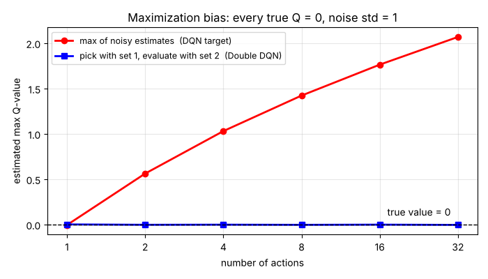

(보충 실험. 진짜 Q-가치가 모두 0이고 추정에 표준 편차 1의 잡음이 있을 때, 추정값 10만 세트로 계산한 평균. 빨강: 잡음 낀 추정의 최댓값(기본 DQN의 타깃) — 행동이 2개면 +0.56, 4개면 +1.03, 32개면 **+2.07**로 행동이 많을수록 과대평가가 커진다. 파랑: 한 세트로 고르고 다른 세트로 평가(더블 DQN) — 행동 수와 무관하게 0)

**③ 우선 순위 경험 재생**(prioritized experience replay, PER, 2015)

재생 버퍼에서 경험을 **균일하게** 뽑는 대신, **중요한** 경험을 더 자주 뽑는다. 중요도는 TD 오차의 크기 $\delta = r + \gamma V(s') - V(s)$로 잰다. 오차가 크면 "예상과 달랐다(놀랍다)"는 뜻이고 배울 게 많다.

- 경험을 버퍼에 넣을 때 우선 순위를 아주 크게 줘서 최소 한 번은 뽑히게 한다
- 뽑힌 뒤에는 TD 오차 $|\delta|$로 우선 순위 $p$를 갱신하고, 뽑힐 확률을 $p^\zeta$에 비례하게 한다. ζ는 얼마나 탐욕적으로 우선 순위를 쓸지 정하는 하이퍼파라미터(0이면 균일 샘플링, 1이면 완전히 우선 순위대로, 논문은 0.6)
- 중요한 경험을 더 자주 뽑으면 훈련이 그 경험 쪽으로 **편향**된다. 그래서 훈련할 때 **중요도 샘플링**(importance sampling) 가중치 $w = (n P)^{-\beta}$로 손실을 줄여 보정한다($n$ = 버퍼 크기, $P$ = 뽑힐 확률). β는 훈련이 끝날 무렵 1로 키운다(논문은 0.4 → 1)

**④ 듀얼링 DQN**(dueling DQN, 2015)

Q-가치는 상태 가치와 행동 이득의 합으로 쓸 수 있다: $Q(s, a) = V(s) + A(s, a)$. 듀얼링 DQN은 공유 층 위에서 $V(s)$와 $A(s, a)$를 **따로** 추정한 뒤 합친다. 최선의 행동의 이득은 0이어야 하므로, 모든 이득에서 최대 이득을 빼서 맞춘다.

$$Q(s, a) = V(s) + A(s, a) - \max_{a'} A(s, a')$$

많은 상태에서는 어떤 행동을 해도 결과가 비슷하다(예: 브레이크아웃에서 공이 멀리 있을 때). 이때 $V(s)$만 잘 배우면 되므로 학습이 효율적이다.

**결합**: 딥마인드의 **Rainbow**(2017)는 더블 DQN, 우선 순위 재생, 듀얼링 등 여섯 가지 기법을 합쳐 각각보다 훨씬 좋은 성능을 냈다.

### 3-13. 보충 코드: 목표 네트워크와 더블 DQN의 효과

> 🎯 **목적** — 노트북 DQN에 목표 네트워크와 더블 DQN을 붙여 시드 11개로 돌려 보고, 성능의 편차와 Q-가치의 크기가 어떻게 달라지는지 확인한다.

**보충 코드**

```python
# 보충 코드 (요약) — 노트북 train_dqn()과 같은 설정(800 에피소드, 에피소드당 1스텝, NAdam 0.03)에서 타깃만 바꾼다
target = copy.deepcopy(model)
...
with torch.inference_mode():
    if variant == "plain":                                     # 노트북 그대로
        nq = model(nst).max(dim=1)[0]
    elif variant == "target":                                  # 고정 Q-가치 타깃
        nq = target(nst).max(dim=1)[0]
    else:                                                      # 더블 DQN
        best = model(nst).argmax(dim=1, keepdim=True)
        nq = target(nst).gather(1, best).squeeze(1)
...
if variant != "plain" and n_train % 10 == 0:                   # 10번 훈련할 때마다 동기화
    target.load_state_dict(model.state_dict())
# 시드 42, 0 ~ 9 (11개) × 3가지, 훈련마다 배치의 평균 max Q-가치를 기록
```

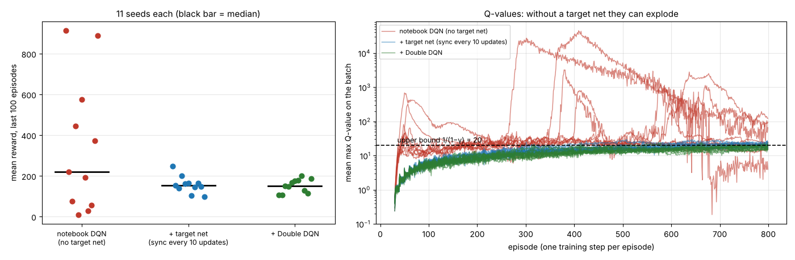

(왼쪽: 시드마다 마지막 100 에피소드의 평균 보상(점 하나 = 시드 하나, 검은 막대 = 중앙값). 오른쪽: 훈련 중 배치의 평균 max Q-가치(로그 축). 점선 = CartPole에서 가능한 Q-가치의 상한 $\sum_k \gamma^k \cdot 1 = 1/(1-0.95) = 20$. 노트북 DQN(빨강)은 여러 시드에서 Q-가치가 수백 ~ **수만**까지 폭주했다가 내려오고, 목표 네트워크(파랑)와 더블 DQN(초록)은 상한 근처에서 안정적이다)

| 변형 | 마지막 100 에피소드 평균 (11개 시드) | 중앙값 | 훈련 중 최대 Q-가치 |
|---|---|---|---|
| 노트북 DQN | 10 ~ 913 | 221 | 38 ~ **44,892** (11개 중 8개가 상한 20의 10배 이상) |
| + 목표 네트워크 | 99 ~ 248 | 155 | 20.5 ~ 29.6 |
| + 더블 DQN | 106 ~ 200 | 149 | 16.4 ~ 24.6 |

**결과 해석**

- 노트북 DQN은 **복권** 같다. 시드 42(913)나 9(888)처럼 잘 풀리기도 하지만, 시드 3은 10점에 머물렀다. Q-가치가 이론상 상한(20)의 수천 배까지 커진 것은 "자기 예측을 타깃으로 쓰는" 피드백 루프가 발산했다는 증거다
- 목표 네트워크를 붙이면 Q-가치 폭주가 사라지고 시드 간 편차가 크게 줄었다. 더블 DQN은 Q-가치를 한층 더 낮춰(과대평가 감소) 상한 아래에 머물게 한다
- ⚠️ 하지만 이 설정에서는 평균 점수가 오히려 **낮다**. 업데이트가 770번뿐인데 타깃까지 느리게 움직이니 학습이 덜 된 것이다(더블 DQN으로 2,000 에피소드를 돌려도 76 ~ 124에 머물렀다). 실전 DQN은 환경 스텝마다 훈련해 수백만 번 업데이트한다. 안정화 기법은 **학습이 충분히 길 때** 진가를 발휘한다
- 교훈: 강화 학습 결과는 **시드 여러 개**로 보고해야 한다. 시드 하나의 학습 곡선은 운일 수 있다

---

## 4. 액터-크리틱 알고리즘 (19.4)

> 🎯 **목적** — 정책 그레이디언트(액터)와 가치 추정(크리틱)을 하나의 네트워크로 합쳐, 에피소드가 끝나기 전에 매 스텝 배우는 액터-크리틱을 구현한다.

> 💬 **선수와 코치**
>
> REINFORCE는 경기가 끝난 뒤에야 "이번 경기 잘했어/못했어"로 모든 플레이를 평가했다. 액터-크리틱은 옆에 **코치**(크리틱)를 둔다. 선수(액터)가 한 플레이를 하면, 코치가 바로 "그 플레이 덕분에 상황이 예상보다 좋아졌다/나빠졌다"(TD 오차)를 알려 준다.
>
> - **액터**: 정책 $\pi(a \mid s)$ — 어떤 행동을 할지 (REINFORCE의 정책 네트워크)
> - **크리틱**: 상태 가치 $V(s)$ — 지금 상황이 얼마나 좋은지 (DQN과 비슷한 가치 추정)
> - 행동의 점수 = TD 오차 $\delta = r + \gamma V(s') - V(s)$: 한 스텝 뒤 상황이 기대보다 좋아졌으면 양수
> - **헷갈림 주의**: 크리틱은 행동을 고르지 않는다. 행동을 고르는 건 액터뿐이고, 크리틱은 액터의 훈련 신호(이득)를 만들어 주는 역할만 한다

### 4-1. 액터와 크리틱

> 🎯 **목적** — 액터-크리틱이 REINFORCE와 DQN의 어떤 장점을 합치는지, TD 오차가 왜 행동 이득의 추정이 되는지 정리한다.

**개념·원리**

액터-크리틱(actor-critic)은 정책 그레이디언트와 심층 Q-네트워크를 결합한 알고리즘 계열이다. 에이전트는 신경망 두 개(또는 머리가 두 개인 신경망 하나)를 쓴다.

- **정책 네트워크**(액터)는 REINFORCE처럼 행동 확률을 내고, 그 로그 확률에 행동 이득을 곱해 훈련한다
- **가치 네트워크**(크리틱)는 상태 가치 $V(s)$를 예측하고, TD 학습처럼 타깃 $r + \gamma V(s')$에 회귀한다

이득을 크리틱으로 추정하면:

$$\hat{A}_t = \underbrace{r_{t+1} + \gamma V(s_{t+1})}_{\text{한 스텝 뒤 실제로 본 결과}} - \underbrace{V(s_t)}_{\text{기대했던 값}} = \delta_t$$

| | REINFORCE | 액터-크리틱 |
|---|---|---|
| 행동 점수 | 정규화한 반환값 (에피소드 끝까지의 실제 보상) | TD 오차 δ (한 스텝 + 크리틱 추정) |
| 업데이트 시점 | 에피소드가 끝난 뒤 | **매 스텝** |
| 분산 / 편향 | 분산 큼 / 편향 없음 | 분산 작음 / 크리틱이 틀리면 편향 |
| 비유 | 경기가 끝나고 총평 | 플레이마다 코치의 즉석 평가 |

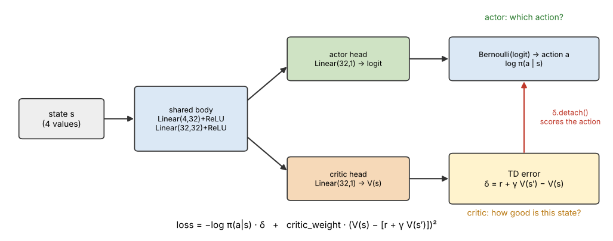

(노트북의 `ActorCritic` 모델. 관측 4개가 **공유 몸통**(32 → 32)을 지나 두 머리로 갈린다. 액터 머리(초록)는 행동 로짓 → 베르누이 분포 → 행동과 로그 확률, 크리틱 머리(주황)는 상태 가치 V(s). 크리틱으로 계산한 TD 오차 δ를 `detach()`해서 액터의 점수로 쓴다(빨간 화살표). 아래는 전체 손실)

### 4-2. 액터-크리틱 구현

> 🎯 **목적** — 공유 몸통에 액터·크리틱 머리를 단 모델과, 매 스텝 TD 오차로 두 머리를 함께 훈련하는 함수를 구현한다.

**코드**

```python
class ActorCritic(nn.Module):
    def __init__(self):
        super().__init__()
        self.body = nn.Sequential(nn.Linear(4, 32), nn.ReLU(),
                                  nn.Linear(32, 32), nn.ReLU())
        self.actor_head = nn.Linear(32, 1)  # outputs action logits
        self.critic_head = nn.Linear(32, 1)  # outputs state values

    def forward(self, state):
        features = self.body(state)
        return self.actor_head(features), self.critic_head(features)
```

몸통을 공유하면 "막대가 얼마나 위험한 상태인가" 같은 특성을 두 머리가 함께 쓴다. 파라미터는 $4 \times 32 + 32 + 32 \times 32 + 32 + (32 + 1) \times 2 = 1,282$개(DQN과 같은 개수).

```python
def choose_action_and_evaluate(model, obs):
    state = torch.as_tensor(obs)
    logit, state_value = model(state)
    dist = torch.distributions.Bernoulli(logits=logit)
    action = dist.sample()
    log_prob = dist.log_prob(action)
    return int(action.item()), log_prob, state_value
```

2-3절의 `choose_action()`에 크리틱의 상태 가치 출력만 더했다.

```python
def ac_training_step(optimizer, criterion, state_value, target_value, log_prob,
                     critic_weight):
    td_error = target_value - state_value
    actor_loss = -log_prob * td_error.detach()
    critic_loss = criterion(state_value, target_value)
    loss = actor_loss + critic_weight * critic_loss
    optimizer.zero_grad()
    loss.backward()
    optimizer.step()

def get_target_value(model, next_obs, reward, done, truncated, discount_factor):
    with torch.inference_mode():
        _, _, next_state_value = choose_action_and_evaluate(model, next_obs)

    running = 0.0 if (done or truncated) else 1.0
    target_value = reward + running * discount_factor * next_state_value
    return target_value
```

| 코드 | 의미 |
|---|---|
| `td_error = target_value - state_value` | δ = (r + γV(s')) − V(s). 행동이 예상보다 좋았으면 양수 |
| `-log_prob * td_error.detach()` | **액터 손실**: REINFORCE와 같은 꼴, 점수만 TD 오차로. `detach()`가 없으면 액터 손실이 크리틱 쪽으로도 그레이디언트를 보내 "δ를 키우도록" 크리틱을 망가뜨린다 |
| `criterion(state_value, target_value)` | **크리틱 손실**: MSE로 V(s)를 TD 타깃에 맞춘다 |
| `critic_weight` (0.3) | 두 손실의 균형. 공유 몸통이 한쪽에 끌려가지 않게 |
| `torch.inference_mode()` 안에서 V(s') 계산 | 타깃은 상수 취급 (DQN의 타깃과 같은 이유). 여기서 뽑힌 다음 행동은 버린다 |
| `running = 0.0 if (done or truncated)` | 끝났으면 미래 가치 없음 |

```python
def run_episode_and_train(model, optimizer, criterion, env, discount_factor,
                          critic_weight, seed=None):
    obs, _info = env.reset(seed=seed)
    total_rewards = 0
    while True:
        action, log_prob, state_value = choose_action_and_evaluate(model, obs)
        next_obs, reward, done, truncated, _info = env.step(action)
        target_value = get_target_value(model, next_obs, reward, done,
                                        truncated, discount_factor)
        ac_training_step(optimizer, criterion, state_value, target_value,
                         log_prob, critic_weight)
        total_rewards += reward
        if done or truncated:
            return total_rewards
        obs = next_obs

def train_actor_critic(model, optimizer, criterion, env, n_episodes=400,
                       discount_factor=0.95, critic_weight=0.3):
    totals = []
    model.train()
    for episode in range(n_episodes):
        seed = torch.randint(0, 2**32, size=()).item()
        total_rewards = run_episode_and_train(model, optimizer, criterion, env,
                                              discount_factor, critic_weight,
                                              seed=seed)
        totals.append(total_rewards)
        print(f"\rEpisode: {episode + 1}, Rewards: {total_rewards}", end=" ")

    return totals
```

REINFORCE와 달리 **환경 스텝마다** 그레이디언트 스텝을 한다. 재생 버퍼 없이 방금 겪은 경험 하나로 바로 배우고 버린다(**온라인·온-폴리시**).

### 4-3. 훈련과 결과

> 🎯 **목적** — 액터-크리틱을 400 에피소드 훈련하고 학습 곡선을 해석한다.

**코드**

```python
torch.manual_seed(42)
ac_model = ActorCritic()
optimizer = torch.optim.NAdam(ac_model.parameters(), lr=1.1e-3)
criterion = nn.MSELoss()
totals = train_actor_critic(ac_model, optimizer, criterion, env)
# Episode: 400, Rewards: 1000.0

# extra code – shows an animation of the trained DQN playing one episode
torch.manual_seed(42)
ac_model.eval()

def actor_critic_policy(obs):
    with torch.no_grad():
        action, _, _ = choose_action_and_evaluate(ac_model, obs)
        return action

show_one_episode(actor_critic_policy)

# extra code
plt.figure(figsize=(8, 4))
plt.plot(totals)
plt.xlabel("Episode", fontsize=14)
plt.ylabel("Sum of rewards", fontsize=14)
plt.grid(True)
plt.show()
```

(애니메이션 셀의 주석 "trained DQN"은 노트북의 복사 실수다 — 실제로는 액터-크리틱 모델을 보여 준다.) 학습률이 1.1e-3으로 REINFORCE(0.06)·DQN(0.03)보다 훨씬 작다. 매 스텝 업데이트하므로 업데이트 횟수가 수만 ~ 수십만 번이기 때문이다.

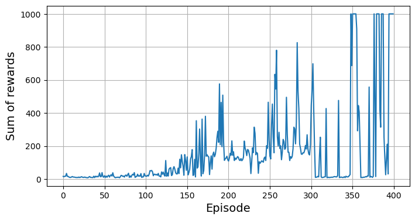

(가로축: 에피소드, 세로축: 총보상. 120 에피소드 무렵부터 오르기 시작해 150 ~ 300 에피소드에 100 ~ 800점 사이를 오르내리고, 300 에피소드 직후 한 번 10점대로 무너졌다가, 350 에피소드 무렵부터 1,000점 에피소드가 나오고 마지막에는 1,000점을 연속으로 낸다)

**결과 해석**

- 400 에피소드 만에 1,000스텝을 채웠다. 곡선은 DQN보다 덜 길게 무너지지만 여전히 출렁인다
- 액터와 크리틱이 **서로의 학습 대상이 움직이는** 구조라(크리틱이 바뀌면 액터의 점수가 바뀌고, 액터가 바뀌면 크리틱이 보게 될 상태가 바뀐다) 불안정하다
- ✅ CPU 재실행(시드 42, 약 1.5분): 마지막 100 에피소드 평균 395. 시드 0·1은 161·150으로, 400 에피소드 안에 풀지 못했다(5-8절 그림)

### 4-4. A2C, A3C 그리고 그 너머

> 🎯 **목적** — 액터-크리틱의 대표적 발전형을 정리한다.

> ⚠️ 노트북에는 이 소절의 코드가 없다. 아래는 교재 절 내용을 정리한 것이다.

| 알고리즘 | 연도 | 아이디어 |
|---|---|---|
| **A3C** (비동기 이득 액터-크리틱, asynchronous advantage actor-critic) | 2016 (딥마인드) | 여러 에이전트가 환경 사본에서 **병렬로** 배우고, 주기적·**비동기적으로** 마스터 네트워크의 가중치를 갱신한 뒤 최신 가중치를 받아 간다. 에이전트마다 다른 경험을 하므로 재생 버퍼 없이도 데이터의 상관이 줄어든다 |
| **A2C** (이득 액터-크리틱, advantage actor-critic) | 2016 ~ 2017 | A3C의 **동기식** 버전. 모든 에이전트가 한 스텝씩 움직인 뒤 그레이디언트를 모아 한 번에 갱신 → GPU를 더 잘 활용하고, 성능은 A3C와 비슷하거나 낫다 |
| **PPO** (근접 정책 최적화, proximal policy optimization) | 2017 (OpenAI) | A2C에 "정책을 한 번에 너무 많이 바꾸지 않게" **손실을 클리핑**. 단순하고 안정적이라 사실상 표준 → 19.5절 |
| **SAC** (소프트 액터-크리틱, soft actor-critic) | 2018 (버클리) | 보상과 함께 행동의 **엔트로피**(무작위성)도 최대화. 오프-폴리시라 표본 효율이 좋고 연속 행동에 강하다 → 6-3절 |

> 💡 노트북의 `ActorCritic`은 "환경 1개, 매 스텝 업데이트"인 가장 단순한 형태다. 실전에서는 여러 환경을 **병렬로** 돌려 한 번에 여러 경험을 모으고(벡터화된 환경, 5-2절의 `n_envs=4`), 한 스텝 TD 오차 대신 몇 스텝을 내다보는 **GAE** 같은 이득 추정을 쓴다(5-1절).

---

## 5. Stable-Baselines3 PPO 구현을 사용하여 아타리 브레이크아웃 마스터하기 (19.5)

> 🎯 **목적** — 검증된 강화 학습 라이브러리 Stable-Baselines3의 PPO로, 화면 픽셀만 보고 아타리 브레이크아웃을 하는 에이전트를 만들고 평가한다.

> 💬 **직접 구현은 이해용, 실전은 검증된 라이브러리로**
>
> 강화 학습 알고리즘은 작은 구현 실수 하나(부호, `detach`, 종료 처리)로 조용히 망가지고, 망가졌는지조차 알기 어렵다. 그래서 실전에서는 **Stable-Baselines3**(SB3)처럼 검증된 구현을 쓴다. 모델 생성 한 줄, 훈련 한 줄이다.
>
> - **PPO** = 액터-크리틱 + "정책을 한 번에 조금만 바꾸기"(클리핑)
> - 아타리 화면은 84 × 84 흑백으로 줄이고, **최근 4프레임을 쌓아** 공의 움직임을 보게 한다
> - 정책은 합성곱 신경망(**NatureCNN**)이 화면 → 행동 확률 4개 + 상태 가치 1개를 낸다
> - **헷갈림 주의**: 브레이크아웃을 잘하려면 CPU로는 며칠, GPU로도 몇 시간이 걸린다. 노트북은 저자가 **3천만 스텝** 훈련해 둔 모델을 내려받아 쓴다

### 5-1. PPO 알고리즘

> 🎯 **목적** — PPO가 REINFORCE·액터-크리틱의 불안정을 어떻게 줄이는지(확률 비율, 클리핑, GAE, 엔트로피 보너스) 정리한다.

> ⚠️ 노트북에는 이 소절의 코드가 없다(SB3가 구현을 담당). 아래는 교재 절 내용과 PPO 논문(2017)의 원리를 정리한 것이다.

**개념·원리**

정책 그레이디언트의 큰 문제는 한 번 업데이트에 정책이 **너무 많이** 바뀌면 성능이 무너지고, 무너진 정책이 나쁜 데이터를 모아 회복하기 어렵다는 것이다(2-6절, 4-3절의 붕괴). 2015년의 **TRPO**(trust region policy optimization)는 "새 정책과 옛 정책의 KL 발산이 일정 이하"라는 **제약**을 걸어 이를 막았지만 계산이 복잡했다. **PPO**(proximal policy optimization, 2017)는 같은 효과를 단순한 **손실 클리핑**으로 얻는다.

① **확률 비율**: 데이터를 모은 옛 정책 $\pi_{\text{old}}$ 대비 새 정책이 그 행동을 얼마나 더(덜) 하게 되었는가

$$r_t(\theta) = \frac{\pi_\theta(a_t \mid s_t)}{\pi_{\text{old}}(a_t \mid s_t)}$$

② **클리핑된 대리 목적 함수**(clipped surrogate objective, 최대화)

$$L^{\text{CLIP}}(\theta) = \mathbb{E}_t\left[ \min\Big( r_t(\theta) \hat{A}_t, \; \text{clip}\big(r_t(\theta), 1-\varepsilon, 1+\varepsilon\big) \hat{A}_t \Big) \right]$$

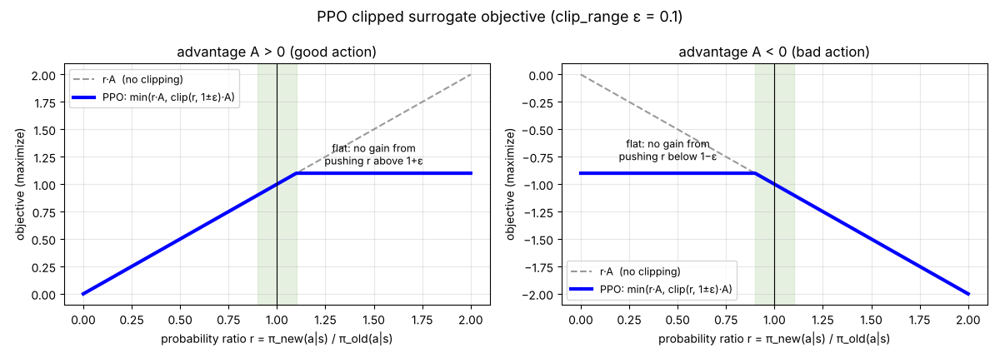

(가로축: 확률 비율 r, 세로축: 목적 함수(클수록 좋다), ε = 0.1(노트북의 `clip_range`). 회색 점선 = 클리핑 없는 $r \cdot A$, 파란 선 = PPO 목적. 왼쪽(좋은 행동, A > 0): r을 1.1보다 키워도 목적이 더 오르지 않는다(평평) → 그 행동 확률을 한 번에 10% 넘게 올릴 동기가 없다. 오른쪽(나쁜 행동, A < 0): r을 0.9보다 낮춰도 이득이 없다. 초록 띠 = 1 ± ε)

- 좋은 행동은 확률을 올리되 **최대 1 + ε배까지만**, 나쁜 행동은 내리되 **최소 1 − ε배까지만** 반영한다
- 반대 방향(좋은 행동의 확률이 내려갔거나 나쁜 행동의 확률이 올라간 경우)은 `min` 덕분에 클리핑 없이 그대로 벌을 받는다(비관적 하한)
- 정책이 크게 바뀔 위험이 없으므로, **같은 데이터로 여러 번**(`n_epochs`) 업데이트할 수 있다 → REINFORCE보다 표본 효율이 좋다

③ **전체 손실**(SB3의 PPO, 최소화)

$$\mathcal{L} = -L^{\text{CLIP}} + c_{\text{vf}} \cdot \big(V_\theta(s_t) - \hat{R}_t\big)^2 - c_{\text{ent}} \cdot \mathcal{H}\big[\pi_\theta(\cdot \mid s_t)\big]$$

| 항 | 하이퍼파라미터 | 의미 |
|---|---|---|
| 정책 손실 $-L^{\text{CLIP}}$ | `clip_range` (ε) | 액터 |
| 가치 손실 | `vf_coef` ($c_{\text{vf}}$) | 크리틱을 반환값 추정 $\hat{R}_t$에 회귀 (4-2절의 `critic_weight`와 같은 역할) |
| 엔트로피 보너스 | `ent_coef` ($c_{\text{ent}}$) | 정책 분포의 엔트로피가 클수록(골고루 고를수록) 손실이 작아진다 → 너무 일찍 한 행동에 확신하지 않고 **탐험**을 유지 |

④ **GAE**(generalized advantage estimation): 이득을 한 스텝 TD 오차(분산 작음, 편향 큼)와 몬테카를로 반환값(분산 큼, 편향 없음)의 중간으로 추정한다.

$$\hat{A}_t = \sum_{l=0}^{\infty} (\gamma\lambda)^l \, \delta_{t+l}, \qquad \delta_t = r_{t+1} + \gamma V(s_{t+1}) - V(s_t)$$

λ = 0이면 액터-크리틱의 TD 오차, λ = 1이면 REINFORCE식 반환값(에서 V를 뺀 것)이다. SB3 기본값은 `gae_lambda=0.95`.

**PPO 한 번의 반복**

```
① 현재 정책으로 환경 n_envs개를 n_steps씩 실행 → 경험 n_envs × n_steps개 (롤아웃)
② GAE로 이득 Â_t와 반환값 R̂_t 계산 (크리틱 사용)
③ 같은 롤아웃을 n_epochs번 반복: 미니배치(batch_size)로 나눠 위 손실로 경사 하강법
④ 롤아웃을 버리고(온-폴리시) ①로
```

### 5-2. 아타리 환경 준비와 전처리

> 🎯 **목적** — 아케이드 학습 환경(ALE)으로 브레이크아웃을 만들고, SB3의 아타리 전처리가 무엇을 하는지 정리한다.

**코드**

```python
import ale_py

ale = ale_py.ALEInterface()
# A.L.E: Arcade Learning Environment (version 0.10.2+unknown)
# [Powered by Stella]
```

**ALE**(arcade learning environment)는 아타리 2600 에뮬레이터(Stella)를 강화 학습 환경으로 감싼 라이브러리다. `ale_py`를 임포트하면 아타리 환경이 Gymnasium에 등록된다(최신 Gymnasium 1.x에서는 `gym.register_envs(ale_py)`를 명시적으로 불러야 하는 경우가 있다).

```python
gymnasium_atari_was_installed_using_anaconda = False
if gymnasium_atari_was_installed_using_anaconda:
    %pip install -qU AutoROM
    from pathlib import Path
    from AutoROM import main as autorom

    autorom(accept_license=True, source_file=None,  # you accept the Atari license
            install_dir=Path(ale_py.roms.__path__[0]), quiet=False)
```

노트북 설명: 아나콘다로 `gymnasium-atari`를 설치했다면 아타리 **롬**(게임 파일)이 포함되지 않으므로 AutoROM으로 직접 설치해야 한다(아타리 라이선스에 동의하는 것). pip으로 설치한 `ale-py`에는 롬이 들어 있다.

```python
from stable_baselines3.common.env_util import make_atari_env

envs = make_atari_env("BreakoutNoFrameskip-v4", n_envs=4, seed=42)
obs = envs.reset()  # a 4 ✕ 84 ✕ 84 ✕ 1 NumPy array (note: no info dict)
# Game console created:
#   ROM file:  .../ale_py/roms/breakout.bin
#   Cart Name: Breakout - Breakaway IV (1978) (Atari)
#   ... (환경 4개라 같은 메시지가 4번)

obs.shape
# (4, 84, 84, 1)
```

| 코드 | 의미 |
|---|---|
| `"BreakoutNoFrameskip-v4"` | `NoFrameskip`: 환경 자체는 프레임을 건너뛰지 않는다(전처리 래퍼가 직접 건너뛴다). `v4`: 같은 행동이 확률적으로 반복되는 "끈적이는 행동"(sticky action)이 없는 버전 |
| `make_atari_env(..., n_envs=4, seed=42)` | 환경 4개를 만들어 **벡터화된 환경**(`VecEnv`)으로 묶고, 각각에 `Monitor`(진짜 게임 점수 기록) + `AtariWrapper`(전처리)를 씌운다. 시드는 42, 43, 44, 45 |
| `envs.reset()` | 4개 환경의 관측을 한꺼번에 `[4, 84, 84, 1]`(환경, 높이, 너비, 채널)로. ⚠️ Gymnasium과 달리 **`info`를 돌려주지 않는다** |

SB3 `VecEnv`의 API는 Gymnasium과 조금 다르다.

| | Gymnasium `env` | SB3 `VecEnv` |
|---|---|---|
| `reset()` | `obs, info` | `obs` (환경 수만큼 쌓인 배열) |
| `step(action)` | `obs, reward, done, truncated, info` | `obs, rewards, dones, infos` (넷, 모두 배열/리스트). `dones` = 종료 **또는** 잘림 |
| 에피소드가 끝나면 | 직접 `reset()` | **자동으로 리셋**하고 새 에피소드의 첫 관측을 돌려준다 |

`AtariWrapper`가 하는 전처리(딥마인드 DQN 논문의 표준 설정):

| 래퍼 | 하는 일 | 이유 |
|---|---|---|
| `NoopResetEnv(noop_max=30)` | 리셋 후 0 ~ 30번 무작위로 "아무것도 안 함" | 시작 상태를 다양하게 |
| `MaxAndSkipEnv(skip=4)` | 같은 행동을 **4프레임** 반복하고 마지막 두 프레임의 픽셀 최댓값을 관측으로 | 계산량 1/4, 아타리의 깜빡이는 스프라이트 보정 |
| `EpisodicLifeEnv` | 목숨을 하나 잃으면 `done=True` (게임은 계속) | 목숨을 잃는 것이 나쁘다는 신호를 빨리 준다 (5-7절에서 중요) |
| `FireResetEnv` | 리셋 후 FIRE를 눌러 게임 시작 | 브레이크아웃은 FIRE를 눌러야 공이 나온다 |
| `WarpFrame` | 210 × 160 RGB → **84 × 84 흑백** | 입력 크기를 1/15로 |
| `ClipRewardEnv` | 보상을 **부호**(+1, 0, −1)로 | 게임마다 점수 단위가 달라도 같은 하이퍼파라미터로 훈련 (벽돌 색에 따른 1·4·7점 차이도 무시) |

```python
plt.figure(figsize=(9, 4))
plt.subplot(1, 2, 1)
plt.title("Original 210 ✕ 160 RGB")
plt.imshow(envs.get_images()[0])
plt.axis("off")
plt.subplot(1, 2, 2)
plt.title("Preprocessed 84 ✕ 84 Grayscale")
plt.imshow(obs[0, :, :, 0], cmap="gray")
plt.axis("off")
plt.show()
```

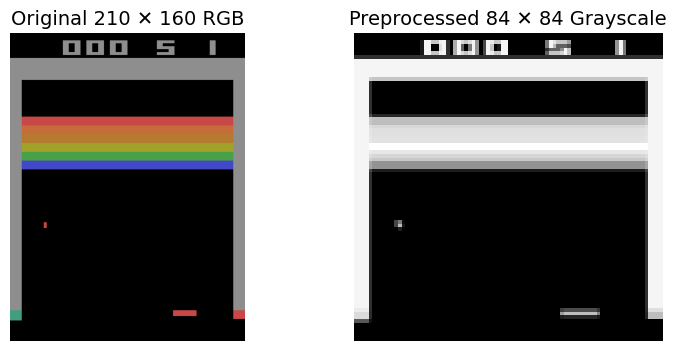

(왼쪽: 에뮬레이터 원본 화면(210 × 160 RGB). 위쪽 숫자는 점수 000, 남은 목숨 5, 플레이어 1. 무지개색 벽돌 6줄, 아래쪽 빨간 막대가 패들, 작은 빨간 점이 공. 오른쪽: 에이전트가 실제로 보는 84 × 84 흑백 이미지. 정사각형으로 눌리며 가로세로 비율이 바뀌었고, 벽돌의 색 차이는 밝기 차이로만 남았다)

### 5-3. 프레임 쌓기

> 🎯 **목적** — 한 장의 화면으로는 알 수 없는 공의 방향·속도를 에이전트가 보게 하려고 최근 프레임 4장을 쌓는다.

**코드**

```python
from stable_baselines3.common.vec_env import VecFrameStack

envs_stacked = VecFrameStack(envs, n_stack=4)
obs = envs_stacked.reset()  # returns a 4 ✕ 84 ✕ 84 ✕ 4 NumPy array
```

한 프레임만 보면 공이 **어느 방향으로 얼마나 빨리** 움직이는지 알 수 없다(사진 한 장으로는 속도를 모른다). 즉 관측 하나가 환경의 상태를 다 담지 못해 마르코프 성질이 깨진다. `VecFrameStack(n_stack=4)`는 최근 4프레임을 **채널 축으로 이어 붙여** `[4, 84, 84, 4]`(환경, 높이, 너비, 프레임)로 만든다. 합성곱 신경망은 채널 4개짜리 이미지 한 장처럼 받아 움직임을 읽어 낸다.

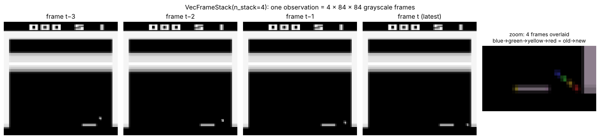

(보충 그림. 한 환경에서 FIRE 후 몇 스텝 움직인 뒤의 관측 하나 = 84 × 84 흑백 프레임 4장. 왼쪽 4개는 오래된 것 → 최신 순서. 맨 오른쪽: 패들 근처를 확대해 4프레임을 색으로 겹친 것(파랑 → 초록 → 노랑 → 빨강 = 과거 → 현재). 공이 오른쪽 아래로 내려오고 있다는 것이 4장을 함께 봐야만 보인다)

> 💡 CartPole은 관측에 속도(카트 속도, 막대 각속도)가 이미 들어 있어서 쌓을 필요가 없었다(2-3절). 프레임을 쌓는 대신 순환 신경망([13장](13_processing_sequences_using_rnns_and_cnns.md))으로 과거를 기억하게 할 수도 있다(SB3-Contrib의 `RecurrentPPO`).

### 5-4. PPO 모델 만들기

> 🎯 **목적** — PPO 모델을 만들고 하이퍼파라미터 각각의 의미를 정리한다.

**코드**

```python
from stable_baselines3 import PPO

tensorboard_logdir = "my_ppo_breakout_tensorboard"  # path to the log directory

ppo_model = PPO("CnnPolicy", envs_stacked, device=device, learning_rate=2.5e-4,
                batch_size=256, n_steps=256, n_epochs=4, clip_range=0.1,
                vf_coef=0.5, ent_coef=0.01, gamma=0.99, verbose=0,
                tensorboard_log=tensorboard_logdir)
```

| 인자 | 값 | 의미 |
|---|---|---|
| `"CnnPolicy"` | | 이미지 관측용 정책: 합성곱 특성 추출기(NatureCNN) + 액터·크리틱 머리 (5-5절). 벡터 관측이면 `"MlpPolicy"` |
| `envs_stacked` | 환경 4개 × 프레임 4장 | 훈련에 쓸 벡터화 환경 |
| `learning_rate` | 2.5e-4 | Adam 학습률 (PPO 논문의 아타리 설정) |
| `n_steps` | 256 | 롤아웃 한 번에 **환경마다** 256스텝 → 한 번에 256 × 4 = **1,024**개 경험 |
| `batch_size` | 256 | 미니배치 크기 → 롤아웃 하나가 미니배치 4개 |
| `n_epochs` | 4 | 같은 롤아웃을 4번 반복 학습 → 롤아웃당 그레이디언트 스텝 16번 |
| `clip_range` | 0.1 | PPO의 ε (확률 비율을 0.9 ~ 1.1로) |
| `vf_coef` | 0.5 | 가치 손실 가중치 |
| `ent_coef` | 0.01 | 엔트로피 보너스 가중치 (탐험 유지) |
| `gamma` | 0.99 | 감가율. 내다보는 범위 약 100스텝 (= 400프레임 ≈ 7초) — 공을 치고 벽돌이 깨질 때까지의 지연을 담기에 충분하다 |
| `tensorboard_log` | 폴더 경로 | 훈련 지표를 텐서보드 형식으로 기록 |
| 그 밖의 기본값 | `gae_lambda=0.95`, `max_grad_norm=0.5`, 옵티마이저 Adam | GAE의 λ, 그레이디언트 클리핑 |

### 5-5. 정책 네트워크 구조

> 🎯 **목적** — SB3가 만든 정책 네트워크(NatureCNN + 액터·크리틱 머리)의 구조와 크기를 확인한다.

**코드**

```python
ppo_model.policy
# ActorCriticCnnPolicy(
#   (features_extractor): NatureCNN(
#     (cnn): Sequential(
#       (0): Conv2d(4, 32, kernel_size=(8, 8), stride=(4, 4))
#       (1): ReLU()
#       (2): Conv2d(32, 64, kernel_size=(4, 4), stride=(2, 2))
#       (3): ReLU()
#       (4): Conv2d(64, 64, kernel_size=(3, 3), stride=(1, 1))
#       (5): ReLU()
#       (6): Flatten(start_dim=1, end_dim=-1)
#     )
#     (linear): Sequential(
#       (0): Linear(in_features=3136, out_features=512, bias=True)
#       (1): ReLU()
#     )
#   )
#   (pi_features_extractor): NatureCNN( ... 위와 같은 구조 ... )
#   (vf_features_extractor): NatureCNN( ... 위와 같은 구조 ... )
#   (mlp_extractor): MlpExtractor(
#     (policy_net): Sequential()
#     (value_net): Sequential()
#   )
#   (action_net): Linear(in_features=512, out_features=4, bias=True)
#   (value_net): Linear(in_features=512, out_features=1, bias=True)
# )
```

**NatureCNN**은 2015년 딥마인드가 네이처(Nature)에 발표한 DQN 논문의 합성곱 신경망이다. 입력 `[B, 4, 84, 84]`(SB3가 채널 축을 앞으로 옮긴다)의 형태 변화(보충 확인):

| 층 | 출력 형태 | 파라미터 | 계산 |
|---|---|---|---|
| `Conv2d(4, 32, 8, stride=4)` | `[B, 32, 20, 20]` | 8,224 | $(84 - 8)/4 + 1 = 20$ |
| `Conv2d(32, 64, 4, stride=2)` | `[B, 64, 9, 9]` | 32,832 | $(20 - 4)/2 + 1 = 9$ |
| `Conv2d(64, 64, 3, stride=1)` | `[B, 64, 7, 7]` | 36,928 | $9 - 3 + 1 = 7$ |
| `Flatten` | `[B, 3136]` | | $64 \times 7 \times 7$ |
| `Linear(3136, 512)` + ReLU | `[B, 512]` | 1,606,144 | 전체의 95% |
| `action_net`: `Linear(512, 4)` | `[B, 4]` | 2,052 | 행동 4개의 로짓 → 범주형 분포 |
| `value_net`: `Linear(512, 1)` | `[B, 1]` | 513 | 상태 가치 V(s) |
| **합계** | | **1,686,693** | |

**결과 해석**

- 큰 커널(8 × 8)과 큰 스트라이드(4)로 첫 층부터 해상도를 빠르게 줄인다([12장 패딩과 스트라이드](12_deep_computer_vision_with_cnns.md#2-5-패딩과-스트라이드)). 풀링 층은 없다
- 출력에 `features_extractor`, `pi_features_extractor`, `vf_features_extractor` 세 개가 찍히지만, 기본값 `share_features_extractor=True`라 **같은 모듈 하나를 세 이름으로** 가리킨다(파라미터는 한 번만 센다). 즉 4-2절의 `ActorCritic`처럼 몸통을 공유하고 머리만 둘이다
- `mlp_extractor`의 `policy_net`·`value_net`이 빈 `Sequential()`인 것은 CNN 뒤에 추가 은닉 층이 없다는 뜻이다. `policy_kwargs=dict(net_arch=...)`로 더할 수 있다

### 5-6. 텐서보드와 체크포인트로 훈련하기

> 🎯 **목적** — 훈련 과정을 텐서보드로 지켜보고, 체크포인트 콜백으로 중간 모델을 저장하며 훈련한다.

**코드**

```python
%tensorboard --logdir={tensorboard_logdir} --port 6006
```

노트북 안에 텐서보드 대시보드(iframe)를 띄운다. 훈련을 시작하면 SB3가 기록하는 주요 지표가 실시간으로 그려진다.

| 지표 (텐서보드 태그) | 의미 | 보는 법 |
|---|---|---|
| `rollout/ep_rew_mean` | 최근 에피소드의 평균 보상 | **가장 중요**. 꾸준히 오르면 학습 중. `Monitor`가 기록한 **원래 게임 점수**(목숨 5개 전체, 클리핑 전)라 훈련 보상(±1)과 단위가 다르다 |
| `rollout/ep_len_mean` | 평균 에피소드 길이 | 오래 살아남을수록 길어진다 |
| `train/entropy_loss` | 정책 엔트로피(의 음수) | 0 쪽으로 가면 정책이 확신해 가는 중. 너무 빨리 0이면 탐험 부족 |
| `train/approx_kl` | 옛 정책 ↔ 새 정책의 근사 KL 발산 | 한 번에 정책이 얼마나 바뀌었나. 갑자기 커지면 불안정 |
| `train/clip_fraction` | 확률 비율이 클리핑된 비율 | 너무 크면 학습률·`n_epochs`를 줄인다 |
| `train/value_loss`, `train/explained_variance` | 크리틱의 오차, 크리틱이 반환값 분산을 얼마나 설명하나 | 설명된 분산이 1에 가까울수록 크리틱이 정확 |
| `time/fps` | 초당 환경 스텝 | 속도 |

```python
from stable_baselines3.common.callbacks import CheckpointCallback

cb = CheckpointCallback(save_freq=100_000, save_path="my_checkpoints",
                        name_prefix="breakout")
ppo_model.learn(total_timesteps=200_000, progress_bar=True, callback=cb)
ppo_model.save("my_ppo_agent_breakout")  # save the final model
```

| 코드 | 의미 |
|---|---|
| `CheckpointCallback(save_freq=100_000, ...)` | 주기적으로 모델을 `my_checkpoints/breakout_<스텝>_steps.zip`으로 저장. 3-11절에서 본 것처럼 강화 학습은 훈련 중 갑자기 무너질 수 있으므로 **가장 좋았던 시점**의 모델을 남겨 둬야 한다 |
| `learn(total_timesteps=200_000)` | 환경 스텝 20만 번(4개 환경 합계) 훈련 |
| `progress_bar=True` | 진행 막대 표시 (`tqdm`, `rich` 필요) |
| `save("my_ppo_agent_breakout")` | `my_ppo_agent_breakout.zip`(가중치 + 하이퍼파라미터 + 옵티마이저 상태)으로 저장 |

> ⚠️ `save_freq`는 콜백이 **불린 횟수** 기준이다. 벡터 환경에서는 `step()` 한 번(= 환경 4개가 한 스텝씩)에 한 번 불리므로, 실제로는 100,000 × 4 = **40만 스텝마다** 저장된다. 그래서 20만 스텝 훈련에서는 체크포인트가 하나도 생기지 않는다. 의도대로 10만 스텝마다 저장하려면 `save_freq=100_000 // n_envs`로 준다.

> ⚠️ 보충 측정: 이 설정의 훈련 속도는 CPU 스레드 하나에서 **1,000스텝당 약 6.9초**였다. 20만 스텝이면 약 23분, 저자가 훈련한 3천만 스텝이면 약 58시간이다. GPU를 쓰면 신경망 계산은 빨라지지만 에뮬레이터는 CPU에서 돌기 때문에, 환경 수(`n_envs`)를 늘리고 `SubprocVecEnv`로 프로세스를 나누는 것이 속도에 더 중요하다.

노트북 설명: "여러분이 할 필요가 없도록 내가 이 코드를 3천만 스텝 동안 실행해 두었다. 다음 셀을 실행해 훈련된 모델을 내려받으면 된다."

### 5-7. 사전 훈련된 에이전트 평가

> 🎯 **목적** — 저자가 3천만 스텝 훈련한 PPO 에이전트를 내려받아 브레이크아웃을 플레이시키고, 실제 점수를 확인한다.

**코드**

```python
import urllib.request

data_root = "https://raw.githubusercontent.com/ageron/data/refs/heads/main"
filename = "ppo_agent_breakout.zip"
urllib.request.urlretrieve(f"{data_root}/{filename}", f"my_{filename}")
# ('my_ppo_agent_breakout.zip', <http.client.HTTPMessage at 0x3fc01b5f0>)

ppo_model = PPO.load("my_ppo_agent_breakout")  # or load the best checkpoint
eval_env = make_atari_env("BreakoutNoFrameskip-v4", n_envs=1, seed=42)
eval_stacked = VecFrameStack(eval_env, n_stack=4)
frames = []
obs = eval_stacked.reset()
for _ in range(5000):  # some limit in case the agent never loses
    frames.append(eval_stacked.render())
    action, _ = ppo_model.predict(obs, deterministic=True) # for reproducibility
    obs, reward, done, info = eval_stacked.step(action)
    if done[0]:  # note: there's no `truncated`
        break

eval_stacked.close()

plot_animation(frames)
```

| 코드 | 의미 |
|---|---|
| `urlretrieve(url, "my_ppo_agent_breakout.zip")` | 20MB짜리 모델 파일을 내려받는다. 이름이 앞의 `save()` 결과와 같아서 덮어쓴다 |
| `PPO.load("my_ppo_agent_breakout")` | `.zip`에서 하이퍼파라미터·가중치를 복원. 환경은 따로 넘기지 않아도 예측은 된다 |
| `make_atari_env(..., n_envs=1, seed=42)` | 평가용 환경 1개. 훈련 때와 **같은 전처리**(전처리가 다르면 정책이 엉뚱하게 동작한다) |
| `predict(obs, deterministic=True)` | 확률이 가장 높은 행동(argmax). `False`면 분포에서 샘플링. `(행동 배열, RNN 상태)`를 돌려준다 |
| `eval_stacked.render()` | 첫 번째 환경의 원본 RGB 화면 (애니메이션용) |
| `if done[0]: break` | 첫 환경의 에피소드가 끝나면 멈춘다. `VecEnv`의 `step()`은 `truncated`를 따로 주지 않는다 |

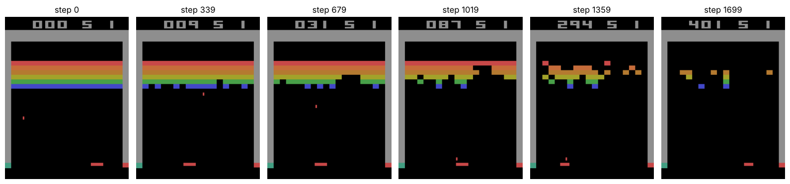

(노트북 셀을 CPU에서 다시 실행해 애니메이션에서 6프레임을 고르게 뽑았다. 점수가 000 → 009 → 031 → 087 → 294 → 401로 오른다. 에이전트는 한쪽 벽돌을 뚫어 공을 벽돌 **위쪽** 공간으로 올려 보내는 전략을 쓴다(4번째 프레임의 오른쪽 위 구멍). 공이 위에서 튀어 다니며 벽돌을 한꺼번에 깨서 점수가 급격히 오른다(5번째 프레임). 화면 위 "5"는 남은 목숨)

**결과 해석** (보충 실행)

| 측정 | 시드 42 | 시드 0 | 시드 1 |
|---|---|---|---|
| 첫 목숨을 잃을 때까지 (노트북 셀 그대로) | 1,700스텝, 화면 점수 **401**, 깬 벽돌 98개 | 427스텝, 벽돌 11개 | 457스텝, 벽돌 12개 |
| 목숨 5개 전체 게임 점수 (`info["episode"]["r"]`) | **428** | **380** | **356** |

- ⚠️ 노트북 루프는 `done[0]`에서 멈추는데, `EpisodicLifeEnv` 때문에 **목숨 하나를 잃으면** `done=True`가 된다(게임은 계속). 그래서 애니메이션은 첫 목숨의 플레이만 보여 준다. 진짜 게임 점수를 보려면 `Monitor`가 기록하는 `info[0]["episode"]["r"]`이 나올 때까지(목숨 5개 모두) 돌려야 한다
- 3천만 스텝 훈련한 에이전트는 게임 하나에서 **350 ~ 430점**을 냈다. 딥마인드 DQN 논문(2015)이 보고한 사람 테스터의 브레이크아웃 점수가 약 30점이었으니 사람을 크게 앞선다. 첫 번째 벽(벽돌 108개)을 모두 깨면 432점이다(줄마다 1·1·4·4·7·7점 × 18개). 시드 42의 428점은 첫 벽을 거의 다 깬 점수다
- 같은 에이전트도 시드(초기 무작위 no-op 수)에 따라 첫 목숨의 성적이 98개 vs 11개로 크게 다르다. 평가할 때는 여러 게임의 평균을 본다
- `deterministic=True`로 평가하면 같은 시드에서 매번 같은 플레이가 나온다. 다만 결정적 정책은 공이 특정 궤도에 갇혀 같은 동작을 반복하는 함정에 빠지기도 한다

노트북 메모: 저자는 **센티피드**(Centipede) 게임용 에이전트도 훈련해 두었다. 마지막 세 셀에서 `"breakout"`(또는 `"Breakout"`)을 `"centipede"`(`"Centipede"`)로 바꿔 실행하면 볼 수 있다.

### 5-8. 보충 코드: 같은 API로 CartPole, 그리고 알고리즘 비교

> 🎯 **목적** — SB3 PPO를 CartPole에 그대로 써 보고, 이 장에서 직접 구현한 REINFORCE·DQN·액터-크리틱과 시드별 안정성을 비교한다.

**보충 코드**

```python
# 보충 코드 — 브레이크아웃과 같은 PPO 클래스, 정책만 MlpPolicy로
from stable_baselines3 import PPO
from stable_baselines3.common.env_util import make_vec_env
from stable_baselines3.common.evaluation import evaluate_policy

venv = make_vec_env("CartPole-v1", n_envs=4, seed=0,
                    env_kwargs={"max_episode_steps": 1000})
model = PPO("MlpPolicy", venv, seed=0, device="cpu", n_steps=256, batch_size=256,
            n_epochs=4, learning_rate=1e-3, gamma=0.99)
model.learn(total_timesteps=100_000)                       # CPU 약 14초

eval_env = gym.make("CartPole-v1", max_episode_steps=1000)
evaluate_policy(model, eval_env, n_eval_episodes=10, deterministic=True)
# 시드 0: (971.1, 86.7)   시드 1: (1000.0, 0.0)   시드 2: (1000.0, 0.0)
```

`MlpPolicy`는 정책·가치 네트워크를 따로 둔다(각각 `Linear(4, 64)` → tanh → `Linear(64, 64)` → tanh, 파라미터 합계 9,155개). 직접 구현한 세 알고리즘은 노트북 코드 그대로 시드만 바꿔(REINFORCE·액터-크리틱은 400 에피소드, DQN은 800 에피소드) 돌렸다.

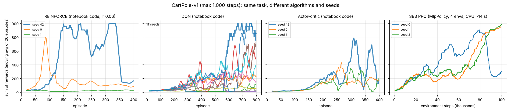

(세로축: 에피소드 총보상의 20 에피소드 이동 평균(최대 1,000). 왼쪽부터 REINFORCE(시드 3개, 굵은 선 = 노트북 시드 42), DQN(시드 11개), 액터-크리틱(시드 3개), SB3 PPO(시드 3개, 가로축은 환경 스텝). 직접 구현한 세 알고리즘은 시드에 따라 결과가 완전히 다르고, 잘 되던 시드도 중간에 무너진다. PPO는 세 시드 모두 10만 스텝 안에 1,000 근처까지 오른다)

| 알고리즘 | 마지막 100 에피소드 평균 (시드별) | 비고 |
|---|---|---|
| REINFORCE (400 에피소드) | 472 / 99 / 26 (시드 42 / 0 / 1) | 시드 42도 150 에피소드에 1,000을 찍은 뒤 340 에피소드 무렵 무너졌다 |
| DQN (800 에피소드) | 10 ~ 913, 중앙값 221 (시드 11개) | 3-13절 |
| 액터-크리틱 (400 에피소드) | 395 / 161 / 150 (시드 42 / 0 / 1) | |
| SB3 PPO (10만 스텝 ≈ 450 에피소드) | 결정적 평가 971 / 1,000 / 1,000 (시드 0 / 1 / 2) | 훈련 중 확률적 정책 곡선은 출렁이지만 평가 성능은 안정적 |

**결과 해석**

- 노트북의 직접 구현은 **원리를 보여 주기 위한** 최소한의 코드다. 이득 정규화·그레이디언트 클리핑·병렬 환경·GAE·클리핑 같은 안정화 장치가 대부분 없다
- PPO는 같은 액터-크리틱 아이디어에 "정책을 조금씩만 바꾸기"와 "여러 환경에서 모은 데이터를 여러 번 재사용하기"를 더해 훨씬 안정적이다. 실전에서 첫 시도로 PPO를 쓰는 이유다
- 강화 학습 논문이 결과를 시드 5 ~ 10개 이상의 평균과 신뢰 구간으로 보고하는 이유도 여기 있다. **시드 하나의 성공은 우연일 수 있다**

---

## 6. 다른 강화 학습 알고리즘 (19.6)

> 🎯 **목적** — 이 장에서 다루지 못한 주요 강화 학습 알고리즘과 연구 흐름을 지도처럼 정리한다.

> ⚠️ 노트북에는 이 절의 코드가 없다. 아래는 교재 절 내용과 관련 연구를 정리한 것이다.

> 💬 **세 갈래 + 모델**
>
> 이 장의 알고리즘은 모두 **모델 없는**(model-free) 방법이었다: 환경이 어떻게 돌아가는지 배우지 않고 정책이나 가치만 배운다. 환경의 **모델**(다음 상태와 보상을 예측하는 함수)이 있거나 배울 수 있다면, 머릿속으로 미리 시뮬레이션하며 **계획**할 수 있다. 바둑의 AlphaZero가 그 예다.

### 6-1. 알고리즘 지도

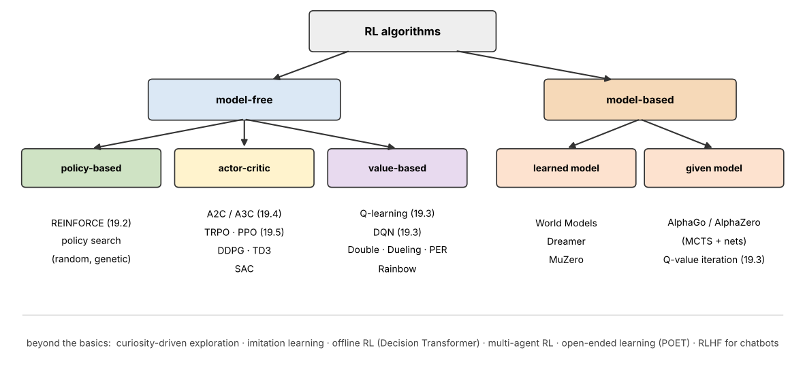

(강화 학습 알고리즘의 큰 분류. 모델 없는 방법은 정책 기반(REINFORCE), 액터-크리틱(A2C·PPO·SAC 등), 가치 기반(Q-러닝·DQN 계열)으로 나뉘고, 모델 기반 방법은 모델을 배우는 쪽(World Models·Dreamer·MuZero)과 규칙이 주어진 쪽(AlphaGo·AlphaZero, 이 장의 Q-가치 반복)으로 나뉜다. 괄호 안은 이 장의 절. 맨 아래는 이 장 너머의 주제들)

| 기준 | 갈래 | 이 장의 예 |
|---|---|---|
| 무엇을 배우나 | 정책 / 가치 / 둘 다 | REINFORCE / DQN / 액터-크리틱·PPO |
| 경험의 출처 | **온-폴리시**(지금 정책의 데이터만) / **오프-폴리시**(다른 정책의 데이터도) | REINFORCE·액터-크리틱·PPO / Q-러닝·DQN |
| 환경 모델 | 모델 없음 / 모델 기반 | 이 장의 학습 알고리즘 전부 / Q-가치 반복 |
| 행동 공간 | 이산 / 연속 | CartPole·브레이크아웃 / 로봇 관절(6-3절) |

### 6-2. 모델 기반 강화 학습: AlphaGo에서 MuZero까지

| 시스템 | 연도 | 핵심 |
|---|---|---|
| **AlphaGo** | 2016 | 바둑 세계 챔피언 이세돌을 이겼다. 사람 기보로 지도 학습한 정책 네트워크 + 자기 대국 강화 학습 + **몬테카를로 트리 탐색**(MCTS: 유망한 수를 골라 앞으로 몇 수를 시뮬레이션해 보는 탐색) |
| **AlphaZero** | 2017 | 사람 데이터 **없이** 자기 대국만으로 바둑·체스·쇼기를 모두 정복. 하나의 네트워크가 정책(어디에 둘까)과 가치(누가 이길까)를 함께 출력하고, MCTS가 이를 이용해 더 좋은 수를 찾으면 그 결과로 다시 네트워크를 훈련 |
| **MuZero** | 2019 | 게임의 **규칙조차 주지 않는다**. 환경의 동역학(다음 잠재 상태·보상)을 스스로 배운 모델 안에서 MCTS로 계획. 바둑·체스·쇼기·아타리를 하나의 알고리즘으로 (연습문제 8번의 예) |
| **World Models / Dreamer** | 2018 / 2020 ~ 2023 | 환경을 압축한 잠재 공간에서 다음 상태를 예측하는 "세계 모델"을 배우고, 그 **상상 속에서** 정책을 훈련. DreamerV3는 하나의 하이퍼파라미터 설정으로 마인크래프트 다이아몬드 채굴까지 해냈다 |

> 💡 모델 기반 방법은 실제 환경과의 상호작용이 비쌀 때(로봇, 실제 시스템) **표본 효율**이 크게 좋다. 대신 모델이 틀리면 그 틀린 모델에 과적합된 정책이 나온다.

### 6-3. 연속 행동 공간: DDPG, TD3, SAC

로봇 팔의 관절 토크처럼 행동이 **연속값**이면, DQN처럼 "모든 행동의 Q-가치를 계산해 최댓값을 고르기"가 불가능하다.

| 알고리즘 | 아이디어 |
|---|---|
| 정책 그레이디언트 계열 (PPO 등) | 정책이 **정규분포의 평균·표준 편차**를 출력하고 거기서 행동을 샘플링 (베르누이·범주형 분포 대신). 그대로 적용된다 |
| **DDPG** (deep deterministic policy gradient, 2015) | 액터가 행동을 **결정적으로** 출력하고, 크리틱 $Q(s, a)$의 그레이디언트를 따라 액터를 개선. DQN의 재생 버퍼·목표 네트워크를 그대로 쓴다(오프-폴리시) |
| **TD3** (twin delayed DDPG, 2018) | 크리틱을 **두 개** 두고 작은 쪽을 타깃으로(더블 DQN처럼 과대평가 억제), 액터는 덜 자주 업데이트, 타깃 행동에 잡음 추가 |
| **SAC** (soft actor-critic, 2018) | 보상 + **엔트로피**를 함께 최대화: "보상을 많이 받되 가능한 한 다양하게 행동하라". 탐험이 자연스럽고 하이퍼파라미터에 덜 민감해, 연속 제어의 기본 선택지 |

SB3에는 이들이 모두 있다(`A2C`, `DQN`, `DDPG`, `TD3`, `SAC`, `PPO`). 연습문제 9번의 BipedalWalker처럼 연속 행동 환경이면 SAC나 TD3, PPO부터 시도해 볼 만하다.

### 6-4. 탐험을 돕는 방법: 호기심과 개방형 학습

보상이 아주 **드문** 환경(예: 몬테주마의 복수 — 열쇠를 찾아 문을 열어야 첫 보상)에서는 ε-그리디 같은 무작위 탐험으로는 보상을 한 번도 못 받을 수 있다.

- **호기심 기반 탐험**(curiosity-based exploration, 2017): 환경 보상과 별개로 에이전트가 **스스로 내부 보상**을 만든다. 다음 상태를 예측하는 모델을 함께 훈련하고, **예측이 틀릴수록**(놀라울수록) 보상을 준다. 그러면 에이전트는 아직 이해하지 못한 곳을 찾아다닌다. 외부 보상이 전혀 없어도 게임을 꽤 진행하는 결과가 나왔다. (예측할 수 없는 잡음 — TV 화면 같은 것 — 에 빠져드는 "시끄러운 TV 문제"를 피하는 것이 과제다)
- **개방형 학습**(open-ended learning): 정해진 과제 하나가 아니라 **점점 어려워지는 과제**를 스스로 만들며 배운다. 우버의 **POET**(2019)는 장애물 지형을 생성하고 진화시키며, 에이전트가 쉬운 지형에서 배운 기술을 어려운 지형으로 옮겨 가게 했다. 커리큘럼 학습과 닮았다
- 3-7절의 탐험 함수 $Q + \kappa/(1+N)$(방문 횟수 보너스)도 같은 계열의 단순한 형태다

### 6-5. 데이터에서 배우기: 모방 학습, 오프라인 RL, RLHF

| 방법 | 아이디어 | 예 |
|---|---|---|
| **모방 학습**(imitation learning) / 행동 복제 | 전문가의 (상태, 행동) 기록으로 정책을 **지도 학습** | 자율 주행의 초기 정책, AlphaGo의 첫 단계 |
| 역강화 학습(inverse RL) | 전문가 행동을 설명하는 **보상 함수**를 추론 | 보상을 설계하기 어려운 과제 |
| **오프라인 강화 학습**(offline RL) | 환경과 상호작용하지 않고 **이미 모은 경험 데이터셋**만으로 학습. 데이터에 없는 행동의 가치를 과대평가하지 않도록 보수적으로 추정(CQL 등) | 의료·추천처럼 실험이 위험하거나 비싼 분야 |
| **결정 트랜스포머**(Decision Transformer, 2021) | 강화 학습을 **시퀀스 모델링**으로: (원하는 반환값, 상태, 행동)의 시퀀스를 [15장의 GPT](15_transformers_for_nlp_and_chatbots.md)처럼 학습하고, "높은 반환값"을 조건으로 주면 그에 맞는 행동을 생성 | 오프라인 RL |
| **다중 에이전트 RL** | 여러 에이전트가 협력·경쟁 | OpenAI Five(도타 2), AlphaStar(스타크래프트 II) |
| **RLHF** (사람 피드백 기반 강화 학습) | 사람 선호로 **보상 모델**을 훈련하고, 언어 모델을 그 보상을 최대화하도록 **PPO**로 미세 튜닝(원래 모델에서 멀어지지 않게 KL 페널티) | ChatGPT 이후의 챗봇 정렬. [15장 5-4절](15_transformers_for_nlp_and_chatbots.md#5-4-정렬-sft-rlhf-dpo) 참고 |
| 검증 가능한 보상으로 추론 훈련 | 수학 정답·코드 테스트 통과처럼 **자동으로 확인할 수 있는 보상**으로 언어 모델을 강화 학습(PPO 변형인 GRPO 등). 긴 사고 과정을 스스로 발전시킨다 | 2024 ~ 2025년의 추론 모델들 |

> 💡 언어 모델 관점에서 보면: 상태 = 지금까지의 텍스트, 행동 = 다음 토큰(어휘 수만큼의 이산 행동), 정책 = 언어 모델, 에피소드 = 답변 하나, 보상 = 답변 끝에 한 번(보상 모델 점수 또는 정답 여부). 이 장의 REINFORCE·PPO가 그대로 적용된다. 보상이 답변 끝에만 오니 **신용 할당 문제**(2-4절)가 그대로 나타난다.

### 6-6. 실전에서 강화 학습이 어려운 이유

- **표본 효율**: 브레이크아웃에 3천만 스텝(5-6절)이 필요했다. 사람은 몇 분이면 배운다. 실제 로봇으로 수천만 번 시행착오를 할 수는 없다 → 시뮬레이션 + **sim2real**(시뮬레이터에서 배워 실제로 옮기기, 도메인 무작위화)
- **보상 설계**: 보상을 잘못 설계하면 에이전트는 의도와 다른 지름길을 찾는다(**보상 해킹**). 보상을 촘촘히 주면(보상 셰이핑) 학습이 빨라지지만 원하지 않는 행동을 유도할 수 있다 (연습문제 5번)
- **불안정과 재현성**: 시드·하이퍼파라미터·구현 세부에 민감하다(3-13절, 5-8절). 여러 시드로 실험하고, 학습 곡선을 보고, 체크포인트를 남긴다
- **안전한 탐험**: 실제 시스템에서는 탐험 중의 실수가 비싸다(3-8절의 SARSA vs Q-러닝)

> 📌 그래도 강화 학습은 "정답은 모르지만 결과는 평가할 수 있는" 문제(게임, 제어, 최적화, 언어 모델 정렬)에서 다른 방법으로는 얻기 힘든 결과를 낸다. 노트북 저자의 마지막 인사: "이 노트북을 즐겼기를 바란다!"

---

## 7. 연습문제

노트북에는 1 ~ 8번 개념 문제의 풀이가 있고, 실습 문제(LunarLander, BipedalWalker, 라즈베리 파이 로봇)는 풀이 준비 중이다("Work in progress"). 노트북은 실습 문제에 "8. ~ 10."이라는 번호를 붙였지만 개념 문제가 8번까지 있으므로, 이 노트에서는 실습을 9 ~ 11번으로 정리한다.

**1 ~ 8번 (노트북 풀이 요약)**

| 번호 | 질문 | 답 요약 | 관련 절 |
|---|---|---|---|
| 1 | 강화 학습을 어떻게 정의하나. 지도·비지도 학습과 무엇이 다른가 | 환경 속에서 시간에 따른 보상을 최대화하도록 행동하는 에이전트를 만드는 분야. 차이: ① 목표가 예측이 아니라 좋은 **정책**을 찾는 것, ② 정답을 받지 않고 시행착오로 배운다, ③ 그래도 보상이라는 형태의 감독은 있다(어떻게 하라고는 안 해도 잘하고 있는지는 알려 준다), ④ **탐험과 활용**의 균형을 맞춰야 한다, ⑤ 연속된 관측이 독립이 아니다(그래서 재생 버퍼를 쓰기도 한다) | 1-1 |
| 2 | 이 장에 없는 강화 학습 응용 세 가지와 각각의 환경·에이전트·행동·보상 | ① **음악 개인화**: 환경 = 사용자의 개인 라디오, 에이전트 = 다음 곡을 고르는 소프트웨어, 행동 = 카탈로그의 곡 재생 또는 광고 재생, 보상 = 곡을 들으면 작은 +, 광고를 들으면 큰 +, 건너뛰면 −, 떠나면 큰 −. ② **마케팅**: 환경 = 회사 마케팅 부서, 에이전트 = 고객별로 우편 캠페인을 보낼지 정하는 소프트웨어(행동 = 보낸다 / 안 보낸다), 보상 = 캠페인 비용(−)과 예상 매출(+). ③ **배송**: 에이전트가 트럭들이 어디서 무엇을 싣고 어디로 갈지 결정, 제때 배송하면 +, 늦으면 − | 1-1 |
| 3 | 감가율이란. 감가율을 바꾸면 최적 정책이 바뀔 수 있나 | 행동의 가치를 추정할 때 먼 미래의 보상일수록 덜 반영하려고 스텝마다 곱하는 값. 예: γ = 0.9면 두 스텝 뒤의 보상 100은 $0.9^2 \times 100 = 81$로 친다. 1에 가까우면 미래를 현재만큼 중시, 0에 가까우면 즉시 보상만. **최적 정책은 크게 바뀔 수 있다**: 미래를 중시하면 나중의 보상을 위해 지금의 고통을 감수한다 (이 장의 MDP는 γ ≈ 0.948에서 s1의 최적 행동이 바뀐다) | 2-4, 3-4 |
| 4 | 강화 학습 에이전트의 성능은 어떻게 측정하나 | 받은 보상을 합한다. 시뮬레이션 환경이면 여러 에피소드를 돌려 총보상의 평균(그리고 최솟값·최댓값·표준 편차 등)을 본다 | 2-2, 5-7, 5-8 |
| 5 | 신용 할당 문제란. 언제 생기고 어떻게 완화하나 | 보상을 받았을 때 이전의 어떤 행동 덕분인지 직접 알 방법이 없는 문제. 행동과 보상 사이의 **지연**이 길 때 생긴다(예: 퐁에서 공을 친 순간부터 점수를 얻기까지 수십 스텝). 완화: 가능하면 **더 짧은 간격의 보상**을 준다(사전 지식 필요). 예: 체스에서 이겼을 때만이 아니라 상대 말을 잡을 때마다 보상. (이 장의 방법: 감가율로 반환값 계산, 크리틱의 TD 오차) | 2-4, 4-1 |
| 6 | 재생 버퍼를 쓰는 이유는 | 에이전트는 한동안 환경의 같은 영역에 머물러 그 기간의 경험이 서로 매우 비슷하다. 이것만으로 배우면 학습이 편향되어 그 영역에만 맞는 정책이 된다. 재생 버퍼에 최근 경험과 오래된 경험을 함께 담아 거기서 배우면 이 문제가 줄어든다 (저자: "우리가 밤에 꿈을 꾸는 이유도 낮의 경험을 재생해 더 잘 배우기 위해서일까?") | 3-10 |
| 7 | 오프-폴리시 강화 학습 알고리즘이란. 장점은 | 에이전트가 **다른 정책**을 따르는 동안 최적 정책의 가치를 배우는 알고리즘. Q-러닝이 대표 예. 반대로 온-폴리시는 탐험과 활용을 포함해 에이전트가 실제로 실행하는 정책의 가치를 배운다. 장점: 다른(과거·탐험·사람의) 정책이 만든 경험을 재사용할 수 있다 → 재생 버퍼, 표본 효율 | 3-6, 3-8 |
| 8 | 모델 기반 강화 학습 알고리즘이란 | 환경의 **모델**을 포함해 미래 상태와 보상을 예측하고, 이를 이용해 행동(또는 행동 시퀀스)의 결과를 시뮬레이션하며 **미리 계획**한다. 좋은 예가 MuZero: 모델을 스스로 배우고 몬테카를로 트리 탐색으로 계획한다 | 6-2 |

**실습 문제 (노트북 풀이 준비 중)**

| 번호 | 문제 | 접근 방법 (정리) |
|---|---|---|
| 9 | 정책 그레이디언트로 Gymnasium의 LunarLander를 풀어라 | 관측 8개, 이산 행동 4개(아무것도 안 함, 왼쪽·주·오른쪽 엔진). `Box2D` 설치 필요. 노트북의 `PolicyNetwork`를 출력 4개 + `torch.distributions.Categorical`로 바꾸면 REINFORCE를 그대로 쓸 수 있다. 착륙 성공 시 +100 ~ +140, 추락 −100, 엔진 분사마다 작은 −가 있어 보상 구조가 CartPole보다 복잡하다. 평균 200점 이상이면 푼 것으로 본다. ⚠️ 문제는 `LunarLander-v2`라고 하지만 최신 Gymnasium에서는 `LunarLander-v3`다 |
| 10 | 원하는 알고리즘으로 BipedalWalker-v3를 풀어라 | 관측 24개(몸체 각도·속도, 관절, 라이다 10개), **연속** 행동 4개(관절 토크, −1 ~ 1). DQN은 쓸 수 없고 연속 행동 알고리즘이 필요하다: SB3의 `SAC`·`TD3`·`PPO("MlpPolicy", ...)`. 300점 이상(평균)이면 푼 것. Hardcore 버전은 장애물이 있어 훨씬 어렵다 |
| 11 | 라즈베리 파이와 저렴한 로봇 부품으로 직접 로봇을 만들어라 | 저자 제안: 처음엔 가장 밝은 방향(빛 센서)이나 가장 가까운 물체(초음파 센서) 쪽으로 돌기 같은 단순한 목표부터. 카메라가 있으면 객체 탐지([12장](12_deep_computer_vision_with_cnns.md))로 사람을 찾아 다가가기, 그다음 강화 학습으로 모터 사용법을 스스로 배우게 해 보기. 저자: "이건 여러분 몫이다. 세상은 여러분의 것이다! 😄" |

```python
# 9 ~ 10번 출발점 (보충, 실행 시간은 환경에 따라 다름) — SB3로 기준선부터 만들어 두면 직접 구현의 목표가 생긴다
from stable_baselines3 import PPO, SAC
from stable_baselines3.common.env_util import make_vec_env

lunar = make_vec_env("LunarLander-v3", n_envs=8)                 # pip install "gymnasium[box2d]"
PPO("MlpPolicy", lunar, n_steps=1024, batch_size=64, gae_lambda=0.98,
    gamma=0.999, ent_coef=0.01, verbose=1).learn(1_000_000)

walker = make_vec_env("BipedalWalker-v3", n_envs=1)
SAC("MlpPolicy", walker, learning_starts=10_000, verbose=1).learn(1_000_000)
```

> 💡 직접 해 볼 만한 실습: ① REINFORCE에서 반환값 표준화를 빼고(원래 반환값 그대로) 훈련해 학습 곡선 비교(2-6절). ② `train_dqn()`에서 에피소드당 훈련 스텝을 1 → 10으로 늘리고 목표 네트워크를 붙여 시드 5개로 비교(3-13절). ③ 액터-크리틱의 `critic_weight`를 0.1, 0.3, 1.0으로 바꿔 보기(4-3절). ④ SB3 `PPO`의 `clip_range`를 0.1, 0.3, 1.0(사실상 클리핑 없음)으로 바꿔 CartPole 학습 곡선과 `train/clip_fraction` 비교(5-1절). ⑤ Q-러닝의 탐험 정책을 무작위 대신 ε-그리디로 바꿔 수렴 속도 비교(3-6절).

---

## 8. 정리

### 8-1. 전체 흐름

```
[19.1 강화 학습이란?]  에이전트 ─행동→ 환경 ─관측·보상→ 에이전트, 목표 = 할인된 보상의 합 최대화
정책     : 관측 → 행동 (결정적 / 확률적)
정책 탐색 : 무작위·격자 / 유전 알고리즘 / 정책 그레이디언트
보충     : 파라미터 1개 정책 — 각도만 42점, 각속도를 조금 섞으면 500점(만점), 지형이 절벽

[19.2 정책 그레이디언트]
Gymnasium : gym.make("CartPole-v1", render_mode="rgb_array", max_episode_steps=1000)
            reset() → (obs, info), step(a) → (obs, reward, done, truncated, info)
하드코딩  : 기울어진 쪽으로 밀기 → 평균 41.7, 최대 63스텝
신경망 정책 : Linear(4,5)-ReLU-Linear(5,1) (31 파라미터) → 로짓 → Bernoulli → 샘플링 + log_prob
신용 할당  : G_t = r + γG_{t+1}, compute_returns([10,0,-50], 0.8) = [-22,-40,-50], 표준화 = 이득
REINFORCE : 손실 = −Σ log π(a_t|s_t)·Â_t, 에피소드마다 1번 업데이트, NAdam(0.06)
            200 에피소드 → 1,000스텝 (CPU: 124번째에 처음 1,000, 21.7초)

[19.3 가치 기반 방법]
마르코프 연쇄 : 다음 상태는 현재 상태에만 의존, s0 → s3 기대 16스텝
MDP       : T(s,a,s'), R(s,a,s'), 벨만 최적 방정식 V*(s) = max_a Σ T[R + γV*(s')]
Q-가치 반복 : Q(s,a) ← Σ T[R + γ max Q(s',·)], 50번 → Q*(s0,a0) = 18.92, 정책 [a0, a0, a1]
감가율     : γ = 0.95면 s1 → a2 (경계 γ ≈ 0.948)
TD 학습    : V(s) ← (1−α)V(s) + α(r + γV(s')), TD 오차 δ, 부트스트래핑
Q-러닝     : Q(s,a) ← (1−α)Q(s,a) + α(r + γ max Q(s',·)), 무작위 탐험 1만 번 → 같은 정책 (오프-폴리시)
탐험       : ε-그리디(1 → 0.01), 탐험 함수 Q + κ/(1+N)
보충       : CliffWalking — Q-러닝은 최단(13스텝)·학습 중 −49.7, SARSA는 안전(17스텝)·학습 중 −27.2
DQN       : Linear(4,32)-ReLU-Linear(32,32)-ReLU-Linear(32,2) (1,282), 타깃 y = r + γ max Q(s',·)
            재생 버퍼 deque(100,000), 배치 32, gather로 한 행동의 Q, MSE, NAdam(0.03)
            800 에피소드 → 1,000스텝, 중간에 치명적 망각으로 긴 붕괴
변형       : 고정 Q-가치 타깃(목표 모델), 더블 DQN(온라인이 고르고 목표가 평가), PER(|δ|^ζ, IS 가중치),
            듀얼링(Q = V + A − max A), Rainbow
보충       : 시드 11개 — 노트북 DQN 10 ~ 913 (Q-가치 최대 44,892, 상한 20), 목표 네트워크·더블 DQN은 Q ≤ 30으로 안정

[19.4 액터-크리틱]  공유 몸통(4→32→32) + 액터 머리(로짓) + 크리틱 머리(V)
손실     : −log π(a|s)·δ.detach() + 0.3·(V(s) − [r + γV(s')])², 매 스텝 업데이트, NAdam(1.1e-3)
결과     : 400 에피소드 → 1,000스텝
발전     : A3C(비동기 병렬), A2C(동기), PPO(클리핑), SAC(엔트로피)

[19.5 SB3 PPO 브레이크아웃]
PPO      : r = π/π_old, min(r·Â, clip(r, 1±ε)·Â) + 가치 손실 − 엔트로피 보너스, GAE(λ = 0.95)
환경     : make_atari_env("BreakoutNoFrameskip-v4", n_envs=4) → [4, 84, 84, 1]
           (no-op 리셋, 4프레임 건너뛰기, 목숨 = 에피소드, FIRE 리셋, 84×84 흑백, 보상 부호)
프레임 쌓기 : VecFrameStack(n_stack=4) → [4, 84, 84, 4] (공의 방향·속도)
모델     : PPO("CnnPolicy", lr=2.5e-4, n_steps=256, batch_size=256, n_epochs=4, clip_range=0.1,
           vf_coef=0.5, ent_coef=0.01, gamma=0.99), NatureCNN + 머리 2개 = 1,686,693 파라미터
훈련     : 텐서보드(ep_rew_mean, approx_kl, clip_fraction …), CheckpointCallback, learn(200_000)
           (save_freq는 VecEnv 호출 기준 → 실제로는 ×4), CPU 1,000스텝당 6.9초
평가     : 저자의 3천만 스텝 모델, predict(deterministic=True)
           첫 목숨 401점(시드 42), 목숨 5개 전체 428 / 380 / 356점
보충     : SB3 PPO CartPole 10만 스텝(14초) → 시드 3개 모두 971 ~ 1,000. 직접 구현 3종은 시드별로 들쭉날쭉

[19.6 다른 알고리즘]
모델 기반 : AlphaGo → AlphaZero(자기 대국 + MCTS) → MuZero(모델 학습), Dreamer
연속 행동 : DDPG, TD3(쌍둥이 크리틱), SAC(엔트로피 최대화)
탐험     : 호기심(예측 오차 = 내부 보상), 개방형 학습(POET)
데이터    : 모방 학습, 오프라인 RL, 결정 트랜스포머, 다중 에이전트, RLHF·검증 가능한 보상
```

### 8-2. 개념과 코드 대응

| 단계 | 핵심 코드 | 핵심 원칙 |
|---|---|---|
| 환경 만들기 | `gym.make("CartPole-v1", render_mode="rgb_array", max_episode_steps=1000)` | 시간 제한 조절 |
| 에피소드 루프 | `obs, info = env.reset(seed=s)` … `obs, r, done, truncated, info = env.step(a)` … `if done or truncated: break` | 종료 vs 잘림 구분 |
| 확률적 정책 | `dist = torch.distributions.Bernoulli(logits=model(state))`, `a = dist.sample()`, `dist.log_prob(a)` | 샘플링 = 탐험 |
| 반환값 | 뒤에서부터 `returns[t-1] += returns[t] * γ` | $G_t = r + \gamma G_{t+1}$ |
| 이득 근사 | `(returns - returns.mean()) / (returns.std() + 1e-7)` | 에피소드 내 상대 평가 |
| REINFORCE 손실 | `torch.cat([-logp * A for ...]).sum()` | 좋은 행동의 로그 확률 ↑ |
| Q-가치 반복 | `Q[s, a] = Σ T[s][a][sp] * (R[s][a][sp] + γ * Q_prev[sp].max())` | 모델이 있을 때 |
| 불가능한 행동 | `np.full((3, 3), -np.inf)` | `max`·`argmax`에서 제외 |
| Q-러닝 | `Q[s, a] = (1 - α) * Q[s, a] + α * (r + γ * Q[s2].max())` | 오프-폴리시 TD |
| 학습률 감소 | `α = α0 / (1 + it * decay)` | 수렴 |
| ε-그리디 | `if torch.rand(()) < ε: 무작위 else: model(s).argmax()` | 탐험 ↔ 활용 |
| ε 스케줄 | `max(1 - episode / 500, 0.01)` | 처음엔 탐험 |
| 재생 버퍼 | `deque(maxlen=100_000)`, `torch.randint(len(buf), size=[32])` | 상관 줄이기 + 재사용 |
| 필드별 텐서 | `[to_tensor([exp[i] for exp in batch]) for i in range(6)]` | float64 → float32 |
| DQN 타깃 | `with torch.inference_mode(): model(next_state).max(dim=1)` | 타깃에 그레이디언트 X |
| 종료 마스크 | `running = (~(done \| truncated)).float()` | 끝났으면 미래 0 |
| 한 행동의 Q | `model(state).gather(dim=1, index=action.unsqueeze(1))` | 한 행동만 손실 |
| 목표 네트워크 | `target = copy.deepcopy(model)`, 주기적으로 `target.load_state_dict(model.state_dict())` | 타깃 고정 |
| 더블 DQN | `best = model(s2).argmax(1, keepdim=True)`, `target(s2).gather(1, best)` | 과대평가 감소 |
| 액터-크리틱 모델 | `return self.actor_head(f), self.critic_head(f)` | 몸통 공유 |
| TD 오차 | `td_error = (r + γ * V(s')) - V(s)` | 이득 추정 |
| 액터 손실 | `-log_prob * td_error.detach()` | 크리틱으로 그레이디언트 차단 |
| 아타리 환경 | `make_atari_env("BreakoutNoFrameskip-v4", n_envs=4, seed=42)` | 표준 전처리 |
| 프레임 쌓기 | `VecFrameStack(envs, n_stack=4)` | 움직임 정보 |
| PPO | `PPO("CnnPolicy", envs, clip_range=0.1, ent_coef=0.01, ...)` | 검증된 구현 |
| 훈련·저장 | `model.learn(total_timesteps, callback=CheckpointCallback(...))`, `model.save(path)` | 체크포인트 |
| 평가 | `PPO.load(path)`, `model.predict(obs, deterministic=True)` | 결정적 평가 |

### 8-3. 방법 비교

**알고리즘**

| | REINFORCE | Q-러닝 (표) | DQN | 액터-크리틱 | PPO |
|---|---|---|---|---|---|
| 배우는 것 | 정책 π | Q-가치 표 | Q-가치 신경망 | 정책 + 상태 가치 | 정책 + 상태 가치 |
| 행동 고르기 | 분포에서 샘플링 | argmax Q (+ 탐험) | ε-그리디 | 분포에서 샘플링 | 분포에서 샘플링 |
| 행동 점수 / 타깃 | 정규화한 반환값 | r + γ max Q(s′) | r + γ max Q(s′) | TD 오차 δ | GAE 이득 (클리핑) |
| 온 / 오프-폴리시 | 온 | 오프 | 오프 | 온 | 온 |
| 경험 재사용 | 없음 (에피소드 1번) | 1번 | **재생 버퍼** | 없음 (스텝 1번) | 롤아웃을 `n_epochs`번 |
| 업데이트 시점 | 에피소드 끝 | 매 스텝 | 노트북: 에피소드당 1번 | 매 스텝 | 롤아웃마다 |
| 연속 행동 | 가능 (정규분포) | 불가 | 불가 | 가능 | 가능 |
| 약점 | 분산 큼 | 상태가 많으면 불가 | 발산·과대평가·망각 | 불안정 | 하이퍼파라미터 다수 (그래도 가장 무난) |
| 이 장 CartPole 결과 | 200 에피소드 → 1,000 | — | 800 에피소드 → 1,000 | 400 에피소드 → 1,000 | (보충) 10만 스텝 → 971 ~ 1,000 |

**가치를 갱신하는 방법**

| | 동적 계획법 (Q-가치 반복) | TD 학습 (Q-러닝) | 몬테카를로 (REINFORCE) |
|---|---|---|---|
| 모델 필요 | 예 | 아니요 | 아니요 |
| 타깃 | 모든 다음 상태의 기댓값 | 한 스텝 + 추정 | 에피소드 끝까지의 실제 반환값 |
| 편향 / 분산 | — | 있음 / 작음 | 없음 / 큼 |
| 이 장의 MDP | 50번이면 수렴 | 1만 번 필요 | — |

**DQN 변형**

| 변형 | 해결하는 문제 | 방법 |
|---|---|---|
| 고정 Q-가치 타깃 | 타깃이 같이 움직이는 피드백 루프 (발산·진동) | 목표 모델을 따로 두고 주기적으로 복사 |
| 더블 DQN | max의 과대평가 | 온라인이 고르고 목표가 평가 |
| 우선 순위 경험 재생 | 균일 샘플링의 비효율 | \|TD 오차\|가 큰 경험을 자주 + 중요도 샘플링 보정 |
| 듀얼링 DQN | 행동과 무관한 상태 가치를 행동마다 따로 배움 | V(s)와 A(s, a)를 나눠 추정 |

### 8-4. 주요 결과

| 실험 | 지표 | 값 |
|---|---|---|
| CartPole 첫 관측 (`seed=42`) | 위치·속도·각도·각속도 | 0.027, −0.006, 0.036, 0.020 |
| 하드코딩 정책 (500 에피소드) | 평균 ± 표준 편차 / 최소 / 최대 | 41.70 ± 8.39 / 24 / 63 |
| 정책 탐색 (보충) | θ = 0 / 최고 (2° ~ 30°) / 무작위 30번 최고 | 42.3 / 500 / 500 |
| `compute_returns([10, 0, -50], 0.8)` | 반환값 | −22, −40, −50 |
| REINFORCE (200 에피소드) | 마지막 에피소드 보상 | 1,000 |
| REINFORCE CPU 재실행 (보충) | 처음 1,000 도달 / 시간 / 평가 20회 | 124번째 / 21.7초 / 모두 1,000 |
| 정책 그레이디언트 한 스텝 (보충) | 이득 +1 / −1일 때 P(오른쪽) | 0.472 → 0.575 / 0.472 → 0.373 |
| 마르코프 연쇄 | s0 → s3 기대 스텝 (해석 / 시뮬레이션) | 16 / 16.24 |
| Q-가치 반복 (γ = 0.90) | Q*(s0, ·) / Q*(s1, ·) / Q*(s2, a1) | (18.92, 17.03, 13.62) / (0, −, −4.88) / 50.13 |
| | 최적 정책 / 0.01 이내 수렴 | [a0, a0, a1] / 17번 |
| Q-가치 반복 (γ = 0.95, 보충) | Q*(s1, a0) / Q*(s1, a2) / 정책 | 1.12 / 1.18 / [a0, a2, a1] |
| 정책이 바뀌는 감가율 (보충) | γ* | 0.948 |
| Q-러닝 (1만 번, CPU 재실행) | Q(s0, a0) / Q(s1, a2) / Q(s2, a1) | 18.78 / −8.00 / 49.40 |
| CliffWalking (보충, 시드 20개) | 학습 중 보상 (SARSA / Q-러닝) | −27.2 / −49.7 |
| | 그리디 경로 길이 | 17 / 13 |
| 최대화 편향 (보충, 진짜 Q = 0) | 행동 2 / 4 / 32개일 때 max 추정 | +0.56 / +1.03 / +2.07 (더블 추정 ≈ 0) |
| DQN (800 에피소드) | 마지막 에피소드 / 그림 | 1,000 / 270 ~ 560 에피소드 붕괴 |
| DQN 시드 11개 (보충) | 마지막 100 평균: 노트북 / +목표 / +더블 | 중앙값 221 (10 ~ 913) / 155 (99 ~ 248) / 149 (106 ~ 200) |
| | 훈련 중 최대 Q-가치 (상한 20) | 38 ~ 44,892 / 20.5 ~ 29.6 / 16.4 ~ 24.6 |
| 액터-크리틱 (400 에피소드) | 마지막 에피소드 | 1,000 |
| REINFORCE / AC 시드 3개 (보충, 400 에피소드) | 마지막 100 평균 | 472·99·26 / 395·161·150 |
| 브레이크아웃 관측 | 원본 / 전처리 / 쌓기 | 210 × 160 × 3 / `[4, 84, 84, 1]` / `[4, 84, 84, 4]` |
| PPO `CnnPolicy` | 파라미터 (CNN / Linear / 액터 / 크리틱) | 77,984 / 1,606,144 / 2,052 / 513 = 1,686,693 |
| PPO 훈련 속도 (보충, CPU 1스레드) | 1,000스텝당 | 6.9초 |
| 사전 훈련 PPO (3천만 스텝) | 첫 목숨 (시드 42): 스텝 / 화면 점수 | 1,700 / 401 |
| | 목숨 5개 전체 점수 (시드 42 / 0 / 1) | 428 / 380 / 356 |
| SB3 PPO CartPole (보충, 10만 스텝) | 시간 / 결정적 평가 (시드 0 / 1 / 2) | 약 14초 / 971 / 1,000 / 1,000 |

### 8-5. 자주 쓴 코드 패턴

| 패턴 | 용도 | 위치 |
|---|---|---|
| `gym.make(id, render_mode="rgb_array", max_episode_steps=n)` | 환경 생성 | 2-1 |
| `gym.envs.registry`, `gym.pprint_registry()` | 환경 목록 | 2-1 |
| `env.reset(seed=s)` / `env.step(a)` / `env.render()` / `env.close()` | 환경 API | 2-1 |
| `while True: ... if done or truncated: break` | 에피소드 루프 | 2-2 |
| `matplotlib.animation.FuncAnimation(fig, fn, frames=n, interval=40)` | 애니메이션 | 2-2 |
| `torch.distributions.Bernoulli(logits=z)` / `.sample()` / `.log_prob(a)` | 확률적 정책 | 2-3 |
| `torch.randint(0, 2**32, size=()).item()` | 에피소드 시드 | 2-6 |
| `torch.cat(list_of_tensors).sum()` | 손실 모으기 | 2-6 |
| `np.random.choice(n, p=probs)` | 확률적 전이 | 3-1 |
| `for ... else` | 루프가 `break` 없이 끝났을 때 | 3-1 |
| `np.full(shape, -np.inf)` + 팬시 인덱싱 | 불가능한 행동 표시 | 3-3 |
| `Q.argmax(axis=1)` | 상태별 최적 행동 | 3-3 |
| `collections.deque(maxlen=n)` | 고정 크기 버퍼 | 3-11 |
| 원형 버퍼 `index = (index + 1) % max_length` | O(1) 무작위 접근 | 3-10 |
| `np.stack(list)` → `torch.as_tensor(..., dtype=...)` | 경험 → 배치 텐서 | 3-10 |
| `with torch.inference_mode():` | 타깃 계산 | 3-11 |
| `~bool_tensor` | 논리 NOT | 3-11 |
| `tensor.max(dim=1)` → `(values, indices)` | 행동 축 최댓값 | 3-11 |
| `tensor.gather(1, idx.unsqueeze(1))` | 행마다 다른 열 고르기 | 3-11 |
| `copy.deepcopy(model)` / `load_state_dict(state_dict())` | 목표 네트워크 | 3-12 |
| `.detach()` | 한쪽 손실의 그레이디언트 차단 | 4-2 |
| `make_atari_env(id, n_envs, seed)` / `VecFrameStack(env, n_stack)` | 아타리 벡터 환경 | 5-2, 5-3 |
| `PPO(policy, env, ...)`, `.learn()`, `.save()`, `PPO.load()`, `.predict()` | SB3 기본 API | 5-4 ~ 5-7 |
| `%tensorboard --logdir=...` | 훈련 모니터링 | 5-6 |
| `CheckpointCallback(save_freq, save_path, name_prefix)` | 중간 저장 | 5-6 |
| `make_vec_env(id, n_envs)`, `evaluate_policy(model, env, n_eval_episodes)` | SB3 벡터 환경·평가 | 5-8 |

### 8-6. 핵심 원칙

1. 강화 학습은 **정답 대신 보상**으로 배운다. 목표는 즉시 보상이 아니라 할인된 **미래 보상의 합**이고, 감가율 γ는 "얼마나 멀리 내다볼지"를 정해 최적 정책 자체를 바꾼다.
2. 신용 할당이 핵심 난제다. 늦게 온 보상을 행동에 나눠 주는 방법이 곧 알고리즘의 차이다: 반환값(REINFORCE), 한 스텝 + 추정(TD·Q-러닝), 크리틱의 TD 오차(액터-크리틱), GAE(PPO).
3. 정책 그레이디언트는 "좋았던 행동의 로그 확률 × 이득"을 키운다. 확률적 정책 덕분에 보상이 매끄러워지고 자연스럽게 탐험하지만, 이득 추정의 **분산**이 크다.
4. 모델을 알면 벨만 방정식으로 **계산**(Q-가치 반복)하고, 모르면 경험으로 **추정**(Q-러닝)한다. 상태가 많으면 표 대신 신경망(DQN)을 쓴다.
5. 오프-폴리시 알고리즘은 다른 정책의 경험으로도 배워 **재생 버퍼**로 경험을 재사용할 수 있다. 온-폴리시는 지금 정책의 경험만 쓰지만 학습 중 행동이 더 안전하다.
6. "자기 예측을 타깃으로 쓰는" 부트스트래핑은 불안정하다. 타깃에는 그레이디언트를 흘리지 않고(`inference_mode`, `detach`), 타깃을 천천히 움직이고(목표 네트워크), max의 과대평가를 줄인다(더블 DQN).
7. 정책을 한 번에 너무 많이 바꾸면 무너진다. PPO는 확률 비율을 1 ± ε로 클리핑해 작은 걸음을 강제하고, 덕분에 같은 데이터를 여러 번 쓴다.
8. 관측이 상태를 다 담지 못하면(속도가 없는 화면) 과거를 함께 넣는다(프레임 쌓기). 전처리(크기·흑백·프레임 건너뛰기·보상 클리핑)는 훈련과 평가에서 **똑같아야** 한다.
9. 강화 학습은 시드와 하이퍼파라미터에 민감하다. 학습 곡선을 그리고, **여러 시드**로 평가하고, 가장 좋았던 **체크포인트**를 남긴다. 실전에서는 검증된 라이브러리(SB3)의 PPO·SAC부터 시작한다.
10. 강화 학습의 틀(상태·행동·보상·정책)은 게임 너머로 넓다: 로봇 제어, 추천, 그리고 언어 모델의 정렬(RLHF)과 추론 훈련까지 같은 원리가 쓰인다.

### 8-7. 5분 셀프 테스트

> 🧠 답을 보기 전에 **소리 내어** 먼저 답해 보자. 막히면 그 개념이 나온 절로 돌아가서 다시 읽고 오면 된다. 정답은 ▶를 눌러 펼친다.

**Q1. 강화 학습이 지도 학습과 다른 점 세 가지는?**

<details><summary>정답 보기</summary>

① 정답 행동이 아니라 **보상**만 받고, 그 보상은 늦게·드문드문 온다(신용 할당 문제). ② 데이터가 주어지지 않고 에이전트가 **행동하며 직접 모으므로**, 정책이 바뀌면 데이터 분포도 바뀌고 연속된 관측이 강하게 상관된다. ③ 새 방법을 시도할지(탐험) 아는 방법을 쓸지(활용) **균형**을 맞춰야 한다. 결과물도 예측 모델이 아니라 정책이다.

</details>

**Q2. REINFORCE의 손실 함수를 쓰고, 각 항의 의미와 반환값을 표준화하는 이유를 설명하라.**

<details><summary>정답 보기</summary>

$\mathcal{L} = -\sum_t \log \pi_\theta(a_t \mid s_t) \, \hat{A}_t$. $\log \pi_\theta(a_t \mid s_t)$는 실제로 고른 행동의 로그 확률(그레이디언트가 흐름), $\hat{A}_t$는 그 행동의 이득(상수)으로, 노트북은 할인된 반환값 $G_t = r_{t+1} + \gamma G_{t+1}$을 에피소드 안에서 표준화해 쓴다. 표준화하면 평균보다 나은 행동은 양수(확률 ↑), 못한 행동은 음수(확률 ↓)가 되고, 에피소드 길이와 상관없이 점수의 크기가 비슷해져 학습이 안정된다.

</details>

**Q3. Q-가치 반복과 Q-러닝의 업데이트 식을 비교하라. 왜 Q-러닝을 오프-폴리시라고 하나?**

<details><summary>정답 보기</summary>

Q-가치 반복: $Q(s, a) \leftarrow \sum_{s'} T(s, a, s')[R(s, a, s') + \gamma \max_{a'} Q(s', a')]$ — 전이 확률과 보상(모델)을 알아야 하고, 모든 다음 상태의 기댓값을 계산한다. Q-러닝: $Q(s, a) \leftarrow (1-\alpha)Q(s, a) + \alpha(r + \gamma \max_{a'} Q(s', a'))$ — 실제로 겪은 전이 하나로 이동 평균을 갱신한다. 타깃의 $\max_{a'}$는 "다음에 최선의 행동을 한다"고 가정한 것이라, 실제로 따른 정책(무작위·ε-그리디)과 무관하게 **최적 정책**의 가치를 배운다 → 오프-폴리시.

</details>

**Q4. DQN의 훈련 타깃은 무엇이고, 재생 버퍼와 목표 네트워크는 각각 어떤 문제를 해결하나?**

<details><summary>정답 보기</summary>

타깃 $y = r + \gamma \max_{a'} Q_\theta(s', a')$(에피소드가 끝났으면 $y = r$)이고, 실제로 한 행동의 $Q_\theta(s, a)$(`gather`)를 MSE로 맞춘다. 타깃에는 그레이디언트를 흘리지 않는다. **재생 버퍼**: 연속된 경험의 강한 상관과 한 영역에 대한 과적합을 줄이고 경험을 재사용한다(무작위 샘플링). **목표 네트워크**: 같은 네트워크가 예측과 타깃을 함께 만들어 생기는 피드백 루프(발산·진동)를 끊는다 — 타깃은 주기적으로만 갱신되는 복사본으로 계산한다. (보충 실험: 목표 네트워크가 없으면 Q-가치가 상한 20을 넘어 수만까지 폭주했다)

</details>

**Q5. 더블 DQN은 기본 DQN의 어떤 편향을 어떻게 줄이나?**

<details><summary>정답 보기</summary>

추정 Q-가치에 잡음이 있으면 $\max$는 늘 우연히 크게 추정된 값을 골라 **과대평가**한다(행동이 많을수록 심하다: 보충 실험에서 32개면 +2.07). 더블 DQN은 다음 행동을 **온라인 모델로 고르고**($\arg\max_{a'} Q_{\text{online}}(s', a')$) 그 가치를 **목표 모델로 평가**한다. 고르는 잡음과 평가하는 잡음이 독립이라 편향이 사라진다.

</details>

**Q6. 액터-크리틱에서 액터와 크리틱은 각각 무엇을 출력하고, 각각 어떤 손실로 훈련하나? `detach()`는 왜 필요한가?**

<details><summary>정답 보기</summary>

액터는 행동 분포(노트북: 베르누이 로짓), 크리틱은 상태 가치 $V(s)$를 출력한다. TD 오차 $\delta = r + \gamma V(s') - V(s)$를 이득으로 써서, 액터 손실은 $-\log \pi(a \mid s) \cdot \delta$, 크리틱 손실은 $(V(s) - [r + \gamma V(s')])^2$(가중치 0.3)이다. 액터 손실의 δ를 `detach()`하지 않으면 액터 손실의 그레이디언트가 크리틱으로 흘러 "δ를 키우는 쪽으로" 크리틱을 바꿔 가치 추정을 망가뜨린다. 타깃 $r + \gamma V(s')$도 상수로 취급한다(`inference_mode`).

</details>

**Q7. PPO의 클리핑은 무엇을 막고, 아타리 브레이크아웃에서 프레임 4장을 쌓는 이유는?**

<details><summary>정답 보기</summary>

PPO는 확률 비율 $r = \pi_\theta(a \mid s) / \pi_{\text{old}}(a \mid s)$를 $[1-\varepsilon, 1+\varepsilon]$(노트북 ε = 0.1)로 잘라 $\min(r\hat{A}, \text{clip}(r)\hat{A})$를 최대화한다. 좋은 행동의 확률을 한 번에 1.1배 넘게 올리거나 나쁜 행동을 0.9배 아래로 내려도 이득이 없으므로, 정책이 한 번에 크게 바뀌어 무너지는 것을 막고 같은 롤아웃을 여러 번(`n_epochs`) 재사용할 수 있게 한다. 프레임 쌓기: 화면 한 장으로는 공의 **방향과 속도**를 알 수 없어(관측이 상태를 다 담지 못함) 최근 4프레임을 채널로 이어 붙여 합성곱 신경망이 움직임을 읽게 한다.

</details>

---

> 🏁 **본문 마지막 장**  
> 1장의 "머신러닝 지도"에서 출발해 사이킷런 모델(2 ~ 8장), 신경망과 파이토치(9 ~ 11장), 비전·시퀀스·트랜스포머(12 ~ 17장), 생성 모델(18장)을 거쳐, 보상으로 행동을 배우는 강화 학습(19장)까지 왔다. 복습은 [📚 전체 목차](../README.md)의 학습 로드맵과 [📖 용어집](glossary.md)으로, 각 장 끝의 **5분 셀프 테스트**를 다시 풀어 보는 것으로 시작하면 좋다. 아직 읽지 않았다면 [부록 C. 서포트 벡터 머신](C_support_vector_machines.md)도 있다.

[← 18장. 오토인코더, GAN 그리고 확산 모델](18_autoencoders_gans_and_diffusion_models.md) · [📚 전체 목차](../README.md) · [📖 용어집](glossary.md) · 🏁 본문 마지막 장
