# 부록 C. 서포트 벡터 머신

[📚 전체 목차](../README.md) · [📖 용어집](glossary.md)

> 📘 **교재** 『핸즈온 머신러닝 with 사이킷런, 파이토치』 부록 C · 노트북 `Appendix_C_support_vector_machines.ipynb`
>
> 이번 판에서 SVM은 본문이 아니라 부록으로 옮겨졌다. 그런데 노트의 [2장 연습문제](02_end_to_end_machine_learning_project.md#8-1-svr-그리드-서치)(`SVR`), [3장 다중 분류](03_classification.md#4-2-svc-자동-ovo)(`SVC`), [6장 투표·스태킹](06_ensemble_learning_and_random_forests.md#1-1-직접-투표-hard-voting)(`SVC`)이 SVM을 설명 없이 쓴다. 이 부록은 그 빈칸을 채운다. **4장(선형 모델, 규제)까지 읽은 뒤** 보면 가장 잘 이해된다.

## 이 장의 흐름

| 단계 | 핵심 질문 | 결과물 |
|---|---|---|
| 1. 선형 SVM 분류 | 두 클래스를 가르는 직선이 여러 개면 무엇을 고르나 | 라지 마진 분류, 서포트 벡터 |
| 2. 소프트 마진 | 완벽히 나뉘지 않으면 | 하이퍼파라미터 `C`, 힌지 손실 |
| 3. 비선형 SVM | 직선으로 안 나뉘면 | 다항 특성, 커널 트릭(다항·RBF), `gamma` |
| 4. SVM 회귀 | 분류 대신 숫자를 예측하려면 | ε-튜브, `SVR` |
| 5. 내부 동작 | 위 모든 것을 하나의 최적화 문제로 | 목적 함수, 마진 폭 = 2/‖w‖ |

## 목차

- [1. 선형 SVM 분류](#1-선형-svm-분류)
- [2. 소프트 마진 분류](#2-소프트-마진-분류)
- [3. 비선형 SVM 분류](#3-비선형-svm-분류)
- [4. SVM 회귀](#4-svm-회귀)
- [5. SVM의 내부 동작](#5-svm의-내부-동작)
- [6. 어떤 SVM 클래스를 쓰나](#6-어떤-svm-클래스를-쓰나)
- [7. 연습문제 (개념 1~8번)](#7-연습문제-개념-18번)
- [8. 정리](#8-정리)

---

## 1. 선형 SVM 분류

> 🎯 **목적** — 두 클래스를 완벽히 가르는 직선이 무수히 많을 때, SVM이 어떤 직선을 고르는지 이해한다.

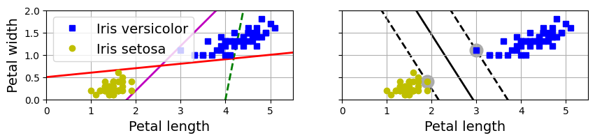

(붓꽃 데이터의 꽃잎 길이·너비. 왼쪽 = 아무 선형 분류기나 그은 경계 세 개(점선은 아예 틀림), 오른쪽 = SVM의 경계(실선)와 마진(점선). 회색 원 = 서포트 벡터.)

- 왼쪽의 두 실선도 훈련 세트는 완벽히 가르지만 샘플에 **바짝 붙어 있어** 새 샘플이 조금만 달라도 틀릴 수 있다
- SVM은 두 클래스 사이에 **가장 넓은 도로(street)** 를 낸다. 도로 한가운데 선이 결정 경계, 도로 폭의 절반이 **마진** → **라지 마진 분류**(large margin classification)
- 도로 가장자리에 걸친 샘플만 경계를 결정한다 = **서포트 벡터**(support vector). 도로 밖 샘플은 지우거나 더 넣어도 경계가 바뀌지 않는다

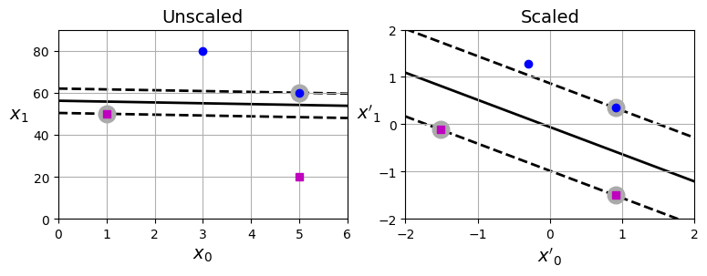

(왼쪽 = 세로축 값이 가로축보다 훨씬 큰 데이터, 오른쪽 = 표준화 후.)

> ⚠️ SVM은 거리로 도로 폭을 재므로 **특성 스케일에 민감**하다. 왼쪽처럼 한 축이 크면 도로가 그 축 방향으로 눕는다. **항상 `StandardScaler`를 앞에 붙인다.**

---

## 2. 소프트 마진 분류

> 🎯 **목적** — 이상치가 있거나 클래스가 겹칠 때, 도로 폭과 오류 사이의 균형을 `C`로 조절한다.

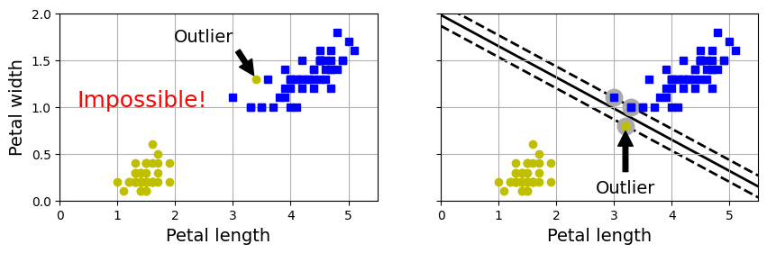

- **하드 마진**: 모든 샘플이 도로 밖, 올바른 쪽에 있어야 한다. 왼쪽처럼 이상치 하나가 있으면 불가능하고, 오른쪽처럼 가능하더라도 이상치 하나 때문에 도로가 아주 좁아진다
- **소프트 마진**: 도로를 넓게 유지하되 **마진 오류**(도로 위에 있거나 반대쪽에 있는 샘플)를 어느 정도 허용한다

```python
from sklearn.datasets import load_iris
from sklearn.pipeline import make_pipeline
from sklearn.preprocessing import StandardScaler
from sklearn.svm import LinearSVC

iris = load_iris(as_frame=True)
X = iris.data[["petal length (cm)", "petal width (cm)"]].values
y = (iris.target == 2)                      # Iris virginica인가?

svm_clf = make_pipeline(StandardScaler(),
                        LinearSVC(C=1, random_state=42))
svm_clf.fit(X, y)

X_new = [[5.5, 1.7], [5.0, 1.5]]
svm_clf.predict(X_new)                      # array([ True, False])
svm_clf.decision_function(X_new)            # array([ 0.66163816, -0.22035761])
```

| 코드 | 의미 |
|---|---|
| `LinearSVC(C=1)` | 선형 SVM 분류기. `C`가 클수록 마진 오류를 강하게 벌한다 |
| `decision_function` | 부호 있는 점수 $\mathbf{w}^\top\mathbf{x} + b$. 양수면 양성. 경계에서 멀수록 절댓값이 크다 |
| `predict_proba` 없음 | SVM 점수는 확률이 아니다. `SVC(probability=True)`면 교차 검증 + 로지스틱 회귀로 점수를 확률로 보정한다(훈련이 느려짐, [6장 1-2](06_ensemble_learning_and_random_forests.md#1-2-간접-투표-soft-voting)) |

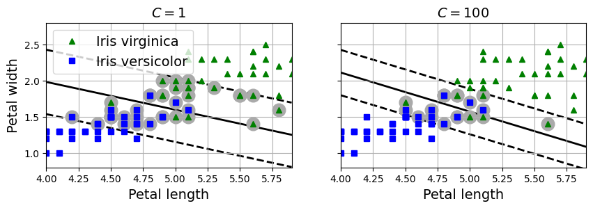

(왼쪽 `C=1`, 오른쪽 `C=100`. 회색 원 = 서포트 벡터.)

- `C`가 작으면(왼쪽) 도로가 넓고 마진 오류가 많다 → 규제가 강한 쪽, 일반화가 더 나을 때가 많다
- `C`가 크면(오른쪽) 도로가 좁고 마진 오류가 적다 → 훈련 세트에 더 맞춘다
- **과대적합이면 `C`를 줄인다.** 4장의 `LogisticRegression(C=...)`와 같은 방향(C = 1/α)

---

## 3. 비선형 SVM 분류

> 🎯 **목적** — 직선으로 나뉘지 않는 데이터를, 특성을 늘리거나 커널 트릭으로 직선 문제로 바꿔 푼다.

### 3-1. 특성을 추가하면 선형으로 나뉜다

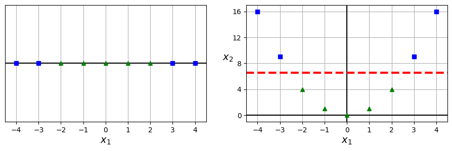

- 왼쪽: $x_1$ 하나로는 파랑(양 끝)과 초록(가운데)을 직선(점) 하나로 가를 수 없다
- 오른쪽: $x_2 = x_1^2$를 추가하면 빨간 수평선 하나로 완벽히 나뉜다 → 4장 다항 회귀와 같은 아이디어

```python
from sklearn.datasets import make_moons
from sklearn.preprocessing import PolynomialFeatures

X, y = make_moons(n_samples=100, noise=0.15, random_state=42)
polynomial_svm_clf = make_pipeline(
    PolynomialFeatures(degree=3), StandardScaler(),
    LinearSVC(C=10, max_iter=10_000, random_state=42))
polynomial_svm_clf.fit(X, y)
```

한계: 차수가 높으면 특성 수가 폭발한다(4장 3-1의 $(n+d)!/(d!\,n!)$).

### 3-2. 커널 트릭

**커널** $K(\mathbf{a}, \mathbf{b})$ = 두 샘플을 고차원으로 변환한 뒤의 내적 $\phi(\mathbf{a})^\top\phi(\mathbf{b})$를, **실제로 변환하지 않고** 원래 공간에서 바로 계산하는 함수.

SVM의 훈련과 예측은 샘플끼리의 **내적만** 쓰도록 바꿔 쓸 수 있다(5절의 쌍대 문제). 그래서 내적을 커널로 바꾸면 고차원 특성을 만든 것과 **같은 결과**를 특성 폭발 없이 얻는다.

| 커널 | $K(\mathbf{a}, \mathbf{b})$ | 하이퍼파라미터 |
|---|---|---|
| 선형 | $\mathbf{a}^\top\mathbf{b}$ | — |
| 다항 | $(\gamma\,\mathbf{a}^\top\mathbf{b} + r)^d$ | `degree`=$d$, `coef0`=$r$, `gamma` |
| 가우스 RBF | $\exp(-\gamma \lVert \mathbf{a} - \mathbf{b} \rVert^2)$ | `gamma` |

예: 2차원 $\mathbf{a} = (a_1, a_2)$에서 $\phi(\mathbf{a}) = (a_1^2, \sqrt{2}\,a_1 a_2, a_2^2)$로 바꾸면 $\phi(\mathbf{a})^\top\phi(\mathbf{b}) = (\mathbf{a}^\top\mathbf{b})^2$. 3차원 변환을 하지 않고 2차원 내적의 제곱만 계산하면 된다.

```python
from sklearn.svm import SVC

poly_kernel_svm_clf = make_pipeline(StandardScaler(),
                                    SVC(kernel="poly", degree=3, coef0=1, C=5))
poly_kernel_svm_clf.fit(X, y)
```

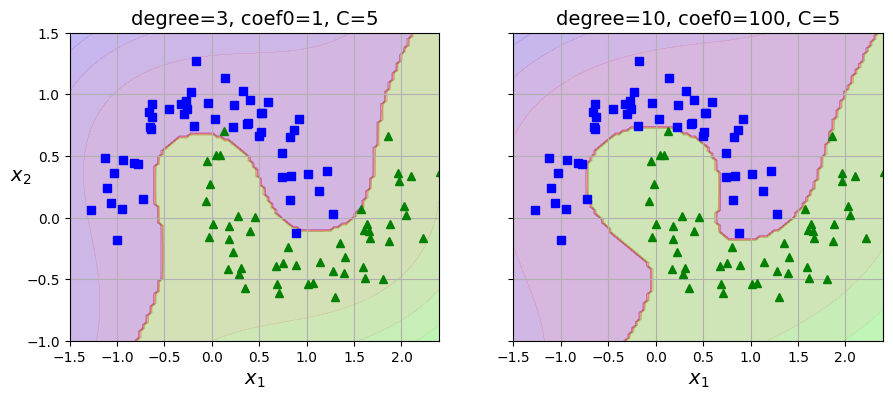

(왼쪽 3차 다항 커널, 오른쪽 10차. `coef0`는 고차항과 저차항 중 어느 쪽에 더 영향을 줄지 정한다.)

### 3-3. 유사도 특성과 RBF 커널

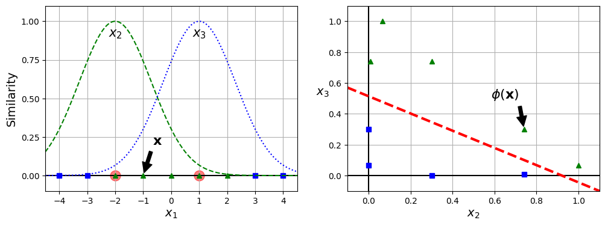

(왼쪽: 랜드마크 $x_1 = -2$, $x_1 = 1$ 두 곳에서의 RBF 유사도 곡선. 오른쪽: 각 샘플을 (랜드마크1 유사도, 랜드마크2 유사도)라는 새 특성 두 개로 바꾸면 직선으로 나뉜다.)

- 2장 [`ClusterSimilarity`](02_end_to_end_machine_learning_project.md#4-7-사용자-정의-변환기)와 같은 RBF 유사도다
- 모든 훈련 샘플을 랜드마크로 쓰면 특성이 $m$개가 되는데, **RBF 커널**은 이 변환을 실제로 하지 않고 같은 결과를 낸다

```python
rbf_kernel_svm_clf = make_pipeline(StandardScaler(),
                                   SVC(kernel="rbf", gamma=5, C=0.001))
rbf_kernel_svm_clf.fit(X, y)
```

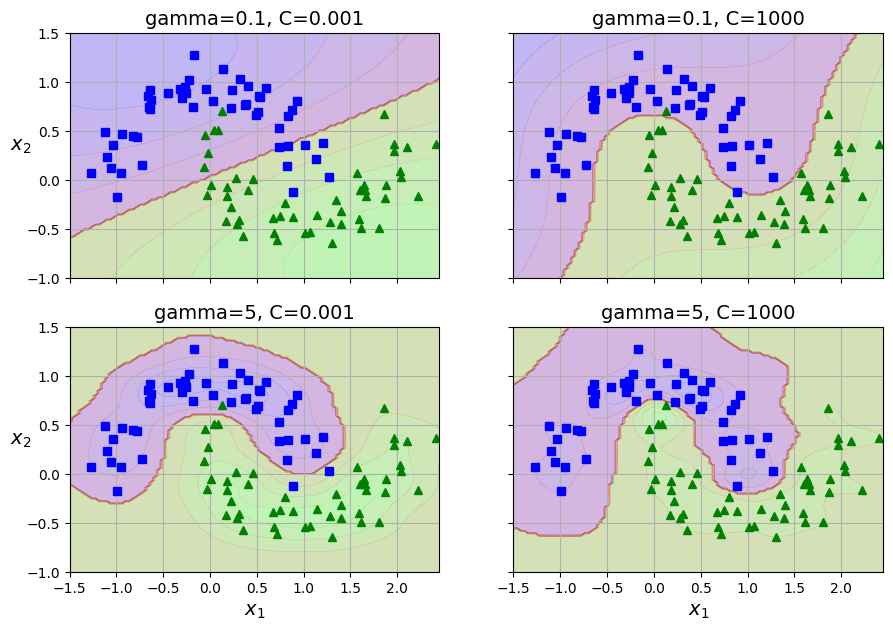

| 하이퍼파라미터 | 작으면 | 크면 |
|---|---|---|
| `gamma` (종 모양의 폭의 역수) | 종이 넓다 → 각 샘플의 영향 범위가 넓다 → 경계가 **매끄럽다** (위 두 그림) | 종이 좁다 → 경계가 샘플 하나하나를 따라 **구불구불** (아래 두 그림) |
| `C` | 마진 오류 허용 → 규제 강함 | 마진 오류 엄격 → 규제 약함 |

- **과대적합이면 `gamma`와 `C`를 줄이고, 과소적합이면 키운다.** 둘 다 규제 하이퍼파라미터처럼 움직인다
- 2장 연습문제에서 `C`를 `loguniform`으로, `gamma`를 `expon`으로 탐색한 이유: `C`는 적절한 스케일을 모르고, `gamma`는 대략 1 근처로 예상되기 때문

---

## 4. SVM 회귀

> 🎯 **목적** — 분류의 "도로 밖으로 밀어내기"를 뒤집어, "도로 안에 최대한 담기"로 회귀를 한다.

- 분류: 도로를 **넓게** 하면서 샘플을 도로 **밖**에 두려 한다
- 회귀: 폭이 $2\varepsilon$인 도로 **안**에 가능한 많은 샘플을 담으려 한다. 도로 안 샘플은 손실이 0 → **ε에 둔감**(ε-insensitive)

```python
from sklearn.svm import LinearSVR, SVR

svm_reg = make_pipeline(StandardScaler(),
                        LinearSVR(epsilon=0.5, random_state=42))
svm_poly_reg = make_pipeline(StandardScaler(),
                             SVR(kernel="poly", degree=2, C=0.01, epsilon=0.1))
```

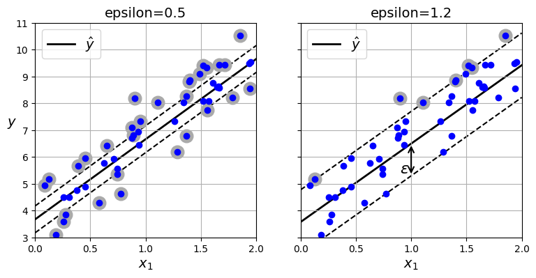

(실선 = 예측, 점선 = 도로 경계, 회색 원 = 서포트 벡터(도로 밖이나 경계의 샘플).)

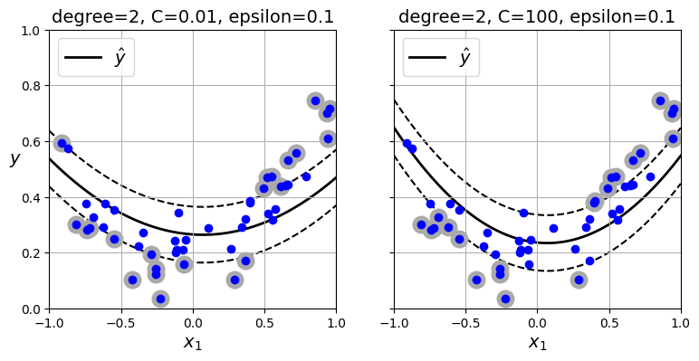

(왼쪽 `C=0.01`: 규제가 강해 완만한 곡선. 오른쪽 `C=100`: 규제가 약해 데이터에 더 붙는다.)

- 2장 연습문제의 `SVR`이 바로 이 모델이다. 캘리포니아 주택 문제에서 랜덤 포레스트(교차 검증 RMSE 약 42,000)보다 나빴던(약 56,000) 이유는, 대용량·복잡한 표 데이터에서 커널 SVM은 비싸고 하이퍼파라미터에 민감하기 때문

---

## 5. SVM의 내부 동작

> 🎯 **목적** — 마진, 소프트 마진, 힌지 손실을 하나의 최적화 문제로 묶어 이해한다.

**결정 함수**: $s = \mathbf{w}^\top\mathbf{x} + b$. $s \ge 0$이면 양성. 레이블을 $t \in \{-1, +1\}$로 쓴다.

**마진 폭과 가중치 크기**

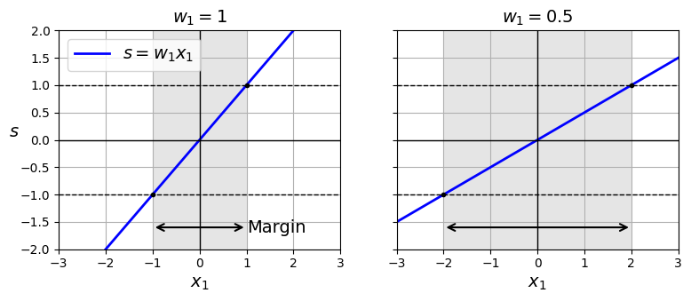

(1차원 예. 왼쪽 $w_1 = 1$, 오른쪽 $w_1 = 0.5$. 회색 띠 = $-1 \le s \le 1$인 구간 = 도로.)

- 도로 경계를 $s = \pm 1$로 정하면, 도로 폭은 $2 / \lVert \mathbf{w} \rVert$ 다. 가중치를 반으로 줄이면 도로 폭이 두 배
- 그래서 "도로를 넓게" = "$\lVert \mathbf{w} \rVert$를 작게" = **ℓ2 규제와 같은 방향** (4장 릿지)

**하드 마진 목적 함수** — 모든 샘플이 도로 밖, 올바른 쪽에 있다는 조건 아래 $\lVert \mathbf{w} \rVert$ 최소화

```math
\min_{\mathbf{w}, b}\ \frac{1}{2}\mathbf{w}^\top\mathbf{w}
\quad \text{조건: } t^{(i)}\left(\mathbf{w}^\top\mathbf{x}^{(i)} + b\right) \ge 1 \quad (i = 1, \dots, m)
```

**소프트 마진 목적 함수** — 샘플마다 조건을 얼마나 어겼는지(슬랙 변수 $\zeta^{(i)} \ge 0$)를 허용하고, 그 합에 `C`를 곱해 벌한다

```math
\min_{\mathbf{w}, b, \boldsymbol{\zeta}}\ \frac{1}{2}\mathbf{w}^\top\mathbf{w} + C\sum_{i=1}^{m}\zeta^{(i)}
\quad \text{조건: } t^{(i)}\left(\mathbf{w}^\top\mathbf{x}^{(i)} + b\right) \ge 1 - \zeta^{(i)},\ \ \zeta^{(i)} \ge 0
```

조건을 만족하는 가장 작은 슬랙은 $\zeta^{(i)} = \max\left(0,\ 1 - t^{(i)} s^{(i)}\right)$ 이므로, 제약 없는 형태로 다시 쓰면

```math
J(\mathbf{w}, b) = \frac{1}{2}\mathbf{w}^\top\mathbf{w} + C\sum_{i=1}^{m}\max\left(0,\ 1 - t^{(i)}\left(\mathbf{w}^\top\mathbf{x}^{(i)} + b\right)\right)
```

= **ℓ2 규제 + 힌지 손실**. 4장의 "MSE + 규제"와 같은 구조이고, 경사 하강법으로도 풀 수 있다(3장의 `SGDClassifier(loss="hinge")`가 바로 이것).

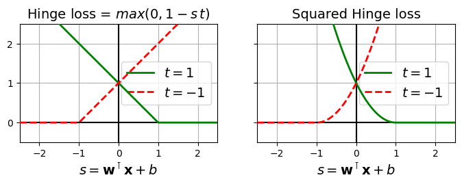

(가로 = 점수 $s$, 초록 = 양성($t=1$)의 손실, 빨강 = 음성($t=-1$)의 손실. 왼쪽 힌지, 오른쪽 제곱 힌지.)

- 양성 샘플은 $s \ge 1$(도로 밖, 올바른 쪽)이면 손실 0. 도로 안으로 들어오거나 반대쪽이면 직선으로 커진다
- 로지스틱 회귀의 로그 손실과 달리 **어느 지점부터 정확히 0** → 그 샘플들은 경계에 아무 영향도 없다 = 서포트 벡터만 경계를 결정하는 이유

**쌍대 문제와 커널** — 위 문제는 라그랑주 승수 $\alpha^{(i)}$에 대한 **쌍대 문제**로 바꿔 풀 수 있다. 쌍대 문제와 예측식에는 샘플이 $\mathbf{x}^{(i)\top}\mathbf{x}^{(j)}$ 형태(내적)로만 나타난다.

```math
\hat{y}(\mathbf{x}) = \text{sign}\left(\sum_{i \in \text{SV}} \alpha^{(i)} t^{(i)} K\!\left(\mathbf{x}^{(i)}, \mathbf{x}\right) + b\right)
```

- 내적을 커널 $K$로 바꾼 것이 커널 트릭이다
- 합은 $\alpha^{(i)} > 0$인 샘플, 즉 **서포트 벡터에 대해서만** 계산한다 → 예측 비용이 서포트 벡터 수에 비례

---

## 6. 어떤 SVM 클래스를 쓰나

| 클래스 | 시간 복잡도 | 대용량 샘플 | 외부 메모리 학습 | 스케일 조정 | 커널 |
|---|---|---|---|---|---|
| `LinearSVC` | $O(m \times n)$ | 빠름 | X | 필요 | X |
| `SVC` | $O(m^2 \times n)$ ~ $O(m^3 \times n)$ | **느림** | X | 필요 | O |
| `SGDClassifier(loss="hinge")` | $O(m \times n)$ | 빠름 | O | 필요 | X |

- 먼저 **선형 커널**(`LinearSVC`)을 시도하고, 데이터가 크지 않으면 **RBF 커널**(`SVC`)을 시도한다
- 샘플 수가 수만 개를 넘으면 `SVC`는 매우 느리다 → 2장 연습문제가 5,000개만 쓴 이유
- 회귀는 각각 `LinearSVR`, `SVR`, `SGDRegressor(loss="epsilon_insensitive")`

---

## 7. 연습문제 (개념 1~8번)

| 번호 | 질문 | 답 요약 | 관련 절 |
|---|---|---|---|
| 1 | SVM의 기본 아이디어 | 클래스 사이에 **가장 넓은 도로**를 낸다. 소프트 마진은 완벽한 분리와 넓은 도로 사이의 절충. 비선형 데이터에는 **커널** | 1, 2, 3 |
| 2 | 서포트 벡터란 | 도로 위(경계 포함)에 있는 샘플. 결정 경계는 이 샘플들만으로 정해진다. 커널 SVM의 예측도 서포트 벡터만 쓴다 | 1, 5 |
| 3 | SVM에서 입력 스케일이 중요한 이유 | 거리로 도로 폭을 재므로, 스케일이 작은 특성을 무시하게 된다 | 1 |
| 4 | SVM이 신뢰도 점수·확률을 낼 수 있나 | `decision_function()`은 경계까지의 거리에 해당하는 점수. 확률은 아니다. `SVC(probability=True)`면 교차 검증 점수에 로지스틱 회귀를 맞춰 `predict_proba()`를 제공 | 2 |
| 5 | `LinearSVC`, `SVC`, `SGDClassifier` 중 무엇을 쓰나 | 셋 다 선형 라지 마진 분류 가능. `SVC`만 커널 트릭 지원(대신 샘플이 많으면 느림, 특성 수에는 강함). `LinearSVC`는 선형 전용 최적화, `SGDClassifier`는 유연하고 점진적 학습 가능 | 6 |
| 6 | RBF 커널 SVM이 과소적합하면 | 규제가 너무 강할 수 있다 → **`gamma`나 `C`(또는 둘 다)를 키운다** | 3-3 |
| 7 | ε에 둔감하다는 말의 뜻 | SVM 회귀는 예측 주변 폭 $2\varepsilon$ 안에 샘플을 담으려 한다. 그 안에 샘플을 추가해도 모델이 전혀 바뀌지 않는다 | 4 |
| 8 | 커널 트릭이란 | 입력을 고차원으로 비선형 변환한 뒤 선형 SVM을 훈련한 것과 같은 결과를, **실제 변환 없이** 얻는 수학적 기법 | 3-2, 5 |

---

## 8. 정리

| 개념 | 한 줄 요약 | 코드 |
|---|---|---|
| 라지 마진 | 클래스 사이 가장 넓은 도로. 서포트 벡터만 경계를 정한다 | `LinearSVC` |
| 스케일 | 거리 기반이라 표준화 필수 | `make_pipeline(StandardScaler(), ...)` |
| 소프트 마진 | `C`↓ = 넓은 도로·마진 오류 많음·규제 강함 | `C=` |
| 힌지 손실 | ℓ2 규제 + $\max(0, 1 - ts)$. 도로 밖 샘플은 손실 0 | `SGDClassifier(loss="hinge")` |
| 커널 트릭 | 고차원 변환 없이 고차원 내적 계산 | `SVC(kernel="poly"/"rbf")` |
| `gamma` | RBF 종 모양의 좁기. ↑면 구불구불(과대적합 쪽) | `gamma=` |
| SVM 회귀 | 폭 2ε 도로 안에 샘플을 담는다 | `LinearSVR`, `SVR(epsilon=)` |
| 확장성 | 커널 SVM은 샘플 수에 대해 $O(m^2)$~$O(m^3)$ | 큰 데이터면 `LinearSVC`·`SGD` |

---

[📚 전체 목차](../README.md) · [📖 용어집](glossary.md)
